# Manual para Administrador

Este manual está dirigido al personal de la **Coordinación de Voluntariado de ABAQ Querétaro** que opera la plataforma con perfil administrativo. Describe, pantalla por pantalla y con capturas de referencia, los procedimientos para gestionar voluntarios, convocatorias, asistencias, pláticas, campañas, adopciones, placas de identificación, respaldos y notificaciones.

El perfil administrativo concentra la operación institucional: valida expedientes, acredita horas, emite constancias, publica actividades y resguarda la información del sistema. Por ello, las acciones descritas deben realizarse con criterios documentados y con estricto apego a la protección de datos personales.

!!! note "Convenciones utilizadas en este manual"

    - Los nombres de botones, pestañas, campos y etiquetas aparecen entre comillas exactamente como se muestran en la interfaz.
    - Las cifras, folios, nombres y fechas de las capturas corresponden a un entorno de demostración con datos simulados; en su operación verá los registros reales de ABAQ.
    - El **folio institucional** identifica de forma única a cada voluntario y participante. Los folios de Servicio Social siguen el formato `SS-XXXXXXXX-XX`; los de Voluntariado General, `VG-XXXXXXXX-XX`. Los folios de participación siguen el formato `OP-CAT-YYMMDD-XXXX`. La sección 1.3 explica ambos tipos y su uso.
    - Las acciones marcadas como **irreversibles** requieren confirmación expresa y, cuando aplica, quedan registradas en la bitácora institucional.

## Índice de capturas de pantalla

Este manual incluye las siguientes capturas de pantalla, en el orden en que aparecen:

| N.º | Archivo | Pantalla | Sección |
|-----|---------|----------|---------|
| 1 | `adm-00-login.png` | Inicio de sesión administrativo | [2.1 Iniciar sesión](#21-iniciar-sesion) |
| 2 | `adm-01-panel-resumen.png` | Panel de inicio: resumen general | [3.1 Resumen general](#31-resumen-general) |
| 3 | `adm-02-panel-seguimiento.png` | Panel de inicio: agenda y seguimiento | [3.2 Seguimiento y agenda](#32-seguimiento-y-agenda) |
| 4 | `adm-03-panel-actividades.png` | Panel de inicio: resumen de actividades | [3.3 Resumen de actividades](#33-resumen-de-actividades) |
| 5 | `adm-04-voluntarios-padron.png` | Voluntarios: padrón general | [4.1 Padrón general](#41-padron-general) |
| 6 | `adm-05-voluntarios-por-aprobar.png` | Voluntarios: solicitudes de ingreso | [4.2 Solicitudes de ingreso](#42-solicitudes-de-ingreso) |
| 7 | `adm-06-historial-voluntarios.png` | Voluntarios: historial y bitácora | [4.3 Historial y bitácora](#43-historial-y-bitacora) |
| 8 | `adm-07-detalle-voluntario.png` | Expediente de Servicio Social: encabezado | [4.4 Expediente de Servicio Social](#44-expediente-de-servicio-social) |
| 9 | `adm-08-detalle-horas.png` | Expediente de Servicio Social: control de horas | [4.4 Expediente de Servicio Social](#44-expediente-de-servicio-social) |
| 10 | `adm-09-detalle-expediente.png` | Expediente de Servicio Social: documentos | [4.4 Expediente de Servicio Social](#44-expediente-de-servicio-social) |
| 11 | `adm-10-detalle-participaciones.png` | Expediente de Servicio Social: participaciones | [4.4 Expediente de Servicio Social](#44-expediente-de-servicio-social) |
| 12 | `adm-39-detalle-voluntario-general.png` | Expediente de Voluntario General: encabezado | [4.5 Expediente de Voluntario General](#45-expediente-de-voluntario-general) |
| 13 | `adm-40-detalle-voluntario-general-expediente.png` | Expediente de Voluntario General: documentos y consentimientos | [4.5 Expediente de Voluntario General](#45-expediente-de-voluntario-general) |
| 14 | `adm-41-detalle-voluntario-general-participaciones.png` | Expediente de Voluntario General: participaciones | [4.5 Expediente de Voluntario General](#45-expediente-de-voluntario-general) |
| 15 | `adm-42-aceptar-voluntario.png` | Modal de aceptación de voluntario | [4.6 Aceptar una solicitud](#46-aceptar-una-solicitud) |
| 16 | `adm-37-rechazar-solicitud.png` | Modal de rechazo de solicitud | [4.7 Rechazar una solicitud](#47-rechazar-una-solicitud) |
| 17 | `adm-38-inactivar-cuenta.png` | Modal de inactivación de cuenta | [4.8 Inactivar una cuenta](#48-inactivar-una-cuenta) |
| 18 | `adm-35-enlaces-invitacion.png` | Menú de enlaces de invitación | [4.9 Enlaces de invitación](#49-enlaces-de-invitacion) |
| 19 | `adm-11-participaciones.png` | Participaciones: bandeja de revisión | [5.1 Bandeja de participaciones](#51-bandeja-de-participaciones) |
| 20 | `adm-11b-participaciones-historial.png` | Participaciones: historial | [5.2 Historial de participación](#52-historial-de-participacion) |
| 21 | `adm-12-detalle-convocatoria.png` | Detalle de una convocatoria | [5.3 Detalle de una convocatoria](#53-detalle-de-una-convocatoria) |
| 22 | `adm-13-pasar-lista.png` | Pase de lista: participantes de Servicio Social | [5.4 Pasar lista de asistencia](#54-pasar-lista-de-asistencia) |
| 23 | `adm-14-validacion-participantes.png` | Validación de participantes y voluntarios generales | [5.5 Validación de participantes](#55-validacion-de-participantes) |
| 24 | `adm-15-crear-convocatoria.png` | Formulario de nueva convocatoria: información principal | [5.6 Nueva convocatoria](#56-nueva-convocatoria) |
| 25 | `adm-16-crear-convocatoria-fechas.png` | Formulario de nueva convocatoria: fechas, horas y cupo | [5.6 Nueva convocatoria](#56-nueva-convocatoria) |
| 26 | `adm-36-registrar-participacion.png` | Registro manual de una participación individual | [5.7 Registro manual de una participación](#57-registro-manual-de-una-participacion) |
| 27 | `adm-17-plantillas-actividades.png` | Plantillas de actividades | [6.1 Lista de plantillas](#61-lista-de-plantillas) |
| 28 | `adm-18-publicar-plantilla.png` | Publicación de una plantilla | [6.2 Publicar una plantilla](#62-publicar-una-plantilla) |
| 29 | `adm-19-platicas.png` | Pláticas: listado general | [7.1 Listado de pláticas](#71-listado-de-platicas) |
| 30 | `adm-20-nueva-platica.png` | Pláticas: registro de una nueva plática | [7.2 Registro de una nueva plática](#72-registro-de-una-nueva-platica) |
| 31 | `adm-21-detalle-platica.png` | Pláticas: detalle e impacto social | [7.3 Detalle de la plática](#73-detalle-de-la-platica) |
| 32 | `adm-22-padron-platica.png` | Pláticas: padrón de asistentes y constancias | [7.4 Padrón de asistentes y constancias](#74-padron-de-asistentes-y-constancias) |
| 33 | `adm-23-campanas.png` | Campañas EST: listado general | [8.1 Listado de campañas](#81-listado-de-campanas) |
| 34 | `adm-24-nueva-campana.png` | Campañas EST: registro de una nueva campaña | [8.2 Registro de una nueva campaña](#82-registro-de-una-nueva-campana) |
| 35 | `adm-25-detalle-campana.png` | Campañas EST: detalle de la campaña | [8.3 Detalle de la campaña](#83-detalle-de-la-campana) |
| 36 | `adm-26-adopciones.png` | Adopciones: listado general | [9.1 Listado de adopciones](#91-listado-de-adopciones) |
| 37 | `adm-27-detalle-adopcion.png` | Adopciones: detalle del expediente | [9.2 Detalle y cierre de una adopción](#92-detalle-y-cierre-de-una-adopcion) |
| 38 | `adm-43-proceso-adopcion.png` | Adopciones: proceso y cierre definitivo | [9.2 Detalle y cierre de una adopción](#92-detalle-y-cierre-de-una-adopcion) |
| 39 | `adm-28-placas.png` | Placas de identificación: listado general | [10.1 Listado de placas](#101-listado-de-placas) |
| 40 | `adm-29-nueva-placa.png` | Placas de identificación: registro de una nueva placa | [10.2 Registro de una nueva placa](#102-registro-de-una-nueva-placa) |
| 41 | `adm-30-detalle-placa.png` | Placas de identificación: detalle | [10.3 Detalle de la placa](#103-detalle-de-la-placa) |
| 42 | `adm-31-respaldos.png` | Respaldos: estado del sistema y del almacenamiento | [11.1 Estado del sistema y del almacenamiento](#111-estado-del-sistema-y-del-almacenamiento) |
| 43 | `adm-32-respaldos-descargas.png` | Respaldos: descargas de información | [11.2 Descargas de información](#112-descargas-de-informacion) |
| 44 | `adm-32b-respaldos-corte.png` | Respaldos: corte y archivo de información | [11.3 Corte y archivo de información](#113-corte-y-archivo-de-informacion) |
| 45 | `adm-33-respaldos-restauracion.png` | Respaldos: restauración de un archivo | [11.4 Restauración de un respaldo](#114-restauracion-de-un-respaldo) |
| 46 | `adm-34-notificaciones.png` | Centro de notificaciones | [12. Centro de notificaciones](#12-centro-de-notificaciones) |

## 1. Acerca del panel administrativo

### 1.1 Perfil y alcance

El perfil administrativo es la cuenta institucional de la Coordinación de Voluntariado. A diferencia de las cuentas de Servicio Social y Voluntariado General, **no se crea desde el formulario público de registro**: la Coordinación provisiona el acceso y lo asigna al personal responsable.

Desde este perfil es posible:

- Consultar el estado general de la plataforma y dar seguimiento a la operación diaria.
- Revisar, aceptar, rechazar o inactivar expedientes de voluntarios.
- Publicar convocatorias, plantillas de actividades y eventos institucionales.
- Pasar lista, validar asistencias, acreditar horas y emitir constancias.
- Registrar y consultar pláticas, campañas, adopciones y placas de identificación.
- Descargar respaldos, generar cortes de información y restaurar archivos.
- Atender las notificaciones operativas del sistema.

!!! warning "Responsabilidad institucional"

    Las acciones del perfil administrativo impactan directamente el expediente de los voluntarios, el conteo de horas y los documentos oficiales. Antes de aceptar, rechazar, inactivar, validar o borrar un registro, confirme que la decisión esté respaldada por la documentación y por el procedimiento interno de ABAQ.

### 1.2 Navegación principal

La barra superior concentra las secciones del panel:

| Elemento | Contenido |
|----------|-----------|
| **Inicio** | Panel administrativo con métricas, agenda, seguimiento y resumen de actividades. |
| **Voluntarios** | Padrón, solicitudes de ingreso, historial y expedientes individuales. |
| **Participaciones** | Convocatorias, vinculaciones, pase de lista, validación e historial. |
| **Base de datos** | Menú desplegable con **Pláticas**, **Campañas EST**, **Adopciones** y **Placas de identificación**. |
| **Respaldos** | Estado del sistema, descargas, cortes y restauración de información. |
| **Campana de notificaciones** | Centro de notificaciones con contador de no leídas. |
| **Cerrar sesión** | Cierre seguro de la sesión administrativa. |

### 1.3 Folios institucionales y de participación

La plataforma utiliza folios para identificar de forma única los expedientes y las participaciones. Son la referencia más segura en constancias, correos, notificaciones y búsquedas, y evitan confusiones entre personas con nombres similares.

| Tipo de folio | Formato | Qué identifica | Dónde se utiliza |
|---------------|---------|----------------|------------------|
| **Folio de expediente** | `SS-YYMMDD-XX` para Servicio Social; `VG-YYMMDD-XX` para Voluntariado General | A la persona y a su expediente institucional | Encabezado del expediente, constancias, correos, notificaciones y búsqueda del padrón |
| **Folio de participación** | `OP-CAT-YYMMDD-XXXX` | Cada vinculación individual o actividad grupal | Historial de participación, validaciones, notificaciones, comprobantes y búsqueda |

El **folio de expediente** se asigna al concluir el registro y se conserva sin cambios durante toda la vida del voluntario. Los folios operativos son `SS-YYMMDD-XX` y `VG-YYMMDD-XX`: el bloque `YYMMDD` registra la fecha de emisión y los dos caracteres finales distinguen el registro; por ejemplo, `SS-260818-01` corresponde a un expediente de Servicio Social emitido el 18 de agosto de 2026. Este folio aparece en las constancias y acreditaciones que emite la plataforma, así como en la correspondencia oficial.

El **folio de participación** se genera para cada registro. El segmento `CAT` indica la modalidad: `EVE` para convocatorias y eventos, `TLK` para pláticas, `MED` para difusión en medios, `SOC` para redes sociales, `ADO` para adopciones, `MOD` para módulos de adopción, `DON` para donativos, `STE` para esterilizaciones, `CAM` para campañas, `IND` para inducción, `IDE` para identificación y `ADM` para registros administrativos. En una convocatoria, el folio `OP-EVE-…` identifica la actividad y es el que se muestra a todos los inscritos; en una vinculación individual, el folio `OP-CAT-…` identifica el registro de esa persona.

!!! tip "Búsqueda y copia de folios"

    El buscador del padrón (sección 4.1) y el de participaciones (sección 5.1) aceptan el folio como criterio de búsqueda. Junto a cada folio, el botón de copia (⧉) lo lleva al portapapeles para pegarlo en correos, constancias o reportes sin errores de transcripción.

## 2. Acceso al panel

### 2.1 Iniciar sesión

El acceso se realiza desde la misma página de inicio de sesión de la plataforma, utilizando las credenciales institucionales asignadas por la Coordinación.

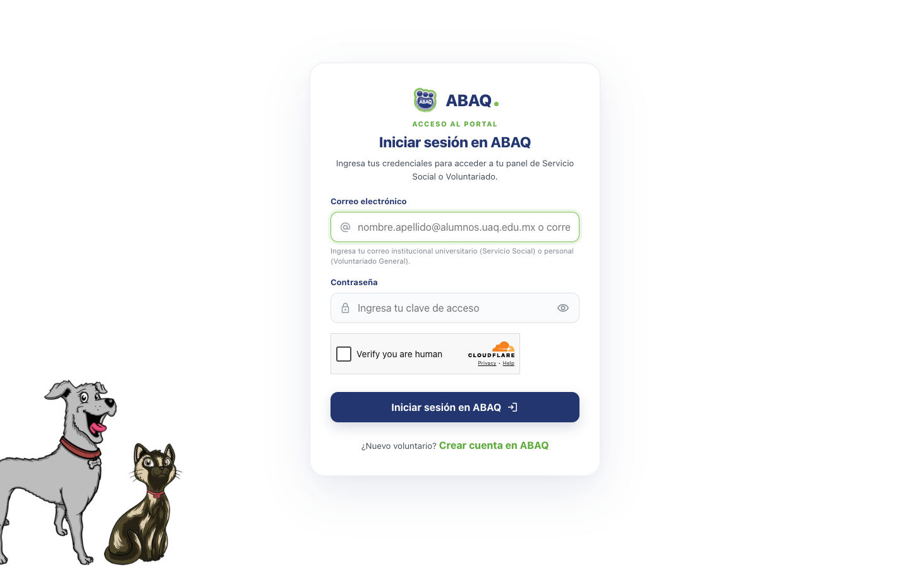

1. **Correo electrónico**: ingrese el correo institucional asociado a su cuenta administrativa.
2. **Contraseña**: escriba su clave de acceso. El ícono del ojo permite mostrar u ocultar el texto.
3. **Verificación de seguridad**: complete la casilla de Cloudflare Turnstile.
4. Pulse **Iniciar sesión en ABAQ**.

Al autenticarse, la plataforma lo dirige al panel administrativo y habilita las secciones **Inicio**, **Voluntarios**, **Participaciones**, **Base de datos** y **Respaldos**.

!!! tip "Sesiones compartidas"

    Si utiliza una computadora compartida, cierre sesión con el botón **Cerrar sesión** al terminar. No comparta su contraseña ni permita que otras personas operen con su cuenta: la bitácora institucional registra las acciones por usuario.

## 3. Panel de inicio

### 3.1 Resumen general

El panel de inicio presenta una vista ejecutiva de la operación. En el encabezado **Resumen de ABAQ** se muestran cuatro indicadores:

- **Estudiantes**: personas registradas en ABAQ.
- **Actividades**: actividades creadas.
- **Inscripciones**: participaciones registradas.
- **Por revisar**: asignaciones que aún no han sido validadas.

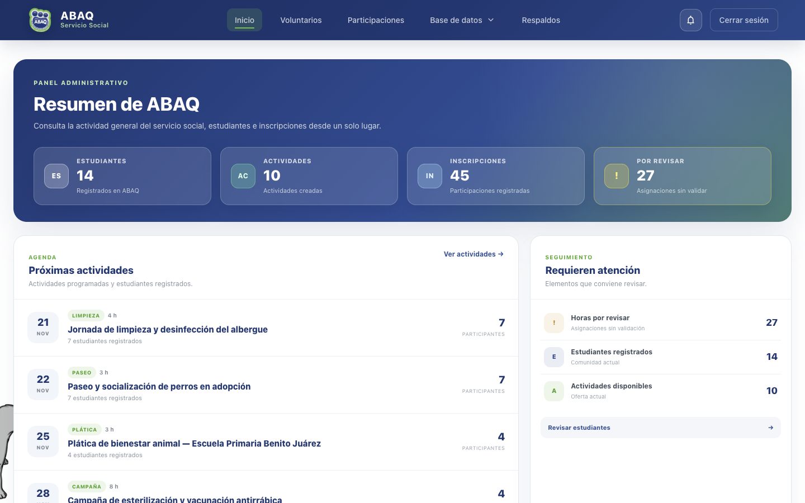

Debajo de las métricas se despliega la agenda **Próximas actividades**, con la fecha, el tipo, la duración y el número de estudiantes registrados en cada evento. El enlace **Ver actividades** abre la lista completa de participaciones.

A la derecha, el bloque **Seguimiento** concentra los elementos que conviene revisar:

- **Horas por revisar**: asignaciones sin validación.
- **Estudiantes registrados**: comunidad actual.
- **Actividades disponibles**: oferta vigente.

El botón **Revisar estudiantes** conduce directamente al padrón de voluntarios.

### 3.2 Seguimiento y agenda

Al desplazarse por el panel se confirma la agenda completa y el bloque de seguimiento. Esta vista es útil para la reunión operativa diaria: permite identificar campañas, pláticas, jornadas y módulos de adopción próximos, así como el número de personas ya inscritas.

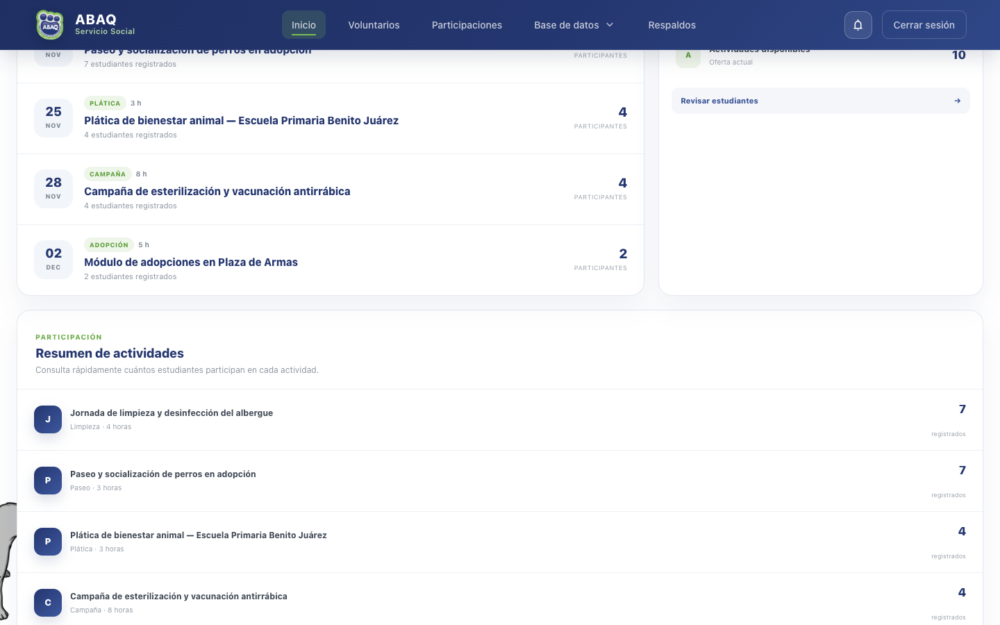

Cada tarjeta de la agenda muestra:

- El **día y mes** del evento.
- Una etiqueta con el **tipo de actividad** (por ejemplo, **Limpieza**, **Paseo**, **Plática**, **Campaña** o **Adopción**) y su duración.
- El **título** de la actividad.
- El número de **estudiantes registrados**, con el texto **participantes**.

### 3.3 Resumen de actividades

La sección **Resumen de actividades** presenta un concentrado de todas las actividades con el número de estudiantes inscritos en cada una. La lista se ordena de mayor a menor participación y funciona como termómetro de la oferta: permite detectar actividades con poca inscripción y reforzar su difusión.

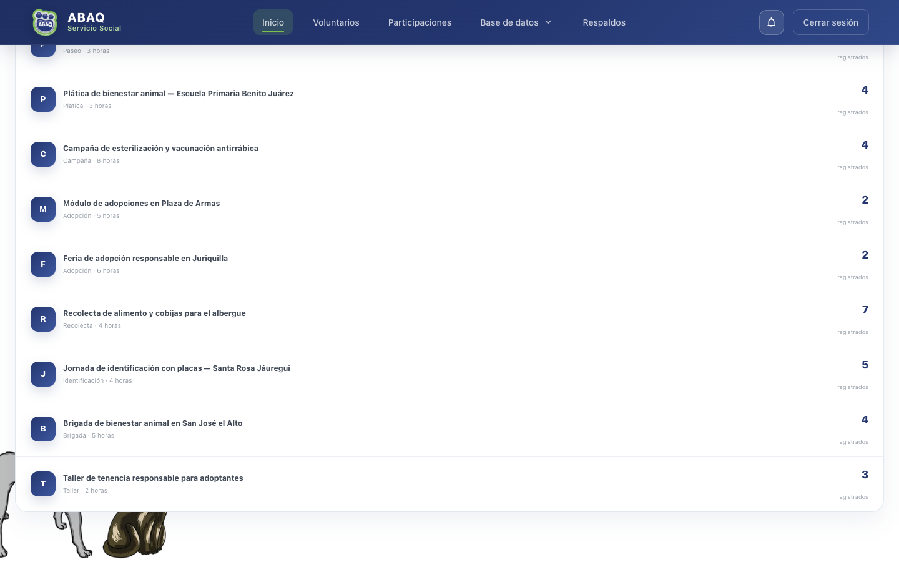

Cada fila incluye el nombre de la actividad, su categoría, la duración en horas y el total de **registrados**. Para revisar el detalle, utilice la sección **Participaciones** (capítulo 5).

## 4. Gestión de voluntarios

### 4.1 Padrón general

La sección **Voluntarios** concentra a todas las personas que colaboran con ABAQ. El encabezado muestra cinco contadores:

- **Voluntarios registrados**.
- **Activos**.
- **Por aprobar**.
- **Servicio Social**.
- **Voluntariado General**.

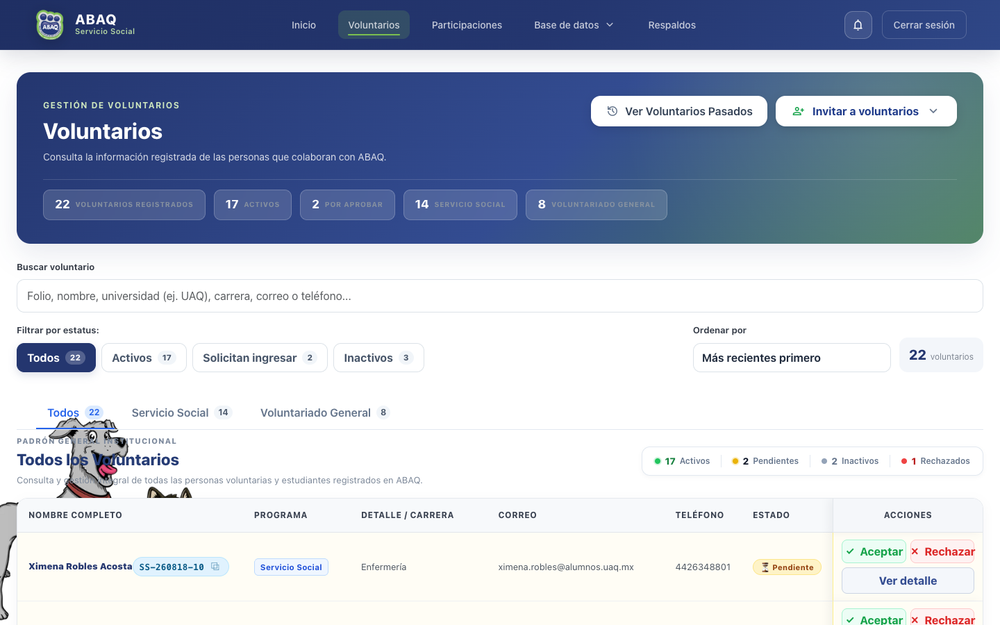

La pantalla ofrece las siguientes herramientas:

1. **Buscar voluntario**: acepta folio, nombre, universidad, carrera, correo o teléfono.
2. **Filtrar por estatus**: **Todos**, **Activos**, **Solicitan ingresar** e **Inactivos**.
3. **Ordenar por**: el selector ofrece cinco criterios. Salvo en **Por estatus**, los registros inactivos y rechazados se mantienen al final de la lista. En los criterios de fecha y horas, cuando dos registros coinciden, el desempate es por nombre de A a Z.
    - **Más recientes primero** (opción predeterminada): ordena de la fecha de inicio más reciente a la más antigua. Se toma la fecha de inicio del voluntariado y, si no está registrada, la de inicio del periodo.
    - **Más antiguos primero**: invierte el criterio anterior; primero aparecen los expedientes con la fecha de inicio más antigua.
    - **Nombre (A-Z)**: orden alfabético por nombre completo. Si el nombre no está disponible, se usa el correo o el folio.
    - **Por estatus (por aprobar primero)**: agrupa los registros en el orden **Pendiente**, **Activo**, **Inactivo** y **Rechazado**. Dentro de cada grupo, el más reciente aparece primero. En este criterio, los inactivos y rechazados conservan el lugar que les corresponde por estatus, sin enviarse al final.
    - **Más horas validadas**: ordena de mayor a menor por horas acreditadas. Si dos registros tienen las mismas horas, se ordenan por nombre de A a Z.
4. **Pestañas de programa**: **Todos**, **Servicio Social** y **Voluntariado General**.
5. **Contador de resultados**: muestra cuántos voluntarios cumplen los filtros.

La tabla presenta las columnas **Nombre completo**, **Programa**, **Detalle / carrera**, **Correo**, **Teléfono**, **Estado** y **Acciones**. Según el estado del registro, las acciones son:

- **Aceptar** y **Rechazar**, para solicitudes pendientes.
- **Ver detalle**, para abrir el expediente completo.
- **Inactivar**, para cuentas activas.

Los botones superiores **Ver Voluntarios Pasados** e **Invitar a voluntarios** abren, respectivamente, el historial de cuentas cerradas y el menú de enlaces de registro.

### 4.2 Solicitudes de ingreso

Para atender las solicitudes, seleccione el filtro **Solicitan ingresar**. La plataforma muestra únicamente los expedientes pendientes de validación.

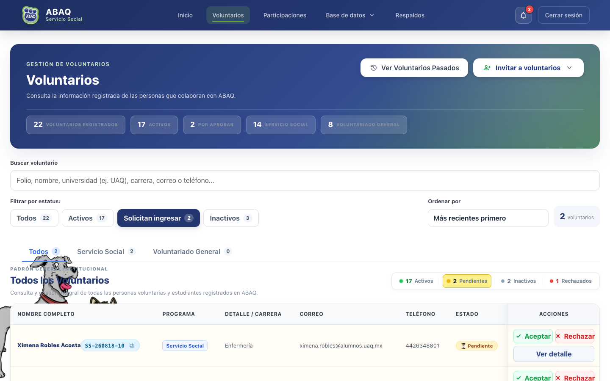

Cada registro pendiente presenta el folio, el programa, la carrera o adscripción, el correo, el teléfono y el estado **Pendiente**. Antes de decidir, abra **Ver detalle** y recorra el expediente completo. Los criterios de evaluación se agrupan en las mismas categorías que muestra el expediente; el detalle de cada categoría se describe en la sección 4.4 para Servicio Social y en la sección 4.5 para Voluntariado General.

**Categorías del expediente de Servicio Social**

1. **Datos generales**: folio de expediente, fecha de emisión, fecha de aceptación, nombre completo, matrícula, correos, teléfono, CURP, escuela, carrera, periodo o avance académico y cómo se enteró de ABAQ. Confirme que los datos coincidan con la identificación oficial y, en su caso, con la constancia de estudios.
2. **Expediente digital**: identificación oficial (INE o escolar), currículum vitae o semblanza y los documentos que el aspirante haya cargado. Las constancias de inicio, el reporte de actividades y la constancia de término se generan o habilitan conforme avanza el expediente. Verifique que los archivos estén completos, legibles y correspondan a la persona.
3. **Sobre mí**: semblanza, intereses, talentos, habilidades, aportes esperados a ABAQ, experiencia con animales de compañía y motivación institucional. Valore la coherencia del perfil y su afinidad con la misión de ABAQ.
4. **Inducción**: respuestas a los seis módulos formativos sobre rescate, valores y misión de ABAQ. Confirme que las reflexiones estén completas.
5. **Reglamento y normativa**: reglamento firmado a mano en PDF, aviso de privacidad y términos y condiciones aceptados. Verifique que las aceptaciones estén registradas y que el reglamento corresponda a la persona.

**Categorías del expediente de Voluntariado General**

1. **Datos generales**: folio de expediente, nombre completo, correo, teléfono, CURP, ocupación u oficio, fecha de nacimiento, inicio del voluntariado, WhatsApp, contacto de emergencia y cómo se enteró de ABAQ.
2. **Formación**: grados académicos, instituciones, títulos o carreras y estado de cada registro.
3. **Sobre mí**: semblanza, intereses, talentos, aportes esperados a ABAQ, experiencia con animales de compañía y motivación institucional.
4. **Inducción**: respuestas a los seis módulos formativos sobre rescate, valores y misión de ABAQ.
5. **Expediente digital**: identificación oficial, currículum vitae o semblanza y demás documentos del expediente.
6. **Reglamento y normativa**: reglamento firmado, aviso de privacidad y términos y condiciones.
7. **Comunidad y redes**: canales oficiales y redes de difusión registrados.

!!! note "Criterio de aceptación"

    Un expediente puede aceptarse cuando las categorías obligatorias están completas, los documentos son legibles y los datos coinciden entre sí. Si falta un documento o existe una incongruencia, rechace la solicitud con observaciones para que el aspirante pueda corregir (sección 4.7).

Con esa revisión, proceda conforme a la sección 4.6 (aceptar) o 4.7 (rechazar).

### 4.3 Historial y bitácora

Los folios que aparecen en esta pantalla identifican expedientes (`SS-…` o `VG-…`) y participaciones (`OP-…`). La estructura y el uso de ambos se explican en la sección 1.3; el folio del expediente de Servicio Social se detalla al inicio de la sección 4.4.

El botón **Ver Voluntarios Pasados** abre el **Historial de Voluntarios**, que reúne a las personas que ya no están activas y la bitácora de cambios de estado.

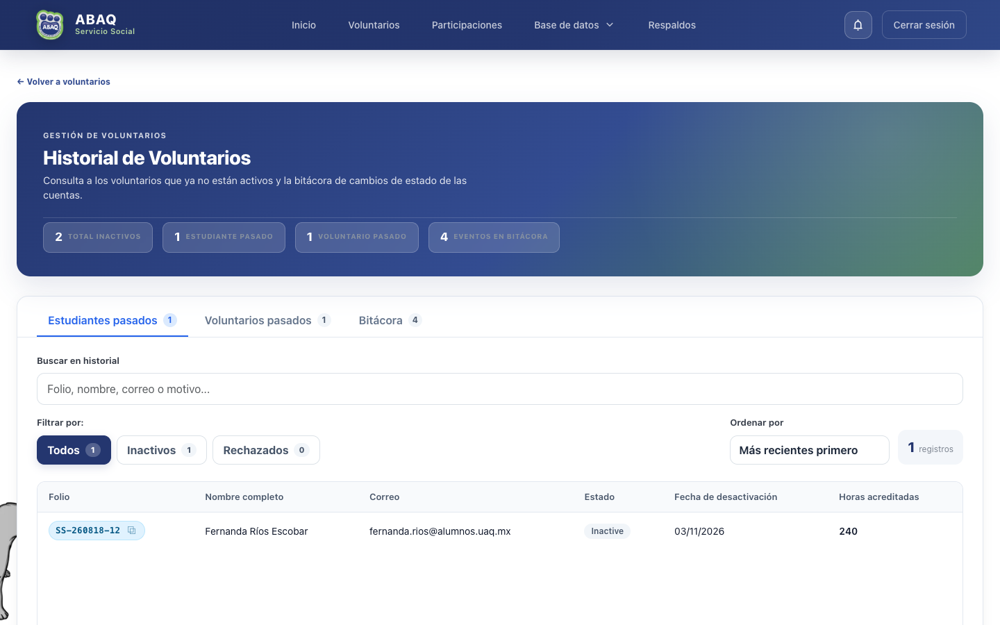

La pantalla contiene:

- **Contadores**: **Total inactivos**, **Estudiante pasado**, **Voluntario pasado** y **Eventos en bitácora**.
- **Pestañas**: **Estudiantes pasados**, **Voluntarios pasados** y **Bitácora**.
- **Buscador** por folio, nombre, correo o motivo.
- **Filtros**: **Todos**, **Inactivos** y **Rechazados**.

La tabla de estudiantes y voluntarios muestra **Folio**, **Nombre completo**, **Correo**, **Estado**, **Fecha de desactivación** y **Horas acreditadas**. La pestaña **Bitácora** conserva el registro cronológico de las decisiones administrativas y sus motivos, lo que permite auditar el historial de cada cuenta.

### 4.4 Expediente de Servicio Social

El expediente de Voluntario Servicio Social lleva un conteo de horas desde 0 a 480 horas; al cumplirlas se le genera una carta por término de servicio. El encabezado muestra el folio `SS-XXXXXXXX-XX`, el estatus de la cuenta, la fecha de aceptación, las participaciones individuales, las actividades grupales y el total registrado.

El **folio de expediente** es el identificador institucional del estudiante. En el folio operativo `SS-YYMMDD-XX`, el bloque `YYMMDD` registra la fecha de emisión y los dos caracteres finales distinguen el registro; por ejemplo, `SS-260818-01` se emitió el 18 de agosto de 2026. El folio no cambia, se conserva en constancias y notificaciones y puede copiarse con el botón (⧉) que aparece junto a él. Es, además, el criterio de búsqueda más preciso en el padrón (sección 4.1) y en el historial (sección 4.3).

Al pulsar **Ver detalle** en un estudiante, se abre el **Expediente del estudiante** con la modalidad **Servicio Social**. El encabezado resume la situación del expediente:

- **Estatus**: **Activo**, **Pendiente**, **Rechazado**, **Inactivo** o **Concluido**, con la leyenda del estado y, cuando existe, el motivo del último cambio.
- **Fecha de aceptación**: fecha y hora en que la Coordinación aprobó el expediente. Mientras la solicitud siga pendiente, el encabezado muestra **Pendiente**.
- **Fin de periodo (est.)**: fecha estimada de conclusión conforme al calendario escolar universitario. Es una referencia para planear el servicio social, no una fecha de término oficial.
- **Fecha de término**: cuando el estudiante completa las 480 horas o se emite la constancia de término, el encabezado sustituye el fin de periodo estimado por la fecha real de conclusión, con la leyenda **Conclusión oficial ABAQ**.
- **Participaciones individuales**, **actividades grupales** y **total registrado**: conteo de vinculaciones, eventos ABAQ y la suma de ambos.

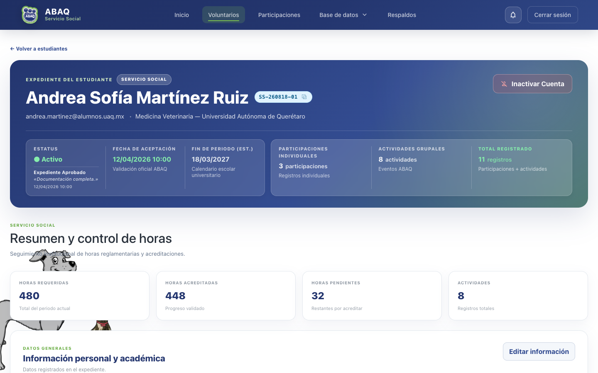

En la esquina superior derecha se encuentra **Inactivar Cuenta** (sección 4.8). Debajo del encabezado, el bloque **Resumen y control de horas** presenta:

- **Horas requeridas**: meta reglamentaria de 480 horas.
- **Horas acreditadas**: horas validadas.
- **Horas pendientes**: diferencia por acreditar.
- **Actividades**: registros totales.

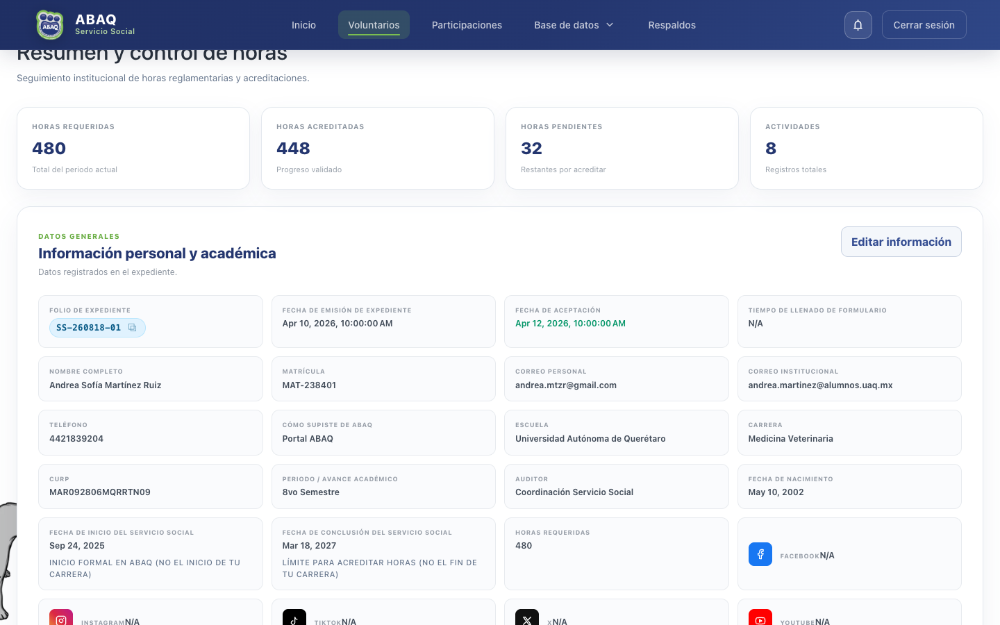

Más abajo, la sección **Información personal y académica** concentra los datos del estudiante y el botón **Editar información**. Después se muestran:

- **Documentos del expediente en la nube**: **Constancia de Inicio**, **Reporte de actividades** y **Constancia de Término**, además de la **Identificación oficial (INE / escolar)** y el **Currículum Vitae (CV) / semblanza**. Los documentos disponibles pueden descargarse o reemplazarse según el caso.
- **Semblanza, intereses, talentos y vocación**: perfil vocacional registrado durante el onboarding.

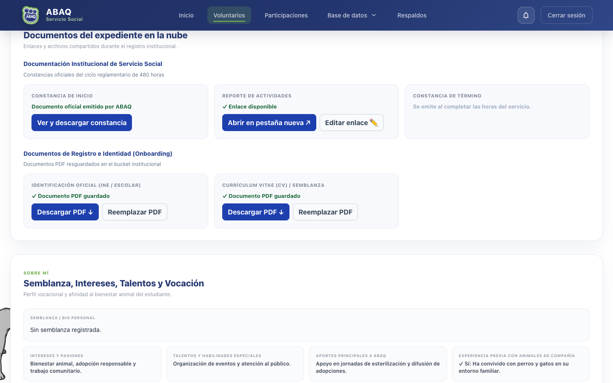

Finalmente, el bloque **Participaciones y actividades grupales** presenta la vista combinada de todos los registros del estudiante, con las columnas **Folio**, **Origen**, **Tipo / título**, **Horas**, **Desempeño**, **Estado** y **Fecha**. Los estados posibles incluyen `registered`, `approved`, `validated` y `rejected`; las horas se acreditan únicamente cuando la participación alcanza el estado `validated`.

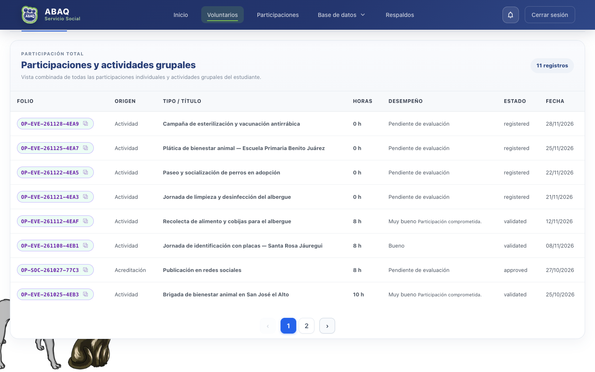

!!! note "Diferencia entre participación y actividad"

    Las **participaciones individuales** son vinculaciones registradas por el voluntario con evidencia documental. Las **actividades grupales** son eventos publicados por la Coordinación a los que el voluntario se inscribió. El expediente suma ambas, pero solo las validadas generan horas.

### 4.5 Expediente de Voluntario General

El expediente de **Voluntariado General** comparte la estructura del expediente de Servicio Social, con las diferencias propias del perfil: no existe conteo de horas ni constancia de término por 480 horas. El encabezado muestra el folio `VG-XXXXXXXX-XX`, el estatus de la cuenta, la fecha de aceptación, las participaciones individuales, las actividades grupales y el total registrado.

El **folio de expediente** `VG-YYMMDD-XX` se asigna al concluir el registro, no cambia y es el identificador institucional del voluntario. Al igual que en Servicio Social, el bloque `YYMMDD` registra la fecha de emisión y los dos caracteres finales distinguen el registro; por ejemplo, `VG-260818-01` se emitió el 18 de agosto de 2026. Puede copiarse con el botón (⧉) y es el criterio de búsqueda más preciso en el padrón (sección 4.1).

La diferencia principal está en el encabezado y en el conteo:

- **Estatus**: **Activo**, **Pendiente**, **Rechazado**, **Inactivo** o **Concluido**, con la leyenda del estado y, cuando existe, el motivo del último cambio.
- **Fecha de aceptación**: se registra cuando la Coordinación aprueba el expediente; mientras esté pendiente, se muestra **Pendiente**.
- **Fecha de término**: solo aparece cuando se registra la conclusión del voluntariado. A diferencia del Servicio Social, no existe un **Fin de periodo (est.)** calculado con el calendario escolar, porque este perfil no está sujeto a las 480 horas curriculares.
- **Participaciones individuales**, **actividades grupales** y **total registrado**: contabilizan registros, no horas curriculares.

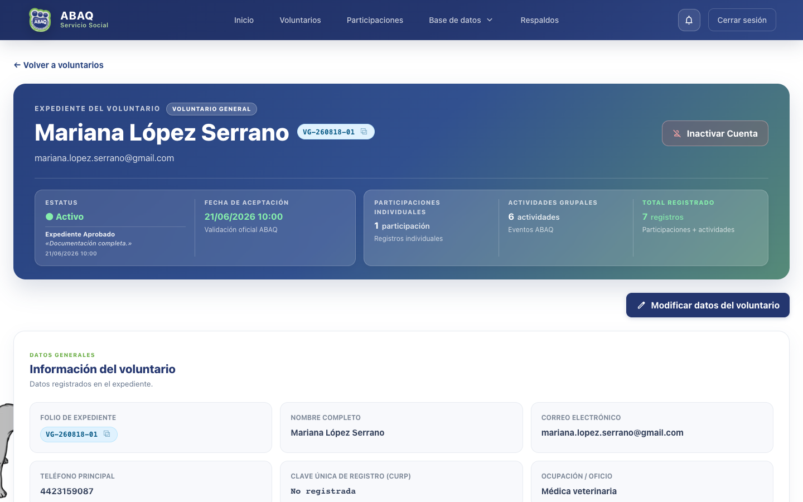

Desde este expediente es posible:

- **Modificar datos del voluntario**.
- **Inactivar Cuenta**, con el mismo procedimiento y guarda de seguridad descritos en la sección 4.8.
- Consultar **Historial académico**, **Perfil y preferencias**, **Módulos de inducción**, **Documentación del Voluntario**, **Consentimientos y reglamento** y **Canales oficiales y difusión**.

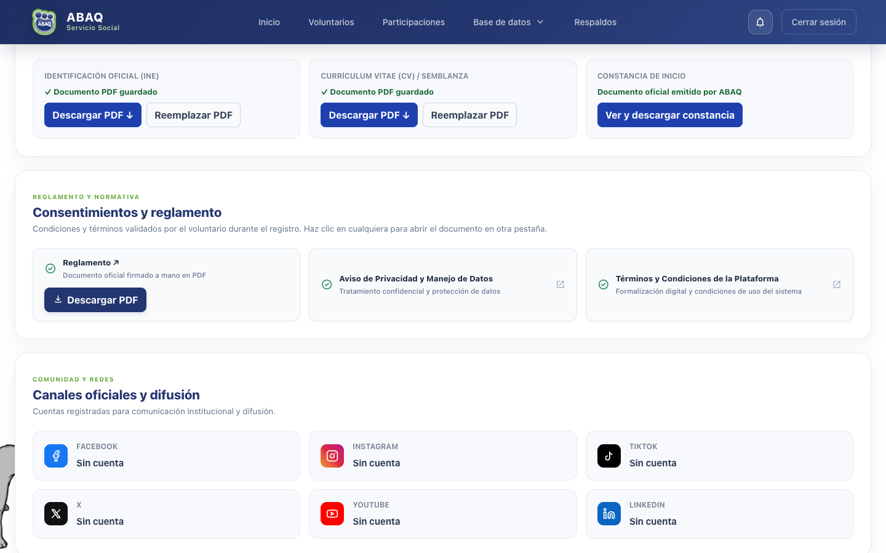

El bloque **Participaciones y actividades grupales** lista los mismos campos que en Servicio Social. En el caso de Voluntariado General, la columna de horas no aplica para acreditación curricular; el registro conserva el impacto de la participación y su estado de validación.

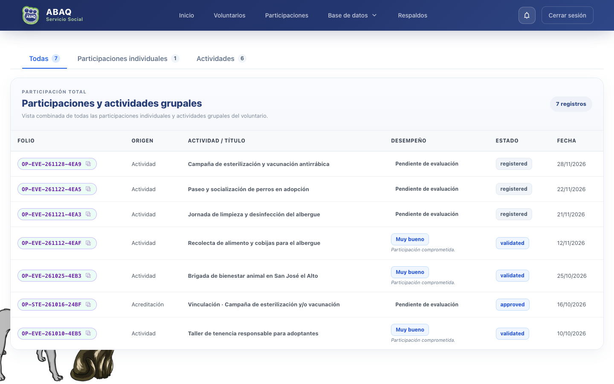

### 4.6 Aceptar una solicitud

Para aceptar a un aspirante, localícelo en el filtro **Solicitan ingresar** y pulse **Aceptar**. Se abre el modal **Aceptar e Ingresar Voluntario**, que muestra el nombre, el folio oficial y la modalidad del solicitante.

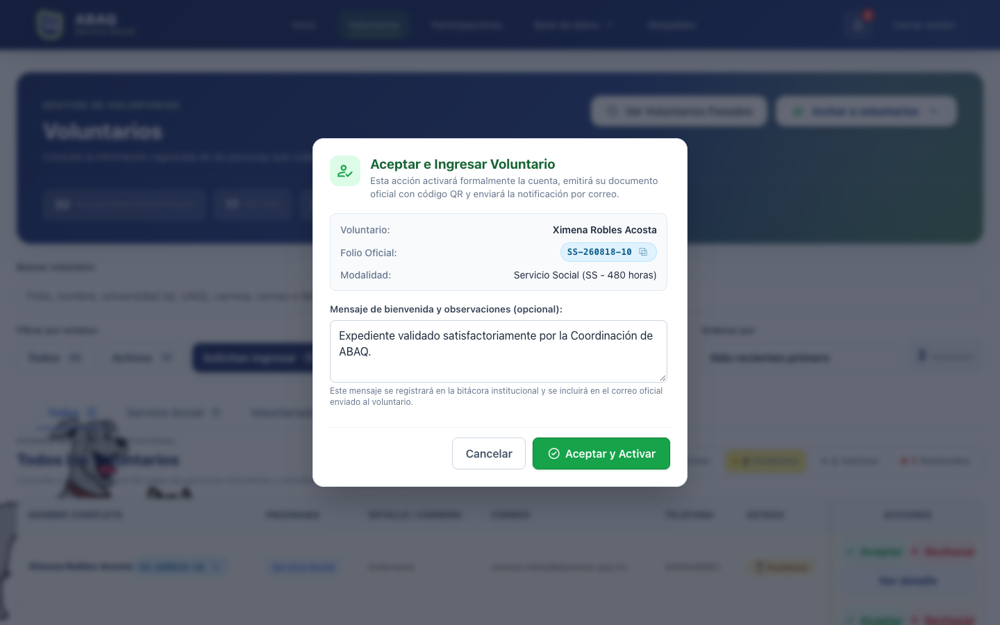

1. Revise que el nombre, el folio y la modalidad correspondan al expediente consultado.
2. Escriba, si lo desea, un **Mensaje de bienvenida y observaciones (opcional)**. El texto se registra en la bitácora y se incluye en el correo oficial.
3. Pulse **Aceptar y Activar**.

Al confirmar, la cuenta se activa formalmente, se emite la **Constancia de Inicio** con folio institucional y se envía la notificación por correo. La acción queda asentada en la bitácora institucional.

!!! warning "Verifique antes de aceptar"

    La aceptación habilita el acceso del voluntario y emite documentos oficiales. No acepte expedientes con documentación incompleta o ilegible: en ese caso utilice el rechazo con observaciones para que el aspirante pueda corregir.

### 4.7 Rechazar una solicitud

Si el expediente presenta faltantes o incongruencias, pulse **Rechazar** en la fila correspondiente. Se abre el modal **Rechazar Solicitud de Ingreso**.

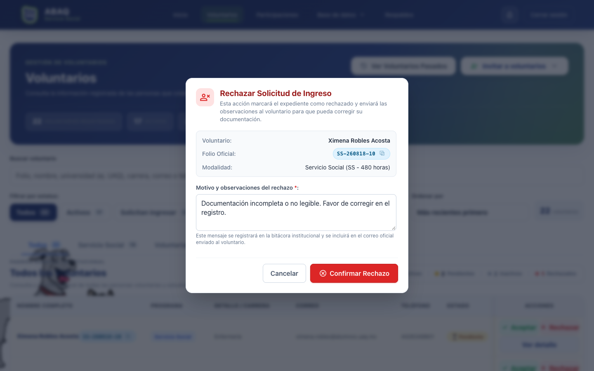

1. Verifique el **Voluntario**, el **Folio Oficial** y la **Modalidad**.
2. Redacte el **Motivo y observaciones del rechazo**. Este campo es obligatorio y debe explicar con claridad qué debe corregir la persona.
3. Pulse **Confirmar Rechazo**.

El expediente queda marcado como rechazado y las observaciones se envían al voluntario por correo oficial. El mensaje también se conserva en la bitácora institucional para dar trazabilidad a la decisión.

### 4.8 Inactivar una cuenta

La inactivación suspende el acceso operativo de un voluntario a la plataforma. Puede realizarse desde el listado (**Inactivar**) o desde el encabezado del expediente (**Inactivar Cuenta**).

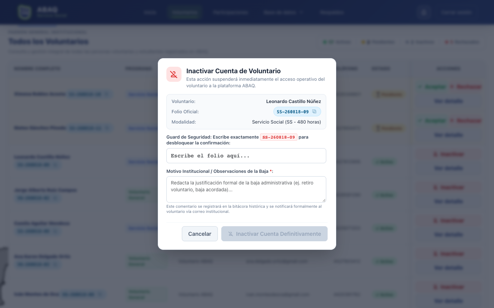

1. Confirme el **Voluntario**, el **Folio Oficial** y la **Modalidad**.
2. En **Guarda de Seguridad**, escriba exactamente el folio indicado (por ejemplo, `SS-260818-09`). El botón permanece deshabilitado hasta que la captura coincida.
3. Redacte el **Motivo Institucional / Observaciones de la Baja**. Este campo es obligatorio y debe contener la justificación formal (retiro voluntario, baja acordada, conclusión del programa, etc.).
4. Pulse **Inactivar Cuenta Definitivamente**.

La acción suspende de inmediato el acceso, se registra en la bitácora histórica y se notifica formalmente al voluntario por correo institucional.

!!! danger "Acción irreversible desde la interfaz"

    La inactivación no se revierte con un botón de la plataforma. Si la cuenta debe reactivarse, escale el caso a la Coordinación de sistemas para su revisión y, en su caso, restauración controlada.

### 4.9 Enlaces de invitación

El botón **Invitar a voluntarios** despliega el menú **Enlaces de invitación**, que permite copiar al portapapeles los accesos de registro y de inicio de sesión.

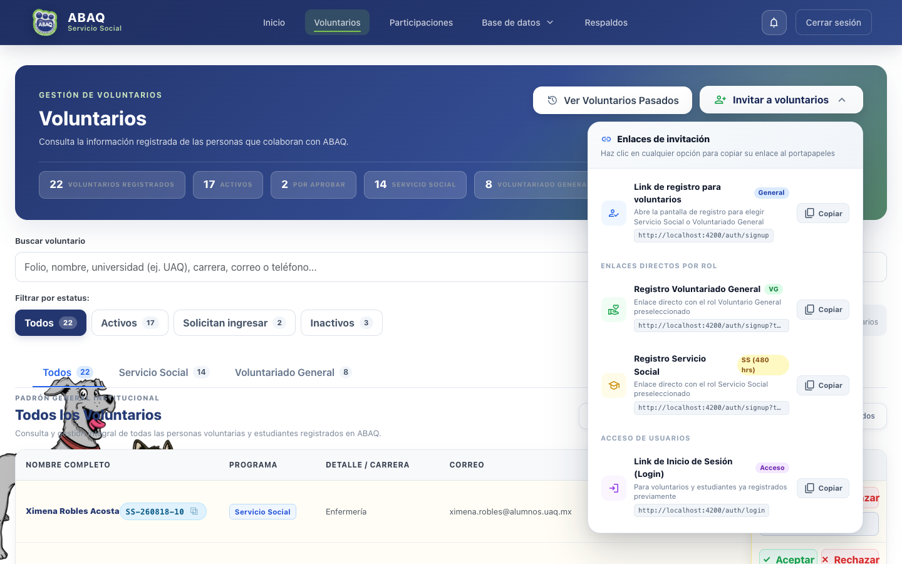

El menú contiene:

- **Link de registro para voluntarios** (`General`): abre la pantalla de registro para elegir entre Servicio Social y Voluntariado General.
- **Registro Voluntariado General** (`VG`): enlace directo con el rol preseleccionado.
- **Registro Servicio Social** (`SS (480 hrs)`): enlace directo con el rol preseleccionado.
- **Link de Inicio de Sesión (Login)** (`Acceso`): para voluntarios y estudiantes ya registrados.

Cada opción incluye el botón **Copiar**. Comparta estos enlaces únicamente por canales institucionales y evite publicarlos en espacios abiertos donde puedan ser utilizados por personas ajenas a ABAQ.

## 5. Participaciones y convocatorias

### 5.1 Bandeja de participaciones

La sección **Participaciones** es el centro operativo de la Coordinación. El encabezado muestra tres indicadores: **Participaciones en total**, **En revisión** y **Validadas**.

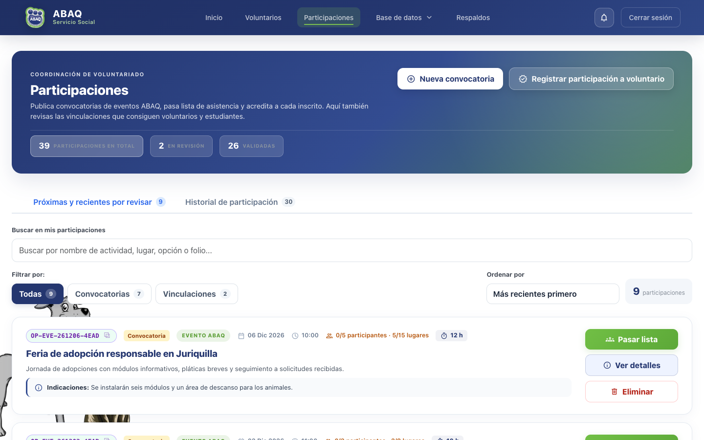

La pantalla se organiza en dos pestañas:

- **Próximas y recientes por revisar**: eventos y registros que requieren seguimiento.
- **Historial de participación**: registros de semanas anteriores.

Las herramientas de búsqueda y filtrado permiten localizar por nombre de actividad, lugar, opción o folio, y filtrar por **Todas**, **Convocatorias** o **Vinculaciones**. Cada tarjeta de convocatoria muestra el folio, la categoría, la fecha, la hora, el cupo ocupado, la duración y las indicaciones. Las acciones disponibles son:

- **Pasar lista**: abre la captura de asistencia (sección 5.4).
- **Ver detalles**: abre la administración de la actividad (sección 5.3).
- **Eliminar**: borra la convocatoria con confirmación previa.

Los botones superiores **Nueva convocatoria** y **Registrar participación a voluntario** dan de alta una actividad grupal o una participación individual, respectivamente.

!!! note "Lectura del indicador de participaciones"

    El contador **Participaciones en total** combina las convocatorias publicadas y las acreditaciones individuales. Por ello puede ser mayor que la suma de las tarjetas visibles en una sola pestaña; utilice los filtros para revisar cada tipo de registro.

### 5.2 Historial de participación

La pestaña **Historial de participación** concentra los eventos concluidos y las vinculaciones de semanas anteriores. La tabla presenta las columnas **Folio**, **Forma de participar**, **Participación**, **Participantes**, **Avance**, **Fecha** y **Acciones**.

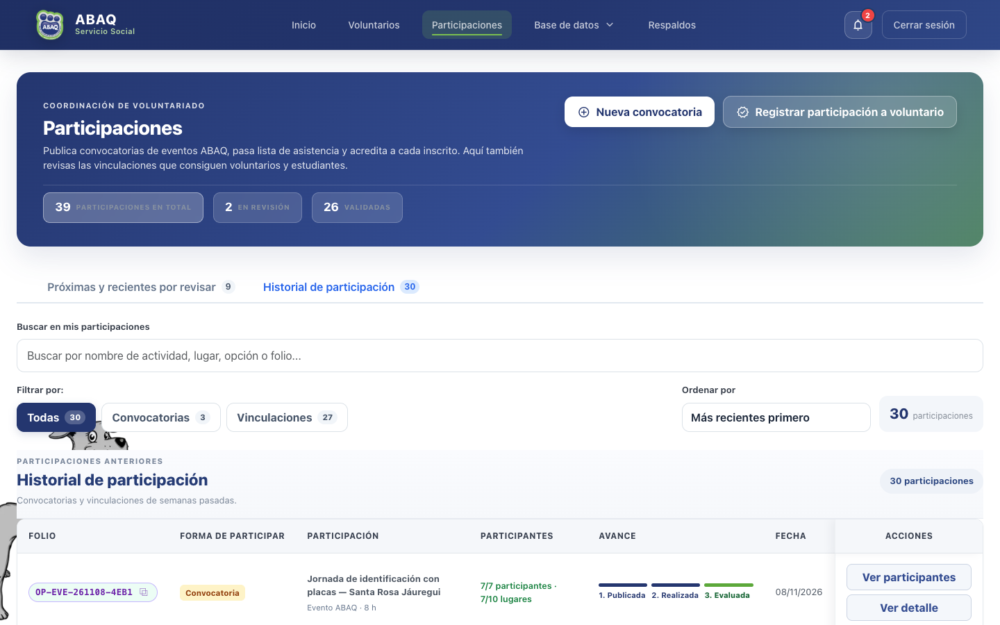

La columna **Avance** resume el ciclo de vida de cada convocatoria:

1. **Publicada**: la actividad está visible y recibe inscripciones.
2. **Realizada**: la fecha del evento ya ocurrió.
3. **Evaluada**: la asistencia y el desempeño fueron validados.

Los botones **Ver participantes** y **Ver detalle** permiten consultar la lista de inscritos y la información completa del evento. Use el buscador y los filtros **Todas**, **Convocatorias** y **Vinculaciones** para localizar un registro específico.

### 5.3 Detalle de una convocatoria

El detalle de una convocatoria presenta el encabezado **Administración de actividad** con el folio, la descripción y los datos operativos:

- **Categoría** y multiplicador de horas (por ejemplo, **Evento ABAQ · 2x**).
- **Duración → acredita**: duración del evento y equivalencia en horas de Servicio Social.
- **Fecha de inicio** y **Fecha límite**.
- **Horario**.
- **Cupo** ocupado sobre el total.
- **Indicaciones** para los participantes.

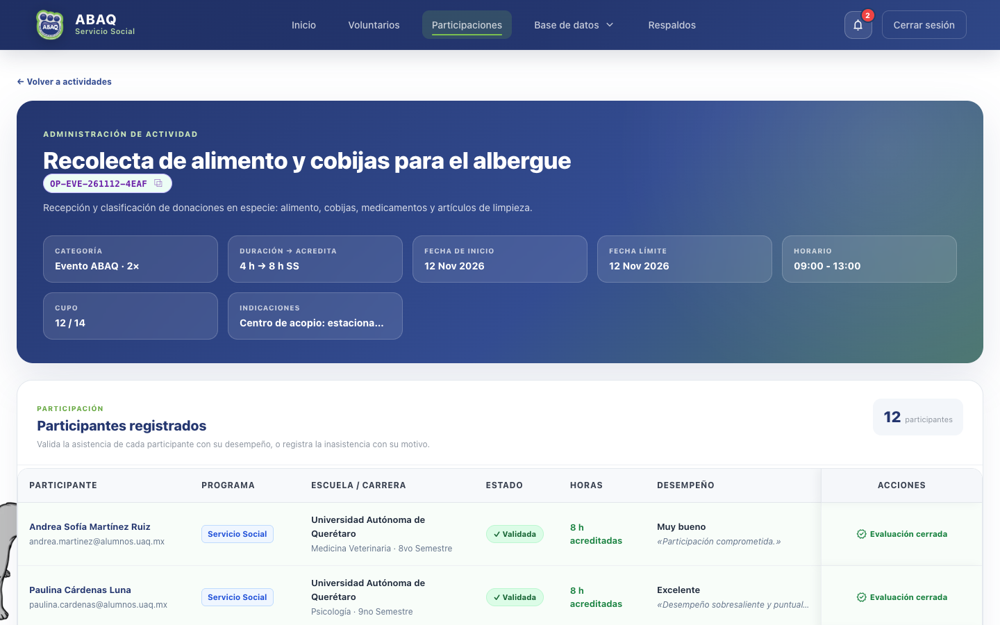

En el bloque **Participantes registrados** se valida la asistencia de cada persona. La tabla muestra **Participante**, **Programa**, **Escuela / carrera**, **Estado**, **Horas**, **Desempeño** y **Acciones**. Los estados y acciones se explican en las secciones 5.4 y 5.5.

### 5.4 Pasar lista de asistencia

El botón **Pasar lista** abre la captura de asistencia de la convocatoria. Para cada participante de Servicio Social se muestra la escuela, la carrera y el semestre, además del estado actual y las horas que se acreditarían.

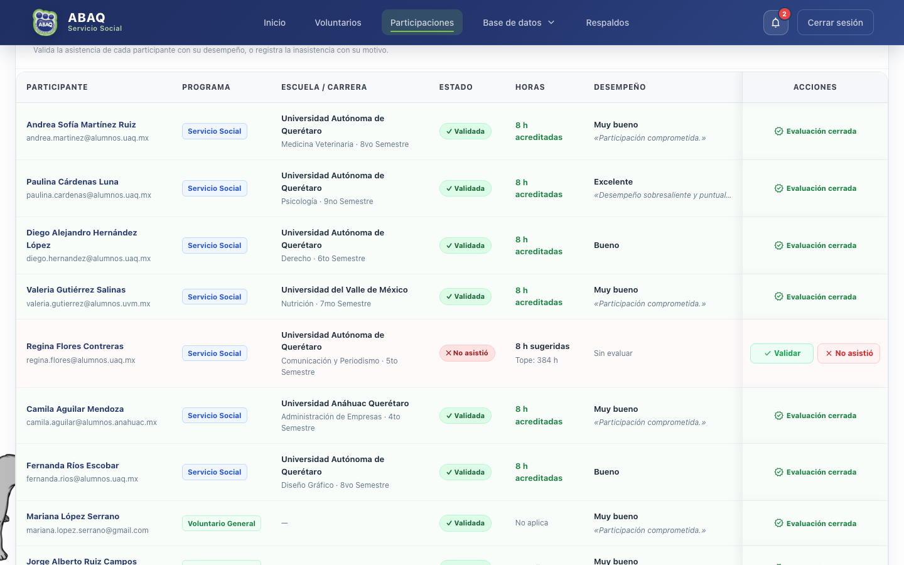

El procedimiento es el siguiente:

1. Confirme que la actividad y la fecha correspondan al evento realizado.
2. Revise la lista de inscritos.
3. Para cada asistente, pulse **Validar** si asistió y cumplió con la actividad.
4. Si no asistió, pulse **No asistió** y registre el motivo cuando el sistema lo solicite.
5. Verifique que el estado cambie a **Validada** y que las horas se muestren como **acreditadas**.

Los registros ya validados muestran **Evaluación cerrada** y ya no permiten editar la asistencia. Los participantes marcados como **No asistió** aparecen con las horas **sugeridas** y el tope aplicable; esas horas no se acreditan.

!!! tip "Tope de horas"

    Cuando el estudiante tiene horas pendientes menores a la duración del evento, la plataforma muestra el tope aplicable (por ejemplo, **Tope: 384 h**). El sistema nunca acredita más horas de las que faltan para completar las 480 horas reglamentarias.

### 5.5 Validación de participantes

La validación confirma la asistencia y el desempeño. En la misma tabla se concentran estudiantes de Servicio Social y voluntarios generales; para estos últimos la columna de horas indica **No aplica**.

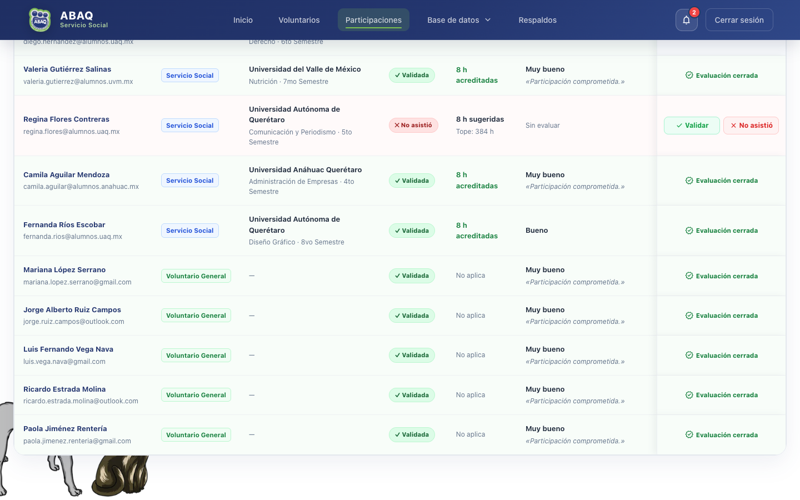

Reglas operativas:

- **Validar** acredita las horas correspondientes y registra el desempeño (**Excelente**, **Muy bueno**, **Bueno**, entre otros).
- **No asistió** marca la ausencia; no genera horas y puede requerir un motivo.
- **Evaluación cerrada** indica que el registro ya fue procesado y no admite cambios.
- El comentario de desempeño se conserva en el expediente y respalda la constancia correspondiente.

Antes de validar, confirme la identidad del participante y su asistencia real. Una validación indebida impacta el expediente y los documentos oficiales del voluntario.

### 5.6 Nueva convocatoria

El botón **Nueva convocatoria** abre el formulario **Crear nueva actividad**, organizado en dos secciones.

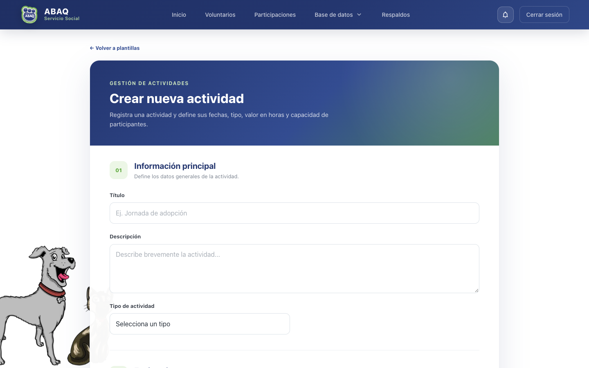

**01 · Información principal**

- **Título**: nombre visible de la actividad.
- **Descripción**: propósito y alcance del evento.
- **Tipo de actividad**:
    - **Obligatoria · todos los participantes deben asistir**.
    - **Voluntaria · se inscribe quien quiera participar**.
    - **Por convocatoria · solo personas convocadas por la Coordinación**.

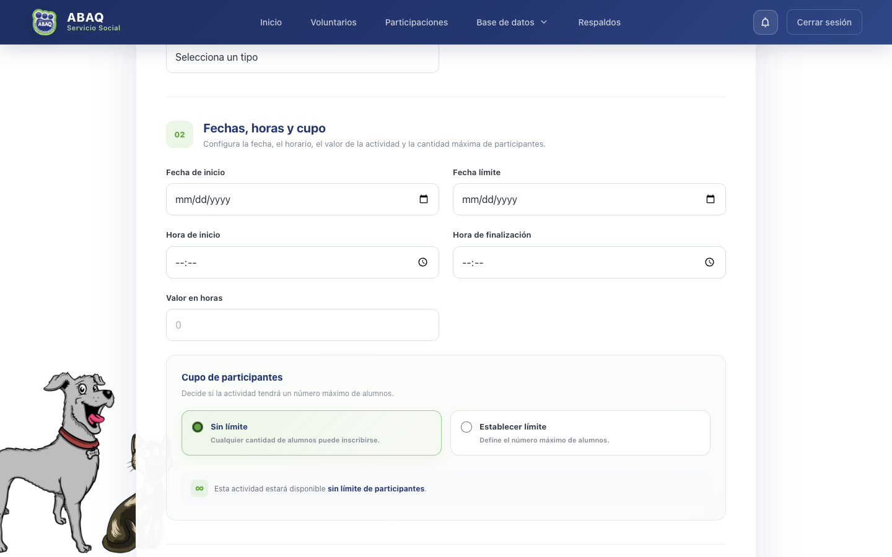

**02 · Fechas, horas y cupo**

- **Fecha de inicio** y **Fecha de finalización**.
- **Hora de inicio** y **Hora de finalización**, en formato de 24 horas.
- **Valor en horas**: duración base de la actividad.
- **Cupo máximo**: límite de participantes o modalidad sin límite, según la configuración disponible.

Antes de publicar, revise que las fechas sean futuras, que el horario no se empalme con otra actividad institucional y que las indicaciones sean claras. Al guardar, la convocatoria aparece en la bandeja de participaciones y queda disponible para los voluntarios según su tipo.

!!! warning "Actividades futuras y pase de lista"

    Una convocatoria futura no debe validarse antes de su realización. El pase de lista se habilita para la fecha del evento; si necesita corregir un registro, hágalo con la evidencia documental correspondiente.

### 5.7 Registro manual de una participación

El botón **Registrar participación a voluntario** abre el modal **Registrar vinculación de voluntario**, utilizado para asentar una participación individual con evidencia documental.

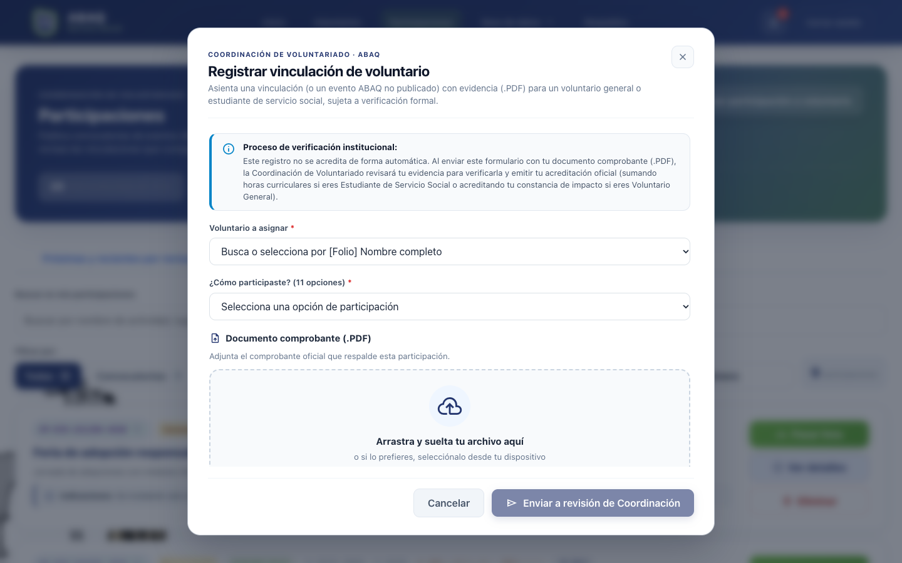

1. En **Voluntario a asignar**, busque y seleccione por **Folio** o nombre completo.
2. En **¿Cómo participaste? (11 opciones)**, elija la opción que corresponda (adopción, plática, campaña, difusión, recaudación, etc.).
3. Adjunte el **Documento comprobante (.PDF)** arrastrándolo al área de carga o seleccionándolo desde el dispositivo.
4. Pulse **Enviar a revisión de Coordinación**.

El registro **no se acredita de forma automática**: queda en revisión para que la Coordinación verifique la evidencia y emita la acreditación oficial. Si el voluntario es de Servicio Social, las horas se suman a su expediente; si es de Voluntariado General, se acredita su constancia de impacto.

## 6. Plantillas de actividades

### 6.1 Lista de plantillas

Las plantillas permiten reutilizar actividades recurrentes sin capturar de nuevo toda la información. Se accede desde **Participaciones > Nueva convocatoria > Volver a plantillas** o desde el flujo de creación de actividades.

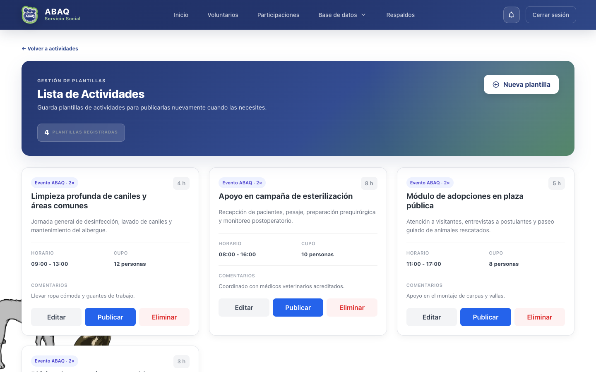

Cada tarjeta muestra:

- La **categoría** y el multiplicador de horas (por ejemplo, **Evento ABAQ · 2x**).
- La **duración** en horas.
- El **título** y la **descripción**.
- El **horario** y el **cupo**.
- **Comentarios** operativos.

Las acciones disponibles son **Editar**, **Publicar** y **Eliminar**. El botón **Nueva plantilla** abre el formulario de creación de actividades para guardar una nueva plantilla.

### 6.2 Publicar una plantilla

Al pulsar **Publicar**, se despliega el formulario **Publicar actividad**, que solicita los datos específicos de la nueva edición:

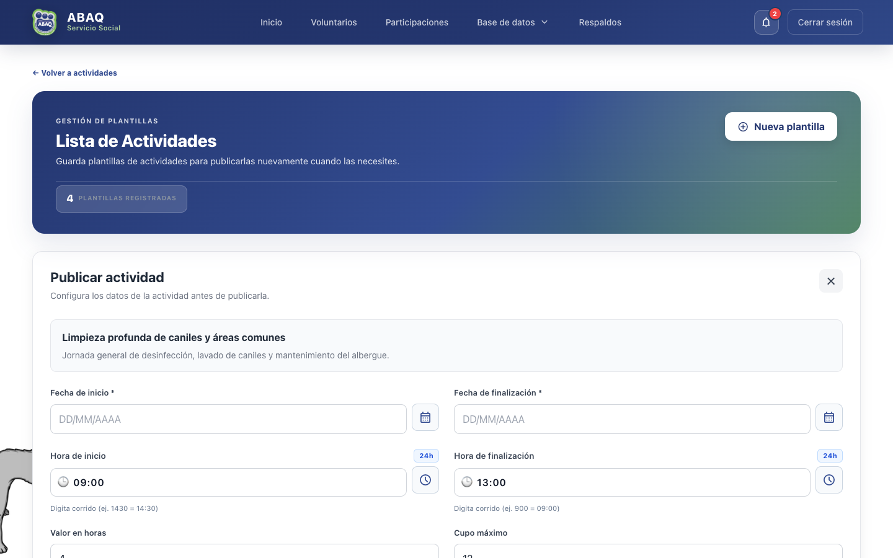

1. **Fecha de inicio** y **Fecha de finalización**.
2. **Hora de inicio** y **Hora de finalización**.
3. **Valor en horas**.
4. **Cupo máximo**.

Al confirmar, la plantilla se convierte en una convocatoria activa con su propio folio y queda disponible en la bandeja de participaciones. La plantilla original se conserva para futuras ediciones.

!!! tip "Plantillas y cupo"

    Si la plantilla se usa para eventos con cupo variable, ajuste el **Cupo máximo** en cada publicación. El valor de la plantilla es solo una referencia y no limita las ediciones posteriores.

## 7. Pláticas de bienestar animal

### 7.1 Listado de pláticas

El módulo **Pláticas** se encuentra en **Base de datos > Pláticas**. Su propósito es registrar las pláticas de bienestar animal impartidas por ABAQ y dar seguimiento a los asistentes y constancias.

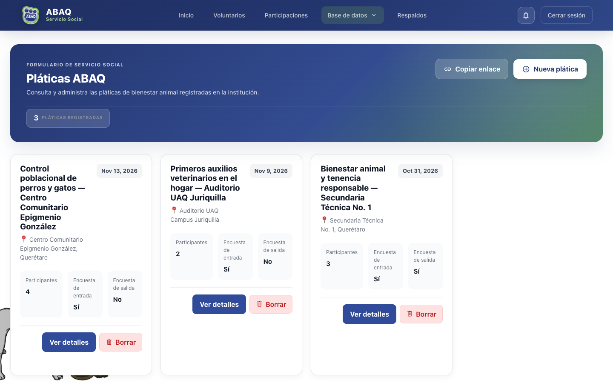

El encabezado muestra el número de **pláticas registradas**, el botón **Copiar enlace** para compartir el formulario y el botón **Nueva plática**. Cada tarjeta presenta el nombre, la fecha, el lugar, el número de **participantes**, la aplicación de la **Encuesta de entrada** y la **Encuesta de salida**, además de las acciones **Ver detalles** y **Borrar**.

### 7.2 Registro de una nueva plática

El botón **Nueva plática** despliega el formulario de captura.

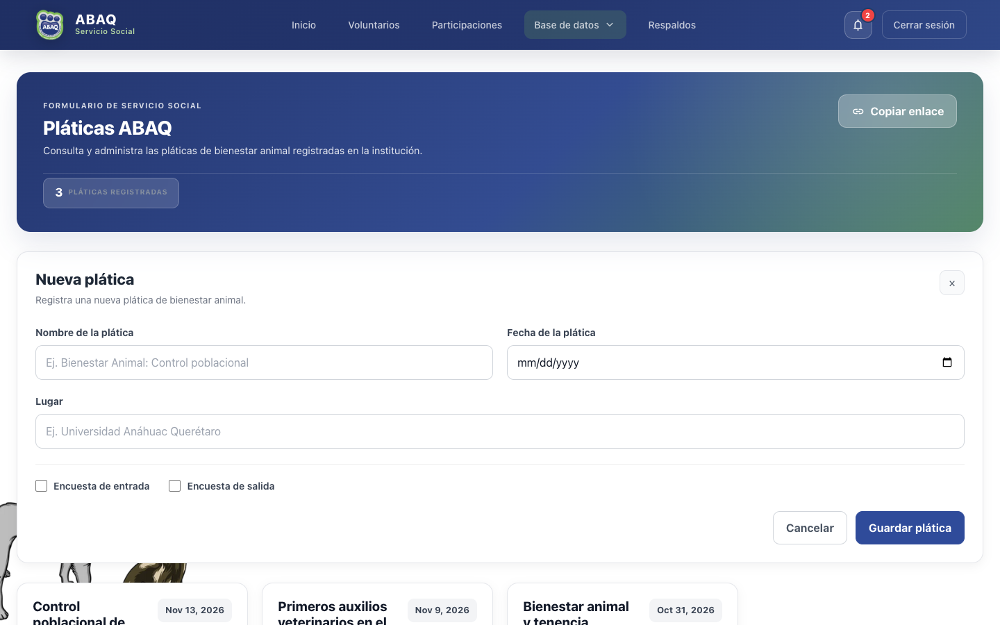

1. **Nombre de la plática**: título completo, incluyendo sede si aplica.
2. **Fecha de la plática**: seleccione la fecha en el calendario.
3. **Lugar**: institución, auditorio o dirección donde se impartió.
4. **Encuesta de entrada** y **Encuesta de salida**: marque las casillas si se aplicaron instrumentos de evaluación.
5. Pulse **Guardar plática**.

Las encuestas determinan el indicador **Encuestas de impacto** que se muestra en el detalle. Si no se aplicó alguna, el detalle indicará **Parciales**.

### 7.3 Detalle de la plática

El detalle muestra el folio institucional (`ABAQ-PL-AAAA-XXXXXX`), el título, la sede y la fecha, además de cuatro indicadores de impacto:

- **Fecha realizada**.
- **Asistentes capacitados**, con desglose por sexo.
- **Notificaciones email**, con el número de constancias enviadas.
- **Encuestas de impacto**: **Completas**, **Parciales** o **No aplica**.

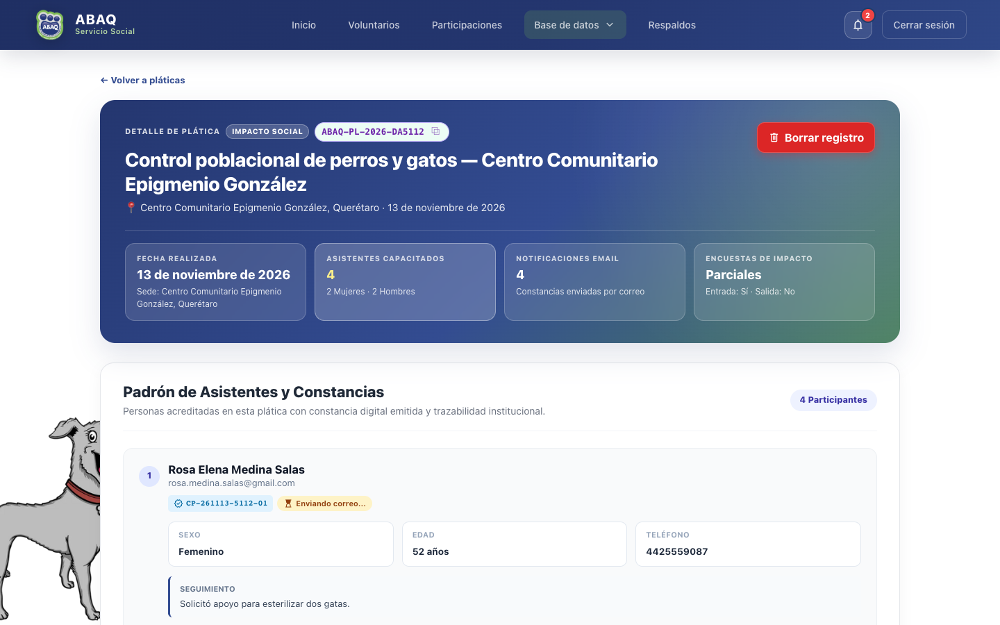

El botón **Borrar registro** elimina la plática y su padrón con confirmación previa. Antes de borrar, descargue o conserve las constancias y la evidencia que deban resguardarse.

### 7.4 Padrón de asistentes y constancias

El bloque **Padrón de Asistentes y Constancias** lista a las personas acreditadas en la plática. Cada registro incluye:

- Número consecutivo y nombre.
- Correo electrónico.
- Folio de constancia (`CP-...`).
- Estado del envío por correo.
- **Sexo**, **Edad** y **Teléfono**.
- **Seguimiento**: notas de interés o solicitudes posteriores.
- Botones **Ver constancia** y **Copiar enlace**.

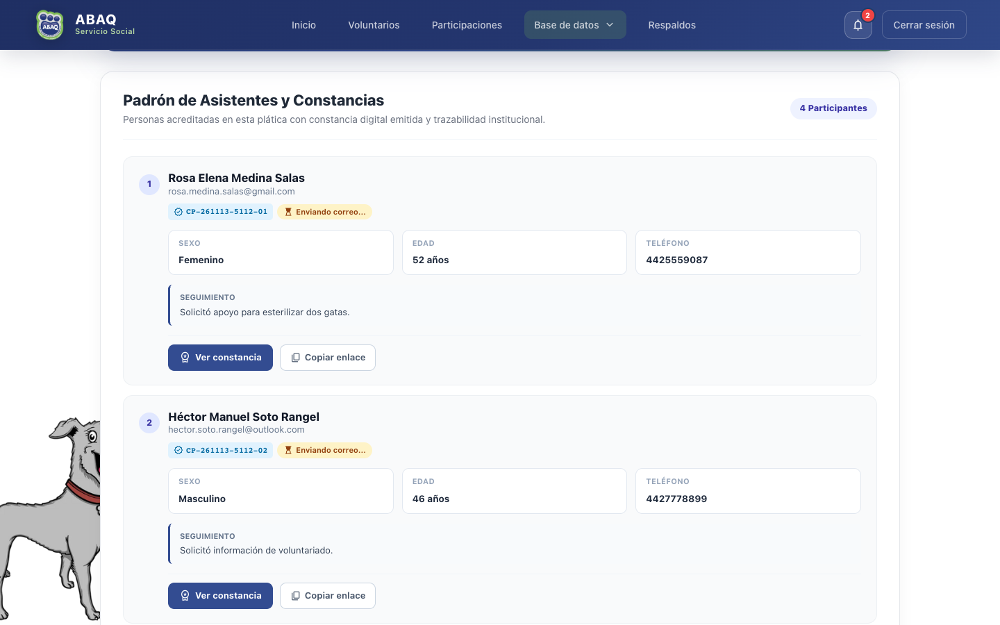

Utilice **Ver constancia** para abrir el documento digital y **Copiar enlace** para compartirlo por el canal institucional correspondiente. El seguimiento permite identificar solicitudes de esterilización, información de voluntariado o interés en llevar la plática a otra sede.

## 8. Campañas de esterilización

### 8.1 Listado de campañas

El módulo **Campañas EST** se ubica en **Base de datos > Campañas EST**. Registra las atenciones y esterilizaciones realizadas durante las campañas de ABAQ.

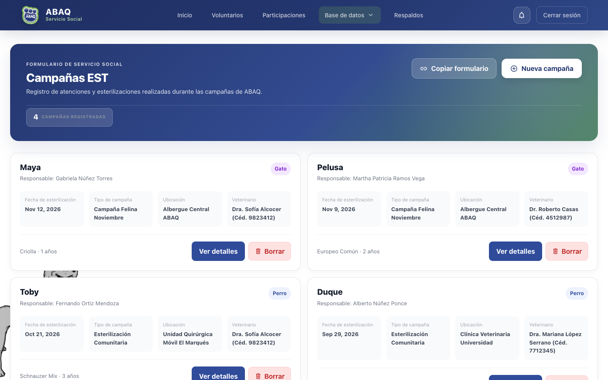

El encabezado muestra el número de **campañas registradas**, el botón **Copiar formulario** y el botón **Nueva campaña**. Cada tarjeta presenta:

- Nombre y especie del animal.
- Responsable.
- **Fecha de esterilización**.
- **Tipo de campaña**.
- **Ubicación**.
- **Veterinario** y cédula profesional.
- Raza y edad.
- Acciones **Ver detalles** y **Borrar**.

### 8.2 Registro de una nueva campaña

El botón **Nueva campaña** abre el formulario **Registrar la información de la atención realizada**.

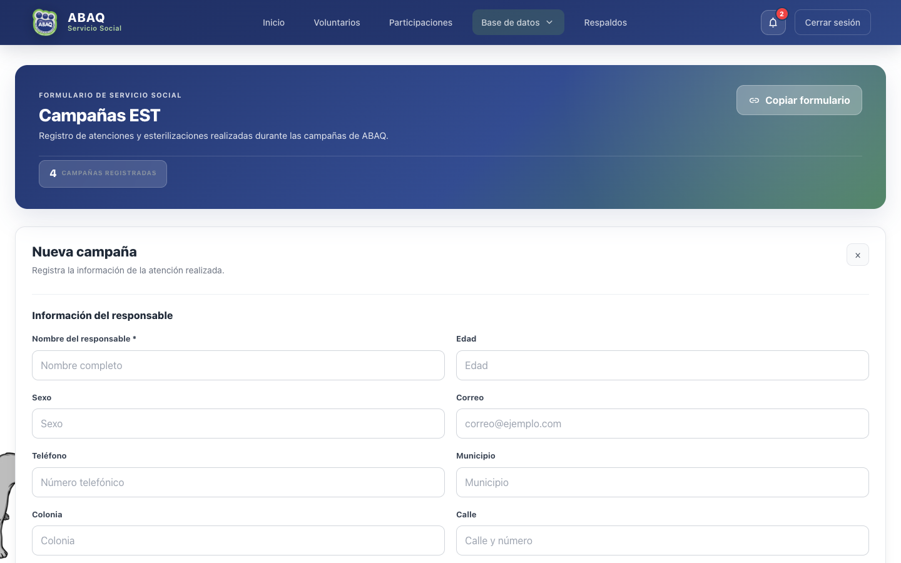

El formulario se completa de arriba hacia abajo:

1. **Información del responsable**: nombre, edad y sexo.
2. **Domicilio**: municipio, colonia y calle.
3. **Información de contacto**: correo, teléfono y redes sociales.
4. **Información de ABAQ**: cómo se enteró de ABAQ, red social, cuenta y recomendación.
5. **Información del animal de compañía**: nombre, especie, sexo, raza, tamaño, edad y peso.
6. **Información de la campaña**: fecha y lugar de esterilización, veterinario, tipo de campaña, pago y comentarios.

Al guardar, la campaña aparece en el listado y queda disponible para consulta y seguimiento. Verifique los datos del veterinario y la fecha antes de confirmar, ya que alimentan los indicadores de impacto del programa.

### 8.3 Detalle de la campaña

El detalle muestra el encabezado con las etiquetas **Campaña EST** y **Felino** o **Canino**, seguido de los datos de la atención y del animal.

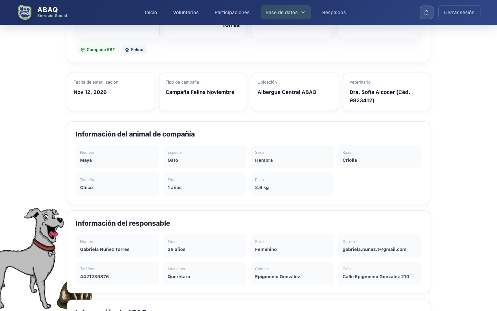

Se organiza en tres bloques:

- **Datos de la campaña**: fecha de esterilización, tipo de campaña, ubicación y veterinario.
- **Información del animal de compañía**: nombre, especie, sexo, raza, tamaño, edad y peso.
- **Información del responsable**: nombre, edad, sexo, correo, teléfono, municipio, colonia y calle.
- **Información de ABAQ**: cómo se enteró de ABAQ, red social, cuenta y recomendación.

El botón **Borrar** elimina el registro con confirmación previa. Conserve la evidencia clínica y el consentimiento antes de eliminar cualquier campaña.

## 9. Adopciones

### 9.1 Listado de adopciones

El módulo **Adopciones** se encuentra en **Base de datos > Adopciones**. Concentra los procesos de adopción registrados en la institución.

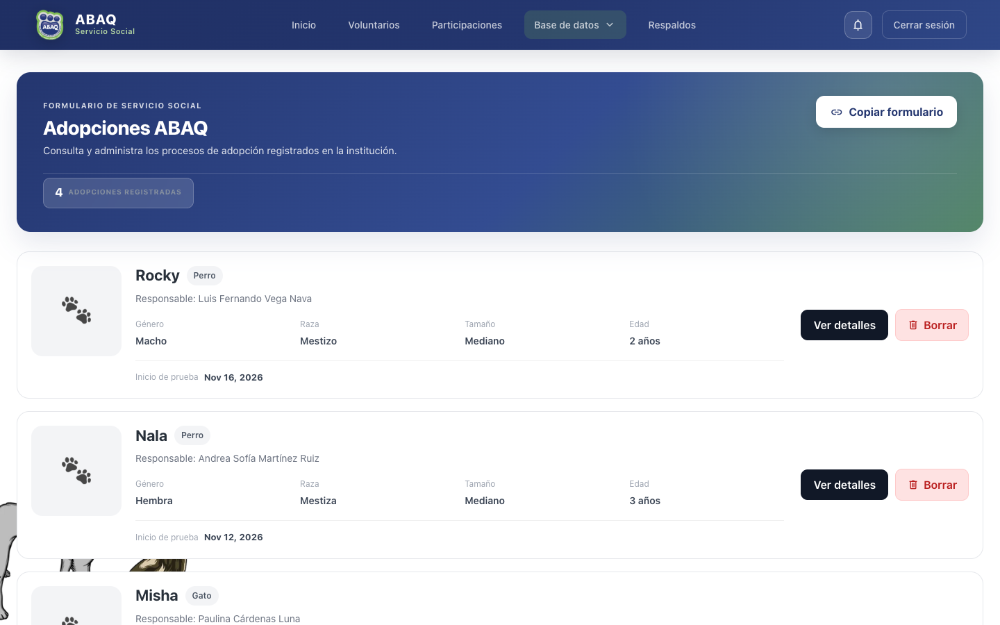

El encabezado muestra el número de **adopciones registradas** y el botón **Copiar formulario**. Cada tarjeta incluye:

- Nombre, especie y foto o marcador del animal.
- **Responsable**.
- **Género**, **Raza**, **Tamaño** y **Edad**.
- **Inicio de prueba**.
- Acciones **Ver detalles** y **Borrar**.

### 9.2 Detalle y cierre de una adopción

El detalle del expediente presenta el encabezado con las etiquetas **Expediente de Adopción** y **Canino** o **Felino**, el nombre del animal y el botón **Borrar registro**.

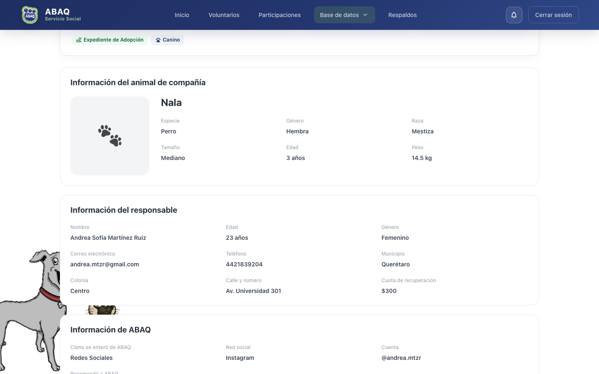

La pantalla se organiza en los siguientes bloques:

- **Información del animal de compañía**: especie, género, raza, tamaño, edad, peso y fotografía.
- **Información del responsable**: nombre, edad, género, correo, teléfono, municipio, colonia, calle y cuota de recuperación.
- **Información de ABAQ**: cómo se enteró de ABAQ, red social, cuenta y recomendación.
- **Documentación del Expediente**: **Formato de Solicitud de Adopción (PDF)**, **Identificación Oficial (INE)** y **Comprobante de Domicilio**.

El bloque **Proceso de adopción** distingue dos etapas:

1. **Periodo de prueba**: fecha de inicio y comentarios del acompañamiento (habitualmente 15 días).
2. **Adopción definitiva**: si aún no se completa, muestra el botón **Completar adopción**.

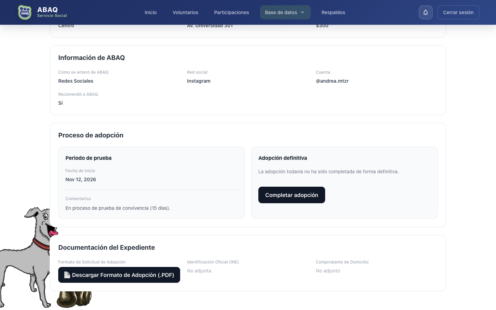

Para cerrar el proceso:

1. Pulse **Completar adopción**.
2. Registre los **Comentarios sobre la adopción definitiva**.
3. Confirme la acción.

Al completar, el expediente cambia a **Adopción Definitiva** y se conserva el historial del periodo de prueba. No complete la adopción si el periodo de convivencia no ha concluido o si falta documentación del responsable.

!!! warning "Borrado de expedientes"

    **Borrar registro** elimina el expediente de adopción y su documentación asociada. Antes de borrar, confirme que no exista una obligación de resguardo o un proceso judicial en curso.

## 10. Placas de identificación

### 10.1 Listado de placas

El módulo **Placas de identificación** se encuentra en **Base de datos > Placas de identificación**. Gestiona las solicitudes de placas para animales de compañía vinculados con ABAQ.

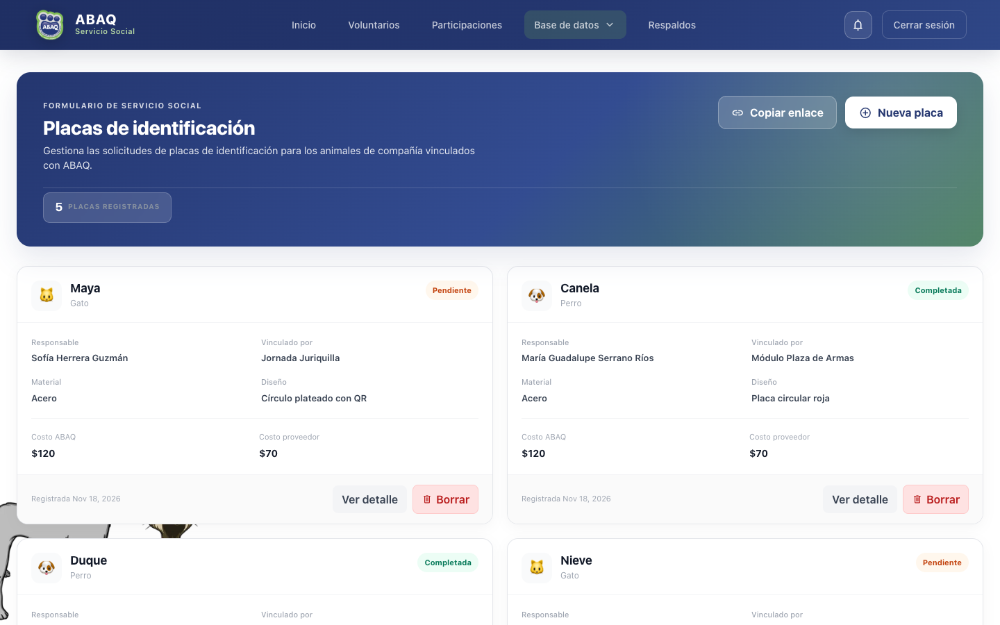

El encabezado muestra el número de **placas registradas**, el botón **Copiar enlace** y el botón **Nueva placa**. Cada tarjeta presenta:

- Nombre y especie del animal.
- Estado: **Pendiente** o **Completada**.
- **Responsable** y **Vinculado por**.
- **Material** y **Diseño**.
- **Costo ABAQ** y **Costo proveedor**.
- Fecha de registro.
- Acciones **Ver detalle** y **Borrar**.

### 10.2 Registro de una nueva placa

El botón **Nueva placa** abre el formulario **Nueva placa de identificación**.

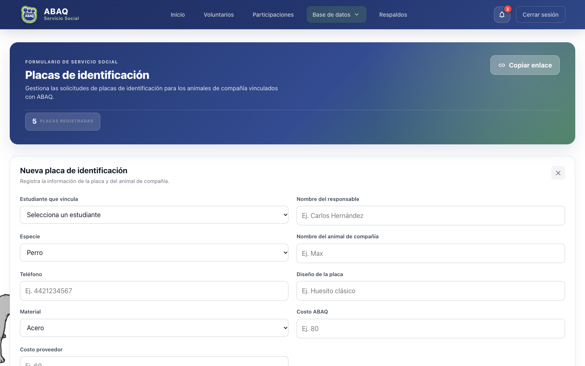

1. **Estudiante que vincula**: seleccione a la persona responsable del vínculo.
2. **Nombre del responsable**: capture el nombre completo.
3. **Especie**: **Perro** o **Gato**.
4. **Nombre del animal de compañía**.
5. **Teléfono** de contacto.
6. **Diseño de la placa**: por ejemplo, **Huesito clásico**.
7. **Material**: por ejemplo, **Acero**.
8. **Costo ABAQ** y **Costo proveedor**.

Complete el resto de los campos que solicite el formulario y guarde el registro. La placa quedará en estado **Pendiente** hasta que se confirme su entrega o fabricación.

### 10.3 Detalle de la placa

El detalle muestra el nombre del animal, el responsable, el estado y el botón **Borrar registro**.

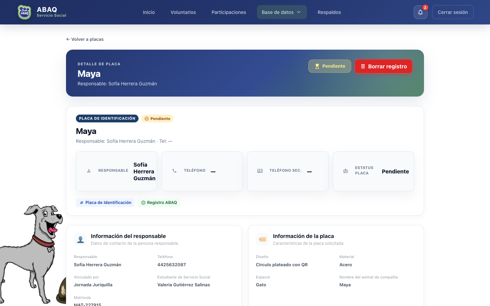

La pantalla incluye:

- **Resumen**: responsable, teléfono, teléfono secundario y estatus de la placa.
- **Etiquetas**: **Placa de Identificación** y **Registro ABAQ**.
- **Información del responsable**: nombre, teléfono, vínculo, estudiante de Servicio Social y matrícula.
- **Información de la placa**: diseño, material, especie y nombre del animal de compañía.

Utilice **Borrar registro** solo si la solicitud fue cancelada o duplicada. Si la placa ya fue entregada, conserve el registro para el historial del programa.

## 11. Respaldos y restauración

### 11.1 Estado del sistema y del almacenamiento

La sección **Respaldos** concentra las herramientas de protección de la información. El encabezado **Copias de Seguridad y Respaldo** muestra el estado de la base de datos y del almacenamiento de archivos.

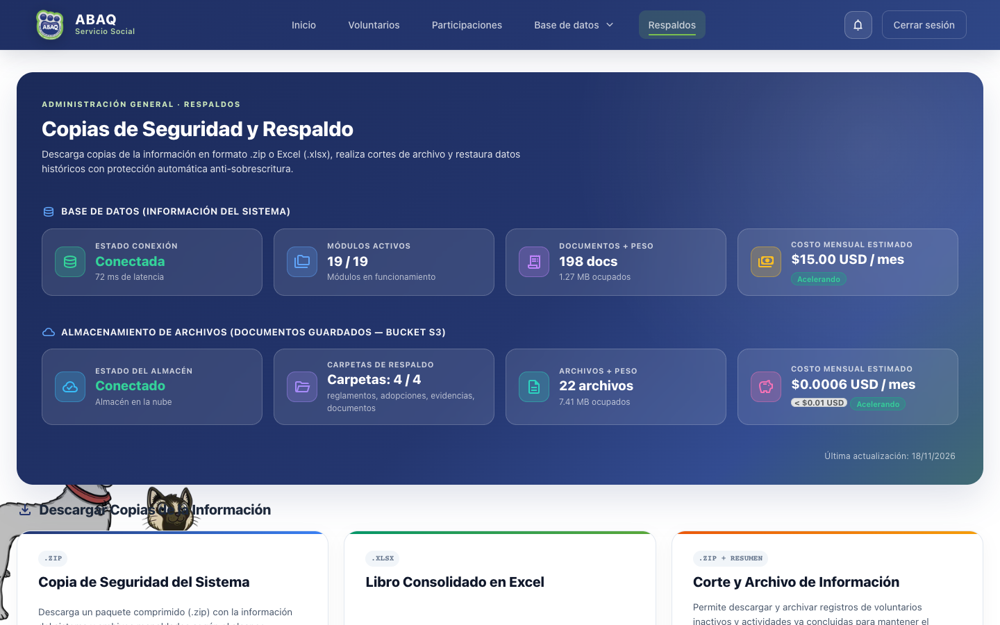

Los indicadores de **Base de datos (información del sistema)** son:

- **Estado conexión**: **Conectada** y latencia.
- **Módulos activos**: módulos en funcionamiento sobre el total.
- **Documentos + peso**: número de documentos y espacio ocupado.
- **Costo mensual estimado**.

Los indicadores de **Almacenamiento de archivos (documentos guardados — Bucket S3)** son:

- **Estado del almacén**: **Conectado**.
- **Carpetas de respaldo**: carpetas disponibles (reglamentos, adopciones, evidencias, documentos).
- **Archivos + peso**.
- **Costo mensual estimado**.

La fecha de **Última actualización** confirma la vigencia de los indicadores. Los costos son estimaciones operativas y pueden mostrar la etiqueta **Acelerando** mientras el sistema calcula el valor definitivo.

### 11.2 Descargas de información

La sección **Descargar Copias de Información** ofrece tres productos:

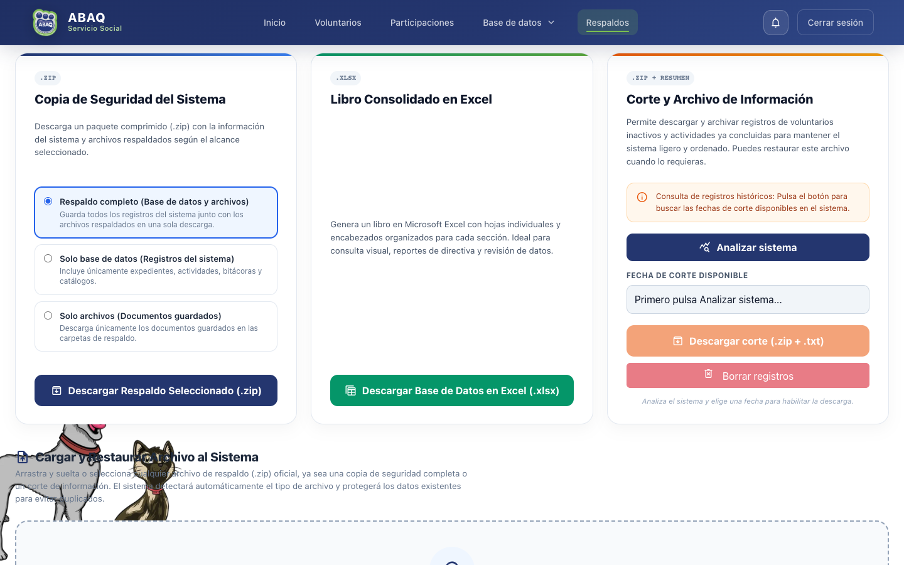

1. **Copia de Seguridad del Sistema** (`.zip`): permite elegir el alcance.
    - **Respaldo completo (Base de datos y archivos)**.
    - **Solo base de datos (Registros del sistema)**.
    - **Solo archivos (Documentos guardados)**.
    - Pulse **Descargar Respaldo Seleccionado (.zip)**.
2. **Libro Consolidado en Excel** (`.xlsx`): genera un libro con hojas individuales y encabezados organizados por sección. Pulse **Descargar Base de Datos en Excel (.xlsx)**.
3. **Corte y Archivo de Información** (`.zip` + resumen): descarga registros históricos y permite archivar voluntarios inactivos y actividades concluidas.

Descargue el respaldo completo antes de cualquier cambio masivo, actualización del sistema o restauración. Conserve los archivos en un medio institucional seguro y con control de acceso.

### 11.3 Corte y archivo de información

El bloque **Corte y Archivo de Información** permite analizar el sistema y generar un corte de registros históricos.

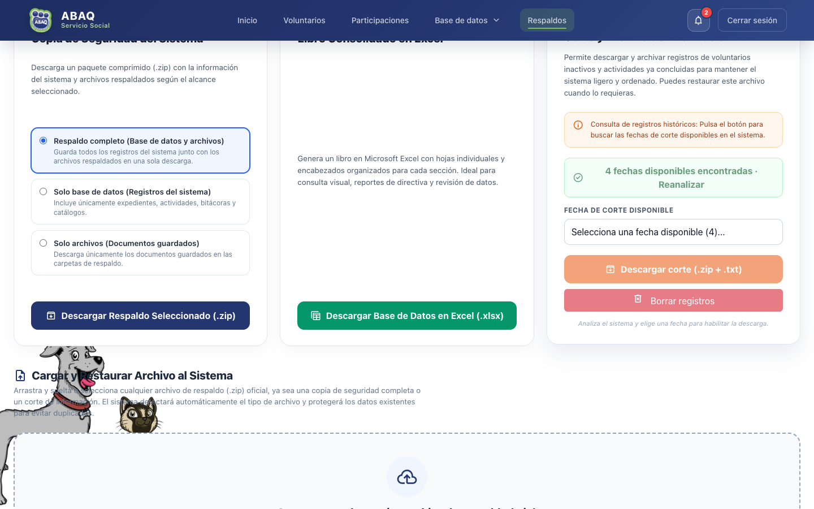

1. Pulse **Analizar sistema**. El botón cambia a **Reanalizar** cuando ya existe un análisis.
2. El sistema muestra las **fechas de corte disponibles** (por ejemplo, **4 fechas disponibles encontradas**).
3. Seleccione una fecha en **Fecha de corte disponible**.
4. Pulse **Descargar corte (.zip + .txt)** para obtener el archivo y su resumen.
5. La opción **Borrar registros** elimina del sistema los registros incluidos en el corte.

!!! danger "El borrado de registros es irreversible"

    **Borrar registros** elimina información histórica del sistema. Ejecute esta acción únicamente después de descargar y verificar el corte, y con autorización expresa de la Coordinación. El sistema protege contra duplicados, pero no recupera registros borrados sin un respaldo previo.

### 11.4 Restauración de un respaldo

La sección **Cargar y Restaurar Archivo al Sistema** permite restaurar una copia de seguridad completa o un corte de información.

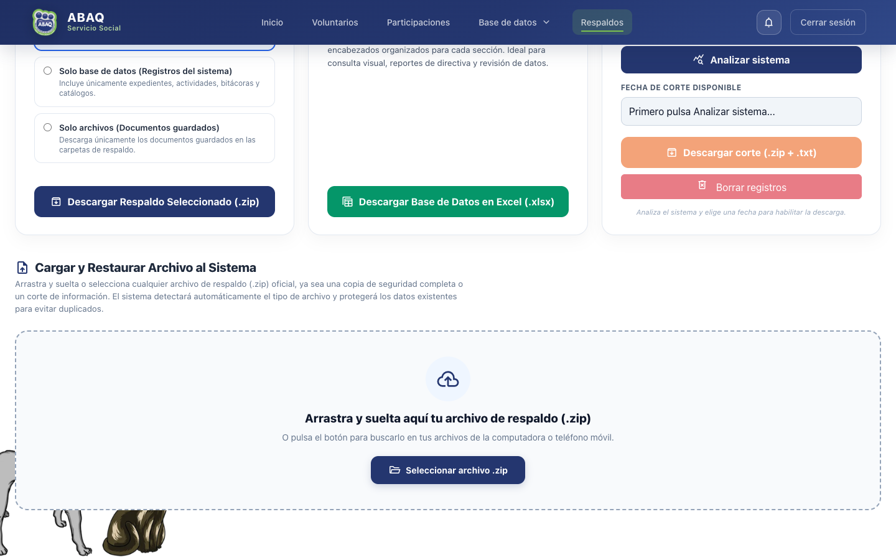

1. Arrastre el archivo `.zip` al área de carga o pulse **Seleccionar archivo .zip**.
2. El sistema detecta automáticamente el tipo de archivo (respaldo completo o corte).
3. Confirme la restauración y espere a que termine el proceso.

La restauración protege los datos existentes para evitar duplicados. No interrumpa el proceso ni cierre la sesión mientras el sistema lo indique. Al finalizar, verifique los módulos principales (voluntarios, participaciones, pláticas, campañas y adopciones) antes de reanudar la operación.

!!! warning "Restauración y datos posteriores"

    Restaurar un respaldo antiguo puede sobrescribir o dejar fuera información capturada después de la fecha del archivo. Descargue un respaldo actual antes de restaurar y coordine la ventana de mantenimiento con la Coordinación.

## 12. Centro de notificaciones

El ícono de campana de la barra superior abre el **Centro de Notificaciones ABAQ**, un panel lateral con el contador de no leídas.

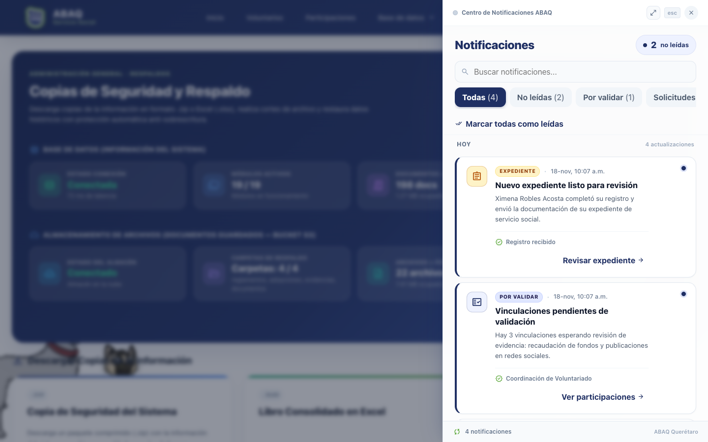

El centro incluye:

- **Buscador** de notificaciones.
- **Pestañas**: **Todas**, **No leídas**, **Por validar** y **Solicitudes**.
- **Marcar todas como leídas**.
- Notificaciones agrupadas por fecha (**HOY**), con categoría, hora, título, resumen y acción directa.

Las notificaciones administrativas más frecuentes son:

- **Expediente**: nuevo expediente listo para revisión.
- **Por validar**: vinculaciones pendientes de validación.
- **Solicitudes**: ingresos, correcciones o avisos de voluntarios.

Cada tarjeta ofrece una acción contextual, por ejemplo **Revisar expediente** o **Ver participaciones**, que conduce directamente al registro correspondiente. El botón de cerrar o la tecla `Esc` ocultan el panel.

!!! tip "Revisión diaria"

    Atienda el centro de notificaciones al inicio y al cierre de la jornada. Las solicitudes de ingreso y las vinculaciones tienen tiempos de respuesta institucionales; una revisión oportuna evita retrasos en las constancias y en el conteo de horas.

## 13. Buenas prácticas y seguridad

### 13.1 Protección de datos personales

La plataforma contiene identificaciones oficiales, comprobantes de domicilio, datos académicos y datos de contacto. Aplique las siguientes medidas:

- Acceda únicamente a los expedientes necesarios para la tarea asignada.
- No descargue documentos personales en equipos compartidos ni los envíe por canales no institucionales.
- No comparta capturas de pantalla con datos de voluntarios en redes sociales o mensajería personal.
- Cierre sesión al terminar y bloquee el equipo cuando se ausente.
- Reporte de inmediato cualquier acceso indebido o extravío de información.

### 13.2 Operación diaria

1. **Revise el panel de inicio** y el centro de notificaciones al comenzar la jornada.
2. **Atienda primero las solicitudes pendientes**: ingresos, vinculaciones y correcciones.
3. **Valide asistencias solo con evidencia**: lista firmada, registro fotográfico o comprobante institucional.
4. **Documente los rechazos e inactivaciones** con motivos claros y verificables.
5. **Verifique los folios** antes de aceptar, rechazar, inactivar o borrar.
6. **Confirme los datos de contacto** antes de enviar constancias o notificaciones.

### 13.3 Respaldos y continuidad

- Descargue un **respaldo completo** antes de actualizaciones, cortes o cambios masivos.
- Conserve los respaldos en un repositorio institucional con control de acceso.
- Ejecute **Analizar sistema** y descargue el corte antes de borrar registros históricos.
- Pruebe la restauración en un entorno controlado antes de aplicarla en producción.
- Registre en la bitácora institucional cualquier restauración, corte o incidencia.

## 14. Preguntas frecuentes

**¿Por qué las horas acreditadas no coinciden con las participaciones registradas?**

Porque solo las participaciones con estado `validated` generan horas. Las que están `registered`, `approved` o en revisión aún no se acreditan. Revise el detalle del expediente y la bandeja de participaciones.

**¿Puedo corregir una validación ya cerrada?**

La interfaz muestra **Evaluación cerrada** y no permite editar el registro. Si detecta un error, documente el caso con el folio de la participación y escálelo a la Coordinación de sistemas para una corrección controlada.

**¿Qué diferencia hay entre una convocatoria y una vinculación?**

La **convocatoria** es una actividad grupal publicada por la Coordinación; la **vinculación** es una participación individual registrada por el voluntario o por la Coordinación con evidencia documental. Ambas pueden acreditar horas, pero se gestionan en flujos distintos.

**¿Por qué un voluntario aparece como inactivo?**

Porque se aplicó una baja administrativa, concluyó su periodo o fue rechazado. Consulte la pestaña **Bitácora** del historial para conocer el motivo y la fecha del cambio de estado.

**¿Cómo reactivo una cuenta inactiva?**

La reactivación no se realiza desde el botón de inactivación. Escale el caso a la Coordinación de sistemas para revisar el expediente y, si procede, restaurar el acceso mediante el procedimiento institucional.

**¿Dónde se descargan las constancias?**

Las constancias de pláticas se abren desde **Ver constancia** en el padrón de asistentes. Las constancias de Servicio Social se consultan en el expediente del estudiante y se envían por correo al completar los hitos correspondientes.

**¿Qué hago si borré un registro por error?**

El borrado desde la interfaz es definitivo. Suspenda la operación, documente el registro afectado y recurra al respaldo más reciente. Si no existe respaldo, escale el caso a la Coordinación de sistemas.

**¿Los costos de respaldo que muestra el panel son definitivos?**

No. Son estimaciones operativas de la base de datos y del almacenamiento. La etiqueta **Acelerando** indica que el sistema aún está calculando el valor; consulte la facturación institucional para cifras definitivas.
