# Manual para Voluntario de Servicio Social

Este manual está dirigido a estudiantes universitarios que realizan su **Servicio Social** a través de la plataforma ABAQ Querétaro, en cumplimiento de las **480 horas curriculares reglamentarias**. Describe, paso a paso y con capturas de pantalla, todas las pantallas disponibles para este perfil: acceso, registro e inducción, panel de inicio, gestión de participaciones, registro de vinculaciones con conteo oficial de horas, expediente digital, notificaciones y uso desde dispositivos móviles.

!!! note "Convenciones utilizadas en este manual"

    - Los nombres de botones, pestañas y etiquetas aparecen entre comillas exactamente como se muestran en la interfaz.
    - Las cifras y folios que aparecen en las capturas pertenecen a una cuenta de demostración; en su cuenta verá sus propios datos.
    - El **folio institucional** (formato `SS-XXXXXXXX-XX`) identifica de forma única su expediente y se utiliza en constancias y comunicaciones con la Coordinación.

## Índice de capturas de pantalla

Este manual incluye las siguientes capturas de pantalla, en el orden en que aparecen:

| N.º | Archivo | Pantalla | Sección |
|-----|---------|----------|---------|
| 1 | `login.png` | Inicio de sesión en ABAQ | [2.1 Iniciar sesión](#21-iniciar-sesion) |
| 2 | `ss-12-registro-modalidad.png` | Selección de modalidad de colaborador | [3.1 Selección de modalidad](#31-seleccion-de-modalidad) |
| 3 | `ss-13-registro-credenciales.png` | Creación de credenciales de acceso | [3.2 Creación de credenciales](#32-creacion-de-credenciales) |
| 4 | `ss-14-onboarding-fase1.png` | Fase 1: perfil — creación de cuenta y datos personales | [3.3 Fase 1 · Perfil](#33-fase-1-perfil) |
| 5 | `ss-15-onboarding-datos-academicos.png` | Fase 1: perfil — datos académicos y redes sociales | [3.3 Fase 1 · Perfil](#33-fase-1-perfil) |
| 6 | `ss-16-onboarding-induccion.png` | Fase 2: módulos de inducción | [3.4 Fase 2 · Inducción](#34-fase-2-induccion) |
| 7 | `ss-17-onboarding-documentos.png` | Fase 4: documentos en la nube y consentimiento legal | [3.6 Fase 4 · Documentos y consentimientos](#36-fase-4-documentos-y-consentimientos) |
| 8 | `ss-18-onboarding-consentimientos.png` | Fase 4: reglamento firmado y aceptaciones | [3.6 Fase 4 · Documentos y consentimientos](#36-fase-4-documentos-y-consentimientos) |
| 9 | `ss-19-expediente-bienvenida.png` | Expediente aprobado y cuenta activada | [3.7 Aprobación del expediente](#37-aprobacion-del-expediente) |
| 10 | `ss-01-home-bienvenida.png` | Panel de inicio: bienvenida y métricas | [4.1 Bienvenida y métricas](#41-bienvenida-y-metricas) |
| 11 | `ss-02-home-pendientes.png` | Panel de inicio: actividades pendientes e historial | [4.2 Actividades pendientes e historial](#42-actividades-pendientes-e-historial) |
| 12 | `ss-03-home-graficas.png` | Panel de inicio: gráficas de progreso | [4.3 Gráficas de progreso](#43-graficas-de-progreso) |
| 13 | `ss-04-participaciones-convocatorias.png` | Mis participaciones: agenda y métricas | [5.1 Encabezado y agenda](#51-encabezado-y-agenda) |
| 14 | `ss-05-participaciones-tarjetas.png` | Mis participaciones: búsqueda, filtros e inscripción | [5.2 Búsqueda, filtros e inscripción](#52-busqueda-filtros-e-inscripcion) |
| 15 | `compartido-01-estado-inscrito.png` | Estados de una participación | [5.3 Estados de una participación](#53-estados-de-una-participacion) |
| 16 | `compartido-02-cancelar-asistencia.png` | Modal de cancelación de asistencia | [5.4 Cancelar asistencia](#54-cancelar-asistencia) |
| 17 | `ss-07-detalle-actividad.png` | Detalle de una actividad | [5.5 Detalle de una actividad](#55-detalle-de-una-actividad) |
| 18 | `ss-06-participaciones-historial.png` | Mi historial de participación | [5.6 Mi historial](#56-mi-historial) |
| 19 | `ss-08-modal-vinculacion.png` | Formulario «Registrar vinculación» | [6.1 Formulario de registro](#61-formulario-de-registro) |
| 20 | `ss-08b-modal-vinculacion-horas.png` | Campos dinámicos según la opción elegida | [6.2 Opciones de participación y campos dinámicos](#62-opciones-de-participacion-y-campos-dinamicos) |
| 21 | `ss-08c-modal-vinculacion-calculo.png` | Cálculo oficial de horas y comprobante | [6.3 Cálculo oficial de horas](#63-calculo-oficial-de-horas) |
| 22 | `compartido-03-detalle-vinculacion.png` | Seguimiento de una vinculación enviada | [6.4 Envío y seguimiento](#64-envio-y-seguimiento) |
| 23 | `ss-09-perfil-datos.png` | Expediente del estudiante: resumen y control de horas | [7.1 Resumen y control de horas](#71-resumen-y-control-de-horas) |
| 24 | `ss-10-perfil-documentos.png` | Expediente del estudiante: documentos y constancias | [7.2 Documentos del expediente](#72-documentos-del-expediente) |
| 25 | `ss-11-notificaciones.png` | Centro de notificaciones | [8. Notificaciones](#8-notificaciones) |
| 26 | `movil-03-home-ss.png` | Panel de inicio en dispositivo móvil | [9. Uso desde dispositivos móviles](#9-uso-desde-dispositivos-moviles) |
| 27 | `movil-04-menu-ss.png` | Menú de navegación en dispositivo móvil | [9. Uso desde dispositivos móviles](#9-uso-desde-dispositivos-moviles) |

## 1. Acerca de la plataforma

ABAQ es la plataforma institucional de gestión de voluntariado de ABAQ Querétaro. Permite inscribirse a convocatorias de actividades, registrar vinculaciones (adopciones, pláticas, campañas, difusión, recaudaciones, entre otras) y dar seguimiento al acreditamiento de horas.

Como **Voluntario de Servicio Social**, su objetivo en la plataforma es completar y ver acreditadas **480 horas reglamentarias**. Las horas se acumulan cuando la Coordinación valida sus participaciones; el sistema muestra en todo momento el avance de su servicio social.

!!! warning "Regla institucional importante"

    Dos meses de inactividad no previamente notificada causarán la **baja automática del programa**. Si no podrá participar durante un periodo prolongado, comuníquelo con antelación a la Coordinación de Voluntariado.

## 2. Acceso a la plataforma

### 2.1 Iniciar sesión

Para ingresar al portal, diríjase a la página de acceso de ABAQ y complete el formulario de inicio de sesión:

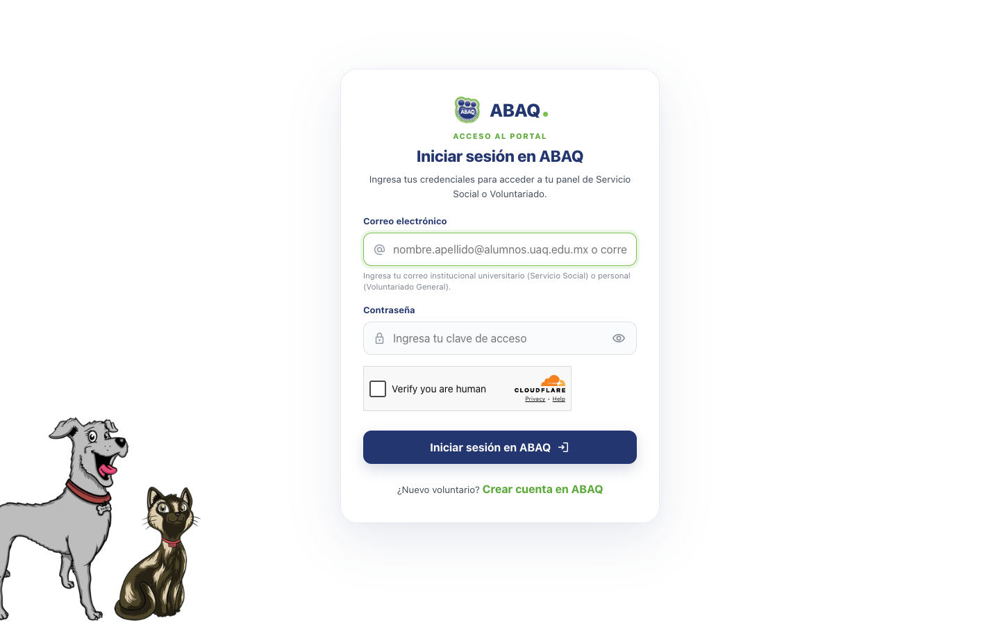

1. **Correo electrónico**: ingrese su correo institucional universitario (por ejemplo, `nombre.apellido@alumnos.uaq.edu.mx`). Este correo está vinculado a su expediente de 480 horas.
2. **Contraseña**: escriba su clave de acceso. El ícono del ojo permite mostrar u ocultar el texto.
3. **Verificación de seguridad**: complete la casilla **Verify you are human** de Cloudflare Turnstile, que protege el portal contra accesos automatizados.
4. Pulse el botón **Iniciar sesión en ABAQ**.

Si aún no dispone de una cuenta, pulse el enlace **¿Nuevo voluntario? Crear cuenta en ABAQ** y continúe con la sección 3 de este manual.

Al iniciar sesión correctamente, el sistema lo dirige al panel de inicio del estudiante (sección 4). La barra de navegación superior muestra las secciones **Inicio**, **Mis participaciones** y **Mi perfil**, junto con la campana de notificaciones y el botón **Cerrar sesión**.

## 3. Registro de una nueva cuenta y onboarding

El registro se realiza una sola vez y consta de una pantalla inicial de credenciales seguida de **cuatro fases** guiadas: perfil, inducción, «sobre mí» y documentos. Cada fase se guarda automáticamente a medida que se completa, lo que se indica con la etiqueta **Guardado**.

### 3.1 Selección de modalidad

La primera pantalla del registro pregunta **¿Cómo te gustaría colaborar?**

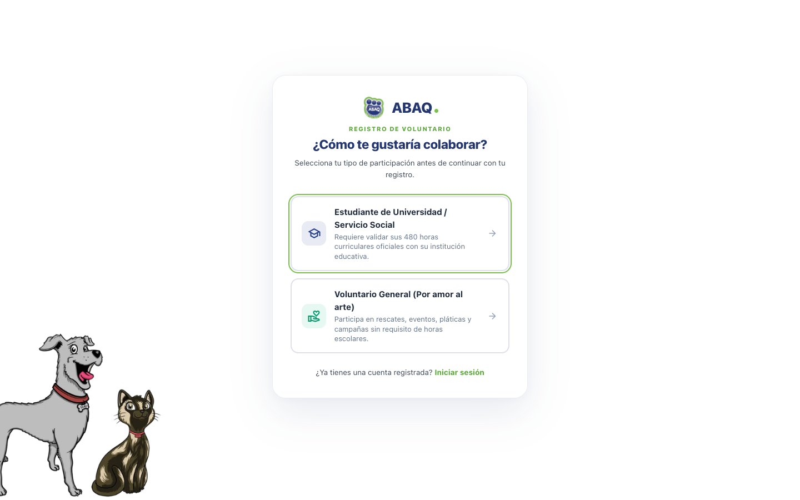

Seleccione la opción **Estudiante de Universidad / Servicio Social**, indicada para quienes deben validar sus 480 horas curriculares oficiales con su institución educativa. Si ya tiene una cuenta registrada, pulse **Iniciar sesión**.

### 3.2 Creación de credenciales

A continuación, la plataforma solicita las credenciales de acceso de la cuenta:

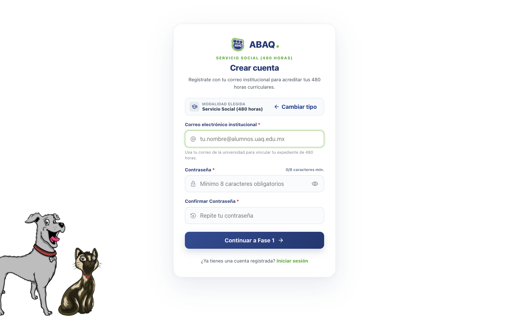

1. Verifique que la modalidad elegida sea **Servicio Social (480 horas)**; si no lo es, pulse **Cambiar tipo** para regresar a la selección anterior.
2. **Correo electrónico institucional** (obligatorio): registre su correo `@alumnos.uaq.edu.mx` u otro dominio institucional. La plataforma indica que este correo es el que vincula su expediente de 480 horas.
3. **Contraseña** (obligatoria): mínimo 8 caracteres. El contador muestra el avance (por ejemplo, «0/8 caracteres mín.»).
4. **Confirmar Contraseña**: repita la contraseña para validarla.
5. Pulse **Continuar a Fase 1**.

### 3.3 Fase 1 · Perfil

La Fase 1, titulada **Perfil Académico**, se organiza en cuatro subsecciones: **01 · Creación de cuenta**, **02 · Datos personales**, **03 · Datos académicos** y **04 · Redes sociales**. La barra superior muestra el avance de las cuatro fases del registro, y el menú lateral izquierdo permite desplazarse entre subsecciones.

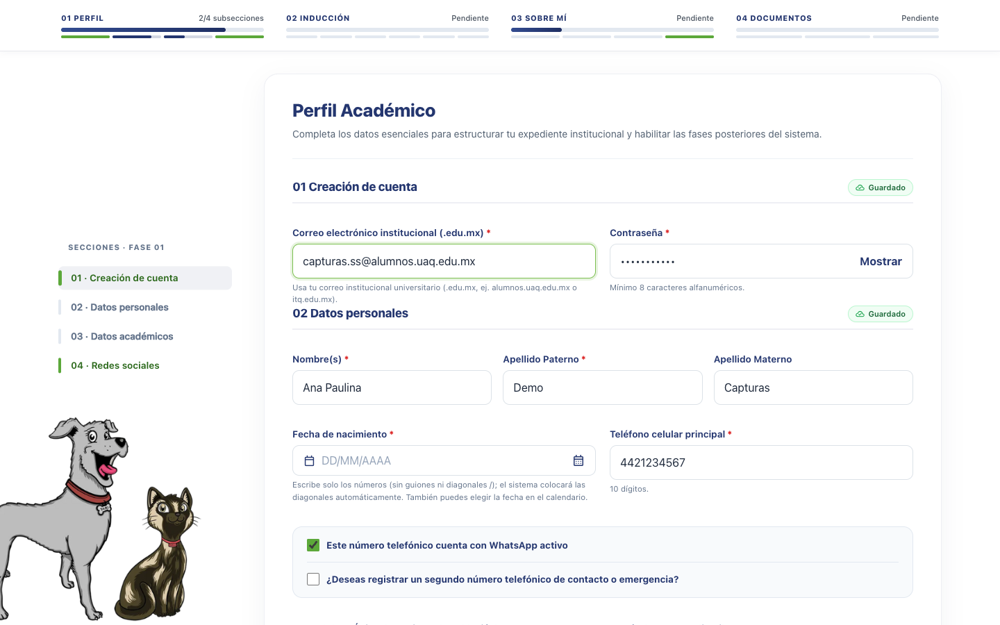

En esta fase se capturan, entre otros datos:

- **Correo electrónico institucional** y **contraseña**, ya registrados en el paso anterior.
- **Nombre(s)**, **Apellido Paterno** y **Apellido Materno**.
- **Fecha de nacimiento**, escrita solo con números (el sistema coloca las diagonales automáticamente) o elegida en el calendario.
- **Teléfono celular principal** de 10 dígitos, con la casilla opcional **Este número telefónico cuenta con WhatsApp activo** y la posibilidad de registrar un segundo número de contacto o emergencia.

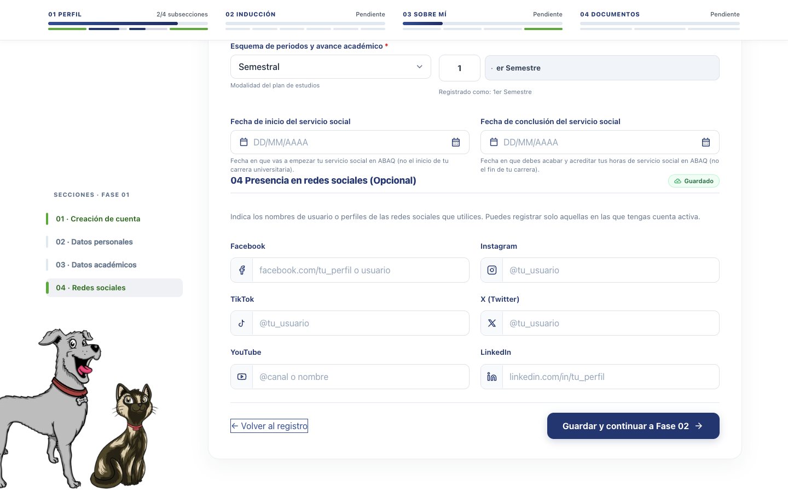

En la subsección de datos académicos se registran:

- **Esquema de periodos y avance académico**: modalidad del plan de estudios (por ejemplo, **Semestral**) y el semestre registrado.
- **Fecha de inicio del servicio social**: la fecha en que iniciará su servicio social en ABAQ (no el inicio de su carrera universitaria).
- **Fecha de conclusión del servicio social**: la fecha límite en que deberá haber acreditado sus horas en ABAQ.

La subsección **04 · Presencia en redes sociales (Opcional)** permite registrar los perfiles de Facebook, Instagram, TikTok, X (Twitter), YouTube y LinkedIn que la institución podrá consultar para tareas de difusión. Finalice pulsando **Guardar y continuar a Fase 02**; el botón **Volver al registro** regresa a la pantalla de credenciales.

### 3.4 Fase 2 · Inducción

La Fase 2 comprende los **Módulos de Inducción ABAQ**: seis temas formativos de bienestar animal, cada uno con **tres reflexiones de aprendizaje** que se responden por escrito.

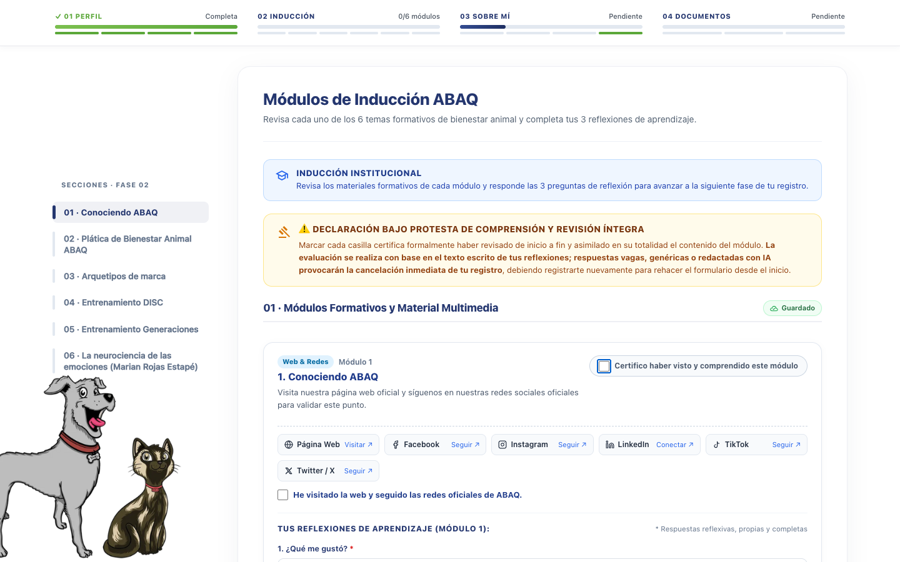

Los módulos son:

1. Conociendo ABAQ
2. Plática de Bienestar Animal ABAQ
3. Arquetipos de marca
4. Entrenamiento DISC
5. Entrenamiento Generaciones
6. La neurociencia de las emociones (Marian Rojas Estapé)

Cada módulo incluye material multimedia y enlaces de consulta (página web y redes sociales oficiales). Para validar un módulo, marque la casilla **Certifico haber visto y comprendido este módulo** y responda las tres reflexiones de aprendizaje.

!!! warning "Declaración bajo protesta de comprensión"

    Marcar cada casilla certifica formalmente haber revisado el contenido del módulo de inicio a fin. La evaluación se realiza con base en el texto escrito de sus reflexiones: respuestas vagas, genéricas o redactadas con inteligencia artificial provocarán la **cancelación inmediata del registro**, debiendo registrarse nuevamente para rehacer el formulario desde el inicio.

### 3.5 Fase 3 · Sobre mí

En esta fase la plataforma recopila información complementaria para su expediente: semblanza, intereses, talentos y habilidades, aportes que espera realizar a ABAQ, experiencia previa con animales de compañía y motivación institucional. Complete los campos y continúe a la Fase 4.

### 3.6 Fase 4 · Documentos y consentimientos

La Fase 4 finaliza el expediente con la carga de documentos y la aceptación de la normativa institucional.

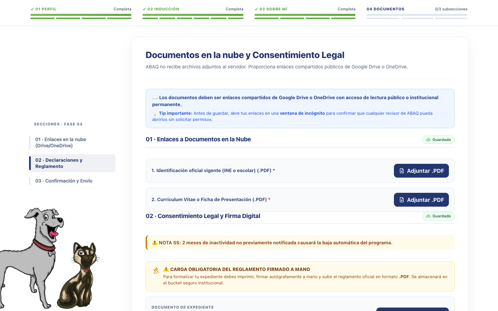

Esta fase incluye:

- **Documentos de registro**: identificación oficial vigente (INE o escolar) y currículum vitae o ficha de presentación, ambos en formato `.PDF`, mediante los botones **Adjuntar .PDF**.
- **Consentimiento legal y firma digital**: aceptación del aviso de privacidad, del reglamento y de los términos y condiciones de la plataforma.

Además:

- **Reglamento firmado a mano (obligatorio .PDF)**: descargue el reglamento oficial con el enlace **Descargar Reglamento Oficial (.pdf)**, imprímalo, fírmelo autógrafamente y cárguelo con el botón **Cargar archivo .PDF**. Este paso es obligatorio para formalizar su expediente.
- Marque las casillas **He leído y acepto el Aviso de Privacidad y Manejo de Datos**, **He leído y acepto el Reglamento** y **He leído y acepto los Términos y Condiciones de la Plataforma**; los enlaces **Leer aviso**, **Leer reglamento** y **Leer términos** permiten consultar cada documento antes de aceptarlo.
- Complete la verificación **Verify you are human** y pulse **Finalizar y crear cuenta en ABAQ**.

### 3.7 Aprobación del expediente

Una vez que la Coordinación de ABAQ Querétaro revisa y valida sus datos y documentos, la plataforma muestra la pantalla de bienvenida con la activación de su cuenta:

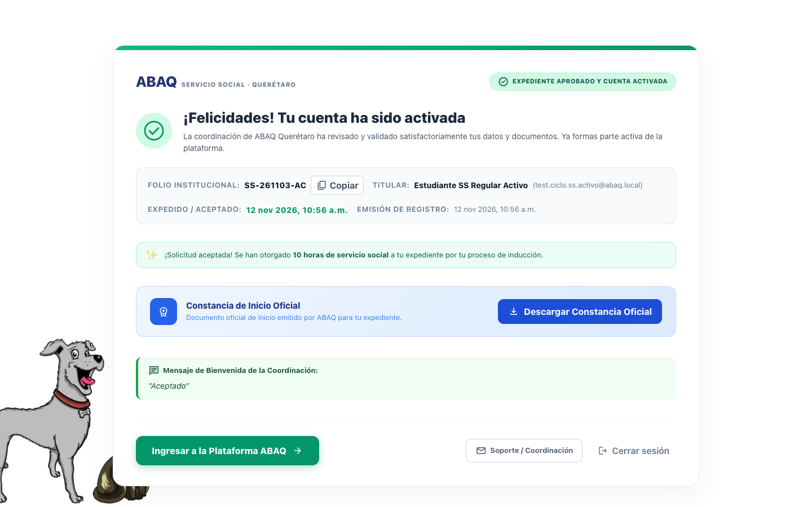

En esta pantalla podrá:

- Consultar y copiar su **folio institucional** (botón **Copiar**), que lo identifica en todo el sistema.
- Confirmar la concesión de **10 horas de servicio social** otorgadas por completar el proceso de inducción.
- Descargar la **Constancia de Inicio Oficial** mediante el botón **Descargar Constancia Oficial**.
- Leer el mensaje de bienvenida de la Coordinación.
- Ingresar a la plataforma con el botón **Ingresar a la Plataforma ABAQ**.

## 4. Panel de inicio

La sección **Inicio** concentra el resumen de su servicio social: métricas de avance, actividades pendientes, historial y gráficas de progreso.

### 4.1 Bienvenida y métricas

El encabezado del panel, identificado como **PANEL DE ESTUDIANTE**, muestra el saludo con su nombre y su folio institucional, y las siguientes métricas:

| Métrica | Descripción |
|---------|-------------|
| **Participaciones validadas** | Total de participaciones aprobadas y acreditadas. |
| **Participaciones en revisión** | Total de participaciones en proceso de validación por la Coordinación. |
| **Horas acreditadas** | Horas validadas hasta el momento, con la meta de **480 h reglamentarias** como referencia. |
| **Horas pendientes** | Horas por completar para finalizar el servicio social. |
| **Progreso** | Porcentaje de servicio social completado. |

Debajo del encabezado, la tarjeta **Información del estudiante** resume sus datos de perfil: nombre completo, correo personal, correo institucional, teléfono, fecha de nacimiento, escuela, carrera, semestre y auditor asignado.

### 4.2 Actividades pendientes e historial

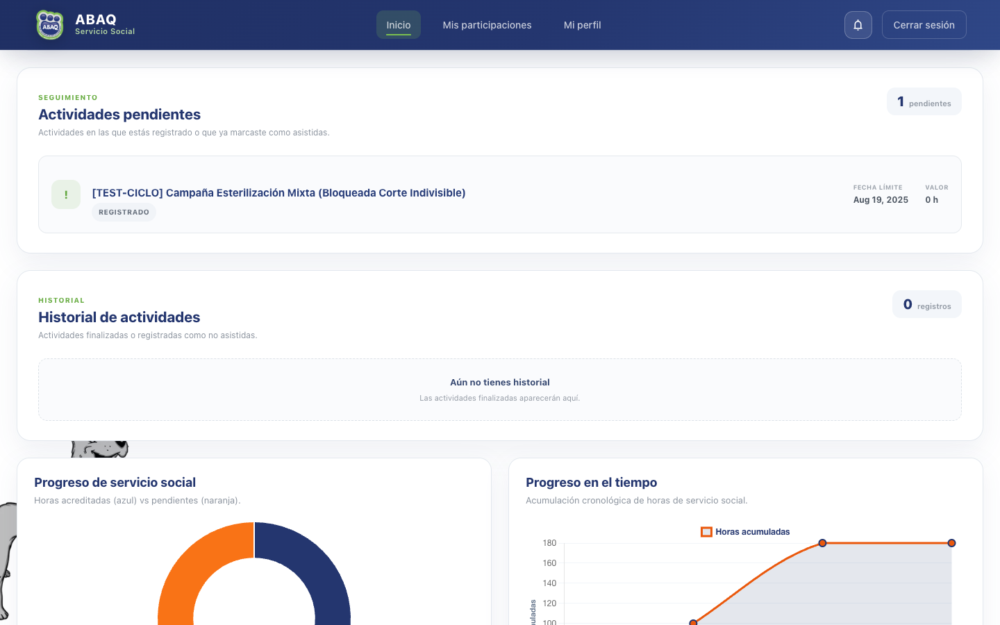

- **Actividades pendientes**: actividades en las que está registrado o que ya marcó como asistidas y que requieren su atención. Cada elemento indica el nombre de la actividad, su estado (por ejemplo, **REGISTRADO**), la **fecha límite** y el valor en horas.
- **Historial de actividades**: actividades finalizadas o registradas como no asistidas. Mientras no existan registros se muestra el aviso **Aún no tienes historial**.

### 4.3 Gráficas de progreso

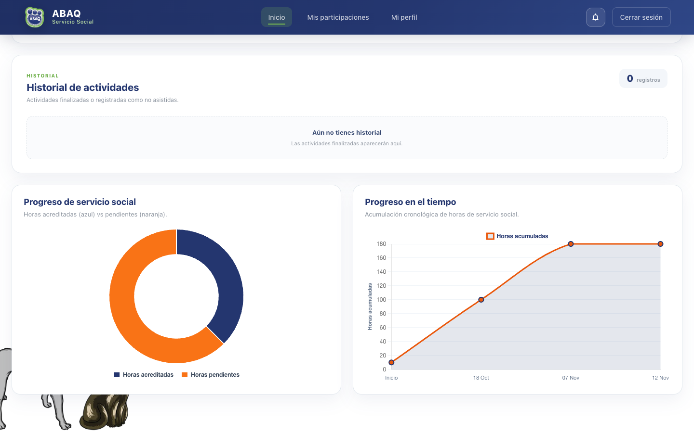

Al final del panel se presentan dos gráficas:

- **Progreso de servicio social**: gráfica de dona que compara las horas acreditadas (azul) contra las horas pendientes (naranja).
- **Progreso en el tiempo**: gráfica de línea con la acumulación cronológica de horas de servicio social desde su inicio hasta la fecha actual.

## 5. Mis participaciones

La sección **Mis participaciones** es el centro de gestión de sus convocatorias y vinculaciones.

### 5.1 Encabezado y agenda

El encabezado ofrece:

- Los botones **Ver actividades para inscribirme** y **Registrar vinculación**.
- Las píldoras de resumen: **participaciones en total**, **próximas en mi agenda**, **en revisión**, **validadas** y **horas acumuladas de 480 h**.
- **Tu agenda de participación**: las convocatorias a las que se inscribió y las vinculaciones programadas para la semana en curso y la siguiente, organizadas por bloques **ESTA SEMANA** y la semana posterior. Cada tarjeta indica la fecha (por ejemplo, **HOY Mar 17 Nov**), el horario, el botón **Agregar al calendario**, el folio con su identificador `OP-…`, la categoría de la actividad, el cupo y el avance de su trámite, con los botones **Ver detalles**, **Ver asistentes** y **Cancelar asistencia**.

### 5.2 Búsqueda, filtros e inscripción

Bajo la agenda se encuentran las dos pestañas de la lista de participaciones:

- **Para inscribirme y recientes**: convocatorias abiertas y vinculaciones recientes.
- **Mi historial**: participaciones de semanas anteriores (sección 5.6).

La lista dispone de:

- **Buscador**: «Buscar por nombre de actividad, lugar, opción o folio…».
- **Filtros**: **Todas**, **Convocatorias** y **Vinculaciones**, con contador de resultados.
- **Ordenar por**: por ejemplo, **Más recientes primero**.

Cada tarjeta de convocatoria abierta muestra el folio, la etiqueta de estado (por ejemplo, **Convocatoria abierta**), la categoría (por ejemplo, **LIMPIEZA DE REFUGIO**), la fecha, el horario, los inscritos y el cupo, así como las horas que suma la actividad. El botón verde **Inscribirme** registra su participación de inmediato.

!!! note "Estados que impiden inscribirse"

    Si la convocatoria ya no admite registros, el sistema lo indica en el propio botón: **Cuenta inactiva** cuando su expediente no está activo, o **Lugares agotados** cuando el cupo se ha llenado. El botón **Volver a inscribirme** aparece en convocatorias en las que canceló su asistencia previamente y que aún admiten lugares.

### 5.3 Estados de una participación

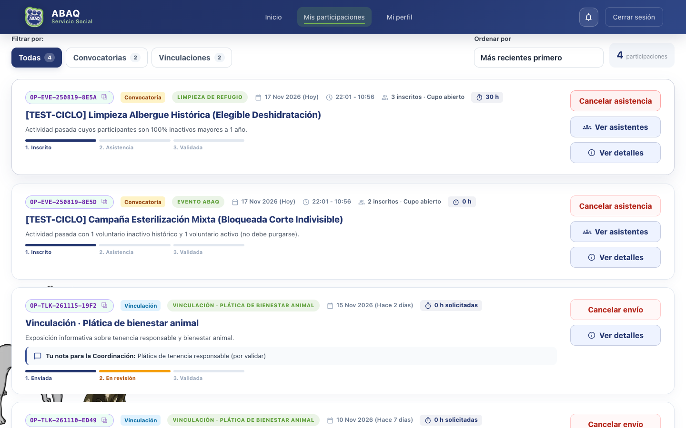

Cada participación muestra una barra de avance con su etapa actual:

| Tipo | Pipeline de estados |
|------|---------------------|
| **Convocatorias** | 1. **Inscrito** → 2. **Asistencia** (o **No asistió**) → 3. **Validada** |
| **Vinculaciones** | 1. **Enviada** → 2. **En revisión** → 3. **Validada** (o **Rechazada**) |

Las vinculaciones muestran además la nota registrada para la Coordinación («Tu nota para la Coordinación: …») y el botón **Cancelar envío**, disponible mientras la solicitud no ha sido validada. En convocatorias inscritas, el botón **Cancelar asistencia** libera su lugar.

### 5.4 Cancelar asistencia

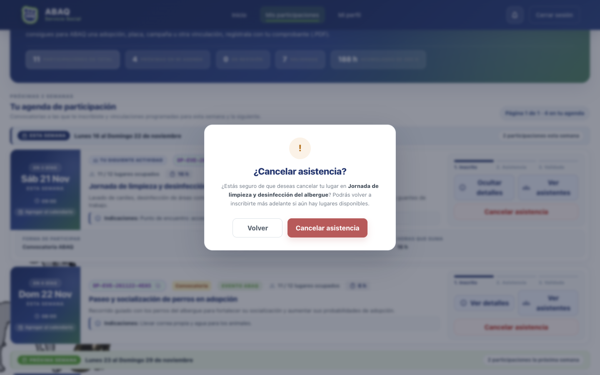

Al pulsar **Cancelar asistencia**, la plataforma solicita confirmación con el mensaje **¿Cancelar asistencia?**, advirtiendo que podrá volver a inscribirse más adelante si aún hay lugares disponibles. Pulse **Volver** para desistir o **Cancelar asistencia** para confirmar la operación.

### 5.5 Detalle de una actividad

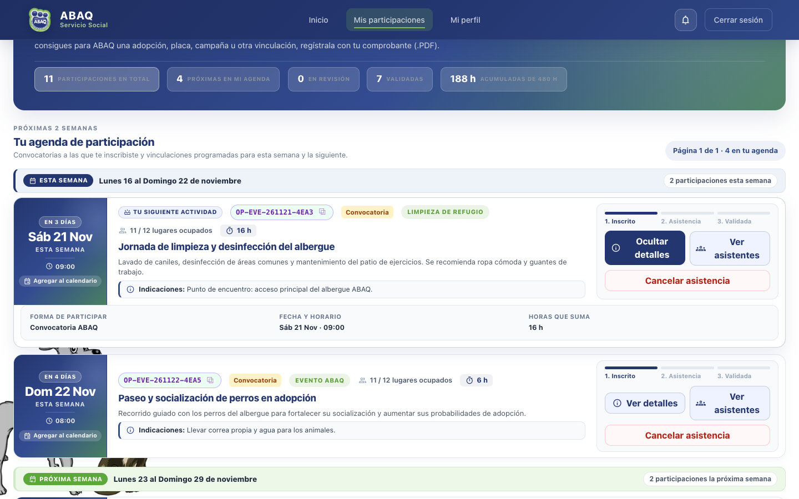

El botón **Ver detalles** expande la tarjeta y muestra la ficha resumen de la participación:

- **Forma de participar**: convocatoria ABAQ o el tipo de vinculación registrado.
- **Fecha y horario** de la actividad.
- **Horas que suma**: valor en horas que la participación aportará a su servicio social al validarse.

### 5.6 Mi historial

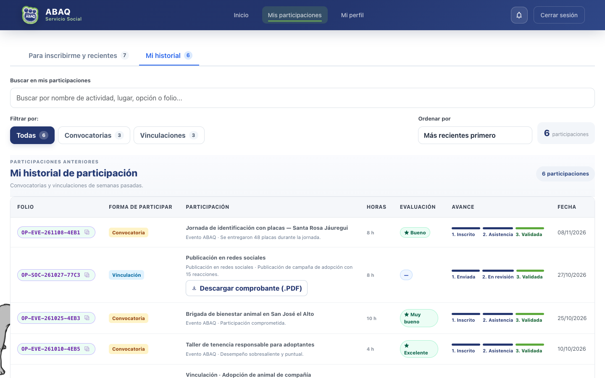

La pestaña **Mi historial** presenta la tabla **Mi historial de participación** con las participaciones anteriores, organizadas por las columnas:

| Columna | Contenido |
|---------|-----------|
| **Folio** | Identificador único de la participación (por ejemplo, `OP-TLK-261110-ED49`). |
| **Forma de participar** | Convocatoria o vinculación. |
| **Participación** | Nombre de la actividad y descripción breve. |
| **Horas** | Horas asociadas a la participación. |
| **Evaluación** | Resultado de la validación cuando aplica. |
| **Avance** | Barra con el pipeline de estados. |
| **Fecha** | Fecha de registro de la participación. |

Las vinculaciones incluyen el botón **Descargar comprobante (.PDF)** para recuperar el documento enviado a la Coordinación.

## 6. Registro de vinculaciones

Una **vinculación** es cualquier apoyo concreto que ofrece a ABAQ fuera de una convocatoria publicada: adopciones, placas, campañas, pláticas, difusión, publicaciones en redes, recaudaciones o apoyos administrativos. Las vinculaciones requieren un comprobante en formato `.PDF` y se acreditan únicamente tras la revisión de la Coordinación.

### 6.1 Formulario de registro

Abra el formulario con el botón **Registrar vinculación** (disponible en el encabezado de **Mis participaciones** y en el menú móvil). El formulario incluye:

1. **Proceso de verificación institucional**: aviso de que el registro no se acredita de forma automática; al enviarlo, la Coordinación de Voluntariado revisará su evidencia y emitirá su acreditación oficial sumando horas curriculares.
2. **Identificación del expediente**: la tarjeta azul confirma el expediente activo con conteo de horas curriculares, por ejemplo **[SS-261103-AC] Estudiante SS Regular Activo**.
3. **¿Cómo participaste?**: lista de opciones de participación.
4. **Documento comprobante (.PDF)**: área para arrastrar y soltar el archivo, o el botón **Examinar archivo**. El documento debe ser oficial, en formato `.PDF` con un máximo de 15 MB, y se envía a resguardo cifrado en el repositorio institucional.
5. **Nota para la Coordinación (opcional)**: descripción breve de la labor realizada.
6. Los botones **Cancelar** y **Enviar a revisión de Coordinación**.

### 6.2 Opciones de participación y campos dinámicos

Al elegir una opción, el formulario despliega los campos que corresponden a esa modalidad. Por ejemplo, la opción **9. Recaudación de fondos o donación en especie** solicita la **fecha de la recaudación** y el **monto recaudado en MXN**, y muestra el aviso **1 hora por cada $50 recaudados** con la nota de que la recaudación debe haber sido previamente acordada y contar con la evidencia correspondiente.

### 6.3 Cálculo oficial de horas

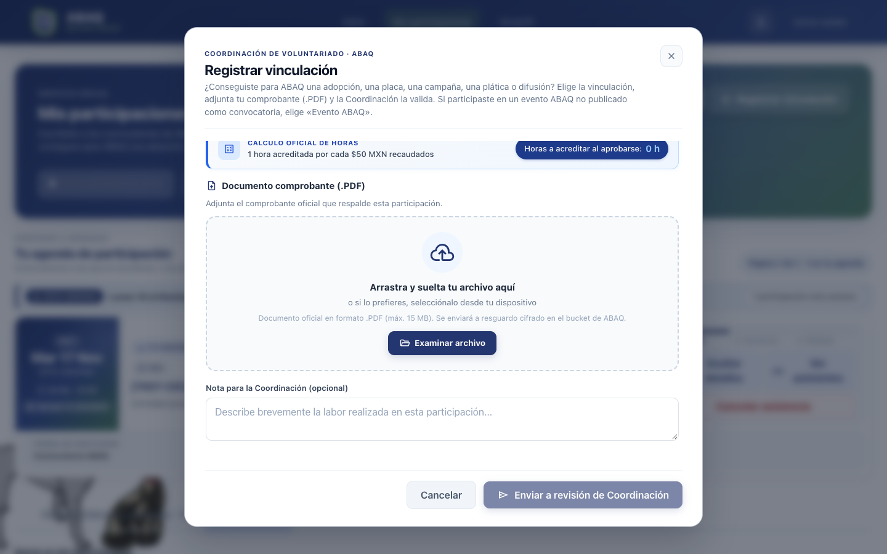

Para los estudiantes de Servicio Social, el formulario muestra el recuadro **CÁLCULO OFICIAL DE HORAS** con la regla de acreditación de la opción elegida y el resultado estimado en la insignia **Horas a acreditar al aprobarse: X h**. Las reglas institucionales por opción son:

| Opción | Regla de acreditación |
|--------|------------------------|
| 1. Evento ABAQ (inscripción a convocatoria) | Multiplicador según la categoría del evento: **2×** en campaña de esterilización, apoyo a refugio (paseo), módulo de adopción, plática de bienestar animal y otros eventos; **4×** en apoyo a refugio (limpieza). Las horas acreditadas se calculan sobre cada hora de reloj realizada. |
| 2. Placas de identificación | **5 h** por cada placa colocada. |
| 3. Campaña de esterilización y/o vacunación | **10 h** por cada animal de compañía esterilizado. |
| 4. Adopción de animal de compañía | **100 h** por adopción; se acreditan al concluir los **15 días** de periodo de prueba. |
| 5. Coordinar módulo de adopción | **40 h** por cada módulo coordinado. |
| 6. Plática de bienestar animal | **50 h** fijas cuando el aforo alcanza al menos **50 participantes**; **0 h** si el aforo es menor. |
| 7. Difusión en medios | **30 h** fijas por cobertura o difusión. |
| 8. Publicación en redes sociales | **5 h** base más **1 h** por cada 5 reacciones obtenidas. |
| 9. Recaudación de fondos o donación en especie | **1 h** por cada **$50 MXN** recaudados. |
| 10. Apoyo administrativo | Asignación manual de horas autorizada por la Coordinación. |

!!! note "Horas de inducción"

    Además de las vinculaciones, el proceso de inducción otorga **10 horas de servicio social** al aprobarse su expediente (véase la sección 3.7).

### 6.4 Envío y seguimiento

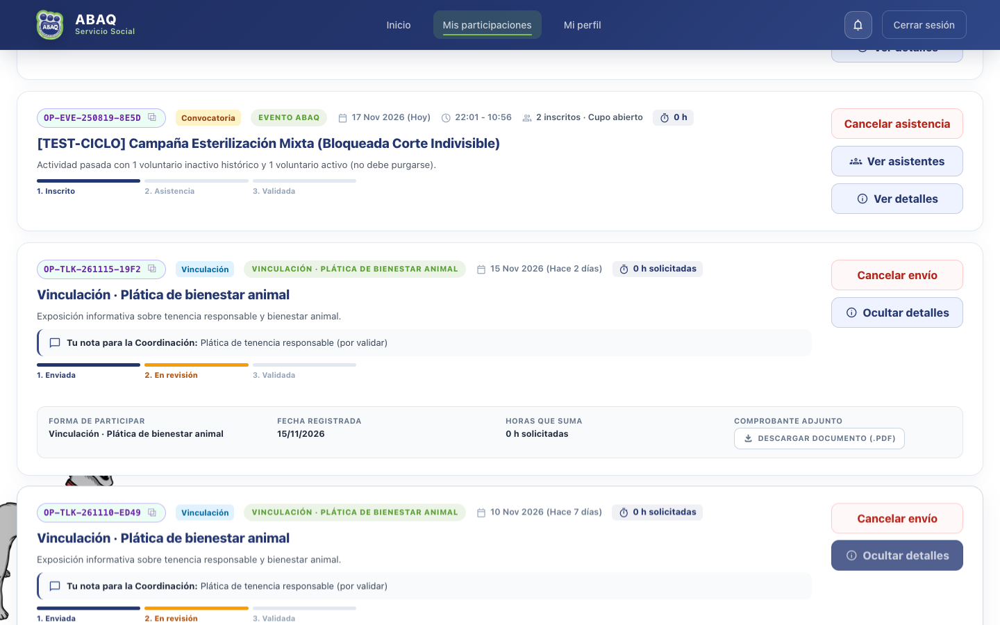

Al enviar el formulario, la vinculación queda en el estado **1. Enviada** y pasa a **2. En revisión** mientras la Coordinación verifica la evidencia. Desde la tarjeta expandida (**Ocultar detalles**) podrá consultar:

- **Forma de participar**: tipo de vinculación registrada.
- **Fecha registrada**.
- **Horas que suma**: horas solicitadas para acreditarse.
- **Comprobante adjunto**: botón **DESCARGAR DOCUMENTO (.PDF)** para recuperar su comprobante.

Cuando la Coordinación aprueba la vinculación, el estado pasa a **3. Validada** y las horas se acreditan a su expediente; si la rechaza, verá el estado **Rechazada** con la posibilidad de corregir y volver a enviar.

## 7. Mi perfil

La sección **Mi perfil** presenta el expediente institucional del estudiante: estatus, control de horas, datos generales y documentos oficiales.

### 7.1 Resumen y control de horas

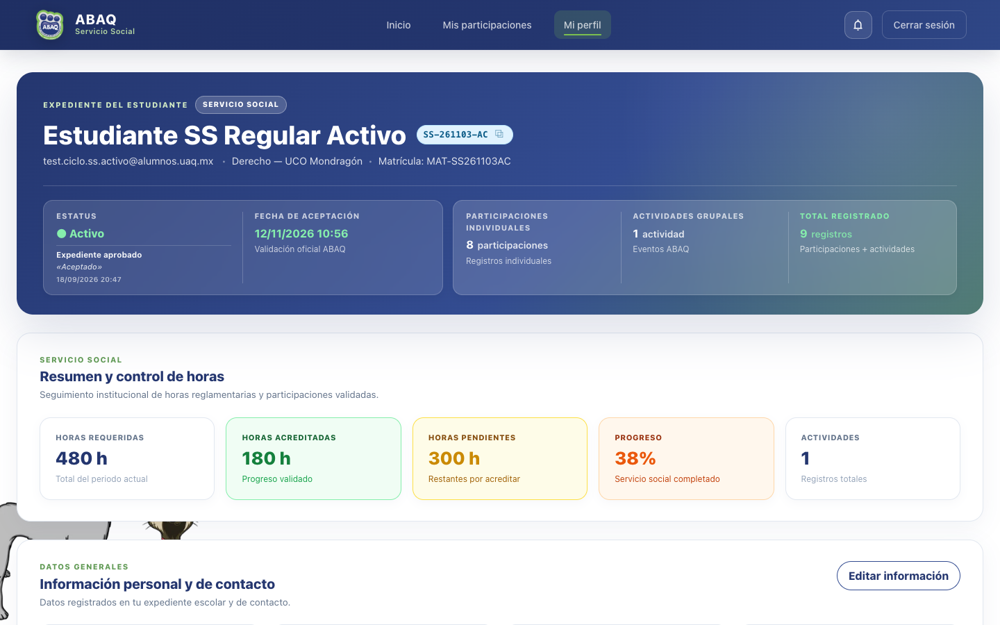

El encabezado del expediente muestra:

- **Estatus** de la cuenta (por ejemplo, **Activo**) y el resultado de la última revisión (**Expediente aprobado «Aceptado»**).
- **Fecha de aceptación** con la validación oficial de ABAQ.
- **Participaciones individuales**, **actividades grupales** y **total registrado**.

El recuadro **Resumen y control de horas** concentra el seguimiento institucional:

| Indicador | Descripción |
|-----------|-------------|
| **Horas requeridas** | Total del periodo actual: **480 h**. |
| **Horas acreditadas** | Progreso validado por la Coordinación. |
| **Horas pendientes** | Horas restantes por acreditar. |
| **Progreso** | Porcentaje de servicio social completado. |
| **Actividades** | Registros totales del expediente. |

La tarjeta **Información personal y de contacto** muestra sus datos generales con el botón **Editar información**, que permite actualizar el **correo personal** y el **teléfono**. Los datos escolares (escuela, carrera, matrícula) provienen de su registro y solo pueden corregirse a través de la Coordinación.

### 7.2 Documentos del expediente

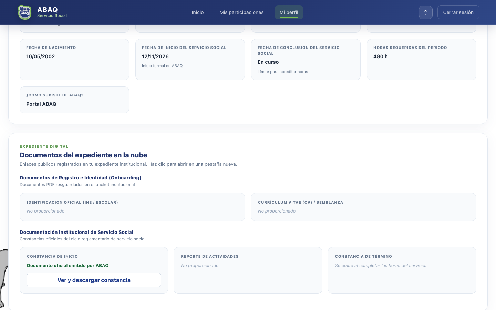

La sección **Expediente digital** organiza los documentos oficiales:

- **Fechas del servicio social**: fecha de nacimiento, **fecha de inicio del servicio social** (inicio formal en ABAQ), **fecha de conclusión del servicio social** (límite para acreditar horas) y horas requeridas del periodo.
- **Documentos de registro e identidad (onboarding)**: identificación oficial (INE o escolar) y currículum vitae o semblanza.
- **Documentación institucional de servicio social**:
    - **Constancia de Inicio**: documento oficial emitido por ABAQ, disponible con el botón **Ver y descargar constancia**.
    - **Reporte de actividades**: documento del periodo cuando aplique.
    - **Constancia de Término**: **se emite al completar las horas del servicio**; la plataforma la habilita cuando sus horas pendientes llegan a cero.

## 8. Notificaciones

El ícono de campana de la barra de navegación abre el **Centro de Notificaciones ABAQ**, un panel lateral con:

- **Contador de no leídas** junto al título **Notificaciones**.
- **Buscador** de notificaciones.
- **Filtros**: **Todas**, **No leídas**, **Convocatorias** y **Vinculaciones**.
- La acción **Marcar todas como leídas**.

En este centro recibirá sus aceptaciones de expediente, constancias, avisos institucionales y el resumen semanal de actividades. Las notificaciones le informan, por ejemplo, de la validación de una vinculación, de la aprobación de su expediente o de la emisión de una constancia.

!!! note "Filtros por rol"

    En la cuenta de Voluntario de Servicio Social, los filtros del centro de notificaciones corresponden al contexto de **Mi Servicio Social**.

## 9. Uso desde dispositivos móviles

La plataforma es responsiva y adapta todas sus secciones a pantallas de teléfonos y tabletas.

En pantallas móviles, la barra de navegación se simplifica al logotipo de ABAQ, la campana de notificaciones y el botón de menú. El panel de inicio presenta las métricas (participaciones validadas, en revisión, horas acreditadas con su meta de 480 h, horas pendientes y progreso) en tarjetas apiladas.

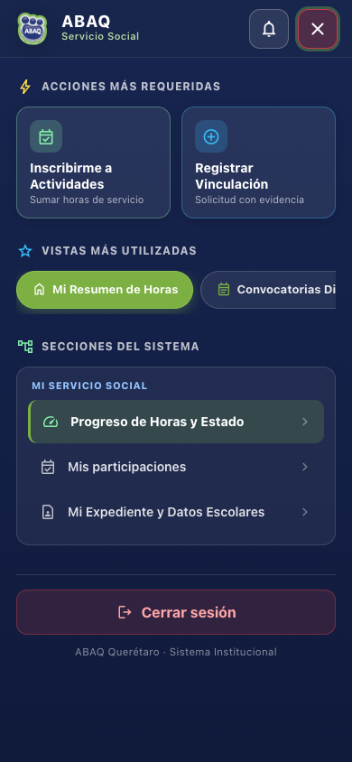

El botón de menú despliega la navegación completa, organizada en:

- **Acciones más requeridas**: **Inscribirme a Actividades** (para sumar horas de servicio) y **Registrar Vinculación** (solicitud con evidencia).
- **Vistas más utilizadas**: accesos directos al resumen de horas y a las convocatorias disponibles.
- **Mi Servicio Social**: **Progreso de Horas y Estado**, **Mis participaciones** y **Mi Expediente y Datos Escolares**.
- El botón **Cerrar sesión**.

## 10. Diferencias respecto al Voluntario General

Como referencia rápida, estas son las funcionalidades exclusivas del perfil de **Servicio Social** en comparación con el Voluntario General:

| Funcionalidad | Servicio Social | Voluntario General |
|---------------|-----------------|--------------------|
| Horas reglamentarias | Meta de **480 h** con métricas de horas acreditadas, pendientes y progreso | Sin conteo de horas |
| Registro | Correo institucional obligatorio y datos académicos (escuela, carrera, semestre, matrícula) | Correo personal, grado académico y ocupación |
| Panel de inicio | Métricas de horas y gráficas «Progreso de servicio social» | Métricas de estado de cuenta y gráficas «Participación en actividades» |
| Vinculación | Recuadro **Cálculo Oficial de Horas** con reglas de acreditación | Sin cálculo de horas |
| Perfil editable | Correo personal y teléfono | Solo teléfono |
| Constancias | Constancia de Inicio y **Constancia de Término** al completar las 480 h | Constancia de impacto cuando aplique |

## 11. Recomendaciones finales

1. **Verifique su correo institucional**: todas las comunicaciones oficiales y la vinculación de su expediente de 480 horas dependen de él.
2. **Adjunte comprobantes claros**: una vinculación sin evidencia válida puede ser rechazada por la Coordinación; descargue siempre su comprobante desde el historial.
3. **Dé seguimiento a sus estados**: revise periódicamente la barra de avance de cada participación para detectar rechazos o solicitudes de corrección.
4. **Comunique sus ausencias**: recuerde que dos meses de inactividad no notificada provocan la baja automática del programa.
5. **Descargue sus constancias**: conserve la Constancia de Inicio y, al terminar, obtenga su Constancia de Término desde **Mi perfil**.

Para dudas sobre su expediente, utilice el canal **Soporte / Coordinación** disponible en la plataforma o comuníquese directamente con la Coordinación de Voluntariado ABAQ Querétaro.
