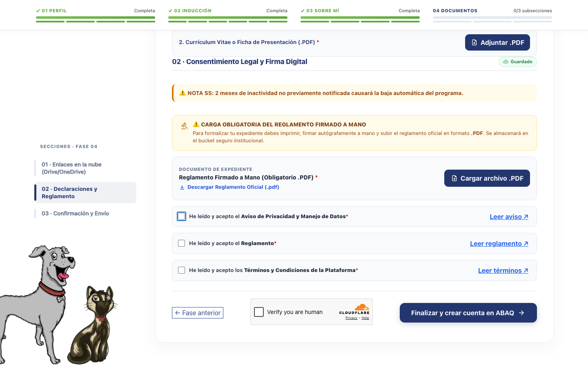
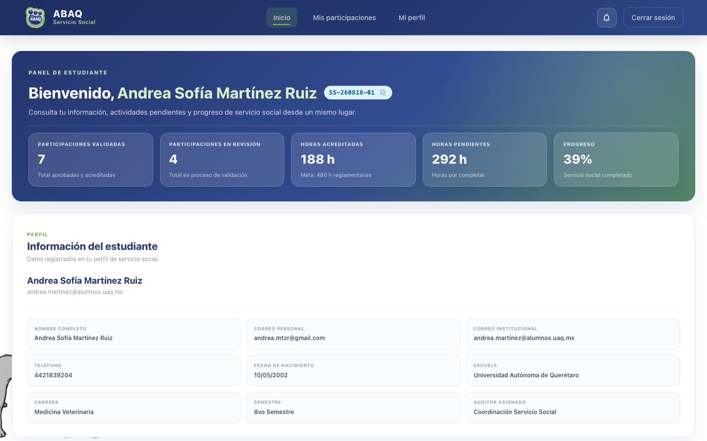
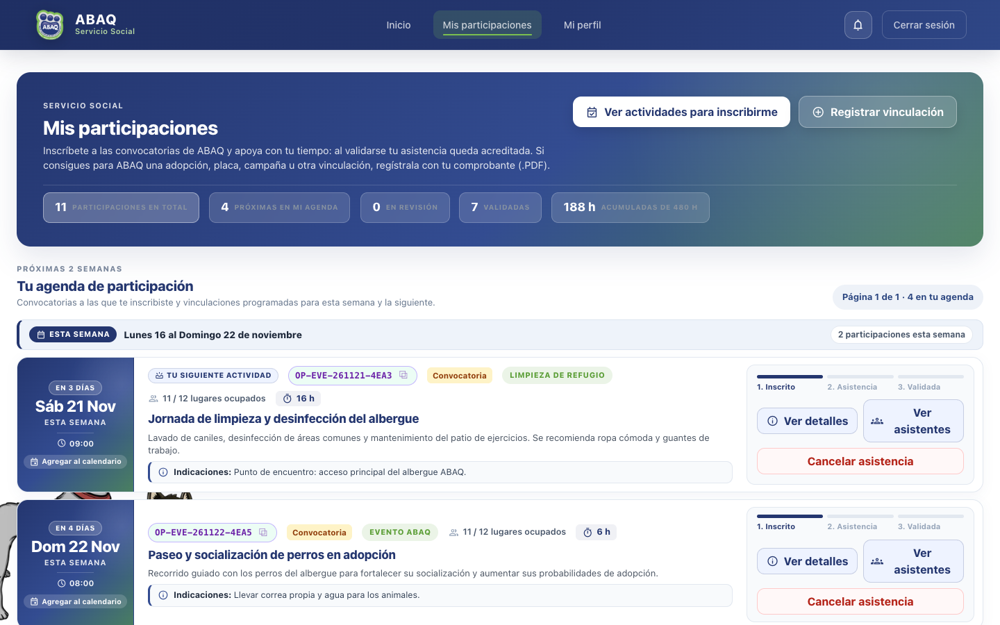
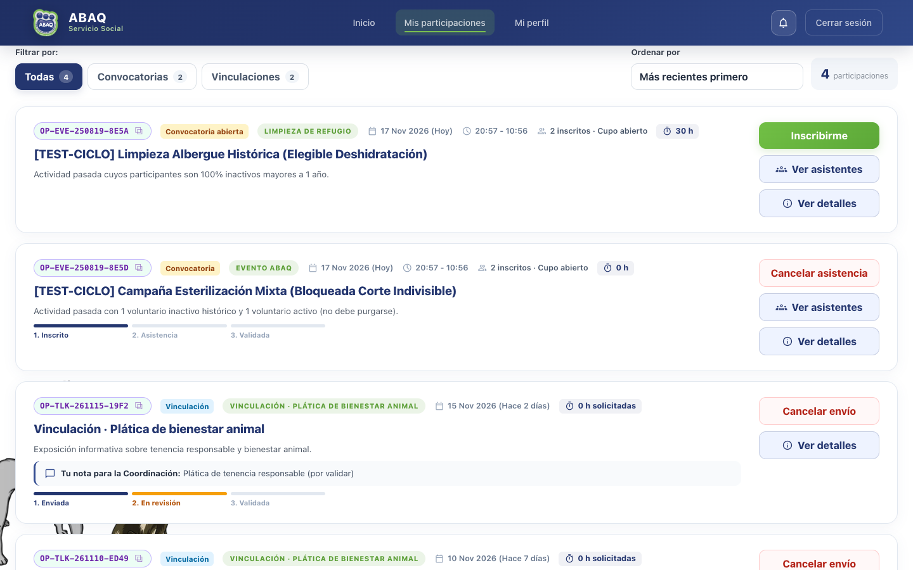
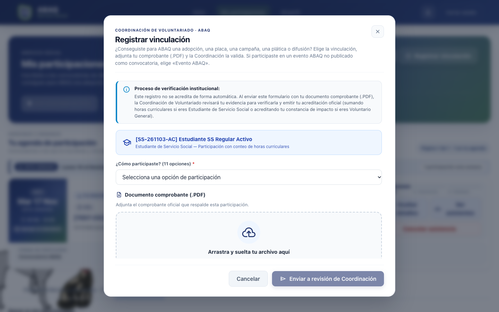
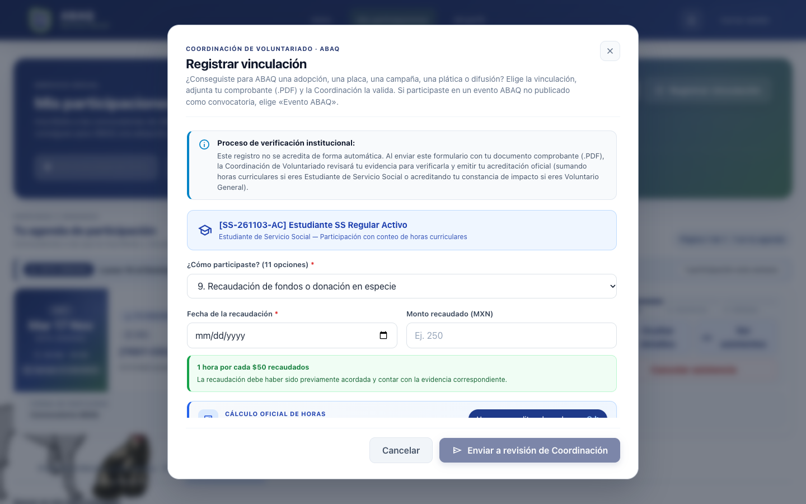
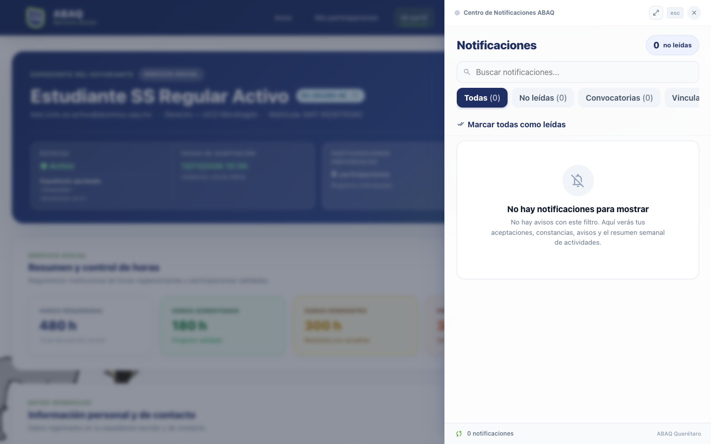
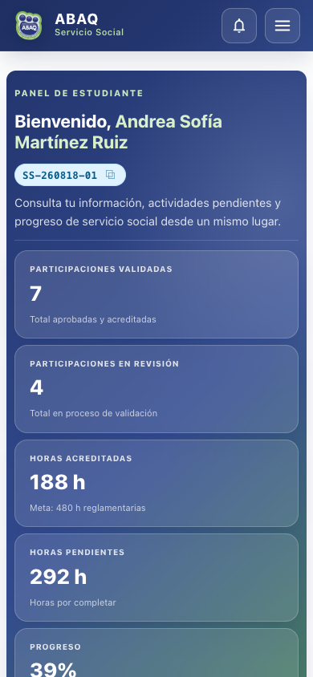

# Manual para Voluntario de Servicio Social

Este manual está dirigido a estudiantes universitarios que realizan su **Servicio Social** a través de la plataforma ABAQ Querétaro, en cumplimiento de las **480 horas curriculares reglamentarias**. Describe, paso a paso y con capturas de pantalla, todas las pantallas disponibles para este perfil: acceso, registro e inducción, panel de inicio, gestión de participaciones, registro de vinculaciones con conteo oficial de horas, expediente digital, notificaciones y uso desde dispositivos móviles.

!!! note "Convenciones utilizadas en este manual"

    - Los nombres de botones, pestañas y etiquetas aparecen entre comillas exactamente como se muestran en la interfaz.
    - Las cifras y folios que aparecen en las capturas pertenecen a una cuenta de demostración; en su cuenta verá sus propios datos.
    - El **folio institucional** (formato `SS-YYMMDD-XX`, por ejemplo `SS-260818-01`) identifica de forma única su expediente y se utiliza en constancias y comunicaciones con la Coordinación. Los folios de participación siguen el formato `OP-CAT-YYMMDD-XXXX`. La sección 1.1 explica ambos tipos y su uso.

## Índice de capturas de pantalla

Este manual incluye las siguientes capturas de pantalla, en el orden en que aparecen:

| N.º | Archivo | Pantalla | Sección |
|-----|---------|----------|---------|
| 1 | `login.png` | Inicio de sesión en ABAQ | [2.1 Iniciar sesión](#21-iniciar-sesion) |
| 2 | `ss-12-registro-modalidad.png` | Selección de modalidad de colaborador | [3.1 Selección de modalidad](#31-seleccion-de-modalidad) |
| 3 | `ss-13-registro-credenciales.png` | Creación de credenciales de acceso | [3.2 Creación de credenciales](#32-creacion-de-credenciales) |
| 4 | `ss-14-onboarding-fase1.png` | Fase 1: perfil — creación de cuenta y datos personales | [3.3 Fase 1 · Perfil](#33-fase-1-perfil) |
| 5 | `ss-15-onboarding-datos-academicos.png` | Fase 1: perfil — datos académicos y redes sociales | [3.3 Fase 1 · Perfil](#33-fase-1-perfil) |
| 6 | `ss-16-onboarding-induccion.png` | Fase 2: módulos de inducción | [3.4 Fase 2 · Inducción](#34-fase-2-induccion) |
| 7 | `ss-17-onboarding-documentos.png` | Fase 4: documentos en la nube y consentimiento legal | [3.6 Fase 4 · Documentos y consentimientos](#36-fase-4-documentos-y-consentimientos) |
| 8 | `ss-18-onboarding-consentimientos.png` | Fase 4: reglamento firmado y aceptaciones | [3.6 Fase 4 · Documentos y consentimientos](#36-fase-4-documentos-y-consentimientos) |
| 9 | `ss-19-expediente-bienvenida.png` | Expediente aprobado y cuenta activada | [3.7 Aprobación del expediente](#37-aprobacion-del-expediente) |
| 10 | `ss-01-home-bienvenida.png` | Panel de inicio: bienvenida y métricas | [4.1 Bienvenida y métricas](#41-bienvenida-y-metricas) |
| 11 | `ss-02-home-pendientes.png` | Panel de inicio: actividades pendientes e historial | [4.2 Actividades pendientes e historial](#42-actividades-pendientes-e-historial) |
| 12 | `ss-03-home-graficas.png` | Panel de inicio: gráficas de progreso | [4.3 Gráficas de progreso](#43-graficas-de-progreso) |
| 13 | `ss-04-participaciones-convocatorias.png` | Mis participaciones: agenda y métricas | [5.1 Encabezado y agenda](#51-encabezado-y-agenda) |
| 14 | `ss-05-participaciones-tarjetas.png` | Mis participaciones: búsqueda, filtros e inscripción | [5.2 Búsqueda, filtros e inscripción](#52-busqueda-filtros-e-inscripcion) |
| 15 | `compartido-01-estado-inscrito.png` | Estados de una participación | [5.3 Estados de una participación](#53-estados-de-una-participacion) |
| 16 | `compartido-02-cancelar-asistencia.png` | Modal de cancelación de asistencia | [5.4 Cancelar asistencia](#54-cancelar-asistencia) |
| 17 | `ss-07-detalle-actividad.png` | Detalle de una actividad | [5.5 Detalle de una actividad](#55-detalle-de-una-actividad) |
| 18 | `ss-06-participaciones-historial.png` | Mi historial de participación | [5.6 Mi historial](#56-mi-historial) |
| 19 | `ss-08-modal-vinculacion.png` | Formulario «Registrar vinculación» | [6.1 Formulario de registro](#61-formulario-de-registro) |
| 20 | `ss-08b-modal-vinculacion-horas.png` | Campos dinámicos según la opción elegida | [6.2 Opciones de participación y campos dinámicos](#62-opciones-de-participacion-y-campos-dinamicos) |
| 21 | `ss-08c-modal-vinculacion-calculo.png` | Cálculo oficial de horas y comprobante | [6.3 Cálculo oficial de horas](#63-calculo-oficial-de-horas) |
| 22 | `compartido-03-detalle-vinculacion.png` | Seguimiento de una vinculación enviada | [6.4 Envío y seguimiento](#64-envio-y-seguimiento) |
| 23 | `ss-09-perfil-datos.png` | Expediente del estudiante: resumen y control de horas | [7.1 Resumen y control de horas](#71-resumen-y-control-de-horas) |
| 24 | `ss-10-perfil-documentos.png` | Expediente del estudiante: documentos y constancias | [7.3 Documentos del expediente](#73-documentos-del-expediente) |
| 25 | `ss-11-notificaciones.png` | Centro de notificaciones | [8. Notificaciones](#8-notificaciones) |
| 26 | `movil-03-home-ss.png` | Panel de inicio en dispositivo móvil | [9. Uso desde dispositivos móviles](#9-uso-desde-dispositivos-moviles) |
| 27 | `movil-04-menu-ss.png` | Menú de navegación en dispositivo móvil | [9. Uso desde dispositivos móviles](#9-uso-desde-dispositivos-moviles) |

## 1. Acerca de la plataforma

ABAQ es la plataforma institucional de gestión de voluntariado de ABAQ Querétaro. Permite inscribirse a convocatorias de actividades, registrar vinculaciones (adopciones, pláticas, campañas, difusión, recaudaciones, entre otras) y dar seguimiento al acreditamiento de horas.

Como **Voluntario de Servicio Social**, su objetivo en la plataforma es completar y ver acreditadas **480 horas reglamentarias**. Las horas se acumulan cuando la Coordinación valida sus participaciones; el sistema muestra en todo momento el avance de su servicio social.

!!! warning "Regla institucional importante"

    Dos meses de inactividad no previamente notificada causarán la **baja automática del programa**. Si no podrá participar durante un periodo prolongado, comuníquelo con antelación a la Coordinación de Voluntariado.

### 1.1 Folios del expediente y de las participaciones

La plataforma utiliza dos familias de folios. Ambos son identificadores únicos y la referencia más segura para localizar información o comunicarse con la Coordinación.

| Folio | Formato | Qué identifica | Dónde aparece |
|-------|---------|----------------|---------------|
| **Folio de expediente** | `SS-YYMMDD-XX` | Su expediente de Servicio Social | Encabezado del panel y de **Mi perfil**, constancias, correos, notificaciones y búsquedas |
| **Folio de participación** | `OP-CAT-YYMMDD-XXXX` | Cada vinculación individual o actividad grupal | **Mis participaciones**, **Mi historial**, notificaciones y comprobantes |

El **folio de expediente** se asigna al crear su cuenta y se conserva sin cambios durante todo su servicio social. En el folio operativo `SS-YYMMDD-XX`, el bloque `YYMMDD` registra la fecha de emisión y los dos caracteres finales distinguen su registro; por ejemplo, `SS-260818-01` se emitió el 18 de agosto de 2026. Este folio aparece en su **Constancia de Inicio**, en la **Constancia de Término** y en la correspondencia oficial.

El **folio de participación** se genera para cada registro. El segmento `CAT` indica la modalidad: `EVE` para convocatorias y eventos, `TLK` para pláticas, `MED` para difusión en medios, `SOC` para redes sociales, `ADO` para adopciones, `MOD` para módulos de adopción, `DON` para donativos, `STE` para esterilizaciones, `CAM` para campañas, entre otras. En una convocatoria, el folio `OP-EVE-…` identifica la actividad y es el que se muestra a todos los inscritos; en una vinculación individual, el folio `OP-CAT-…` identifica su registro.

!!! tip "Cómo usar los folios"

    - Use el botón de copia (⧉) que aparece junto al folio para llevarlo al portapapeles.
    - En **Mis participaciones** puede buscar por folio para localizar una actividad o vinculación concreta (sección 5.2); en **Mi historial** cada registro muestra su folio (sección 5.6).
    - Al escribir a la Coordinación, indique primero su **folio de expediente** y, si el asunto se refiere a una participación específica, agregue el **folio de participación**.

## 2. Acceso a la plataforma

### 2.1 Iniciar sesión

Para ingresar al portal, diríjase a la página de acceso de ABAQ y complete el formulario de inicio de sesión:

1. **Correo electrónico**: ingrese su correo institucional universitario (por ejemplo, `nombre.apellido@alumnos.uaq.edu.mx`). Este correo está vinculado a su expediente de 480 horas.
2. **Contraseña**: escriba su clave de acceso. El ícono del ojo permite mostrar u ocultar el texto.
3. **Verificación de seguridad**: complete la casilla **Verify you are human** de Cloudflare Turnstile, que protege el portal contra accesos automatizados.
4. Pulse el botón **Iniciar sesión en ABAQ**.

Si aún no dispone de una cuenta, pulse el enlace **¿Nuevo voluntario? Crear cuenta en ABAQ** y continúe con la sección 3 de este manual.

Al iniciar sesión correctamente, el sistema lo dirige al panel de inicio del estudiante (sección 4). La barra de navegación superior muestra las secciones **Inicio**, **Mis participaciones** y **Mi perfil**, junto con la campana de notificaciones y el botón **Cerrar sesión**.

## 3. Registro de una nueva cuenta y onboarding

El registro se realiza una sola vez y consta de una pantalla inicial de credenciales seguida de **cuatro fases** guiadas: perfil, inducción, «sobre mí» y documentos. Cada fase se guarda automáticamente a medida que se completa, lo que se indica con la etiqueta **Guardado**. Si cierra el navegador y vuelve más tarde, la plataforma conserva lo que ya había capturado.

!!! note "Dos niveles de revisión"
    El **formulario** revisa sus datos mientras los escribe y le impide avanzar si falta un campo obligatorio o si un dato tiene un formato incorrecto. Al finalizar, el **servidor** vuelve a validar la información, la limpia y confirma la creación del expediente. El servidor es la autoridad final: por eso, aunque el formulario le permita continuar, un dato inválido detectado en el servidor puede impedir el alta. La sección 3.8 resume las reglas de ambas capas.

### 3.1 Selección de modalidad

La primera pantalla del registro pregunta **¿Cómo te gustaría colaborar?**

Seleccione la opción **Estudiante de Universidad / Servicio Social**, indicada para quienes deben validar sus 480 horas curriculares oficiales con su institución educativa. Si ya tiene una cuenta registrada, pulse **Iniciar sesión**.

### 3.2 Creación de credenciales

A continuación, la plataforma solicita las credenciales de acceso de la cuenta:

1. Verifique que la modalidad elegida sea **Servicio Social (480 horas)**; si no lo es, pulse **Cambiar tipo** para regresar a la selección anterior.
2. **Correo electrónico institucional** (obligatorio): registre su correo `@alumnos.uaq.edu.mx` u otro dominio institucional. La plataforma indica que este correo es el que vincula su expediente de 480 horas.
3. **Contraseña** (obligatoria): mínimo 8 caracteres. El contador muestra el avance (por ejemplo, «0/8 caracteres mín.»). Use el botón **Mostrar** u **Ocultar** para revisar lo que escribe.
4. **Confirmar Contraseña**: repita la contraseña; debe coincidir exactamente con la anterior.
5. Pulse **Continuar a Fase 1**.

| Campo | Regla que aplica la pantalla | Qué ocurre si no cumple |
|-------|-----------------------------|--------------------------|
| **Correo electrónico** | Obligatorio, con formato `usuario@dominio` y máximo 254 caracteres. | Muestra un mensaje en rojo y no permite continuar. |
| **Contraseña** | Obligatoria, mínimo 8 caracteres. | Indica cuántos caracteres faltan. |
| **Confirmar Contraseña** | Obligatoria e idéntica a la contraseña. | Indica que no coincide con la contraseña. |

Al pulsar **Continuar a Fase 1**, el servidor comprueba el correo y la contraseña antes de abrir el formulario. Si el correo ya tiene una cuenta activa, un expediente con historial o un bloqueo temporal, la plataforma muestra un mensaje genérico: «No es posible continuar el registro con este correo. Si ya tienes cuenta, inicia sesión o comunícate con la Coordinación.». Por seguridad, el sistema no revela cuál de esos casos ocurrió.

!!! note "Correo y contraseña en la Fase 1"
    La Fase 1 vuelve a mostrar el correo y la contraseña para que confirme que son correctos. Si los modifica ahí, esos serán los datos definitivos de la cuenta. El correo de acceso es el institucional; el correo personal de contacto puede actualizarlo después desde **Mi perfil**.

### 3.3 Fase 1 · Perfil

La Fase 1, titulada **Perfil Académico**, se organiza en cuatro subsecciones: **01 · Creación de cuenta**, **02 · Datos personales**, **03 · Datos académicos** y **04 · Redes sociales**. La barra superior muestra el avance de las cuatro fases del registro, y el menú lateral izquierdo permite desplazarse entre subsecciones. En cada subsección, la etiqueta **Guardando** cambia a **Guardado** cuando la información se conserva.

#### 01 · Creación de cuenta

Confirme el **correo electrónico institucional** y la **contraseña**. El correo debe tener un formato válido y no superar los 254 caracteres; la contraseña, al menos 8. La pantalla permite mostrar u ocultar la contraseña. Si cambia estos datos en esta fase, se usarán los que aquí queden registrados al crear la cuenta.

#### 02 · Datos personales

Capture los datos de identidad y contacto:

| Campo | Obligatorio | Regla |
|-------|-------------|-------|
| **Nombre(s)** | Sí | Entre 2 y 80 caracteres. Solo letras (con acentos y ñ), espacios, apóstrofos, guiones y puntos. |
| **Apellido Paterno** | Sí | Mismas reglas que el nombre. |
| **Apellido Materno** | No | Si se captura, se aplican las mismas reglas. |
| **Fecha de nacimiento** | Sí | Debe ser una fecha real entre 1900 y 2100. Puede escribir solo los números (DD/MM/AAAA) o elegirla en el calendario. |
| **Teléfono celular principal** | Sí | Exactamente 10 dígitos. La pantalla da formato mientras escribe y acepta el prefijo `+52`, que se descarta. |
| **Número con WhatsApp** | Condicional | Si no marca la casilla **Este número telefónico cuenta con WhatsApp activo**, debe capturar un número de WhatsApp de 10 dígitos. Si la marca, se usa el teléfono principal. |
| **Segundo número de contacto** | Condicional | Si marca la casilla **¿Deseas registrar un segundo número telefónico de contacto o emergencia?**, debe capturar 10 dígitos. |
| **CURP** | Sí, solo Servicio Social | 18 caracteres con la estructura oficial de RENAPO. Se guarda en mayúsculas. |
| **Matrícula o ID Estudiantil** | Sí, solo Servicio Social | Entre 3 y 20 caracteres. Se permiten letras, números y los separadores `-`, `/` y `.`; debe comenzar y terminar con letra o número. |

#### 03 · Datos académicos

En esta subsección se registra su trayectoria universitaria:

- **Nivel de estudios** (opcional): Licenciatura / Ingeniería, Especialización / Maestría, Doctorado o Técnico Superior Universitario.
- **Institución académica (Querétaro)** (obligatorio): seleccione una institución sugerida o escriba la suya. Se aceptan de 2 a 150 caracteres.
- **Carrera** (obligatorio): seleccione una carrera sugerida o escriba la suya. Se aceptan de 2 a 150 caracteres.
- **Esquema de periodos y avance académico** (obligatorio): elija el tipo de periodo (**Semestral**, **Cuatrimestral**, **Trimestral**, **Bimestral**, **Tetramestral**, **Anual** o **Modular**) y escriba el número de periodo en el que va, del 1 al 20. La pantalla completa la frase con la regla gramatical correspondiente (por ejemplo, «Registrado como: 4to Semestre»).
- **Fecha de inicio del servicio social** (opcional en el formulario): fecha en que iniciará su servicio social en ABAQ, no el inicio de su carrera. No puede ser anterior a hoy y debe estar entre 1900 y 2100.
- **Fecha de conclusión del servicio social** (opcional en el formulario): fecha límite en que deberá acreditar sus horas en ABAQ, no el fin de su carrera. No puede ser anterior a hoy ni anterior a la fecha de inicio.

!!! note "Fechas del servicio social"
    Si deja una o ambas fechas vacías, el expediente se crea con la fecha del día como inicio y sin fecha de conclusión. Puede solicitar la corrección a la Coordinación cuando conozca sus fechas oficiales.

#### 04 · Redes sociales (opcional)

Puede registrar sus perfiles de **Facebook**, **Instagram**, **TikTok**, **X (Twitter)**, **YouTube** y **LinkedIn**. Cada campo admite hasta 100 caracteres y puede contener el nombre de usuario o la dirección del perfil. No se exige un formato especial; la Coordinación las consulta para tareas de difusión.

Al terminar, pulse **Guardar y continuar a Fase 02**. Si hay campos obligatorios vacíos o con formato incorrecto, el botón muestra **Faltan N requisitos** y la pantalla lo lleva al primer campo por corregir. El botón **Volver al registro** regresa a la pantalla de credenciales.

### 3.4 Fase 2 · Inducción

La Fase 2 comprende los **Módulos de Inducción ABAQ**: seis temas formativos de bienestar animal, cada uno con **tres reflexiones de aprendizaje** que se responden por escrito.

| Módulo | Material | Duración |
|--------|----------|----------|
| **1. Conociendo ABAQ** | Página web y seis redes oficiales | Sin temporizador |
| **2. Plática de Bienestar Animal ABAQ** | Presentación en Canva | Sin temporizador |
| **3. Arquetipos de marca** | Video en YouTube | 22:32 |
| **4. Entrenamiento DISC** | Video en YouTube | 2:32 |
| **5. Entrenamiento Generaciones** | Video en YouTube | 6:58 |
| **6. La neurociencia de las emociones (Marian Rojas Estapé)** | Video en YouTube | 54:55 |

En el **módulo 1** debe abrir los seis canales oficiales: **Página Web**, **Facebook**, **Instagram**, **LinkedIn**, **TikTok** y **Twitter / X**. Cada enlace se marca con **✓ Visitada**; después marque la casilla **He visitado la web y seguido las redes oficiales de ABAQ.**

En los **módulos 3 a 6**, el botón del video inicia un temporizador que muestra **Viendo video · faltan mm:ss**. La casilla de certificación no se puede marcar hasta que el contador llega a cero. El tiempo se conserva si cierra sesión y vuelve después.

Para validar cada módulo, marque la casilla **Certifico haber visto y comprendido este módulo** y responda las tres reflexiones de aprendizaje:

1. **¿Qué me gustó?**
2. **¿Qué considero lo más importante?**
3. **¿Qué puede mejorar?**

Son **18 respuestas en total**. Cada una debe ser propia, completa y redactada con sus palabras. El formulario no le permite avanzar si falta alguna casilla, algún video por completar o alguna reflexión.

!!! note "Validación de la Fase 2"
    Esta fase se valida en el formulario. El servidor guarda sus respuestas en el expediente, pero no las califica ni vuelve a exigir los videos: la evaluación del contenido corresponde a la Coordinación.

!!! warning "Declaración bajo protesta de comprensión"

    Marcar cada casilla certifica formalmente haber revisado el contenido del módulo de inicio a fin. La evaluación se realiza con base en el texto escrito de sus reflexiones: respuestas vagas, genéricas o redactadas con inteligencia artificial provocarán la **cancelación inmediata del registro**, debiendo registrarse nuevamente para rehacer el formulario desde el inicio.

### 3.5 Fase 3 · Sobre mí

En esta fase la plataforma recopila información complementaria para su expediente. Se organiza en dos subsecciones: **01 · Semblanza y Habilidades** y **02 · Prioridad de Actividades Institucionales**.

#### 01 · Semblanza y Habilidades

| Campo | Obligatorio | Regla |
|-------|-------------|-------|
| **Semblanza personal / Biografía** | Sí | Texto libre. El servidor admite hasta 2000 caracteres. |
| **Áreas de interés principal en ABAQ** | Sí | Texto libre. Los botones de **Sugerencias rápidas** agregan temas con un clic. |
| **Principales talentos y habilidades** | Sí | Texto libre. |
| **Experiencia previa con animales de compañía** | No | Lista de opciones: experiencia actual, experiencia pasada o sin experiencia. |
| **Talentos y conocimientos que deseas compartir con ABAQ** | Sí | Texto libre. |
| **Detalles de tu experiencia con animales de compañía / rescates** | No | Texto libre. |
| **Motivación principal para sumarse a ABAQ** | Sí | Texto libre. |

#### 02 · Prioridad de Actividades Institucionales

La plataforma muestra **11 actividades institucionales** precargadas. Puede cambiar su orden con las flechas de cada tarjeta para indicar cuáles prefiere. Esta priorización **no bloquea el avance** y se guarda junto con el resto de la fase.

!!! note "Validación de la Fase 3"
    El formulario exige la semblanza, las áreas de interés, los talentos, los aportes y la motivación. El servidor valida la semblanza (máximo 2000 caracteres) y guarda los demás textos tal como se envían; la valoración de su contenido corresponde a la Coordinación.

Al terminar, pulse **Guardar y continuar a Fase 04**. Si falta algún campo obligatorio, el botón muestra **Faltan N requisitos** y lo lleva al campo correspondiente.

### 3.6 Fase 4 · Documentos y consentimientos

La Fase 4 finaliza el expediente con la carga de documentos y la aceptación de la normativa institucional. Se organiza en **01 · Enlaces a Documentos en la Nube**, **02 · Consentimiento Legal y Firma Digital** y **03 · Confirmación**.

#### 01 · Enlaces a documentos en la nube

La plataforma solicita dos documentos en formato **PDF**:

| Documento | Obligatorio | Formato |
|-----------|-------------|---------|
| **Identificación oficial vigente (INE o escolar)** | Sí | PDF de máximo 15 MB. |
| **Currículum Vitae o Ficha de Presentación** | Sí | PDF de máximo 15 MB. |

Use el botón **Adjuntar .PDF** de cada documento. El modal permite arrastrar el archivo o seleccionarlo con **Examinar archivo .PDF**; solo acepta archivos PDF y rechaza los que superan los 15 MB con los mensajes **Solo se permiten documentos en formato .PDF.** o **El archivo supera el límite de 15 MB.** Cuando el archivo queda listo, la tarjeta muestra el nombre y los botones **Cambiar** y **Eliminar**.

!!! note "Enlaces de Google Drive o OneDrive"
    La sección recuerda que, si comparte enlaces de Google Drive o OneDrive, deben tener acceso de lectura público o institucional permanente. Antes de guardarlos, ábralos en una ventana de incógnito para confirmar que cualquier revisor de ABAQ puede verlos sin solicitar permisos. Los archivos cargados con **Adjuntar .PDF** quedan resguardados directamente en el bucket institucional.

#### 02 · Consentimiento legal y firma digital

Además de los documentos, debe cargar el **Reglamento Firmado a Mano (Obligatorio .PDF)**:

1. Descargue el reglamento con el enlace **Descargar Reglamento Oficial (.pdf)**.
2. Imprímalo y fírmelo autógrafamente.
3. Escanee o fotografíe el documento y guárdelo como PDF de máximo 15 MB.
4. Cárguelo con el botón **Cargar archivo .PDF**. También puede usar **Cambiar** o **Eliminar** mientras no envíe el expediente.
5. Marque las tres casillas obligatorias:
    - **He leído y acepto el Aviso de Privacidad y Manejo de Datos**.
    - **He leído y acepto el Reglamento**.
    - **He leído y acepto los Términos y Condiciones de la Plataforma**.

Los enlaces **Leer aviso ↗**, **Leer reglamento ↗** y **Leer términos ↗** abren cada documento antes de aceptarlo.

!!! warning "Nota para Servicio Social"
    La plataforma le recuerda que **2 meses de inactividad no previamente notificada causarán la baja automática del programa**. Conserve sus datos de contacto actualizados y avise a la Coordinación si suspenderá actividades.

#### 03 · Confirmación y envío

Complete la verificación **Verify you are human** y pulse **Finalizar y crear cuenta en ABAQ**. El botón muestra **Creando expediente...** mientras se procesa y **¡Expediente enviado!** cuando termina.

Si falta algún requisito, el botón muestra **Faltan N requisitos** y la pantalla lo lleva al primer campo por corregir. Al enviar, la plataforma vuelve a revisar las Fases 1 a 3 y, si alguna quedó incompleta, lo regresa a esa fase. Si el servidor rechaza el alta, aparece un aviso en la parte superior; la causa más común es que el correo ya esté registrado.

!!! note "Validación de la Fase 4"
    El formulario exige los dos documentos, el reglamento firmado y las tres aceptaciones; el modal solo permite PDF de hasta 15 MB. El servidor **no vuelve a abrir los PDF ni revalida las casillas**: su función es resguardar los archivos y registrar las aceptaciones. La revisión documental la realiza la Coordinación. Si el reglamento firmado llega correctamente, el servidor lo marca como aceptado en el expediente.

### 3.7 Aprobación del expediente

Al enviar el formulario, la plataforma muestra la pantalla **¡Felicidades! Expediente recibido con éxito**, con el estado **En revisión por la coordinación**. Ahí puede consultar y copiar su **folio institucional** (botón **Copiar**), el nombre y correo registrados, la fecha de emisión del expediente y el tiempo de llenado.

La Coordinación revisa los datos y documentos en **24 a 48 horas hábiles**, en estricto orden de registro. Cuando la solicitud se acepta, recibirá un correo y la pantalla se actualizará para permitir la descarga de la **Constancia de Inicio** y el ingreso a la plataforma. Para Servicio Social, la inducción otorga **10 horas** al aprobarse el expediente.

Una vez aprobado, podrá:

- Consultar y copiar su **folio institucional**, que lo identifica en todo el sistema.
- Confirmar la concesión de **10 horas de servicio social** por completar la inducción.
- Descargar la **Constancia de Inicio Oficial** mediante el botón **Descargar Constancia Oficial**.
- Leer el mensaje de bienvenida de la Coordinación.
- Ingresar con el botón **Ingresar a la Plataforma ABAQ**.

!!! warning "Si el expediente no se aprueba"
    La pantalla muestra **Solicitud no aprobada** y, cuando existen, las **Observaciones de la Coordinación para Corrección**. Para reingresar el expediente corregido, regístrese de nuevo con **el mismo correo y la misma contraseña**; puede elegir otra modalidad si se equivocó, pero el expediente anterior se reemplaza. Si el correo queda bloqueado por intentos fallidos o por historial, la plataforma muestra el mensaje genérico descrito en la sección 3.2.

### 3.8 Validaciones del formulario y del servidor

El registro aplica las mismas reglas en dos momentos: el **formulario** da aviso inmediato y bloquea el avance; el **servidor** revalida, normaliza y es la autoridad final. Esta tabla resume las reglas principales de Servicio Social:

| Dato | Regla | Formulario | Servidor |
|------|-------|------------|----------|
| **Correo electrónico** | Formato `usuario@dominio`, máximo 254 caracteres; se guarda en minúsculas. | Sí | Sí |
| **Contraseña** | Mínimo 8 caracteres. | Sí | Sí |
| **Nombre(s) y apellidos** | Entre 2 y 80 caracteres por campo; solo letras, espacios, apóstrofos, guiones y puntos. | Sí | Sí |
| **Fecha de nacimiento** | Fecha real entre 1900 y 2100. | Sí | Sí |
| **Teléfonos** | Exactamente 10 dígitos; se acepta `+52` y se descarta. | Sí | Sí |
| **CURP** | 18 caracteres con la estructura oficial de RENAPO. | Sí | Sí, si se recibe |
| **Matrícula** | Entre 3 y 20 caracteres alfanuméricos con `-`, `/` o `.`. | Sí | Sí, si se recibe |
| **Institución y carrera** | Texto de 2 a 150 caracteres. | Sí, obligatorios | Sí, si se reciben |
| **Número de periodo** | Entero del 1 al 20. | Sí | Sí, si se recibe |
| **Fechas del servicio social** | Inicio no anterior a hoy; conclusión no anterior a hoy ni al inicio; años 1900 a 2100. | Sí | Sí, si se reciben |
| **Redes sociales** | Hasta 100 caracteres por red. | No valida formato; sí el servidor la longitud | Sí |
| **Semblanza** | Hasta 2000 caracteres. | Solo exige que no esté vacía | Sí |
| **Documentos** | PDF de máximo 15 MB. | Sí | No revalida el contenido |
| **Consentimientos** | Tres aceptaciones obligatorias. | Sí | Registra las aceptaciones |
| **Verificación anti-bot** | Token de Turnstile. | Sí | Sí |

!!! important "El formulario es más estricto que el servidor en los datos académicos"
    Por diseño, el servidor no rechaza el alta si faltan **CURP, matrícula, institución o carrera**: completa valores provisionales para no perder el registro. El formulario sí los exige y la Coordinación compara el expediente con sus documentos, por lo que debe capturarlos completos y correctos. Algo similar ocurre con las fechas del servicio social: el formulario las acepta vacías y el servidor asigna la fecha del día como inicio.

Las **Fases 2 y 3** se validan únicamente en el formulario. El servidor guarda las reflexiones, la semblanza, los intereses y la priorización de actividades para que la Coordinación los revise, pero no vuelve a exigir videos, casillas ni respuestas.

El servidor también **normaliza** lo que recibe: elimina espacios sobrantes, convierte el correo a minúsculas, descarta el prefijo `+52` de los teléfonos y guarda la CURP y la matrícula en mayúsculas. Si un dato no supera la validación del servidor, el alta se detiene y la plataforma muestra el motivo en la parte superior del formulario.

## 4. Panel de inicio

La sección **Inicio** concentra el resumen de su servicio social: métricas de avance, actividades pendientes, historial y gráficas de progreso.

### 4.1 Bienvenida y métricas

El encabezado del panel, identificado como **PANEL DE ESTUDIANTE**, muestra el saludo con su nombre y su folio institucional, y las siguientes métricas:

| Métrica | Descripción |
|---------|-------------|
| **Participaciones validadas** | Total de participaciones aprobadas y acreditadas. |
| **Participaciones en revisión** | Total de participaciones en proceso de validación por la Coordinación. |
| **Horas acreditadas** | Horas validadas hasta el momento, con la meta de **480 h reglamentarias** como referencia. |
| **Horas pendientes** | Horas por completar para finalizar el servicio social. |
| **Progreso** | Porcentaje de servicio social completado. |

Debajo del encabezado, la tarjeta **Información del estudiante** resume sus datos de perfil: nombre completo, correo personal, correo institucional, teléfono, fecha de nacimiento, escuela, carrera, semestre y auditor asignado.

### 4.2 Actividades pendientes e historial

- **Actividades pendientes**: actividades en las que está registrado o que ya marcó como asistidas y que requieren su atención. Cada elemento indica el nombre de la actividad, su estado (por ejemplo, **REGISTRADO**), la **fecha límite** y el valor en horas.
- **Historial de actividades**: actividades finalizadas o registradas como no asistidas. Mientras no existan registros se muestra el aviso **Aún no tienes historial**.

### 4.3 Gráficas de progreso

Al final del panel se presentan dos gráficas:

- **Progreso de servicio social**: gráfica de dona que compara las horas acreditadas (azul) contra las horas pendientes (naranja).
- **Progreso en el tiempo**: gráfica de línea con la acumulación cronológica de horas de servicio social desde su inicio hasta la fecha actual.

## 5. Mis participaciones

La sección **Mis participaciones** es el centro de gestión de sus convocatorias y vinculaciones.

### 5.1 Encabezado y agenda

El encabezado ofrece:

- Los botones **Ver actividades para inscribirme** y **Registrar vinculación**.
- Las píldoras de resumen: **participaciones en total**, **próximas en mi agenda**, **en revisión**, **validadas** y **horas acumuladas de 480 h**.
- **Tu agenda de participación**: las convocatorias a las que se inscribió y las vinculaciones programadas para la semana en curso y la siguiente, organizadas por bloques **ESTA SEMANA** y la semana posterior. Cada tarjeta indica la fecha (por ejemplo, **Sáb 21 Nov**), el horario, el botón **Agregar al calendario**, el folio con su identificador `OP-…`, la categoría de la actividad, el cupo y el avance de su trámite, con los botones **Ver detalles**, **Ver asistentes** y **Cancelar asistencia**.

### 5.2 Búsqueda, filtros e inscripción

Bajo la agenda se encuentran las dos pestañas de la lista de participaciones:

- **Para inscribirme y recientes**: convocatorias abiertas y vinculaciones recientes.
- **Mi historial**: participaciones de semanas anteriores (sección 5.6).

La lista dispone de:

- **Buscador**: «Buscar por nombre de actividad, lugar, opción o folio…».
- **Filtros**: **Todas**, **Convocatorias** y **Vinculaciones**, con contador de resultados.
- **Ordenar por**: por ejemplo, **Más recientes primero**.

Cada tarjeta de convocatoria abierta muestra el folio, la etiqueta de estado (por ejemplo, **Convocatoria abierta**), la categoría (por ejemplo, **LIMPIEZA DE REFUGIO**), la fecha, el horario, los inscritos y el cupo, así como las horas que suma la actividad. El botón verde **Inscribirme** registra su participación de inmediato.

!!! note "Estados que impiden inscribirse"

    Si la convocatoria ya no admite registros, el sistema lo indica en el propio botón: **Cuenta inactiva** cuando su expediente no está activo, o **Lugares agotados** cuando el cupo se ha llenado. El botón **Volver a inscribirme** aparece en convocatorias en las que canceló su asistencia previamente y que aún admiten lugares.

### 5.3 Estados de una participación

Cada participación muestra una barra de avance con su etapa actual:

| Tipo | Pipeline de estados |
|------|---------------------|
| **Convocatorias** | 1. **Inscrito** → 2. **Asistencia** (o **No asistió**) → 3. **Validada** |
| **Vinculaciones** | 1. **Enviada** → 2. **En revisión** → 3. **Validada** (o **Rechazada**) |

Las vinculaciones muestran además la nota registrada para la Coordinación («Tu nota para la Coordinación: …») y el botón **Cancelar envío**, disponible mientras la solicitud no ha sido validada. En convocatorias inscritas, el botón **Cancelar asistencia** libera su lugar. La captura de esta sección ilustra la vinculación `OP-MED-261114-3C9A`, con la etapa **2. En revisión** activa.

### 5.4 Cancelar asistencia

Al pulsar **Cancelar asistencia**, la plataforma solicita confirmación con el mensaje **¿Cancelar asistencia?**, advirtiendo que podrá volver a inscribirse más adelante si aún hay lugares disponibles. Pulse **Volver** para desistir o **Cancelar asistencia** para confirmar la operación.

### 5.5 Detalle de una actividad

El botón **Ver detalles** expande la tarjeta y muestra la ficha resumen de la participación:

- **Forma de participar**: convocatoria ABAQ o el tipo de vinculación registrado.
- **Fecha y horario** de la actividad.
- **Horas que suma**: valor en horas que la participación aportará a su servicio social al validarse.

### 5.6 Mi historial

La pestaña **Mi historial** presenta la tabla **Mi historial de participación** con las participaciones anteriores, organizadas por las columnas:

| Columna | Contenido |
|---------|-----------|
| **Folio** | Identificador único de la participación (por ejemplo, `OP-EVE-261108-4EB1`). |
| **Forma de participar** | Convocatoria o vinculación. |
| **Participación** | Nombre de la actividad y descripción breve. |
| **Horas** | Horas asociadas a la participación. |
| **Evaluación** | Resultado de la validación cuando aplica. |
| **Avance** | Barra con el pipeline de estados. |
| **Fecha** | Fecha de registro de la participación. |

Las vinculaciones incluyen el botón **Descargar comprobante (.PDF)** para recuperar el documento enviado a la Coordinación.

## 6. Registro de vinculaciones

Una **vinculación** es cualquier apoyo concreto que ofrece a ABAQ fuera de una convocatoria publicada: adopciones, placas, campañas, pláticas, difusión, publicaciones en redes, recaudaciones o apoyos administrativos. Las vinculaciones requieren un comprobante en formato `.PDF` y se acreditan únicamente tras la revisión de la Coordinación.

### 6.1 Formulario de registro

Abra el formulario con el botón **Registrar vinculación** (disponible en el encabezado de **Mis participaciones** y en el menú móvil). El formulario incluye:

1. **Proceso de verificación institucional**: aviso de que el registro no se acredita de forma automática; al enviarlo, la Coordinación de Voluntariado revisará su evidencia y emitirá su acreditación oficial sumando horas curriculares.
2. **Identificación del expediente**: la tarjeta azul confirma el expediente activo y su folio institucional, con la leyenda «Estudiante de Servicio Social — Participación con conteo de horas curriculares»; por ejemplo, **[SS-260818-01] Andrea Sofía Martínez Ruiz**.
3. **¿Cómo participaste?**: lista de opciones de participación.
4. **Documento comprobante (.PDF)**: área para arrastrar y soltar el archivo, o el botón **Examinar archivo**. El documento debe ser oficial, en formato `.PDF` con un máximo de 15 MB, y se envía a resguardo cifrado en el repositorio institucional.
5. **Nota para la Coordinación (opcional)**: descripción breve de la labor realizada.
6. Los botones **Cancelar** y **Enviar a revisión de Coordinación**.

### 6.2 Opciones de participación y campos dinámicos

Al elegir una opción, el formulario despliega los campos que corresponden a esa modalidad. Por ejemplo, la opción **9. Recaudación de fondos o donación en especie** solicita la **fecha de la recaudación** y el **monto recaudado en MXN**, y muestra el aviso **1 hora por cada $50 recaudados** con la nota de que la recaudación debe haber sido previamente acordada y contar con la evidencia correspondiente.

### 6.3 Cálculo oficial de horas

Para los estudiantes de Servicio Social, el formulario muestra el recuadro **CÁLCULO OFICIAL DE HORAS** con la regla de acreditación de la opción elegida y el resultado estimado en la insignia **Horas a acreditar al aprobarse: X h**. Las reglas institucionales por opción son:

| Opción | Regla de acreditación |
|--------|------------------------|
| 1. Evento ABAQ (inscripción a convocatoria) | Multiplicador según la categoría del evento: **2×** en campaña de esterilización, apoyo a refugio (paseo), módulo de adopción, plática de bienestar animal y otros eventos; **4×** en apoyo a refugio (limpieza). Las horas acreditadas se calculan sobre cada hora de reloj realizada. |
| 2. Placas de identificación | **5 h** por cada placa colocada. |
| 3. Campaña de esterilización y/o vacunación | **10 h** por cada animal de compañía esterilizado. |
| 4. Adopción de animal de compañía | **100 h** por adopción; se acreditan al concluir los **15 días** de periodo de prueba. |
| 5. Coordinar módulo de adopción | **40 h** por cada módulo coordinado. |
| 6. Plática de bienestar animal | **50 h** fijas cuando el aforo alcanza al menos **50 participantes**; **0 h** si el aforo es menor. |
| 7. Difusión en medios | **30 h** fijas por cobertura o difusión. |
| 8. Publicación en redes sociales | **5 h** base más **1 h** por cada 5 reacciones obtenidas. |
| 9. Recaudación de fondos o donación en especie | **1 h** por cada **$50 MXN** recaudados. |
| 10. Apoyo administrativo | Asignación manual de horas autorizada por la Coordinación. |

!!! note "Horas de inducción"

    Además de las vinculaciones, el proceso de inducción otorga **10 horas de servicio social** al aprobarse su expediente (véase la sección 3.7).

### 6.4 Envío y seguimiento

Al enviar el formulario, la vinculación queda en el estado **1. Enviada** y pasa a **2. En revisión** mientras la Coordinación verifica la evidencia. Desde la tarjeta expandida (**Ocultar detalles**) podrá consultar:

- **Forma de participar**: tipo de vinculación registrada.
- **Fecha registrada**.
- **Horas que suma**: horas solicitadas para acreditarse.
- **Comprobante adjunto**: botón **DESCARGAR DOCUMENTO (.PDF)** para recuperar su comprobante.

Cuando la Coordinación aprueba la vinculación, el estado pasa a **3. Validada** y las horas se acreditan a su expediente; si la rechaza, verá el estado **Rechazada** con la posibilidad de corregir y volver a enviar.

## 7. Mi perfil

La sección **Mi perfil** presenta el expediente institucional del estudiante. Se organiza en ocho bloques: resumen y control de horas, datos personales y de contacto, documentos, semblanza e intereses, reflexiones de inducción, consentimientos, redes sociales e historial de folios.

### 7.1 Resumen y control de horas

El encabezado del expediente muestra:

- Su nombre y **folio de expediente** (`SS-…`), el identificador institucional descrito en la sección 1.1. También aparece la **matrícula**.
- **Estatus** de la cuenta (por ejemplo, **Activo**) y el resultado de la última revisión (**Expediente aprobado «Documentación completa.»**).
- **Fecha de aceptación** con la validación oficial de ABAQ y, cuando corresponde, **fecha de término**.
- **Participaciones individuales**, **actividades grupales** y **total registrado**.

El recuadro **Resumen y control de horas** concentra el seguimiento institucional:

| Indicador | Descripción |
|-----------|-------------|
| **Horas requeridas** | Total del periodo actual: **480 h**. |
| **Horas acreditadas** | Progreso validado por la Coordinación. |
| **Horas pendientes** | Horas restantes por acreditar. |
| **Progreso** | Porcentaje de servicio social completado. |
| **Actividades** | Registros totales del expediente. |

!!! note "Punto de partida del conteo"
    Al aprobarse el expediente, la inducción acredita **10 horas**, por lo que el resumen parte de 10 h acreditadas y 470 pendientes de las 480 requeridas. Las horas restantes se suman con las participaciones y vinculaciones que la Coordinación valide.

El resumen no se edita manualmente: se actualiza cuando la Coordinación valida una participación, una acreditación o una vinculación.

### 7.2 Datos personales y de contacto

La tarjeta **Información personal y de contacto** reúne los datos del expediente escolar y de contacto:

| Dato | ¿Se puede editar? | Observaciones |
|------|-------------------|---------------|
| **Folio de expediente** | No | Identificador institucional. |
| **Fecha de emisión del expediente** | No | Se asigna al crear el registro. |
| **Fecha de aceptación** | No | Se asigna cuando la Coordinación aprueba. |
| **Fecha de término** | No | Se asigna cuando concluye el periodo. |
| **Tiempo de llenado del formulario** | No | Métrica del onboarding. |
| **Nombre completo**, **matrícula** y **CURP** | No | Provienen del registro. |
| **Correo institucional** | No | Es el correo de acceso y de comunicaciones oficiales. |
| **Correo personal** | **Sí** | Se usa para contacto alterno. |
| **Teléfono** | **Sí** | Debe tener 10 dígitos. |
| **¿Tiene WhatsApp?** y **contacto secundario** | No | Provienen del registro. |
| **Escuela / universidad**, **carrera** y **periodo / avance académico** | No | Solo la Coordinación puede corregirlos. |
| **Auditor responsable** | No | Se asigna institucionalmente. |
| **Fecha de nacimiento** y **fechas del servicio social** | No | Provienen del registro. |
| **Horas requeridas del periodo** | No | Meta de 480 h. |
| **¿Cómo supiste de ABAQ?** | No | Valor institucional predeterminado. |

Para actualizar los datos editables, pulse **Editar información**. La tarjeta habilita el **correo personal** y el **teléfono**, con validación en línea:

- El **correo personal** debe tener formato `usuario@dominio` y máximo 254 caracteres.
- El **teléfono** debe tener exactamente 10 dígitos; se aceptan espacios, guiones y el prefijo `+52`.
- El botón **Guardar cambios** permanece deshabilitado mientras haya un error. **Cancelar** restaura los valores anteriores.

Al guardar, el servidor vuelve a validar ambos campos y solo permite modificar el teléfono, el correo personal, la semblanza y las redes sociales. Cualquier intento de cambiar estatus, horas, folio, fechas o datos académicos se rechaza. Si el cambio es correcto, la plataforma confirma **Datos de contacto actualizados correctamente.**

!!! note "Correo de acceso y correo de contacto"
    Actualizar el **correo personal** no cambia el correo con el que inicia sesión: el acceso sigue siendo el **correo institucional** registrado en la cuenta.

### 7.3 Documentos del expediente

La sección **Expediente digital** organiza los documentos oficiales en dos grupos:

**Documentos de registro e identidad (onboarding)**

- **Identificación oficial (INE o escolar)**: PDF cargado durante el registro. Si no existe, muestra **No proporcionado**.
- **Currículum Vitae (CV) o semblanza**: PDF cargado durante el registro. Si no existe, muestra **No proporcionado**.

**Documentación institucional de servicio social**

- **Constancia de Inicio**: documento oficial emitido por ABAQ, disponible con el botón **Ver y descargar constancia** cuando la cuenta está activa.
- **Reporte de actividades**: enlace del periodo cuando la Coordinación lo haya cargado; se abre con **Abrir documento público ↗**.
- **Constancia de Término**: **se emite al completar las horas del servicio**. La plataforma habilita el botón **Ver y descargar constancia** cuando las horas pendientes llegan a cero; mientras tanto muestra **Se emite al completar las horas del servicio.**

Los documentos son de solo lectura. Si detecta un error o falta un archivo, comuníquese con la Coordinación.

### 7.4 Semblanza, intereses y talentos

La sección **Sobre mí** muestra la información vocacional capturada en la Fase 3:

- **Semblanza / bio personal**: es el único campo editable de este bloque. Pulse **Modificar datos**, escriba el texto y guarde con **Guardar cambios**. El servidor admite hasta **2000 caracteres**; si supera el límite, muestra un error y no guarda. Puede dejar la semblanza vacía, aunque se recomienda mantenerla completa.
- **Intereses y pasiones**, **talentos y habilidades especiales**, **aportes principales a ABAQ**, **experiencia previa con animales de compañía** y **motivación para unirse a ABAQ**: son de solo lectura y provienen del onboarding.
- **Actividades de interés seleccionadas**: tabla con la **prioridad**, la **actividad** y la **acreditación** en horas. Refleja el orden que eligió en la Fase 3 y no se edita desde aquí.

### 7.5 Reflexiones de inducción

La sección **Inducción** muestra las respuestas de los seis módulos formativos, organizadas por módulo. Para cada uno se presentan las tres preguntas:

- **Lo que más llamó mi atención**.
- **Lo que considero más importante**.
- **Sugerencia de mejora o propuesta**.

Si aún no hay respuestas, aparece el aviso **Sin reflexiones de inducción registradas.** La información es de solo lectura.

### 7.6 Consentimientos y normativa

La sección **Consentimientos y Términos Aceptados** reúne los documentos que formalizan su participación:

- **Reglamento**: abre el documento oficial y permite **Descargar PDF** de la versión firmada a mano.
- **Aviso de Privacidad y Manejo de Datos**: describe el tratamiento confidencial y la protección de sus datos.
- **Términos y Condiciones de la Plataforma**: formalizan el uso del sistema.

Cada tarjeta muestra una marca de validación. Los documentos son de solo lectura; si necesita una copia, descárguela desde aquí.

### 7.7 Redes sociales y canales de difusión

La sección **Redes sociales y canales de difusión** muestra las cuentas de **Facebook**, **Instagram**, **TikTok**, **X (Twitter)**, **YouTube** y **LinkedIn** registradas en el onboarding. Si no hay cuenta, muestra **Sin cuenta**, **Sin canal** o **Sin perfil**, según la red.

Pulse **Modificar datos** para actualizar los usuarios. Cada campo admite hasta **100 caracteres**; si supera el límite, aparece un mensaje en rojo y **Guardar cambios** se deshabilita. **Cancelar** restaura los valores anteriores. Al guardar, el servidor revalida la longitud y confirma la actualización.

### 7.8 Historial institucional

La sección **Trazabilidad institucional — Historial** presenta la tabla de folios únicos asignados a su expediente, actividades grupales y participaciones individuales, con las columnas **Folio**, **Concepto**, **Detalle**, **Horas**, **Estado** y **Fecha**. El encabezado indica el número total de folios y la tabla se pagina.

Cada folio (por ejemplo, `SS-260818-01` para el expediente o `OP-EVE-261121-4EA3` para una actividad asignada) puede copiarse para referencias ante la Coordinación. Si no hay registros, se muestra **Sin registros en tu historial**.

## 8. Notificaciones

El ícono de campana de la barra de navegación abre el **Centro de Notificaciones ABAQ**, un panel lateral con:

- **Contador de no leídas** junto al título **Notificaciones**.
- **Buscador** de notificaciones.
- **Filtros**: **Todas**, **No leídas**, **Convocatorias** y **Vinculaciones**.
- La acción **Marcar todas como leídas**.

En este centro recibirá sus aceptaciones de expediente, constancias, avisos institucionales y el resumen semanal de actividades. Las notificaciones le informan, por ejemplo, de la validación de una vinculación, de la aprobación de su expediente o de la emisión de una constancia. La captura muestra una **nueva convocatoria** y la **validación de la vinculación** `OP-SOC-261027-77C3`, con 8 horas acreditadas.

!!! note "Filtros por rol"

    En la cuenta de Voluntario de Servicio Social, los filtros del centro de notificaciones corresponden al contexto de **Mi Servicio Social**.

## 9. Uso desde dispositivos móviles

La plataforma es responsiva y adapta todas sus secciones a pantallas de teléfonos y tabletas.

En pantallas móviles, la barra de navegación se simplifica al logotipo de ABAQ, la campana de notificaciones y el botón de menú. El panel de inicio presenta las métricas (participaciones validadas, en revisión, horas acreditadas con su meta de 480 h, horas pendientes y progreso) en tarjetas apiladas.

El botón de menú despliega la navegación completa, organizada en:

- **Acciones más requeridas**: **Inscribirme a Actividades** (para sumar horas de servicio) y **Registrar Vinculación** (solicitud con evidencia).
- **Vistas más utilizadas**: accesos directos al resumen de horas y a las convocatorias disponibles.
- **Mi Servicio Social**: **Progreso de Horas y Estado**, **Mis participaciones** y **Mi Expediente y Datos Escolares**.
- El botón **Cerrar sesión**.

## 10. Diferencias respecto al Voluntario General

Como referencia rápida, estas son las funcionalidades exclusivas del perfil de **Servicio Social** en comparación con el Voluntario General:

| Funcionalidad | Servicio Social | Voluntario General |
|---------------|-----------------|--------------------|
| Horas reglamentarias | Meta de **480 h** con métricas de horas acreditadas, pendientes y progreso | Sin conteo de horas |
| Registro | Correo institucional obligatorio y datos académicos (escuela, carrera, semestre, matrícula, CURP) | Correo personal, formación académica modular y ocupación |
| Panel de inicio | Métricas de horas y gráficas «Progreso de servicio social» | Métricas de estado de cuenta y gráficas «Participación en actividades» |
| Vinculación | Recuadro **Cálculo Oficial de Horas** con reglas de acreditación | Sin cálculo de horas |
| Perfil editable | Correo personal, teléfono, semblanza y redes sociales | Teléfono, semblanza y redes sociales |
| Constancias | Constancia de Inicio y **Constancia de Término** al completar las 480 h | Constancia de Inicio; sin constancia de término |

## 11. Recomendaciones finales

1. **Verifique su correo institucional**: todas las comunicaciones oficiales y la vinculación de su expediente de 480 horas dependen de él.
2. **Adjunte comprobantes claros**: una vinculación sin evidencia válida puede ser rechazada por la Coordinación; descargue siempre su comprobante desde el historial.
3. **Dé seguimiento a sus estados**: revise periódicamente la barra de avance de cada participación para detectar rechazos o solicitudes de corrección.
4. **Comunique sus ausencias**: recuerde que dos meses de inactividad no notificada provocan la baja automática del programa.
5. **Descargue sus constancias**: conserve la Constancia de Inicio y, al terminar, obtenga su Constancia de Término desde **Mi perfil**.

Para dudas sobre su expediente, utilice el canal **Soporte / Coordinación** disponible en la plataforma o comuníquese directamente con la Coordinación de Voluntariado ABAQ Querétaro.
