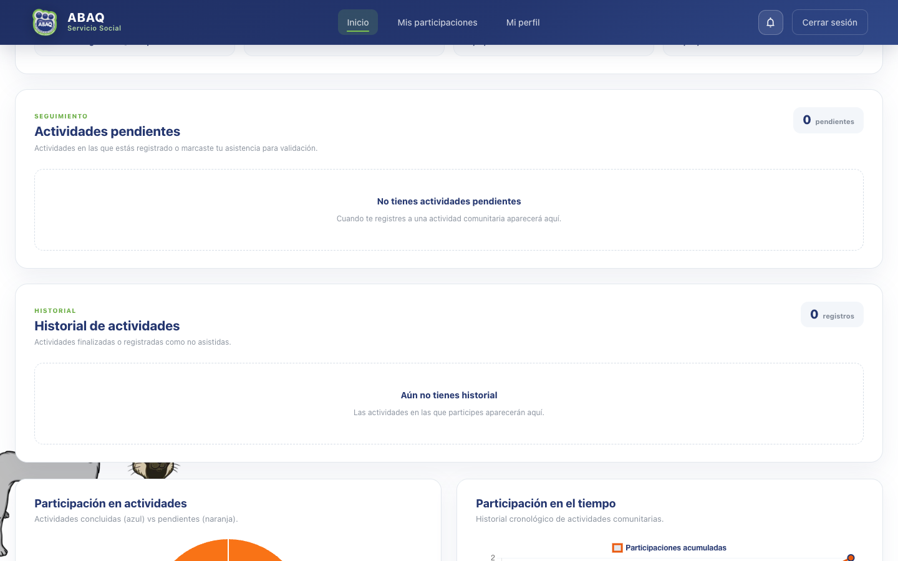
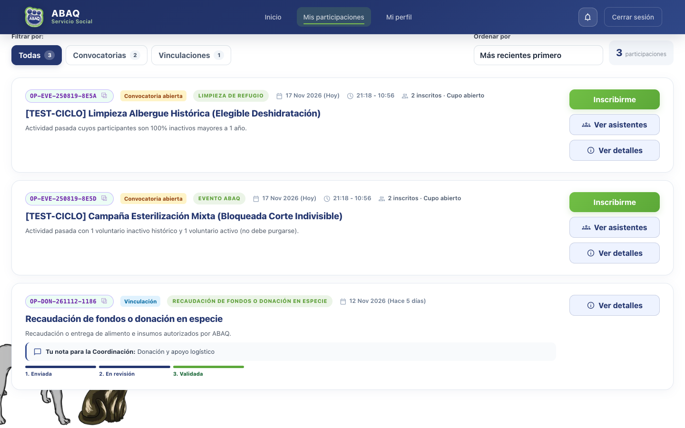
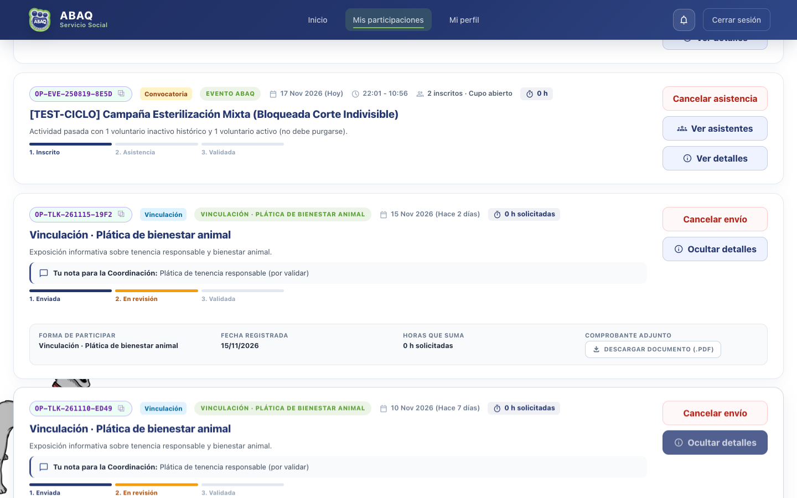
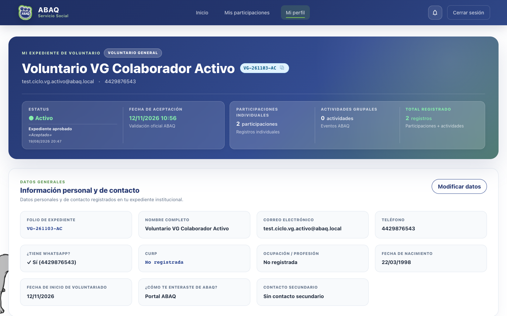
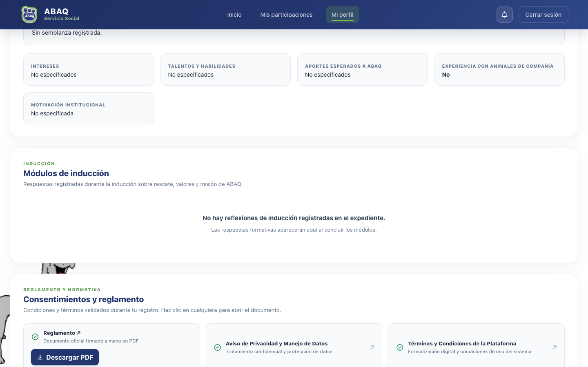
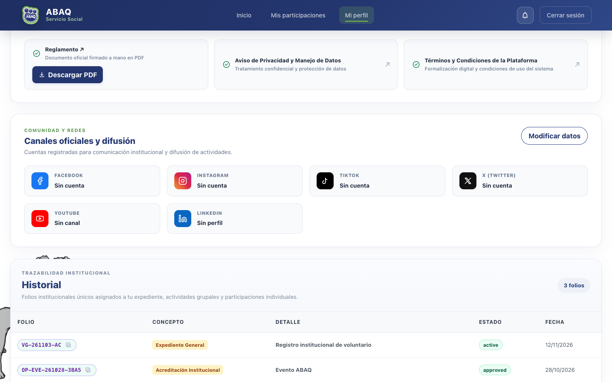
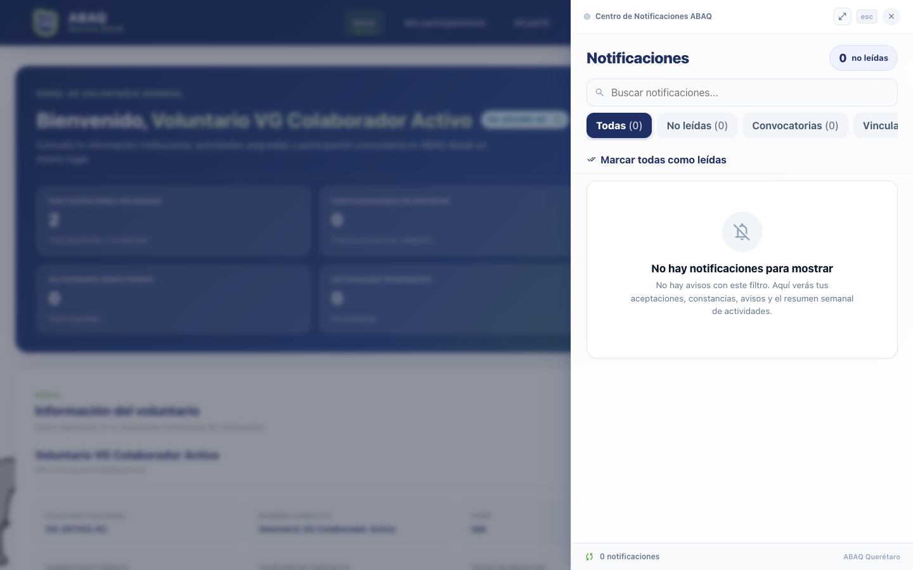
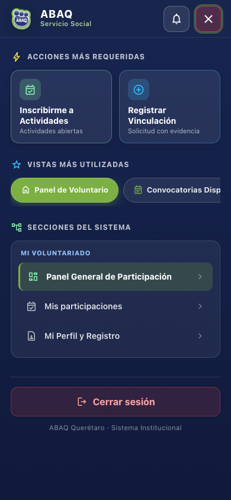

# Manual para Voluntario General

Este manual está dirigido a personas que participan en ABAQ Querétaro como **Voluntarios Generales**, es decir, colaboradores que apoyan en rescates, eventos, pláticas y campañas **sin requisito de horas escolares** («por amor al arte»). Describe, paso a paso y con capturas de pantalla, todas las pantallas disponibles para este perfil: acceso, registro, panel de inicio, gestión de participaciones, registro de vinculaciones, expediente de voluntario, notificaciones y uso desde dispositivos móviles.

!!! note "Convenciones utilizadas en este manual"

    - Los nombres de botones, pestañas y etiquetas aparecen entre comillas exactamente como se muestran en la interfaz.
    - Las cifras y folios que aparecen en las capturas pertenecen a una cuenta de demostración; en su cuenta verá sus propios datos.
    - El **folio institucional** (formato `VG-YYMMDD-XX`, por ejemplo `VG-260818-01`) identifica de forma única su expediente y se utiliza en constancias y comunicaciones con la Coordinación. Los folios de participación siguen el formato `OP-CAT-YYMMDD-XXXX`. La sección 1.1 explica ambos tipos y su uso.

## Índice de capturas de pantalla

Este manual incluye las siguientes capturas de pantalla, en el orden en que aparecen:

| N.º | Archivo | Pantalla | Sección |
|-----|---------|----------|---------|
| 1 | `login.png` | Inicio de sesión en ABAQ | [2.1 Iniciar sesión](#21-iniciar-sesion) |
| 2 | `ss-12-registro-modalidad.png` | Selección de modalidad de colaborador | [3.1 Selección de modalidad](#31-seleccion-de-modalidad) |
| 3 | `vg-01-home-bienvenida.png` | Panel de inicio: bienvenida y métricas | [4.1 Bienvenida y métricas](#41-bienvenida-y-metricas) |
| 4 | `vg-02-home-pendientes-historial.png` | Panel de inicio: actividades pendientes e historial | [4.2 Actividades pendientes e historial](#42-actividades-pendientes-e-historial) |
| 5 | `vg-03-home-graficas.png` | Panel de inicio: gráficas de participación | [4.3 Gráficas de participación](#43-graficas-de-participacion) |
| 6 | `vg-04-participaciones.png` | Mis participaciones: agenda y métricas | [5.1 Encabezado y agenda](#51-encabezado-y-agenda) |
| 7 | `vg-05-participaciones-tarjetas.png` | Mis participaciones: pestañas, búsqueda y filtros | [5.2 Búsqueda, filtros e inscripción](#52-busqueda-filtros-e-inscripcion) |
| 8 | `vg-06-participaciones-inscripcion.png` | Tarjetas de convocatoria e inscripción | [5.2 Búsqueda, filtros e inscripción](#52-busqueda-filtros-e-inscripcion) |
| 9 | `compartido-01-estado-inscrito.png` | Estados de una participación | [5.3 Estados de una participación](#53-estados-de-una-participacion) |
| 10 | `compartido-02-cancelar-asistencia.png` | Modal de cancelación de asistencia | [5.4 Cancelar asistencia](#54-cancelar-asistencia) |
| 11 | `vg-07-modal-vinculacion.png` | Formulario «Registrar vinculación» | [6.1 Formulario de registro](#61-formulario-de-registro) |
| 12 | `vg-08-modal-vinculacion-opcion.png` | Campos dinámicos según la opción elegida | [6.2 Opciones de participación y campos dinámicos](#62-opciones-de-participacion-y-campos-dinamicos) |
| 13 | `compartido-03-detalle-vinculacion.png` | Seguimiento de una vinculación enviada | [6.3 Envío y seguimiento](#63-envio-y-seguimiento) |
| 14 | `vg-09-perfil.png` | Expediente de voluntario: datos generales | [7.1 Información personal y de contacto](#71-informacion-personal-y-de-contacto) |
| 15 | `vg-10-perfil-documentos.png` | Expediente: semblanza, intereses e inducción | [7.4 Semblanza y preferencias](#74-semblanza-y-preferencias) |
| 16 | `vg-11-perfil-consentimientos.png` | Expediente: consentimientos, canales oficiales e historial de folios | [7.6 Consentimientos y reglamento](#76-consentimientos-y-reglamento) · [7.8 Historial institucional](#78-historial-institucional) |
| 17 | `vg-12-notificaciones.png` | Centro de notificaciones | [8. Notificaciones](#8-notificaciones) |
| 18 | `movil-01-home.png` | Panel de inicio en dispositivo móvil | [9. Uso desde dispositivos móviles](#9-uso-desde-dispositivos-moviles) |
| 19 | `movil-02-menu.png` | Menú de navegación en dispositivo móvil | [9. Uso desde dispositivos móviles](#9-uso-desde-dispositivos-moviles) |

## 1. Acerca de la plataforma

ABAQ es la plataforma institucional de gestión de voluntariado de ABAQ Querétaro. Permite inscribirse a convocatorias de actividades, registrar vinculaciones (adopciones, pláticas, campañas, difusión, recaudaciones, entre otras) y dar seguimiento a cada participación.

Como **Voluntario General**, su participación no está sujeta a un conteo de horas curriculares: el sistema registra sus actividades y validaciones para reconocer su labor comunitaria y, cuando corresponda, emitir la acreditación de impacto correspondiente. Todas las participaciones requieren la validación de la Coordinación de Voluntariado.

### 1.1 Folios del expediente y de las participaciones

La plataforma utiliza dos familias de folios. Ambos son identificadores únicos y la referencia más segura para localizar información o comunicarse con la Coordinación.

| Folio | Formato | Qué identifica | Dónde aparece |
|-------|---------|----------------|---------------|
| **Folio de expediente** | `VG-YYMMDD-XX` | Su expediente de Voluntariado General | Encabezado del panel y de **Mi perfil**, constancias o acreditaciones, correos, notificaciones y búsquedas |
| **Folio de participación** | `OP-CAT-YYMMDD-XXXX` | Cada vinculación individual o actividad grupal | **Mis participaciones**, historial institucional, notificaciones y comprobantes |

El **folio de expediente** se asigna al crear su cuenta y se conserva sin cambios durante toda su participación. En el folio operativo `VG-YYMMDD-XX`, el bloque `YYMMDD` registra la fecha de emisión y los dos caracteres finales distinguen su registro; por ejemplo, `VG-260818-01` se emitió el 18 de agosto de 2026. Este folio aparece en sus constancias o acreditaciones y en la correspondencia oficial.

El **folio de participación** se genera para cada registro. El segmento `CAT` indica la modalidad: `EVE` para convocatorias y eventos, `TLK` para pláticas, `MED` para difusión en medios, `SOC` para redes sociales, `ADO` para adopciones, `MOD` para módulos de adopción, `DON` para donativos, `STE` para esterilizaciones, `CAM` para campañas, entre otras. En una convocatoria, el folio `OP-EVE-…` identifica la actividad y es el que se muestra a todos los inscritos; en una vinculación individual, el folio `OP-CAT-…` identifica su registro.

!!! tip "Cómo usar los folios"

    - Use el botón de copia (⧉) que aparece junto al folio para llevarlo al portapapeles.
    - En **Mis participaciones** puede buscar por folio para localizar una actividad o vinculación concreta (sección 5.2); en el **Historial** de **Mi perfil** puede consultar la tabla de trazabilidad con todos los folios de su expediente (sección 7.8).
    - Al escribir a la Coordinación, indique primero su **folio de expediente** y, si el asunto se refiere a una participación específica, agregue el **folio de participación**.

## 2. Acceso a la plataforma

### 2.1 Iniciar sesión

Para ingresar al portal, diríjase a la página de acceso de ABAQ y complete el formulario de inicio de sesión:

1. **Correo electrónico**: ingrese el correo personal con el que registró su cuenta de voluntariado.
2. **Contraseña**: escriba su clave de acceso. El ícono del ojo permite mostrar u ocultar el texto.
3. **Verificación de seguridad**: complete la casilla **Verify you are human** de Cloudflare Turnstile, que protege el portal contra accesos automatizados.
4. Pulse el botón **Iniciar sesión en ABAQ**.

Si aún no dispone de una cuenta, pulse el enlace **¿Nuevo voluntario? Crear cuenta en ABAQ** y continúe con la sección 3 de este manual.

Al iniciar sesión correctamente, el sistema lo dirige al panel de inicio del voluntario (sección 4). La barra de navegación superior muestra las secciones **Inicio**, **Mis participaciones** y **Mi perfil**, junto con la campana de notificaciones y el botón **Cerrar sesión**.

## 3. Registro de una nueva cuenta y onboarding

El registro se realiza una sola vez y consta de una pantalla inicial de credenciales seguida de **cuatro fases** guiadas: perfil, inducción, «sobre mí» y documentos. Cada fase se guarda automáticamente a medida que se completa, lo que se indica con la etiqueta **Guardado**. Si cierra el navegador y vuelve más tarde, la plataforma conserva lo que ya había capturado.

!!! note "Dos niveles de revisión"
    El **formulario** revisa sus datos mientras los escribe y le impide avanzar si falta un campo obligatorio o si un dato tiene un formato incorrecto. Al finalizar, el **servidor** vuelve a validar la información, la limpia y confirma la creación del expediente. El servidor es la autoridad final: por eso, aunque el formulario le permita continuar, un dato inválido detectado en el servidor puede impedir el alta. La sección 3.8 resume las reglas de ambas capas.

### 3.1 Selección de modalidad

La primera pantalla del registro pregunta **¿Cómo te gustaría colaborar?**

Seleccione la opción **Voluntario General (Por amor al arte)**, indicada para quienes participan en rescates, eventos, pláticas y campañas **sin requisito de horas escolares**. Si ya tiene una cuenta registrada, pulse **Iniciar sesión**.

### 3.2 Creación de credenciales

A continuación, la plataforma solicita las credenciales de acceso de la cuenta:

1. Verifique que la modalidad elegida sea **Voluntariado General**; si no lo es, pulse **Cambiar tipo** para regresar a la selección anterior.
2. **Correo electrónico personal** (obligatorio): registre el correo con el que desea recibir avisos y acceder al sistema.
3. **Contraseña** (obligatoria): mínimo 8 caracteres. El contador muestra el avance (por ejemplo, «0/8 caracteres mín.»). Use el botón **Mostrar** u **Ocultar** para revisar lo que escribe.
4. **Confirmar Contraseña**: repita la contraseña; debe coincidir exactamente con la anterior.
5. Pulse **Continuar a Fase 1**.

| Campo | Regla que aplica la pantalla | Qué ocurre si no cumple |
|-------|-----------------------------|--------------------------|
| **Correo electrónico** | Obligatorio, con formato `usuario@dominio` y máximo 254 caracteres. | Muestra un mensaje en rojo y no permite continuar. |
| **Contraseña** | Obligatoria, mínimo 8 caracteres. | Indica cuántos caracteres faltan. |
| **Confirmar Contraseña** | Obligatoria e idéntica a la contraseña. | Indica que no coincide con la contraseña. |

Al pulsar **Continuar a Fase 1**, el servidor comprueba el correo y la contraseña antes de abrir el formulario. Si el correo ya tiene una cuenta activa, un expediente con historial o un bloqueo temporal, la plataforma muestra un mensaje genérico: «No es posible continuar el registro con este correo. Si ya tienes cuenta, inicia sesión o comunícate con la Coordinación.». Por seguridad, el sistema no revela cuál de esos casos ocurrió.

!!! note "Correo y contraseña en la Fase 1"
    La Fase 1 vuelve a mostrar el correo y la contraseña para que confirme que son correctos. Si los modifica ahí, esos serán los datos definitivos de la cuenta. El correo personal es el de acceso y el de avisos; si más adelante necesita cambiarlo, comuníquese con la Coordinación.

### 3.3 Fase 1 · Perfil

La Fase 1, titulada **Perfil y Formación**, se organiza en cuatro subsecciones: **01 Creación de cuenta**, **02 Datos personales**, **03 Formación y Nivel de Estudios** y **04 Presencia en redes sociales (Opcional)**. La barra superior muestra el avance de las cuatro fases del registro, y el menú lateral izquierdo permite desplazarse entre subsecciones. En cada subsección, la etiqueta **Guardando** cambia a **Guardado** cuando la información se conserva.

#### 01 · Creación de cuenta

Confirme el **correo electrónico personal** y la **contraseña**. El correo debe tener un formato válido y no superar los 254 caracteres; la contraseña, al menos 8. La pantalla permite mostrar u ocultar la contraseña. Si cambia estos datos en esta fase, se usarán los que aquí queden registrados al crear la cuenta.

#### 02 · Datos personales

Capture los datos de identidad y contacto:

| Campo | Obligatorio | Regla |
|-------|-------------|-------|
| **Nombre(s)** | Sí | Entre 2 y 80 caracteres. Solo letras (con acentos y ñ), espacios, apóstrofos, guiones y puntos. |
| **Apellido Paterno** | Sí | Mismas reglas que el nombre. |
| **Apellido Materno** | No | Si se captura, se aplican las mismas reglas. |
| **Fecha de nacimiento** | Sí | Debe ser una fecha real entre 1900 y 2100. Puede escribir solo los números (DD/MM/AAAA) o elegirla en el calendario. |
| **Teléfono celular principal** | Sí | Exactamente 10 dígitos. La pantalla da formato mientras escribe y acepta el prefijo `+52`, que se descarta. |
| **Número con WhatsApp** | Condicional | Si no marca la casilla **Este número telefónico cuenta con WhatsApp activo**, debe capturar un número de WhatsApp de 10 dígitos. Si la marca, se usa el teléfono principal. |
| **Segundo número de contacto** | Condicional | Si marca la casilla **¿Deseas registrar un segundo número telefónico de contacto o emergencia?**, debe capturar 10 dígitos. |

A diferencia de Servicio Social, el onboarding de Voluntario General **no solicita CURP ni matrícula**: estos datos no forman parte de este perfil.

#### 03 · Formación y Nivel de Estudios

La plataforma invita a compartir su trayectoria educativa: «Puedes registrar tus estudios de preparatoria, universidad, maestrías o doctorados». La formación se captura por bloques, uno por cada estudio:

| Campo | Obligatorio | Regla |
|-------|-------------|-------|
| **Nivel de estudios** | No | Preparatoria / Bachillerato, Técnico / Carrera Técnica, Universidad / Licenciatura / Ingeniería, Especialidad, Maestría, Doctorado o Posdoctorado. |
| **Institución educativa** | Sí, en el formulario | Nombre de la escuela o universidad (por ejemplo, UAQ, ITQ, UNAM o Tec de Monterrey). |
| **Carrera, programa o especialidad** | Sí, en el formulario | Nombre del programa cursado (por ejemplo, Licenciatura en Administración). |
| **Estado de los estudios** | No | Graduado / Titulado / Concluido, En curso o Pasante / En proceso de titulación. |

El primer bloque aparece como **Estudio #1**. Con el botón **+ Agregar otra universidad, maestría o doctorado** puede añadir más bloques; el botón **Eliminar** desaparece cuando solo queda uno. Al final se solicita la **Ocupación o actividad actual** (opcional), por ejemplo «Profesionista independiente, Diseñador, Veterinario».

!!! note "Formación académica en el formulario"
    El formulario exige la institución y la carrera o programa de cada estudio, pero el servidor no vuelve a validar esos campos: los guarda tal como se envían. Revise que la información coincida con sus documentos antes de continuar. El expediente tampoco solicita una **fecha de inicio de voluntariado**: el servidor asigna la fecha del registro al crear la cuenta.

#### 04 · Redes sociales (opcional)

Puede registrar sus perfiles de **Facebook**, **Instagram**, **TikTok**, **X (Twitter)**, **YouTube** y **LinkedIn**. Cada campo admite hasta 100 caracteres y puede contener el nombre de usuario o la dirección del perfil. No se exige un formato especial; la Coordinación las consulta para tareas de difusión.

Al terminar, pulse **Guardar y continuar a Fase 02**. Si hay campos obligatorios vacíos o con formato incorrecto, el botón muestra **Faltan N requisitos** y la pantalla lo lleva al primer campo por corregir. El botón **Volver al registro** regresa a la pantalla de credenciales.

### 3.4 Fase 2 · Inducción

La Fase 2 comprende los **Módulos de Inducción ABAQ**: seis temas formativos de bienestar animal, cada uno con **tres reflexiones de aprendizaje** que se responden por escrito.

| Módulo | Material | Duración |
|--------|----------|----------|
| **1. Conociendo ABAQ** | Página web y seis redes oficiales | Sin temporizador |
| **2. Plática de Bienestar Animal ABAQ** | Presentación en Canva | Sin temporizador |
| **3. Arquetipos de marca** | Video en YouTube | 22:32 |
| **4. Entrenamiento DISC** | Video en YouTube | 2:32 |
| **5. Entrenamiento Generaciones** | Video en YouTube | 6:58 |
| **6. La neurociencia de las emociones (Marian Rojas Estapé)** | Video en YouTube | 54:55 |

En el **módulo 1** debe abrir los seis canales oficiales: **Página Web**, **Facebook**, **Instagram**, **LinkedIn**, **TikTok** y **Twitter / X**. Cada enlace se marca con **✓ Visitada**; después marque la casilla **He visitado la web y seguido las redes oficiales de ABAQ.**

En los **módulos 3 a 6**, el botón del video inicia un temporizador que muestra **Viendo video · faltan mm:ss**. La casilla de certificación no se puede marcar hasta que el contador llega a cero. El tiempo se conserva si cierra sesión y vuelve después.

Para validar cada módulo, marque la casilla **Certifico haber visto y comprendido este módulo** y responda las tres reflexiones de aprendizaje:

1. **¿Qué me gustó?**
2. **¿Qué considero lo más importante?**
3. **¿Qué puede mejorar?**

Son **18 respuestas en total**. Cada una debe ser propia, completa y redactada con sus palabras. El formulario no le permite avanzar si falta alguna casilla, algún video por completar o alguna reflexión.

!!! note "Validación de la Fase 2"
    Esta fase se valida en el formulario. El servidor guarda sus respuestas en el expediente, pero no las califica ni vuelve a exigir los videos: la evaluación del contenido corresponde a la Coordinación.

!!! warning "Declaración bajo protesta de comprensión"

    Marcar cada casilla certifica formalmente haber revisado el contenido del módulo de inicio a fin. La evaluación se realiza con base en el texto escrito de sus reflexiones: respuestas vagas, genéricas o redactadas con inteligencia artificial provocarán la **cancelación inmediata del registro**, debiendo registrarse nuevamente para rehacer el formulario desde el inicio.

### 3.5 Fase 3 · Sobre mí

En esta fase la plataforma recopila información complementaria para su expediente. Se organiza en dos subsecciones: **01 · Semblanza y Habilidades** y **02 · Prioridad de Actividades Institucionales**.

#### 01 · Semblanza y Habilidades

| Campo | Obligatorio | Regla |
|-------|-------------|-------|
| **Semblanza personal / Biografía** | Sí | Texto libre. El servidor admite hasta 2000 caracteres. |
| **Áreas de interés principal en ABAQ** | Sí | Texto libre. Los botones de **Sugerencias rápidas** agregan temas con un clic. |
| **Principales talentos y habilidades** | Sí | Texto libre. |
| **Experiencia previa con animales de compañía** | No | Lista de opciones: experiencia actual, experiencia pasada o sin experiencia. |
| **Talentos y conocimientos que deseas compartir con ABAQ** | Sí | Texto libre. |
| **Detalles de tu experiencia con animales de compañía / rescates** | No | Texto libre. |
| **Motivación principal para sumarse a ABAQ** | Sí | Texto libre. |

#### 02 · Prioridad de Actividades Institucionales

La plataforma muestra **11 actividades institucionales** precargadas. Puede cambiar su orden con las flechas de cada tarjeta para indicar cuáles prefiere. Esta priorización **no bloquea el avance** y se guarda junto con el resto de la fase.

!!! note "Validación de la Fase 3"
    El formulario exige la semblanza, las áreas de interés, los talentos, los aportes y la motivación. El servidor valida la semblanza (máximo 2000 caracteres) y guarda los demás textos tal como se envían; la valoración de su contenido corresponde a la Coordinación.

Al terminar, pulse **Guardar y continuar a Fase 04**. Si falta algún campo obligatorio, el botón muestra **Faltan N requisitos** y lo lleva al campo correspondiente.

### 3.6 Fase 4 · Documentos y consentimientos

La Fase 4 finaliza el expediente con la carga de documentos y la aceptación de la normativa institucional. Se organiza en **01 · Enlaces a Documentos en la Nube**, **02 · Consentimiento Legal y Firma Digital** y **03 · Confirmación**.

#### 01 · Enlaces a documentos en la nube

La plataforma solicita dos documentos en formato **PDF**:

| Documento | Obligatorio | Formato |
|-----------|-------------|---------|
| **Identificación oficial vigente (INE o escolar)** | Sí | PDF de máximo 15 MB. |
| **Currículum Vitae o Ficha de Presentación** | Sí | PDF de máximo 15 MB. |

Use el botón **Adjuntar .PDF** de cada documento. El modal permite arrastrar el archivo o seleccionarlo con **Examinar archivo .PDF**; solo acepta archivos PDF y rechaza los que superan los 15 MB con los mensajes **Solo se permiten documentos en formato .PDF.** o **El archivo supera el límite de 15 MB.** Cuando el archivo queda listo, la tarjeta muestra el nombre y los botones **Cambiar** y **Eliminar**.

!!! note "Enlaces de Google Drive o OneDrive"
    La sección recuerda que, si comparte enlaces de Google Drive o OneDrive, deben tener acceso de lectura público o institucional permanente. Antes de guardarlos, ábralos en una ventana de incógnito para confirmar que cualquier revisor de ABAQ puede verlos sin solicitar permisos. Los archivos cargados con **Adjuntar .PDF** quedan resguardados directamente en el bucket institucional.

#### 02 · Consentimiento legal y firma digital

Además de los documentos, debe cargar el **Reglamento Firmado a Mano (Obligatorio .PDF)**:

1. Descargue el reglamento con el enlace **Descargar Reglamento Oficial (.pdf)**.
2. Imprímalo y fírmelo autógrafamente.
3. Escanee o fotografíe el documento y guárdelo como PDF de máximo 15 MB.
4. Cárguelo con el botón **Cargar archivo .PDF**. También puede usar **Cambiar** o **Eliminar** mientras no envíe el expediente.
5. Marque las tres casillas obligatorias:
    - **He leído y acepto el Aviso de Privacidad y Manejo de Datos**.
    - **He leído y acepto el Reglamento**.
    - **He leído y acepto los Términos y Condiciones de la Plataforma**.

Los enlaces **Leer aviso ↗**, **Leer reglamento ↗** y **Leer términos ↗** abren cada documento antes de aceptarlo.

#### 03 · Confirmación y envío

Complete la verificación **Verify you are human** y pulse **Finalizar y crear cuenta en ABAQ**. El botón muestra **Creando expediente...** mientras se procesa y **¡Expediente enviado!** cuando termina.

Si falta algún requisito, el botón muestra **Faltan N requisitos** y la pantalla lo lleva al primer campo por corregir. Al enviar, la plataforma vuelve a revisar las Fases 1 a 3 y, si alguna quedó incompleta, lo regresa a esa fase. Si el servidor rechaza el alta, aparece un aviso en la parte superior; la causa más común es que el correo ya esté registrado.

!!! note "Validación de la Fase 4"
    El formulario exige los dos documentos, el reglamento firmado y las tres aceptaciones; el modal solo permite PDF de hasta 15 MB. El servidor **no vuelve a abrir los PDF ni revalida las casillas**: su función es resguardar los archivos y registrar las aceptaciones. La revisión documental la realiza la Coordinación. Si el reglamento firmado llega correctamente, el servidor lo marca como aceptado en el expediente.

### 3.7 Aprobación del expediente

Al enviar el formulario, la plataforma muestra la pantalla **¡Felicidades! Expediente recibido con éxito**, con el estado **En revisión por la coordinación**. Ahí puede consultar y copiar su **folio institucional** (botón **Copiar**), el nombre y correo registrados, la fecha de emisión del expediente y el tiempo de llenado.

La Coordinación revisa los datos y documentos en **24 a 48 horas hábiles**, en estricto orden de registro. Cuando la solicitud se acepta, recibirá un correo y la pantalla se actualizará para permitir la descarga de la **Constancia de Inicio** y el ingreso a la plataforma.

Una vez aprobado, podrá:

- Consultar y copiar su **folio institucional**, que lo identifica en todo el sistema.
- Descargar la **Constancia de Inicio Oficial** mediante el botón **Descargar Constancia Oficial**.
- Leer el mensaje de bienvenida de la Coordinación.
- Ingresar con el botón **Ingresar a la Plataforma ABAQ**.

!!! note "Sin conteo de horas curriculares"
    El expediente de Voluntariado General no incluye horas requeridas, horas acreditadas ni constancia de término, porque su participación no está sujeta a un requisito escolar. La Coordinación reconoce su labor mediante las validaciones y acreditaciones de impacto que correspondan.

!!! warning "Si el expediente no se aprueba"
    La pantalla muestra **Solicitud no aprobada** y, cuando existen, las **Observaciones de la Coordinación para Corrección**. Para reingresar el expediente corregido, regístrese de nuevo con **el mismo correo y la misma contraseña**; puede elegir otra modalidad si se equivocó, pero el expediente anterior se reemplaza. Si el correo queda bloqueado por intentos fallidos o por historial, la plataforma muestra el mensaje genérico descrito en la sección 3.2.

### 3.8 Validaciones del formulario y del servidor

El registro aplica las mismas reglas en dos momentos: el **formulario** da aviso inmediato y bloquea el avance; el **servidor** revalida, normaliza y es la autoridad final. Esta tabla resume las reglas principales de Voluntario General:

| Dato | Regla | Formulario | Servidor |
|------|-------|------------|----------|
| **Correo electrónico** | Formato `usuario@dominio`, máximo 254 caracteres; se guarda en minúsculas. | Sí | Sí |
| **Contraseña** | Mínimo 8 caracteres. | Sí | Sí |
| **Nombre(s) y apellidos** | Entre 2 y 80 caracteres por campo; solo letras, espacios, apóstrofos, guiones y puntos. | Sí | Sí |
| **Fecha de nacimiento** | Fecha real entre 1900 y 2100. | Sí | Sí |
| **Teléfonos** | Exactamente 10 dígitos; se acepta `+52` y se descarta. | Sí | Sí |
| **Institución y carrera por estudio** | Texto libre, obligatorio en cada bloque de formación. | Sí | No las revalida |
| **Nivel y estado de estudios** | Opcionales; se eligen de una lista. | No | No los revalida |
| **Ocupación o actividad actual** | Hasta 150 caracteres. | No valida la longitud | Sí |
| **Fecha de inicio de voluntariado** | La asigna el servidor al crear el expediente; no se pregunta. | No la solicita | Sí la asigna |
| **CURP y matrícula** | No forman parte del perfil de Voluntario General. | No se solicitan | No se solicitan |
| **Redes sociales** | Hasta 100 caracteres por red. | No valida formato; sí el servidor la longitud | Sí |
| **Semblanza** | Hasta 2000 caracteres. | Solo exige que no esté vacía | Sí |
| **Documentos** | PDF de máximo 15 MB. | Sí | No revalida el contenido |
| **Consentimientos** | Tres aceptaciones obligatorias. | Sí | Registra las aceptaciones |
| **Verificación anti-bot** | Token de Turnstile. | Sí | Sí |

!!! important "El formulario es más estricto que el servidor en la formación académica"
    Por diseño, el servidor no rechaza el alta si falta la institución o la carrera de un estudio: guarda lo que reciba y no vuelve a validar esos campos. El formulario sí los exige, y la Coordinación compara el expediente con sus documentos, por lo que debe capturarlos completos y correctos. El servidor tampoco solicita CURP, matrícula ni fechas de servicio social, y asigna la fecha del día como inicio de voluntariado.

Las **Fases 2 y 3** se validan únicamente en el formulario. El servidor guarda las reflexiones, la semblanza, los intereses y la priorización de actividades para que la Coordinación los revise, pero no vuelve a exigir videos, casillas ni respuestas.

El servidor también **normaliza** lo que recibe: elimina espacios sobrantes, convierte el correo a minúsculas, descarta el prefijo `+52` de los teléfonos y recorta los textos. Si un dato no supera la validación del servidor, el alta se detiene y la plataforma muestra el motivo en la parte superior del formulario.

## 4. Panel de inicio

La sección **Inicio** concentra el resumen de su participación institucional: métricas de estado, actividades pendientes, historial y gráficas.

### 4.1 Bienvenida y métricas

El encabezado del panel, identificado como **PANEL DE VOLUNTARIO GENERAL**, muestra el saludo con su nombre y su folio institucional, y las siguientes métricas:

| Métrica | Descripción |
|---------|-------------|
| **Participaciones validadas** | Total de participaciones aprobadas y acreditadas. |
| **Participaciones en revisión** | Total de participaciones en proceso de validación por la Coordinación. |
| **Estatus de cuenta** | Estado de su cuenta en la plataforma (por ejemplo, **Activo**). |
| **Actividades registradas** | Total de actividades asignadas. |
| **Actividades pendientes** | Actividades por participar. |
| **Actividades concluidas** | Historial de participación. |

A diferencia del panel de Servicio Social, este panel no muestra conteo de horas: el seguimiento se basa en participaciones y estado de cuenta.

Debajo del encabezado, la tarjeta **Información del voluntario** resume sus datos de perfil: folio institucional, nombre completo, CURP, ocupación o profesión, correo electrónico, teléfono de contacto, fecha de registro y fecha de nacimiento.

### 4.2 Actividades pendientes e historial

- **Actividades pendientes**: actividades en las que está registrado o marcó su asistencia para validación. Mientras no existan registros se muestra el aviso **No tienes actividades pendientes**.
- **Historial de actividades**: actividades finalizadas o registradas como no asistidas. Mientras no existan registros se muestra el aviso **Aún no tienes historial**.

### 4.3 Gráficas de participación

Al final del panel se presentan dos gráficas:

- **Participación en actividades**: gráfica de dona que compara las actividades concluidas (azul) contra las pendientes (naranja).
- **Participación en el tiempo**: gráfica de línea con el histórico cronológico de actividades comunitarias acumuladas desde su registro.

## 5. Mis participaciones

La sección **Mis participaciones** es el centro de gestión de sus convocatorias y vinculaciones.

### 5.1 Encabezado y agenda

El encabezado ofrece:

- Los botones **Ver actividades para inscribirme** y **Registrar vinculación**.
- Las píldoras de resumen: **participaciones en total**, **próximas en mi agenda**, **en revisión** y **validadas**. A diferencia del perfil de Servicio Social, no existe la píldora de horas acumuladas.
- **Tu agenda de participación**: las convocatorias a las que se inscribió y las vinculaciones programadas para la semana en curso y la siguiente, organizadas por bloques **ESTA SEMANA** y la semana posterior. Cada tarjeta indica la fecha (por ejemplo, **Sáb 21 Nov**), el tipo de participación (**Convocatoria**), el botón **Agregar al calendario**, el folio con su identificador `OP-…`, la categoría de la actividad y las indicaciones de la Coordinación, con los botones **Ver detalles**, **Ver asistentes** y **Cancelar asistencia**.

### 5.2 Búsqueda, filtros e inscripción

Bajo la agenda se encuentran las dos pestañas de la lista de participaciones:

- **Para inscribirme y recientes**: convocatorias abiertas y vinculaciones recientes.
- **Mi historial**: participaciones de semanas anteriores.

La lista dispone de:

- **Buscador**: «Buscar por nombre de actividad, lugar, opción o folio…».
- **Filtros**: **Todas**, **Convocatorias** y **Vinculaciones**, con contador de resultados.
- **Ordenar por**: por ejemplo, **Más recientes primero**.

Cada tarjeta de convocatoria abierta muestra el folio, la etiqueta de estado (por ejemplo, **Convocatoria abierta**), la categoría (por ejemplo, **LIMPIEZA DE REFUGIO**), la fecha, el horario, los inscritos y el cupo. El botón verde **Inscribirme** registra su participación de inmediato. A diferencia del perfil de Servicio Social, las tarjetas de convocatoria del Voluntario General no muestran el valor en horas de la actividad.

!!! note "Estados que impiden inscribirse"

    Si la convocatoria ya no admite registros, el sistema lo indica en el propio botón: **Cuenta inactiva** cuando su expediente no está activo, o **Lugares agotados** cuando el cupo se ha llenado. El botón **Volver a inscribirme** aparece en convocatorias en las que canceló su asistencia previamente y que aún admiten lugares.

### 5.3 Estados de una participación

Cada participación muestra una barra de avance con su etapa actual:

| Tipo | Pipeline de estados |
|------|---------------------|
| **Convocatorias** | 1. **Inscrito** → 2. **Asistencia** (o **No asistió**) → 3. **Validada** |
| **Vinculaciones** | 1. **Enviada** → 2. **En revisión** → 3. **Validada** (o **Rechazada**) |

Las vinculaciones muestran además la nota registrada para la Coordinación («Tu nota para la Coordinación: …») y el botón **Cancelar envío**, disponible mientras la solicitud no ha sido validada. En convocatorias inscritas, el botón **Cancelar asistencia** libera su lugar. La captura de esta sección ilustra una vinculación en revisión, con la etapa **2. En revisión** activa.

### 5.4 Cancelar asistencia

Al pulsar **Cancelar asistencia**, la plataforma solicita confirmación con el mensaje **¿Cancelar asistencia?**, advirtiendo que podrá volver a inscribirse más adelante si aún hay lugares disponibles. Pulse **Volver** para desistir o **Cancelar asistencia** para confirmar la operación.

## 6. Registro de vinculaciones

Una **vinculación** es cualquier apoyo concreto que ofrece a ABAQ fuera de una convocatoria publicada: adopciones, placas, campañas, pláticas, difusión, publicaciones en redes, recaudaciones o apoyos administrativos. Las vinculaciones requieren un comprobante en formato `.PDF` y se acreditan únicamente tras la revisión de la Coordinación.

### 6.1 Formulario de registro

Abra el formulario con el botón **Registrar vinculación** (disponible en el encabezado de **Mis participaciones** y en el menú móvil). El formulario incluye:

1. **Proceso de verificación institucional**: aviso de que el registro no se acredita de forma automática; al enviarlo, la Coordinación de Voluntariado revisará su evidencia para verificarla y emitir su acreditación oficial.
2. **Identificación del expediente**: la tarjeta verde confirma el expediente de Voluntario General como registro de labor social comunitaria, con la leyenda «Voluntario General — Registro de labor social comunitaria»; por ejemplo, **[VG-260818-01] Mariana López Serrano**.
3. **¿Cómo participaste?**: lista de opciones de participación.
4. **Documento comprobante (.PDF)**: área para arrastrar y soltar el archivo. El documento debe ser oficial, en formato `.PDF`, y se envía a resguardo cifrado en el repositorio institucional.
5. Los botones **Cancelar** y **Enviar a revisión de Coordinación**.

!!! note "Sin cálculo de horas"

    A diferencia del formulario de Servicio Social, el formulario de Voluntario General **no muestra el recuadro «Cálculo Oficial de Horas»** ni las reglas de acreditación, ya que este perfil no acumula horas curriculares. La Coordinación registra la acreditación de su labor comunitaria al validar la evidencia.

### 6.2 Opciones de participación y campos dinámicos

Al elegir una opción, el formulario despliega los campos que corresponden a esa modalidad. Por ejemplo, la opción **10. Apoyo administrativo** solicita la **fecha de la actividad** junto con el documento comprobante. Las opciones disponibles cubren vinculaciones de placas de identificación, campañas de esterilización y/o vacunación, adopción de animales de compañía, coordinación de módulos de adopción, pláticas de bienestar animal, difusión en medios, publicaciones en redes sociales, recaudación de fondos o donación en especie y apoyo administrativo.

### 6.3 Envío y seguimiento

Al enviar el formulario, la vinculación queda en el estado **1. Enviada** y pasa a **2. En revisión** mientras la Coordinación verifica la evidencia. Desde la tarjeta expandida (**Ocultar detalles**) podrá consultar:

- **Forma de participar**: tipo de vinculación registrada.
- **Fecha registrada**.
- **Horas que suma**: valor solicitado en la solicitud (aplica únicamente cuando la vinculación registrada lo contempla).
- **Comprobante adjunto**: botón **DESCARGAR DOCUMENTO (.PDF)** para recuperar su comprobante.

Cuando la Coordinación aprueba la vinculación, el estado pasa a **3. Validada** y la participación queda acreditada en su expediente; si la rechaza, verá el estado **Rechazada** con la posibilidad de corregir y volver a enviar.

## 7. Mi perfil

La sección **Mi perfil** presenta el expediente institucional del voluntario. Se organiza en ocho bloques: información personal y de contacto, formación académica, documentos, semblanza y preferencias, módulos de inducción, consentimientos, canales oficiales e historial de folios.

### 7.1 Información personal y de contacto

El encabezado del expediente, identificado como **MI EXPEDIENTE DE VOLUNTARIO · VOLUNTARIO GENERAL**, muestra:

- Su nombre y **folio institucional**.
- **Estatus** de la cuenta (por ejemplo, **Activo**) y el resultado de la última revisión (**Expediente aprobado «Documentación completa.»**).
- **Fecha de aceptación** con la validación oficial de ABAQ y, cuando corresponde, **fecha de término**.
- **Participaciones individuales**, **actividades grupales** y **total registrado**.

La tarjeta **Información personal y de contacto** reúne los datos del expediente:

| Dato | ¿Se puede editar? | Observaciones |
|------|-------------------|---------------|
| **Folio de expediente** | No | Identificador institucional (por ejemplo, `VG-260818-01`). |
| **Nombre completo** | No | Proviene del registro. |
| **Correo electrónico** | No | Es el correo de acceso y de avisos. |
| **Teléfono** | **Sí** | Debe tener exactamente 10 dígitos. |
| **¿Tiene WhatsApp?** y **número de WhatsApp** | No | Provienen del registro. |
| **CURP** | No | No se solicita en Voluntariado General; se muestra **No registrada**. |
| **Ocupación / profesión** | No | Capturada en la Fase 1. |
| **Fecha de nacimiento** | No | Proviene del registro. |
| **Fecha de inicio de voluntariado** | No | Se asigna automáticamente al crear el expediente. |
| **Fecha de término** | No | Aparece cuando corresponde. |
| **¿Cómo te enteraste de ABAQ?** | No | Valor predeterminado **Portal ABAQ**; no se pregunta en el onboarding. |
| **Contacto secundario** | No | Teléfono alterno registrado en la Fase 1. |

Para actualizar el teléfono, pulse **Modificar datos**. La tarjeta habilita el campo con validación en línea: si no tiene 10 dígitos, aparece un mensaje en rojo y **Guardar cambios** se deshabilita. **Cancelar** restaura el valor anterior. Al guardar, el servidor revalida el número y confirma **Información de contacto actualizada correctamente.**

!!! note "Datos que solo corrige la Coordinación"
    El nombre, el correo, la ocupación, la formación académica y las fechas del expediente no se editan desde **Mi perfil**. Si detecta un error, comuníquese con la Coordinación e indique su folio institucional.

### 7.2 Formación académica

La sección **Formación — Historial académico** muestra los grados registrados en la Fase 1 en una tabla con las columnas **Nivel**, **Institución**, **Título / Carrera** y **Estatus** del estudio.

La información es de solo lectura. Si no hay grados registrados, aparece el aviso **No hay grados académicos adicionales registrados.** Para corregir un grado, acuda a la Coordinación.

### 7.3 Documentos del expediente

La sección **Expediente digital — Documentación Oficial** organiza los documentos del alta institucional:

- **Identificación oficial (INE)**: PDF cargado durante el registro. Si existe, muestra **✓ Documento PDF guardado** y el botón **Descargar PDF ↓**; si no, **Documento pendiente de carga**.
- **Currículum Vitae (CV) o semblanza**: PDF cargado durante el registro, con el mismo comportamiento.
- **Constancia de Inicio**: se emite cuando la cuenta está activa y se descarga con **Ver y descargar constancia**. Mientras la Coordinación no acepta el expediente, muestra **Se emite cuando la coordinación acepta el expediente.**

El expediente de Voluntariado General **no incluye Constancia de Término** ni documentos de control de horas. Los archivos son de solo lectura; si detecta un error o falta un documento, comuníquese con la Coordinación.

### 7.4 Semblanza y preferencias

La sección **Sobre mí — Perfil y preferencias** muestra la información vocacional capturada en la Fase 3:

- **Semblanza / bio personal**: es el único campo editable de este bloque. Pulse **Modificar datos**, escriba el texto y guarde con **Guardar cambios**. El servidor admite hasta **2000 caracteres**; si supera el límite, muestra un error y no guarda.
- **Intereses**, **talentos y habilidades**, **aportes esperados a ABAQ**, **experiencia con animales de compañía** y **motivación institucional**: son de solo lectura y provienen del onboarding.
- **Actividades de interés seleccionadas**: lista numerada con el orden de prioridad que eligió en la Fase 3. No se edita desde aquí.

### 7.5 Módulos de inducción

La sección **Inducción — Módulos de inducción** muestra las respuestas de los seis módulos formativos, organizadas por módulo. Para cada uno se presentan las tres preguntas:

- **Lo que más llamó mi atención**.
- **Lo que considero más importante**.
- **Sugerencia de mejora / innovación**.

Si aún no hay respuestas, aparece el aviso **No hay reflexiones de inducción registradas en el expediente.** La información es de solo lectura.

### 7.6 Consentimientos y reglamento

La sección **Reglamento y normativa — Consentimientos y reglamento** reúne los documentos que formalizan su participación:

- **Reglamento**: abre el documento oficial y permite **Descargar PDF** de la versión firmada a mano.
- **Aviso de Privacidad y Manejo de Datos**: describe el tratamiento confidencial y la protección de sus datos.
- **Términos y Condiciones de la Plataforma**: formalizan el uso del sistema.

Cada tarjeta muestra una marca de validación. Los documentos son de solo lectura; si necesita una copia, descárguela desde aquí.

### 7.7 Canales oficiales y redes sociales

La sección **Comunidad y redes — Canales oficiales y difusión** muestra las cuentas de **Facebook**, **Instagram**, **TikTok**, **X (Twitter)**, **YouTube** y **LinkedIn** registradas en el onboarding. Si no hay cuenta, muestra **Sin cuenta**, **Sin canal** o **Sin perfil**, según la red.

Pulse **Modificar datos** para actualizar los usuarios. Cada campo admite hasta **100 caracteres**; si supera el límite, aparece un mensaje en rojo y **Guardar cambios** se deshabilita. **Cancelar** restaura los valores anteriores. Al guardar, el servidor revalida la longitud y confirma la actualización.

### 7.8 Historial institucional

La sección **Trazabilidad institucional — Historial** presenta la tabla de folios únicos asignados a su expediente, actividades grupales y participaciones individuales, con las columnas **Folio**, **Concepto**, **Detalle**, **Estado** y **Fecha**. El encabezado indica el número total de folios y la tabla se pagina.

Cada folio (por ejemplo, `VG-260818-01` para el expediente o `OP-EVE-261121-4EA3` para una actividad asignada) puede copiarse para referencias ante la Coordinación. Si no hay registros, se muestra **Sin registros en tu historial**.

## 8. Notificaciones

El ícono de campana de la barra de navegación abre el **Centro de Notificaciones ABAQ**, un panel lateral con:

- **Contador de no leídas** junto al título **Notificaciones**.
- **Buscador** de notificaciones.
- **Filtros**: **Todas**, **No leídas**, **Convocatorias** y **Vinculaciones**.
- La acción **Marcar todas como leídas**.

En este centro recibirá sus aceptaciones de expediente, constancias, avisos institucionales y el resumen semanal de actividades. Las notificaciones le informan, por ejemplo, de la validación de una participación o de la aprobación de su expediente. La captura muestra una **nueva convocatoria** y la **participación validada** por la Recolecta de alimento y cobijas del 12 de noviembre.

!!! note "Filtros por rol"

    En la cuenta de Voluntario General, los filtros del centro de notificaciones corresponden al contexto de **Mi voluntariado**.

## 9. Uso desde dispositivos móviles

La plataforma es responsiva y adapta todas sus secciones a pantallas de teléfonos y tabletas.

En pantallas móviles, la barra de navegación se simplifica al logotipo de ABAQ, la campana de notificaciones y el botón de menú. El panel de inicio presenta las métricas (participaciones validadas, en revisión, estatus de cuenta, actividades registradas, pendientes y concluidas) en tarjetas apiladas.

El botón de menú despliega la navegación completa, organizada en:

- **Acciones más requeridas**: **Inscribirme a Actividades** (actividades abiertas) y **Registrar Vinculación** (solicitud con evidencia).
- **Vistas más utilizadas**: accesos directos al **Panel de Voluntario** y a las convocatorias disponibles.
- **Mi Voluntariado**: **Panel General de Participación**, **Mis participaciones** y **Mi Perfil y Registro**.
- El botón **Cerrar sesión**.

## 10. Diferencias respecto al Servicio Social

Como referencia rápida, estas son las características propias del perfil de **Voluntario General** en comparación con el Voluntario de Servicio Social:

| Funcionalidad | Voluntario General | Servicio Social |
|---------------|--------------------|-----------------|
| Horas reglamentarias | Sin conteo de horas | Meta de **480 h** con métricas de horas acreditadas, pendientes y progreso |
| Registro | Correo personal, formación académica modular y ocupación | Correo institucional obligatorio y datos académicos (escuela, carrera, semestre, matrícula, CURP) |
| Panel de inicio | Métricas de estado de cuenta y gráficas «Participación en actividades» | Métricas de horas y gráficas «Progreso de servicio social» |
| Convocatorias | Tarjetas sin valor en horas | Tarjetas con las horas que suma la actividad |
| Vinculación | Sin recuadro de cálculo de horas | Recuadro **Cálculo Oficial de Horas** con reglas de acreditación |
| Perfil editable | Teléfono, semblanza y redes sociales | Correo personal, teléfono, semblanza y redes sociales |
| Constancias | Constancia de Inicio; sin constancia de término | Constancia de Inicio y **Constancia de Término** al completar las 480 h |

## 11. Recomendaciones finales

1. **Mantenga sus datos de contacto actualizados**: el teléfono con WhatsApp y el correo registrado son los canales de comunicación de la Coordinación.
2. **Adjunte comprobantes claros**: una vinculación sin evidencia válida puede ser rechazada por la Coordinación; descargue siempre su comprobante desde el historial.
3. **Dé seguimiento a sus estados**: revise periódicamente la barra de avance de cada participación para detectar rechazos o solicitudes de corrección.
4. **Consulte el reglamento**: conserve a la mano el reglamento firmado y los términos aceptados, disponibles en **Mi perfil**.
5. **Participe en las convocatorias abiertas**: revise la agenda de **Mis participaciones** para no perder las actividades de las próximas dos semanas.

Para dudas sobre su expediente, utilice el canal **Soporte / Coordinación** disponible en la plataforma o comuníquese directamente con la Coordinación de Voluntariado ABAQ Querétaro.
