# Manual para Voluntario General

Este manual está dirigido a personas que participan en ABAQ Querétaro como **Voluntarios Generales**, es decir, colaboradores que apoyan en rescates, eventos, pláticas y campañas **sin requisito de horas escolares** («por amor al arte»). Describe, paso a paso y con capturas de pantalla, todas las pantallas disponibles para este perfil: acceso, registro, panel de inicio, gestión de participaciones, registro de vinculaciones, expediente de voluntario, notificaciones y uso desde dispositivos móviles.

!!! note "Convenciones utilizadas en este manual"

    - Los nombres de botones, pestañas y etiquetas aparecen entre comillas exactamente como se muestran en la interfaz.
    - Las cifras y folios que aparecen en las capturas pertenecen a una cuenta de demostración; en su cuenta verá sus propios datos.
    - El **folio institucional** (formato `VG-YYMMDD-XX`, por ejemplo `VG-260818-01`) identifica de forma única su expediente y se utiliza en constancias y comunicaciones con la Coordinación. Los folios de participación siguen el formato `OP-CAT-YYMMDD-XXXX`. La sección 1.1 explica ambos tipos y su uso.

## Índice de capturas de pantalla

Este manual incluye las siguientes capturas de pantalla, en el orden en que aparecen:

| N.º | Archivo | Pantalla | Sección |
|-----|---------|----------|---------|
| 1 | `login.png` | Inicio de sesión en ABAQ | [2.1 Iniciar sesión](#21-iniciar-sesion) |
| 2 | `ss-12-registro-modalidad.png` | Selección de modalidad de colaborador | [3.1 Selección de modalidad](#31-seleccion-de-modalidad) |
| 3 | `vg-01-home-bienvenida.png` | Panel de inicio: bienvenida y métricas | [4.1 Bienvenida y métricas](#41-bienvenida-y-metricas) |
| 4 | `vg-02-home-pendientes-historial.png` | Panel de inicio: actividades pendientes e historial | [4.2 Actividades pendientes e historial](#42-actividades-pendientes-e-historial) |
| 5 | `vg-03-home-graficas.png` | Panel de inicio: gráficas de participación | [4.3 Gráficas de participación](#43-graficas-de-participacion) |
| 6 | `vg-04-participaciones.png` | Mis participaciones: agenda y métricas | [5.1 Encabezado y agenda](#51-encabezado-y-agenda) |
| 7 | `vg-05-participaciones-tarjetas.png` | Mis participaciones: pestañas, búsqueda y filtros | [5.2 Búsqueda, filtros e inscripción](#52-busqueda-filtros-e-inscripcion) |
| 8 | `vg-06-participaciones-inscripcion.png` | Tarjetas de convocatoria e inscripción | [5.2 Búsqueda, filtros e inscripción](#52-busqueda-filtros-e-inscripcion) |
| 9 | `compartido-01-estado-inscrito.png` | Estados de una participación | [5.3 Estados de una participación](#53-estados-de-una-participacion) |
| 10 | `compartido-02-cancelar-asistencia.png` | Modal de cancelación de asistencia | [5.4 Cancelar asistencia](#54-cancelar-asistencia) |
| 11 | `vg-07-modal-vinculacion.png` | Formulario «Registrar vinculación» | [6.1 Formulario de registro](#61-formulario-de-registro) |
| 12 | `vg-08-modal-vinculacion-opcion.png` | Campos dinámicos según la opción elegida | [6.2 Opciones de participación y campos dinámicos](#62-opciones-de-participacion-y-campos-dinamicos) |
| 13 | `compartido-03-detalle-vinculacion.png` | Seguimiento de una vinculación enviada | [6.3 Envío y seguimiento](#63-envio-y-seguimiento) |
| 14 | `vg-09-perfil.png` | Expediente de voluntario: datos generales | [7.1 Información personal y de contacto](#71-informacion-personal-y-de-contacto) |
| 15 | `vg-10-perfil-documentos.png` | Expediente: semblanza, inducción y consentimientos | [7.2 Semblanza, inducción y consentimientos](#72-semblanza-induccion-y-consentimientos) |
| 16 | `vg-11-perfil-consentimientos.png` | Expediente: consentimientos, canales oficiales e historial de folios | [7.2 Semblanza, inducción y consentimientos](#72-semblanza-induccion-y-consentimientos) · [7.3 Canales oficiales e historial institucional](#73-canales-oficiales-e-historial-institucional) |
| 17 | `vg-12-notificaciones.png` | Centro de notificaciones | [8. Notificaciones](#8-notificaciones) |
| 18 | `movil-01-home.png` | Panel de inicio en dispositivo móvil | [9. Uso desde dispositivos móviles](#9-uso-desde-dispositivos-moviles) |
| 19 | `movil-02-menu.png` | Menú de navegación en dispositivo móvil | [9. Uso desde dispositivos móviles](#9-uso-desde-dispositivos-moviles) |

## 1. Acerca de la plataforma

ABAQ es la plataforma institucional de gestión de voluntariado de ABAQ Querétaro. Permite inscribirse a convocatorias de actividades, registrar vinculaciones (adopciones, pláticas, campañas, difusión, recaudaciones, entre otras) y dar seguimiento a cada participación.

Como **Voluntario General**, su participación no está sujeta a un conteo de horas curriculares: el sistema registra sus actividades y validaciones para reconocer su labor comunitaria y, cuando corresponda, emitir la acreditación de impacto correspondiente. Todas las participaciones requieren la validación de la Coordinación de Voluntariado.

### 1.1 Folios del expediente y de las participaciones

La plataforma utiliza dos familias de folios. Ambos son identificadores únicos y la referencia más segura para localizar información o comunicarse con la Coordinación.

| Folio | Formato | Qué identifica | Dónde aparece |
|-------|---------|----------------|---------------|
| **Folio de expediente** | `VG-YYMMDD-XX` | Su expediente de Voluntariado General | Encabezado del panel y de **Mi perfil**, constancias o acreditaciones, correos, notificaciones y búsquedas |
| **Folio de participación** | `OP-CAT-YYMMDD-XXXX` | Cada vinculación individual o actividad grupal | **Mis participaciones**, historial institucional, notificaciones y comprobantes |

El **folio de expediente** se asigna al crear su cuenta y se conserva sin cambios durante toda su participación. En el folio operativo `VG-YYMMDD-XX`, el bloque `YYMMDD` registra la fecha de emisión y los dos caracteres finales distinguen su registro; por ejemplo, `VG-260818-01` se emitió el 18 de agosto de 2026. Este folio aparece en sus constancias o acreditaciones y en la correspondencia oficial.

El **folio de participación** se genera para cada registro. El segmento `CAT` indica la modalidad: `EVE` para convocatorias y eventos, `TLK` para pláticas, `MED` para difusión en medios, `SOC` para redes sociales, `ADO` para adopciones, `MOD` para módulos de adopción, `DON` para donativos, `STE` para esterilizaciones, `CAM` para campañas, entre otras. En una convocatoria, el folio `OP-EVE-…` identifica la actividad y es el que se muestra a todos los inscritos; en una vinculación individual, el folio `OP-CAT-…` identifica su registro.

!!! tip "Cómo usar los folios"

    - Use el botón de copia (⧉) que aparece junto al folio para llevarlo al portapapeles.
    - En **Mis participaciones** puede buscar por folio para localizar una actividad o vinculación concreta (sección 5.2); en el **Historial** de **Mi perfil** puede consultar la tabla de trazabilidad con todos los folios de su expediente (sección 7.3).
    - Al escribir a la Coordinación, indique primero su **folio de expediente** y, si el asunto se refiere a una participación específica, agregue el **folio de participación**.

## 2. Acceso a la plataforma

### 2.1 Iniciar sesión

Para ingresar al portal, diríjase a la página de acceso de ABAQ y complete el formulario de inicio de sesión:

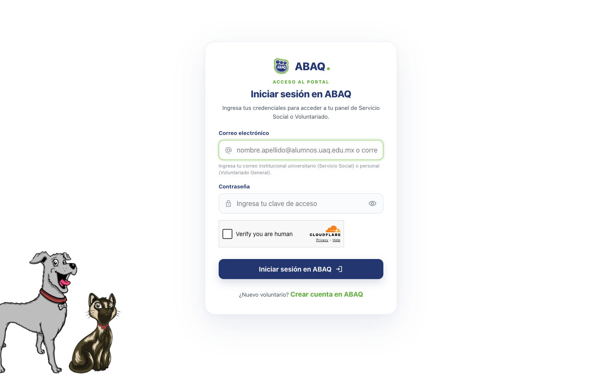

1. **Correo electrónico**: ingrese el correo personal con el que registró su cuenta de voluntariado.
2. **Contraseña**: escriba su clave de acceso. El ícono del ojo permite mostrar u ocultar el texto.
3. **Verificación de seguridad**: complete la casilla **Verify you are human** de Cloudflare Turnstile, que protege el portal contra accesos automatizados.
4. Pulse el botón **Iniciar sesión en ABAQ**.

Si aún no dispone de una cuenta, pulse el enlace **¿Nuevo voluntario? Crear cuenta en ABAQ** y continúe con la sección 3 de este manual.

Al iniciar sesión correctamente, el sistema lo dirige al panel de inicio del voluntario (sección 4). La barra de navegación superior muestra las secciones **Inicio**, **Mis participaciones** y **Mi perfil**, junto con la campana de notificaciones y el botón **Cerrar sesión**.

## 3. Registro de una nueva cuenta

El registro se realiza una sola vez: se selecciona la modalidad de colaborador, se crean las credenciales de acceso y después se completa el onboarding por fases (perfil, inducción, «sobre mí» y documentos), con guardado automático en cada subsección.

### 3.1 Selección de modalidad

La primera pantalla del registro pregunta **¿Cómo te gustaría colaborar?**

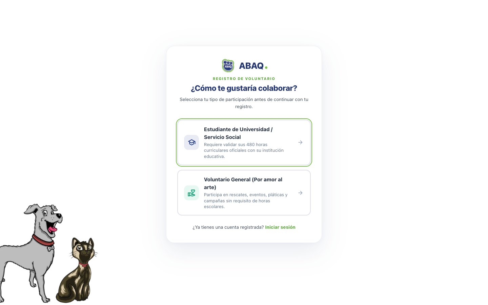

Seleccione la opción **Voluntario General (Por amor al arte)**, indicada para quienes participan en rescates, eventos, pláticas y campañas **sin requisito de horas escolares**. Si ya tiene una cuenta registrada, pulse **Iniciar sesión**.

A continuación, la plataforma solicita sus credenciales de acceso: **correo electrónico personal** y **contraseña** (mínimo 8 caracteres, confirmada en un segundo campo). Al continuar, inicia la Fase 1 del onboarding, en la que se registran sus datos personales, su **grado académico** y su **ocupación o profesión**, además de sus redes sociales de forma opcional.

!!! note "Onboarding de Voluntario General"

    El onboarding de Voluntario General comparte la estructura de fases con el de Servicio Social (perfil, inducción, «sobre mí» y documentos), pero solicita datos propios de este perfil: grado académico y ocupación en lugar de los datos escolares institucionales. La Fase 2 comprende los **Módulos de Inducción ABAQ**, seis temas formativos de bienestar animal con tres reflexiones de aprendizaje cada uno.

## 4. Panel de inicio

La sección **Inicio** concentra el resumen de su participación institucional: métricas de estado, actividades pendientes, historial y gráficas.

### 4.1 Bienvenida y métricas

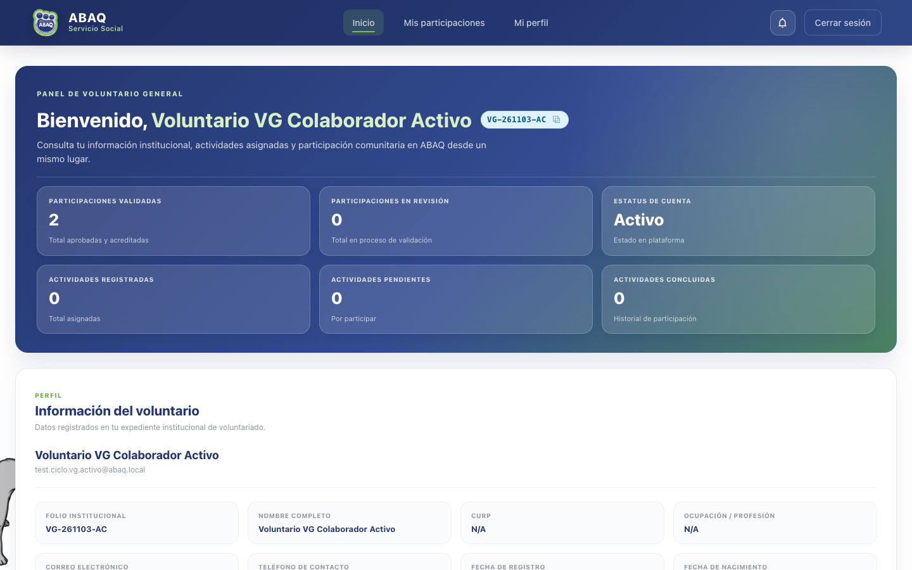

El encabezado del panel, identificado como **PANEL DE VOLUNTARIO GENERAL**, muestra el saludo con su nombre y su folio institucional, y las siguientes métricas:

| Métrica | Descripción |
|---------|-------------|
| **Participaciones validadas** | Total de participaciones aprobadas y acreditadas. |
| **Participaciones en revisión** | Total de participaciones en proceso de validación por la Coordinación. |
| **Estatus de cuenta** | Estado de su cuenta en la plataforma (por ejemplo, **Activo**). |
| **Actividades registradas** | Total de actividades asignadas. |
| **Actividades pendientes** | Actividades por participar. |
| **Actividades concluidas** | Historial de participación. |

A diferencia del panel de Servicio Social, este panel no muestra conteo de horas: el seguimiento se basa en participaciones y estado de cuenta.

Debajo del encabezado, la tarjeta **Información del voluntario** resume sus datos de perfil: folio institucional, nombre completo, CURP, ocupación o profesión, correo electrónico, teléfono de contacto, fecha de registro y fecha de nacimiento.

### 4.2 Actividades pendientes e historial

- **Actividades pendientes**: actividades en las que está registrado o marcó su asistencia para validación. Mientras no existan registros se muestra el aviso **No tienes actividades pendientes**.
- **Historial de actividades**: actividades finalizadas o registradas como no asistidas. Mientras no existan registros se muestra el aviso **Aún no tienes historial**.

### 4.3 Gráficas de participación

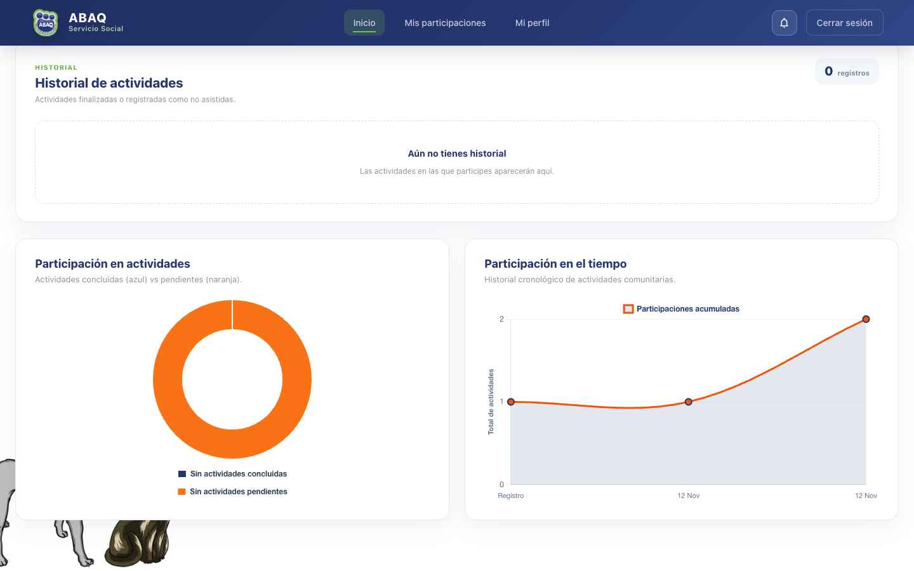

Al final del panel se presentan dos gráficas:

- **Participación en actividades**: gráfica de dona que compara las actividades concluidas (azul) contra las pendientes (naranja).
- **Participación en el tiempo**: gráfica de línea con el histórico cronológico de actividades comunitarias acumuladas desde su registro.

## 5. Mis participaciones

La sección **Mis participaciones** es el centro de gestión de sus convocatorias y vinculaciones.

### 5.1 Encabezado y agenda

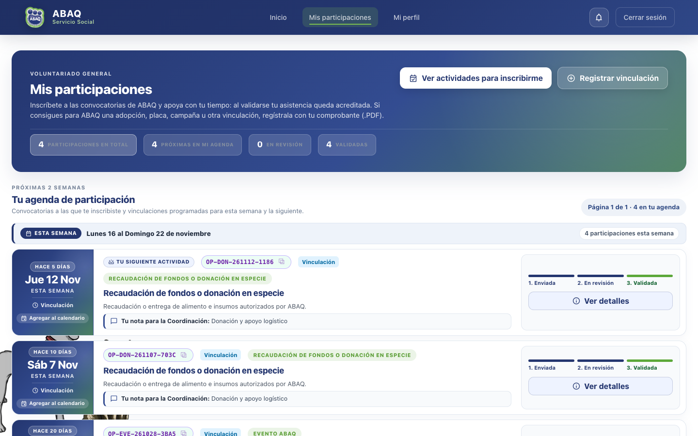

El encabezado ofrece:

- Los botones **Ver actividades para inscribirme** y **Registrar vinculación**.
- Las píldoras de resumen: **participaciones en total**, **próximas en mi agenda**, **en revisión** y **validadas**. A diferencia del perfil de Servicio Social, no existe la píldora de horas acumuladas.
- **Tu agenda de participación**: las convocatorias a las que se inscribió y las vinculaciones programadas para la semana en curso y la siguiente, organizadas por bloques **ESTA SEMANA** y la semana posterior. Cada tarjeta indica la fecha (por ejemplo, **Sáb 21 Nov**), el tipo de participación (**Convocatoria**), el botón **Agregar al calendario**, el folio con su identificador `OP-…`, la categoría de la actividad y las indicaciones de la Coordinación, con los botones **Ver detalles**, **Ver asistentes** y **Cancelar asistencia**.

### 5.2 Búsqueda, filtros e inscripción

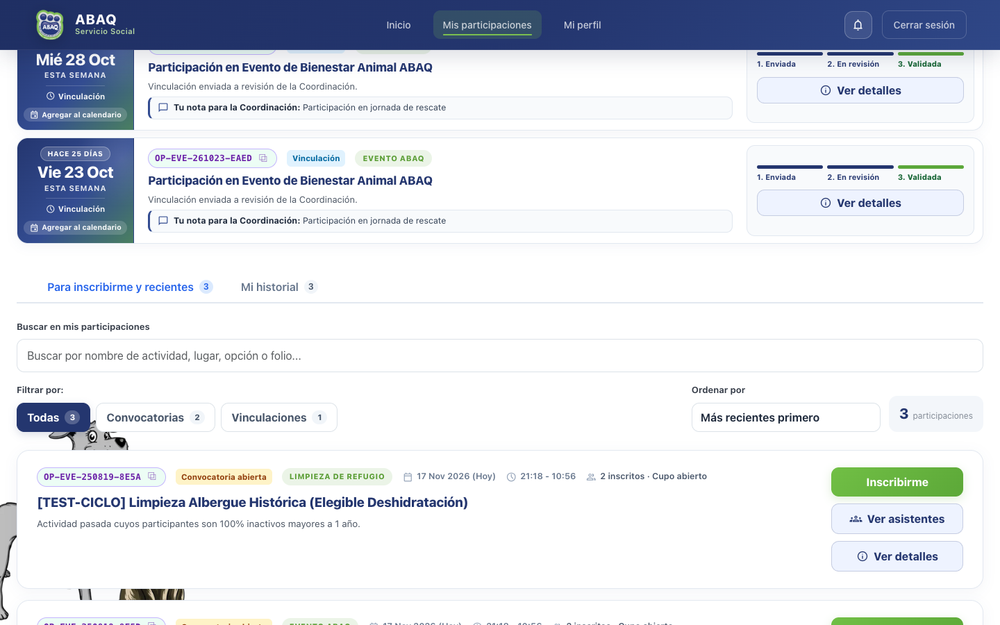

Bajo la agenda se encuentran las dos pestañas de la lista de participaciones:

- **Para inscribirme y recientes**: convocatorias abiertas y vinculaciones recientes.
- **Mi historial**: participaciones de semanas anteriores.

La lista dispone de:

- **Buscador**: «Buscar por nombre de actividad, lugar, opción o folio…».
- **Filtros**: **Todas**, **Convocatorias** y **Vinculaciones**, con contador de resultados.
- **Ordenar por**: por ejemplo, **Más recientes primero**.

Cada tarjeta de convocatoria abierta muestra el folio, la etiqueta de estado (por ejemplo, **Convocatoria abierta**), la categoría (por ejemplo, **LIMPIEZA DE REFUGIO**), la fecha, el horario, los inscritos y el cupo. El botón verde **Inscribirme** registra su participación de inmediato. A diferencia del perfil de Servicio Social, las tarjetas de convocatoria del Voluntario General no muestran el valor en horas de la actividad.

!!! note "Estados que impiden inscribirse"

    Si la convocatoria ya no admite registros, el sistema lo indica en el propio botón: **Cuenta inactiva** cuando su expediente no está activo, o **Lugares agotados** cuando el cupo se ha llenado. El botón **Volver a inscribirme** aparece en convocatorias en las que canceló su asistencia previamente y que aún admiten lugares.

### 5.3 Estados de una participación

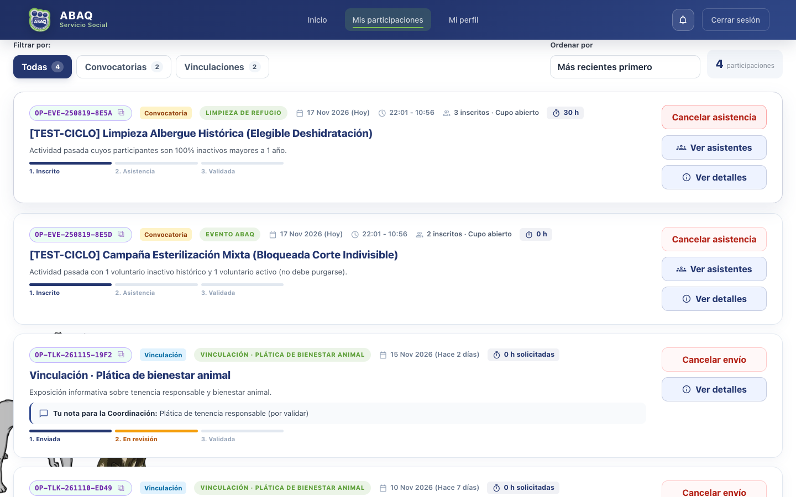

Cada participación muestra una barra de avance con su etapa actual:

| Tipo | Pipeline de estados |
|------|---------------------|
| **Convocatorias** | 1. **Inscrito** → 2. **Asistencia** (o **No asistió**) → 3. **Validada** |
| **Vinculaciones** | 1. **Enviada** → 2. **En revisión** → 3. **Validada** (o **Rechazada**) |

Las vinculaciones muestran además la nota registrada para la Coordinación («Tu nota para la Coordinación: …») y el botón **Cancelar envío**, disponible mientras la solicitud no ha sido validada. En convocatorias inscritas, el botón **Cancelar asistencia** libera su lugar. La captura de esta sección ilustra una vinculación en revisión, con la etapa **2. En revisión** activa.

### 5.4 Cancelar asistencia

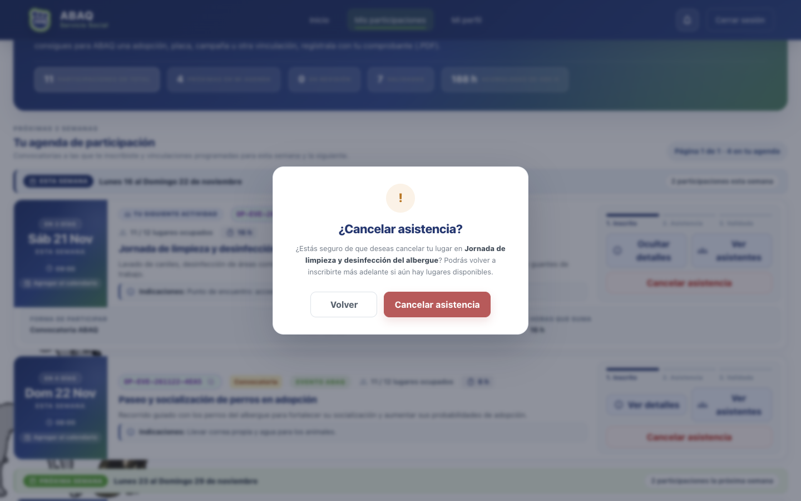

Al pulsar **Cancelar asistencia**, la plataforma solicita confirmación con el mensaje **¿Cancelar asistencia?**, advirtiendo que podrá volver a inscribirse más adelante si aún hay lugares disponibles. Pulse **Volver** para desistir o **Cancelar asistencia** para confirmar la operación.

## 6. Registro de vinculaciones

Una **vinculación** es cualquier apoyo concreto que ofrece a ABAQ fuera de una convocatoria publicada: adopciones, placas, campañas, pláticas, difusión, publicaciones en redes, recaudaciones o apoyos administrativos. Las vinculaciones requieren un comprobante en formato `.PDF` y se acreditan únicamente tras la revisión de la Coordinación.

### 6.1 Formulario de registro

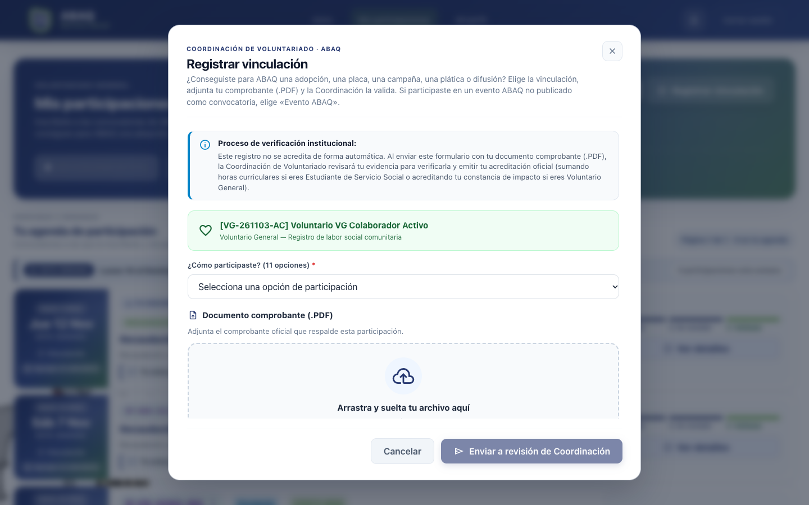

Abra el formulario con el botón **Registrar vinculación** (disponible en el encabezado de **Mis participaciones** y en el menú móvil). El formulario incluye:

1. **Proceso de verificación institucional**: aviso de que el registro no se acredita de forma automática; al enviarlo, la Coordinación de Voluntariado revisará su evidencia para verificarla y emitir su acreditación oficial.
2. **Identificación del expediente**: la tarjeta verde confirma el expediente de Voluntario General como registro de labor social comunitaria, con la leyenda «Voluntario General — Registro de labor social comunitaria»; por ejemplo, **[VG-260818-01] Mariana López Serrano**.
3. **¿Cómo participaste?**: lista de opciones de participación.
4. **Documento comprobante (.PDF)**: área para arrastrar y soltar el archivo. El documento debe ser oficial, en formato `.PDF`, y se envía a resguardo cifrado en el repositorio institucional.
5. Los botones **Cancelar** y **Enviar a revisión de Coordinación**.

!!! note "Sin cálculo de horas"

    A diferencia del formulario de Servicio Social, el formulario de Voluntario General **no muestra el recuadro «Cálculo Oficial de Horas»** ni las reglas de acreditación, ya que este perfil no acumula horas curriculares. La Coordinación registra la acreditación de su labor comunitaria al validar la evidencia.

### 6.2 Opciones de participación y campos dinámicos

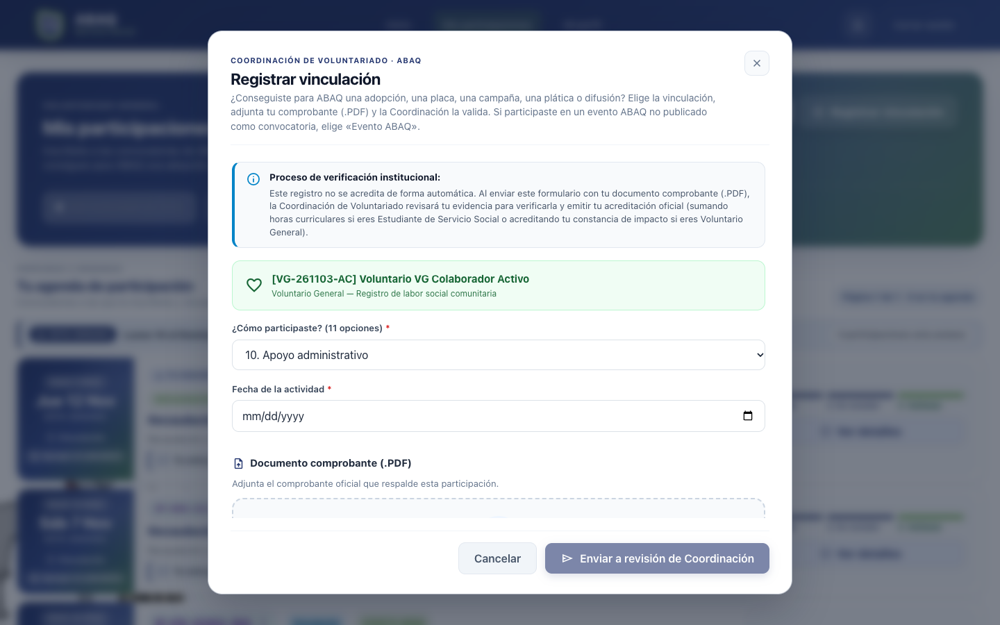

Al elegir una opción, el formulario despliega los campos que corresponden a esa modalidad. Por ejemplo, la opción **10. Apoyo administrativo** solicita la **fecha de la actividad** junto con el documento comprobante. Las opciones disponibles cubren vinculaciones de placas de identificación, campañas de esterilización y/o vacunación, adopción de animales de compañía, coordinación de módulos de adopción, pláticas de bienestar animal, difusión en medios, publicaciones en redes sociales, recaudación de fondos o donación en especie y apoyo administrativo.

### 6.3 Envío y seguimiento

Al enviar el formulario, la vinculación queda en el estado **1. Enviada** y pasa a **2. En revisión** mientras la Coordinación verifica la evidencia. Desde la tarjeta expandida (**Ocultar detalles**) podrá consultar:

- **Forma de participar**: tipo de vinculación registrada.
- **Fecha registrada**.
- **Horas que suma**: valor solicitado en la solicitud (aplica únicamente cuando la vinculación registrada lo contempla).
- **Comprobante adjunto**: botón **DESCARGAR DOCUMENTO (.PDF)** para recuperar su comprobante.

Cuando la Coordinación aprueba la vinculación, el estado pasa a **3. Validada** y la participación queda acreditada en su expediente; si la rechaza, verá el estado **Rechazada** con la posibilidad de corregir y volver a enviar.

## 7. Mi perfil

La sección **Mi perfil** presenta el expediente institucional del voluntario: estatus, datos generales, semblanza, inducción, consentimientos, canales oficiales e historial de folios.

### 7.1 Información personal y de contacto

El encabezado del expediente, identificado como **MI EXPEDIENTE DE VOLUNTARIO · VOLUNTARIO GENERAL**, muestra:

- Su nombre y **folio institucional**.
- **Estatus** de la cuenta (por ejemplo, **Activo**) y el resultado de la última revisión (**Expediente aprobado «Documentación completa.»**).
- **Fecha de aceptación** con la validación oficial de ABAQ.
- **Participaciones individuales**, **actividades grupales** y **total registrado**.

La tarjeta **Información personal y de contacto** presenta, entre otros, los siguientes datos con el botón **Modificar datos** para actualizar la información editable:

| Dato | Descripción |
|------|-------------|
| **Folio de expediente** | Identificador institucional (por ejemplo, `VG-260818-01`). |
| **Nombre completo**, **correo electrónico** y **teléfono** | Datos de contacto registrados. |
| **¿Tiene WhatsApp?** | Indicador del canal de contacto. |
| **CURP** y **ocupación / profesión** | Datos capturados en el onboarding. |
| **Fecha de nacimiento** y **fecha de inicio de voluntariado** | Fechas del expediente. |
| **¿Cómo te enteraste de ABAQ?** y **contacto secundario** | Datos de captación y contacto alterno. |

A diferencia del perfil de Servicio Social, este expediente no incluye el recuadro de resumen y control de horas, ni constancias de inicio o término del servicio social.

### 7.2 Semblanza, inducción y consentimientos

A continuación, el expediente integra:

- **Semblanza e intereses**: semblanza registrada, intereses, talentos y habilidades, aportes esperados a ABAQ, experiencia con animales de compañía y motivación institucional.
- **Módulos de inducción**: respuestas registradas durante la inducción sobre rescate, valores y misión de ABAQ. Mientras no existan registros se muestra el aviso **No hay reflexiones de inducción registradas en el expediente**.
- **Consentimientos y reglamento**: condiciones y términos validados durante su registro, con acceso directo a cada documento.

La sección **Consentimientos y reglamento** incluye:

- **Reglamento**: documento oficial firmado a mano en PDF, disponible con el botón **Descargar PDF**.
- **Aviso de Privacidad y Manejo de Datos**: tratamiento confidencial y protección de datos.
- **Términos y Condiciones de la Plataforma**: formalización digital y condiciones de uso del sistema. La captura anterior corresponde a esta sección y, en su parte inferior, a los canales oficiales descritos en la sección 7.3.

### 7.3 Canales oficiales e historial institucional

La sección **Comunidad y redes — Canales oficiales y difusión** muestra las cuentas registradas para comunicación institucional y difusión de actividades (Facebook, Instagram, TikTok, X (Twitter), YouTube y LinkedIn), con el botón **Modificar datos** para actualizarlas.

Finalmente, la sección **Trazabilidad institucional — Historial** presenta la tabla de folios únicos asignados a su expediente, actividades grupales y participaciones individuales, organizada por las columnas **Folio**, **Concepto**, **Detalle**, **Estado** y **Fecha**. Cada folio (por ejemplo, `VG-260818-01` para el expediente o `OP-EVE-261121-4EA3` para una actividad asignada) puede copiarse para referencias ante la Coordinación.

## 8. Notificaciones

El ícono de campana de la barra de navegación abre el **Centro de Notificaciones ABAQ**, un panel lateral con:

- **Contador de no leídas** junto al título **Notificaciones**.
- **Buscador** de notificaciones.
- **Filtros**: **Todas**, **No leídas**, **Convocatorias** y **Vinculaciones**.
- La acción **Marcar todas como leídas**.

En este centro recibirá sus aceptaciones de expediente, constancias, avisos institucionales y el resumen semanal de actividades. Las notificaciones le informan, por ejemplo, de la validación de una participación o de la aprobación de su expediente. La captura muestra una **nueva convocatoria** y la **participación validada** por la Recolecta de alimento y cobijas del 12 de noviembre.

!!! note "Filtros por rol"

    En la cuenta de Voluntario General, los filtros del centro de notificaciones corresponden al contexto de **Mi voluntariado**.

## 9. Uso desde dispositivos móviles

La plataforma es responsiva y adapta todas sus secciones a pantallas de teléfonos y tabletas.

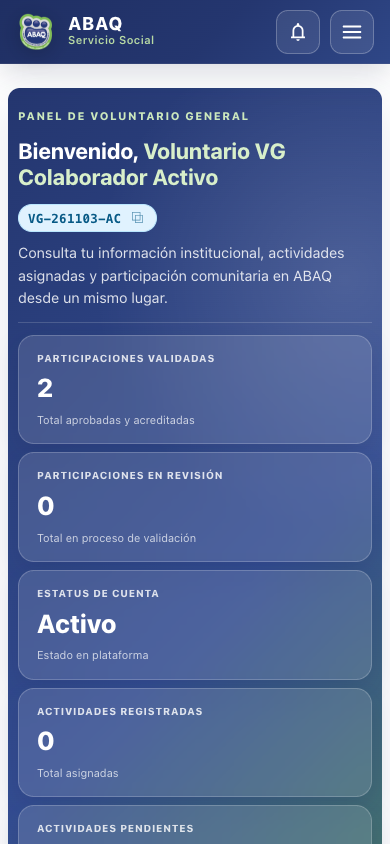

En pantallas móviles, la barra de navegación se simplifica al logotipo de ABAQ, la campana de notificaciones y el botón de menú. El panel de inicio presenta las métricas (participaciones validadas, en revisión, estatus de cuenta, actividades registradas, pendientes y concluidas) en tarjetas apiladas.

El botón de menú despliega la navegación completa, organizada en:

- **Acciones más requeridas**: **Inscribirme a Actividades** (actividades abiertas) y **Registrar Vinculación** (solicitud con evidencia).
- **Vistas más utilizadas**: accesos directos al **Panel de Voluntario** y a las convocatorias disponibles.
- **Mi Voluntariado**: **Panel General de Participación**, **Mis participaciones** y **Mi Perfil y Registro**.
- El botón **Cerrar sesión**.

## 10. Diferencias respecto al Servicio Social

Como referencia rápida, estas son las características propias del perfil de **Voluntario General** en comparación con el Voluntario de Servicio Social:

| Funcionalidad | Voluntario General | Servicio Social |
|---------------|--------------------|-----------------|
| Horas reglamentarias | Sin conteo de horas | Meta de **480 h** con métricas de horas acreditadas, pendientes y progreso |
| Registro | Correo personal, grado académico y ocupación | Correo institucional obligatorio y datos académicos (escuela, carrera, semestre, matrícula) |
| Panel de inicio | Métricas de estado de cuenta y gráficas «Participación en actividades» | Métricas de horas y gráficas «Progreso de servicio social» |
| Convocatorias | Tarjetas sin valor en horas | Tarjetas con las horas que suma la actividad |
| Vinculación | Sin recuadro de cálculo de horas | Recuadro **Cálculo Oficial de Horas** con reglas de acreditación |
| Perfil editable | Solo teléfono | Correo personal y teléfono |
| Constancias | Constancia de impacto cuando aplique | Constancia de Inicio y **Constancia de Término** al completar las 480 h |

## 11. Recomendaciones finales

1. **Mantenga sus datos de contacto actualizados**: el teléfono con WhatsApp y el correo registrado son los canales de comunicación de la Coordinación.
2. **Adjunte comprobantes claros**: una vinculación sin evidencia válida puede ser rechazada por la Coordinación; descargue siempre su comprobante desde el historial.
3. **Dé seguimiento a sus estados**: revise periódicamente la barra de avance de cada participación para detectar rechazos o solicitudes de corrección.
4. **Consulte el reglamento**: conserve a la mano el reglamento firmado y los términos aceptados, disponibles en **Mi perfil**.
5. **Participe en las convocatorias abiertas**: revise la agenda de **Mis participaciones** para no perder las actividades de las próximas dos semanas.

Para dudas sobre su expediente, utilice el canal **Soporte / Coordinación** disponible en la plataforma o comuníquese directamente con la Coordinación de Voluntariado ABAQ Querétaro.
