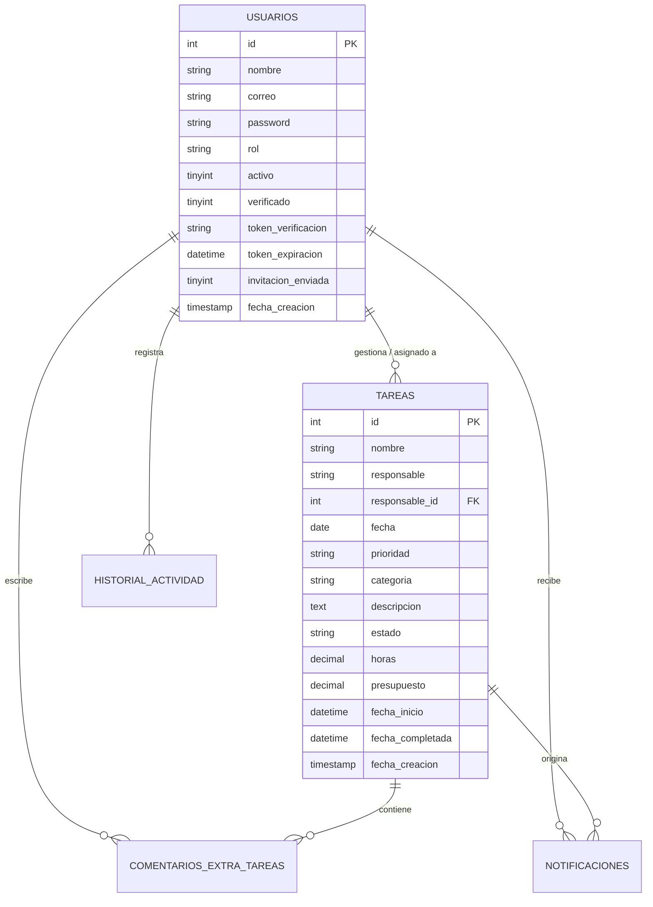

# Arquitectura y Stack Tecnológico

El Organizador ABAQ fue concebido con una arquitectura **Vanilla PHP + MySQL**, prescindiendo intencionalmente de frameworks pesados para maximizar la velocidad de respuesta, minimizar el consumo de recursos en contenedores y facilitar su mantenimiento y portabilidad.

---

## 🛠️ Stack Tecnológico

| Capa | Tecnología | Detalle |
|---|---|---|
| **Lenguaje Backend** | PHP 8.2 CLI | Scripts estructurados, orientados a API JSON y vistas server-side ligeras. |
| **Base de Datos** | MySQL 8.x | Extensiones `mysqli` y `pdo_mysql`. Soporte UTF8MB4. |
| **Frontend** | HTML5, CSS3, Vanilla JS | Diseño responsivo nativo, interacción drag-and-drop HTML5 y modales CSS. |
| **Servicio de Correo** | Resend API REST | Integración nativa vía cURL a `https://api.resend.com/emails`. |
| **Contenedorización** | Docker (`php:8.2-cli`) | Servidor embebido PHP escuchando en `0.0.0.0:${PORT}`. |
| **Plataforma Cloud** | Railway | Alojamiento de servicio web y base de datos relacional MySQL vinculada. |

---

## 🗄️ Esquema de Base de Datos

En `conexion.php`, el sistema implementa una auto-inicialización con `CREATE TABLE IF NOT EXISTS`:

---

## 🔐 Manejo de Entornos y Configuración (.env)

El sistema cuenta con un cargador de entorno nativo (`env.php`):

1. **Prioridad de Variables:** Si una variable ya existe en el entorno del sistema (por ejemplo, inyectada por Railway o Docker), se respeta y no es sobreescrita.
2. **Carga Local:** Si existe el archivo `.env`, lo analiza línea por línea, omitiendo comentarios (`#`) y limpiando comillas, cargando los valores mediante `putenv()` y `$_ENV`.
3. **Conexión MySQL Dinámica:** `conexion.php` soporta de manera transparente variables independientes (`MYSQLHOST`, `MYSQLPORT`, `MYSQLUSER`, `MYSQLPASSWORD`, `MYSQLDATABASE`) o URLs de conexión consolidadas (`MYSQL_URL`, `DATABASE_URL`).

---

## ⚠️ Hallazgos de Seguridad Pendientes

Revisión del código de la rama `dev` realizada el 18 de noviembre de 2026. Los siguientes puntos están documentados y **aún no se corrigen**.

!!! danger "Endpoints de tareas sin control de sesión"

    `guardar_tarea.php` y `eliminar_tarea.php` no validan la sesión ni el rol. Cualquier persona que conozca la URL puede crear o eliminar tareas en producción. Ambos archivos solo son invocados por `script.js`, que no está incluido en ninguna página: se trata de código heredado, reemplazado por `guardar_tarea_admin.php` y `eliminar_tarea_admin.php`.

    **Corrección sugerida:** eliminar `script.js`, `guardar_tarea.php` y `eliminar_tarea.php`, o exigir sesión de administrador en ambos endpoints.

!!! warning "Autoregistro accesible"

    `registro.html` y `registrar_usuario.php` permiten crear cuentas con rol `usuario` sin invitación. Aunque ninguna página enlaza al formulario, este es accesible por URL, y `login.php` no verifica el campo `verificado`, por lo que la cuenta creada puede iniciar sesión.

    **Corrección sugerida:** eliminar el autoregistro, ya que el acceso oficial es por invitación (`enviar_invitacion.php` → `crear_password.php`).

!!! info "Políticas de contraseña inconsistentes"

    `crear_password.php` exige **12 caracteres** como mínimo, mientras que `registrar_usuario.php` y `crear_usuario_admin.php` aceptan **8**. `crear_usuario_admin.php` ya no se utiliza: «Agregar usuario» en `admin_usuarios.php` envía una invitación.

    **Corrección sugerida:** unificar el mínimo en 12 caracteres y eliminar `crear_usuario_admin.php`.
