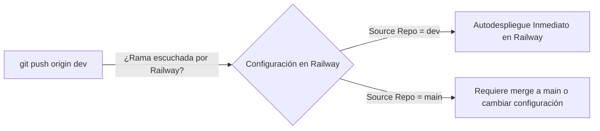

# Despliegue en Railway

El Organizador ABAQ está configurado para ejecutarse en la plataforma cloud **Railway**, utilizando su soporte nativo para contenedores Docker y vinculación de bases de datos relacionales MySQL.

---

## 🐳 Configuración del Contenedor (`Dockerfile`)

El contenedor utiliza la imagen base oficial de PHP CLI:

```dockerfile
FROM php:8.2-cli

RUN docker-php-ext-install mysqli pdo pdo_mysql

WORKDIR /app
COPY . /app

ENV PORT=80
ENV NODE_ENV=development

CMD php -S 0.0.0.0:${PORT} -t /app
```

- **Extensiones Compiladas:** `mysqli`, `pdo`, `pdo_mysql`.
- **Enlace de Red:** Escucha en `0.0.0.0` utilizando el puerto inyectado por Railway en la variable `PORT`.

---

## 🌐 Enlaces y Dominios en Railway

Railway distingue entre dos tipos de comunicación de red:

### 1. Dominio Público (Acceso para Usuarios y Navegador)
- **Generación:** Se crea desde la consola de Railway: *Proyecto $\rightarrow$ Servicio Web $\rightarrow$ Settings $\rightarrow$ Networking $\rightarrow$ Public Networking $\rightarrow$ Generate Domain*.
- **Estructura del Enlace:** `https://<nombre-aleatorio>.up.railway.app`.
- **Uso:** Esta es la URL que los administradores y colaboradores ingresan en su navegador para acceder a `index.html`, `dashboard.php`, `kanban_admin.php`, etc.

### 2. Dominio y Red Interna (Comunicación entre Servicios)
- **Estructura:** `<nombre-del-servicio>.railway.internal:<puerto>` (por ejemplo, `mysql.railway.internal:3306`).
- **Uso:** Comunicación privada, de baja latencia y segura dentro del cluster de Railway para que PHP se conecte a MySQL sin exponer puertos al Internet público.

---

## 🔄 Estrategia de Ramas y Autodespliegue



1. **Configuración por Defecto:**
   - Si el servicio en Railway fue vinculado inicialmente a `main`, empujar a `dev` **no** disparará la compilación automáticamente hasta que se fusione `dev` en `main`.
2. **Recomendación para Despliegue Directo de `dev`:**
   - Para que Railway se actualice automáticamente con cada `git push origin dev`, accede a la consola de Railway:
     * *Servicio $\rightarrow$ Settings $\rightarrow$ Source Repo $\rightarrow$ Branch*.
     * Cambia la rama de despliegue a **`dev`**.
   - A partir de ese momento, cualquier push a `dev` iniciará el ciclo de build y deploy en vivo.
