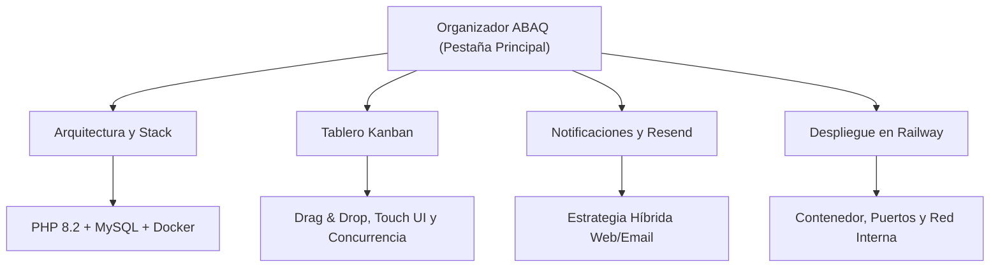

# Organizador ABAQ

El **Organizador ABAQ** es el segundo proyecto dentro del ecosistema de software de la asociación **ABAQ**, diseñado para operar de forma independiente y complementaria a la plataforma principal (Angular/Express).

---

## 🎯 Objetivo del Sistema

Brindar a la administración y a los coordinadores de ABAQ un entorno ágil, visual y ligero para:

1. **Gestión de Tareas:** Creación, categorización (Legal, RH, Finanzas, Mercadotecnia, Relaciones Públicas, Investigación, Vinculación), asignación y control de fechas límite.
2. **Tablero Kanban:** Organización dinámica del flujo de trabajo por estados (*Canceladas*, *Pendiente*, *En proceso*, *Completada*).
3. **Control Operativo:** Registro de horas trabajadas, presupuesto asignado y justificación de beneficio/impacto de cada entrega.
4. **Activación de Colaboradores:** Flujo de invitación con enlace seguro por token para que nuevos usuarios definan su contraseña.
5. **Comunicación Híbrida:** Notificaciones en tiempo real en la plataforma (campana) y alertas transaccionales por correo electrónico vía **Resend**.

---

## 🧭 Estructura de esta Sección

Esta pestaña agrupa de forma exclusiva toda la documentación técnica, arquitectónica y operativa del Organizador:

- [**Arquitectura y Stack Tecnológico**](arquitectura-y-stack.md): Componentes de backend, base de datos relacional MySQL, contenedorización Docker y configuración de variables de entorno (`.env`).
- [**Tablero Kanban y Flujos de Estado**](kanban.md): Mecanismos de interacción visual, compatibilidad móvil/táctil, resolución de condiciones de carrera y sincronización con MySQL.
- [**Notificaciones y Servicio de Correo Resend**](notificaciones-y-resend.md): Estrategia híbrida de avisos (campana en navegador vs. correos críticos transaccionales con plantillas ABAQ).
- [**Despliegue en Railway**](despliegue-railway.md): Configuración de Dockerfile, variables inyectadas, enlaces públicos (`*.up.railway.app`) y red privada (`railway.internal`).

---

## 📍 Estado del Repositorio y Ramas

- **Código Fuente:** Estable y unificado en la rama `dev`.
- **Integración de Cambios:** Contiene las soluciones de Kanban y Resend (aportadas por el agente Antigravity), el saneamiento de sincronización y merge de `main` (por el agente GLM-5.3-Flash / OpenCode), y los ajustes de tipos y filtros.
- **Ambiente de Producción / Staging:** Listo para despliegue automatizado en Railway.
