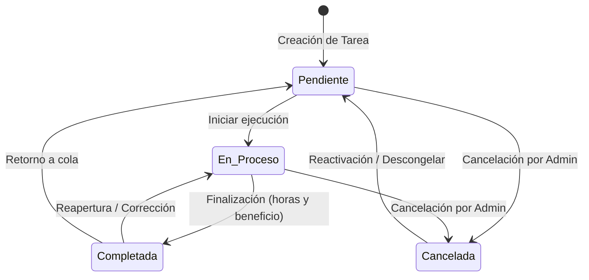

# Tablero Kanban y Flujos de Estado

El tablero Kanban (`kanban_admin.php`) es el núcleo visual para los administradores de ABAQ, permitiendo mover tareas fluidamente entre sus cuatro columnas operativas.

---

## 📊 Flujo de Estados

---

## ⚡ Problemas Detectados y Soluciones Implementadas

### 1. Desincronización y Pérdida de ID en "Canceladas"

- **Causa Raíz:** Al soltar una tarjeta en la columna *Canceladas*, el código disparaba un `confirm()` del navegador. Este diálogo bloqueaba el hilo síncrono de JavaScript, lo cual provocaba que el navegador disparara inmediatamente el evento `dragend` en la tarjeta arrastrada. Dicho `dragend` limpiaba la variable global `tareaArrastradaId = null`. Cuando el usuario aceptaba la confirmación, se enviaba `id: null` al backend, fallando siempre con *"Tarea no válida"*.
- **Solución:** Se capturan de inmediato tanto `tareaArrastradaId` como el dato de `evento.dataTransfer.getData("text/plain")` en constantes locales (`const idAMover = ...`) **antes** de invocar cualquier diálogo o confirmación.

### 2. Parpadeo Visual (*Flickering*) en el Arrastre

- **Causa Raíz:** Al mover una tarjeta sobre elementos hijos (títulos, etiquetas, tarjetas existentes) dentro de una columna, el evento `dragleave` se activaba falsamente debido al cambio de `relatedTarget`.
- **Solución:** Se implementó un contador de profundidad (`dragCounters[colEstado]`) por columna, incrementando en `dragenter` y decrementando en `dragleave`. La clase CSS `.drag-over` solo se retira cuando el contador vuelve a cero.

### 3. Soporte para Pantallas Táctiles y Móviles

- **Causa Raíz:** La API de Drag & Drop nativa de HTML5 no tiene soporte para eventos táctiles en smartphones y tablets.
- **Solución:** Se integró un selector accesible (`<select class="kanban-select-estado">`) en cada tarjeta que permite cambiar el estado con un simple toque, manteniendo las mismas confirmaciones y notificaciones que el arrastre con ratón.

### 4. Actualización Segura en Backend (`actualizar_estado_kanban.php`)

- **Causa Raíz:** La sentencia SQL original incluía `WHERE id = ? AND estado = ?` y exigía que `$filasActualizadas === 1`. Si la tarea ya se encontraba en un estado equivalente en la base de datos o si MySQL devolvía 0 filas afectadas, se generaba un error de *"La tarea cambió mientras se procesaba la solicitud"*.
- **Solución:** Se consulta la tarea inicialmente para validar existencia, se descartan cambios redundantes y se actualiza mediante `WHERE id = ?`. Al completar con éxito, se genera automáticamente una notificación interna al colaborador responsable en la tabla `notificaciones`.
