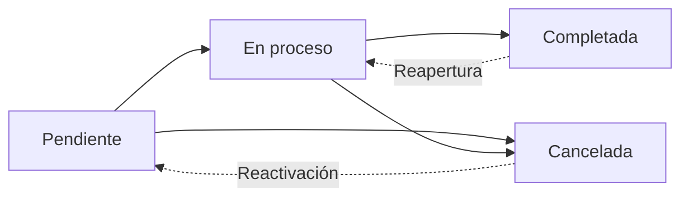

# Manual del Administrador — Organizador ABAQ

Este manual está dirigido a las personas de la Coordinación de ABAQ Querétaro que administran el **Organizador ABAQ**. Describe cómo invitar y gestionar colaboradores, crear y asignar tareas, darles seguimiento en el tablero Kanban, consultar estadísticas y revisar el historial de actividad.

!!! note "Convenciones utilizadas en este manual"

    - Los nombres de botones, pestañas y etiquetas aparecen entre comillas exactamente como se muestran en la interfaz.
    - La plataforma se encuentra disponible en <https://organizador-production-4fc3.up.railway.app>.
    - Los recuadros **«Captura pendiente»** indican el lugar donde se insertará la captura de pantalla correspondiente. Las imágenes deberán guardarse en `docs/organizador-abaq/attachments/`.
    - Para las pantallas que comparte con los colaboradores (inicio de sesión, notificaciones y calendario), consulte el [Manual del Colaborador](manual-colaborador.md).

## Índice de capturas de pantalla

| N.º | Archivo | Pantalla | Sección |
|-----|---------|----------|---------|
| 1 | `org-adm-01-panel.png` | Panel del administrador | [1. Panel del administrador](#1-panel-del-administrador) |
| 2 | `org-adm-02-usuarios.png` | Administración de usuarios | [2.1 Consultar usuarios](#21-consultar-usuarios) |
| 3 | `org-adm-03-agregar-usuario.png` | Formulario «Agregar usuario» | [2.2 Invitar a un colaborador](#22-invitar-a-un-colaborador) |
| 4 | `org-adm-04-detalle-usuario.png` | Detalle de usuario y acciones | [2.3 Acciones sobre un usuario](#23-acciones-sobre-un-usuario) |
| 5 | `org-adm-05-tareas.png` | Gestión de tareas con filtros | [3.1 Consultar y filtrar tareas](#31-consultar-y-filtrar-tareas) |
| 6 | `org-adm-06-nueva-tarea.png` | Formulario «Nueva tarea» | [3.2 Crear una tarea](#32-crear-una-tarea) |
| 7 | `org-adm-07-editar-tarea.png` | Ventana «Editar tarea» | [3.3 Editar una tarea](#33-editar-una-tarea) |
| 8 | `org-adm-08-comentarios.png` | Comentarios de la tarea | [3.5 Comentarios de la tarea](#35-comentarios-de-la-tarea) |
| 9 | `org-adm-09-kanban.png` | Tablero Kanban | [4. Tablero Kanban](#4-tablero-kanban) |
| 10 | `org-adm-10-estadisticas.png` | Estadísticas de tareas | [5. Estadísticas](#5-estadisticas) |
| 11 | `org-adm-11-historial.png` | Historial de actividad | [6. Historial de actividad](#6-historial-de-actividad) |

---

## 1. Panel del administrador

Al iniciar sesión con una cuenta de administrador, el sistema abre el panel «ABAQ ADMINISTRADOR». Desde ahí se accede a todos los módulos:

| Acceso | Para qué sirve |
|---|---|
| **Administrar usuarios** | Invitar, activar, desactivar y restablecer contraseñas de colaboradores. |
| **Agregar usuario** (acción rápida) | Abre directamente el formulario de invitación. |
| **Tareas** | Crear, editar, cancelar, reactivar y eliminar tareas. |
| **Kanban** | Mover tareas entre estados de forma visual. |
| **Estadísticas** | Consultar el resumen general y las tareas completadas por persona. |
| **Historial** | Revisar la actividad registrada en la plataforma. |
| **Calendario** (botón flotante) | Ver las tareas por fecha límite. |
| **Campana** | Notificaciones del administrador. |

!!! example "📷 Captura pendiente — `org-adm-01-panel.png`"

    Panel «ABAQ ADMINISTRADOR» con la sección «ACCIONES RÁPIDAS», los accesos a tareas, usuarios, Kanban e historial, y la campana de notificaciones.

---

## 2. Administración de usuarios

### 2.1 Consultar usuarios

La pantalla «ADMINISTRACIÓN DE USUARIOS» lista a todas las personas registradas con su nombre, correo, estado (*Activo* / *Inactivo*) y las acciones disponibles.

!!! example "📷 Captura pendiente — `org-adm-02-usuarios.png`"

    Tabla de usuarios con al menos un usuario activo, uno inactivo y uno con invitación pendiente.

### 2.2 Invitar a un colaborador

1. Presione «Agregar usuario».
2. Escriba el **nombre completo** y el **correo electrónico** del colaborador.
3. Presione el botón para guardar.
4. El sistema enviará al colaborador un correo con un enlace para crear su contraseña. Verá el aviso «Invitación enviada correctamente al correo.»

!!! warning "Vigencia de la invitación"

    El enlace vence a las **24 horas** y solo puede usarse una vez. Si el colaborador no lo utiliza a tiempo, envíe una nueva invitación.

!!! info "Modo prueba (sin correo configurado)"

    Si el servicio de correo no está configurado, aparecerá el aviso «MODO PRUEBA: no se envió ningún correo.» junto con el enlace de activación. Cópielo completo y compártalo con el colaborador por un medio seguro; debe pegarse directamente en el navegador.

!!! example "📷 Captura pendiente — `org-adm-03-agregar-usuario.png`"

    Formulario «Agregar usuario» con nombre y correo de ejemplo, y el mensaje de confirmación del envío.

### 2.3 Acciones sobre un usuario

| Acción | Efecto |
|---|---|
| **Ver** | Muestra el detalle: nombre, correo, estado y fecha de registro. |
| **Desactivar** | Impide que el usuario inicie sesión. Sus tareas e historial se conservan. Se pide confirmación («¿Seguro que deseas desactivar este usuario?»). |
| **Activar** | Restablece el acceso de un usuario desactivado. |
| **Restablecer contraseña** | Genera una contraseña nueva («¿Generar una nueva contraseña?») y la muestra una sola vez en la ventana «Contraseña actualizada». |

!!! tip "Comparta las contraseñas de forma segura"

    Copie la contraseña nueva en el momento en que se muestra y entréguela al colaborador por un canal privado. Recomiéndele no reutilizarla en otros servicios.

!!! example "📷 Captura pendiente — `org-adm-04-detalle-usuario.png`"

    Ventana de detalle de un usuario con los botones de activar/desactivar y restablecer contraseña.

---

## 3. Gestión de tareas

### 3.1 Consultar y filtrar tareas

La pantalla de tareas agrupa todas las actividades en «Tareas pendientes», «En proceso», «Completadas» y «Tareas canceladas». Para localizar una tarea, combine los filtros:

- **Nombre** (búsqueda por texto).
- **Responsable**.
- **Categoría**: Legal, RH, Finanzas, Mercadotecnia, Relaciones Públicas, Investigación o Vinculación.
- **Prioridad**: Alta, Media o Baja.
- **Estado**.
- **Fecha**.

En las tareas completadas se muestran además las **horas realizadas**, el **nivel de beneficio** (Alto, Medio, Bajo o Sin beneficio identificable) y la justificación que registró el colaborador.

!!! example "📷 Captura pendiente — `org-adm-05-tareas.png`"

    Pantalla de tareas con la barra de filtros y tarjetas en distintos estados, incluida una tarea completada con horas y beneficio.

### 3.2 Crear una tarea

1. Presione «Nueva tarea».
2. Llene el formulario:

    | Campo | Descripción |
    |---|---|
    | **Nombre** | Título breve de la actividad (por ejemplo, «Publicar campaña de adopción»). |
    | **Responsable** | Colaborador al que se asigna la tarea. |
    | **Fecha** | Fecha límite de entrega. |
    | **Prioridad** | Alta, Media o Baja. |
    | **Categoría** | Área de la asociación a la que pertenece. |
    | **Descripción** | Qué debe realizar el colaborador. |
    | **¿La tarea tuvo presupuesto? (opcional)** | Si elige *Sí*, indique el **Presupuesto asignado (MXN)**, por ejemplo `1500.00`. |

3. Guarde la tarea. Quedará en estado *Pendiente* y el responsable recibirá una notificación en la plataforma y un **correo electrónico** de nueva tarea asignada.

!!! example "📷 Captura pendiente — `org-adm-06-nueva-tarea.png`"

    Formulario «Nueva tarea» lleno con datos de ejemplo y la opción de presupuesto activada.

### 3.3 Editar una tarea

1. En la tarjeta de la tarea, presione «Editar tarea».
2. Modifique los campos necesarios (responsable, fecha, prioridad, categoría, descripción o presupuesto).
3. Guarde los cambios. La edición queda registrada en el historial de actividad.

!!! example "📷 Captura pendiente — `org-adm-07-editar-tarea.png`"

    Ventana «Editar tarea» con los campos precargados.

### 3.4 Cancelar, reactivar y eliminar

| Acción | Cuándo está disponible | Efecto |
|---|---|---|
| **Cancelar** | Solo en tareas *Pendientes*. | La tarea pasa a «Tareas canceladas» y deja de mostrarse como trabajo por hacer. |
| **Descongelar** | Solo en tareas *Canceladas*. | La tarea regresa a *Pendiente* para que el responsable pueda retomarla. |
| **Eliminar** | Cualquier estado. | Borra la tarea de forma **definitiva**. |

!!! danger "La eliminación no se puede deshacer"

    Prefiera **Cancelar** cuando una tarea ya no sea necesaria: conserva la información y puede reactivarse. Use **Eliminar** solo para tareas creadas por error.

### 3.5 Comentarios de la tarea

Con «💬 Ver comentarios» se abre el «Historial de comentarios» de la tarea, donde aparecen los comentarios del colaborador y de la administración. Para responder, escriba en «Agregar un comentario nuevo» y presione «Guardar comentario».

!!! example "📷 Captura pendiente — `org-adm-08-comentarios.png`"

    Ventana «Comentarios de la tarea» con comentarios del colaborador y una respuesta del administrador.

---

## 4. Tablero Kanban

El tablero muestra las tareas en cuatro columnas: **Pendiente**, **En proceso**, **Completada** y **Cancelada**.

- **Con ratón:** arrastre la tarjeta y suéltela en la columna destino.
- **En celular o tableta:** use el selector «Mover:» de cada tarjeta y elija el nuevo estado.

Al mover una tarea a *Cancelada*, el sistema pide confirmación. Cada cambio de estado notifica automáticamente al responsable y queda registrado en el historial como «Cambio en Kanban».

!!! example "📷 Captura pendiente — `org-adm-09-kanban.png`"

    Tablero Kanban con tarjetas en las cuatro columnas; idealmente, una tarjeta en pleno arrastre.

Para los detalles técnicos del tablero, consulte [Tablero Kanban y Flujos de Estado](kanban.md).

---

## 5. Estadísticas

La pantalla «ESTADÍSTICAS DE TAREAS» ofrece:

1. **Resumen general:** número de tareas *Pendientes*, *En proceso* y *Completadas*.
2. **Gráfica «Tareas completadas por usuario»:** barras con las tareas concluidas por cada colaborador. Se muestran únicamente los usuarios que actualmente se encuentran activos.

Use esta vista para equilibrar la carga de trabajo y reconocer la participación de cada colaborador.

!!! example "📷 Captura pendiente — `org-adm-10-estadisticas.png`"

    Resumen general con los tres contadores y la gráfica de barras con al menos tres colaboradores.

---

## 6. Historial de actividad

La pantalla «Actividades registradas en ABAQ» presenta una línea de tiempo con las acciones realizadas en la plataforma (creación y edición de tareas, cambios en Kanban, inicios y finalizaciones, entre otras), indicando quién la realizó, su rol, la descripción y la fecha y hora.

Para «Buscar y filtrar actividad»:

1. Escriba un texto en el buscador, o
2. Filtre por **usuario**, **tipo de acción** o **fecha**.
3. Presione «Limpiar» para quitar todos los filtros.

El contador de resultados se actualiza al instante. Si no hay registros, aparecerá «Aún no hay actividad registrada».

!!! example "📷 Captura pendiente — `org-adm-11-historial.png`"

    Línea de tiempo del historial con filtros aplicados y el contador de resultados visible.

---

## 7. Buenas prácticas

- **Asigne fechas realistas.** El sistema notifica automáticamente las tareas que vencen mañana, hoy o que ya están vencidas, tanto al responsable como a los administradores.
- **Escriba descripciones accionables.** Indique el entregable esperado y, si aplica, el presupuesto disponible.
- **Desactive en lugar de olvidar.** Cuando un colaborador concluya su participación, desactive su cuenta para proteger la información.
- **Revise el historial periódicamente** para detectar cambios inesperados.

---

**Relacionado:** [Manual del Colaborador](manual-colaborador.md) · [Arquitectura y Stack](arquitectura-y-stack.md) · [Notificaciones y Resend](notificaciones-y-resend.md) · [Despliegue en Railway](despliegue-railway.md)
