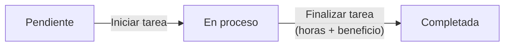

# Manual del Colaborador — Organizador ABAQ

Este manual está dirigido a las personas que colaboran con ABAQ Querétaro y reciben tareas asignadas a través del **Organizador ABAQ**. Describe, paso a paso, cómo activar la cuenta, iniciar sesión, consultar las tareas asignadas, iniciarlas, finalizarlas registrando horas y beneficio, agregar comentarios y atender las notificaciones.

!!! note "Convenciones utilizadas en este manual"

    - Los nombres de botones, pestañas y etiquetas aparecen entre comillas exactamente como se muestran en la interfaz.
    - La plataforma se encuentra disponible en <https://organizador-production-4fc3.up.railway.app>.
    - Los recuadros **«Captura pendiente»** indican el lugar donde se insertará la captura de pantalla correspondiente. El nombre de archivo sugerido se indica en cada recuadro y las imágenes deberán guardarse en `docs/organizador-abaq/attachments/`.

## Índice de capturas de pantalla

| N.º | Archivo | Pantalla | Sección |
|-----|---------|----------|---------|
| 1 | `org-col-01-correo-invitacion.png` | Correo de invitación | [1.1 Recibir la invitación](#11-recibir-la-invitacion) |
| 2 | `org-col-02-crear-password.png` | Pantalla «Crea tu contraseña» | [1.2 Crear la contraseña](#12-crear-la-contrasena) |
| 3 | `org-col-03-login.png` | Inicio de sesión | [2. Iniciar sesión](#2-iniciar-sesion) |
| 4 | `org-col-04-mis-tareas.png` | Panel «Mis actividades» | [3. Panel de tareas](#3-panel-de-tareas) |
| 5 | `org-col-05-iniciar-tarea.png` | Tarjeta con el botón «Iniciar tarea» | [4.1 Iniciar una tarea](#41-iniciar-una-tarea) |
| 6 | `org-col-06-finalizar-tarea.png` | Formulario «Finalizar tarea» | [4.2 Finalizar una tarea](#42-finalizar-una-tarea) |
| 7 | `org-col-07-comentarios.png` | Ventana «Comentarios adicionales» | [5. Comentarios adicionales](#5-comentarios-adicionales) |
| 8 | `org-col-08-notificaciones.png` | Panel de notificaciones | [6. Notificaciones](#6-notificaciones) |
| 9 | `org-col-09-calendario.png` | Calendario de tareas | [7. Calendario](#7-calendario) |

---

## 1. Activación de la cuenta

El acceso al Organizador se otorga por invitación: un administrador de ABAQ registra el nombre y correo del colaborador y el sistema envía un enlace de activación.

### 1.1 Recibir la invitación

1. Revise la bandeja de entrada del correo que proporcionó a la Coordinación.
2. Abra el mensaje de invitación del Organizador ABAQ.
3. Haga clic en el enlace de activación.

!!! warning "Vigencia del enlace"

    El enlace de invitación **vence a las 24 horas** y solo puede utilizarse **una vez**. Si al abrirlo aparece la leyenda «Invitación no disponible», solicite a un administrador que le envíe una nueva invitación.

!!! example "📷 Captura pendiente — `org-col-01-correo-invitacion.png`"

    Correo de invitación recibido, mostrando el remitente, el asunto y el botón o enlace de activación.

### 1.2 Crear la contraseña

1. En la pantalla «Crea tu contraseña», escriba una contraseña de **al menos 12 caracteres**.
2. Confírmela en el segundo campo.
3. Presione el botón para guardar. Aparecerá el mensaje «Cuenta activada».
4. Continúe al inicio de sesión.

**Consejo:** utilice una frase fácil de recordar para usted y difícil de adivinar para otros, por ejemplo cuatro palabras sin relación entre sí.

!!! example "📷 Captura pendiente — `org-col-02-crear-password.png`"

    Pantalla «Crea tu contraseña» con los campos de contraseña y confirmación (indicación «Mínimo 12 caracteres»).

---

## 2. Iniciar sesión

1. Ingrese a <https://organizador-production-4fc3.up.railway.app>.
2. Escriba su correo electrónico y su contraseña.
3. Presione el botón de inicio de sesión.

El sistema lo dirigirá automáticamente a su panel de tareas («Mis actividades»).

!!! example "📷 Captura pendiente — `org-col-03-login.png`"

    Pantalla «ABAQ - Iniciar sesión» con los campos de correo y contraseña.

??? question "Mensajes que pueden aparecer al iniciar sesión"

    | Mensaje | Qué significa | Qué hacer |
    |---|---|---|
    | «Completa correo y contraseña.» | Uno de los campos quedó vacío. | Llene ambos campos. |
    | «Correo o contraseña incorrectos.» | Los datos no coinciden con una cuenta. | Verifique el correo y la contraseña; si la olvidó, pida a un administrador que la restablezca. |
    | «Tu acceso se encuentra inactivo. Contacta a un administrador.» | Su cuenta fue desactivada. | Comuníquese con la Coordinación. |

Para salir de la plataforma, utilice el botón «Cerrar sesión» de la barra superior. Se recomienda cerrar sesión siempre que use un equipo compartido.

---

## 3. Panel de tareas

El panel «Mis actividades» concentra todas las tareas que un administrador le ha asignado. Cada tarea se muestra como una tarjeta con su nombre, categoría, prioridad, fecha límite y descripción.

Las tarjetas se agrupan por estado:

| Sección | Contenido |
|---|---|
| **Tareas pendientes** | Tareas asignadas que aún no se han comenzado. |
| **En proceso** | Tareas que usted ya inició. |
| **Completadas** | Tareas finalizadas, con las horas y el beneficio registrados. |

**Categorías:** Legal, RH, Finanzas, Mercadotecnia, Relaciones Públicas, Investigación y Vinculación.
**Prioridades:** Alta, Media y Baja.

!!! example "📷 Captura pendiente — `org-col-04-mis-tareas.png`"

    Panel «Mis actividades» con al menos una tarjeta en cada sección (pendiente, en proceso y completada).

---

## 4. Ciclo de una tarea

### 4.1 Iniciar una tarea

1. Ubique la tarjeta en «Tareas pendientes».
2. Presione «Iniciar tarea».
3. La tarjeta pasará a la sección «En proceso» y el sistema registrará la fecha de inicio.

!!! info "Solo puede iniciar sus propias tareas"

    Únicamente la persona responsable puede iniciar una tarea, y solo cuando se encuentra en estado *Pendiente*. Si la tarea ya fue iniciada o completada, aparecerá el aviso «La tarea ya fue iniciada o completada.»

!!! example "📷 Captura pendiente — `org-col-05-iniciar-tarea.png`"

    Tarjeta de una tarea pendiente con el botón «Iniciar tarea» visible.

### 4.2 Finalizar una tarea

Al concluir el trabajo, registre el resultado para que la Coordinación conozca el esfuerzo invertido y el impacto obtenido.

1. En la tarjeta de la tarea en proceso, presione «Finalizar tarea».
2. Llene el formulario «Registra las horas y el beneficio obtenido para ABAQ»:

    | Campo | Descripción |
    |---|---|
    | **Horas realizadas** | Total de horas dedicadas a la tarea (por ejemplo, `4`). No puede ser negativo. |
    | **¿Qué nivel de beneficio tuvo la tarea?** | Seleccione *Alto*, *Medio*, *Bajo* o *Sin beneficio identificable*. |
    | **¿Por qué? Explica el resultado obtenido** | Describa qué se logró y cómo benefició a ABAQ (máximo 2,000 caracteres). |

3. Presione «Finalizar tarea». La tarjeta pasará a «Completadas» y los administradores recibirán un aviso de que la tarea fue concluida.

**Consejo:** en la justificación, mencione resultados concretos (por ejemplo, «Se publicaron 3 piezas de la campaña de adopción; alcanzaron 1,200 personas»). Esta información alimenta las estadísticas de la asociación.

!!! example "📷 Captura pendiente — `org-col-06-finalizar-tarea.png`"

    Formulario «Finalizar tarea» con los campos de horas, nivel de beneficio y justificación llenos con datos de ejemplo.

---

## 5. Comentarios adicionales

Cada tarea cuenta con un espacio de comentarios para dejar avances, dudas u observaciones que el administrador puede consultar.

1. En la tarjeta de la tarea, abra «Comentarios adicionales».
2. Revise el historial de comentarios. Si aún no hay ninguno, verá el aviso «Todavía no hay comentarios adicionales.»
3. Escriba su mensaje en «Agregar un comentario».
4. Presione «Guardar comentario».

!!! example "📷 Captura pendiente — `org-col-07-comentarios.png`"

    Ventana «Comentarios adicionales» con dos o tres comentarios en el historial y el campo para agregar uno nuevo.

---

## 6. Notificaciones

El icono de campana de la barra superior muestra un contador con los avisos no leídos. Al abrirlo, se despliega la lista de notificaciones.

El Organizador le avisa, entre otros casos, cuando:

- Se le asigna una **nueva tarea** (este aviso también llega por **correo electrónico**).
- Un administrador **cambia el estado** de una de sus tareas en el tablero.
- Una tarea **vence mañana**, **vence hoy** o ya está **vencida** sin haberse completado.

Para mantener la bandeja ordenada, haga clic sobre una notificación para marcarla como leída, o utilice la opción para marcar todas como leídas.

!!! example "📷 Captura pendiente — `org-col-08-notificaciones.png`"

    Panel de notificaciones desplegado con avisos leídos y no leídos (por ejemplo, «Nueva tarea asignada» y «Tarea vence mañana»).

---

## 7. Calendario

El botón flotante del calendario abre una vista mensual con las tareas ubicadas en su fecha límite.

1. Presione el botón del calendario.
2. Navegue entre meses con las flechas o regrese al mes actual con «Hoy».
3. Haga clic en una tarea para ver su detalle: nombre, responsable, fecha, prioridad, estado y descripción.
4. Cierre el detalle con la «X» o con la tecla **Esc**.

Las tareas se distinguen por color según su estado (*Pendiente* o *En proceso*).

!!! example "📷 Captura pendiente — `org-col-09-calendario.png`"

    Vista mensual del calendario con varias tareas y el detalle de una de ellas abierto.

---

## 8. Preguntas frecuentes

??? question "Mi enlace de invitación ya no funciona."

    Los enlaces vencen a las 24 horas y solo funcionan una vez. Solicite a un administrador que le reenvíe la invitación.

??? question "Olvidé mi contraseña."

    El Organizador no cuenta todavía con recuperación automática. Pida a un administrador que genere una contraseña nueva desde «Administración de usuarios»; se le compartirá por un medio seguro.

??? question "Me equivoqué al registrar las horas de una tarea completada."

    Una vez completada, la tarea no puede finalizarse de nuevo. Deje un comentario adicional con la corrección y avise al administrador, quien puede regresarla a *En proceso* desde el tablero Kanban.

??? question "No veo una tarea que me dijeron que tenía asignada."

    Verifique que inició sesión con el correo correcto. Si la tarea fue cancelada por un administrador, ya no aparecerá como pendiente. En caso de duda, consulte con la Coordinación.

---

**Relacionado:** [Manual del Administrador](manual-administrador.md) · [Tablero Kanban](kanban.md) · [Notificaciones y Resend](notificaciones-y-resend.md)
