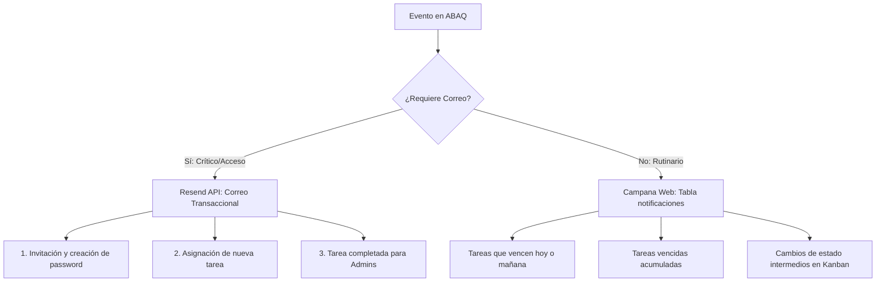

# Notificaciones y Servicio de Correo (Resend)

El sistema implementa una **estrategia híbrida** de notificaciones, separando los eventos cotidianos dentro de la aplicación de los eventos verdaderamente críticos enviados a la bandeja de entrada.

---

## 🎯 Filosofía Híbrida: Web vs. Correo

### ¿Por qué mantener mínimas las notificaciones por correo?

1. **Prevención de Fatiga de Correo:** Si cada cambio de columna en el Kanban o cada aviso diario de "vence mañana" enviara un email, los colaboradores crearían filtros de spam o ignorarían las alertas.
2. **Reserva para Eventos Clave:** El correo electrónico se reserva estrictamente para momentos donde el usuario **no está conectado** o necesita una acción de seguridad (como crear contraseña).

---

## 📬 Las 3 Notificaciones Mínimas Indispensables

| Notificación | Destinatario | Archivo Emisor | Propósito |
|---|---|---|---|
| **1. Invitación y Activación** | Nuevo Usuario | `enviar_invitacion.php` | Entrega el token seguro con vigencia de 24h para acceder a `crear_password.php`. Sin este correo, el usuario no puede activar su cuenta. |
| **2. Nueva Tarea Asignada** | Colaborador Asignado | `guardar_tarea_admin.php` | Alerta al colaborador sobre el nuevo trabajo, su categoría, prioridad y fecha límite de entrega. |
| **3. Tarea Completada** | Administradores Activos | `funciones_notificaciones.php` / `finalizar_tarea.php` | Notifica a los administradores que la tarea fue finalizada, detallando horas de trabajo y justificación del beneficio social. |

---

## 🔌 Arquitectura de `servicio_correo.php`

El servicio de correos interactúa directamente con la API REST de **Resend**:

- **Endpoint:** `POST https://api.resend.com/emails`
- **Autenticación:** `Authorization: Bearer RESEND_API_KEY`
- **Fallback Seguro:** Si `RESEND_API_KEY` no está configurada o se encuentra en modo local de prueba, el servicio registra un mensaje informativo en los logs del servidor y retorna una respuesta simulada sin detener ni interrumpir la creación de tareas ni el guardado de datos.
- **Diseño Responsivo:** Las plantillas HTML incluyen la cabecera azul marino `#17233d`, el acento naranja `#ff6a00`, tipografía moderna del sistema y botón de llamada a la acción hacia la URL configurada en `APP_URL`.
