# 🌱 Sembrado de Base de Datos (`seed.sh`)

El script [`seed.sh`](file:///Users/riosisraelg/Desktop/1/abaq/seed.sh), ubicado en la raíz del repositorio principal, es la herramienta unificada de línea de comandos para sembrar, enriquecer y depurar de forma automatizada los datos de prueba de la plataforma **ABAQ Querétaro**.

***

## 1. Arquitectura y Funcionamiento

El orquestador en Bash actúa como punto de entrada de alto nivel y delega la ejecución en el motor backend escrito en Node.js ([`backend/scripts/seed-lifecycle-scenarios.js`](file:///Users/riosisraelg/Desktop/1/abaq/backend/scripts/seed-lifecycle-scenarios.js)):

```mermaid
flowchart TD
    CLI["seed.sh (Bash Runner en Raíz)"] --> Core["seed-lifecycle-scenarios.js (Node.js Engine)"]
    
    subgraph S1 ["1. Identidad y Ciclo de Vida"]
        Core --> Users["Users (Credenciales y Roles)"]
        Core --> Students["Students (Servicio Social / 8 Estados)"]
        Core --> Volunteers["Volunteers (Voluntariado General / 6 Estados)"]
        Core --> Notifs["Notifications (Avisos in-app)"]
    end

    subgraph S2 ["2. Interacciones y Folios"]
        Core --> Acc["Accreditations (12 Modalidades OP-CAT)"]
        Core --> Act["Activities (Convocatorias AC-*)"]
        Core --> QA["QuickActivities (Plantillas Rápidas)"]
    end

    subgraph S3 ["3. Operación Comunitaria y Veterinaria"]
        Core --> Pets["Pets (Censo Animal PET-TEST-*)"]
        Core --> Talks["Talks (Pláticas y Encuestas)"]
        Core --> Camps["Campaigns (Esterilización y Vacunación)"]
        Core --> Adopts["Adoptions (Procesos en Prueba y Definitivos)"]
        Core --> Ids["Identifications (Placas y Costos)"]
        Core --> Contacts["Contacts (Directorio y Seguimiento)"]
    end

    Core -.-> AutoJSON["cuentas-ciclo-vida.json (Sincronización en Raíz)"]
```



### Características Principales

* **Ejecutable desde cualquier ruta:** Detecta dinámicamente su directorio raíz y ubica el motor backend en `backend/scripts/seed-lifecycle-scenarios.js`.
* **Salida Visual con Colores ANSI:** Muestra en terminal cada fase del proceso (conexión Atlas, conteo por colección, advertencias y resumen).
* **Sincronización Automática de Manifiesto JSON:** Cada ejecución exitosa actualiza en la raíz el archivo estructurado [`cuentas-ciclo-vida.json`](file:///Users/riosisraelg/Desktop/1/abaq/cuentas-ciclo-vida.json).
* **Protección de Datos:** Las operaciones destructivas (`--clean`) están blindadas para borrar únicamente registros del dominio `@abaq.local` o con la etiqueta `[TEST-*]`.
* **Contraseña Universal:** Todas las cuentas creadas utilizan la contraseña unificada **`123456789.a`**.

---

## 2. Sintaxis y Opciones de Línea de Comandos

```bash
./seed.sh [opciones]
```

### Tabla de Parámetros y Banderas

| Bandera | Descripción | Comportamiento |
| :--- | :--- | :--- |
| *(sin banderas)* | **Sembrado Completo (`--all`)** | Siembra todas las cuentas del ciclo de vida, folios, acreditaciones y los 8 modelos operativos complementarios en `abaqTesting--dev-rivers`. |
| **`--publish`**, **`--endpoints`** | **Publicador Integral REST/Mongoose** | Ejecuta [`backend/scripts/publish-data-endpoints.js`](file:///Users/riosisraelg/Desktop/1/abaq/backend/scripts/publish-data-endpoints.js), despachando las 28 cuentas (16 SS + 12 VG) y entre 8 y 12 registros de los 8 modelos operativos para validación de paginación UI/UX con token Bearer JWT de administrador o modo directo resiliente. |
| **`--all`**, **`--seed`** | **Sembrado Total Explícito** | Equivalente a la ejecución por defecto. Procesa los 14 modelos de Mongoose. |
| **`--lifecycle`** | **Solo Ciclo de Vida** | Siembra exclusivamente los 8 estados de estudiantes (`Student`), 6 de voluntarios generales (`Volunteer`), acreditaciones (`Accreditation`), identidades (`User`) y actividades de corte (`Activity`). |
| **`--models`** | **Solo Modelos Operativos** | Siembra únicamente las entidades complementarias: Censo animal (`Pet`), Plantillas (`QuickActivity`), Pláticas (`Talk`), Campañas (`Campaign`), Adopciones (`Adoption`), Placas (`Identification`), Directorio (`Contact`) y Notificaciones (`Notification`). |
| **`--backfill-folios`** | **Enriquecimiento Retroactivo** | Recorre documentos y subdocumentos existentes sin `interactionFolio` y les asigna folios deterministas (`AC-*` y `OP-*`), sincronizando la colección raíz y los arreglos embebidos de los usuarios. |
| **`--clean`** | **Purga Atómica Segura** | Elimina de la base de datos seleccionada todas las cuentas `@abaq.local`, actividades `[TEST-CICLO]`, mascotas `[TEST-SEED]`, pláticas, campañas, adopciones y placas de prueba. |
| **`--summary`** | **Tabla Resumen** | Imprime en consola la matriz de credenciales (email, contraseña, rol, folios y ObjectIds de Mongo). |
| **`--db <nombre>`** | **Selección de Base de Datos** | Redirige la ejecución a la base de datos especificada (por defecto: `abaqTesting--dev-rivers`). |
| **`--help`**, **`-h`** | **Ayuda en Terminal** | Muestra el menú de opciones y sintaxis en pantalla. |

---

## 3. Ejemplos de Uso Práctico

### 3.1 Sembrar Todo el Ecosistema
Para poblar la base de datos con todos los perfiles de usuario, mascotas, pláticas y campañas:
```bash
./seed.sh
# O explícitamente indicando la base de datos de destino:
./seed.sh --all --db "abaqTesting--dev-rivers"
```

### 3.2 Probar Únicamente el Ciclo de Vida y Folios
Si solo deseas evaluar los estados de cuenta (`pending`, `active`, `inactive`, `rejected`) y folios de acreditación:
```bash
./seed.sh --lifecycle
```

### 3.3 Enriquecer Documentos Viejos sin Folio
Si la base de datos contiene registros históricos que no muestran folio en la interfaz:
```bash
./seed.sh --backfill-folios
```

### 3.4 Limpiar Completamente los Registros de Prueba
Para dejar la base de datos limpia sin tocar datos reales ni administradores:
```bash
./seed.sh --clean
```

### 3.5 Publicar Datos Relacionales para Validación de Paginación UI/UX
Para publicar las 28 cuentas de prueba y el catálogo de 8 a 12 modelos operativos vinculados con tokens y folios deterministas:
```bash
./seed.sh --publish
# O directamente vía Mongoose:
./seed.sh --publish --direct
```

---

## 4. Manifiesto Sincronizado (`cuentas-ciclo-vida.json`)

Al finalizar el sembrado, el script invoca al generador de manifiesto y escribe en la raíz de `abaq` el archivo [`cuentas-ciclo-vida.json`](file:///Users/riosisraelg/Desktop/1/abaq/cuentas-ciclo-vida.json):

```json
{
  "database": "abaqTesting--dev-rivers",
  "universalPassword": "123456789.a",
  "updatedAt": "2026-11-03T15:26:11.000Z",
  "totalCuentas": 14,
  "cuentas": [
    {
      "rol": "student",
      "caso": "activo",
      "email": "test.ciclo.ss.activo@abaq.local",
      "password": "123456789.a",
      "status": "active",
      "folioExpediente": "SS-261103-AC",
      "mongoId": "6ae9fd0a8d86ba4740daaeb2",
      "foliosInteraccion": [
        "OP-IND-260909-A9AE",
        "OP-STE-261004-9DEB",
        "OP-EVE-261024-B424",
        "OP-TLK-261101-E055"
      ]
    }
  ]
}
```

---

## 5. Catálogo de Cuentas del Ciclo de Vida

* **Contraseña Universal:** `123456789.a`
* **Base de datos por defecto:** `abaqTesting--dev-rivers`

### 5.1 Estudiantes de Servicio Social (`Student`)

| Caso | Correo Electrónico | Estatus | Folio Expediente | Horas | Folios de Interacción (`OP` / `AC`) | Flujo a Evaluar en la UI |
| :--- | :--- | :--- | :--- | :---: | :--- | :--- |
| **`pending`** | `test.ciclo.ss.pending@abaq.local` | `pending` | `SS-261103-P1` | 0 / 480 | *(Sin folios)* | Al loguearse, redirige a `/onboarding/expediente` en modo "En Validación". Bloquea `/activity-list`. |
| **`primerIngreso`** | `test.ciclo.ss.primer.ingreso@abaq.local` | `active` | `SS-261103-PI` | 10 / 480 | `OP-IND-261101-894B` | Cuenta con `primerIngresoRealizado: false`. Muestra felicitación, descarga de carta de aceptación y botón *"Ingresar a la Plataforma"*. |
| **`activo`** | `test.ciclo.ss.activo@abaq.local` | `active` | `SS-261103-AC` | 180 / 480 | `OP-IND-260909-A9AE`<br>`OP-STE-261004-9DEB`<br>`OP-EVE-261024-B424`<br>`OP-TLK-261101-E055` | Acceso completo. Inspección de píldoras y filas con folios `OP-*` en `/my-accreditations` y `/student-profile`. |
| **`alerta45`** | `test.ciclo.ss.alerta45@abaq.local` | `active` | `SS-261103-A4` | 120 / 480 | `OP-IND-260810-977B`<br>`OP-CAM-260914-2A30` | Inactividad acumulada de 48 días (`inactivityStage: 'day45'`). Alerta preventiva antes de la baja. |
| **`inactivo60`** | `test.ciclo.ss.inactivo60@abaq.local` | `inactive` | `SS-261103-I6` | 150 / 480 | `OP-STE-260726-6FA9` | Inactivo reciente (< 12 meses) por abandono de 60 días. En la tabla admin `/student` aparece con **fila gris atenuada** (`#f1f5f9`). |
| **`inactivo480h`** | `test.ciclo.ss.inactivo480h@abaq.local` | `inactive` | `SS-261103-G4` | 480 / 480 | `OP-IND-260417-67AB`<br>`OP-CAM-260706-F5CA`<br>`OP-STE-260918-ACF2` | Egresado curricular con 480 horas completadas. Permite validar la generación del certificado oficial con firma HMAC. |
| **`historico`** | `test.ciclo.ss.historico@abaq.local` | `inactive` | `SS-250815-H1` | 480 / 480 | `OP-EVE-250830-95BB`<br>`OP-STE-250919-2E06` | Inactivo hace > 12 meses (400 días). Oculto de la tabla principal de `/student`; visible en `/volunteers/history` (pestaña Pasados). |
| **`rechazado`** | `test.ciclo.ss.rechazado@abaq.local` | `rejected` | `SS-261103-R1` | 0 / 480 | *(Sin folios)* | Cuenta rechazada con bitácora en `statusHistory`. Permite probar el flujo de **re-registro idempotente con el mismo correo** en `/signup`. |

### 5.2 Voluntarios Generales (`Volunteer`)

| Caso | Correo Electrónico | Estatus | Folio Expediente | Folios de Interacción (`OP`) | Flujo a Evaluar en la UI |
| :--- | :--- | :--- | :--- | :--- | :--- |
| **`vgPending`** | `test.ciclo.vg.pending@abaq.local` | `pending` | `VG-261103-P1` | *(Sin folios)* | Onboarding de voluntario general pendiente de dictamen. |
| **`vgPrimerIngreso`** | `test.ciclo.vg.primer.ingreso@abaq.local` | `active` | `VG-261103-PI` | *(Sin folios)* | Primer ingreso de voluntario general y confirmación de expediente. |
| **`vgActivo`** | `test.ciclo.vg.activo@abaq.local` | `active` | `VG-261103-AC` | `OP-EVE-261014-7773`<br>`OP-DON-261029-54AD` | Colaborador activo en jornadas de rescate y donaciones en `/volunteer-profile`. |
| **`vgAlerta45`** | `test.ciclo.vg.alerta45@abaq.local` | `active` | `VG-261103-A4` | `OP-TLK-260914-934F` | Voluntario general con 48 días sin registrar asistencias. |
| **`vgHistorico`** | `test.ciclo.vg.historico@abaq.local` | `inactive` | `VG-250810-H1` | `OP-EVE-250830-55DA` | Voluntario general retirado hace > 12 meses en `/volunteers/history`. |
| **`vgRechazado`** | `test.ciclo.vg.rechazado@abaq.local` | `rejected` | `VG-261103-R1` | *(Sin folios)* | Registro rechazado por cupo temporal para reintento cívico. |

---

## 6. Catálogo de Modelos Operativos Complementarios

El sembrado genera registros con folios y datos realistas para las 8 colecciones operativas adicionales:

* **Mascotas (`Pet`):**
  * `[TEST-SEED] Rocky` (`PET-TEST-001`): Perro mestizo de 2 años, macho, esterilizado, con vacunas al corriente.
  * `[TEST-SEED] Luna` (`PET-TEST-002`): Gata criolla de 1 año, hembra, en tratamiento médico.
  * `[TEST-SEED] Canela` (`PET-TEST-003`): Perra Labrador Mix de 3 años, apta para adopción comunitaria.
* **Plantillas Rápidas (`QuickActivity`):**
  * Limpieza Profunda y Mantenimiento de Albergue (4 horas, cupo 12).
  * Apoyo en Campaña Masiva de Esterilización (6 horas, cupo 8).
  * Módulo de Adopciones en Plaza Comunitaria (5 horas, cupo 6).
  * Taller de Tenencia Responsable (3 horas, cupo 4).
* **Pláticas y Talleres (`Talk`):**
  * `[TEST-SEED] Concientización sobre Esterilización Temprana` (Realizada, 2 asistentes, encuestas de entrada y salida completas).
  * `[TEST-SEED] Taller de Primeros Auxilios Veterinarios en el Hogar` (Programada en UAQ Juriquilla).
* **Campañas de Esterilización (`Campaign`):**
  * `[TEST-SEED] Toby` (Responsable: Fernando Ortiz, Unidad Quirúrgica Móvil El Marqués).
  * `[TEST-SEED] Pelusa` (Responsable: Martha Ramos, Albergue Central ABAQ).
* **Procesos de Adopción (`Adoption`):**
  * `[TEST-SEED] Bruno` (Adoptante: José Luis Benítez, periodo de prueba concluido, adopción definitiva firmada).
  * `[TEST-SEED] Misha` (Adoptante: Claudia Sánchez, periodo de prueba de 15 días activo).
* **Placas de Identificación (`Identification`):**
  * `[TEST-SEED] Hércules` (Placa de aluminio azul, \$80 MXN ABAQ / \$45 proveedor, estatus `COMPLETED`).
  * `[TEST-SEED] Nieve` (Placa de acero con QR, \$120 MXN ABAQ / \$65 proveedor, estatus `PENDING`).
* **Directorio Institucional (`Contact`):**
  * Contactos de vinculación con la facultad de veterinaria UAQ y coordinadores de zona con fechas de seguimiento agendadas.
* **Notificaciones en App (`Notification`):**
  * Alertas transaccionales vinculadas a los usuarios de prueba (`BIENVENIDA_SS`, `RECORDATORIO_JORNADA`, `EXPEDIENTE_VALIDADO`).

---

## 7. Diagnóstico de Conexión y Lista Blanca de IPs en Atlas

!!! warning "Error: MongooseServerSelectionError / IP Whitelist"
    Si al ejecutar `./seed.sh` observas:
    ```text
    Could not connect to any servers in your MongoDB Atlas cluster.
    One common reason is that you're trying to access the database from an IP that isn't whitelisted.
    ```
    **Causa:** Tu dirección IP pública no se encuentra autorizada en la lista blanca de MongoDB Atlas (o expiró la regla temporal).
    
    **Solución en 4 Pasos:**
    1. Obtén tu IP pública actual:
       ```bash
       curl -s https://api.ipify.org
       ```
    2. Ingresa a la consola web de **MongoDB Atlas** -> **Security** -> **Network Access**.
    3. Haz clic en **Add IP Address** y agrega tu IP (o habilita temporalmente `0.0.0.0/0` para desarrollo).
    4. Vuelve a ejecutar `./seed.sh`.
