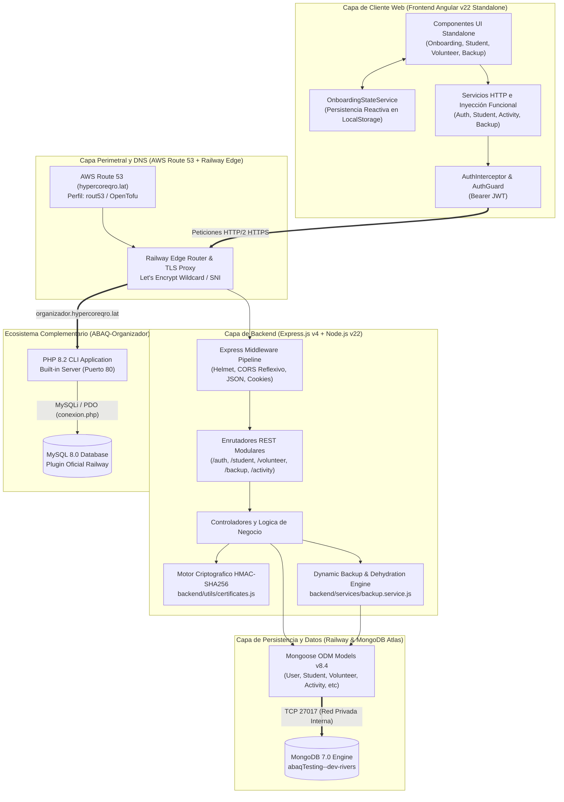
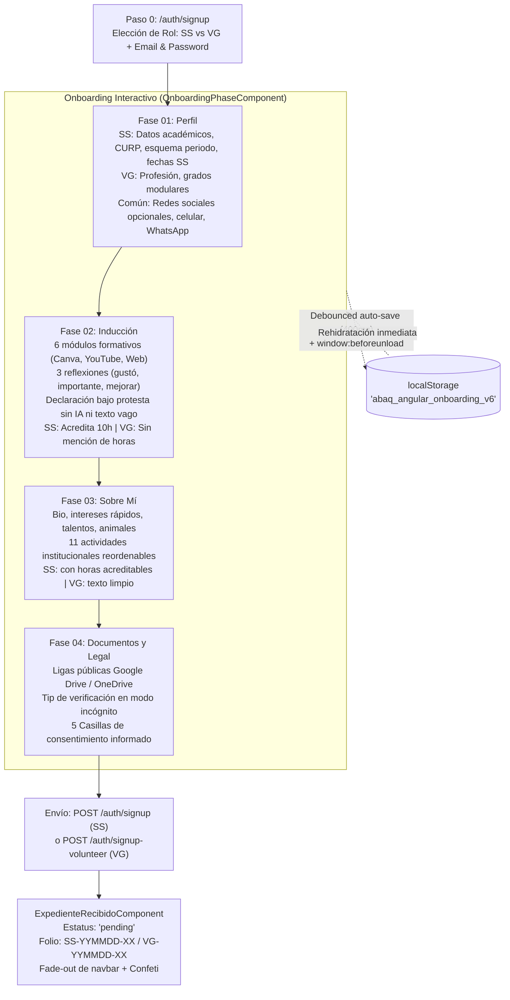
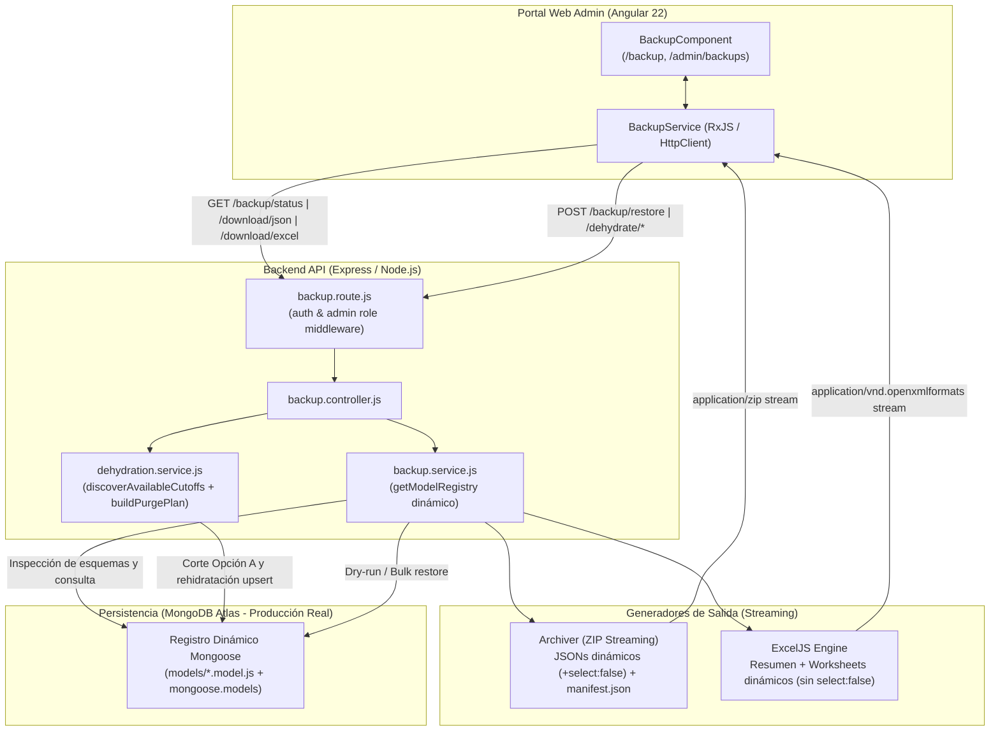
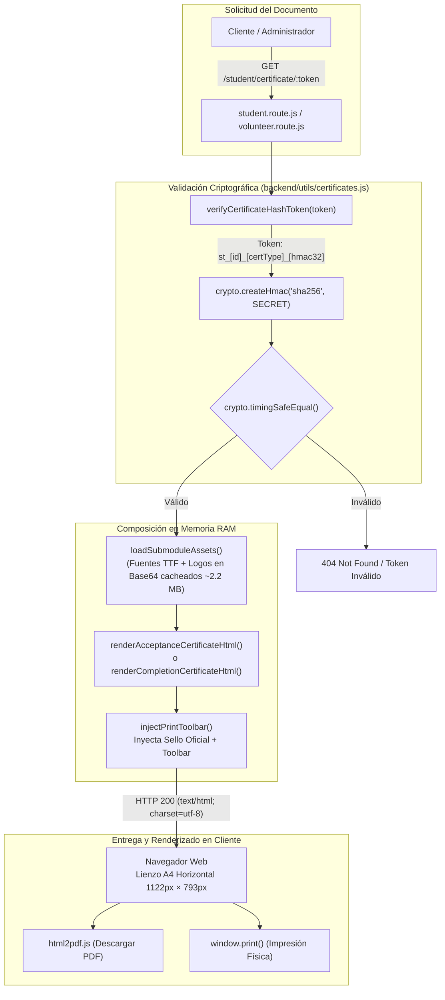
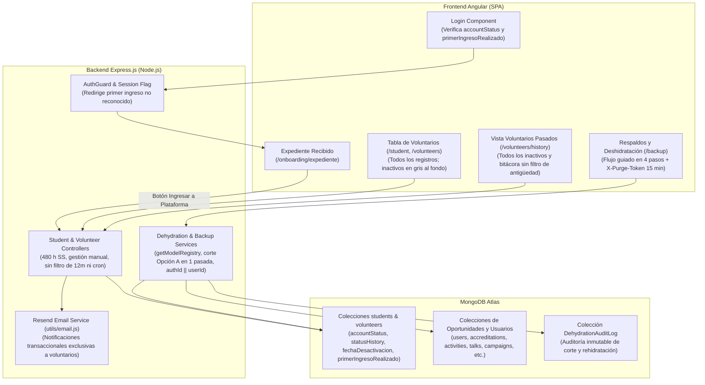
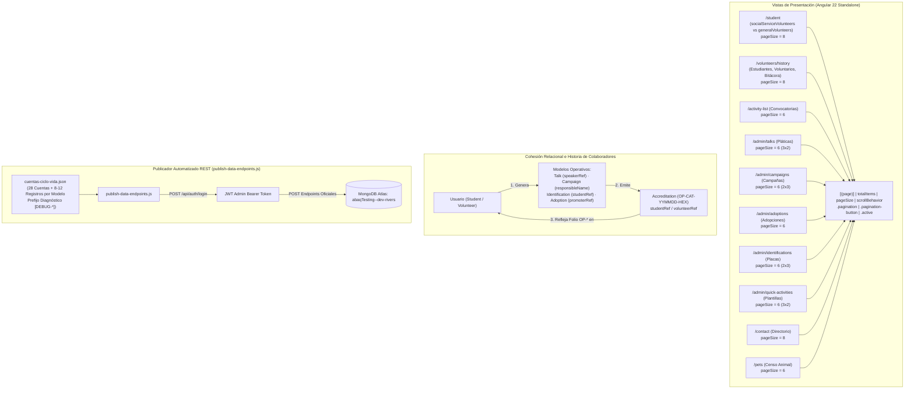

# Documento de Arquitectura de Software (SAD)
**Estándar:** ISO/IEC/IEEE 42010:2022  
**Proyecto:** Plataforma Web ABAQ (Servicio Social, Censo Comunitario y Documentación Pedagógica)  
**Versión:** 2026.11.13 (CalVer)  
**Fecha:** 2026-11-13  
**Estado:** Aprobado e Implementado en Vivo (Railway Cloud + OpenTofu + AWS Route 53)  
**Autores:** Equipo de Arquitectura e Ingeniería de Software ABAQ  

---

## 1. Visión General del Sistema y Contexto (System Overview & Context)

### 1.1 Propósito y Misión del Sistema
La plataforma **ABAQ** es un sistema full-stack en producción real (Angular v22 Standalone + Node.js/Express + MongoDB sin datos simulados / mock data) orientado a coordinar el servicio social universitario, el voluntariado comunitario, el censo animal en Querétaro y el ciclo de vida del expediente digital de colaboradores. El sistema comprende:
1. **Flujo de Proceso de Onboarding y Registro Guiado**: Proceso interactivo estructurado con persistencia reactiva en navegador (`localStorage`), autoguardado con *debounce*, outline adaptativo según el dispositivo, y formalización digital mediante casillas de consentimiento informado bajo protesta de decir verdad.
2. **Arquitectura Cero Archivos (Zero-File Storage)**: Eliminación de la carga física de archivos pesados al servidor en el onboarding. Los documentos de identificación y académicos se validan mediante enlaces públicos permanentes en la nube (Google Drive / OneDrive), verificables en modo incógnito, persistidos como datos estructurados JSON.
3. **Motor Criptográfico de Certificados y Constancias Oficiales**: Generación dinámica bajo demanda de Cartas de Aceptación y Certificados de Finalización (480 horas) utilizando tokens firmados con HMAC-SHA256 (`st_[id]_[certType]_[hmac32]`), plantillas HTML autocontenidas con fuentes/gráficos incrustados en Base64, y compilación client-side a PDF nativo con `html2pdf.js` e impresión física con sellos de verificación criptográfica.
4. **Segregación Estricta de Roles y Reglas de Negocio**:
   - **Estudiante de Servicio Social (`SS`)**: Acumula horas (meta típica de 480 h), recibe 10 horas automáticas por la inducción formativa (Fase 2), prioriza entre las 11 actividades institucionales oficiales del reglamento con valores de acreditación explícitos, y está sujeto a la regla de baja por inactividad no notificada mayor a 2 meses.
   - **Voluntario General (`VG`)**: Participa sin fines curriculares escolares; su flujo omite toda referencia o badge de acreditación de 10 horas de inducción, y sus actividades no muestran horas académicas.
   - **Administrador (`admin`)**: Gestión operativa mediante tablas densas de alto contraste con búsqueda, filtrado en tiempo real, auditoría de asistencias, validación de horas, y herramientas de respaldo/restauración de base de datos.
5. **Subsistema de Respaldos Dinámicos, Deshidratación en 4 Pasos y Rollback (Disaster Recovery)**: Descubrimiento dinámico de todos los modelos Mongoose registrados mediante `getModelRegistry()` en `backup.service.js` (exponiendo métricas `activeCollections / totalCollections`), exportación streaming en formato técnico (`.zip` con JSONs íntegros incluyendo campos `select: false` como `+passwordHash` y `manifest.json` con firmas SHA-256) y formato gerencial (`.xlsx` multi-hoja vía `ExcelJS` omitiendo automáticamente campos `select: false` y credenciales), complementado con *rollback* tras validación *dry-run* y corte manual bajo demanda en 4 pasos para cuentas `inactive`.
6. **Levantamiento Censal y Encuestas Dinámicas**: Captura de encuestas de bienestar animal en campo y seguimiento veterinario.

### 1.2 Partes Interesadas (Stakeholders) y Puntos de Vista
- **Estudiantes de Servicio Social (`SS`)**: Registran su perfil académico (CURP, esquema compuesto de periodos, fechas de servicio), completan 6 módulos formativos con reflexiones de aprendizaje, comparten enlaces de documentos en la nube, seleccionan actividades y consultan sus horas acreditadas.
- **Voluntarios Generales (`VG`)**: Registran su perfil personal y profesional modular, completan la inducción sin carga de horas escolares y se postulan a actividades comunitarias.
- **Coordinación y Administradores (`admin`)**: Auditan y aprueban solicitudes en estado *pendiente*, gestionan asistencias, validan horas, supervisan la regla de inactividad de 2 meses, emiten cartas oficiales y ejecutan respaldos del sistema.
- **Equipo de Ingeniería y Docencia**: Requiere una arquitectura desacoplada, autodocumentada y estrictamente estandarizada sin datos mock en los flujos principales.

### 1.3 Pila Tecnológica Integral (Technology Stack)
- **Backend**:
  - Entorno de ejecución: Node.js v24 LTS.
  - Framework web: Express.js v4.19 con arquitectura modular (Routers, Middlewares, Controllers, Modelos Mongoose, Validadores).
  - Capa ODM y Persistencia: Mongoose v8.4 sobre base de datos MongoDB real (sin mock data).
  - Criptografía y Seguridad: `crypto` nativo de Node.js (HMAC-SHA256 para certificados y verificación *timing-safe* con `timingSafeEqual`), `bcryptjs` (hashing con factor de costo 12), `jsonwebtoken` (JWT stateless auth con HMAC-SHA256).
  - Motor de Certificados y Constancias: `backend/utils/certificates.js` (generación serverless-style de HTML autocontenido con assets Base64 cacheados en memoria RAM, memoria heap contenida en ~16 MB a 36 MB).
  - Exportación y Respaldo: `archiver` (streaming ZIP) y `exceljs` (generación de libros XLSX formateados con estilos corporativos ABAQ).
- **Frontend**:
  - Framework cliente: Angular v22 basado en componentes independientes (**Standalone Components**) sin `NgModule`.
  - Inyección de dependencias: Inyección funcional moderna con `inject()`.
  - Reactividad y gestión asíncrona: RxJS v7.8 (`BehaviorSubject`, operadores de transformación, limpieza con `takeUntilDestroyed`).
  - Formularios y Controles Personalizados: Angular Reactive Forms (`FormBuilder`, `FormGroup`, `FormArray`, validadores personalizados), combobox focus-first `CustomSelectComponent` accesible por teclado, y selector de fechas `CustomDatepickerComponent` con formateo automático de slashes (`DD/MM/AAAA`) al teclear números crudos y calendario emergente institucional.
  - Estado y Persistencia de Onboarding: `OnboardingStateService` con persistencia reactiva en `localStorage`, autoguardado debounced y listener de ciclo de vida `window:beforeunload`.
  - Estilos y Maquetación: SCSS modular y `abaq-design.css`, Bootstrap v5.3, Google Material Symbols, diseño responsivo con breakpoint en 1024px.
  - Visualización y Descarga: Chart.js v4.4 para gráficas reactivas, `html2pdf.js` y CSS `@media print` para generación de PDFs en cliente.

---

## 2. Vistas Arquitectónicas (ISO/IEC/IEEE 42010:2022)



```
┌─────────────────────────────────────────────────────────────────────────────┐
│                       ARQUITECTURA DEL SISTEMA ABAQ                         │
├─────────────────────────────────────────────────────────────────────────────┤
│                                                                             │
│  [ CLIENTE WEB (Angular 22 Standalone) ]                                    │
│  ┌────────────────────────┐   ┌────────────────────────┐                    │
│  │ Vistas y Componentes   │   │ Servicios y Estado     │                    │
│  │ (Onboarding, Home,     │<─>│ (OnboardingState, Auth,│                    │
│  │  Student, Volunteer)   │   │  Student, Backup)      │                    │
│  └──────────┬─────────────┘   └───────────┬────────────┘                    │
│             │                             │                                 │
│             ▼                             ▼                                 │
│  ┌────────────────────────┐   ┌────────────────────────┐                    │
│  │ Mappers DTO/Dominio    │   │ Interceptors & Guards  │                    │
│  │ (student, volunteer)   │   │ (auth.interceptor/guard)│                   │
│  └────────────────────────┘   └───────────┬────────────┘                    │
│                                           │ (HTTP / JSON / Bearer JWT)      │
│ ──────────────────────────────────────────┼──────────────────────────────── │
│                                           ▼                                 │
│  [ SERVIDOR BACKEND (Node.js 24 + Express 4.19) ]                           │
│  ┌─────────────────────────────────────────────────────┐                    │
│  │ Express Pipeline: CORS -> Parsers -> Routers        │                    │
│  │ (/auth, /student, /volunteer, /backup, /activity)  │                    │
│  └────────────────────────┬────────────────────────────┘                    │
│                           ▼                                                 │
│  ┌────────────────────────┐   ┌────────────────────────┐                    │
│  │ Middlewares            │   │ Controladores y Engine │                    │
│  │ (auth, validator)      │──>│ (student, backup,      │                    │
│  └────────────────────────┘   │  certificates utils)   │                    │
│                               └───────────┬────────────┘                    │
│                                           │                                 │
│                           ┌───────────────┴────────────────┐                │
│                           ▼                                ▼                │
│                ┌──────────────────────┐        ┌───────────────────────┐    │
│                │ Mongoose ODM Models  │        │ Crypto Engine         │    │
│                │ (Student, Volunteer, │        │ (HMAC-SHA256 Token &  │    │
│                │  User, Activity, etc)│        │  Base64 Cert Template)│    │
│                └──────────┬───────────┘        └───────────────────────┘    │
│ ──────────────────────────┼──────────────────────────────────────────────── │
│                           ▼                                                 │
│  [ BASE DE DATOS (MongoDB Document Store - Producción Real) ]               │
└─────────────────────────────────────────────────────────────────────────────┘
```
### 2.1 Vista Lógica (Logical View)
La vista lógica organiza el sistema en capas de responsabilidad única y desacoplada, operando sobre persistencia real en MongoDB (sin datos simulados / mock data):

1. **Capa de Presentación (Frontend UI)**:
   - Reside en `frontend/src/app/components/`.
   - Implementada al 100% mediante **Angular Standalone Components**, eliminando módulos intermedios y aprovechando la nueva sintaxis de Control Flow (`@if`, `@for`, `@switch`).
   - Cada componente encapsula su plantilla HTML, lógica TypeScript y estilos SCSS.
   - Componentes clave del sistema:
     - `SignupComponent` & `LoginComponent`: Selección inicial de rol (Estudiante de Servicio Social `SS` vs. Voluntario General `VG`) y autenticación con secuenciación compatible con gestores de contraseñas.
     - `OnboardingPhaseComponent`: Motor unificado del proceso de onboarding y registro (`01 Perfil`, `02 Inducción`, `03 Sobre Mí`, `04 Documentos y Consentimientos`), con outline adaptativo responsivo (oculto en pantallas `<=1024px`), autoguardado reactivo y validación dinámica de faltantes.
     - `ExpedienteRecibidoComponent`: Pantalla de cierre de registro que muestra el folio institucional (`SS-YYMMDD-XX` o `VG-YYMMDD-XX`), reproduce la animación de fade-out del navbar sin desplazamiento del contenido (*zero layout shift*) y dispara una lluvia de confeti ligero.
     - `HomeComponent` & `AdminHomeComponent`: Paneles diferenciados para alumnos (progreso de 480 horas, actividades pendientes e historial) y administradores (triaje de solicitudes pendientes, auditoría de asistencias y validación de horas).
     - `StudentComponent`, `StudentDetail`, `VolunteerDetailComponent` & `VolunteerProfileComponent`: Vistas de alta densidad y expedientes completos que reflejan los datos recolectados (CURP, periodos académicos compuestos, fechas de servicio y enlaces a redes sociales).
     - `BackupComponent`: Centro de control administrativo para descarga de respaldos JSON en streaming, libros Excel y restauración con verificación previa (*dry-run*).
     - Controles personalizados reutilizables: `CustomSelectComponent` (combobox *focus-first* con navegación de teclado) y `CustomDatepickerComponent` (auto-formateo de separadores `DD/MM/AAAA` al teclear números crudos y calendario modal).

2. **Capa de Aplicación y Comunicación (Frontend Services & Mappers)**:
   - Servicios singleton (`@Injectable({ providedIn: 'root' })`) que centralizan la lógica de negocio del cliente y llamadas HTTP con inyección funcional `inject()`.
   - `OnboardingStateService`: Gestiona el estado reactivo del formulario de onboarding, persistencia automática en `localStorage` con *debounce* y sincronización ante cierre de pestaña (`window:beforeunload`).
   - `AuthService`, `StudentService`, `VolunteerService`, `ActivityService`, `BackupService`.
   - **Patrón Adaptador / DTO Mappers**:
     - `student.mapper.ts`: Traduce entre el contrato de base de datos en español (`BackendStudent`) y la interfaz tipada de Angular (`Student`).
     - `volunteer.mapper.ts`: Adapta los campos de voluntarios generales (`Volunteer`).
     - `survey.mapper.ts`: Transforma encuestas de bienestar animal a contratos normalizados (`BackendSurvey`).

3. **Capa de Transporte y Control (Backend API & Routers)**:
   - Reside en `backend/routes/` y `backend/controllers/`.
   - Enrutadores Express dedicados por dominio (`/auth`, `/student`, `/volunteer`, `/backup`, `/activity`, `/survey`, `/pet`, `/contact`).
   - Controladores que procesan la petición, delegan al modelo o servicio y generan respuestas HTTP normalizadas mediante `{ status: "success", data: ... }`.
   - **Patrón Controlador Factory (`handler.controller.js`)**: Generador dinámico de métodos CRUD estándar (`createOne`, `getOne`, `getAll`, `updateOne`, `deleteOne`), reduciendo duplicación de código.

4. **Capa de Dominio y Persistencia (Backend ODM & Modelos)**:
   - Modelos Mongoose (`backend/models/`):
     - `User`: Credenciales, rol (`student` | `volunteer` | `admin`), métodos criptográficos estáticos y de instancia.
     - `Student`: Datos académicos, CURP, esquema compuesto de periodos (`periodType`, `periodNumber`, `semestre`), fechas de servicio (`fechaArranque`, `fechaConclusion`), balance de horas (`horasCubrir: 480`, `horasAcreditadas: 10`, `horasPendientes: 470`), redes sociales y subdocumento `onboardingData`.
     - `Volunteer`: Perfil de voluntarios generales (`volunteerType: 'GENERAL'`), formación académica modular (`degrees`), ocupación, redes sociales, estado (`volunteerStatus: 'pending'`) y subdocumento `onboardingData`.
     - `Activity`, `Accreditation`, `Survey`, `Pet`, `Contact`.
   - **Cero Archivos en Servidor**: Los documentos aportados por el usuario no se suben al servidor ni se fragmentan en GridFS; se registran como URLs verificadas de Google Drive o OneDrive en el documento del estudiante/voluntario (`cloudUrls: { ine, cv, comprobante }`).
   - **Motor Criptográfico de Certificados (`backend/utils/certificates.js`)**: Generación en memoria de plantillas HTML autocontenidas con fuentes TTF y logotipos en Base64, protegidas mediante tokens HMAC-SHA256.

### 2.2 Vista de Seguridad y Autenticación (Security / Auth View)

```
┌─────────────────────────────────────────────────────────────────────────────┐
│                VISTA DE SEGURIDAD Y CICLO DE AUTENTICACIÓN                  │
├─────────────────────────────────────────────────────────────────────────────┤
│                                                                             │
│  [ Flujo de Login ]                                                         │
│  Navegador ──POST /auth/login {correo, password}──> Express authRoute       │
│                                                           │                 │
│                                                           ▼                 │
│  bcrypt.compare(password, user.password) <────── authController.login       │
│            │ (Válido)                                                       │
│            ▼                                                                │
│  jwt.sign({ id: user._id }, SECRET, { expiresIn })                          │
│            │                                                                │
│            ▼                                                                │
│  Respuesta: JSON { status: "success", token, data: { user } }               │
│            │                                                                │
│            ▼ (Guardado en localStorage / memoria)                           │
│                                                                             │
│  [ Peticiones Subsecuentes Protegidas ]                                     │
│  HttpClient ──> auth.interceptor.ts (Inyecta Bearer <token>)                │
│                         │                                                   │
│                         ▼ (HTTP Header: Authorization: Bearer <token>)      │
│  Express auth.middleware.js (protect)                                       │
│         ├── 1. Extrae token del header Bearer                               │
│         ├── 2. jwt.verify(token, JWT_SECRET)                                │
│         ├── 3. User.findById(decoded.id)                                    │
│         └── 4. Asigna req.user = currentUser; next()                        │
│                                                                             │
│  [ Rollback Transaccional en Signup ]                                       │
│  authController.signup / signupVolunteer:                                  │
│     Paso 1: User.create() exitoso                                           │
│     Paso 2: Student.create() o Volunteer.create() lanza excepción           │
│     Catch: User.findByIdAndDelete(user._id) ──> Previene cuentas huérfanas   │
│                                                                             │
│  [ Verificación Criptográfica de Constancias y Certificados ]               │
│  Petición: GET /student/certificate/:token                                  │
│     Paso 1: verifyCertificateHashToken(token)                                │
│     Paso 2: crypto.timingSafeEqual(providedHmac, expectedHmac)              │
│     Paso 3: Renderizado HTML con Sello de Verificación y toolbar de PDF      │
└─────────────────────────────────────────────────────────────────────────────┘
```

- **Mecanismo de Autenticación**: Stateless basado en tokens JWT (JSON Web Tokens) firmados con algoritmo HMAC-SHA256 (`backend/utils/jwt.js`).
- **Protección de Credenciales**:
  - Hashing unidireccional con `bcryptjs`, factor de costo 12 (`salt rounds = 12`).
  - Campo de contraseña en esquema con `select: false` para evitar fugas accidentales en consultas.
  - Validación de contraseña con longitud mínima de 8 caracteres y soporte de hasta 128 caracteres Unicode sin truncamiento.
- **Autorización y Control de Acceso Basado en Roles (RBAC)**:
  - Roles definidos: `student` (`SS`), `volunteer` (`VG`) y `admin`.
  - Rutas administrativas protegidas por `protect` y `restrictTo('admin')`.
  - Registro de administradores protegido obligatoriamente por passkey secreta del entorno (`ADMIN_REGISTRATION_SECRET`).
  - **Confinamiento de Seguridad para Cuentas Pendientes (`Pending Account Isolation`)**:
    - Un usuario que completa el onboarding obtiene un token de autenticación para consultar su estatus en el expediente (`/auth/me`, `/auth/expediente-status`).
    - Dicho token mantiene a la cuenta en estado `pending`, impidiendo el acceso a los endpoints operativos de la plataforma (charlas, campañas, acreditaciones, actividades, pase de lista y colecciones de base de datos). El middleware de autorización rechaza cualquier solicitud no permitida con `403 Forbidden`, bloqueando a usuarios técnicos avanzados de interactuar directamente con la base de datos antes de la aprobación administrativa.
- **Protección Perimetral y Anti-Bot con Cloudflare Turnstile Proxy**:
  - Mitigación pasiva de bots y scripts maliciosos en todas las superficies públicas sin autenticación (`/auth/login`, `/auth/signup-student`, `/auth/signup-volunteer`, y las subrutas anónimas `/<recurso>/public` de adopción, campaña, identificación y charla) mediante Cloudflare Turnstile con acciones nominales por superficie.
  - Validación canónica del token `cf-turnstile-response` en backend (`siteverify` servidor-a-servidor) antes del procesamiento criptográfico de credenciales o la persistencia de documentos, con verificación de `success`, `action` esperada y `hostname` autorizado.
  - Gobernanza por entorno: `TURNSTILE_DISABLED=true` o ausencia de `TURNSTILE_SECRET` desactivan la exigencia para preservar la auditabilidad del sandbox de seguridad (SRS §16.3).
  - Proxy inverso con DNS gestionado en Cloudflare para protección DDoS, HTTP/3, compresión Brotli y certificados SSL/TLS automáticos (etapa diferida; el DNS actual permanece en AWS Route 53 vía OpenTofu).
- **Seguridad en Emisión de Constancias**:
  - Los certificados y cartas de aceptación no se acceden por ID numérico secuencial ni por nombre, sino por un hash token URL-safe: `st_[id]_[certType]_[hmac32]`.
  - La verificación utiliza `crypto.timingSafeEqual` para prevenir ataques de temporización (*timing attacks*).

### 2.3 Vista de Flujo de Datos y Ciclo de Vida (Data Flow & Lifecycle View)

#### A. Pipeline de Petición HTTP en Express (`backend/app.js`)
Cada petición recibida atraviesa una tubería secuencial estrictamente ordenada:

```
[Cliente HTTP / Navegador]
           │
           ▼
1. CORS Middleware (cors): Valida origen 'http://localhost:4200' y credentials: true
           │
           ▼
2. Body Parsers: express.json({ limit: '10mb' }) y express.urlencoded({ extended: true })
           │
           ▼
3. Enrutadores Montados (Routers):
   ├── /auth      ──> authRouter (login, signup SS, signup-volunteer VG, admin/register, me)
   ├── /student   ──> studentRouter (CRUD estudiantes, asistencia, /certificate/:token)
   ├── /volunteer ──> volunteerRouter (CRUD voluntarios, estatus, /certificate/:token)
   ├── /backup    ──> backupRouter (estado BD, streaming ZIP JSON, Excel, rollback)
   ├── /activity  ──> activityRouter (catálogo, asistencia, acreditación de horas)
   ├── /survey    ──> surveyRouter (encuestas de bienestar animal)
   ├── /pet       ──> petRouter (censo veterinario)
   └── /contact   ──> contactRouter (bitácora de contactos comunitarios)
           │
           ▼ (Si ninguna ruta coincide)
4. Capturador 404: app.all('*') ──> Genera new AppError(`${req.originalUrl} not found`, 404)
           │
           ▼ (En cualquier excepción en la cadena)
5. Middleware Global de Errores: (err, req, res, next) ──> JSON estandarizado { status, message }
```

#### B. Pipeline de Onboarding y Registro Guiado y Persistencia en Navegador


#### C. Pipeline de Emisión de Certificados y Constancias Criptográficas
1. **Solicitud**: El usuario o administrador abre `/student/certificate/:token` o `/volunteer/certificate/:token`.
2. **Autenticación del Documento**: `verifyCertificateHashToken(token)` desglosa el identificador, tipo de documento (`acceptance` o `completion`) y valida la firma HMAC con `CERT_SECRET`.
3. **Carga en Memoria de Recursos Base64**: La función `loadSubmoduleAssets()` carga una sola vez en el ciclo de vida del servidor las fuentes (`GreatVibes`, `CrimsonText`) y gráficos oficiales (`logo_highres_trans.png`, `new_watermark_trans.png`), manteniéndolos en memoria RAM (~2.2 MB).
4. **Composición de Plantilla**: Se reemplazan los marcadores `{{NOMBRE}}`, `{{DIA}}`, `{{MES}}`, `{{ANIO}}`, `{{LUGAR}}` y se inyecta la cabecera interactiva con el sello de validación criptográfica.
5. **Renderizado en Cliente y Descarga Táctil**: El navegador recibe el HTML y permite al usuario previsualizar la constancia auto-escalada dinámicamente según el viewport (`--cert-scale`), imprimirla con colores exactos (`print-color-adjust: exact`) o compilarla a archivo de imagen PNG en un clic usando `html2canvas` a doble resolución (2x, 2244 × 1586 px).

### 2.4 Vista de Topología de Componentes (Component Topology View)

```
┌─────────────────────────────────────────────────────────────────────────────┐
│                     TOPOLOGÍA DE COMPONENTES FRONTEND                       │
├─────────────────────────────────────────────────────────────────────────────┤
│  Root: AppComponent (NavbarComponent + RouterOutlet)                        │
│                                                                             │
│  [ Rutas Públicas ]                                                         │
│  ├── LoginComponent ───────────────┐                                        │
│  ├── SignupComponent (Paso 0) ─────┼──> AuthService ──> TokenService        │
│  ├── OnboardingPhaseComponent ─────┼──> OnboardingStateService              │
│  ├── ExpedienteRecibidoComponent ──┤                                        │
│  └── FormComponent (Surveys) ──────┼──> SurveyService ──> survey.mapper     │
│                                    │                                        │
│  [ Rutas Privadas (AuthGuard) ]    │                                        │
│  ├── HomeComponent (SS Dashboard)  │                                        │
│  ├── AdminHomeComponent ───────────┼──> StudentService ──> student.mapper   │
│  ├── StudentComponent (Tabla SS) ──┼──> VolunteerService ──> volunteer.map  │
│  ├── StudentDetail / StudentProfile│                                        │
│  ├── VolunteerDetail / Profile ────┤                                        │
│  ├── BackupComponent (Respaldos) ──┼──> BackupService                       │
│  ├── ActivityListComponent ────────┼──> ActivityService                     │
│  ├── ActivityDetail ───────────────┘                                        │
│  ├── PetViewComponent ────────────────> PetService                          │
│  └── ContactComponent ────────────────> ContactService                      │
│                                                                             │
│  [ Componentes UI Reutilizables ]                                           │
│  ├── CustomSelectComponent (Combobox accesibilidad teclado)                 │
│  └── CustomDatepickerComponent (Auto-formato de barras y calendario popup)  │
└─────────────────────────────────────────────────────────────────────────────┘
```

- **Frontend (Standalone Architecture)**:
  - 22 Componentes Standalone (`app`, `navbar`, `login`, `signup`, `admin-signup`, `onboarding-phase`, `expediente-recibido`, `home`, `admin-home`, `student`, `student-detail`, `student-profile`, `volunteer-detail`, `volunteer-profile`, `backup`, `activity`, `activity-list`, `activity-detail`, `form`, `survey`, `custom-select`, `custom-datepicker`).
  - 10 Servicios (`AuthService`, `TokenService`, `OnboardingStateService`, `StudentService`, `VolunteerService`, `ActivityService`, `BackupService`, `SurveyService`, `PetService`, `ContactService`).
  - 3 Mappers de Dominio/DTO (`student.mapper.ts`, `volunteer.mapper.ts`, `survey.mapper.ts`).
  - Guards e Interceptores (`auth.guard.ts`, `auth.interceptor.ts`).
  - Interfaces tipadas (`student`, `volunteer`, `activity`, `backup`, `survey`, `pet`, `contact`).

- **Backend (Node.js 24 + Express)**:
  - 1 Servidor central (`app.js`).
  - 8 Enrutadores (`auth`, `student`, `volunteer`, `backup`, `activity`, `survey`, `pet`, `contact`).
  - 8 Controladores (`auth`, `student`, `volunteer`, `backup`, `activity`, `survey`, `pet`, `contact`, `handler.controller`).
  - 7 Modelos Mongoose (`User`, `Student`, `Volunteer`, `Activity`, `Accreditation`, `Survey`, `Pet`, `Contact`).
  - Motor de certificados (`utils/certificates.js`).
  - Motor de respaldos (`services/backup.service.js`).
  - Middlewares y utilidades (`auth.middleware.js`, `validator.js`, `jwt.js`, `appError.js`, `catchAsync.js`).

### 2.5 Vista de Despliegue y Distribución (Deployment View)

```
┌─────────────────────────────────────────────────────────────────────────────┐
│                    VISTA DE DESPLIEGUE FÍSICO / DISTRIBUCIÓN                 │
├─────────────────────────────────────────────────────────────────────────────┤
│                                                                             │
│   [ Dispositivo Cliente ]                                                   │
│   Navegador Web (Chrome, Firefox, Safari, Edge)                             │
│         │                                                                   │
│         │ HTTPS (Puerto 443 / 4200 en desarrollo)                           │
│         ▼                                                                   │
│   [ Servidor Web / Reverse Proxy / Nginx ]                                  │
│   ├── Archivos Estáticos Angular SPA (/dist/frontend/browser)                │
│   └── Proxy Inverso /api/ ──> Puerto 3000                                   │
│                                  │                                          │
│                                  ▼                                          │
│   [ Servidor de Aplicaciones (Node.js 24 Runtime) ]                         │
│   Proceso Express.js (backend/app.js)                                       │
│   ├── Variables de entorno (.env): PORT, MONGO_URI, JWT_SECRET, ADMIN_PASS  │
│   └── Conexión Mongoose Pool ─────────────────┐                             │
│                                               │                             │
│                                               ▼                             │
│   [ Clúster de Base de Datos (MongoDB Atlas / Local) ]                      │
│   ├── Colecciones Documentales: users, students, surveys, activities, etc.  │
│   └── Bucket GridFS: uploads.files, uploads.chunks (bloques de 255KB)       │
│                                                                             │
└─────────────────────────────────────────────────────────────────────────────┘
```

- **Aislamiento en Control de Versiones**: Todo el código de producción y documentación del proyecto está unificado y versionado en la rama `docs-explanation` tanto en el repositorio del backend como del frontend.

---

### 2.5 Subsistema de Respaldos, Exportación Multi-Formato y Rollback de Datos

El subsistema de respaldos y recuperación provee soberanía operativa a los administradores sin requerir acceso directo a la consola de base de datos o utilidades de línea de comandos en la nube, apoyándose en el descubrimiento dinámico de modelos Mongoose (`getModelRegistry()`).



#### Componentes y Responsabilidades
1. **`BackupComponent` & `BackupService` (Frontend)**:
   - Muestra estado vital de la base de datos (`activeCollections / totalCollections`, `totalDocuments` y estado de conectividad).
   - Descarga en un clic los archivos binarios mediante `Blob` y URLs temporales (`window.URL.createObjectURL`).
   - Opera la tarjeta guiada en **4 pasos** de Corte y Deshidratación bajo demanda (análisis con aviso temporal de `3.5 s` en el botón cuando no hay fechas disponibles, elección de fecha evaluada en memoria, descarga `.zip` con `X-Purge-Token` de 15 min y borrado confirmado) y administra la subida de paquetes `.zip` tanto para *rollback* completo como para rehidratación selectiva con vista previa (*dry-run*).
2. **`backup.controller.js` & `backup.service.js` (Backend)**:
   - `getModelRegistry()`: Descubre dinámicamente todos los modelos Mongoose registrados desde `backend/models/*.model.js` y `mongoose.models`, detectando en `schema.paths` los atributos con `select: false` y credenciales (`password`, `passwordHash`).
   - `getBackupSummary()`: Retorna el inventario dinámico con `activeCollections`, `totalCollections` y `totalDocuments`.
   - `streamJsonZipBackup`: Itera sobre `getModelRegistry()` forzando la inclusión de campos `select: false` (p. ej. `+passwordHash`) para garantizar un *rollback* íntegro, calcula hashes SHA-256, genera `manifest.json` y transmite el `.zip` comprimido en streaming.
   - `streamExcelBackup`: Construye mediante `ExcelJS` una hoja `"Resumen General"` más una hoja por cada modelo descubierto en `getModelRegistry()`, con encabezados corporativos (`#24366f`) y exclusión automática de campos `select: false` y hashes de contraseñas.
   - `processRollback`: Descomprime el `.zip` en memoria, valida `manifest.json` y hashes SHA-256 contra `getModelRegistry()`, entrega el reporte *dry-run* y, si `confirm=true`, restaura las colecciones preservando `_id`.

---

### 2.6 Subsistema de Generación y Validación Criptográfica de Certificados

El subsistema de certificados oficiales de ABAQ permite emitir documentos formales (Carta de Aceptación y Certificado de Término de 480 horas) sin sobrecargar el servidor con procesamiento gráfico ni requerir almacenamiento de archivos PDF en disco o base de datos.



#### Atributos Técnicos Clave:
- **Consumo de Memoria Optimizado**: Carga inicial única de activos gráficos en Base64 (~2.2 MB de RAM fija). Un certificado individual genera 2.77 MB de HTML en 28 ms consumiendo ~36 MB Heap; un lote de 100 certificados se procesa en 1.6 segundos con liberación inmediata de memoria tras el Garbage Collector.
- **Sello de Verificación Criptográfica**: Cada documento impreso o descargado porta el folio institucional (`SS-YYMMDD-XX` o `VG-YYMMDD-XX`), la firma HMAC abreviada y leyenda oficial de validación.

---

### 2.7 Vista de Despliegue y Distribución (Deployment View)

```
┌─────────────────────────────────────────────────────────────────────────────┐
│                    VISTA DE DESPLIEGUE FÍSICO / DISTRIBUCIÓN                 │
├─────────────────────────────────────────────────────────────────────────────┤
│                                                                             │
│   [ Dispositivo Cliente ]                                                   │
│   Navegador Web (Chrome, Firefox, Safari, Edge)                             │
│         │                                                                   │
│         │ HTTPS (Puerto 443 / 4200 en desarrollo)                           │
│         ▼                                                                   │
│   [ Servidor Web / Reverse Proxy / Nginx ]                                  │
│   ├── Archivos Estáticos Angular SPA (/dist/frontend/browser)                │
│   └── Proxy Inverso /api/ ──> Puerto 3000                                   │
│                                  │                                          │
│                                  ▼                                          │
│   [ Servidor de Aplicaciones (Node.js 24 Runtime) ]                         │
│   Proceso Express.js (backend/app.js)                                       │
│   ├── Variables de entorno (.env): PORT, MONGO_URI, JWT_SECRET, ADMIN_PASS  │
│   └── Conexión Mongoose Pool ─────────────────┐                             │
│                                               │                             │
│                                               ▼                             │
│   [ Clúster de Base de Datos (MongoDB Atlas / Local) ]                      │
│   ├── Colecciones Documentales: users, students, volunteers, activities,    │
│   │   accreditations, surveys, pets, contacts.                              │
│   └── Persistencia Real (Sin datos simulados ni mocks)                      │
│                                                                             │
└─────────────────────────────────────────────────────────────────────────────┘
```

- **Aislamiento en Control de Versiones**: Todo el código de producción y documentación del proyecto está unificado y versionado en la rama `main` en los repositorios de frontend y backend.

### 2.8 Subsistema de Ciclo de Vida, Gestión de Inactividad y Deshidratación de Base de Datos
Este subsistema gobierna el ciclo de vida de los colaboradores en ABAQ **sin procesos automáticos `node-cron` ni ventanas de purga de 12 meses en segundo plano**, manteniendo todos los registros disponibles en listados operativos e historial hasta que un administrador ejecute intencionalmente el flujo guiado de 4 pasos de corte y deshidratación en `/backup`.



#### Principios Clave del Subsistema:
1. **Flujo de Primer Ingreso Asimétrico:** Tras ser aceptado por el admin, el usuario va obligatoriamente a `/onboarding/expediente` la primera vez, descarga su carta y pulsa *"Ingresar a la Plataforma ABAQ"*, persistiendo `primerIngresoRealizado: true`. En inicios posteriores, entra directo a su rol (`/activity-list`).
2. **Re-registro Idempotente:** Si un usuario rechazado (`accountStatus: "rejected"`) se registra de nuevo con su mismo correo, se reutiliza su `_id` original, se resetea a `"pending"`, se actualizan sus credenciales y se registra el evento en `statusHistory`.
3. **Transición Controlada a `inactive` (Cero Cron en Background):**
   - Se elimina por completo el barrido nocturno `node-cron` de 45/60 días (`inactivity.service.js`, `scheduleInactivitySweep` y `POST /student/check-inactivity`).
   - El cambio a `accountStatus: "inactive"` ocurre únicamente al acreditarse las **480 horas** en `student` (emitiendo certificado oficial) o mediante **gestión administrativa manual** (`PATCH`), conservando intactos los campos del esquema Mongoose (`fechaDesactivacion`, `statusHistory`, `inactivityStage`) por compatibilidad con respaldos y *seeds*.
4. **Persistencia Integral sin Ventana de 12 Meses:**
   - No existe ningún filtro ni ocultamiento de 12 meses (`365` días): todos los registros persisten en las tablas principales (con los `inactive` estilizados en gris `#f1f5f9` ordenados al final) y todos los inactivos y transiciones se consultan en `/volunteers/history` hasta que un administrador ejecute un corte manual en `/backup`.
5. **Elegibilidad Inmediata y Corte Indivisible (Opción A):**
   - Cualquier `student` o `volunteer` con `accountStatus: "inactive"` cuya fecha efectiva (`fechaDesactivacion || updatedAt || createdAt`) sea `<= cutoffDate` (con tope en el fin del día actual UTC, `23:59:59.999Z`) es candidato inmediato sin espera de antigüedad, resolviendo sus cuentas `users` mediante `authId || userId`.
   - Una actividad colectiva compartida solo se purga si el **100 %** de sus participantes inscritos pertenecen al conjunto elegible de inactivos hasta `cutoffDate`; si hay al menos un participante activo o fuera del corte, la actividad se retiene en MongoDB mientras el colaborador inactivo sí se exporta al `.zip` y se purga sin dejar valores `null`.
6. **Flujo Guiado Bajo Demanda en 4 Pasos y Rehidratación:**
   - **1) Analizar sistema** (`POST /backup/dehydrate/analyze` con `{}` en una sola pasada sin N+1; si no existen fechas con impacto `> 0`, el propio botón muestra temporalmente `"No se encontraron fechas de corte disponibles"` durante `3.5 s` y vuelve a `"Analizar sistema"`) $\rightarrow$ **2) Elegir fecha** en selector desplegable evaluado en memoria $\rightarrow$ **3) Descargar corte `.zip`** (emite `X-Purge-Token` con vigencia de 15 minutos) $\rightarrow$ **4) Borrar registros** (`POST /backup/dehydrate/purge`).
   - La rehidratación se realiza vía subida del `.zip` (`POST /backup/dehydrate/restore`) con `bulkWrite` (`replaceOne` + `upsert: true`) manteniendo `_id` originales.
7. **Notificaciones Exclusivas para Voluntarios:** Correos transaccionales vía Resend disparados únicamente por eventos explícitos del ciclo de vida hacia el correo del voluntario, sin cron en background, sin notificaciones a administradores ni bandejas in-app.

---

### 2.9 Subsistema de Paginación Estandarizada UI/UX y Cohesión Relacional de Datos Operativos

Este subsistema garantiza navegación homogénea y fluida en todas las tablas y cuadrículas de la plataforma, acoplando las operaciones de colaboradores con los modelos operativos de ABAQ:



1. **Componente Standalone Reutilizable `<app-pagination>`:**
   - Centralizado en `frontend/src/app/components/ui/pagination/`.
   - Soporta two-way binding `[(page)]`, recálculo por `totalItems` + `pageSize` o `totalPages` explícito, y condensación visual mediante elipsis (`…`) con `maxVisiblePages` (default 7).
   - Preservación de posición vertical de scroll (`scrollBehavior = 'preserve'` con `window.scrollY` y `requestAnimationFrame`).
   - Mantiene estricta fidelidad con el diseño de `accreditation-list` y `my-accreditations` (botones `38px × 38px`, border-radius 10px, paleta `#2563eb` y `#eff6ff`).
2. **Desacoplamiento de Servicio Social y Voluntariado General en `/student`:**
   - Para evitar que la paginación de una tabla oculte o mezcle filas de la otra, el componente TypeScript desglosa en memoria `socialServiceVolunteers` y `generalVolunteers` de forma independiente, aplicando `pagedSocialServiceVolunteers` (`pageSize = 8`) y `pagedGeneralVolunteers` (`pageSize = 8`).
3. **Cohesión Relacional de Datos Operativos:**
   - Las actividades operativas (`Talk`, `Campaign`, `Adoption`, `Identification`) referencian formalmente al estudiante o voluntario que las registró (`studentRef`, `volunteerRef`, `linkerName`).
   - El folio de interacción determinista `OP-CAT-YYMMDD-HEX` se almacena sincronizado tanto en la colección raíz `accreditations` como dentro del arreglo embebido `accreditations` del colaborador.
4. **Nomenclatura Semántica de Depuración (`[DEBUG-*]`):**
   - Todos los registros creados para pruebas portan prefijos diagnósticos que identifican el rol y caso de prueba (`[DEBUG-SS-ACTIVO]`, `[DEBUG-TALK-COMPLETADA]`, etc.), con el 100% de campos poblados para asegurar que ningún campo quede vacío o roto en la UI.
5. **Publicación Fiel vía Endpoints REST Oficiales:**
   - El script `publish-data-endpoints.js` obtiene un token JWT de administrador y realiza llamadas `POST` contra la API REST oficial de Express, ejecutando todas las validaciones de esquema, sanitizadores y ganchos de modelo de producción.
6. **Estabilidad de Altura Contenedora (Layout Stability / Anti-CLS):**
   - Establecimiento de `min-height: 480px` en contenedores de tablas (`.table-wrapper`, `.volunteer-group .table-wrapper`, `.table`) y `min-height: 520px` en cuadrículas y listas (`.activity-list`, `.talk-list`, `.campaign-list`, `.adoption-list`, `.identification-grid`, `.quick-activities-grid`, `.pet-grid`), asegurando que la contracción del DOM no desplace bruscamente la botonera de paginación al navegar entre páginas con menor densidad de datos.
7. **Tratamiento Prioritario y Estilo Diferenciado de Colaboradores Inactivos:**
   - Los listados de Servicio Social y Voluntariado General en `/student` ordenan deterministamente a los colaboradores inactivos y rechazados al final de la tabla (`sortWithInactivesAtEnd`), desplazándolos a las últimas páginas. Asimismo, aplican la clase visual `.row-inactive` (fondo `#f8fafc`, texto atenuado `#64748b`) y la insignia de estado `.badge-inactive` (`⏹ Inactivo`).

---

### 2.10 Subsistema de Transiciones de Estatus, Modal con Guard de Folio, Comentarios y Notificaciones Resend

Este subsistema establece la gobernanza unificada del ciclo de vida de colaboradores en ABAQ, garantizando la trazabilidad histórica de cada cambio de estatus, un guard de seguridad para prevenir bajas accidentales y notificaciones transaccionales contextualizadas mediante la API de Resend:

```mermaid
flowchart TD
    subgraph UI_Admin["Panel Administrativo (Admin Only)"]
        T["Tabla /student (SS y General)"] -->|Inactivar| M["InactivateVolunteerModalComponent"]
        D1["StudentDetail /student/:id"] -->|Inactivar| M
        D2["VolunteerDetail /volunteer-detail/:id"] -->|Inactivar| M
        T -->|Rechazar| MR["Modal de Captura de Observaciones"]
        D1 -->|Rechazar| MR
        D2 -->|Rechazar| MR
    end

    subgraph Guard_Modal["Guard de Seguridad por Folio"]
        M --> G{"¿Folio Tipeado Coincide\ny Comentario no Vacío?"}
        G -->|No| B_DIS["Botón Deshabilitado"]
        G -->|Sí| B_ACT["Confirmar (reason: administrative_decision)"]
    end

    subgraph Backend_Governance["Gobernanza Backend & ODM"]
        B_ACT --> EP["PATCH /student|volunteer/:id/account-status"]
        MR --> EP
        EP --> ASC["applyStatusChange(doc, {toStatus, reason, comments})"]
        ASC --> DB[(MongoDB: statusHistory[] + fechaDesactivacion)]
    end

    subgraph Notifications_Resend["Despacho Asíncrono Resend"]
        EP -->|admin_approval| E_ACC["sendAcceptanceEmail + Callout de Bienvenida"]
        EP -->|admin_rejection| E_REJ["sendRejectionEmail + Callout de Observaciones"]
        EP -->|administrative_decision| E_INA["sendInactivityWarningEmail (Cero Certificados)"]
    end

    subgraph Onboarding_ReReg["Re-Registro y Blindaje"]
        LOG["Login Aspirante Rechazado"] --> EXP["Expediente: Muestra {{comments}} (Solo Lectura)"]
        SIGN["Signup Aspirante Rechazado"] --> CHK{"¿Mismo Rol?"}
        CHK -->|Sí| UPD["Actualiza doc y contraseña (pending)"]
        CHK -->|No| SWP["Crea doc destino y purga doc viejo con deleteOne"]
    end
```

#### Principios Arquitectónicos del Subsistema:

1. **Catálogo Oficial de Causales Internas (`reason`):**
   - El atributo `reason` en `statusHistory` es un valor técnico interno de base de datos administrado automáticamente por el backend:
     - `initial_signup`: Alta automática tras completar el proceso de onboarding y registro.
     - `admin_approval`: Aprobación formal manual por Coordinación (`pending` ➔ `active`).
     - `admin_rejection`: Rechazo con captura obligatoria de observaciones institucionales (`pending` ➔ `rejected`).
     - `hours_completed`: Acreditación automática de 480 horas curriculares para estudiantes (`active` ➔ `inactive`).
     - `administrative_decision`: Baja administrativa discrecional ejecutada por el admin mediante el modal con guard de folio (`active` ➔ `inactive`).
     - `re_registration`: Reingreso de expediente corregido tras rechazo (`rejected` ➔ `pending`).
2. **Componente Modal Reutilizable `InactivateVolunteerModalComponent`:**
   - Componente Angular Standalone desacoplado (`frontend/src/app/components/shared/inactivate-volunteer-modal/`).
   - Requiere obligatoriamente que el administrador escriba de forma idéntica el folio del colaborador (`typedFolio.trim() === targetFolio.trim()`) y redacte una justificación obligatoria (`comments.trim().length > 0`) para desbloquear el botón de confirmación de baja destructiva.
3. **Flujo Dual de Re-Registro y Purga Atómica de Huérfanos al Cambiar de Rol:**
   - El aspirante rechazado que entra a `/onboarding/expediente` visualiza sus observaciones institucionales y solo cuenta con opciones de cerrar sesión o contactar a Coordinación.
   - Si decide corregir o cambiar de modalidad, entra a `/auth/signup`:
     - **Mismo rol:** Sobrescribe el documento existente, actualiza credenciales y pasa a `pending` con `reason: 're_registration'`.
     - **Cambio de rol (`SS` ➔ `VG` o `VG` ➔ `SS`):** Crea el documento en la colección destino, actualiza `users.role` y **elimina atómicamente el documento rechazado anterior** (`Student.deleteOne` o `Volunteer.deleteOne`) para evitar colisiones de índices de email o lecturas erróneas.
4. **Blindaje Estricto de Seguridad y Aislamiento Perimetral:**
   - El middleware `requireActiveAccount` intercepta todas las rutas operativas (`/activity`, `/accreditation`, `/campaigns`, `/identification`, `/talks`, `/adoptions`, `/pets`, `/contact`, `/student/me`, `/volunteer/me`), rechazando con `403 Forbidden` a usuarios con estatus `pending` o `rejected`.
   - El `AuthGuard` de Angular bloquea toda navegación interna hacia rutas de la aplicación para aspirantes `pending` o `rejected`, forzando la permanencia en `/onboarding/expediente`.
5. **Subsistema de Notificaciones Transaccionales Resend:**
   - `sendAcceptanceEmail`: Notifica el alta formal e inyecta la caja destacada con las notas de bienvenida redactadas por el administrador.
   - `sendRejectionEmail`: Notifica el rechazo con caja destacada ámbar/rojo con las observaciones exactas de Coordinación e instrucciones para ingresar a `/auth/signup`.
   - `sendInactivityWarningEmail`: Notifica bajas administrativas discrecionales con el motivo capturado en el modal.
   - **Prohibición de Certificados sin Mérito:** Las bajas por inactividad o decisión administrativa tienen estrictamente vetada la emisión o enlace a constancias o certificados de término.
   - **Despacho No Bloqueante:** Toda invocación a la API de Resend se maneja de forma asíncrona no bloqueante; los fallos de red no interrumpen ni revierten transacciones en MongoDB.
6. **Tarjeta Amigable de Estatus en Perfiles:**
   - Sustitución de variables de depuración crudas (`expediente_aprobado`, `Aceptado`) por un contenedor institucional con redacción corporativa, insignias de estado, fecha formateada y notas de bienvenida.

### 2.11 Subsistema de Estabilización de Deshidratación, Manifiesto Dual (.zip + .txt MD), Gobernanza de Rehidratación y Resiliencia

El subsistema de respaldos y deshidratación histórica se robustece conforme a la propuesta técnica aprobada del 4 de noviembre de 2026:

1. **Corrección Polimórfica del Empaquetador ZIP (Archiver v8)**:
   - Integración del helper unificado `createZipArchive(options)` en [`backend/utils/zip.js`](file:///Users/riosisraelg/Desktop/1/abaq/backend/utils/zip.js), asegurando compatibilidad nativa con constructores exportados como objetos (`new archiver.ZipArchive(options)`) y previniendo el error en tiempo de ejecución `TypeError: archiver is not a function`.
2. **Descarga Dual Asíncrona (Paquete Binario + Resumen de Lectura Humana)**:
   - Al ejecutar `POST /backup/dehydrate/download`, el backend expone el manifiesto criptográfico en la cabecera HTTP `X-Dehydration-Manifest` (codificado en Base64URL) y expuesto por CORS.
   - El frontend descarga inmediatamente el archivo binario oficial `abaq-corte-YYYY-MM-DD.zip` y, con un desfase no intrusivo de 300 ms, genera y descarga el archivo complementario `abaq-corte-YYYY-MM-DD-resumen.txt` con formato Markdown limpio para consulta humana inmediata.
   - **Inmunidad de Scripts**: Los motores de rollback y rehidratación operan exclusivamente sobre archivos `.zip` que contengan `manifest.json`, ignorando por completo cualquier archivo externo `.txt`.
3. **Gobernanza de Rehidratación y Preservación de Credenciales**:
   - `loadEligibleDataset()` incluye obligatoriamente `.select("+passwordHash")` para que las cuentas de usuario (`users`) conserven sus credenciales cifradas originales al ser archivadas y rehidratadas.
   - Detección de colisiones contra índices únicos activos (`email` en `users` y `interactionFolio` en `accreditations`): si un registro archivado colisiona con un documento activo de `_id` diferente, se omite de forma segura sin abortar la operación (`DUPLICATE_KEY_ACTIVE_RECORD`).
   - Omisión en cascada de expedientes (`students` y `volunteers`) cuyo `authId` corresponda a un usuario omitido por colisión (`DEPENDS_ON_SKIPPED_USER`).
4. **Validación en Seco (Dry-Run) y Trazabilidad en Bitácora**:
   - Soporte del parámetro `confirm` en `POST /backup/dehydrate/restore`: si `confirm !== true`, se ejecuta un análisis en memoria que devuelve el balance proyectado (en paquete, restaurables, colisiones y ya presentes en BD) sin modificar registros.
   - Al confirmar (`confirm === true`), se ejecutan las operaciones mediante `replaceOne({ _id: doc._id }, doc, { upsert: true })` y se registra un evento pericial inmutable en `DehydrationAuditLog` (`operationType: 'rehydrate_restore'`) documentando el folio `REHYD-YYYYMMDD-XXXX` y los conflictos detectados.
5. **Resiliencia de Memoria y Validación de Formato**:
   - Validación binaria de magic bytes (`PK\x03\x04` / `PK\x05\x06`) mediante `isZipBuffer()` antes de descomprimir archivos en memoria.
   - Ampliación del límite de Multer a 100 MB para paquetes de corte histórico consolidados.
6. **Diseño de Carga en Doble Columna y Proceso de Revisión (Dry-Run) en Modales Responsivos**:
   - Reutilización simétrica de la tarjeta institucional (`rollback-card`), zonas de arrastre (`upload-zone`) y selectores de archivo tanto para la restauración total como para la rehidratación de cortes históricos.
   - Disposición en **doble columna en resolución de navegador de escritorio** (`grid-template-columns: repeat(2, 1fr)`) y apilamiento vertical fluido en tabletas y móviles (`grid-template-columns: 1fr` en pantallas `<= 991px`).
   - El proceso de revisión preliminar y balance de integridad (*dry-run*) se encapsula en **modales dedicados con scroll interno** (`modal-dialog-scrollable` con tablas optimizadas para toque), impidiendo deformaciones de diseño en escritorio y proveyendo botones apilados táctiles (mínimo 44px) en pantallas pequeñas.
7. **Blindaje de Backend: Tokens Anti-Replay, Prevención de Fugas de Memoria, Mutex y Transaccionalidad Atómica**:
   - **Registro Anti-Replay de Un Solo Uso (`consumedPurgeTokens`):** Cada `purgeToken` emitido se invalida irrevocablemente en el momento en que se consume para la purga; cualquier reintento o reenvío tras recargar la pestaña (F5) se rechaza con HTTP 409 Conflict.
   - **Prevención de Retención de Memoria en Heap:** Se eliminó la persistencia de colecciones completas (`plan`) en la memoria del proceso de Node.js, almacenando únicamente metadatos mínimos. Se implementó la nulificación explícita de buffers pesados (`zipBuffer = null`, `zip = null`, `req.file.buffer = null`) en bloques `finally` y listeners `res.on('finish')`/`res.on('close')`.
   - **Detección de Desconexión Temprana (`req.on('close')`):** Los generadores de streams (ZIP y Excel) abortan la compresión si el cliente cancela la descarga o recarga la página.
   - **Candado Mutex de Concurrencia (`isDatabaseOperationLocked`):** Bloquea operaciones destructivas concurrentes (Rollback, Purga, Rehidratación confirmada) rechazando ejecuciones paralelas con HTTP 409 Conflict.
   - **Transaccionalidad Atómica en Rollback (`processRollback`):** El vaciado e inserción masiva se ejecuta dentro de una sesión transaccional de Mongoose (`startTransaction()` + `abortTransaction()`), garantizando que ante cualquier interrupción o error la base de datos se revierta íntegramente sin dejar colecciones vacías.
8. **Rediseño Responsivo de Alto Contraste del Reporte de Revisión (Dry-Run) para Escritorio y Dispositivos Táctiles**:
   - **Vista Doble Excluyente por Breakpoint (RF-DEHYD-15):** El balance por colección se materializa en dos vistas mutuamente excluyentes regidas por clases de Bootstrap: tabla compacta tradicional con encabezado fijo (`sticky-top`) dentro de un contenedor de altura acotada (`max-height: 360px`) para resolución de escritorio (`d-none d-md-block`), y listado de **tarjetas de inspección de alto contraste** (`review-mobile-card`) para pantallas de teléfono y tableta (`d-md-none`), eliminando por completo el desplazamiento horizontal en pantallas estrechas.
   - **Codificación Cromática de Impacto:** Cada tarjeta móvil incorpora un borde lateral informativo (esmeralda `#16a34a` para colecciones con variación positiva o registros restaurables; rojo `#dc2626` para variaciones negativas o colisiones; gris neutro cuando no existen cambios) y una cinta de resumen (`contrast-badge`) que verbaliza el balance (p. ej. `+15 nuevos`, `8 conflictos`, `Sin cambios`) para permitir lectura inmediata sin voltear tablas.
   - **Retícula de Métricas Embebida:** Cada tarjeta presenta una retícula de cuatro celdas métricas (`card-metrics-grid`: En BD Actual / En Respaldo / Variación / Acción, y En Paquete / Restaurables / Conflictos / Ya en BD) con fondos semánticos (`highlight-green`, `highlight-red`) que colapsa a una retícula de dos por fila en pantallas `<= 360px` para preservar la legibilidad de cada cifra.
   - **Barra de Filtrado Segmentada por Colección:** Ambos modales incorporan una barra segmentada (`review-filter-bar` con botones tipo *pill*) que permite conmutar entre la totalidad de colecciones y únicamente aquéllas con cambios (Rollback: `Con cambios (N)`) o con registros por rehidratar (Rehidratación: `Con registros a rehidratar (N)`), acompañadas de píldoras KPI consolidadas en el encabezado del modal (En Respaldo, En BD Actual, Variación Neta con signo, Colecciones / Total en Paquete, Restaurables, Ya en BD, Conflictos) que se tiñen de esmeralda o rojo cuando la variación neta o los conflictos difieren de cero.

---

## 3. Registros de Decisiones Arquitectónicas (Architectural Decision Records - ADRs)

### ADR-01: Adopción de Componentes Independientes (Standalone) e Inyección Funcional en Angular 22
- **Estado**: Aceptado y Aplicado.
- **Contexto**: Las versiones previas de Angular requerían definir módulos (`NgModule`), introduciendo complejidad en la configuración, importaciones circulares y paquetes de distribución más pesados.
- **Decisión**: Se adopta el estándar de **Standalone Components** en el 100% de los componentes del frontend (`@Component({ standalone: true, imports: [...] })`), así como la función `inject()` para resolver dependencias (`AuthService`, `HttpClient`, `Router`) directamente en inicializadores de propiedades de clase.
- **Consecuencias**:
  - *Positivas*: Mayor modularidad, eliminación de archivos `*.module.ts`, tree-shaking optimizado por el compilador, menor fricción cognitiva para desarrolladores noveles.
  - *Negativas*: Requiere rigor en declarar explícitamente en el arreglo `imports` de cada componente las directivas o módulos de Angular (`CommonModule`, `ReactiveFormsModule`, `RouterModule`) que utiliza.

### ADR-02: Autenticación Desacoplada y Criptografía con JWT y RBAC
- **Estado**: Aceptado y Aplicado.
- **Contexto**: El sistema debe operar con un frontend SPA y una API RESTful que permitan escalabilidad horizontal sin persistencia de sesiones en memoria del servidor web (*stateless*).
- **Decisión**: Implementar autenticación basada en tokens JWT firmados con HMAC-SHA256 y expiración configurable. El control de acceso basado en roles (`student` vs `volunteer` vs `admin`) se valida tanto en el middleware del backend (`auth.middleware.js`) como en los guards del frontend (`auth.guard.ts`). El registro de administradores requiere forzosamente una clave secreta configurada en el entorno (`ADMIN_REGISTRATION_SECRET`).
- **Consecuencias**:
  - *Positivas*: Arquitectura completamente desacoplada; cero consumo de memoria de sesiones en el backend; soporte nativo para balanceo de carga; seguridad criptográfica estándar.
  - *Negativas*: La revocación inmediata de un token emitido antes de su expiración requiere listas de revocación en base de datos si se requiere invalidación forzada antes del vencimiento.

### ADR-03: Documentación Pedagógica en Código (JSDoc/TSDoc en Inglés) y Guía Arquitectónica en Español
- **Estado**: Aceptado y Aplicado.
- **Contexto**: El proyecto ABAQ es utilizado por estudiantes y docentes de servicio social técnico. Es prioritario que cualquier desarrollador pueda entender tanto la visión conceptual de alto nivel como los mecanismos internos de los frameworks (Express, Mongoose, Angular, RxJS).
- **Decisión**: Se establece una **disciplina bilingüe rigurosa**:
  1. La documentación conceptual, arquitectura (`docs/architecture.md`), requerimientos (`docs/srs.md`), tareas (`docs/tasks.md`) y guía de lectura interactiva (`docs/codebase-reading-guide.md`) se redactan en **español técnico**.
  2. Los comentarios en código fuente (JSDoc en backend, TSDoc en frontend) se redactan en **inglés técnico**, siguiendo los estándares internacionales de código abierto y herramientas de análisis estático.
  3. Los comentarios deben ser pedagógicos: explicar *por qué* existe el componente, su rol en el ciclo de vida y qué hace cada mecanismo de framework (`next()`, `catchAsync`, `takeUntilDestroyed`, `FormArray`, etc.), sin alterar el AST de ejecución (Zero Runtime Overhead).
- **Consecuencias**:
  - *Positivas*: Máxima claridad formativa y mantenibilidad a largo plazo; compatibilidad total con herramientas IDE (IntelliSense, TypeDoc, JSDoc); cero impacto en el rendimiento en tiempo de ejecución.
  - *Negativas*: Requiere esfuerzo continuo de autoría y auditoría para mantener sincronizados los comentarios con la evolución del código.

### ADR-04: Registro Dinámico de Modelos y Estrategia Dual de Exportación y Rollback (JSON Streaming + Excel Sanitizado)
- **Estado**: Aceptado y Aplicado.
- **Contexto**: Las administradoras requieren generar copias de seguridad descargables a su máquina local tanto para recuperación técnica ante contingencias (*disaster recovery/rollback*) como para auditoría gerencial en hojas de cálculo, sin que la incorporación o evolución de modelos Mongoose deje colecciones fuera del respaldo ni exponga campos sensibles.
- **Decisión**: Se implementa un subsistema desacoplado en `services/backup.service.js` gobernado por descubrimiento dinámico (`getModelRegistry()`, que inspecciona `backend/models/*.model.js` y `mongoose.models` y expone métricas `activeCollections / totalCollections`):
  1. **Formato Técnico (`.zip` JSON)**: Exporta cada modelo descubierto en formato JSON con tipos nativos e incluye explícitamente los atributos configurados con `select: false` (p. ej. `+passwordHash`) junto a un `manifest.json` con metadatos y hashes SHA-256. Este artefacto es la fuente oficial para ejecutar procedimientos de reversión (*rollback*) sin pérdida de credenciales.
  2. **Formato Gerencial (Excel `.xlsx`)**: Exporta mediante `exceljs` una hoja `"Resumen General"` más una pestaña dinámica por cada modelo descubierto, con cabeceras corporativas (`#24366f`) y sanitización automática al omitir todo campo con `select: false` en el esquema y atributos de contraseñas (`password`, `passwordHash`).
  3. **Rollback en Dos Fases**: Toda restauración a partir del `.zip` exige una fase preliminar en seco (*dry-run*) que valida checksums SHA-256 contra `getModelRegistry()`, compara conteos actuales vs. respaldados y exige confirmación explícita del administrador.
- **Consecuencias**:
  - *Positivas*: Cero desfase al añadir nuevos modelos Mongoose; separación limpia entre respaldo ejecutable íntegro (JSON) y reporte gerencial sanitizado (Excel); mitigación de sobreescritura accidental.
  - *Negativas*: Procesar colecciones extensas en Excel requiere streaming cuidadoso para controlar el uso de memoria.

### ADR-05: Arquitectura Cero Archivos (Zero-File) y Certificados Criptográficos Dinámicos
- **Estado**: Aceptado y Aplicado.
- **Contexto**: El almacenamiento de archivos binarios (PDFs, imágenes de INE, comprobantes, cartas) directamente en el servidor o fragmentados en MongoDB (GridFS) eleva los costos de almacenamiento en la nube, complica los respaldos y acarrea riesgos de almacenamiento de binarios no auditados. Anteriormente existían formularios y vistas administrativas (`StudentDetail`) que mantenían selectores `<input type="file">` e intentaban subir archivos binarios al backend mediante `FileUploadService`.
- **Decisión**: Se elimina completamente la subida física de archivos binarios tanto en el onboarding de registro como en las vistas administrativas de consulta y gestión de expedientes (`StudentDetail` y `VolunteerDetail`). Toda la documentación aportada o asociada al voluntario se gestiona estrictamente mediante enlaces compartidos públicos de Google Drive, OneDrive o nubes institucionales (con validación e indicación permanente de probar el enlace en modo incógnito). Las cartas y certificados emitidos por ABAQ no se almacenan como PDFs estáticos; se generan bajo demanda mediante un motor serverless-style en Node.js que renderiza HTML/CSS autocontenido con assets Base64 cacheados y los firma con tokens HMAC-SHA256, delegando la compilación binaria a PDF al cliente web con `html2pdf.js` e impresión nativa.
- **Consecuencias**:
  - *Positivas*: Reducción a cero del almacenamiento binario en servidor; copias de seguridad de base de datos ligeras (solo JSON); rendimiento ultra veloz (HTML generado en ~28ms); eliminación de dependencias pesadas como Chromium/Puppeteer en producción; eliminación de fallos de CORS/iframes al abrir documentos directamente en pestaña nueva nativa de la nube.
  - *Negativas*: Dependencia de que los enlaces compartidos por el usuario o administrador en Google Drive/OneDrive se mantengan públicos y accesibles.

### ADR-06: Proceso de Onboarding y Registro Guiado con Auto-Guardado Reactivo y Outline Adaptativo
- **Estado**: Aceptado y Aplicado.
- **Contexto**: El proceso de admisión es extenso (datos personales, académicos, 6 reflexiones formativas, ordenamiento de 11 actividades, enlaces y consentimientos). Si el usuario refresca o cierra el navegador accidentalmente, no debe perder su trabajo. Además, en dispositivos móviles y tabletas, las barras laterales y outlines complejos roban espacio e interfieren con los campos de entrada táctil.
- **Decisión**:
  1. Se consolida el registro en el **proceso de onboarding y registro**: 01 Perfil, 02 Inducción, 03 Sobre Mí, 04 Documentos y Consentimientos.
  2. Se implementa auto-guardado reactivo en `localStorage` con debounce de 400ms y listener `window:beforeunload`, reflejado con un distintivo minimalista `cloud_done Guardado` en cada sección.
  3. El outline de navegación se configura como un elemento sticky centrado verticalmente a la mitad de la pantalla (`top: 50vh; transform: translateY(-50%)`) en pantallas de escritorio (>1024px). En resoluciones medianas, tabletas y móviles (`<= 1024px`), el outline se oculta completamente (`display: none !important;`), dejando exclusivamente la barra superior de onboarding y registro para garantizar que los formularios y campos compuestos aprovechen el 100% del ancho sin truncamientos.
- **Consecuencias**:
  - *Positivas*: Cero pérdida de datos ante desconexiones o recargas; experiencia móvil limpia y fluida; navegación clara por fases y subsecciones.
  - *Negativas*: Requiere migración y versionamiento de la llave de almacenamiento (`STORAGE_KEY`) cuando cambian los esquemas de datos del borrador.

### ADR-07: Cláusula Reglamentaria de Inactividad de 2 Meses bajo Supervisión Administrativa Manual
- **Estado**: Aceptado y Aplicado (Actualizado — Sin Cron en Segundo Plano).
- **Contexto**: El reglamento oficial de Servicio Social ABAQ estipula que un estudiante no puede abandonar sus actividades por periodos prolongados sin aviso. Sin embargo, ejecutar demonios automáticos en segundo plano (`node-cron`) generaba bajas desatendidas no deseadas.
- **Decisión**: La regla institucional de continuidad (2 meses sin participación no notificada) se aplica mediante supervisión administrativa en los paneles operativos y transición manual controlada a `accountStatus: "inactive"` (`PATCH` con justificación en `statusHistory`), prohibiendo cualquier proceso `node-cron` en segundo plano que mute cuentas automáticamente.
- **Consecuencias**:
  - *Positivas*: Control humano total sobre bajas por ausencia; cero bajas accidentales en segundo plano; cumplimiento transparente del reglamento universitario.
  - *Negativas*: Requiere que la coordinación aplique manualmente el cambio de estatus cuando dictamine una baja por abandono.

### ADR-08: Folio de Expediente como Propiedad Obligatoria en la Raíz del Esquema (Prohibición de Valores Null)
- **Estado**: Aceptado y Aplicado (Regla Estricta de Integridad en Producción).
- **Contexto**: Se evaluó inicialmente la posibilidad de mantener registros históricos con folio en `null` o sin definir para no intervenir datos previos. Dicha excepción fue **rechazada formalmente por requerimiento de negocio y arquitectura**: en el sistema de ABAQ **no se permite bajo ninguna circunstancia un registro con folio `null` o ausente**. El folio de expediente (`SS-YYMMDD-XX` o `VG-YYMMDD-XX`) es un atributo obligatorio por ley institucional para el 100% de los usuarios registrados (`SS` y `VG`).
- **Decisión**:
  1. Se establece la propiedad `folio: { type: String, required: [true, 'El folio institucional de expediente es obligatorio'], trim: true, uppercase: true, index: true }` en la raíz de los esquemas `Student` y `Volunteer`.
  2. Se configuran hooks de ciclo de vida `pre('validate')` en los modelos Mongoose que generan deterministamente el folio conforme a la fecha y sufijo hexadecimal único en caso de que no venga provisto, garantizando que ninguna instancia llegue a validación sin su folio.
  3. Se prohíbe el valor `null`: se incorpora una rutina de migración e integridad automática al inicio de la conexión con MongoDB (`ensureFolioIntegrity`) que asigna su folio reglamentario a cualquier registro histórico preexistente.
  4. En la tabla operativa administrativa de voluntarios y estudiantes, el folio se despliega de manera destacada para los nuevos usuarios en el filtro de postulantes pendientes (`showPendingOnly`), y la tabla cuenta con desplazamiento horizontal fluido (`overflow-x: auto`) para garantizar accesibilidad sin sobrecargar la vista general.
  5. En los detalles de expediente y vistas de perfil completo (tanto para administradores como para el propio usuario en su portal), el folio se visualiza de forma explícita y es estrictamente de sólo lectura (inmutable).
- **Consecuencias**:
  - *Positivas*: Integridad y consistencia absoluta del padrón institucional en MongoDB; trazabilidad fidedigna en la emisión de Cartas de Aceptación y Certificados de Término; erradicación total de discrepancias por registros con campos nulos o incompletos.
  - *Negativas*: Cualquier inserción manual o script externo que intente omitir o vaciar el folio es rechazado inmediatamente por el motor de validación de Mongoose.

### ADR-09: Paridad de Dominio e Integridad de Modelos SS vs VG con Grados Modulares Dinámicos
- **Estado**: Aceptado y Aplicado.
- **Contexto**: La plataforma gestiona dos perfiles con diferentes naturalezas legales pero que comparten el mismo proceso de onboarding: Estudiantes de Servicio Social (`SS`) y Voluntarios Generales (`VG`). Se requería evitar la dispersión de modelos y asegurar que ambos almacenen la totalidad de la información capturada en el proceso de onboarding y registro.
- **Decisión**:
  1. Se unifica el esquema de datos base en MongoDB y en mappers TypeScript: `curp`, `bioPersonal`, `intereses`, `talentos`, `aportesAbaq`, `animalExperience`, `descExperiencia`, `motivacionAbaq`, `rankedActivities`, `cloudUrls`, `consents`, `inductionReflections`.
  2. En el aspecto académico se establece una segregación intencional: `SS` mantiene un esquema rígido institucional (`school`, `career`, `semester`, `matricula`), mientras que `VG` adopta una colección modular de grados académicos (`degrees`: `[{ degree, institution, fieldOfStudy, graduationYear, status }]`).
  3. Las vistas de detalle en administración (`StudentDetailComponent` y `VolunteerDetailComponent`) presentan el 100% de los datos recolectados y habilitan la edición administrativa integral.
  4. Las vistas de perfil de usuario (`StudentProfileComponent` y `VolunteerProfileComponent`) garantizan la inmutabilidad de los datos institucionales (folio, CURP, escuela/grados, estatus, consentimientos), permitiendo únicamente la edición de biografía, teléfono y redes sociales.
- **Consecuencias**:
  - *Positivas*: Cero pérdida de datos entre onboarding y base de datos; coherencia completa en interfaces administrativas y de consulta personal.
  - *Negativas*: Requiere mantener mappers bidireccionales sincronizados en frontend y backend.

### ADR-10: Auditoría Temporal y Telemetría de Llenado del Expediente Digital (`tiempoLlenadoMinutosExpediente`)
- **Estado**: Aceptado y Aplicado.
- **Contexto**: Para optimizar el embudo de admisión, medir la fricción de usuario y auditar el tiempo dedicado a las reflexiones de inducción, se requería una métrica cuantitativa de duración del registro.
- **Decisión**:
  1. Se incorporan en los modelos de dominio los timestamps `fechaInicioFormularioExpediente` (inicio de Fase 1) y `fechaFinFormularioExpediente` (envío de Fase 4).
  2. El servidor calcula de manera determinista y persistente `tiempoLlenadoMinutosExpediente` en minutos exactos al recibir el expediente.
  3. Se añaden marcas de tiempo del ciclo: `fechaEmisionExpediente`, `fechaAceptacionExpediente` y `fechaExpedicionExpediente`.
  4. En la interfaz de expediente recibido, se despliega la hora y fecha de registro, y las tarjetas de voluntario general se centran verticalmente para balancear la diagramación visual frente a la columna de tiempos.
- **Consecuencias**:
  - *Positivas*: Datos objetivos para optimización UX, auditoría de tiempos de respuesta y análisis estadístico en la sección de ideas de Big Data.
  - *Negativas*: Ligero incremento en el tamaño del payload de onboarding.

### ADR-11: Aislamiento Perimetral y Confinamiento RBAC para Tokens en Estado Pendiente (`Pending Account Isolation`)
- **Estado**: Aceptado y Aplicado.
- **Contexto**: Al finalizar el registro, el colaborador recibe un token JWT que le permite permanecer autenticado en la vista de expediente recibido. Existía el riesgo de que un usuario con conocimientos técnicos utilizara dicho token para consultar directamente endpoints operativos o ejecutar comandos sobre la base de datos de la organización.
- **Decisión**:
  1. Se implementa una política estricta de aislamiento perimetral en `auth.middleware.js`: las cuentas con estatus `pending` (no activadas) están restringidas a `/auth/me` y `/auth/expediente-status`.
  2. Cualquier petición a rutas de actividades, asistencias, charlas, campañas, acreditaciones o gestión administrativa devuelve inmediatamente `403 Forbidden`.
  3. En frontend, los guards de Angular impiden la navegación a módulos internos mientras el estatus no sea `active`.
  4. La consulta de estatus en expediente se blinda con `timeout(3500)` y operador `finalize()` para evitar que la UI quede bloqueada en estado "Comprobando...".
- **Consecuencias**:
  - *Positivas*: Protección absoluta de la base de datos y de la privacidad de la información contra accesos no autorizados por usuarios en espera de aprobación.
  - *Negativas*: Cuentas pendientes deben esperar la activación administrativa formal para interactuar con cualquier funcionalidad del portal.

### ADR-12: Integración de Protección Anti-Bot y WAF con Cloudflare Turnstile Proxy
- **Estado**: Propuesta de Arquitectura e Integración Técnica Aprobada.
- **Contexto**: Los puntos de entrada públicos (`/login` y `/signup`) requieren mitigación contra ataques de fuerza bruta, registros masivos automatizados por bots y denegación de servicio.
- **Decisión**:
  1. Se define la integración de Cloudflare Turnstile en modo gestionado no interactivo (*invisible/managed*) para el frontend.
  2. El backend verifica de forma obligatoria el token `cf-turnstile-response` mediante la API de Cloudflare antes de consultar la base de datos o cifrar credenciales.
  3. Se estructura la arquitectura de red con Cloudflare como Proxy Inverso DNS (Orange Cloud) para el dominio institucional, proporcionando TLS automático, firewall WAF y mitigación DDoS en el borde (Edge).
- **Consecuencias**:
  - *Positivas*: Blindaje contra bots sin fricción para el usuario legítimo (sin CAPTCHAs de imágenes distorsionadas); reducción de carga en el backend Express.
  - *Negativas*: Dependencia externa del servicio de Cloudflare para la verificación en registro y login.

### ADR-13: Elegibilidad Inmediata de Inactivos, Corte Indivisible (Opción A) y Flujo Guiado de 4 Pasos con Token de Purga
- **Estado**: Aceptado y Autorizado.
- **Contexto**: Purgar datos de usuarios inactivos dejaba registros huérfanos cuando una actividad colectiva tenía participantes mixtos, exigir 12 meses de espera impedía depurar bajas recientes cuando la administración lo requería, y un borrado accidental sin descarga previa representaba un riesgo irreversible.
- **Decisión**:
  1. **Elegibilidad Inmediata y Resolución `authId || userId`:** Todo `student` o `volunteer` con `accountStatus: "inactive"` cuya fecha efectiva (`fechaDesactivacion || updatedAt || createdAt`) sea `<= cutoffDate` (con tope máximo al cierre del día actual UTC, `23:59:59.999Z`) es candidato inmediato al corte sin esperar 12 meses, resolviendo sus cuentas `users` (roles `student`/`volunteer`, jamás `admin`) mediante `authId || userId`.
  2. **Adopción Oficial de Opción A y Desacoplamiento por Doble Arreglo Embebido:** `Student` y `Volunteer` almacenan `assignedActivities` (folios `AC-...`) y `accreditations` (folios `OP-...`). El colaborador inactivo elegible **sí se purga al `.zip` con todo su historial embebido**, mientras que la actividad colectiva compartida **se conserva viva en MongoDB** si cuenta con al menos un participante inscrito fuera del conjunto elegible de inactivos, purgándose únicamente cuando el 100 % de sus inscritos sean candidatos elegibles.
  3. **Flujo Guiado Bajo Demanda en 4 Pasos en `/backup`:** **1) Analizar sistema** (`POST /backup/dehydrate/analyze` con `{}` en una sola pasada sin N+1 via `discoverAvailableCutoffs`; si no hay fechas con impacto `> 0`, el propio botón muestra temporalmente `"No se encontraron fechas de corte disponibles"` durante `3.5 s` y vuelve a `"Analizar sistema"`) $\rightarrow$ **2) Elegir fecha** en selector desplegable evaluado en memoria $\rightarrow$ **3) Descargar corte `.zip`** (emite cabecera `X-Purge-Token` con TTL de 15 minutos) $\rightarrow$ **4) Borrar registros** (`POST /backup/dehydrate/purge` con contraseña de administrador).
  4. **Rehidratación Idempotente:** Subida del `.zip` (`POST /backup/dehydrate/restore`) y `bulkWrite` con `replaceOne` + `upsert: true` preservando `_id` originales y registrando `DehydrationAuditLog`.
- **Consecuencias**:
  - *Positivas*: Elegibilidad inmediata para cualquier cuenta `inactive` (incluso con `fechaDesactivacion: null`), cero registros huérfanos, cero campos `null`, cero consultas N+1 al cambiar fechas y 100 % de reversibilidad.
  - *Negativas*: Las actividades compartidas con participantes aún activos permanecen en MongoDB hasta que todos sus inscritos pasen a `inactive` dentro de la fecha de corte elegida.

### ADR-14: Flujo Asimétrico de Activación (Primer Ingreso Obligatorio por Expediente)
- **Estado**: Aceptado y Autorizado.
- **Contexto**: Un colaborador con cuenta recién aprobada por el administrador debe enterarse formalmente de su aceptación, recibir sus credenciales iniciales, descargar su Carta Oficial de Aceptación y confirmar su ingreso, sin que en los logins posteriores se vuelva una molestia repetitiva.
- **Decisión**:
  1. Se introduce el atributo booleano `primerIngresoRealizado` en los esquemas `Student` y `Volunteer` (default: `false`).
  2. Tras la aceptación, el primer login del usuario lo redirige obligatoriamente a `/onboarding/expediente` con la tarjeta de bienvenida y el botón *"Ingresar a la Plataforma ABAQ"*.
  3. Al presionar el botón, el backend persiste `primerIngresoRealizado: true` y lo redirige a la vista de su rol (`/activity-list`).
  4. En los inicios de sesión subsecuentes, el sistema evalúa `primerIngresoRealizado === true` y lo dirige directamente a su rol sin pasar por el expediente.
  5. `AuthGuard` bloquea el acceso directo por URL a `/activity-list` mientras `primerIngresoRealizado === false`.
- **Consecuencias**:
  - *Positivas*: Garantía de que el alumno lee su estatus y descarga su constancia oficial la primera vez, con navegación fluida y sin fricción en los accesos futuros.
  - *Negativas*: Requiere una actualización atómica en base de datos al momento de pulsar el botón de entrada inicial.

### ADR-15: Persistencia Operativa e Histórica sin Ventana de 12 Meses ni Barridos en Segundo Plano
- **Estado**: Aceptado y Autorizado (Sustituye la ventana previa de 12 meses).
- **Contexto**: Ocultar registros inactivos tras 12 meses (`365` días) y ejecutar un `node-cron` diario de inactividad introducía mutaciones silenciosas en background y fragmentaba la consulta operativa antes de que la administración decidiera realizar un corte formal.
- **Decisión**:
  1. Se retiran por completo los filtros temporales de 12 meses (`TWELVE_MONTHS_MS`, `twelveMonthVisibilityFilter`) y el barrido nocturno en segundo plano (`inactivity.service.js`, `node-cron` en `app.js` y `POST /student/check-inactivity`).
  2. Todos los colaboradores permanecen visibles en las tablas operativas principales (`/student`, `/volunteer`), distinguiendo los `accountStatus: "inactive"` con fondo gris claro (`#f1f5f9`) y ordenándolos al final de la paginación.
  3. La vista `/volunteers/history` proyecta mediante MongoDB Aggregation Pipelines la totalidad de los colaboradores `inactive` (Estudiantes y Voluntarios Generales) y la bitácora de transiciones vigentes en base de datos, sin ningún filtro de antigüedad.
  4. Un registro solo sale de MongoDB cuando el administrador ejecuta manualmente el Corte y Deshidratación en `/backup`; los campos existentes del esquema (`fechaDesactivacion`, `statusHistory`, `inactivityStage`) se mantienen intactos por compatibilidad con respaldos `.zip` y *seeds*.
- **Consecuencias**:
  - *Positivas*: Cero procesos mutantes en segundo plano; visibilidad predecible y completa de todo el padrón en base de datos hasta decisión explícita de corte en `/backup`.
  - *Negativas*: La desaturación física de la base de datos depende de que la administración ejecute periódicamente el corte manual bajo demanda en `/backup`.

### ADR-16: Componente Standalone de Paginación Homologada y Cohesión Relacional de Modelos
- **Estado**: Aceptado y Autorizado (Fuente de Verdad del Sprint).
- **Contexto**: Diez vistas de la plataforma carecían de paginación, provocando scroll excesivo e inconsistencias visuales, mientras que los datos sintéticos de prueba no vinculaban las actividades y acreditaciones a los colaboradores responsables.
- **Decisión**:
  1. Se implementa el componente Angular Standalone `<app-pagination>` en `frontend/src/app/components/ui/pagination/`, replicando exactamente la estructura de clases (`.pagination`, `.pagination-button`, `.active`, `[disabled]`) y estilos de `accreditation-list` y `my-accreditations` sin rediseñar los layouts existentes.
  2. En `StudentComponent`, se desacoplan en memoria los getters `socialServiceVolunteers` y `generalVolunteers` antes de aplicar `.slice()`, asegurando paginación independiente (`pageSize = 8`) para cada tabla.
  3. En las vistas de cuadrícula (`talk-list`, `campaign-list`, `identification-list`, `quick-activities`, `pets`), se establece `pageSize = 6` para mantener simetría visual en columnas 3x2 y 2x3.
  4. Los datos sintéticos se estructuran en `cuentas-ciclo-vida.json` con **cohesión relacional e historia de colaboradores**: cada plática, campaña, adopción y placa se vincula a su gestor (`studentRef`, `volunteerRef`, `linkerName`), y el folio determinista `OP-CAT-YYMMDD-HEX` se sincroniza tanto en la colección raíz de acreditación como dentro del arreglo `accreditations` del usuario.
  5. Se implementa el script `backend/scripts/publish-data-endpoints.js` con autenticación JWT de administrador para poblar `abaqTesting--dev-rivers` consumiendo los endpoints `POST` oficiales de Express.
- **Consecuencias**:
  - *Positivas*: Experiencia de usuario unificada y predecible; navegación ágil sin saltos de scroll; datos de prueba representativos con relaciones cruzadas y nombres diagnósticos `[DEBUG-*]` para pruebas visuales inmediatas.
  - *Negativas*: Requiere importar `PaginationComponent` en los 10 componentes del frontend y mantener sincronizado el manifiesto JSON de prueba.

### ADR-17: Manifiesto Dual (.zip + .txt MD), Preservación de Credenciales (+passwordHash) y Rehidratación con Dry-Run y Detección de Colisiones
- **Estado**: Aceptado y Autorizado (Fuente de Verdad del Sprint - 4 nov 2026).
- **Contexto**: El proceso de deshidratación histórica arrojaba un error 500 no capturado debido a la instanciación de Archiver v8 como función directa (`archiver is not a function`). Además, el administrador carecía de un resumen legible sin descomprimir el ZIP, las consultas omitían el `passwordHash` de usuarios archivados, no existía interfaz gráfica para rehidratar paquetes de corte y la rehidratación carecía de validación *dry-run* y prevención de colisiones de correo.
- **Decisión**:
  1. Estandarizar la instanciación de compresión con `createZipArchive()` en [`backend/utils/zip.js`](file:///Users/riosisraelg/Desktop/1/abaq/backend/utils/zip.js).
  2. Implementar descarga dual en frontend (`.zip` oficial + `abaq-corte-YYYY-MM-DD-resumen.txt` en Markdown para el usuario), exponiendo el manifiesto estructurado en la cabecera HTTP `X-Dehydration-Manifest`.
  3. Incluir `.select("+passwordHash")` al archivar usuarios para preservar credenciales intactas.
  4. Homologar el endpoint `POST /backup/dehydrate/restore` con flujo en 2 pasos (`confirm: false` para *dry-run* y `confirm: true` para ejecución definitiva con bitácora `DehydrationAuditLog`).
  5. Implementar detección de colisiones de llaves únicas (`email`, `interactionFolio`) y omisión en cascada de perfiles huérfanos.
  6. Añadir sección dedicada en la consola `/backup` para carga, previsualización *dry-run* y confirmación de rehidratación.
- **Consecuencias**:
  - *Positivas*: Descarga 100% estable, legibilidad inmediata para el usuario en texto plano sin comprometer la integridad de scripts, reingreso seguro de datos sin riesgo de colisiones ni pérdida de contraseñas.
  - *Negativas*: Requiere procesar dos descargas consecutivas en el cliente web y mantener la comprobación previa de colisiones contra MongoDB.

### ADR-18: Despliegue Multi-Proyecto en Railway con Infraestructura como Código (OpenTofu) y Enrutamiento DNS en AWS Route 53 (Sandbox de Seguridad)
- **Estado**: Aceptado y Operativo en Vivo (4 nov 2026).
- **Contexto**: Se requería un despliegue inmediato y funcional de la plataforma completa: el sistema principal ABAQ (Frontend Angular v22 y Backend Node.js Express) y el sistema complementario de gestión interna (ABAQ-Organizador en PHP 8.2 y MySQL). Dicho entorno no debía configurarse como producción estricta, sino con `NODE_ENV=development` para permitir auditorías de penetración, inyecciones de prueba y cargas agresivas por parte de evaluadores académicos sin que firewalls perimetrales (Cloudflare WAF / Turnstile) bloquearan las solicitudes. Además, la infraestructura DNS debía gestionarse bajo el dominio `hypercoreqro.lat` en AWS Route 53 mediante OpenTofu (IaC).
- **Decisión**:
  1. **Segregación en Dos Proyectos en Railway**:
     - **Proyecto 1 (`abaq-dev-app`)**: Contiene el servicio `backend` (Express en Node 22, puerto 3000), el servicio `frontend` (Angular v22 en contenedor Alpine con servidor SPA Express 5 en puerto 8080) y el plugin de `MongoDB` (motor 7.0, persistencia en `/data/db`, DNS interno `mongodb.railway.internal:27017` y proxy TCP público `crossover.proxy.rlwy.net:23648`).
     - **Proyecto 2 (`abaq-organizador`)**: Contiene el plugin oficial de `MySQL` y el contenedor PHP 8.2 (`php:8.2-cli` con servidor integrado `php -S 0.0.0.0:${PORT} -t /app`), evitando fallos de Apache MPM.
  2. **Capa de Conexión Dinámica y Auto-DDL en PHP**: Se implementó `conexion.php` para leer variables dinámicas de Railway (`MYSQLHOST`, `MYSQL_URL`) y auto-crear las 5 tablas operativas (`usuarios`, `tareas`, `comentarios_extra_tareas`, `historial_actividad`, `notificaciones`), sembrando al administrador inicial `admin@abaq.org` (`Admin123!`).
  3. **CORS Abierto y Reflexivo**: En `backend/app.js`, se configuró `cors({ origin: (origin, callback) => callback(null, true), credentials: true })` para permitir pruebas desde cualquier cliente, navegador o herramienta de seguridad.
  4. **Orquestación con OpenTofu v1.13.1**: En `infrastructure/route53-railway/main.tf`, se aprovisionaron 6 registros DNS en la zona `hypercoreqro.lat.` (`Z09055831PEII3K2XVDLB`) bajo el perfil AWS `rout53`:
     - `abaq.hypercoreqro.lat` (CNAME) y `_railway-verify.abaq` (TXT) $\rightarrow$ Frontend.
     - `api.hypercoreqro.lat` (CNAME) y `_railway-verify.api` (TXT) $\rightarrow$ Backend.
     - `organizador.hypercoreqro.lat` (CNAME) y `_railway-verify.organizador` (TXT) $\rightarrow$ Organizador.
- **Consecuencias**:
  - *Positivas*: Despliegue 100 % automatizado, cero dependencia del equipo local, certificación TLS automática vía Let's Encrypt, base de datos completamente sembrada y sandbox permisivo para auditorías de seguridad académicas.
  - *Negativas*: El modo `NODE_ENV=development` expone trazas de depuración y relaja políticas de seguridad, lo cual es intencional para esta fase de evaluación pero requerirá endurecimiento previo a la entrega productiva final.

### ADR-19: Responsividad Integral de Expedientes, Transformación de Tablas a Tarjetas Táctiles, Arquitectura Desacoplada de Constancias en Imagen (PNG) y Prevención de Auto-Zoom en Safari iOS
- **Estado**: Aceptado y Operativo en Producción (4 nov 2026).
- **Contexto**:
  1. **Zoom Indeseado en Safari iOS**: Al interactuar con campos de texto (`input`, `textarea`, `select`), Safari forzaba un auto-zoom en pantallas táctiles cuando el tamaño de fuente era inferior a 16px, desorientando a los usuarios en iPhone y iPad.
  2. **Ilegibilidad de Tablas Institucionales en Teléfonos y Tabletas**: Las tablas de participación (`sd-combined-table`, `ranked-activities-table`, grados académicos) desbordaban horizontalmente, cortaban insignias de estatus y obligaban a desplazamientos horizontales incómodos en vistas de expediente (`volunteer-profile`, `student-profile`, `volunteer-detail`, `student-detail`).
  3. **Compresión Crítica de la Tarjeta de Constancias (`official-cert-card`)**: Al desplegarse en una cuadrícula multi-columna con layout flex horizontal, los botones con `white-space: nowrap` dejaban menos de 80px de ancho para el bloque de información en pantallas de tableta y móvil, colapsando el título, la descripción y los metadatos criptográficos en columnas verticales ilegibles.
  4. **Generación Pesada e Incompatible de Documentos en PDF**: El script de constancias generaba PDFs mediante Chromium y librerías cliente (`html2pdf.js`), dificultando la visualización inmediata y el guardado táctil en dispositivos móviles.
- **Decisión**:
  1. **Prevención Global y Definitiva de Auto-Zoom en Safari iOS / iPadOS**:
     - Configuración estricta de `viewport-fit=cover, maximum-scale=1.0, user-scalable=no` en `<meta name="viewport">` de `frontend/src/index.html` y en la plantilla de constancias del backend.
     - Imposición universal de `font-size: 16px !important` y `touch-action: manipulation` en `frontend/src/styles.scss` sin envoltorio `@media`, cubriendo teléfonos móviles, tabletas en orientación vertical y horizontal (iPad Pro / iPad Air / iPad Mini) y escritorio para todos los elementos interactivos (`input`, `select`, `textarea`, `button`, `.form-control`, `.form-input`, `.custom-input`, `.onboarding-input`, `.comments-textarea`, `.abaq-select-input`).
     - Declaración de `-webkit-text-size-adjust: 100%` en `html` y `body` para anular ajustes arbitrarios del motor WebKit de Apple.
  2. **Transformación Táctil de Tablas a Tarjetas (Card Transformation)**:
     - Inyección de atributos `data-label` en cada celda `<td>` de las tablas de acreditaciones, actividades asignadas y grados académicos.
     - En pantallas `<= 900px`, ocultación de `<thead>` y conversión de filas `<tr>` en tarjetas verticales desacopladas con etiquetas institucionales destacadas (`td::before { content: attr(data-label); font-weight: 700; ... }`), garantizando legibilidad total sin scroll horizontal.
     - Habilitación de scroll horizontal táctil nativo con *momentum* (`-webkit-overflow-scrolling: touch`) en la barra de pestañas `.sd-tabs`.
  3. **Arquitectura Responsiva y Anti-Compresión de Tarjetas de Constancias (`official-cert-card`)**:
     - Eliminación de cuadrículas multi-columna en móviles y tabletas: `.official-certs-container` se unifica a `display: flex; flex-direction: column; width: 100%;`.
     - Layout vertical prioritario (`flex-direction: column; align-items: stretch`) en pantallas táctiles y tabletas (`<= 1024px`), reservando el 100% del ancho para el bloque `.cert-info`.
     - Botón de acción (`btn-view-cert`) de ancho completo (`width: 100%`) con área táctil cómoda (`min-height: 44px`).
     - Despliegue horizontal amplio reservado exclusivamente para pantallas de escritorio (`min-width: 992px`).
     - Homologación del componente `.official-cert-card` en las cuatro vistas de expediente (`volunteer-profile`, `student-profile`, `volunteer-detail`, `student-detail`), soportando las variantes de Aceptación General, Aceptación Servicio Social y Término/Liberación (`.cert-completion`).
  4. **Visor Web de Constancias Adaptable a Móvil/Tablet y Exportación Estricta a Imagen PNG (Cero PDFs)**:
     - En `backend/utils/certificates.js`, implementación de un contenedor auto-escalador responsivo (`.cert-viewport-wrapper`) que calcula `--cert-scale` dinámicamente según el ancho del dispositivo (`window.innerWidth`), permitiendo que el lienzo nativo (1122 × 793 px) se ajuste con nitidez milimétrica en cualquier pantalla táctil (iPhone, iPad, Android) sin desbordamiento horizontal.
     - Barra de herramientas flotante (`.abaq-top-bar`) con título truncado responsivo, botón directo **`📥 Descargar Imagen (PNG)`** y ocultación de impresión en pantallas ultracompactas (`<= 480px`).
     - Captura fotográfica de alta resolución (2x, 2244 × 1586 px) vía `html2canvas` aislando temporalmente el `transform` para garantizar fidelidad cromática y tipográfica idéntica a la versión PDF original, pero exportando exclusivamente archivos `.png` a la galería local.
     - En `backend/subprojects/tool-constancias/generate_html.js`, sustitución completa de `page.pdf` por `page.screenshot` (`deviceScaleFactor: 2`, `type: 'png'`) para la generación masiva offline.
- **Consecuencias**:
  - *Positivas*: Interfaz 100% consumible y ergonómica en teléfonos y tabletas; tipografía de constancias legible sin compresión en todas las resoluciones; experiencia táctil sin saltos de zoom en Safari; descarga instantánea de certificados en imagen PNG nativa.
  - *Negativas*: Las tablas ocupan mayor altura vertical en móviles al expandirse como tarjetas individuales, compensado con el scroll natural del dispositivo.

### ADR-20: Optimización de Usabilidad Táctil, Liberación de Ancho Horizontal y Eliminación de Anidamiento Rígido ("Caja dentro de Caja") en Teléfonos y Tabletas Convencionales
- **Estado**: Aceptado y Operativo en Producción (5 nov 2026).
- **Contexto**:
  1. **Contenedor Envolvente Rígido y Desperdicio de Ancho Horizontal**: En resoluciones de smartphone (`<= 768px`) y tabletas medianas (`<= 1024px`), las pantallas principales (`.profile-page`, `.student-detail-page`, `.students-page`, `.admin-dashboard`, `.home-page`, `.volunteer-home`) heredaban márgenes y separaciones diseñadas para monitores amplios (24px a 40px) sobre contenedores macro (`padding: 32px-38px`) y tarjetas de detalle internas (`.info-card`, padding 18px). Esta superposición consumía más de 140px únicamente en márgenes vacíos (más del 35% del ancho de un teléfono de 390px).
  2. **Saturación y Efecto Asfixiante "Caja dentro de Caja"**: Grids multi-columna en pantallas reducidas forzaban a textos largos (nombres completos, correos institucionales, identificadores, estados) a fracturarse en saltos de línea incómodos y tarjetas innecesariamente alargadas.
  3. **Colisión de Etiquetas y Contenidos en Filas de Tablas Móviles**: En las filas de tarjeta `td` que utilizaban `display: flex; justify-content: space-between; align-items: center;` sin envoltura de línea (`flex-wrap: nowrap`), las etiquetas institucionales fijas (ej. "HORAS POR ACREDITAR") y los valores colisionaban, forzando cortes antiestéticos.
  4. **Preservación Incondicional de Escritorio y Accesibilidad Táctil**: Era mandatorio mantener la visualización de escritorio (`min-width: 1025px`) estrictamente inalterada, así como blindar las reglas de accesibilidad que previenen el auto-zoom de Safari móvil en campos de captura (`font-size: 16px !important`, `touch-action: manipulation`, meta viewport `maximum-scale=1.0, user-scalable=no, viewport-fit=cover`).
- **Decisión**:
  1. **Liberación Global de Separaciones Laterales (`frontend/src/styles.scss`)**:
     - En tabletas convencionales (`<= 1024px`): Padding lateral del viewport unificado a `16px !important`, liberando el 95%+ del ancho para tarjetas y módulos.
     - En teléfonos y dispositivos móviles (`<= 768px`): Padding lateral unificado a `10px !important`, con relleno interno de tarjetas macro reducido a `16px 12px`, permitiendo respiración visual y eliminando el confinamiento.
     - En teléfonos compactos (`<= 480px`): Padding lateral ajustado a `8px !important` y tarjetas internas a `10px 12px`.
  2. **Alineación Fluida y Flex-Wrap en Filas de Tarjeta Móvil**:
     - Las celdas `td` de tablas en vista móvil se configuraron con `flex-wrap: wrap !important; gap: 4px 8px;`, `overflow-wrap: anywhere !important; word-break: break-word;` y `max-width: 100%`. Esto permite que identificadores y correos extensos caigan naturalmente a una segunda línea ocupando el 100% del ancho útil de la tarjeta sin romperse a nivel de sílaba.
  3. **Desacoplamiento y Reacomodo Componente por Componente**:
     - Refactorización de estilos aislada en: `volunteer-profile.scss`, `student-profile.scss`, `volunteer-detail.scss`, `student-detail.scss`, `student.component.scss`, `admin-home.scss`, `home.component.scss`, `volunteer-home.component.scss`, `volunteers-history.component.scss` y `accreditation-list.scss`.
     - Cuadrículas internas (`.info-grid`, `.social-grid`, `.summary-grid`, `.hero-stats-row`) reconfiguradas a 1 sola columna en pantallas móviles (`grid-template-columns: 1fr !important; gap: 10px !important;`), eliminando la compresión horizontal.
  4. **Invarianza de Escritorio y Blindaje de Accesibilidad Táctil**:
     - En resoluciones `>= 1025px`, se conservan al 100% los anchos máximos (`max-width: 1200px`), paddings amplios de escritorio y grillas multi-columna originales.
     - Se preservó íntegramente la regla de `font-size: 16px !important` y `touch-action: manipulation` para todos los elementos interactivos, garantizando que Safari en iOS/iPadOS no realice ningún zoom involuntario al interactuar con campos de texto.
- **Consecuencias**:
  - *Positivas*: Máximo aprovechamiento del ancho horizontal disponible en teléfonos y tabletas convencionales; lectura limpia y holgada de identificadores y correos; compatibilidad fluida con Safari sin zoom indeseado; arquitectura de escritorio totalmente respetada.
  - *Negativas*: Mayor longitud de desplazamiento vertical natural en dispositivos móviles debido a la distribución en una columna holgada.

### ADR-21: Pestaña "Todos" Predeterminada, Desambiguación Contextual de Filtros de Estatus y Ergonomía Táctil en Pestañas Administrativas (Móvil y Tablet)
- **Estado**: Aceptado y Operativo en Producción (5 nov 2026).
- **Contexto**:
  1. **Confusión en Dos Niveles de Filtrado**: En la vista administrativa de voluntarios (`/student`), coexistían chips superiores (`Todos` / `Solicitan ingresar`) y pestañas inferiores (`Servicio Social` / `Voluntariado General`), generando ambigüedad al compartir el término "Todos" sin una indicación explícita de qué propiedad filtraba cada control.
  2. **Ausencia de Vista Global por Defecto**: La plataforma forzaba al administrador a iniciar exclusivamente en la pestaña de "Servicio Social", impidiendo visualizar la fuerza total de voluntarios de ABAQ al ingresar al módulo.
  3. **Quiebre y Falta de Ergonomía Táctil en Pestañas Móviles**: En resoluciones de smartphone y tabletas, las pestañas (`.vol-tabs`) sufrían quiebres multilínea que fracturaban el borde inferior activo, o colapsaban los badges de conteo en pantallas de menos de 400px.
- **Decisión**:
  1. **Desambiguación Contextual de Filtros**:
     - Se integró la etiqueta contextual institucional `Estatus:` sobre los chips de admisión superior, delimitando claramente que dicho bloque filtra el estado de ingreso/cuenta (`Todos los estatus` vs `Solicitan ingresar`).
  2. **Pestaña "Todos" Predeterminada**:
     - Se incorporó la pestaña `Todos` con el total general de colaboradores registrados (`filteredVolunteerList.length`) como primera opción y estado activo por defecto (`activeTab = 'all'`).
     - Al estar seleccionada la pestaña "Todos", se presentan ordenadamente ambas secciones completas ("Servicio Social" y "Voluntariado General") con sus respectivas métricas, encabezados institucionales, tablas paginadas y acciones operativas.
     - Se preservó la capacidad de aislar individualmente cada programa al hacer clic o tap en "Servicio Social" o "Voluntariado General".
     - Se integró un estado vacío estilizado (`.empty-state-volunteers`) para búsquedas o filtros sin resultados.
  3. **Ergonomía Táctil en Móvil y Tablet (Look & Feel Desktop Preservado)**:
     - En pantallas de escritorio (`> 1024px`), la composición visual permanece 100% idéntica al estándar del sistema.
     - En tabletas y teléfonos (`<= 1024px`, `<= 800px`), `.vol-tabs` adopta un contenedor horizontal continuo (`overflow-x: auto; flex-wrap: nowrap; -webkit-overflow-scrolling: touch; scroll-snap-type: x mandatory; scrollbar-width: none;`).
     - Cada pestaña cumple con un área de toque táctil mínima de 44px (`min-height: 44px`), alineación `scroll-snap-align: start`, y los badges numéricos quedan protegidos con `flex-shrink: 0`.
- **Consecuencias**:
  - *Positivas*: Claridad semántica total entre estado de cuenta y tipo de voluntariado; vista panorámica inmediata de todos los colaboradores al abrir el módulo; navegación táctil fluida y ergonómica en móviles y tabletas; cero impacto visual en pantallas de escritorio.

### ADR-22: Cobertura Integral de Turnstile en Superficies Públicas, Validación Canónica `siteverify` y Despliegue Railway sin GitHub (2026-11-06)
- **Estado**: Aceptado — En Implementación.
- **Contexto**: La ADR-12 protegía únicamente `/login` y `/signup`, pero el análisis de exposición identificó cinco puntos de escritura anónimos adicionales (`/adoption`, `/campaign`, `/identification`, `/talk` y los dos flujos de registro) que persisten documentos directamente en MongoDB sin autenticación. Además, el dominio `hypercoreqro.lat` es inaccesible en la red universitaria por bloqueo del TLD `.lat`, por lo que los dominios internos `*.up.railway.app` deben operar como hostnames válidos. El entorno objetivo es `development`/`testing`/`security-testing`, donde el SRS §16.3 exige que el anti-bot no interfiera con auditorías de penetración.
- **Decisión**:
  1. **Cobertura total de superficies públicas**: se aplica el contrato "gate, don't replace" a las 7 rutas `POST` anónimas (`/auth/login`, `/auth/signup-student`, `/auth/signup-volunteer` + fallback `/auth/signup`, y las nuevas subrutas `/<recurso>/public` de `/adoption`, `/campaign`, `/identification`, `/talk` declaradas antes de `protect`), cada una con una acción Turnstile nominal (`login`, `signup-student`, `signup-volunteer`, `public-adoption`, `public-campaign`, `public-identification`, `public-talk`).
  2. **Middleware `requireTurnstile(action)` con validación canónica**: el backend ejecuta `siteverify` exigiendo `success === true`, `action` coincidente y `hostname` contenido en `TURNSTILE_HOSTNAMES` (`localhost`, `127.0.0.1`, `hypercoreqro.lat`, `www.hypercoreqro.lat`, `*.up.railway.app`); los tokens son de un solo uso y el frontend invoca `turnstile.reset()` tras cada intento.
  3. **Interruptor de entorno para el sandbox**: `TURNSTILE_DISABLED=true` o la ausencia de `TURNSTILE_SECRET` desactivan la exigencia del token, reconciliando la protección anti-bot con RNF-DEP-01 (auditorías académicas sin interferencia).
  4. **DNS preservado en Route 53**: Turnstile no requiere delegación de nameservers a Cloudflare; los registros de `hypercoreqro.lat` siguen gestionados por OpenTofu (`infrastructure/route53-railway`). La delegación a Cloudflare WAF permanece como etapa diferida de la SEC-2026-CF01.
  5. **Publicación sin GitHub conectado**: los servicios `frontend` y `backend` se despliegan con `railway up` desde los repositorios locales, usando `.railwayignore` para subir únicamente `dist/` precompilado (frontend) y código fuente (backend), con variables de entorno administradas en Railway (`MONGO_URL` del plugin MongoDB, `TURNSTILE_SECRET`, `TURNSTILE_HOSTNAMES`, etc.).
- **Consecuencias**:
  - *Positivas*: Blindaje anti-bot uniforme en todos los puntos de escritura anónimos; cero fricción CAPTCHA para usuarios legítimos; operatividad en redes que bloquean `.lat` mediante dominios Railway; reversibilidad total del anti-bot por variable de entorno sin recompilar; trazabilidad de auditoría preservada.
  - *Negativas*: Mayor superficie de widget que mantener (7 puntos de inserción); dependencia del script `api.js` de Cloudflare en el cliente; el secret del widget debe distribuirse y rotarse en cada entorno (local `.env`, Railway variables).

### ADR-23: Refinamiento de Usabilidad Táctil: Unificación de Tablas por Pestaña Dinámica, Píldoras Anti-Deformación, Desplazamiento Horizontal en Historial y Captura Robusta de Constancias en Imagen
- **Estado**: Aceptado — En Registro de Diseño (2026-11-09).
- **Contexto**:
  1. **Tablas Duplicadas en Modo "Todos" (`/student`)**: La primera implementación de la pestaña "Todos" renderizaba secuencialmente dos tablas completas e independientes en el DOM (Servicio Social y Voluntariado General), creando una experiencia de navegación vertical confusa con doble paginación en móviles.
  2. **Deformación Elíptica/Circular del Badge de Pendientes (`.pending-chip-btn`)**: En anchos de pantalla reducidos (`< 430px`, iPhone SE/Mini), el botón de solicitudes pendientes sufría fracturas de línea que deformaban su geometría en un círculo sobredimensionado y cortaban su texto ("⏳ 0 pendientes de...").
  3. **Apilamiento Vertical de Pestañas en Historial (`/volunteers/history`)**: En dispositivos móviles estrechos (375px), las pestañas `.history-tabs` (`Estudiantes pasados`, `Voluntarios pasados`, `Bitácora`) se apilaban una sobre la otra debido a `flex-wrap: wrap`, consumiendo espacio vertical excesivo y rompiendo el estándar visual de la plataforma.
  4. **Descarga de Constancias y Sellos Criptográficos en UI Web**: El botón directo de descarga de constancias en imagen PNG dependía de scripts externos vulnerables a bloqueos de red o desalineaciones en la captura del elemento raíz, mientras que las tarjetas de constancia en el frontend exponían textos técnicos ("Sello criptográfico HMAC-SHA256 · Verificable en línea con QR institucional") que recargaban visualmente la interfaz de usuario sin ser necesarios fuera del propio documento físico.
- **Decisión**:
  1. **Unificación Dinámica de Contenedor de Tabla (`/student`)**:
     - Se unifica la estructura visual en un único contenedor de tabla/tarjetas controlado por pestañas.
     - Al seleccionar "Todos", la tabla presenta el conjunto unificado de colaboradores ordenados; al alternar a "Servicio Social" o "Voluntariado General", la misma tabla se filtra contextualmente sin renderizar una segunda tabla debajo de la paginación.
  2. **Geometría Blindada en Píldoras de Estado (`.pending-chip-btn`)**:
     - Aplicación de `white-space: nowrap !important; max-width: 100%; border-radius: 999px; display: inline-flex; align-items: center; justify-content: center;` con tipografía controlada, impidiendo que el badge se rompa en múltiples renglones o colapse en una forma circular desproporcionada en pantallas táctiles de cualquier resolución.
  3. **Desplazamiento Horizontal con Scroll-Snap en Historial (`.history-tabs`)**:
     - Se replica el patrón de diseño de `.vol-tabs`: `flex-wrap: nowrap !important; overflow-x: auto; -webkit-overflow-scrolling: touch; scroll-snap-type: x mandatory; scrollbar-width: none;`, permitiendo que en resoluciones de 375px las pestañas mantengan una sola fila horizontal táctil sin apilamientos verticales desordenados.
  4. **Captura Fidedigna de Imagen PNG y Desacoplamiento de Sellos en UI**:
     - El visualizador de certificados captura con precisión el lienzo `#certificateRoot` (1122 × 793 px a resolución 2x) garantizando que el archivo descargado sea el diploma institucional completo.
     - Se retiran las leyendas redundantes de sellos criptográficos HMAC-SHA256 de las tarjetas y modales del frontend (`student-detail`, `volunteer-detail`, `volunteer-profile`, `student-profile`), preservando el sello criptográfico y el código QR de verificación de forma exclusiva en el lienzo impreso/digital de la constancia.
- **Consecuencias**:
  - *Positivas*: Interfaz administrativa limpia, minimalista y libre de duplicaciones; navegación táctil fluida con scroll horizontal coherente en todos los módulos (`/student`, `/volunteers/history`); componentes de estado visualmente estables sin deformación geométrica; preservación íntegra de la validez criptográfica del documento oficial.
  - *Negativas*: Requiere mantener sincronizados los patrones SCSS de pestañas en los distintos componentes de listado.

### ADR-24: Homologación Visual de Encabezados (Admin Heroes), Eliminación Segura en Formularios de Servicio Social, Acreditación Desacoplada de Voluntarios Generales y Optimización en Viewports de 375px
- **Estado**: Aceptado — Implementado en Rama `dev` (2026-11-12, CalVer `v2026.11.12`).
- **Contexto**:
  1. **Desbordamiento de Acciones en iPhone SE (375px)**: Los botones de acción en los formularios de Adopciones, Pláticas, Campañas y Placas forzaban un ancho mayor al viewport disponible en teléfonos compactos.
  2. **Encabezados Desarticulados**: La experiencia administrativa mostraba cabeceras dispares en formularios de servicio social vs. el panel principal y listado de voluntarios.
  3. **Ausencia de Borrado Seguro en Formularios Operativos**: Registros erróneos en adopciones, pláticas, campañas o identificaciones no podían eliminarse desde la interfaz administrativa ni contaban con ruta `DELETE` en la API.
  4. **Fuga Conceptual de Horas en Voluntariado General**: El modal de acreditación solicitaba campos de horas y desplegaba avisos sobre acumulación de horas que no aplican a Voluntarios Generales.
  5. **Concurrencia de Eventos en Combobox (`CustomSelectComponent`)**: Al interactuar con el menú desplegable teniendo un valor previo, se disparaba prematuramente el evento `blur` cerrando el menú.
  6. **Contenedor Rígido en Actividades**: La vista `/activity-list` envolvía el contenido en `div.activities-content` con un padding estático que restaba área útil en pantallas medianas y móviles.
- **Decisión**:
  1. **Patrón `.admin-hero` Universal con Tarjetas de Métricas**:
     - Se homologan los encabezados de Adopciones, Pláticas, Campañas, Placas y Acreditaciones con gradiente corporativo (`#24366f` a `#5ca83a`), cejas, subtítulos y píldoras métricas de conteo integradas.
     - En resoluciones $\le 768$ px y $\le 380$ px, la botonera colapsa verticalmente (`flex-direction: column; width: 100%`), previniendo desbordamientos en iPhone SE (375px).
  2. **Componente Reutilizable `DeleteConfirmModalComponent` y Endpoints REST `DELETE`**:
     - Modal de confirmación que bloquea la acción hasta escribir textualmente `"borrar"`. Al confirmar, conmuta a estado "Borrando..." con spinner y auto-cierra tras completar la llamada HTTP.
     - Backend Express implementa `DELETE /api/v1/adoptions/:id`, `/talks/:id`, `/campaigns/:id`, `/identifications/:id` utilizando `factory.deleteOne(Model)` bajo autenticación JWT.
  3. **Componente Reutilizable `NewAccreditationModalComponent` Desacoplado**:
     - Modal ampliado (`width: min(840px, 96vw)`) con selector unificado `[Folio] Nombre completo`.
     - Si el colaborador es un Voluntario General (`isVolunteerGeneral`), se suprimen estrictamente campos de horas, notas de horas y badges informativos, asignando `hoursPerformed: 0` y `hoursAccredited: 0`.
  4. **Blindaje de Foco en `CustomSelectComponent`**:
     - Invocación de `(mousedown)="$event.preventDefault()"` en dropdown y opciones, cancelando el blur prematuro y auto-seleccionando el texto al recibir foco para facilitar búsqueda inmediata.
  5. **Desacoplamiento Estructural en `/activity-list`**:
     - Se remueve `div.activities-content`, otorgando 100% de ancho a la tabla y tarjetas de actividades, y convirtiendo su encabezado en un `.admin-hero` autónomo con botón superior izquierdo `+ Nueva actividad`.
- **Consecuencias**:
  - *Positivas*: Cohesión visual absoluta en toda el área de administración; eliminación protegida sin riesgo de pérdida accidental de datos; respeto al modelo de dominio que separa horas curriculares de voluntariado general; interfaz 100% responsiva y usable en iPhone SE (375px); reducción drástica de duplicación de código en modales.
  - *Negativas*: Requiere que cualquier nueva entidad administrativa implemente el patrón de endpoints de fábrica (`deleteOne`) y el modal homologado.

### ADR-25: Arquitectura de Vista Unificada de Participación y Acreditaciones mediante Arnés de Reutilización de Componentes (Harness), Agenda Compacta de 2 Semanas, Máquina de Estados de 3 Fases (`.step-pipeline`) sin Mutación de Esquemas Backend y Partición Temporal de 7 Días
- **Estado**: Aceptado — Especificado y Validado en Mockup Interactivo (`2026-11-13`, CalVer `v2026.11.13`).
- **Contexto**:
  1. **Fragmentación Operativa entre `/activity-list` y `/my-accreditations`**: Los colaboradores (`student` y `volunteer`) y administradores (`admin`) debían alternar entre pantallas separadas para consultar actividades institucionales (`AC`) y solicitudes de acreditación autogestionadas (`OP`).
  2. **Restricción de Arnés Arquitectónico (*Component Reuse Harness*) y Cero Cambios de Backend**: Se estableció como restricción arquitectónica no crear componentes Angular adicionales ni añadir campos nuevos a los modelos Mongoose (`Activity`, `Accreditation`, `Student`, `Volunteer`).
  3. **Inviabilidad de una Barra de 4 Pasos sin Nuevo Campo en Base de Datos**: Un pipeline de 4 etapas (`Inscrito → Asistencia → Revisión → Acreditada`) no podía comprobarse de forma determinista con los enums existentes en MongoDB sin inventar un estado adicional.
  4. **Sobrecarga Visual en Tarjetas de Registro**: Renderizar todos los metadatos específicos de cada modalidad (`quantity`, `participantsCount`, `animalsEnrolled`, `infrastructureAvailable`, `reactionsCount`, `donationAmount`, `trialStartDate`, `trialEndDate`, `evidenceUrl`, `activity.url`, `performanceComment`) en la vista principal saturaba la tarjeta, y un bloque estático de recomendaciones (`QUÉ TENER LISTO PARA TU ASISTENCIA`) carecía de respaldo en la base de datos.
- **Decisión**:
  1. **Lienzo Único de 1 Columna (`max-width: 1500px`) bajo Arnés de Reutilización Estricta y Lenguaje Humano Centrado en «Mi participación»**:
     - Se elimina la segunda columna lateral (`aside#sideColumn`) y se reutilizan directamente `header.activities-header.admin-hero` (con acciones rápidas arriba a la derecha y la 1ª píldora de izquierda a derecha en `.hero-stats-row` mostrando el total de `participaciones en total`), `<app-folio-pill>`, `<app-pagination>`, `<app-new-accreditation-modal>` y `manual-hours-modal`.
     - La capa de presentación traduce los modelos técnicos a lenguaje humano libre de jerga críptica: las entidades `Activity` (`AC`) se presentan como **`Actividad grupal`** (correspondiente a la opción grupal de Eventos ABAQ / Limpieza de refugio, 1 de las 11 opciones) y las entidades `Accreditation` (`OP`) se presentan como **`Participación individual`** (forma granular en que el colaborador avisa a administración lo que realizó por su cuenta entre las 11 opciones). Ninguna etiqueta visible expone nombres de campos de base de datos ni siglas internas.
  2. **Agenda Abierta de 2 Semanas (`div.agenda-open-wrapper`) y `section.next-activity-spotlight` Compacto**:
     - Se retira el contenedor envolvente `section.agenda-two-weeks-section` para que las secciones **Semana 1 (Esta semana)** y **Semana 2 (Próxima semana)** aprovechen todo el ancho de `1500px`.
     - La tarjeta `section.next-activity-spotlight` fusiona `div.ticket-stub-left` (sin borde punteado ni muescas circulares, distribuyéndose horizontalmente a todo lo ancho en móvil $\le 768\text{px}$) + `div.ticket-center` + `div.split-prep-box`, eliminando definitivamente `QUÉ TENER LISTO PARA TU ASISTENCIA`.
  3. **Máquina de Estados de 3 Fases (`.step-pipeline`) Validada 100% con Enums Actuales y Sin Píldoras Duplicadas**:
     - **Actividades (`AC` — `activities[].status`)**: `1. Inscrito` (`registered` | `attended` | `validated` | `absent`) → `2. Asistencia` (`attended` | `validated`, o `.failed` `2. No asistió` si `absent`) → `3. Acreditada` (`.done-green` si `validated`).
     - **Acreditaciones (`OP` — `Accreditation.status`)**: `1. Solicitud enviada` (`pending` | `approved` | `rejected`) → `2. En revisión` (`.active` ámbar si `pending`, `.done` si `approved` | `rejected`) → `3. Acreditada` (`.done-green` si `approved`, o `.failed` `3. Rechazada` si `rejected`).
     - Se suprime toda píldora de estado redundante dondequiera que se renderice `.step-pipeline`.
  4. **Separación entre Superficie Vital y Cajón Desplegable `Ver detalles` (`.record-details-drawer`) con Carga/Descarga de Documentos en Bucket y Fallback Anti-Abuso**:
     - La tarjeta muestra en primer plano solo información vital y distingue semánticamente entre **`Indicaciones:`** (`activity.comments` del administrador en `AC`) y **`Comentario de solicitud:`** (`accreditation.comments` del participante en `OP`).
     - El botón `Ver evidencia` es reemplazado por **`Ver detalles`**, donde se despliegan todos los datos específicos de la acreditación/actividad y el botón **`Descargar documento (.PDF)`** conectado al bucket institucional (`BucketService`), mientras que en `<app-new-accreditation-modal>` se sustituye la captura de liga externa por subida directa de documento `.PDF` reutilizando el campo `evidenceUrl` (0 cambios de esquema en MongoDB).
     - Para prevenir costos de *egress* y carga en el servidor ante descargas repetidas del mismo documento, el frontend implementa **caché de `Blob` en memoria de sesión** (entregando el 2.º y 3.er clic con 0 tráfico de red) y un **fallback de enfriamiento (*cooldown*)** a partir del 3.er intento que bloquea temporalmente nuevas descargas y notifica al usuario, complementado con rate-limiting (`HTTP 429`) por sesión/archivo en el backend.
  5. **Partición Temporal de 7 Días en 2 Vistas (`nav.vol-tabs`)**:
     - **Pestaña 1 (`Disponibles y recientes — Últimos 7 días`)**: Actividades abiertas para inscripción + registros `AC` y `OP` hasta 7 días después de su fecha, en tarjetas `article.activity-card`.
     - **Pestaña 2 (`Historial — > 1 semana`)**: Registros `AC` y `OP` con más de 7 días desde su fecha, consolidados en `table.sd-combined-table` con `.step-pipeline`.
- **Consecuencias**:
  - *Positivas*: Cero impacto en esquemas de MongoDB ni endpoints REST existentes; cero creación de componentes Angular superfluos; lectura limpia con revelación progresiva (`Ver detalles`); trazabilidad visual clara en 3 pasos sin duplicar etiquetas de estado.
  - *Negativas*: Requiere un selector computado en el componente contenedor para proyectar y ordenar `Activity` y `Accreditation` según la ventana de 14 días (Agenda) y el corte de 7 días post-evento (Pestaña 1 vs. Pestaña 2).

---

## 4. Atributos de Calidad del Sistema (Quality Attributes)

1. **Mantenibilidad y Comprensibilidad (Maintainability & Understandability)**:
   - Cobertura del 100% de los 80 archivos no plantilla con comentarios normalizados.
   - Existencia de un checklist interactivo por dominios que permite a nuevos ingenieros rastrear su avance formativo en el repositorio.
2. **Inocuidad Operativa (Zero Runtime Overhead / Zero AST Regression)**:
   - Los comentarios agregados no alteran identificadores, lógica de control, firmas de funciones ni estructuras de datos ejecutables.
   - Las pruebas y compilaciones del backend (`node --check`) y del frontend (`ng build`) se mantienen con código de salida 0.
3. **Seguridad y Confidencialidad (Security & Confidentiality)**:
   - Cifrado unidireccional bcrypt con factor de costo 12.
   - Contraseñas robustas de hasta 128 caracteres.
   - Prevención de fugas de contraseñas mediante `select: false` en consultas de Mongoose.
   - Passkey secreta en variables de entorno para alta administrativa.
4. **Usabilidad y Accesibilidad (Usability & Accessibility)**:
   - Formularios multietapa secuenciales estilo *Typeform* con soporte permanente de teclado (`Enter`, `Tab`, flechas).
   - Atributos estándar de autocompletado (`autocomplete`) para compatibilidad fluida con gestores de contraseñas.
5. **Confiabilidad y Manejo de Errores (Reliability & Fault Tolerance)**:
   - Manejo centralizado de excepciones operacionales (`AppError`).
   - Rollback transaccional ante fallos en creación de perfiles de usuario.
   - Limpieza automática de archivos huérfanos en GridFS ante fallos de persistencia en el cliente.
