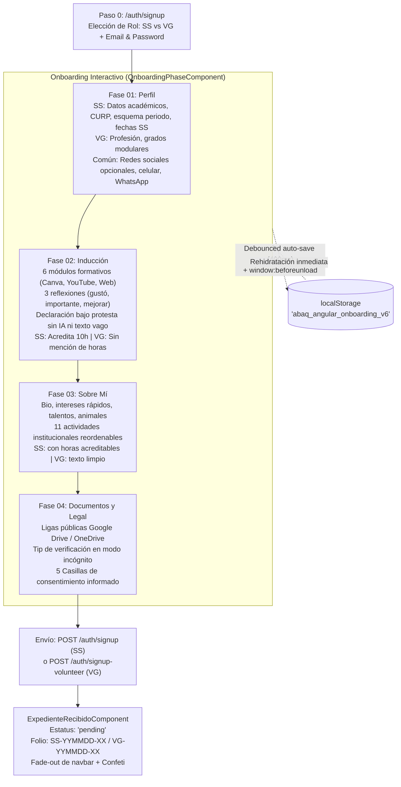
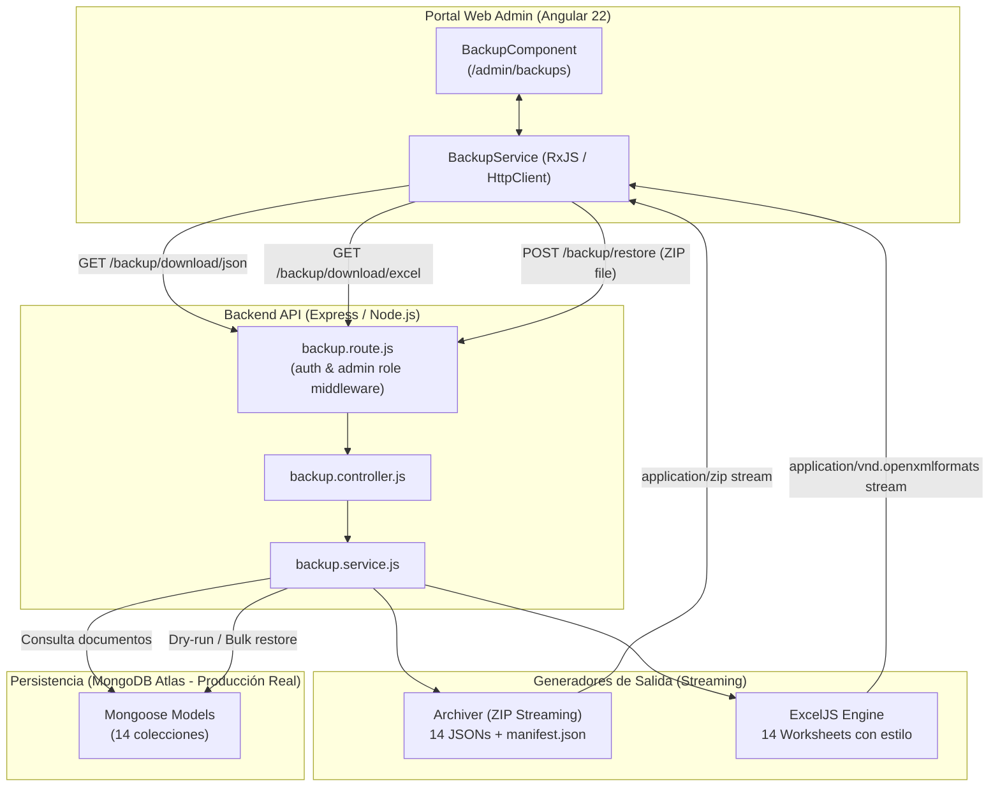
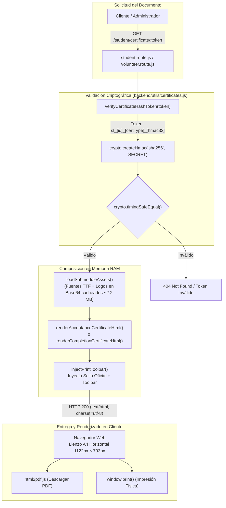
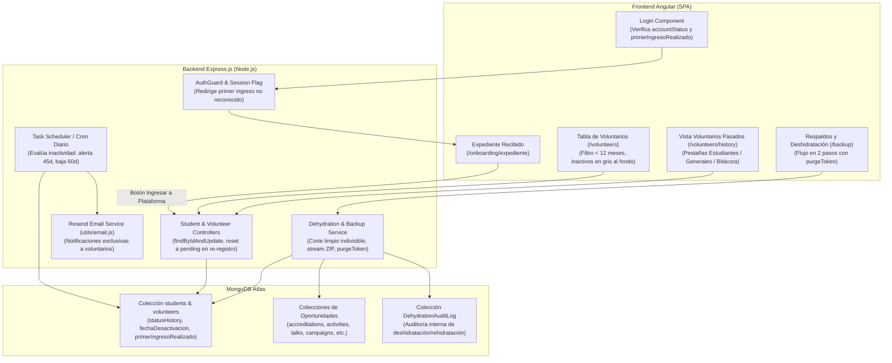

# Documento de Arquitectura de Software (SAD)
**Estándar:** ISO/IEC/IEEE 42010:2022  
**Proyecto:** Plataforma Web ABAQ (Servicio Social, Censo Comunitario y Documentación Pedagógica)  
**Versión:** 2026.10.31 (CalVer)  
**Fecha:** 2026-10-31  
**Estado:** Aprobado  
**Autores:** Equipo de Arquitectura e Ingeniería de Software ABAQ  

---

## 1. Visión General del Sistema y Contexto (System Overview & Context)

### 1.1 Propósito y Misión del Sistema
La plataforma **ABAQ** es un sistema full-stack en producción real (Angular v22 Standalone + Node.js/Express + MongoDB sin datos simulados / mock data) orientado a coordinar el servicio social universitario, el voluntariado comunitario, el censo animal en Querétaro y el ciclo de vida del expediente digital de colaboradores. El sistema comprende:
1. **Flujo de Registro e Inducción en 4 Fases (Onboarding Guiado)**: Proceso interactivo estructurado con persistencia reactiva en navegador (`localStorage`), autoguardado con *debounce*, outline adaptativo según el dispositivo, y formalización digital mediante casillas de consentimiento informado bajo protesta de decir verdad.
2. **Arquitectura Cero Archivos (Zero-File Storage)**: Eliminación de la carga física de archivos pesados al servidor en el onboarding. Los documentos de identificación y académicos se validan mediante enlaces públicos permanentes en la nube (Google Drive / OneDrive), verificables en modo incógnito, persistidos como datos estructurados JSON.
3. **Motor Criptográfico de Certificados y Constancias Oficiales**: Generación dinámica bajo demanda de Cartas de Aceptación y Certificados de Finalización (480 horas) utilizando tokens firmados con HMAC-SHA256 (`st_[id]_[certType]_[hmac32]`), plantillas HTML autocontenidas con fuentes/gráficos incrustados en Base64, y compilación client-side a PDF nativo con `html2pdf.js` e impresión física con sellos de verificación criptográfica.
4. **Segregación Estricta de Roles y Reglas de Negocio**:
   - **Estudiante de Servicio Social (`SS`)**: Acumula horas (meta típica de 480 h), recibe 10 horas automáticas por la inducción formativa (Fase 2), prioriza entre las 11 actividades institucionales oficiales del reglamento con valores de acreditación explícitos, y está sujeto a la regla de baja por inactividad no notificada mayor a 2 meses.
   - **Voluntario General (`VG`)**: Participa sin fines curriculares escolares; su flujo omite toda referencia o badge de acreditación de 10 horas de inducción, y sus actividades no muestran horas académicas.
   - **Administrador (`admin`)**: Gestión operativa mediante tablas densas de alto contraste con búsqueda, filtrado en tiempo real, auditoría de asistencias, validación de horas, y herramientas de respaldo/restauración de base de datos.
5. **Subsistema de Respaldos, Exportación y Rollback (Disaster Recovery)**: Exportación streaming en formato técnico (ZIP con 14 colecciones JSON y `manifest.json` con firmas SHA-256) y formato gerencial (libro Excel multi-hoja formateado vía `ExcelJS`), complementado con un mecanismo de restauración con validación previa en seco (*dry-run*).
6. **Levantamiento Censal y Encuestas Dinámicas**: Captura de encuestas de bienestar animal en campo y seguimiento veterinario.

### 1.2 Partes Interesadas (Stakeholders) y Puntos de Vista
- **Estudiantes de Servicio Social (`SS`)**: Registran su perfil académico (CURP, esquema compuesto de periodos, fechas de servicio), completan 6 módulos formativos con reflexiones de aprendizaje, comparten enlaces de documentos en la nube, seleccionan actividades y consultan sus horas acreditadas.
- **Voluntarios Generales (`VG`)**: Registran su perfil personal y profesional modular, completan la inducción sin carga de horas escolares y se postulan a actividades comunitarias.
- **Coordinación y Administradores (`admin`)**: Auditan y aprueban solicitudes en estado *pendiente*, gestionan asistencias, validan horas, supervisan la regla de inactividad de 2 meses, emiten cartas oficiales y ejecutan respaldos del sistema.
- **Equipo de Ingeniería y Docencia**: Requiere una arquitectura desacoplada, autodocumentada y estrictamente estandarizada sin datos mock en los flujos principales.

### 1.3 Pila Tecnológica Integral (Technology Stack)
- **Backend**:
  - Entorno de ejecución: Node.js v24 LTS.
  - Framework web: Express.js v4.19 con arquitectura modular (Routers, Middlewares, Controllers, Modelos Mongoose, Validadores).
  - Capa ODM y Persistencia: Mongoose v8.4 sobre base de datos MongoDB real (sin mock data).
  - Criptografía y Seguridad: `crypto` nativo de Node.js (HMAC-SHA256 para certificados y verificación *timing-safe* con `timingSafeEqual`), `bcryptjs` (hashing con factor de costo 12), `jsonwebtoken` (JWT stateless auth con HMAC-SHA256).
  - Motor de Certificados y Constancias: `backend/utils/certificates.js` (generación serverless-style de HTML autocontenido con assets Base64 cacheados en memoria RAM, memoria heap contenida en ~16 MB a 36 MB).
  - Exportación y Respaldo: `archiver` (streaming ZIP) y `exceljs` (generación de libros XLSX formateados con estilos corporativos ABAQ).
- **Frontend**:
  - Framework cliente: Angular v22 basado en componentes independientes (**Standalone Components**) sin `NgModule`.
  - Inyección de dependencias: Inyección funcional moderna con `inject()`.
  - Reactividad y gestión asíncrona: RxJS v7.8 (`BehaviorSubject`, operadores de transformación, limpieza con `takeUntilDestroyed`).
  - Formularios y Controles Personalizados: Angular Reactive Forms (`FormBuilder`, `FormGroup`, `FormArray`, validadores personalizados), combobox focus-first `CustomSelectComponent` accesible por teclado, y selector de fechas `CustomDatepickerComponent` con formateo automático de slashes (`DD/MM/AAAA`) al teclear números crudos y calendario emergente institucional.
  - Estado y Persistencia de Onboarding: `OnboardingStateService` con persistencia reactiva en `localStorage`, autoguardado debounced y listener de ciclo de vida `window:beforeunload`.
  - Estilos y Maquetación: SCSS modular y `abaq-design.css`, Bootstrap v5.3, Google Material Symbols, diseño responsivo con breakpoint en 1024px.
  - Visualización y Descarga: Chart.js v4.4 para gráficas reactivas, `html2pdf.js` y CSS `@media print` para generación de PDFs en cliente.

---

## 2. Vistas Arquitectónicas (ISO/IEC/IEEE 42010:2022)

```
┌─────────────────────────────────────────────────────────────────────────────┐
│                       ARQUITECTURA DEL SISTEMA ABAQ                         │
├─────────────────────────────────────────────────────────────────────────────┤
│                                                                             │
│  [ CLIENTE WEB (Angular 22 Standalone) ]                                    │
│  ┌────────────────────────┐   ┌────────────────────────┐                    │
│  │ Vistas y Componentes   │   │ Servicios y Estado     │                    │
│  │ (Onboarding, Home,     │<─>│ (OnboardingState, Auth,│                    │
│  │  Student, Volunteer)   │   │  Student, Backup)      │                    │
│  └──────────┬─────────────┘   └───────────┬────────────┘                    │
│             │                             │                                 │
│             ▼                             ▼                                 │
│  ┌────────────────────────┐   ┌────────────────────────┐                    │
│  │ Mappers DTO/Dominio    │   │ Interceptors & Guards  │                    │
│  │ (student, volunteer)   │   │ (auth.interceptor/guard)│                   │
│  └────────────────────────┘   └───────────┬────────────┘                    │
│                                           │ (HTTP / JSON / Bearer JWT)      │
│ ──────────────────────────────────────────┼──────────────────────────────── │
│                                           ▼                                 │
│  [ SERVIDOR BACKEND (Node.js 24 + Express 4.19) ]                           │
│  ┌─────────────────────────────────────────────────────┐                    │
│  │ Express Pipeline: CORS -> Parsers -> Routers        │                    │
│  │ (/auth, /student, /volunteer, /backup, /activity)  │                    │
│  └────────────────────────┬────────────────────────────┘                    │
│                           ▼                                                 │
│  ┌────────────────────────┐   ┌────────────────────────┐                    │
│  │ Middlewares            │   │ Controladores y Engine │                    │
│  │ (auth, validator)      │──>│ (student, backup,      │                    │
│  └────────────────────────┘   │  certificates utils)   │                    │
│                               └───────────┬────────────┘                    │
│                                           │                                 │
│                           ┌───────────────┴────────────────┐                │
│                           ▼                                ▼                │
│                ┌──────────────────────┐        ┌───────────────────────┐    │
│                │ Mongoose ODM Models  │        │ Crypto Engine         │    │
│                │ (Student, Volunteer, │        │ (HMAC-SHA256 Token &  │    │
│                │  User, Activity, etc)│        │  Base64 Cert Template)│    │
│                └──────────┬───────────┘        └───────────────────────┘    │
│ ──────────────────────────┼──────────────────────────────────────────────── │
│                           ▼                                                 │
│  [ BASE DE DATOS (MongoDB Document Store - Producción Real) ]               │
└─────────────────────────────────────────────────────────────────────────────┘
```
### 2.1 Vista Lógica (Logical View)
La vista lógica organiza el sistema en capas de responsabilidad única y desacoplada, operando sobre persistencia real en MongoDB (sin datos simulados / mock data):

1. **Capa de Presentación (Frontend UI)**:
   - Reside en `frontend/src/app/components/`.
   - Implementada al 100% mediante **Angular Standalone Components**, eliminando módulos intermedios y aprovechando la nueva sintaxis de Control Flow (`@if`, `@for`, `@switch`).
   - Cada componente encapsula su plantilla HTML, lógica TypeScript y estilos SCSS.
   - Componentes clave del sistema:
     - `SignupComponent` & `LoginComponent`: Selección inicial de rol (Estudiante de Servicio Social `SS` vs. Voluntario General `VG`) y autenticación con secuenciación compatible con gestores de contraseñas.
     - `OnboardingPhaseComponent`: Motor unificado del onboarding en 4 fases (`01 Perfil`, `02 Inducción`, `03 Sobre Mí`, `04 Documentos y Consentimientos`), con outline adaptativo responsivo (oculto en pantallas `<=1024px`), autoguardado reactivo y validación dinámica de faltantes.
     - `ExpedienteRecibidoComponent`: Pantalla de cierre de registro que muestra el folio institucional (`SS-YYMMDD-XX` o `VG-YYMMDD-XX`), reproduce la animación de fade-out del navbar sin desplazamiento del contenido (*zero layout shift*) y dispara una lluvia de confeti ligero.
     - `HomeComponent` & `AdminHomeComponent`: Paneles diferenciados para alumnos (progreso de 480 horas, actividades pendientes e historial) y administradores (triaje de solicitudes pendientes, auditoría de asistencias y validación de horas).
     - `StudentComponent`, `StudentDetail`, `VolunteerDetailComponent` & `VolunteerProfileComponent`: Vistas de alta densidad y expedientes completos que reflejan los datos recolectados (CURP, periodos académicos compuestos, fechas de servicio y enlaces a redes sociales).
     - `BackupComponent`: Centro de control administrativo para descarga de respaldos JSON en streaming, libros Excel y restauración con verificación previa (*dry-run*).
     - Controles personalizados reutilizables: `CustomSelectComponent` (combobox *focus-first* con navegación de teclado) y `CustomDatepickerComponent` (auto-formateo de separadores `DD/MM/AAAA` al teclear números crudos y calendario modal).

2. **Capa de Aplicación y Comunicación (Frontend Services & Mappers)**:
   - Servicios singleton (`@Injectable({ providedIn: 'root' })`) que centralizan la lógica de negocio del cliente y llamadas HTTP con inyección funcional `inject()`.
   - `OnboardingStateService`: Gestiona el estado reactivo del formulario de onboarding, persistencia automática en `localStorage` con *debounce* y sincronización ante cierre de pestaña (`window:beforeunload`).
   - `AuthService`, `StudentService`, `VolunteerService`, `ActivityService`, `BackupService`.
   - **Patrón Adaptador / DTO Mappers**:
     - `student.mapper.ts`: Traduce entre el contrato de base de datos en español (`BackendStudent`) y la interfaz tipada de Angular (`Student`).
     - `volunteer.mapper.ts`: Adapta los campos de voluntarios generales (`Volunteer`).
     - `survey.mapper.ts`: Transforma encuestas de bienestar animal a contratos normalizados (`BackendSurvey`).

3. **Capa de Transporte y Control (Backend API & Routers)**:
   - Reside en `backend/routes/` y `backend/controllers/`.
   - Enrutadores Express dedicados por dominio (`/auth`, `/student`, `/volunteer`, `/backup`, `/activity`, `/survey`, `/pet`, `/contact`).
   - Controladores que procesan la petición, delegan al modelo o servicio y generan respuestas HTTP normalizadas mediante `{ status: "success", data: ... }`.
   - **Patrón Controlador Factory (`handler.controller.js`)**: Generador dinámico de métodos CRUD estándar (`createOne`, `getOne`, `getAll`, `updateOne`, `deleteOne`), reduciendo duplicación de código.

4. **Capa de Dominio y Persistencia (Backend ODM & Modelos)**:
   - Modelos Mongoose (`backend/models/`):
     - `User`: Credenciales, rol (`student` | `volunteer` | `admin`), métodos criptográficos estáticos y de instancia.
     - `Student`: Datos académicos, CURP, esquema compuesto de periodos (`periodType`, `periodNumber`, `semestre`), fechas de servicio (`fechaArranque`, `fechaConclusion`), balance de horas (`horasCubrir: 480`, `horasAcreditadas: 10`, `horasPendientes: 470`), redes sociales y subdocumento `onboardingData`.
     - `Volunteer`: Perfil de voluntarios generales (`volunteerType: 'GENERAL'`), formación académica modular (`degrees`), ocupación, redes sociales, estado (`volunteerStatus: 'pending'`) y subdocumento `onboardingData`.
     - `Activity`, `Accreditation`, `Survey`, `Pet`, `Contact`.
   - **Cero Archivos en Servidor**: Los documentos aportados por el usuario no se suben al servidor ni se fragmentan en GridFS; se registran como URLs verificadas de Google Drive o OneDrive en el documento del estudiante/voluntario (`cloudUrls: { ine, cv, comprobante }`).
   - **Motor Criptográfico de Certificados (`backend/utils/certificates.js`)**: Generación en memoria de plantillas HTML autocontenidas con fuentes TTF y logotipos en Base64, protegidas mediante tokens HMAC-SHA256.

### 2.2 Vista de Seguridad y Autenticación (Security / Auth View)

```
┌─────────────────────────────────────────────────────────────────────────────┐
│                VISTA DE SEGURIDAD Y CICLO DE AUTENTICACIÓN                  │
├─────────────────────────────────────────────────────────────────────────────┤
│                                                                             │
│  [ Flujo de Login ]                                                         │
│  Navegador ──POST /auth/login {correo, password}──> Express authRoute       │
│                                                           │                 │
│                                                           ▼                 │
│  bcrypt.compare(password, user.password) <────── authController.login       │
│            │ (Válido)                                                       │
│            ▼                                                                │
│  jwt.sign({ id: user._id }, SECRET, { expiresIn })                          │
│            │                                                                │
│            ▼                                                                │
│  Respuesta: JSON { status: "success", token, data: { user } }               │
│            │                                                                │
│            ▼ (Guardado en localStorage / memoria)                           │
│                                                                             │
│  [ Peticiones Subsecuentes Protegidas ]                                     │
│  HttpClient ──> auth.interceptor.ts (Inyecta Bearer <token>)                │
│                         │                                                   │
│                         ▼ (HTTP Header: Authorization: Bearer <token>)      │
│  Express auth.middleware.js (protect)                                       │
│         ├── 1. Extrae token del header Bearer                               │
│         ├── 2. jwt.verify(token, JWT_SECRET)                                │
│         ├── 3. User.findById(decoded.id)                                    │
│         └── 4. Asigna req.user = currentUser; next()                        │
│                                                                             │
│  [ Rollback Transaccional en Signup ]                                       │
│  authController.signup / signupVolunteer:                                  │
│     Paso 1: User.create() exitoso                                           │
│     Paso 2: Student.create() o Volunteer.create() lanza excepción           │
│     Catch: User.findByIdAndDelete(user._id) ──> Previene cuentas huérfanas   │
│                                                                             │
│  [ Verificación Criptográfica de Constancias y Certificados ]               │
│  Petición: GET /student/certificate/:token                                  │
│     Paso 1: verifyCertificateHashToken(token)                                │
│     Paso 2: crypto.timingSafeEqual(providedHmac, expectedHmac)              │
│     Paso 3: Renderizado HTML con Sello de Verificación y toolbar de PDF      │
└─────────────────────────────────────────────────────────────────────────────┘
```

- **Mecanismo de Autenticación**: Stateless basado en tokens JWT (JSON Web Tokens) firmados con algoritmo HMAC-SHA256 (`backend/utils/jwt.js`).
- **Protección de Credenciales**:
  - Hashing unidireccional con `bcryptjs`, factor de costo 12 (`salt rounds = 12`).
  - Campo de contraseña en esquema con `select: false` para evitar fugas accidentales en consultas.
  - Validación de contraseña con longitud mínima de 8 caracteres y soporte de hasta 128 caracteres Unicode sin truncamiento.
- **Autorización y Control de Acceso Basado en Roles (RBAC)**:
  - Roles definidos: `student` (`SS`), `volunteer` (`VG`) y `admin`.
  - Rutas administrativas protegidas por `protect` y `restrictTo('admin')`.
  - Registro de administradores protegido obligatoriamente por passkey secreta del entorno (`ADMIN_REGISTRATION_SECRET`).
  - **Confinamiento de Seguridad para Cuentas Pendientes (`Pending Account Isolation`)**:
    - Un usuario que completa el onboarding obtiene un token de autenticación para consultar su estatus en el expediente (`/auth/me`, `/auth/expediente-status`).
    - Dicho token mantiene a la cuenta en estado `pending`, impidiendo el acceso a los endpoints operativos de la plataforma (charlas, campañas, acreditaciones, actividades, pase de lista y colecciones de base de datos). El middleware de autorización rechaza cualquier solicitud no permitida con `403 Forbidden`, bloqueando a usuarios técnicos avanzados de interactuar directamente con la base de datos antes de la aprobación administrativa.
- **Protección Perimetral y Anti-Bot con Cloudflare Turnstile Proxy**:
  - Mitigación pasiva de bots y scripts maliciosos en `/login` y `/signup` mediante Cloudflare Turnstile.
  - Validación del token en backend antes del procesamiento criptográfico de credenciales.
  - Proxy inverso con DNS gestionado en Cloudflare para protección DDoS, HTTP/3, compresión Brotli y certificados SSL/TLS automáticos.
- **Seguridad en Emisión de Constancias**:
  - Los certificados y cartas de aceptación no se acceden por ID numérico secuencial ni por nombre, sino por un hash token URL-safe: `st_[id]_[certType]_[hmac32]`.
  - La verificación utiliza `crypto.timingSafeEqual` para prevenir ataques de temporización (*timing attacks*).

### 2.3 Vista de Flujo de Datos y Ciclo de Vida (Data Flow & Lifecycle View)

#### A. Pipeline de Petición HTTP en Express (`backend/app.js`)
Cada petición recibida atraviesa una tubería secuencial estrictamente ordenada:

```
[Cliente HTTP / Navegador]
           │
           ▼
1. CORS Middleware (cors): Valida origen 'http://localhost:4200' y credentials: true
           │
           ▼
2. Body Parsers: express.json({ limit: '10mb' }) y express.urlencoded({ extended: true })
           │
           ▼
3. Enrutadores Montados (Routers):
   ├── /auth      ──> authRouter (login, signup SS, signup-volunteer VG, admin/register, me)
   ├── /student   ──> studentRouter (CRUD estudiantes, asistencia, /certificate/:token)
   ├── /volunteer ──> volunteerRouter (CRUD voluntarios, estatus, /certificate/:token)
   ├── /backup    ──> backupRouter (estado BD, streaming ZIP JSON, Excel, rollback)
   ├── /activity  ──> activityRouter (catálogo, asistencia, acreditación de horas)
   ├── /survey    ──> surveyRouter (encuestas de bienestar animal)
   ├── /pet       ──> petRouter (censo veterinario)
   └── /contact   ──> contactRouter (bitácora de contactos comunitarios)
           │
           ▼ (Si ninguna ruta coincide)
4. Capturador 404: app.all('*') ──> Genera new AppError(`${req.originalUrl} not found`, 404)
           │
           ▼ (En cualquier excepción en la cadena)
5. Middleware Global de Errores: (err, req, res, next) ──> JSON estandarizado { status, message }
```

#### B. Pipeline de Onboarding Guiado en 4 Fases y Persistencia en Navegador


#### C. Pipeline de Emisión de Certificados y Constancias Criptográficas
1. **Solicitud**: El usuario o administrador abre `/student/certificate/:token` o `/volunteer/certificate/:token`.
2. **Autenticación del Documento**: `verifyCertificateHashToken(token)` desglosa el identificador, tipo de documento (`acceptance` o `completion`) y valida la firma HMAC con `CERT_SECRET`.
3. **Carga en Memoria de Recursos Base64**: La función `loadSubmoduleAssets()` carga una sola vez en el ciclo de vida del servidor las fuentes (`GreatVibes`, `CrimsonText`) y gráficos oficiales (`logo_highres_trans.png`, `new_watermark_trans.png`), manteniéndolos en memoria RAM (~2.2 MB).
4. **Composición de Plantilla**: Se reemplazan los marcadores `{{NOMBRE}}`, `{{DIA}}`, `{{MES}}`, `{{ANIO}}`, `{{LUGAR}}` y se inyecta la cabecera interactiva con el sello de validación criptográfica.
5. **Renderizado en Cliente**: El navegador recibe el HTML y permite al usuario previsualizar la constancia en un lienzo de 1122px × 793px (A4 Horizontal), imprimirla con colores exactos (`print-color-adjust: exact`) o compilarla a archivo PDF en un clic usando `html2pdf.js`.

### 2.4 Vista de Topología de Componentes (Component Topology View)

```
┌─────────────────────────────────────────────────────────────────────────────┐
│                     TOPOLOGÍA DE COMPONENTES FRONTEND                       │
├─────────────────────────────────────────────────────────────────────────────┤
│  Root: AppComponent (NavbarComponent + RouterOutlet)                        │
│                                                                             │
│  [ Rutas Públicas ]                                                         │
│  ├── LoginComponent ───────────────┐                                        │
│  ├── SignupComponent (Paso 0) ─────┼──> AuthService ──> TokenService        │
│  ├── OnboardingPhaseComponent ─────┼──> OnboardingStateService              │
│  ├── ExpedienteRecibidoComponent ──┤                                        │
│  └── FormComponent (Surveys) ──────┼──> SurveyService ──> survey.mapper     │
│                                    │                                        │
│  [ Rutas Privadas (AuthGuard) ]    │                                        │
│  ├── HomeComponent (SS Dashboard)  │                                        │
│  ├── AdminHomeComponent ───────────┼──> StudentService ──> student.mapper   │
│  ├── StudentComponent (Tabla SS) ──┼──> VolunteerService ──> volunteer.map  │
│  ├── StudentDetail / StudentProfile│                                        │
│  ├── VolunteerDetail / Profile ────┤                                        │
│  ├── BackupComponent (Respaldos) ──┼──> BackupService                       │
│  ├── ActivityListComponent ────────┼──> ActivityService                     │
│  ├── ActivityDetail ───────────────┘                                        │
│  ├── PetViewComponent ────────────────> PetService                          │
│  └── ContactComponent ────────────────> ContactService                      │
│                                                                             │
│  [ Componentes UI Reutilizables ]                                           │
│  ├── CustomSelectComponent (Combobox accesibilidad teclado)                 │
│  └── CustomDatepickerComponent (Auto-formato de barras y calendario popup)  │
└─────────────────────────────────────────────────────────────────────────────┘
```

- **Frontend (Standalone Architecture)**:
  - 22 Componentes Standalone (`app`, `navbar`, `login`, `signup`, `admin-signup`, `onboarding-phase`, `expediente-recibido`, `home`, `admin-home`, `student`, `student-detail`, `student-profile`, `volunteer-detail`, `volunteer-profile`, `backup`, `activity`, `activity-list`, `activity-detail`, `form`, `survey`, `custom-select`, `custom-datepicker`).
  - 10 Servicios (`AuthService`, `TokenService`, `OnboardingStateService`, `StudentService`, `VolunteerService`, `ActivityService`, `BackupService`, `SurveyService`, `PetService`, `ContactService`).
  - 3 Mappers de Dominio/DTO (`student.mapper.ts`, `volunteer.mapper.ts`, `survey.mapper.ts`).
  - Guards e Interceptores (`auth.guard.ts`, `auth.interceptor.ts`).
  - Interfaces tipadas (`student`, `volunteer`, `activity`, `backup`, `survey`, `pet`, `contact`).

- **Backend (Node.js 24 + Express)**:
  - 1 Servidor central (`app.js`).
  - 8 Enrutadores (`auth`, `student`, `volunteer`, `backup`, `activity`, `survey`, `pet`, `contact`).
  - 8 Controladores (`auth`, `student`, `volunteer`, `backup`, `activity`, `survey`, `pet`, `contact`, `handler.controller`).
  - 7 Modelos Mongoose (`User`, `Student`, `Volunteer`, `Activity`, `Accreditation`, `Survey`, `Pet`, `Contact`).
  - Motor de certificados (`utils/certificates.js`).
  - Motor de respaldos (`services/backup.service.js`).
  - Middlewares y utilidades (`auth.middleware.js`, `validator.js`, `jwt.js`, `appError.js`, `catchAsync.js`).

### 2.5 Vista de Despliegue y Distribución (Deployment View)

```
┌─────────────────────────────────────────────────────────────────────────────┐
│                    VISTA DE DESPLIEGUE FÍSICO / DISTRIBUCIÓN                 │
├─────────────────────────────────────────────────────────────────────────────┤
│                                                                             │
│   [ Dispositivo Cliente ]                                                   │
│   Navegador Web (Chrome, Firefox, Safari, Edge)                             │
│         │                                                                   │
│         │ HTTPS (Puerto 443 / 4200 en desarrollo)                           │
│         ▼                                                                   │
│   [ Servidor Web / Reverse Proxy / Nginx ]                                  │
│   ├── Archivos Estáticos Angular SPA (/dist/frontend/browser)                │
│   └── Proxy Inverso /api/ ──> Puerto 3000                                   │
│                                  │                                          │
│                                  ▼                                          │
│   [ Servidor de Aplicaciones (Node.js 24 Runtime) ]                         │
│   Proceso Express.js (backend/app.js)                                       │
│   ├── Variables de entorno (.env): PORT, MONGO_URI, JWT_SECRET, ADMIN_PASS  │
│   └── Conexión Mongoose Pool ─────────────────┐                             │
│                                               │                             │
│                                               ▼                             │
│   [ Clúster de Base de Datos (MongoDB Atlas / Local) ]                      │
│   ├── Colecciones Documentales: users, students, surveys, activities, etc.  │
│   └── Bucket GridFS: uploads.files, uploads.chunks (bloques de 255KB)       │
│                                                                             │
└─────────────────────────────────────────────────────────────────────────────┘
```

- **Aislamiento en Control de Versiones**: Todo el código de producción y documentación del proyecto está unificado y versionado en la rama `docs-explanation` tanto en el repositorio del backend como del frontend.

---

### 2.5 Subsistema de Respaldos, Exportación Multi-Formato y Rollback de Datos

El subsistema de respaldos y recuperación provee soberanía operativa a los administradores sin requerir acceso directo a la consola de base de datos o utilidades de línea de comandos en la nube.



#### Componentes y Responsabilidades
1. **`BackupComponent` & `BackupService` (Frontend)**:
   - Muestra estado vital de la base de datos (colecciones, documentos, estado de conectividad).
   - Descarga en un clic los archivos binarios mediante `Blob` y URLs temporales (`window.URL.createObjectURL`).
   - Administra la subida del archivo `.zip` para recuperación, renderizando un modal de confirmación con vista previa (*dry-run*) del impacto en registros antes de proceder.
2. **`backup.controller.js` & `backup.service.js` (Backend)**:
   - `getBackupStatus`: Retorna el inventario de las 14 colecciones con su conteo exacto de documentos.
   - `exportJsonZip`: Itera sobre todas las colecciones mediante cursores lean, serializa a JSON formateado, calcula checksums SHA-256, genera `manifest.json` y empaqueta en ZIP con compresión de nivel 6 vía streaming.
   - `exportExcel`: Utiliza `ExcelJS` para construir un libro con 14 hojas nombradas, encabezados corporativos (#24366f), formateo de columnas y exclusión de hashes de contraseñas.
   - `restoreBackup`: Descomprime el `.zip` en memoria/temporal, valida el `manifest.json`, ejecuta validación cruzada de esquemas, y si `confirm=true`, ejecuta una restauración controlada reemplazando colecciones mediante operaciones ordenadas de MongoDB preservando `_id`.

---

### 2.6 Subsistema de Generación y Validación Criptográfica de Certificados

El subsistema de certificados oficiales de ABAQ permite emitir documentos formales (Carta de Aceptación y Certificado de Término de 480 horas) sin sobrecargar el servidor con procesamiento gráfico ni requerir almacenamiento de archivos PDF en disco o base de datos.



#### Atributos Técnicos Clave:
- **Consumo de Memoria Optimizado**: Carga inicial única de activos gráficos en Base64 (~2.2 MB de RAM fija). Un certificado individual genera 2.77 MB de HTML en 28 ms consumiendo ~36 MB Heap; un lote de 100 certificados se procesa en 1.6 segundos con liberación inmediata de memoria tras el Garbage Collector.
- **Sello de Verificación Criptográfica**: Cada documento impreso o descargado porta el folio institucional (`SS-YYMMDD-XX` o `VG-YYMMDD-XX`), la firma HMAC abreviada y leyenda oficial de validación.

---

### 2.7 Vista de Despliegue y Distribución (Deployment View)

```
┌─────────────────────────────────────────────────────────────────────────────┐
│                    VISTA DE DESPLIEGUE FÍSICO / DISTRIBUCIÓN                 │
├─────────────────────────────────────────────────────────────────────────────┤
│                                                                             │
│   [ Dispositivo Cliente ]                                                   │
│   Navegador Web (Chrome, Firefox, Safari, Edge)                             │
│         │                                                                   │
│         │ HTTPS (Puerto 443 / 4200 en desarrollo)                           │
│         ▼                                                                   │
│   [ Servidor Web / Reverse Proxy / Nginx ]                                  │
│   ├── Archivos Estáticos Angular SPA (/dist/frontend/browser)                │
│   └── Proxy Inverso /api/ ──> Puerto 3000                                   │
│                                  │                                          │
│                                  ▼                                          │
│   [ Servidor de Aplicaciones (Node.js 24 Runtime) ]                         │
│   Proceso Express.js (backend/app.js)                                       │
│   ├── Variables de entorno (.env): PORT, MONGO_URI, JWT_SECRET, ADMIN_PASS  │
│   └── Conexión Mongoose Pool ─────────────────┐                             │
│                                               │                             │
│                                               ▼                             │
│   [ Clúster de Base de Datos (MongoDB Atlas / Local) ]                      │
│   ├── Colecciones Documentales: users, students, volunteers, activities,    │
│   │   accreditations, surveys, pets, contacts.                              │
│   └── Persistencia Real (Sin datos simulados ni mocks)                      │
│                                                                             │
└─────────────────────────────────────────────────────────────────────────────┘
```

- **Aislamiento en Control de Versiones**: Todo el código de producción y documentación del proyecto está unificado y versionado en la rama `main` en los repositorios de frontend y backend.

### 2.8 Subsistema de Ciclo de Vida, Inactivación Automática y Deshidratación de Base de Datos
Este subsistema desacopla la operación diaria activa de la custodia histórica de expedientes en ABAQ, garantizando que los usuarios pasen por un ciclo de vida ordenado, con desaturación de vistas operativas y una capacidad integral de purga y rehidratación de la base de datos sin pérdida de datos ni dependencias rotas.



#### Principios Clave del Subsistema:
1. **Flujo de Primer Ingreso Asimétrico:** Tras ser aceptado por el admin, el usuario va obligatoriamente a `/onboarding/expediente` la primera vez, descarga su carta y pulsa *"Ingresar a la Plataforma ABAQ"*, persistiendo `primerIngresoRealizado: true`. En inicios posteriores, entra directo a su rol (`/activity-list`).
2. **Re-registro Idempotente:** Si un usuario rechazado (`accountStatus: "rejected"`) se registra de nuevo con su mismo correo, se reutiliza su `_id` original, se resetea a `"pending"`, se actualizan sus credenciales y se registra el evento en `statusHistory`.
3. **Inactivación Automática Dual:** 
   - Estudiantes de servicio social: Al alcanzar 480 horas, se inactiva de inmediato en la misma transacción donde el admin aprueba la acreditación, emitiendo el certificado oficial.
   - Ambos roles: Inactividad integral evaluada por cron diario. A los 45 días sin interacción se envía correo de alerta preventiva; a los 60 días se pasa a `"inactive"` (sin constancia).
4. **Visibilidad Escalonada (12 Meses):**
   - $< 12$ meses: Visible en la tabla de voluntarios con fila gris (`#f1f5f9`) al final.
   - $\ge 12$ meses: Excluido de la tabla operativa; consultable en `/volunteers/history` mediante aggregation pipelines optimizados.
5. **Corte Limpio e Indivisible ("O se quita todo o no se quita nada"):**
   - Una actividad u oportunidad pasada se deshidrata y purga únicamente si **todos** sus participantes son inactivos de más de un año. Si hay al menos un alumno activo, no se toca nada.
   - Barre todas las 11 modalidades del catálogo de oportunidades (`accreditations`, `identifications`, `talks`, `campaigns`, `adoptions`, etc.).
6. **Seguridad en Dos Pasos y Rehidratación:** La descarga del archivo ZIP emite un `purgeToken` con TTL de 15 minutos que desbloquea el borrado en base de datos. La rehidratación se realiza vía subida de ZIP con `replaceOne` / upsert manteniendo IDs originales.
7. **Notificaciones Exclusivas para Voluntarios:** Cuatro correos transaccionales vía Resend dirigidos únicamente a la casilla de correo del voluntario. Sin notificaciones a administradores ni bandejas in-app.

---

## 3. Registros de Decisiones Arquitectónicas (Architectural Decision Records - ADRs)

### ADR-01: Adopción de Componentes Independientes (Standalone) e Inyección Funcional en Angular 22
- **Estado**: Aceptado y Aplicado.
- **Contexto**: Las versiones previas de Angular requerían definir módulos (`NgModule`), introduciendo complejidad en la configuración, importaciones circulares y paquetes de distribución más pesados.
- **Decisión**: Se adopta el estándar de **Standalone Components** en el 100% de los componentes del frontend (`@Component({ standalone: true, imports: [...] })`), así como la función `inject()` para resolver dependencias (`AuthService`, `HttpClient`, `Router`) directamente en inicializadores de propiedades de clase.
- **Consecuencias**:
  - *Positivas*: Mayor modularidad, eliminación de archivos `*.module.ts`, tree-shaking optimizado por el compilador, menor fricción cognitiva para desarrolladores noveles.
  - *Negativas*: Requiere rigor en declarar explícitamente en el arreglo `imports` de cada componente las directivas o módulos de Angular (`CommonModule`, `ReactiveFormsModule`, `RouterModule`) que utiliza.

### ADR-02: Autenticación Desacoplada y Criptografía con JWT y RBAC
- **Estado**: Aceptado y Aplicado.
- **Contexto**: El sistema debe operar con un frontend SPA y una API RESTful que permitan escalabilidad horizontal sin persistencia de sesiones en memoria del servidor web (*stateless*).
- **Decisión**: Implementar autenticación basada en tokens JWT firmados con HMAC-SHA256 y expiración configurable. El control de acceso basado en roles (`student` vs `volunteer` vs `admin`) se valida tanto en el middleware del backend (`auth.middleware.js`) como en los guards del frontend (`auth.guard.ts`). El registro de administradores requiere forzosamente una clave secreta configurada en el entorno (`ADMIN_REGISTRATION_SECRET`).
- **Consecuencias**:
  - *Positivas*: Arquitectura completamente desacoplada; cero consumo de memoria de sesiones en el backend; soporte nativo para balanceo de carga; seguridad criptográfica estándar.
  - *Negativas*: La revocación inmediata de un token emitido antes de su expiración requiere listas de revocación en base de datos si se requiere invalidación forzada antes del vencimiento.

### ADR-03: Documentación Pedagógica en Código (JSDoc/TSDoc en Inglés) y Guía Arquitectónica en Español
- **Estado**: Aceptado y Aplicado.
- **Contexto**: El proyecto ABAQ es utilizado por estudiantes y docentes de servicio social técnico. Es prioritario que cualquier desarrollador pueda entender tanto la visión conceptual de alto nivel como los mecanismos internos de los frameworks (Express, Mongoose, Angular, RxJS).
- **Decisión**: Se establece una **disciplina bilingüe rigurosa**:
  1. La documentación conceptual, arquitectura (`docs/architecture.md`), requerimientos (`docs/srs.md`), tareas (`docs/tasks.md`) y guía de lectura interactiva (`docs/codebase-reading-guide.md`) se redactan en **español técnico**.
  2. Los comentarios en código fuente (JSDoc en backend, TSDoc en frontend) se redactan en **inglés técnico**, siguiendo los estándares internacionales de código abierto y herramientas de análisis estático.
  3. Los comentarios deben ser pedagógicos: explicar *por qué* existe el componente, su rol en el ciclo de vida y qué hace cada mecanismo de framework (`next()`, `catchAsync`, `takeUntilDestroyed`, `FormArray`, etc.), sin alterar el AST de ejecución (Zero Runtime Overhead).
- **Consecuencias**:
  - *Positivas*: Máxima claridad formativa y mantenibilidad a largo plazo; compatibilidad total con herramientas IDE (IntelliSense, TypeDoc, JSDoc); cero impacto en el rendimiento en tiempo de ejecución.
  - *Negativas*: Requiere esfuerzo continuo de autoría y auditoría para mantener sincronizados los comentarios con la evolución del código.

### ADR-04: Estrategia Dual de Exportación y Rollback (JSON Streaming + Excel Formateado)
- **Estado**: Aceptado y Aplicado.
- **Contexto**: Las administradoras requieren generar copias de seguridad de la base de datos descargables a su máquina local, tanto para fines de respaldo técnico que permita restaurar el sistema ante contingencias (*disaster recovery/rollback*), como para consulta y auditoría gerencial en hojas de cálculo.
- **Decisión**: Se implementa un subsistema desacoplado en el backend con dos formatos especializados:
  1. **Formato Técnico (JSON ZIP)**: Exporta cada una de las 14 colecciones en formato JSON con tipos nativos, comprimidos en un solo archivo `.zip` junto a un `manifest.json` con metadatos y hashes SHA-256. Este artefacto es la única fuente admitida para ejecutar procedimientos de reversión (*rollback*).
  2. **Formato Gerencial (Excel .xlsx)**: Exporta un libro de trabajo consolidado mediante `exceljs` con 14 hojas nombradas, formateo visual acorde al manual de diseño (`#24366f`, cabeceras fijas) y sanitización activa (exclusión estricta de hashes de contraseñas de usuarios).
  3. **Rollback en Dos Fases**: Toda restauración a partir del `.zip` exige una fase preliminar en seco (*dry-run*) que compara registros existentes contra los a restaurar y exige confirmación explícita del administrador.
- **Consecuencias**:
  - *Positivas*: Independencia operativa para el usuario; separación limpia entre respaldo ejecutable (JSON) y reporte legible (Excel); mitigación de riesgos de sobreescritura accidental.
  - *Negativas*: Procesar colecciones con decenas de miles de registros en Excel requiere streaming cuidadoso para controlar el uso de memoria.

### ADR-05: Arquitectura Cero Archivos (Zero-File) y Certificados Criptográficos Dinámicos
- **Estado**: Aceptado y Aplicado.
- **Contexto**: El almacenamiento de archivos binarios (PDFs, imágenes de INE, comprobantes, cartas) directamente en el servidor o fragmentados en MongoDB (GridFS) eleva los costos de almacenamiento en la nube, complica los respaldos y acarrea riesgos de almacenamiento de binarios no auditados. Anteriormente existían formularios y vistas administrativas (`StudentDetail`) que mantenían selectores `<input type="file">` e intentaban subir archivos binarios al backend mediante `FileUploadService`.
- **Decisión**: Se elimina completamente la subida física de archivos binarios tanto en el onboarding de registro como en las vistas administrativas de consulta y gestión de expedientes (`StudentDetail` y `VolunteerDetail`). Toda la documentación aportada o asociada al voluntario se gestiona estrictamente mediante enlaces compartidos públicos de Google Drive, OneDrive o nubes institucionales (con validación e indicación permanente de probar el enlace en modo incógnito). Las cartas y certificados emitidos por ABAQ no se almacenan como PDFs estáticos; se generan bajo demanda mediante un motor serverless-style en Node.js que renderiza HTML/CSS autocontenido con assets Base64 cacheados y los firma con tokens HMAC-SHA256, delegando la compilación binaria a PDF al cliente web con `html2pdf.js` e impresión nativa.
- **Consecuencias**:
  - *Positivas*: Reducción a cero del almacenamiento binario en servidor; copias de seguridad de base de datos ligeras (solo JSON); rendimiento ultra veloz (HTML generado en ~28ms); eliminación de dependencias pesadas como Chromium/Puppeteer en producción; eliminación de fallos de CORS/iframes al abrir documentos directamente en pestaña nueva nativa de la nube.
  - *Negativas*: Dependencia de que los enlaces compartidos por el usuario o administrador en Google Drive/OneDrive se mantengan públicos y accesibles.

### ADR-06: Onboarding Guiado en 4 Fases con Auto-Guardado Reactivo y Outline Adaptativo
- **Estado**: Aceptado y Aplicado.
- **Contexto**: El proceso de admisión es extenso (datos personales, académicos, 6 reflexiones formativas, ordenamiento de 11 actividades, enlaces y consentimientos). Si el usuario refresca o cierra el navegador accidentalmente, no debe perder su trabajo. Además, en dispositivos móviles y tabletas, las barras laterales y outlines complejos roban espacio e interfieren con los campos de entrada táctil.
- **Decisión**:
  1. Se consolida el registro en **4 Fases temáticas**: 01 Perfil, 02 Inducción, 03 Sobre Mí, 04 Documentos y Consentimientos.
  2. Se implementa auto-guardado reactivo en `localStorage` con debounce de 400ms y listener `window:beforeunload`, reflejado con un distintivo minimalista `cloud_done Guardado` en cada sección.
  3. El outline de navegación se configura como un elemento sticky centrado verticalmente a la mitad de la pantalla (`top: 50vh; transform: translateY(-50%)`) en pantallas de escritorio (>1024px). En resoluciones medianas, tabletas y móviles (`<= 1024px`), el outline se oculta completamente (`display: none !important;`), dejando exclusivamente la barra superior de 4 fases para garantizar que los formularios y campos compuestos aprovechen el 100% del ancho sin truncamientos.
- **Consecuencias**:
  - *Positivas*: Cero pérdida de datos ante desconexiones o recargas; experiencia móvil limpia y fluida; navegación clara por fases y subsecciones.
  - *Negativas*: Requiere migración y versionamiento de la llave de almacenamiento (`STORAGE_KEY`) cuando cambian los esquemas de datos del borrador.

### ADR-07: Regla de Desvinculación por Inactividad de 2 Meses en Servicio Social
- **Estado**: Aceptado y Aplicado.
- **Contexto**: El reglamento oficial de Servicio Social ABAQ estipula que un estudiante no puede abandonar sus actividades por periodos prolongados sin aviso, ya que compromete la logística de las brigadas comunitarias y de bienestar animal.
- **Decisión**: Se implementa en el modelo de dominio y controladores la regla de negocio institucional: 2 meses de inactividad no previamente notificada causará la cancelación o baja automática del programa de servicio social. El sistema calcula en tiempo real la diferencia entre la fecha actual y la fecha de la última actividad o actualización del estudiante, alertando en los paneles administrativos cuando un colaborador supera dicho umbral.
- **Consecuencias**:
  - *Positivas*: Mantenimiento de un padrón de prestadores activo y veraz; cumplimiento estricto del reglamento de colaboración con las universidades vinculadas.
  - *Negativas*: Requiere que la administración registre oportunamente las asistencias para evitar falsos positivos de inactividad.

### ADR-08: Folio de Expediente como Propiedad Obligatoria en la Raíz del Esquema (Prohibición de Valores Null)
- **Estado**: Aceptado y Aplicado (Regla Estricta de Integridad en Producción).
- **Contexto**: Se evaluó inicialmente la posibilidad de mantener registros históricos con folio en `null` o sin definir para no intervenir datos previos. Dicha excepción fue **rechazada formalmente por requerimiento de negocio y arquitectura**: en el sistema de ABAQ **no se permite bajo ninguna circunstancia un registro con folio `null` o ausente**. El folio de expediente (`SS-YYMMDD-XX` o `VG-YYMMDD-XX`) es un atributo obligatorio por ley institucional para el 100% de los usuarios registrados (`SS` y `VG`).
- **Decisión**:
  1. Se establece la propiedad `folio: { type: String, required: [true, 'El folio institucional de expediente es obligatorio'], trim: true, uppercase: true, index: true }` en la raíz de los esquemas `Student` y `Volunteer`.
  2. Se configuran hooks de ciclo de vida `pre('validate')` en los modelos Mongoose que generan deterministamente el folio conforme a la fecha y sufijo hexadecimal único en caso de que no venga provisto, garantizando que ninguna instancia llegue a validación sin su folio.
  3. Se prohíbe el valor `null`: se incorpora una rutina de migración e integridad automática al inicio de la conexión con MongoDB (`ensureFolioIntegrity`) que asigna su folio reglamentario a cualquier registro histórico preexistente.
  4. En la tabla operativa administrativa de voluntarios y estudiantes, el folio se despliega de manera destacada para los nuevos usuarios en el filtro de postulantes pendientes (`showPendingOnly`), y la tabla cuenta con desplazamiento horizontal fluido (`overflow-x: auto`) para garantizar accesibilidad sin sobrecargar la vista general.
  5. En los detalles de expediente y vistas de perfil completo (tanto para administradores como para el propio usuario en su portal), el folio se visualiza de forma explícita y es estrictamente de sólo lectura (inmutable).
- **Consecuencias**:
  - *Positivas*: Integridad y consistencia absoluta del padrón institucional en MongoDB; trazabilidad fidedigna en la emisión de Cartas de Aceptación y Certificados de Término; erradicación total de discrepancias por registros con campos nulos o incompletos.
  - *Negativas*: Cualquier inserción manual o script externo que intente omitir o vaciar el folio es rechazado inmediatamente por el motor de validación de Mongoose.

### ADR-09: Paridad de Dominio e Integridad de Modelos SS vs VG con Grados Modulares Dinámicos
- **Estado**: Aceptado y Aplicado.
- **Contexto**: La plataforma gestiona dos perfiles con diferentes naturalezas legales pero que comparten el mismo proceso de onboarding: Estudiantes de Servicio Social (`SS`) y Voluntarios Generales (`VG`). Se requería evitar la dispersión de modelos y asegurar que ambos almacenen la totalidad de la información capturada en las 4 fases.
- **Decisión**:
  1. Se unifica el esquema de datos base en MongoDB y en mappers TypeScript: `curp`, `bioPersonal`, `intereses`, `talentos`, `aportesAbaq`, `animalExperience`, `descExperiencia`, `motivacionAbaq`, `rankedActivities`, `cloudUrls`, `consents`, `inductionReflections`.
  2. En el aspecto académico se establece una segregación intencional: `SS` mantiene un esquema rígido institucional (`school`, `career`, `semester`, `matricula`), mientras que `VG` adopta una colección modular de grados académicos (`degrees`: `[{ degree, institution, fieldOfStudy, graduationYear, status }]`).
  3. Las vistas de detalle en administración (`StudentDetailComponent` y `VolunteerDetailComponent`) presentan el 100% de los datos recolectados y habilitan la edición administrativa integral.
  4. Las vistas de perfil de usuario (`StudentProfileComponent` y `VolunteerProfileComponent`) garantizan la inmutabilidad de los datos institucionales (folio, CURP, escuela/grados, estatus, consentimientos), permitiendo únicamente la edición de biografía, teléfono y redes sociales.
- **Consecuencias**:
  - *Positivas*: Cero pérdida de datos entre onboarding y base de datos; coherencia completa en interfaces administrativas y de consulta personal.
  - *Negativas*: Requiere mantener mappers bidireccionales sincronizados en frontend y backend.

### ADR-10: Auditoría Temporal y Telemetría de Llenado del Expediente Digital (`tiempoLlenadoMinutosExpediente`)
- **Estado**: Aceptado y Aplicado.
- **Contexto**: Para optimizar el embudo de admisión, medir la fricción de usuario y auditar el tiempo dedicado a las reflexiones de inducción, se requería una métrica cuantitativa de duración del registro.
- **Decisión**:
  1. Se incorporan en los modelos de dominio los timestamps `fechaInicioFormularioExpediente` (inicio de Fase 1) y `fechaFinFormularioExpediente` (envío de Fase 4).
  2. El servidor calcula de manera determinista y persistente `tiempoLlenadoMinutosExpediente` en minutos exactos al recibir el expediente.
  3. Se añaden marcas de tiempo del ciclo: `fechaEmisionExpediente`, `fechaAceptacionExpediente` y `fechaExpedicionExpediente`.
  4. En la interfaz de expediente recibido, se despliega la hora y fecha de registro, y las tarjetas de voluntario general se centran verticalmente para balancear la diagramación visual frente a la columna de tiempos.
- **Consecuencias**:
  - *Positivas*: Datos objetivos para optimización UX, auditoría de tiempos de respuesta y análisis estadístico en la sección de ideas de Big Data.
  - *Negativas*: Ligero incremento en el tamaño del payload de onboarding.

### ADR-11: Aislamiento Perimetral y Confinamiento RBAC para Tokens en Estado Pendiente (`Pending Account Isolation`)
- **Estado**: Aceptado y Aplicado.
- **Contexto**: Al finalizar el registro, el colaborador recibe un token JWT que le permite permanecer autenticado en la vista de expediente recibido. Existía el riesgo de que un usuario con conocimientos técnicos utilizara dicho token para consultar directamente endpoints operativos o ejecutar comandos sobre la base de datos de la organización.
- **Decisión**:
  1. Se implementa una política estricta de aislamiento perimetral en `auth.middleware.js`: las cuentas con estatus `pending` (no activadas) están restringidas a `/auth/me` y `/auth/expediente-status`.
  2. Cualquier petición a rutas de actividades, asistencias, charlas, campañas, acreditaciones o gestión administrativa devuelve inmediatamente `403 Forbidden`.
  3. En frontend, los guards de Angular impiden la navegación a módulos internos mientras el estatus no sea `active`.
  4. La consulta de estatus en expediente se blinda con `timeout(3500)` y operador `finalize()` para evitar que la UI quede bloqueada en estado "Comprobando...".
- **Consecuencias**:
  - *Positivas*: Protección absoluta de la base de datos y de la privacidad de la información contra accesos no autorizados por usuarios en espera de aprobación.
  - *Negativas*: Cuentas pendientes deben esperar la activación administrativa formal para interactuar con cualquier funcionalidad del portal.

### ADR-12: Integración de Protección Anti-Bot y WAF con Cloudflare Turnstile Proxy
- **Estado**: Propuesta de Arquitectura e Integración Técnica Aprobada.
- **Contexto**: Los puntos de entrada públicos (`/login` y `/signup`) requieren mitigación contra ataques de fuerza bruta, registros masivos automatizados por bots y denegación de servicio.
- **Decisión**:
  1. Se define la integración de Cloudflare Turnstile en modo gestionado no interactivo (*invisible/managed*) para el frontend.
  2. El backend verifica de forma obligatoria el token `cf-turnstile-response` mediante la API de Cloudflare antes de consultar la base de datos o cifrar credenciales.
  3. Se estructura la arquitectura de red con Cloudflare como Proxy Inverso DNS (Orange Cloud) para el dominio institucional, proporcionando TLS automático, firewall WAF y mitigación DDoS en el borde (Edge).
- **Consecuencias**:
  - *Positivas*: Blindaje contra bots sin fricción para el usuario legítimo (sin CAPTCHAs de imágenes distorsionadas); reducción de carga en el backend Express.
  - *Negativas*: Dependencia externa del servicio de Cloudflare para la verificación en registro y login.

### ADR-13: Corte Indivisible, Desacoplamiento por Doble Arreglo Embebido y Token Criptográfico de Purga (Opción A)
- **Estado**: Aceptado y Autorizado.
- **Contexto**: Purgar datos de usuarios inactivos dejaba registros huérfanos o actividades rotas cuando una actividad colectiva tenía participantes mixtos (alumnos inactivos y alumnos aún activos). Asimismo, un borrado accidental sin descarga previa representaba un riesgo crítico e irreversible.
- **Decisión**:
  1. **Adopción Oficial de Opción A y Desacoplamiento por Doble Arreglo Embebido:** `Student` y `Volunteer` almacenan dos arreglos independientes de subdocumentos autosuficientes: `assignedActivities` (folios `AC-...`) y `accreditations` (folios `OP-...`). Si un estudiante inactivo cumple $> 1$ año, **se purga al ZIP con todo su historial embebido**, mientras que la actividad colectiva compartida **se conserva viva en MongoDB** si cuenta con al menos un participante activo. Cero campos `null` y cero llaves rotas. La actividad se purgará de Atlas únicamente cuando el 100% de sus inscritos cumplan el año de inactividad.
  2. El catálogo de oportunidades barre de forma unificada las 11 modalidades del sistema (`accreditations`, `identifications`, `talks`, `campaigns`, `adoptions`, etc.).
  3. El flujo en `/backup` es bloqueante en 2 pasos: la descarga genera un `X-Purge-Token` criptográfico temporal con TTL de 15 minutos; el botón de purga en BD solo se habilita con este token válido.
  4. La rehidratación se ejecuta mediante subida del ZIP y `bulkWrite` con `replaceOne` / upsert preservando los `_id`s originales y registrando la operación en `DehydrationAuditLog`. Al restaurar el documento del usuario, sus dos arreglos vuelven íntegros, re-vinculando su historial sin parches.
- **Consecuencias**:
  - *Positivas*: Cero registros huérfanos, eliminación absoluta de campos nulos (`null-free`), protección contra pérdidas de datos accidentales y 100% de reversibilidad en caso de contingencia.
  - *Negativas*: Las actividades pasadas que aún cuenten con algún voluntario activo permanecen en MongoDB hasta que todos sus participantes cumplan el año de inactividad.

### ADR-14: Flujo Asimétrico de Activación (Primer Ingreso Obligatorio por Expediente)
- **Estado**: Aceptado y Autorizado.
- **Contexto**: Un colaborador con cuenta recién aprobada por el administrador debe enterarse formalmente de su aceptación, recibir sus credenciales iniciales, descargar su Carta Oficial de Aceptación y confirmar su ingreso, sin que en los logins posteriores se vuelva una molestia repetitiva.
- **Decisión**:
  1. Se introduce el atributo booleano `primerIngresoRealizado` en los esquemas `Student` y `Volunteer` (default: `false`).
  2. Tras la aceptación, el primer login del usuario lo redirige obligatoriamente a `/onboarding/expediente` con la tarjeta de bienvenida y el botón *"Ingresar a la Plataforma ABAQ"*.
  3. Al presionar el botón, el backend persiste `primerIngresoRealizado: true` y lo redirige a la vista de su rol (`/activity-list`).
  4. En los inicios de sesión subsecuentes, el sistema evalúa `primerIngresoRealizado === true` y lo dirige directamente a su rol sin pasar por el expediente.
  5. `AuthGuard` bloquea el acceso directo por URL a `/activity-list` mientras `primerIngresoRealizado === false`.
- **Consecuencias**:
  - *Positivas*: Garantía de que el alumno lee su estatus y descarga su constancia oficial la primera vez, con navegación fluida y sin fricción en los accesos futuros.
  - *Negativas*: Requiere una actualización atómica en base de datos al momento de pulsar el botón de entrada inicial.

### ADR-15: Arquitectura de Retención Escalonada (Ventana Operativa de 12 Meses y Consulta Agregada)
- **Estado**: Aceptado y Autorizado.
- **Contexto**: La acumulación de voluntarios inactivos a lo largo de los semestres saturaba visualmente las tablas operativas de administración y aumentaba los tiempos de carga en el frontend.
- **Decisión**:
  1. Se implementa una ventana de retención operativa de 12 meses: los inactivos con menos de 1 año siguen en la tabla principal pero distinguidos con fondo gris claro (`#f1f5f9`) y reordenados al final.
  2. Al cumplir 12 meses desde `fechaDesactivacion`, los registros se retiran de la tabla operativa y pasan a una vista dedicada: `/volunteers/history`.
  3. La vista `/volunteers/history` expone dos tablas resumidas (Estudiantes y Voluntarios Generales) con campos consolidados optimizados mediante MongoDB Aggregation Pipelines (sin traer modelos pesados).
- **Consecuencias**:
  - *Positivas*: Tablas operativas ágiles y limpias para el personal administrativo; preservación de acceso histórico instantáneo en una vista especializada.
  - *Negativas*: Requiere un endpoint dedicado con proyecciones y pipeline de agregación en el backend.

---

## 4. Atributos de Calidad del Sistema (Quality Attributes)

1. **Mantenibilidad y Comprensibilidad (Maintainability & Understandability)**:
   - Cobertura del 100% de los 80 archivos no plantilla con comentarios normalizados.
   - Existencia de un checklist interactivo por dominios que permite a nuevos ingenieros rastrear su avance formativo en el repositorio.
2. **Inocuidad Operativa (Zero Runtime Overhead / Zero AST Regression)**:
   - Los comentarios agregados no alteran identificadores, lógica de control, firmas de funciones ni estructuras de datos ejecutables.
   - Las pruebas y compilaciones del backend (`node --check`) y del frontend (`ng build`) se mantienen con código de salida 0.
3. **Seguridad y Confidencialidad (Security & Confidentiality)**:
   - Cifrado unidireccional bcrypt con factor de costo 12.
   - Contraseñas robustas de hasta 128 caracteres.
   - Prevención de fugas de contraseñas mediante `select: false` en consultas de Mongoose.
   - Passkey secreta en variables de entorno para alta administrativa.
4. **Usabilidad y Accesibilidad (Usability & Accessibility)**:
   - Formularios multietapa secuenciales estilo *Typeform* con soporte permanente de teclado (`Enter`, `Tab`, flechas).
   - Atributos estándar de autocompletado (`autocomplete`) para compatibilidad fluida con gestores de contraseñas.
5. **Confiabilidad y Manejo de Errores (Reliability & Fault Tolerance)**:
   - Manejo centralizado de excepciones operacionales (`AppError`).
   - Rollback transaccional ante fallos en creación de perfiles de usuario.
   - Limpieza automática de archivos huérfanos en GridFS ante fallos de persistencia en el cliente.
