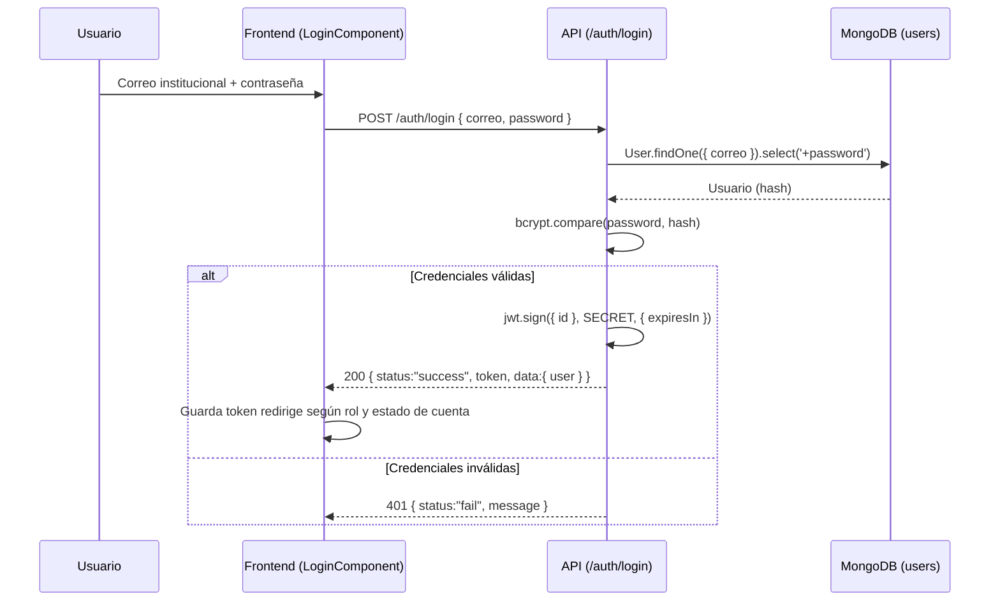
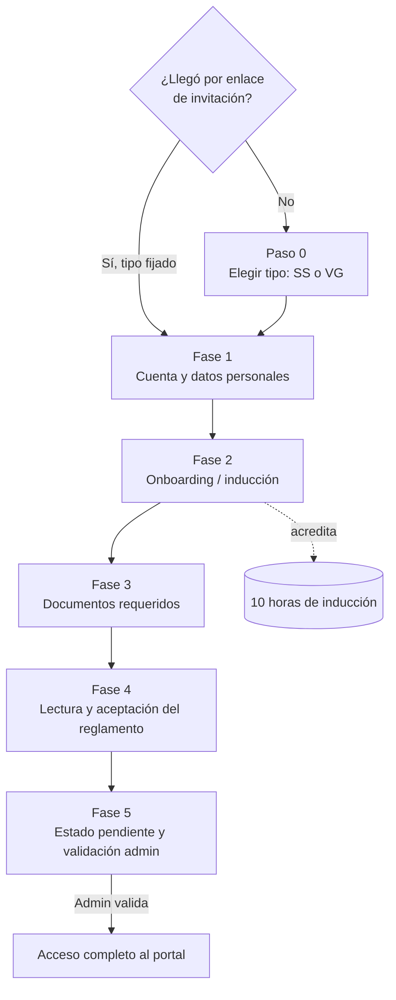
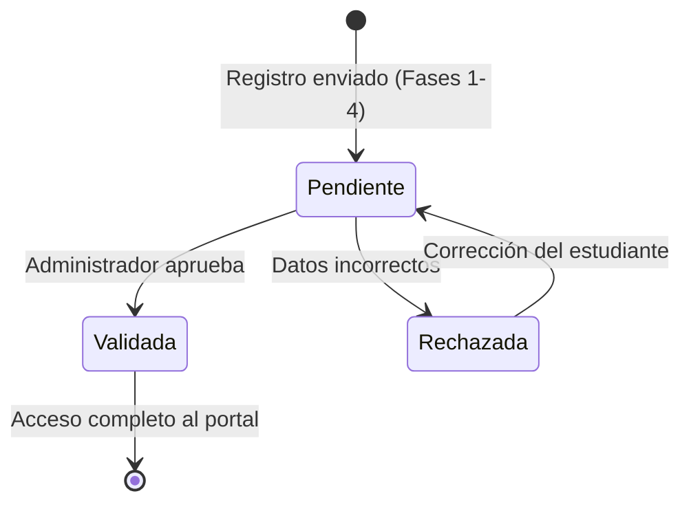

# Diseño de Autenticación: Login y Registro (Signup)

**Estándar de referencia:** ISO/IEC/IEEE 29148:2018 (requisitos) · ISO/IEC/IEEE 42010:2022 (vistas)
**Proyecto:** Plataforma Web ABAQ (Servicio Social)
**Versión:** 1.1.0
**Fecha:** 2026-10-22 (v1.0.0: 2026-10-14)
**Estado:** Propuesta de diseño
**Cambios v1.1.0:** tipos de usuario (§1.1), Paso 0 y enlaces de invitación (§4.0), redirección del voluntario general (§3.4), folio de expediente (§5.1), pantallas de acceso del mockup React (§6.2).
**Fuentes base:** [Reglamento de Voluntarios ABAQ (6 may 2026)](../reports/reglamento-voluntarios-2026-05-06.md) · [Notas de reunión 16 sep 2026](../reports/notas-reunion-2026-09-16-borrador.md)

---

## 1. Propósito y alcance

Este documento especifica el diseño de los dos flujos de acceso de la plataforma ABAQ: **inicio de sesión (login)** y **registro (signup)**. El registro digitaliza el proceso en papel descrito en el [Reglamento de Voluntarios ABAQ](../reports/reglamento-voluntarios-2026-05-06.md) (inducción en PDF, envío de documentos y firma autógrafa en tinta azul), sustituyéndolo por un flujo guiado de cinco fases.

El diseño se rige por dos restricciones de producto, acordadas en la [reunión del 16 de septiembre de 2026](../reports/notas-reunion-2026-09-16-borrador.md):

!!! abstract "Restricciones de diseño"
    1. **La firma es un consentimiento informado por casillas.** No existe firma autógrafa ni carga de documento firmado. La persona declara, mediante casillas de verificación explícitas, haber leído y comprendido el reglamento y el convenio, aceptar las obligaciones y haber completado lo requerido. Esta aceptación es el equivalente digital de la firma.
    2. **El sistema no almacena archivos.** No se guardan PDF, imágenes ni comprimidos en el servidor. Toda la información se persiste como **datos estructurados (JSON)** y los documentos (constancias, cartas, reglamento firmado) se **generan bajo demanda mediante scripts** cuando el cliente los solicita.

### 1.1 Tipos de usuario

La plataforma tiene tres roles. Los dos tipos de voluntario se distinguen desde el registro (ver [Paso 0](#40-paso-0-eleccion-del-tipo-de-voluntario)).

| Rol | Código | Quién es | ¿Acumula horas? |
|---|---|---|---|
| Administrador | — | Coordinación de ABAQ. Se da de alta solo de forma interna | No |
| Estudiante de servicio social | `SS` | Universitario que cumple su servicio social con ABAQ | **Sí** (meta de horas, acreditaciones, folios `OP` y `AC`) |
| Voluntario general | `VG` | Persona que colabora sin servicio social | **No.** Solo se inscribe a actividades y se registra si asistió o no |

---

## 2. Relación con el diseño previo (reconciliación)

El [SRS v2.0.0](srs.md) y la [Arquitectura v2.0.0](architecture.md) describen un registro en **4 lotes temáticos** (`[SRS 9.5.11.2]`) y almacenamiento binario con **GridFS**. El presente diseño, posterior, lo reemplaza por un registro de **5 fases** y un modelo **sin archivos**. La tabla resume la reconciliación:

| Aspecto | Diseño previo (SRS/SAD v2.0.0) | Este diseño (v1.0.0) |
|---|---|---|
| Estructura del signup | 4 lotes (credenciales, personal, académico, periodo SS) | 5 fases (cuenta, onboarding, documentos, aceptación, validación) |
| Firma del reglamento | Carga de PDF firmado en tinta azul | Casillas de consentimiento informado |
| Almacenamiento de documentos | GridFS (binarios en MongoDB) | JSON + generación de PDF bajo demanda |
| Acceso tras registro | Inmediato | Estado *pendiente* hasta validación administrativa |

!!! warning "Deuda técnica: GridFS"
    La capa GridFS (`backend/utils/gridfs.js`, `/upload`) descrita en la arquitectura v2.0.0 queda marcada como **a migrar/deprecar** bajo este diseño. La ruta de migración (retiro de `/upload`, sustitución del visor de documentos por generación bajo demanda) debe planificarse por separado; este documento no la ejecuta y la arquitectura v2.0.0 permanece sin reescribir hasta esa planeación.

---

## 3. Diseño del inicio de sesión (Login)

### 3.1 Identificador de acceso

El identificador único de acceso es el **correo electrónico registrado**: el institucional para el estudiante (`SS`) y el personal para el voluntario general (`VG`), que no tiene correo institucional. Debe tener prioridad visual en el formulario como campo primario. El diseño corrige el problema previo de compatibilidad con gestores de contraseñas reorganizando la secuencia de campos.

### 3.2 Campos y atributos

| Campo | Tipo | `autocomplete` | Validación |
|---|---|---|---|
| Correo institucional | email | `username` | Formato de correo válido; requerido |
| Contraseña | password | `current-password` | 12–128 caracteres; requerido |

### 3.3 Flujo



### 3.4 Redirección por rol y estado

- **`admin`** → panel administrativo (`/admin/home`).
- **`student` con cuenta validada** → portal (`/home`).
- **`student` con cuenta pendiente** → pantalla de estado *"cuenta pendiente / en corroboración"* (ver [Fase 5](#45-fase-5-estado-pendiente-y-validacion-administrativa)); el acceso al registro de actividades permanece deshabilitado.
- **`volunteer` (voluntario general) activo** → portal del voluntario (Inicio, Actividades, Historial de colaboraciones).
- **`volunteer` pendiente o rechazado** → no inicia sesión; ve el motivo (solicitud en validación o rechazada).


---

## 4. Diseño del registro (Signup) — 5 fases

El registro se presenta como un flujo guiado estilo *Typeform* (tarjetas secuenciales con navegación por teclado y barra de progreso, conforme a `[SRS 9.4.3]`). Cada fase valida antes de avanzar y preserva el estado al retroceder.



!!! info "Plazo del reglamento"
    El reglamento marca un plazo máximo de **5 días** para completar inducción y documentos. El diseño debe mostrar este plazo y, opcionalmente, registrar la fecha de inicio para seguimiento administrativo.

### 4.0 Paso 0 — Elección del tipo de voluntario

Antes de la Fase 1, la persona indica qué tipo de voluntario es. Esta elección define su rol en la plataforma (ver [§1.1](#11-tipos-de-usuario)).

**Pantalla.** Una sola tarjeta que explica en pocas líneas la diferencia entre los dos tipos y muestra **dos botones**: *Servicio social (universitario)* y *Voluntario general*. Nada más. Al elegir, continúa a la Fase 1.

**Enlace de invitación.** El administrador puede enviar a universidades y estudiantes un enlace de registro que ya trae el tipo fijado (solo `SS` o solo `VG`). Quien entra por ese enlace **se salta el Paso 0** y empieza directamente en la Fase 1 con el tipo asignado. Quien llega por el sitio principal o por la ruta normal de registro, sin enlace, pasa por el Paso 0.

| Cómo llega | Paso 0 | Tipo |
|---|---|---|
| Enlace de invitación para estudiantes | Se salta | `SS` |
| Enlace de invitación para voluntarios generales | Se salta | `VG` |
| Sitio principal / registro sin enlace | Se muestra | Lo elige la persona |

!!! question "Pendiente de definir"
    Las Fases 1–4 están pensadas para `SS` (datos académicos y periodo de servicio social). Falta definir qué fases y campos aplican al voluntario general.

### 4.1 Fase 1 — Creación de cuenta y datos personales

**1.1 Creación de cuenta.** Correo institucional (identificador único) + contraseña.

| Campo | `autocomplete` | Validación |
|---|---|---|
| Correo institucional | `username` | Correo válido, único; requerido |
| Contraseña | `new-password` | 12–128 caracteres (`[SRS RF-SEC-01]`); requerido |
| Confirmar contraseña | `new-password` | Debe coincidir |

**1.2 Datos personales y de contacto.** Nombre completo, teléfono celular, correo de contacto, fecha de presentación, redes sociales que maneja y confirmación de seguimiento a los canales oficiales de ABAQ (Facebook, Instagram, LinkedIn, TikTok, Twitter y página web).

**1.3 Información académica (servicio social).** Institución/escuela, carrera, grado escolar/semestre, matrícula y **periodo de servicio social** (fecha de arranque y de conclusión).

!!! warning "Aclaración obligatoria en el formulario"
    El periodo de servicio social es el periodo en el que se colabora con ABAQ, **no** el periodo de graduación. El formulario debe enfatizarlo.

### 4.2 Fase 2 — Onboarding / inducción (acredita 10 horas)

Reemplaza la "presentación en PDF" de inducción del reglamento. Por cada punto, la persona registra tres respuestas, en el mismo orden del reglamento: **qué le gustó**, **qué considera lo más importante** y **qué puede mejorar**.

1. **Conociendo ABAQ** — página web y redes (dar seguir en cada una).
2. **Plática de Bienestar Animal ABAQ** (Canva).
3. **Arquetipos de marca** — identificando el elegido por ABAQ: *El Inocente*.
4. **Entrenamiento DISC.**
5. **Entrenamiento Generaciones.**
6. **La neurociencia de las emociones** (Marian Rojas Estapé).
7. **"Sobre mí"** — talentos y cuáles puede compartir con ABAQ, experiencia con animales de compañía, por qué desea participar y en qué actividades le gustaría colaborar (en orden de prioridad).

!!! success "Acreditación"
    Al completar la Fase 2, el sistema acredita **10 horas**, conforme a la validez de la inducción establecida en el reglamento.

### 4.3 Fase 3 — Documentos requeridos

- **INE vigente.**
- **Curriculum Vitae.**

!!! note "Política sin almacenamiento"
    Conforme a la restricción de no almacenar archivos, los documentos no se suben al servidor. El diseño prevé **enlace externo** (p. ej. Google Drive) o datos estructurados, advirtiendo sobre la vigencia del enlace. El "reglamento firmado" del proceso en papel se sustituye por la aceptación digital de la Fase 4; no se carga ningún PDF.

### 4.4 Fase 4 — Lectura, comprensión y aceptación del reglamento

Sustituye la firma autógrafa en tinta azul al borde de cada página. La interfaz debe garantizar lectura comprensiva y consentimiento explícito.

**4.1 Lectura dentro de la plataforma.** Se presenta el [reglamento completo](../reports/reglamento-voluntarios-2026-05-06.md): agradecimiento, actividades y tabla de horas, inducción, y el **Convenio de colaboración en materia de servicio social** (incisos a–h: temporalidad, obligaciones, confidencialidad, conducta, retroalimentación mensual y devolución de recursos).

**4.2 Aceptación mediante casillas de verificación.** Casillas independientes, todas obligatorias, que dejan constancia de que la persona:

- [ ] ha **leído y comprendido** el reglamento y el convenio;
- [ ] **acepta cumplir** las obligaciones y condiciones del convenio (incisos a–h);
- [ ] **confirma haber realizado** todo lo requerido en las Fases 1–3 (inducción y documentos).

**4.3 Registro de la aceptación.** Se persiste como dato estructurado (JSON): fecha, nombre, correo institucional y versión del reglamento aceptada. Es el equivalente digital de la firma. **No se genera ni almacena un PDF**; si llegara a requerirse una constancia de aceptación, se genera bajo demanda mediante script a partir de este registro.

```json
{
  "aceptacionReglamento": {
    "version": "2026-05-06",
    "leidoComprendido": true,
    "aceptaObligaciones": true,
    "confirmaInduccionYDocumentos": true,
    "fecha": "2026-10-14T00:00:00Z",
    "nombre": "<nombre completo>",
    "correoInstitucional": "<correo>"
  }
}
```

!!! danger "Regla de integridad"
    El avance de la Fase 4 queda bloqueado hasta que las tres casillas estén marcadas. El sistema no debe permitir aceptar el reglamento sin haberlo desplegado/leído en la plataforma.

### 4.5 Fase 5 — Estado pendiente y validación administrativa

Tras enviar la información, la cuenta queda en estado **pendiente / en corroboración**. La persona ve un aviso indicando que un administrador validará los datos y que revise la plataforma en **24–48 horas**. Una vez que la administración (Marlen) valida, se autoriza el acceso completo y se habilita el registro de actividades.



---

## 5. Modelo de datos (sin archivos)

La cuenta y el expediente se persisten como documentos JSON en MongoDB. Esquema conceptual del estudiante registrado (campos ilustrativos, no exhaustivos):

```json
{
  "correoInstitucional": "alumno@institucion.edu.mx",
  "estadoCuenta": "pendiente",
  "rol": "student",
  "datosPersonales": {
    "nombreCompleto": "",
    "telefono": "",
    "correoContacto": "",
    "fechaPresentacion": "",
    "redesSociales": [],
    "sigueCanalesOficiales": true
  },
  "datosAcademicos": {
    "escuela": "",
    "carrera": "",
    "gradoSemestre": "",
    "matricula": "",
    "periodoServicio": { "inicio": "", "conclusion": "" }
  },
  "onboarding": {
    "completado": true,
    "horasAcreditadas": 10,
    "respuestas": [
      { "punto": "Conociendo ABAQ", "gusto": "", "importante": "", "mejora": "" }
    ]
  },
  "documentos": {
    "ine": { "tipo": "enlace", "url": "" },
    "cv":  { "tipo": "enlace", "url": "" }
  },
  "aceptacionReglamento": { "...": "ver Fase 4.3" }
}
```

!!! note "Generación de documentos bajo demanda"
    Carta de aceptación, constancia de introducción (10 horas), certificado/carta de término y reporte de actividades se generan mediante scripts del backend a partir de este JSON en el momento de la descarga. Nunca se guardan como PDF en el servidor.

### 5.1 Folio de expediente

Cada registro recibe un folio de expediente legible, que la persona y el administrador usan como referencia.

**Formato:** `<TIPO>-<AAMMDD>-<NN>`

| Parte | Significado | Ejemplo |
|---|---|---|
| `TIPO` | Tipo de voluntario: `SS` o `VG` | `SS` |
| `AAMMDD` | Fecha del registro (año, mes y día, dos dígitos cada uno) | `261022` |
| `NN` | Consecutivo del día para ese tipo | `07` |

Ejemplo: `SS-261022-07` es el séptimo registro de servicio social del 22 de octubre de 2026. El folio no empieza con "ABAQ".

---

## 6. Flujos del sistema de auth

### 6.1 Flujo de auth en login, recuperacion, AUTH-02 login y reto de codigo

```mermaid
flowchart TD
    %% 1. REGISTRO E IDENTIDAD UNIVERSITARIA
    subgraph F1 ["1. Registro e Identidad Universitaria"]
        R1["Inicio: Registro de Usuario"] --> R2["Ingreso de Correo Institucional<br/>(@alumnos.uaq.mx / .edu.mx)"]
        R2 --> R3{"¿Dominio Institucional Válido?"}
        R3 -- No --> R2_ERR["Rechazo de Registro"] --> R2
        R3 -- Sí --> R4["Definición y Validación de Contraseña Robusta"]
        R4 --> R5["Emisión de OTP (6 dígitos) con Temporizador"]
        R5 --> R6{"Validación de OTP"}
        R6 -- Expirado / Inválido --> R5
        R6 -- Intentos Excedidos --> R_LOCK["Bloqueo Temporal (Anti-Fuerza Bruta)"]
        R6 -- Éxito --> R7["Cuenta Confirmada e Inmutable"]
    end

    %% 2. FACTOR 1: INICIO DE SESIÓN
    subgraph F2 ["2. Inicio de Sesión Ordinario (Factor 1)"]
        L1["Pantalla de Login"] --> L2["Ingreso de Credenciales Primarias<br/>(Correo Institucional + Contraseña)"]
        L2 --> L3{"¿Credenciales Válidas?"}
        L3 -- No --> L2_ERR["Error de Autenticación"] --> L1
        L3 -- Sí --> L4{"¿2FA Vinculado?"}
    end

    R7 --> L1

    %% 3. FACTOR 2: 2FA OBLIGATORIO
    subgraph F3 ["3. Verificación en Dos Pasos (RF-PERF-03)"]
        subgraph F3_SETUP ["A. Vinculación Inicial (setup-2fa)"]
            S1["Emisión de Código QR Vectorial + Clave Secreta"]
            S1 --> S2["Escaneo en App Autenticadora<br/>(TOTP - 30 Segundos)"]
            S2 --> S3["Prueba de Sincronización: Código 6 Dígitos"]
            S3 --> S4{"¿Sincronización Exitosa?"}
            S4 -- No --> S3
            S4 -- Sí --> S5["Generación de 10 Códigos de Respaldo<br/>(6 dígitos, un solo uso cada uno)"]
            S5 --> S6["Descarga Forzada: emergencykit.txt<br/>(RF-PERF-09)"]
        end

        subgraph F3_LOGIN ["B. Validación en Login Diario"]
            V_CHOICE{"Selección de Método de Validación"}
            V_TOTP["Vía Primaria: App Autenticadora<br/>(Código dinámico de 6 dígitos)"]
            V_BACKUP["Vía Contingencia: Código de Respaldo<br/>(emergencykit.txt)"]

            V_CHOICE -->|Estándar| V_TOTP
            V_CHOICE -->|Contingencia / Extravío| V_BACKUP

            V_TOTP --> V_EVAL_TOTP{"¿Código TOTP Válido?"}
            V_EVAL_TOTP -- No --> V_TOTP

            V_BACKUP --> V_EVAL_BACKUP{"¿Código Válido y Disponible?"}
            V_EVAL_BACKUP -- Consumido / Inválido --> V_BACKUP
            V_EVAL_BACKUP -- Sí --> V_BURN["Consumo e Invalidación Permanente del Código"]
        end
    end

    L4 -- No --> S1
    S6 --> V_CHOICE
    L4 -- Sí --> V_CHOICE

    %% 4. SESION Y ACCESO AL PORTAL (RBAC)
    subgraph F4 ["4. Sesión y Acceso al Portal (RBAC)"]
        AUTH_OK["Autenticación Completa"]
        AUTH_OK --> T1["Generación de Tokens de Sesión"]
        T1 --> RBAC{"Evaluación de Rol"}
        RBAC -->|student| P_VOL["Portal Voluntario:<br/>- Expediente Digital<br/>- Registro de Horas (Sumar Horas +)<br/>- Cómputo hacia 480h"]
        RBAC -->|admin| P_ADM["Portal Administrador:<br/>- Panel de Auditoría Legal<br/>- Convalidación de Horas y Bitácoras<br/>- Dictamen de Expedientes"]
    end

    V_EVAL_TOTP -- Sí --> AUTH_OK
    V_BURN --> AUTH_OK

    %% 5. GESTION Y RESGUARDO CONTINUO
    subgraph F5 ["5. Gestión y Resguardo Continuo (Configuración > Cuadrante 3)"]
        CFG["Menú: Cuenta y Acceso"]
        CFG --> C1["Descarga Permanente de emergencykit.txt (RF-PERF-10)"]
        CFG --> C2["Regeneración de Códigos de Respaldo<br/>(Revocación inmediata del set previo)"]
        CFG --> C3["Control de Sesiones Activas<br/>(Revocación remota de tokens)"]
        CFG --> C4["Protección de Identidad:<br/>Bloqueo estricto de edición de correo institucional"]
    end

    P_VOL -.-> CFG
    P_ADM -.-> CFG
```



### 6.2 Pantallas de acceso del mockup React

El mockup React (`frontend/react-mockup/src/features/auth/components/`) ya tiene una pantalla por cada paso del flujo §6.1. Ninguna existe en Angular ni en el backend actual; se conservan en la nueva interfaz y funcionan sobre datos de prueba.

| Pantalla | Paso del flujo | Ruta | Comportamiento |
|---|---|---|---|
| `LoginView` | Factor 1 | `/auth/login` | Correo registrado + contraseña (ambos roles) |
| `RegisterView` | Registro | `/auth/signup` | Crea la cuenta; abre el Paso 0 o la Fase 1 |
| `VerifyOtpView` | Verificar correo, **solo en el registro** | `/auth/verify-otp` | Se muestra después de enviar el código al correo. 6 dígitos (3-3), pegado automático, el código vale **5 minutos**, botón de reenvío; al validar va a la Fase 1. No se usa en el login |
| `TwoFactorSetupView` | Vincular 2FA | `/auth/setup-2fa` | 2 pasos: (1) QR o clave manual TOTP + código de prueba; (2) 10 códigos de respaldo y descarga de `emergencykit.txt`. También se abre desde Configuración |
| `LoginOtpView` | Reto 2FA en el login | `/auth/login-otp` | 6 dígitos, ciclo TOTP de **30 s** (RFC 6238); enlaces a códigos de respaldo y a passkey |
| `Backup2FAView` | Acceso de contingencia | `/auth/backup-2fa` | Pide **uno de los 10 códigos de respaldo** de 6 dígitos de `emergencykit.txt`. Cada código sirve **una sola vez**. Sin temporizador ni reenvío |
| `LoginPasskeyView` | Segundo paso con passkey | `/auth/login-passkey` | Después de identificarse con correo y contraseña, la persona confirma con su passkey (huella, Face ID o llave física; WebAuthn / FIDO2). Alternativa al código TOTP |
| `ForgotPasswordView` | Recuperar contraseña | `/auth/forgot-password` | Correo registrado de **cualquier rol** (no solo `.edu.mx`); envía un enlace de recuperación válido por **30 minutos** |

!!! success "Decidido (2026-10-22)"
    1. **Códigos de respaldo:** son 10 códigos de 6 dígitos, de un solo uso cada uno (`emergencykit.txt`). `Backup2FAView` debe pedir uno de ellos; se quitan su temporizador y su reenvío.
    2. **Passkey:** se usa después de identificarse con correo y contraseña, como segundo paso en lugar del código TOTP (una 2FA más fuerte). Por ahora solo existe en el mockup; no hay implementación en backend.
    3. **Correo:** el login, el registro y la recuperación aceptan el correo de los dos tipos de voluntario, no solo `.edu.mx`.

## 6. Requisitos derivados (trazabilidad)


Requisitos nuevos que este diseño introduce o modifica respecto al [SRS v2.0.0](srs.md):

- **RF-AUTH-05 (Identificador de acceso)**: el login y el signup usan el correo registrado como identificador único, con prioridad visual: institucional para `SS`, personal para `VG`.
- **RF-AUTH-06 (Registro por 5 fases)**: el signup de estudiante debe estructurarse en las cinco fases descritas en §4, con validación bloqueante por fase y preservación de estado al retroceder.
- **RF-AUTH-07 (Consentimiento informado)**: la aceptación del reglamento debe realizarse mediante tres casillas obligatorias e independientes y registrarse como dato estructurado con versión del reglamento, fecha, nombre y correo.
- **RF-AUTH-08 (Acreditación de inducción)**: completar la Fase 2 debe acreditar 10 horas de servicio social.
- **RF-AUTH-09 (Estado pendiente)**: toda cuenta nueva de estudiante debe iniciar en estado `pendiente` y requerir validación administrativa antes de habilitar el registro de actividades.
- **RNF-AUTH-10 (Cero almacenamiento de archivos)**: ningún documento del expediente (INE, CV, reglamento aceptado, constancias) debe persistirse como archivo binario; se usa JSON y generación bajo demanda.
- **RF-AUTH-11 (Paso 0)**: sin enlace de invitación, el registro debe iniciar con una tarjeta de dos botones para elegir el tipo de voluntario (`SS` o `VG`), que define el rol.
- **RF-AUTH-12 (Enlace de invitación)**: el administrador debe poder generar enlaces de registro con el tipo fijado; quien entra por ellos se salta el Paso 0.
- **RF-AUTH-13 (Folio de expediente)**: todo registro recibe un folio `<TIPO>-<AAMMDD>-<NN>` (§5.1).
- **RF-AUTH-14 (Acceso del voluntario general)**: el voluntario general en estado pendiente o rechazado no puede iniciar sesión y ve el motivo.
- **RF-AUTH-15 (Verificación de correo por OTP)**: solo en el registro, el sistema envía al correo un código de 6 dígitos válido por 5 minutos, con opción de reenvío. Confirma que el correo es de la persona.
- **RF-AUTH-16 (Reto TOTP)**: tras el Factor 1, la persona con 2FA vinculada ingresa el código TOTP de 6 dígitos (ciclo de 30 s).
- **RF-AUTH-17 (Códigos de respaldo)**: al vincular la 2FA se generan 10 códigos de 6 dígitos; cada uno sirve una sola vez para entrar sin la app autenticadora.
- **RF-AUTH-18 (Passkey)**: después del correo y la contraseña, la persona puede confirmar su identidad con una passkey (WebAuthn / FIDO2) en lugar del código TOTP.
- **RF-AUTH-19 (Recuperación de contraseña)**: cualquier rol solicita un enlace de recuperación a su correo registrado; el enlace vence a los 30 minutos.

---

## 7. Criterios de aceptación

- [ ] **AC-AUTH-01**: El login autentica por correo institucional + contraseña (12–128 caracteres) y redirige según rol y estado de cuenta.
- [ ] **AC-AUTH-02**: El signup presenta las 5 fases en orden, con barra de progreso y navegación por teclado, bloqueando el avance ante campos inválidos.
- [ ] **AC-AUTH-03**: La Fase 4 impide continuar hasta marcar las tres casillas de consentimiento, y registra la aceptación en JSON con versión del reglamento.
- [ ] **AC-AUTH-04**: Completar la Fase 2 acredita 10 horas.
- [ ] **AC-AUTH-05**: Una cuenta recién creada queda en estado `pendiente` y no accede al registro de actividades hasta ser validada.
- [ ] **AC-AUTH-06**: No se persiste ningún archivo binario en el servidor en ninguna fase del registro.
- [ ] **AC-AUTH-07**: Sin enlace de invitación, el registro muestra el Paso 0 con exactamente dos opciones; con enlace, empieza en la Fase 1 con el tipo del enlace.
- [ ] **AC-AUTH-08**: Al terminar el registro, la persona ve su folio de expediente con el formato `SS-AAMMDD-NN` o `VG-AAMMDD-NN`.
- [ ] **AC-AUTH-09**: Cada pantalla de §6.2 tiene su ruta y se puede recorrer el flujo completo: registro → OTP → Fase 1, y login → 2FA o passkey o respaldo → portal.
- [ ] **AC-AUTH-10**: El enlace de recuperación de contraseña deja de funcionar a los 30 minutos.
