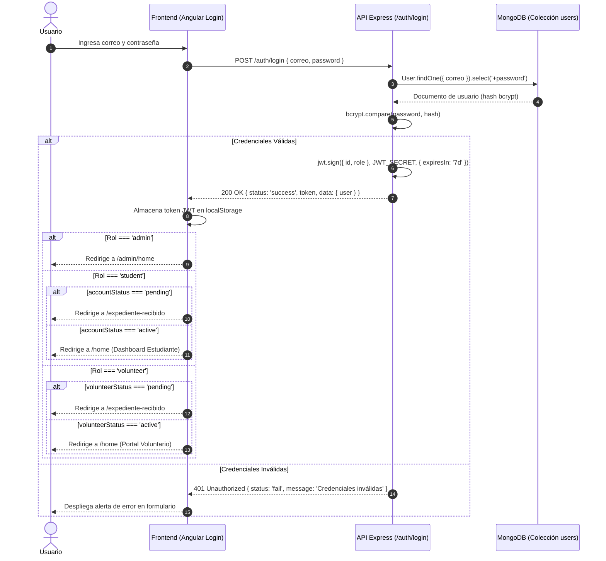
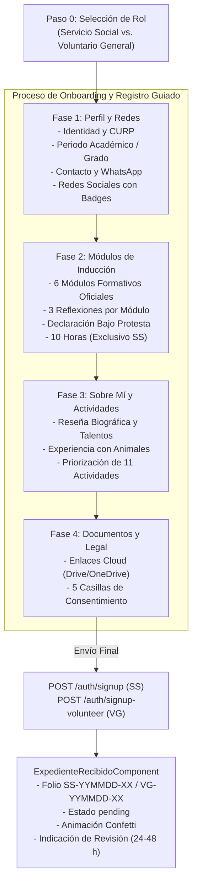

# Diseño de Autenticación y Onboarding: Login, Signup y Expediente Digital

**Estándar de referencia:** ISO/IEC/IEEE 29148:2018 (requisitos) · ISO/IEC/IEEE 42010:2022 (vistas de arquitectura)  
**Proyecto:** Plataforma Web Institucional ABAQ (Servicio Social y Voluntariado General)  
**Versión:** 2.2.0  
**Fecha:** 2026-10-30 (v1.1.0: 2026-10-22 · v1.0.0: 2026-10-14)  
**Estado:** Especificación de Producción (Sistema Real Angular v22 Standalone + Express Node.js v24 + MongoDB)  
**Cambios v2.2.0:**  
- Reconciliación total con el código en producción (elimina supuestos de datos mock y GridFS obsoleto).
- Proceso de onboarding y registro guiado (`OnboardingPhaseComponent`) más pantalla de cierre institucional (`ExpedienteRecibidoComponent`).
- Segregación estricta de roles: Servicio Social (`SS`) vs. Voluntario General (`VG`).
- Arquitectura Zero-File: enlaces públicos validados a nubes personales (Google Drive / OneDrive) en `cloudUrls`.
- Auto-guardado reactivo en `localStorage` con debounce de 400 ms e indicador visual `cloud_done Guardado`.
- Outline adaptativo: sticky centrado en escritorio (>1024px) y completamente oculto (`display: none !important`) en `<=1024px` (tabletas y móviles) dejando activo únicamente el navbar superior de fases.
- Control compuesto de periodo académico 100% full width con regla gramatical de ordinales (`1.er`, `2.º`, etc.) y tipo de periodo configurable (`Semestre`, `Cuatrimestre`, `Bimestre`, etc.).
- Subsección de Redes Sociales con badges oficiales de marca (`f`, `◎`, `♪`, `𝕏`, `▶`, `in`).
- Integración del subsistema de Certificados y Constancias Oficiales con tokens HMAC-SHA256 (`backend/utils/certificates.js`).

---

## 1. Propósito y alcance

Este documento especifica el diseño técnico, los contratos de datos y la experiencia de usuario de los flujos de acceso de la plataforma ABAQ: **inicio de sesión (login)**, **registro guiado (signup / onboarding)** y **emisión de expediente digital**.

El proceso sustituye por completo los trámites manuales en papel (inducción en PDF, carpetas físicas y firmas autógrafas) por un flujo web reactivo en el proceso de onboarding y registro, respaldado por las restricciones operativas institucionales:

> [!IMPORTANT] Restricciones Fundamentales de Diseño
> 1. **Firma por Consentimiento Informado Legal:** No existe firma autógrafa física ni carga de documentos firmados. La persona postulante valida cinco casillas obligatorias de consentimiento (Reglamento Oficial, Aviso de Privacidad, Código de Ética y No Maltrato, Verificación en Modo Incógnito y Consentimiento Libre). La fecha, hora, IP y datos del postulante constituyen el equivalente digital de la firma vinculante.
> 2. **Arquitectura Zero-File (Cero Almacenamiento Binario Local):** El servidor de ABAQ no aloja archivos PDF, imágenes ni ZIPs en el sistema de archivos ni en colecciones binarias. La documentación oficial (INE, CV, comprobante de estudios) se vincula mediante URLs de almacenamiento en la nube (Google Drive, OneDrive, iCloud) verificadas en modo incógnito. Las constancias y cartas institucionales se sintetizan **en memoria bajo demanda** mediante renderizado HTML5/CSS3 con sellos criptográficos HMAC-SHA256.

### 1.1 Segregación de Roles

| Rol | Código | Propósito | Cómputo de Horas | Onboarding y Certificados |
|---|---|---|---|---|
| **Administrador** | `admin` | Coordinación general de ABAQ. Acceso restringido con gestión de expedientes, convalidaciones y respaldos. | No aplica | Panel administrativo `/admin/home` y gestión de expedientes. |
| **Estudiante de Servicio Social** | `SS` | Estudiante universitario que cursa su servicio social obligatorio en ABAQ. | **Sí** (Meta fija de 480 horas, folios operativos `OP` y acreditaciones `AC`). | Completa onboarding y registro con datos académicos, recibe **10 horas** por la Fase 2 de inducción, ve tabla de horas por actividad, y obtiene Carta de Aceptación y Certificado de Término. |
| **Voluntario General** | `VG` | Persona de la sociedad civil que colabora altruistamente sin convenio escolar. | **No**. Su participación es colaborativa; no acumula horas escolares. | Completa onboarding y registro con datos de grado/ocupación, **NO recibe ni ve ninguna mención de 10 horas** en la inducción ni en actividades, y recibe Carta de Aceptación de Voluntario General. |

---

## 2. Reconciliación Arquitectónica (Evolución de Versiones)

Las versiones preliminares proponían un registro dividido en 4 lotes o 5 fases teóricas que incluían GridFS para persistencia binaria (`/upload`). En la implementación real de producción, el sistema se consolidó en el **proceso de onboarding y registro guiado** con una pantalla final de confirmación, eliminando GridFS por completo en favor del modelo Zero-File:

```
┌─────────────────────────────────────────────────────────────────────────────┐
│                       EVOLUCIÓN DEL DISEÑO DE SIGNUP                        │
│                                                                             │
│   DISEÑO PRELIMINAR (Borrador v1.1.0)        SISTEMA REAL EN PRODUCCIÓN (v2.2.0)    │
│   ───────────────────────────────────        ───────────────────────────────────    │
│   • 5 Fases teóricas                         • Onboarding y Registro Guiado         │
│   • Carga binaria en GridFS (/upload)        • Zero-File: Cloud URLs (Drive/OneDrive)│
│   • PDFs estáticos en servidor               • Generación dinámica HMAC-SHA256      │
│   • Datos mock para Voluntario General       • Esquema real Mongoose (Volunteer)    │
│   • Formulario de una sola columna móvil     • Layout responsive adaptativo         │
│                                                (Outline oculto <=1024px)            │
└─────────────────────────────────────────────────────────────────────────────┘
```

---

## 3. Inicio de Sesión (Login)

### 3.1 Identificador y Credenciales
El acceso a la plataforma se realiza mediante correo electrónico autenticado con contraseñas robustas (mínimo 12 caracteres):
- **Estudiante (`SS`):** Correo institucional universitario (`@alumnos.uaq.mx`, `@tec.mx`, etc.) o personal registrado.
- **Voluntario General (`VG`):** Correo electrónico personal.
- **Administrador (`admin`):** Correo institucional administrativo.

### 3.2 Diagrama de Secuencia de Login



---

<a id="4-diseno-del-registro-signup-5-fases"></a>
## 4. Proceso de Onboarding y Registro Guiado (`OnboardingPhaseComponent`)

El flujo de registro está unificado en una experiencia tipo asistente guiado con barra de progreso superior, navegación por pestañas y persistencia automática.



### 4.1 Paso 0 — Selección de Rol y Enlaces de Invitación
- **Ruta:** `/auth/signup`
- **Comportamiento:** Si el usuario accede a la raíz de registro sin parámetros, visualiza dos tarjetas principales:
  1. **Servicio Social (Universitario):** Para estudiantes que requieren liberar horas reglamentarias.
  2. **Voluntario General:** Para personas de la comunidad civil que colaboran altruistamente.
- **Enlace de Invitación:** Permite omitir el Paso 0 mediante `?type=SS` o `?type=VG`, fijando el rol directamente en el servicio de estado.

### 4.2 Fase 1: Perfil (Académico / Personal + Redes Sociales)
- **Componentes Empleados:** `CustomSelectComponent`, `CustomDatepickerComponent`, control compuesto de periodo.
- **Control Compuesto de Periodo Académico (100% Full Width):**
  - Diseñado como una tarjeta integrada horizontal a todo el ancho del contenedor.
  - El usuario selecciona el número de periodo (`1` a `12`) mediante un selector numérico.
  - A la derecha, un campo de lectura bloqueado con fondo neutro muestra automáticamente el ordinal gramatical correcto y el tipo de periodo: `1.er Semestre`, `2.º Cuatrimestre`, `3.er Bimestre`, `4.º Trimestre`.
  - El tipo de periodo es libremente editable mediante un desplegable (`Semestre`, `Cuatrimestre`, `Bimestre`, `Trimestre`, `Módulo`, `Año`).
- **Fechas del Servicio Social (Aclaración Estricta):**
  - Las etiquetas indican con total claridad: `Fecha de inicio del servicio` y `Fecha estimada de conclusión del servicio`.
  - Se eliminó cualquier ambigüedad relativa a fechas de graduación o término de carrera universitaria.
- **Perfil para Voluntario General (`VG`):**
  - Oculta matrícula, escuela y periodo de servicio.
  - Despliega campo de `Ocupación actual` y lista modular de grados académicos (`degrees`: nivel, institución, título, estatus).
- **Subsección 04: Redes Sociales con Badges de Marca:**
  - Despliega campos independientes para perfiles del usuario:
    - Facebook (`f`), Instagram (`◎`), TikTok (`♪`), X/Twitter (`𝕏`), YouTube (`▶`), LinkedIn (`in`).
  - Cada campo incluye el prefijo visual institucional de la marca y valida el formato de usuario o URL.

### 4.3 Fase 2: Módulos de Inducción y Cómputo de Horas
Reemplaza los antiguos PDFs estáticos por seis módulos formativos interactivos con recursos oficiales multimedia:

1. **Conociendo ABAQ:** Portal institucional y seguimiento a canales oficiales ([abaq.org.mx](https://www.abaq.org.mx)).
2. **Plática de Bienestar Animal ABAQ:** Presentación institucional en Canva ([Presentación Canva](https://www.canva.com/design/DAGNqq8CewM/9Iv7Hby2Bgi2egNilw1Szw/watch)).
3. **Arquetipos de Marca — El Inocente:** Video de identidad de marca ([YouTube](https://www.youtube.com/watch?v=BtJnW7z0pXU)).
4. **Entrenamiento DISC:** Video de comunicación efectiva ([YouTube](https://www.youtube.com/watch?v=CKkp8phM7N8)).
5. **Entrenamiento Generaciones:** Video sobre colaboración intergeneracional ([YouTube](https://www.youtube.com/watch?v=QK-fUjSb_Vo)).
6. **La Neurociencia de las Emociones:** Conferencia de Marian Rojas Estapé ([YouTube](https://www.youtube.com/watch?v=TjqrualxgkI&t=584s)).

> [!IMPORTANT] Segregación de Horas en Fase 2
> - **Servicio Social (`SS`):** La vista muestra el aviso destacado: *"NOTA: En caso de Servicio Social, esta presentación será válida por 10 horas, además de que te permitirá continuar"*. Al completar el registro, el sistema acredita automáticamente **10 horas** en su saldo inicial (`horasAcreditadas: 10`).
> - **Voluntario General (`VG`):** **No se muestra ninguna mención de 10 horas** ni de acreditación escolar. El banner y el contador de horas están completamente ausentes de su interfaz.

- **Preguntas de Reflexión por Módulo:**
  - Por cada uno de los 6 temas, el aspirante debe redactar tres reflexiones obligatorias:
    1. *¿Qué te gustó del tema?*
    2. *¿Qué consideras lo más importante?*
    3. *¿Qué consideras que se puede mejorar o qué aprendizaje te deja?*
  - Los campos inician vacíos con placeholders orientativos, exigiendo contenido sustantivo.
- **Declaración Bajo Protesta:**
  - Casilla obligatoria donde el postulante declara bajo protesta de decir verdad que las reflexiones fueron redactadas personalmente sin el uso de Inteligencia Artificial generativa ni respuestas evasivas.

### 4.4 Fase 3: Sobre Mí y Priorización de 11 Actividades
- **Reseña y Competencias:**
  - Breve reseña personal, talentos y habilidades que aporta a la fundación, y experiencia previa con animales de compañía.
- **Priorización de las 11 Actividades Oficiales del Reglamento:**
  - El usuario puede ordenar por preferencia las 11 actividades autorizadas por ABAQ:

| No. | Actividad Oficial | Horas Acreditables (Solo SS) |
|---|---|---|
| 1 | Eventos ABAQ: pláticas, esterilización, vacunación, marchas, apoyo en refugios alianza. | 2x1 (doble hora por hora de participación) |
| 2 | Vincular placa de identificación con proveedor ABAQ. | 5 horas por mascota |
| 3 | Vincular esterilización con registro directo ABAQ. | 10 horas por mascota |
| 4 | Vincular adopción de perro/gato en colaboración ABAQ (periodo de prueba 15 días superado). | 100 horas por adopción efectiva |
| 5 | Vincular y coordinar módulo de adopción ABAQ en evento o espacio público. | 40 horas por módulo |
| 6 | Vincular plática "Bienestar Animal" en escuela, empresa o colonia (mín. 50 asistentes). | 50 horas por plática |
| 7 | Coordinar campaña a bajo costo de esterilización/salud (mín. 60 animales, con quirófano). | 100 horas por campaña |
| 8 | Vincular difusión gratuita en medio de comunicación (radio, TV, podcast, prensa). | 30 horas por difusión |
| 9 | Publicaciones y reposts en redes sociales aprobadas por ABAQ (etiquetando a ABAQ). | 5 horas + 1 hora por cada 5 reacciones |
| 10 | Procuración de fondos para objeto social ABAQ. | 1 hora por cada $50.00 MXN recaudados |
| 11 | Apoyo en actividades administrativas eventuales convocadas por WhatsApp. | Por definir según convocatoria |

> [!NOTE] Visibilidad de Horas en Actividades
> La columna de horas acreditables y el cómputo de horas se renderizan **únicamente para aspirantes de Servicio Social (`SS`)**. Para Voluntarios Generales (`VG`), la lista despliega exclusivamente los títulos y descripciones de las actividades, sin valores de horas.

### 4.5 Fase 4: Documentos en la Nube y Consentimiento Legal
- **Zero-File Cloud Storage:**
  - El postulante no carga archivos locales. En su lugar, proporciona enlaces compartidos públicos (con permisos de lectura) de su proveedor en la nube preferido (Google Drive, Microsoft OneDrive, Dropbox o iCloud):
    1. Identificación Oficial (INE vigente por ambos lados).
    2. Curriculum Vitae actualizado (CV).
    3. Comprobante de estudios o carta de presentación institucional (solo SS).
  - Incluye indicación explícita para verificar que los enlaces abran correctamente en una ventana de **modo incógnito**.
- **Cinco Casillas de Consentimiento Informado Legal:**
  1. [x] Lectura, comprensión y aceptación irrestricta del Reglamento Oficial de ABAQ.
  2. [x] Aceptación del Convenio Institucional de Colaboración y Derechos y Obligaciones.
  3. [x] Compromiso ético de trato humanitario y no maltrato animal.
  4. [x] Declaración bajo protesta de veracidad de datos y comprobación de enlaces públicos en modo incógnito.
  5. [x] Consentimiento expreso para tratamiento de datos personales conforme al Aviso de Privacidad.

### 4.6 Pantalla de Cierre: Expediente Recibido (`ExpedienteRecibidoComponent`)
<a id="51-folio-de-expediente"></a>
<a id="folio-de-expediente"></a>
- **Ruta:** `/expediente-recibido`
- **Folio Institucional Único y Prohibición Estricta de Valores Null:**
  - Formato generado: `SS-AAMMDD-XX` para Servicio Social y `VG-AAMMDD-XX` para Voluntariado General (donde `AAMMDD` es la fecha de registro y `XX` es el identificador correlativo o sufijo hexadecimal único).
  - **Obligatoriedad Estricta:** No se permite bajo ninguna circunstancia que un registro en la base de datos carezca de folio o tenga valor `null`. Se establece `folio: { type: String, required: [true, 'El folio institucional de expediente es obligatorio'], trim: true, uppercase: true, index: true }` en la raíz de ambos esquemas Mongoose (`Student` y `Volunteer`), respaldado por hooks de ciclo de vida `pre('validate')` y rutinas de migración de inicio (`ensureFolioIntegrity`) que asignan y normalizan el folio institucional permanente en el 100% de los registros de MongoDB.
- **Animación y UX:**
  - Renderiza una lluvia sutil de confeti (`canvas-confetti`) como confirmación positiva de recepción de expediente.
  - Oculta el navbar de fases para evitar saltos de maquetación (cero layout shift) y fija el estado de cuenta como `pending`.
  - Explica con claridad que la coordinación de ABAQ validará los datos en un lapso de 24 a 48 horas hábiles.

---

## 5. Arquitectura de UX y Responsive Design

### 5.1 Regla del Outline Adaptativo (Mobile / Tablet / Desktop)
Para evitar la saturación visual observada en tabletas y dispositivos móviles, la navegación secundaria lateral (Outline de secciones) implementa una regla CSS estricta:

```css
/* Regla de Outline Adaptativo en Onboarding */
@media (min-width: 1025px) {
  .onboarding-outline {
    display: block;
    position: sticky;
    top: 96px;
    width: 260px;
    max-height: calc(100vh - 120px);
    overflow-y: auto;
  }
}

@media (max-width: 1024px) {
  .onboarding-outline {
    display: none !important;
  }
  
  /* En tabletas y móviles solo prevalece el navbar superior de fases */
  .onboarding-container {
    width: 100% !important;
    max-width: 100% !important;
    padding: 16px 12px;
  }
}
```

### 5.2 Auto-guardado Local Reactivo
- **Servicio:** `OnboardingStateService`
- **Mecanismo:** Un `Subject` de RxJS captura los cambios del formulario y ejecuta un `debounceTime(400)` antes de sincronizar el estado completo en el `localStorage` del navegador bajo la clave `abaq_onboarding_draft`.
- **Indicador Visual de Guardado:** En cada sección del formulario, alineado a la extrema derecha del título de sección (`.section-heading`), se renderiza un indicador minimalista:
  - Icono `cloud_done` en verde institucional con el texto `Guardado`.
- **Hook `beforeunload`:** Se registra un listener global en la ventana para garantizar que cualquier cambio pendiente se vuelque a `localStorage` si el usuario cierra accidentalmente la pestaña o refresca la página.

---

## 6. Modelos de Datos en MongoDB (Mongoose Schemas Reales)

### 6.1 Esquema de Estudiante (`Student`)
```javascript
const studentSchema = new mongoose.Schema({
  authId: { type: String, required: false },
  folio: { type: String, required: true, trim: true, uppercase: true, index: true },
  nombreCompleto: { type: String, required: true },
  names: { type: String, default: "" },
  apellidoPaterno: { type: String, default: "" },
  apellidoMaterno: { type: String, default: "" },
  curp: { type: String, default: "" },
  matricula: { type: String, required: true },
  correoPersonal: { type: String, required: false },
  correoInstitucional: { type: String, required: true },
  escuela: { type: String, required: true },
  carrera: { type: String, required: true },
  academicLevel: { type: String, default: "licenciatura" },
  periodType: { type: String, default: "semestre" },
  periodNumber: { type: mongoose.Schema.Types.Mixed, default: 1 },
  semestre: { type: mongoose.Schema.Types.Mixed, default: "1.er Semestre" },
  fechaArranque: { type: Date, default: Date.now },
  fechaConclusion: { type: Date, required: false },
  nombreAuditor: { type: String, default: "Coordinación Servicio Social" },
  telefono: { type: String, required: true },
  hasWhatsapp: { type: Boolean, default: true },
  whatsappNumber: { type: String, default: "" },
  hasSecondaryContact: { type: Boolean, default: false },
  secondaryPhone: { type: String, default: "" },
  fechaNacimiento: { type: Date, required: true },
  horasCubrir: { type: Number, default: 480 },
  horasAcreditadas: { type: Number, default: 10 },
  horasPendientes: { type: Number, default: 470 },
  accountStatus: {
    type: String,
    enum: ["pending", "active", "inactive", "rejected"],
    default: "pending",
  },
  primerIngresoRealizado: { type: Boolean, default: false },
  fechaDesactivacion: { type: Date, default: null },
  statusHistory: [{
    fromStatus: String,
    toStatus: String,
    reason: String,
    comments: String,
    changedByEmail: String,
    date: { type: Date, default: Date.now },
  }],
  cloudUrls: {
    ine: { type: String, default: "" },
    cv: { type: String, default: "" },
    comprobante: { type: String, default: "" },
  },
  consents: {
    reglamento: { type: Boolean, default: false },
    privacidad: { type: Boolean, default: false },
    etica: { type: Boolean, default: false },
    incognito: { type: Boolean, default: false },
    consentimiento: { type: Boolean, default: false },
  },
  onboardingData: { type: mongoose.Schema.Types.Mixed, default: {} },
  assignedActivities: [assignedActivitySchema],
}, { timestamps: true });
```

### 6.2 Esquema de Voluntario General (`Volunteer`)
```javascript
const volunteerSchema = new mongoose.Schema({
  authId: { type: String, required: false },
  folio: { type: String, required: true, trim: true, uppercase: true, index: true },
  volunteerType: {
    type: String,
    enum: ["GENERAL", "SERVICE_SOCIAL"],
    default: "GENERAL",
  },
  volunteerStatus: {
    type: String,
    enum: ["pending", "active", "rejected"],
    default: "pending",
  },
  accountStatus: {
    type: String,
    enum: ["pending", "active", "inactive", "rejected"],
    default: "pending",
  },
  primerIngresoRealizado: { type: Boolean, default: false },
  fechaDesactivacion: { type: Date, default: null },
  statusHistory: [{
    fromStatus: String,
    toStatus: String,
    reason: String,
    comments: String,
    changedByEmail: String,
    date: { type: Date, default: Date.now },
  }],
  nombreCompleto: { type: String, required: true, trim: true },
  correoPersonal: { type: String, required: false, trim: true, lowercase: true },
  telefono: { type: String, required: true, trim: true },
  hasWhatsapp: { type: Boolean, default: true },
  whatsappNumber: { type: String, default: "" },
  occupation: { type: String, default: "" },
  degrees: [{
    level: {
      type: String,
      enum: ["preparatoria", "tecnico", "licenciatura", "especialidad", "maestria", "doctorado", "posdoctorado"],
      default: "licenciatura"
    },
    institution: { type: String, default: "" },
    title: { type: String, default: "" },
    status: { type: String, enum: ["completado", "en_curso", "trunco"], default: "completado" }
  }],
  cloudUrls: {
    ine: { type: String, default: "" },
    cv: { type: String, default: "" },
    comprobante: { type: String, default: "" },
  },
  consents: {
    reglamento: { type: Boolean, default: false },
    privacidad: { type: Boolean, default: false },
    etica: { type: Boolean, default: false },
    incognito: { type: Boolean, default: false },
    consentimiento: { type: Boolean, default: false },
  },
  onboardingData: { type: mongoose.Schema.Types.Mixed, default: {} },
  assignedActivities: [assignedActivitySchema],
}, { timestamps: true });
```

---

### 6.3 Ciclo de Vida de la Cuenta, Primer Ingreso y Re-registro

Fuente de verdad del ciclo de vida completo: [ciclo-vida §2](ciclo-vida-voluntarios-deshidratacion-design.md). Resumen de los campos y reglas que `auth.controller.js` y el `OnboardingGuard` deben respetar:

**Estados (`accountStatus`):** `pending` (default tras onboarding) → `active` (aprobación admin) · `pending` → `rejected` (rechazo, el documento NO se borra) · `active` → `inactive` (480 h cumplidas, 60 días de inactividad, o baja administrativa) · `rejected` → `pending` (re-registro con el mismo email).

**Primer ingreso (`primerIngresoRealizado: Boolean`):**
- Tras ser aceptado, en el primer login el usuario es dirigido obligatoriamente a `/onboarding/expediente` para ver su Carta de Aceptación.
- Al pulsar **"Ingresar a la Plataforma ABAQ"**, el backend fija `primerIngresoRealizado = true` (endpoint `PATCH /students/:id/primer-ingreso` y equivalente de voluntario).
- El `OnboardingGuard` del frontend intercepta cualquier ruta operativa mientras `primerIngresoRealizado === false` y regresa a `/onboarding/expediente`; una vez `true`, libera las rutas.

**Re-registro idempotente (mismo correo):** si un aspirante en estado `rejected` vuelve a registrarse con el mismo email, el backend localiza el documento existente por correo y:
1. Reemplaza datos personales, académicos y respuestas de formulario.
2. Re-hashea y actualiza la contraseña.
3. Limpia las observaciones de rechazo previas.
4. Cambia `accountStatus` a `pending`, **conservando el `folio` institucional original**.
5. Registra una entrada en `statusHistory` con `reason: 're_registration'`.

**Bitácora (`statusHistory[]`):** todo cambio de `accountStatus` se registra mediante el helper único `applyStatusChange(user, {toStatus, reason, comments, changedBy})` (`backend/utils/status-history.js`). Cada entrada guarda `fromStatus`, `toStatus`, `reason`, `comments`, `changedByEmail`, `date`. Viaja embebida con el documento en la deshidratación/rehidratación.

---

## 7. Subsistema de Certificados y Verificación Criptográfica

Las cartas oficiales no se almacenan como binarios en base de datos. Se generan dinámicamente mediante el motor criptográfico en `backend/utils/certificates.js`:

### 7.1 Formato del Token Criptográfico
```
st_[id]_[certType]_[hmac32]
```
- `[id]`: Identificador hexadecimal de MongoDB del estudiante o voluntario (`24 caracteres`).
- `[certType]`: Tipo de constancia (`acceptance` para Carta de Aceptación, `completion` para Certificado de Término).
- `[hmac32]`: Firma HMAC con SHA-256 truncada a 32 caracteres hexadecimales, computada usando la clave privada del servidor `process.env.JWT_SECRET || 'abaq-secret-key-2026'`.

### 7.2 Verificación Pública y Mitigación de Ataques de Tiempo
El endpoint público `/certificate/v/:hashToken` (o `/student/certificate/v/:hashToken`):
1. Descompone el token en sus tres componentes.
2. Recalcula el HMAC esperado en el backend.
3. Compara ambas firmas utilizando `crypto.timingSafeEqual(Buffer.from(hmac), Buffer.from(expectedHmac))` para prevenir ataques de canal lateral por análisis de tiempo (*timing attacks*).
4. Si la firma es válida, consulta los datos actualizados del estudiante o voluntario y renderiza el documento institucional en formato imprimible con código QR de verificación.

---

## 8. Criterios de Aceptación de Autenticación y Onboarding

- [x] **AC-AUTH-01:** El inicio de sesión acepta correo y contraseña, emite JWT firmado por 7 días y redirige según rol y estado (`/home`, `/admin/home` o `/expediente-recibido`).
- [x] **AC-AUTH-02:** El registro guía al usuario a través del proceso de onboarding y registro con validación reactiva de campos obligatorios.
- [x] **AC-AUTH-03:** El control compuesto de periodo académico ocupa el 100% del ancho, formateando dinámicamente el ordinal (`1.er`, `2.º`, etc.) junto al nombre libre del periodo.
- [x] **AC-AUTH-04:** La Fase 2 acredita 10 horas y muestra el aviso de 10 horas **exclusivamente para estudiantes de Servicio Social**; para Voluntarios Generales no existe ninguna referencia de horas.
- [x] **AC-AUTH-05:** La Fase 3 permite priorizar las 11 actividades reglamentarias de ABAQ mediante drag/drop o reordenamiento por botones, mostrando horas únicamente a estudiantes.
- [x] **AC-AUTH-06:** No se almacena ningún archivo binario local; los documentos se vinculan como enlaces externos en `cloudUrls`.
- [x] **AC-AUTH-07:** Todo progreso se auto-guarda en `localStorage` con debounce de 400 ms y muestra el indicador `cloud_done Guardado`.
- [x] **AC-AUTH-08:** En resoluciones de pantalla iguales o menores a 1024px (tabletas y móviles), el menú lateral de outline desaparece por completo (`display: none !important`), manteniéndose visible únicamente el navbar superior de fases.
- [x] **AC-AUTH-09:** Al enviar el formulario, el usuario visualiza su folio institucional `SS-YYMMDD-XX` o `VG-YYMMDD-XX` y lluvia de confeti en `/expediente-recibido`.
- [x] **AC-AUTH-10:** Las constancias oficiales se verifican públicamente mediante tokens HMAC-SHA256 con protección de comparación en tiempo constante (`timingSafeEqual`).
