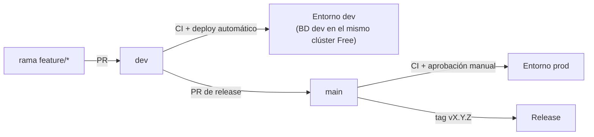
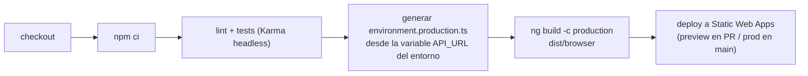
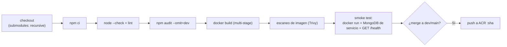
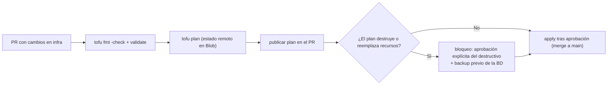
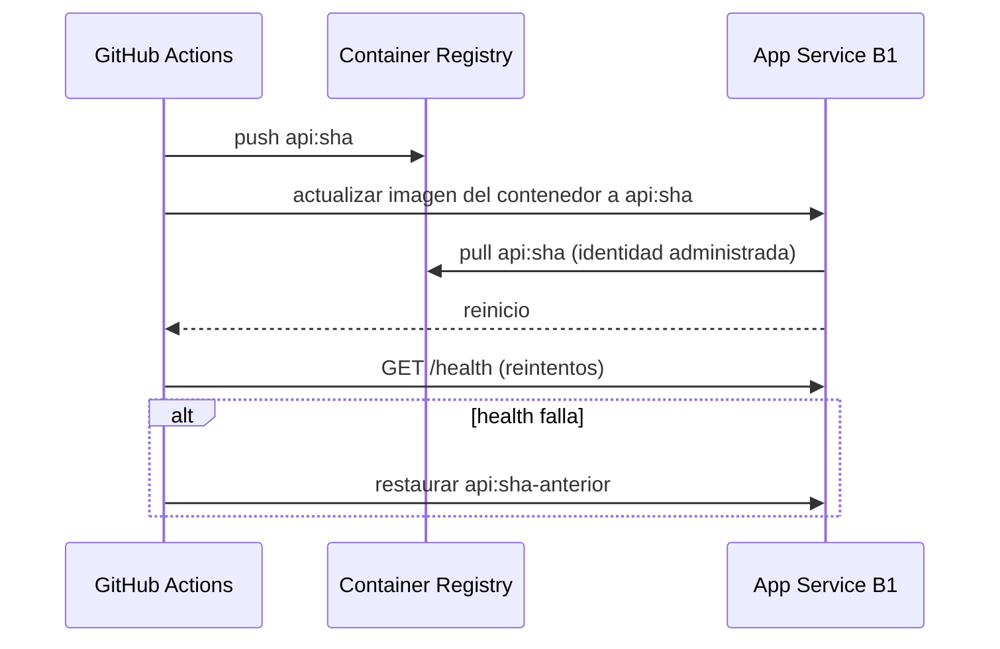
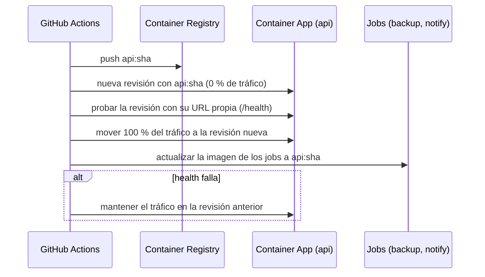
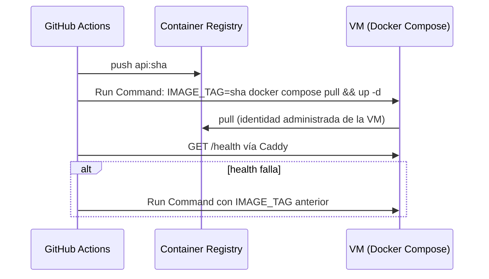

# Diseño de Pipelines CI/CD

**Proyecto:** Plataforma Web ABAQ (Servicio Social)
**Versión:** 0.1.0
**Fecha:** 2026-10-14
**Estado:** Idea de diseño (no implementado)
**Relacionado:** [Despliegue en la nube (Azure)](cloud-deployment.md) · [Stack Tecnológico](tech-stack.md)

!!! abstract "Propósito"
    Proponer los pipelines de integración y entrega continua (CI/CD) para las **tres arquitecturas Azure** del [documento de despliegue](cloud-deployment.md): App Service con contenedor (Opción 1), Container Apps (Opción 2) y VM con Docker Compose (Opción 3). El frontend y la infraestructura comparten pipeline en las tres; cambia solo la etapa de despliegue del backend.

---

## 1. Estado actual (punto de partida)

| Repositorio | ¿Git? | CI/CD actual | Ramas relevantes |
|---|---|---|---|
| `backend/` | Sí | **Ninguno** | `main`, `dev`, `dev-azure`, `dev-rivers` (de trabajo) |
| `backend/subprojects/tool-constancias` | Submódulo (registrado en `dev-azure`) | Ninguno | — |
| `frontend/` | Sí | **Ninguno** (los workflows de Firebase se eliminaron) | `main`, `dev`, `dev-azure`, `dev-rivers` |
| `documentation/` | Sí | `docs.yml` → GitHub Pages | `main` |
| `infrastructure/` | **No** (estado OpenTofu local) | Ninguno | — |

**Prerrequisitos antes de cualquier pipeline:**

1. Versionar `infrastructure/` en git (repositorio propio o carpeta dentro de un repo) y mover el estado de OpenTofu a un **backend remoto en Blob Storage** con bloqueo [9][10].
2. Crear `Dockerfile` y `.dockerignore` en `backend/` (Opciones 1, 2 y 3).
3. Definir `engines.node` en ambos `package.json` y fijar la misma versión en los pipelines.
4. Consolidar la rama de despliegue (los ajustes de Azure viven hoy en `dev-azure`, no en `dev-rivers`).

---

## 2. Principios

| Principio | Aplicación |
|---|---|
| **Sin secretos de larga duración en GitHub** | Autenticación a Azure por **OIDC (federated credentials)** con `azure/login` [1][2]. En GitHub solo se guardan identificadores no secretos (client ID, tenant ID, subscription ID). |
| **Secretos de la aplicación en Key Vault** | `JWT_SECRET`, `MONGODB_URI` y credenciales de correo nunca pasan por el pipeline; la app los lee con identidad administrada. |
| **Artefactos inmutables** | Una imagen por commit, etiquetada con el SHA; la misma imagen viaja de `dev` a `prod`. |
| **Una imagen, varios comandos** | La misma imagen del backend ejecuta la API, el job de backup y el job de notificaciones con distinto comando de arranque. |
| **Promoción con aprobación** | GitHub Environments `dev` y `prod`; `prod` exige revisión manual [3]. |
| **Infraestructura revisada antes de aplicar** | `tofu plan` en cada PR; `apply` solo tras aprobación. Si el plan contiene destrucciones o reemplazos, se requiere aprobación explícita adicional. |
| **Mínimo privilegio** | Una identidad por entorno con roles acotados al grupo de recursos (ver §7). |

---

## 3. Estrategia de ramas y entornos



- **PR a `dev`:** CI completo + entorno de vista previa del frontend (Static Web Apps Free incluye 3 entornos de staging [4]).
- **Merge a `dev`:** despliegue automático al entorno `dev`.
- **Merge a `main`:** despliegue a `prod` con aprobación de un revisor.
- **Entorno `dev` de bajo costo:** como el Free Tier de la base de datos es uno por suscripción, `dev` usa **otra base de datos dentro del mismo clúster** (ver [Despliegue §3.1](cloud-deployment.md#31-restricciones-del-free-tier-de-la-base-de-datos)).

---

## 4. Pipelines comunes a las tres opciones

### 4.1 Frontend (Angular → Static Web Apps)



- `apiUrl` se fija en build: **un build por entorno**, con `API_URL` como variable del GitHub Environment.
- Agregar `staticwebapp.config.json` con `navigationFallback` hacia `/index.html` (rutas sin hash) [5].
- Acción de despliegue: `Azure/static-web-apps-deploy` [6].

### 4.2 Backend — integración continua (todas las opciones)



- **Submódulo:** el checkout debe incluir `tool-constancias` (`submodules: recursive`); si el repositorio del submódulo es privado, usar un token de solo lectura.
- **Imagen multi-stage:** etapa base `api` (Node + Chromium si se elige Puppeteer) y etapa `jobs`, que hereda de `api` y añade MongoDB Database Tools para `mongodump`. Se despliega la etapa `jobs` para la API y los jobs (misma imagen, distinto comando). Usuario no root y `HEALTHCHECK`.
- **Escaneo:** `aquasecurity/trivy-action` [7]; falla con vulnerabilidades críticas.
- **Build y push:** acciones oficiales de Docker [8].

### 4.3 Infraestructura (OpenTofu)



- Estado remoto en Blob con bloqueo [9][10]; nunca estado local en CI.
- Un reemplazo del clúster de base de datos **pierde los datos**: el pipeline exige un backup reciente antes de aplicarlo.

---

## 5. Despliegue del backend por opción

### 5.1 Opción 1 — App Service con contenedor (recomendada)



- Acción: `azure/webapps-deploy` con imagen de contenedor [11].
- B1 **no tiene deployment slots** → el despliegue reinicia la app. Ejecutar en una ventana de bajo uso.
- **Rollback:** volver a desplegar la etiqueta anterior (se guarda como output del job).
- Los jobs (node-cron) viajan dentro de la misma imagen; no hay despliegue aparte.

### 5.2 Opción 2 — Container Apps



- Acción oficial o `az containerapp update` [12]; modo de revisiones múltiples para validar antes de mover tráfico.
- **Rollback:** reactivar la revisión anterior (instantáneo, sin rebuild).
- Los jobs se actualizan con la misma etiqueta para que API y jobs compartan versión del modelo de datos.

### 5.3 Opción 3 — VM con Docker Compose



- **Sin SSH expuesto:** el despliegue usa Run Command de Azure [13].
- El `docker-compose.yml` se versiona en el repo del backend y es el mismo del entorno local [14].
- El aprovisionamiento inicial de la VM (Docker, Compose, usuario, firewall) se hace con cloud-init desde OpenTofu; la VM es reemplazable porque no guarda estado (la BD está en DocumentDB o, en la variante 3-b, en un disco de datos con backup propio).

---

## 6. Qué NO va en CI/CD

| Tarea | Dónde corre | Motivo |
|---|---|---|
| Backups 2×/semana | Job programado de la plataforma (node-cron / Container Apps Job / supercronic) | Debe correr aunque no haya commits; los secretos de BD no salen de Azure |
| Correos programados (status de los martes, inactividad) | Igual que arriba | Misma razón |
| Bulk load / restauración | Interfaz de administración del portal, con dry-run obligatorio | Operación de datos con revisión humana; nunca automática desde un pipeline |

Opcional: un workflow semanal de **verificación** que solo consulta si existe un backup reciente en Blob y abre un issue si no lo encuentra (sin credenciales de la BD).

---

## 7. Identidades y permisos

| Identidad | Uso | Roles (alcance: grupo de recursos del entorno) |
|---|---|---|
| `gh-abaq-dev` / `gh-abaq-prod` (OIDC) | Despliegue desde GitHub | `AcrPush` en ACR; colaborador del recurso de cómputo (Website / Container Apps / VM según la opción) |
| `gh-abaq-infra` (OIDC) | OpenTofu plan/apply | Colaborador del grupo de recursos; `Storage Blob Data Contributor` en el contenedor del estado |
| Identidad administrada de la app | Runtime | `AcrPull`; `Key Vault Secrets User`; `Storage Blob Data Contributor` en el contenedor de backups |

Cada credencial federada se limita al repositorio y al GitHub Environment (`repo:<org>/<repo>:environment:prod`) [1][2].

---

## 8. Costo del CI/CD

| Recurso | Cuota | Estimado ABAQ |
|---|---|---|
| GitHub Actions, repositorios privados (plan Free) | 2,000 min/mes [15] | ~1,000 min/mes (~150 ejecuciones de 5–8 min) |
| GitHub Team para nonprofits | Plan Team gratuito para organizaciones elegibles [16] | Sin costo si ABAQ califica |
| Azure Container Registry Basic | Ya incluido en el costeo de las opciones | Purgar imágenes antiguas para controlar el almacenamiento |

El CI/CD no agrega costo a los 2,000 USD del grant mientras se mantenga dentro de la cuota de GitHub.

---

## 9. Esqueletos de workflow (idea de diseño)

!!! note "No implementado"
    Esqueletos orientativos. Las versiones de cada acción se fijarán por SHA al implementar; aquí se indican como `@<sha>`.

=== "backend-ci.yml"

    ```yaml
    name: backend-ci
    on:
      pull_request:
        branches: [dev, main]
    jobs:
      ci:
        runs-on: ubuntu-latest
        services:
          mongo:
            image: mongo:7
            ports: ["27017:27017"]
        steps:
          - uses: actions/checkout@<sha>
            with:
              submodules: recursive
          - uses: actions/setup-node@<sha>
            with:
              node-version-file: package.json   # requiere engines.node
          - run: npm ci
          - run: node --check app.js
          - run: npm audit --omit=dev --audit-level=high
          - run: docker build --target jobs -t abaq-api:${{ github.sha }} .   # misma etapa que se despliega
          - uses: aquasecurity/trivy-action@<sha>
            with:
              image-ref: abaq-api:${{ github.sha }}
              severity: CRITICAL
              exit-code: "1"
          - run: |
              docker run -d --network host \
                -e MONGODB_URI=mongodb://localhost:27017/abaq_ci \
                -e JWT_SECRET=ci-only -e PORT=3000 \
                abaq-api:${{ github.sha }}
              curl --retry 10 --retry-delay 3 --fail http://localhost:3000/health
    ```

=== "backend-cd.yml (Opción 2)"

    ```yaml
    name: backend-cd
    on:
      push:
        branches: [dev, main]
    permissions:
      id-token: write
      contents: read
    jobs:
      deploy:
        runs-on: ubuntu-latest
        environment: ${{ github.ref_name == 'main' && 'prod' || 'dev' }}
        steps:
          - uses: actions/checkout@<sha>
            with:
              submodules: recursive
          - uses: azure/login@<sha>
            with:
              client-id: ${{ vars.AZURE_CLIENT_ID }}
              tenant-id: ${{ vars.AZURE_TENANT_ID }}
              subscription-id: ${{ vars.AZURE_SUBSCRIPTION_ID }}
          - run: |
              az acr login --name ${{ vars.ACR_NAME }}
              docker build --target jobs -t ${{ vars.ACR_NAME }}.azurecr.io/abaq-api:${{ github.sha }} .
              docker push ${{ vars.ACR_NAME }}.azurecr.io/abaq-api:${{ github.sha }}
          - run: |
              az containerapp update -g ${{ vars.RG }} -n abaq-api \
                --image ${{ vars.ACR_NAME }}.azurecr.io/abaq-api:${{ github.sha }}
              for job in abaq-backup abaq-notify; do
                az containerapp job update -g ${{ vars.RG }} -n $job \
                  --image ${{ vars.ACR_NAME }}.azurecr.io/abaq-api:${{ github.sha }}
              done
    ```

=== "frontend.yml"

    ```yaml
    name: frontend
    on:
      pull_request:
        branches: [dev, main]
      push:
        branches: [dev, main]
    jobs:
      build-deploy:
        runs-on: ubuntu-latest
        environment: ${{ github.ref_name == 'main' && 'prod' || 'dev' }}
        steps:
          - uses: actions/checkout@<sha>
          - uses: actions/setup-node@<sha>
            with:
              node-version-file: package.json
          - run: npm ci
          - run: |
              mkdir -p src/environments
              for f in environment.ts environment.development.ts environment.production.ts; do
                printf "export const environment = { production: true, apiUrl: '%s' };\n" \
                  "${{ vars.API_URL }}" > src/environments/$f
              done
          - run: npm run build
          - uses: Azure/static-web-apps-deploy@<sha>
            with:
              azure_static_web_apps_api_token: ${{ secrets.SWA_DEPLOYMENT_TOKEN }}
              action: upload
              app_location: dist/browser
              skip_app_build: true
    ```

    El token de despliegue de Static Web Apps es el único secreto que se guarda en GitHub; puede rotarse desde el portal.

=== "infra.yml"

    ```yaml
    name: infra
    on:
      pull_request:
        paths: ["**/*.tf"]
      push:
        branches: [main]
        paths: ["**/*.tf"]
    permissions:
      id-token: write
      contents: read
      pull-requests: write
    jobs:
      plan-apply:
        runs-on: ubuntu-latest
        environment: ${{ github.event_name == 'push' && 'infra-prod' || 'infra-plan' }}
        env:
          ARM_USE_OIDC: "true"
          ARM_CLIENT_ID: ${{ vars.AZURE_CLIENT_ID }}
          ARM_TENANT_ID: ${{ vars.AZURE_TENANT_ID }}
          ARM_SUBSCRIPTION_ID: ${{ vars.AZURE_SUBSCRIPTION_ID }}
        steps:
          - uses: actions/checkout@<sha>
          - uses: opentofu/setup-opentofu@<sha>
          - run: tofu init && tofu fmt -check && tofu validate
          - run: tofu plan -out=plan.bin && tofu show -no-color plan.bin > plan.txt
          - name: Bloquear destrucciones o reemplazos
            run: |
              if grep -Eq "must be replaced|will be destroyed" plan.txt; then
                echo "::error::El plan destruye o reemplaza recursos. Requiere aprobación explícita y backup previo."
                exit 1
              fi
          - if: github.event_name == 'push'
            run: tofu apply plan.bin
    ```

---

## 10. Pendientes

- Elegir la arquitectura (D-1 del [documento de despliegue](cloud-deployment.md#12-decisiones-pendientes); tras la auditoría del 2026-10-18 la recomendada es la Opción 1); de ella depende solo la etapa 5.x.
- Crear el repositorio de infraestructura y el backend remoto del estado.
- Definir el endpoint `/health` del backend (no existe; `GET /` renderiza una vista Pug sin verificar la BD).
- Decidir si el submódulo `tool-constancias` se mantiene privado (requiere token de lectura en CI).
- Confirmar la elegibilidad de ABAQ para GitHub Team nonprofit.

---

## Referencias

1. Microsoft Learn — *Use GitHub Actions to connect to Azure with OpenID Connect*. <https://learn.microsoft.com/en-us/azure/developer/github/connect-from-azure-openid-connect>
2. GitHub Docs — *Configuring OpenID Connect in Azure*. <https://docs.github.com/en/actions/how-tos/secure-your-work/security-harden-deployments/oidc-in-azure>
3. GitHub Docs — *Using environments for deployment* (revisores requeridos). <https://docs.github.com/en/actions/deployment/targeting-different-environments/using-environments-for-deployment>
4. Microsoft Learn — *Azure Static Web Apps hosting plans* (entornos de staging). <https://learn.microsoft.com/en-us/azure/static-web-apps/plans>
5. Microsoft Learn — *Configure Azure Static Web Apps* (`navigationFallback`). <https://learn.microsoft.com/en-us/azure/static-web-apps/configuration>
6. GitHub — *Azure/static-web-apps-deploy*. <https://github.com/Azure/static-web-apps-deploy> · Microsoft Learn — *Build configuration for Static Web Apps*. <https://learn.microsoft.com/en-us/azure/static-web-apps/build-configuration>
7. GitHub — *aquasecurity/trivy-action*. <https://github.com/aquasecurity/trivy-action>
8. Docker Docs — *GitHub Actions with Docker*. <https://docs.docker.com/build/ci/github-actions/>
9. OpenTofu — *Backend type: azurerm*. <https://opentofu.org/docs/language/settings/backends/azurerm/>
10. Microsoft Learn — *Store Terraform state in Azure Storage*. <https://learn.microsoft.com/en-us/azure/developer/terraform/store-state-in-azure-storage>
11. Microsoft Learn — *Deploy a custom container to App Service using GitHub Actions*. <https://learn.microsoft.com/en-us/azure/app-service/deploy-container-github-action>
12. Microsoft Learn — *Deploy to Azure Container Apps with GitHub Actions*. <https://learn.microsoft.com/en-us/azure/container-apps/github-actions>
13. Microsoft Learn — *Run scripts in your VM by using Run Command*. <https://learn.microsoft.com/en-us/azure/virtual-machines/run-command-overview>
14. Docker Docs — *Docker Compose*. <https://docs.docker.com/compose/>
15. GitHub Docs — *GitHub Actions billing* (minutos incluidos). <https://docs.github.com/en/billing/concepts/product-billing/github-actions>
16. GitHub Docs — *Getting started with the GitHub Team plan for nonprofits*. <https://docs.github.com/en/nonprofit/nonprofit-teams-plan/getting-started-with-the-github-team-plan-for-nonprofits>
17. GitHub — *Azure/login*. <https://github.com/Azure/login>
18. GitHub — *aptible/supercronic* (cron para contenedores, Opción 3). <https://github.com/aptible/supercronic>
19. Caddy — *Automatic HTTPS* (Opción 3). <https://caddyserver.com/docs/automatic-https>

*Contenido de las fuentes parafraseado para cumplir restricciones de licencia.*
