# Propuesta Técnica: Sistema Integral de Gestión de Voluntarios — Ciclo de Vida, Inactivación, Deshidratación de BD, Folios de Interacción (AC/OP) y Mapeo de Vistas

**Proyecto:** Plataforma Web ABAQ (Servicio Social y Voluntariado General)  
**Versión:** 1.3.0 (Propuesta Técnica Alineada — Cero Cron y Elegibilidad Inmediata de Inactivos)  
**Fecha:** 2026-11-03  
**Estado:** Propuesta Técnica Consolidada (Alineada con Implementación de Respaldos Dinámicos y Corte en 4 Pasos)  
**Relacionado:** [Ideas y Propuestas](ideas/index.md) · [Arquitectura General](architecture.md) · [Diseño de Respaldos y Datos](datos-respaldo-recuperacion-design.md) · [Diseño de Autenticación](auth-design.md) · [Sistema de Notificaciones](notificaciones-design.md)

> [!NOTE] Contexto y Alcance del Documento (Evolución de la Propuesta)
> Este documento consolida la arquitectura y especificación de la **Gestión Integral de Voluntarios** de ABAQ. Aunque la iniciativa inició conceptualmente orientada al archivado de usuarios, la ingeniería del sistema demandó abordar de manera sistémica e indivisible **todo el ciclo de vida del colaborador**, desde su admisión, folios de seguimiento de horas y asistencias, transiciones controladas al estado `inactive` (por acreditación de 480 h o gestión administrativa manual, sin procesos `node-cron` ni purgas automáticas en segundo plano), hasta el descubrimiento dinámico de modelos en `/backup`, la depuración manual en 4 pasos y la auditoría forense de datos.

---

## 1. Resumen Ejecutivo y Marco Integral del Sistema

La plataforma web de la **Asociación de Bienestar Animal Querétaro (ABAQ)** requiere gobernar de forma exhaustiva, automatizada y legalmente transparente la participación de sus dos figuras operativas: **Estudiantes de Servicio Social** (`student`, sujetos al cumplimiento estricto de 480 horas curriculares) y **Voluntarios Generales** (`volunteer`, colaboración cívica altruista sin cómputo horario formal).

Para garantizar la sustentabilidad técnica de la plataforma, evitar la saturación visual de las vistas operativas y amparar fehacientemente cada hora y asistencia registrada, esta propuesta técnica articula **8 módulos funcionales interconectados**:

### Los 8 Módulos Funcionales Comprendidos en esta Especificación

```mermaid
flowchart LR
    M1["1. Máquina de Estados\n(pending, active, inactive, rejected)"] --> M2["2. Transición a Inactivo\n(480 hrs SS / Gestión Admin)"]
    M2 --> M3["3. Persistencia y Vistas\n(Sin filtro 12m / /volunteers/history)"]
    M3 --> M4["4. Corte Guiado en 4 Pasos\n(Análisis + Fecha + ZIP + Purga)"]
    M4 --> M5["5. Registro Dinámico y Bitácoras\n(getModelRegistry + DehydrationAuditLog)"]
    M5 --> M6["6. Folios AC y OP\n(Nomenclatura 3L sin colisiones)"]
    M6 --> M7["7. Mapeo de Vistas\n(Dónde SÍ, NO y Condicional)"]
    M7 --> M8["8. Notificaciones Resend\n(Exclusivo para Voluntarios)"]
```

1. **Máquina de Estados Unificada del Voluntario:** Control estricto de accesos según el estado de la cuenta (`pending`, `active`, `inactive`, `rejected`), flujo de primer ingreso obligatorio a `/onboarding/expediente` para descarga de carta de aceptación, y mecanismo de **re-registro idempotente** con el mismo correo electrónico para solicitudes previamente rechazadas.
2. **Transición Controlada a `inactive` (Cero Cron en Background):** Eliminación total del barrido nocturno en segundo plano (`node-cron` de 45/60 días) y del endpoint `POST /student/check-inactivity`:
   * *Inmediata al cumplir 480 horas* para estudiantes de servicio social (`student`) al aprobarse su acreditación definitiva.
   * *Gestión administrativa manual* (`PATCH`) con justificación obligatoria registrada en `statusHistory`.
   * *Compatibilidad de esquema:* Atributos como `fechaDesactivacion`, `statusHistory` e `inactivityStage` se mantienen intactos en los modelos Mongoose para preservar compatibilidad con documentos existentes, seeds y respaldos `.zip` previos.
3. **Persistencia Integral en Vistas e Historial (Sin Ventana de 12 Meses):** Se elimina toda ventana o purga automática de 12 meses (`365` días). Todos los colaboradores permanecen visibles en las tablas operativas principales (con las filas `inactive` estilizadas en gris y ordenadas al fondo) y los colaboradores inactivos se consultan íntegramente en `/volunteers/history` hasta que un administrador ejecute un corte manual en `/backup`.
4. **Respaldos Dinámicos, Deshidratación en 4 Pasos y Rehidratación Segura (`/backup`):**
   * *Descubrimiento Dinámico de Modelos Mongoose:* `backup.service.js` construye el inventario mediante `getModelRegistry()` (escaneando `backend/models/*.model.js` y `mongoose.models`), reporta `activeCollections / totalCollections`, omite automáticamente campos con `select: false` o credenciales (`password`, `passwordHash`) en `.xlsx` e incluye íntegramente los campos ocultos (`+passwordHash`) en los JSON del `.zip` oficial para *rollback*.
   * *Elegibilidad Inmediata y Corte Indivisible (Opción A):* Cualquier `student` o `volunteer` con `accountStatus: "inactive"` cuya fecha efectiva (`fechaDesactivacion || updatedAt || createdAt`) sea `<= cutoffDate` (con tope máximo al fin del día actual UTC, `23:59:59.999Z`) es candidato inmediato, resolviendo sus cuentas `users` vía `authId || userId`. Una actividad colectiva compartida solo se purga cuando el 100 % de sus participantes inscritos pertenecen al conjunto elegible de inactivos hasta la fecha de corte.
   * *Flujo Guiado Bajo Demanda en 4 Pasos en `/backup`:* Cero ejecución pasiva; **1) Analizar sistema** (`POST /backup/dehydrate/analyze` con `{}` en una sola pasada sin N+1; si no hay fechas con impacto $> 0$, el propio botón muestra temporalmente `"No se encontraron fechas de corte disponibles"` durante `3.5 s` y vuelve a `"Analizar sistema"`) $\rightarrow$ **2) Elegir fecha** en selector desplegable evaluado en memoria $\rightarrow$ **3) Descargar corte `.zip`** (emite cabecera `X-Purge-Token` con vigencia de 15 min) $\rightarrow$ **4) Borrar registros** (`POST /backup/dehydrate/purge`).
5. **Esquema de Datos, Telemetría y Bitácoras de Auditoría:**
   * *Trazabilidad de cambios de estado (`statusHistory` y bitácora histórica):* Registro exacto de a qué usuario se le aplicó (`targetUserId`, `targetUserFolio`), qué administrador lo realizó (`changedByEmail`), la causal (`reason`) y el comentario explicativo (`comments`) visible en perfiles e interfaces.
   * *Telemetría real de MongoDB Atlas:* Diagnóstico empírico de colecciones documentales que clasifica los modelos que salen en el corte limpio (liberando el 41.4 % de la BD al purgar `notifications`) frente a los 4 modelos conservados permanentemente (`quickactivities`, `users` admin, `pets` y `DehydrationAuditLog`), mientras el respaldo general descubre dinámicamente cualquier modelo registrado vía `getModelRegistry()`.
6. **Nomenclatura Determinista de Folios de Interacción (`AC` y `OP`):**
   * Generación de folios no para la actividad a nivel macro, sino para la **solicitud de interacción específica del colaborador**.
   * Respaldo para que el alumno pueda validar y "pelear" sus horas acreditadas y el voluntario amparar su asistencia cívica.
   * Prefijo `AC-YYMMDD-HEX` para actividades convocadas y `OP-CAT-YYMMDD-HEX` con sub-código mnemónico de 3 letras (`EVE`, `IND`, `IDE`, `STE`, `ADO`, `MOD`, `TLK`, `CAM`, `MED`, `SOC`, `DON`, `ADM`) que resuelve formalmente la colisión triple de `AD`.
7. **Mapeo y Definición Visual de Vistas:** Reglas claras de presentación que definen las 9 vistas críticas donde el folio es indispensable, las 3 vistas de visibilidad condicional dinámica y las 10 vistas excluidas para preservar una interfaz limpia y sin sobrecarga cognitiva.
8. **Sistema de Notificaciones Transaccionales y Certificación Criptográfica:** Envío de correos transaccionales mediante Resend con destino exclusivo a los voluntarios (sin procesos cron en background, sin notificaciones a administradores ni bandeja in-app) y generación de URLs seguras con firma HMAC-SHA256 para constancias y cartas oficiales.

---

## 2. Máquina de Estados del Usuario (`accountStatus`)

Los modelos de Mongoose `Student` y `Volunteer` comparten el enum unificado de estados de cuenta: `["pending", "active", "inactive", "rejected"]`.

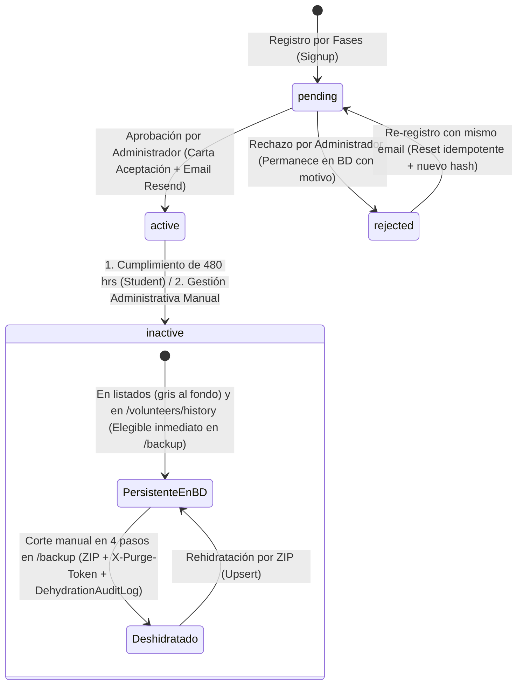

### 2.1 Estado `pending` (Default de Registro)
- **Definición:** Estado inicial al completar el onboarding de 4 fases.
- **Acceso:** Restringido exclusivamente a la vista `/onboarding/expediente` en modo "Expediente Recibido en Validación".
- **Restricción de Login:** Si el usuario ingresa credenciales válidas en `/login`, `AuthGuard` y `LoginComponent` lo redirigen obligatoriamente a `/onboarding/expediente`. No tiene acceso a APIs de consulta operativa ni al menú del portal.

### 2.2 Estado `active` (Aprobado)
- **Activación:** Se detona cuando el administrador presiona "Aceptar" en la tabla de voluntarios/estudiantes.
- **Flujo de Ingreso (Primera vez tras ser aceptado vs. Ingresos posteriores):**
  - **Primer Ingreso (`primerIngresoRealizado: false`):** 
    - Al autenticarse por primera vez tras la aceptación, el sistema lo dirige obligatoriamente a `/onboarding/expediente`.
    - En esta pantalla visualiza su tarjeta oficial de bienvenida con estatus de expediente aprobado y el enlace criptográfico para descargar su **Carta de Aceptación y Felicitación Oficial** (`cartaAceptacion`).
    - Para ingresar al portal operativo, debe pulsar explícitamente el botón **"Ingresar a la Plataforma ABAQ"**. Al hacer clic en este botón, el sistema marca de forma permanente en base de datos la bandera `primerIngresoRealizado: true`.
  - **Ingresos Posteriores (`primerIngresoRealizado: true`):**
    - En todos los inicios de sesión subsecuentes, el usuario **ya no pasa por el expediente**. 
    - El login lo redirige directamente a la vista inicial correspondiente a su rol (`/activity-list` para voluntarios y estudiantes de servicio social; `/admin/home` para administradores).
  - **Control de Navegación por Guard (`primerIngresoRealizado`):** Si un voluntario activo aún no ha realizado su primer ingreso formal (`primerIngresoRealizado === false`) e intenta ingresar directamente por URL a `/activity-list`, `AuthGuard` lo intercepta y lo regresa a `/onboarding/expediente` hasta que concluya el trámite inicial pulsando el botón de acceso. Una vez completado, el acceso a sus rutas operativas queda 100% liberado.

### 2.3 Estado `rejected` (Rechazado)
- **Comportamiento en BD:** Al rechazar una solicitud, el backend **no elimina el documento**. Actualiza `accountStatus: "rejected"` y registra el evento en `statusHistory`.
- **Comportamiento en UI:** Desaparece de la lista de pendientes (filtro `showPendingOnly`). Si el usuario inicia sesión, se le muestra la pantalla de expediente rechazado ("Solicitud no aprobada") con opción única de cerrar sesión o corregir su registro.
- **Protocolo de Re-registro con el Mismo Correo:**
  - El correo electrónico **no queda invalidado ni bloqueado**.
  - Si el aspirante vuelve a llenar el registro usando el mismo correo, el backend localiza el documento existente por `email`:
    1. Reemplaza los datos personales, académicos y respuestas de formulario con los nuevos valores.
    2. Hashea y actualiza la nueva contraseña (`passwordHash`).
    3. Limpia las observaciones de rechazo previas.
    4. Cambia su `accountStatus` de nuevo a `"pending"`.
    5. Registra una nueva entrada en `statusHistory` con motivo `"re_registration"`.

### 2.4 Estado `inactive` (Inactivo / Desvinculado)
La transición a `inactive` ocurre **sin procesos automáticos en segundo plano** (`node-cron` diario de 45/60 días, `inactivity.service.js` y `POST /student/check-inactivity` quedan completamente eliminados), bajo dos causales explícitas:

| Causal de Inactivación | Aplica a | Detonante Técnico | Emisión de Constancia | Notificación Resend |
| :--- | :--- | :--- | :--- | :--- |
| **Cumplimiento de 480 horas** | `student` | Inmediato en la misma operación donde se aprueba la acreditación que alcanza $\ge 480$ hrs | Sí (`constanciaFinalizacion` con token) | Correo de finalización con enlace a certificado |
| **Gestión Administrativa Manual** | `student` y `volunteer` | `PATCH` manual ejecutado por administrador desde el portal | Condicional (solo si concluyó formalmente) | Correo informativo según causal |

#### Ausencia de Barridos en Background y Compatibilidad de Esquema
- **Cero ejecución desatendida:** Ningún demonio ni tarea `node-cron` revisa ni muta estados de `Student` o `Volunteer` en segundo plano.
- **Preservación de atributos en Mongoose:** Los campos existentes en los modelos (`fechaDesactivacion`, `statusHistory`, `inactivityStage`) se conservan intactos en el esquema exclusivamente para preservar compatibilidad con documentos preexistentes, scripts de *seed* y paquetes `.zip` históricos.

#### Matriz de Permisos del Usuario Inactivo
- **Lectura Histórica Restringida:** Puede iniciar sesión para consultar su historial pasado.
- **Filtro de Actividades:** El endpoint `GET /activities` detecta si el usuario está inactivo y aplica la restricción sobre su fecha de baja (`fechaDesactivacion || updatedAt || createdAt`), impidiendo que observe actividades convocadas con posterioridad a su desvinculación.
- **Acciones Bloqueadas:** Se prohíbe inscribirse a nuevas actividades (`403 Forbidden`), editar su perfil o solicitar acreditaciones u oportunidades.

---

## 3. Reglas de Visibilidad en Frontend y Persistencia sin Ventana de 12 Meses

El sistema **elimina cualquier ventana o filtro de 12 meses (`365` días)** tanto en los listados operativos como en el historial (`TWELVE_MONTHS_MS` y `twelveMonthVisibilityFilter` retirados). Todos los registros persisten en MongoDB hasta que un administrador ejecute intencionalmente un corte manual en `/backup`:

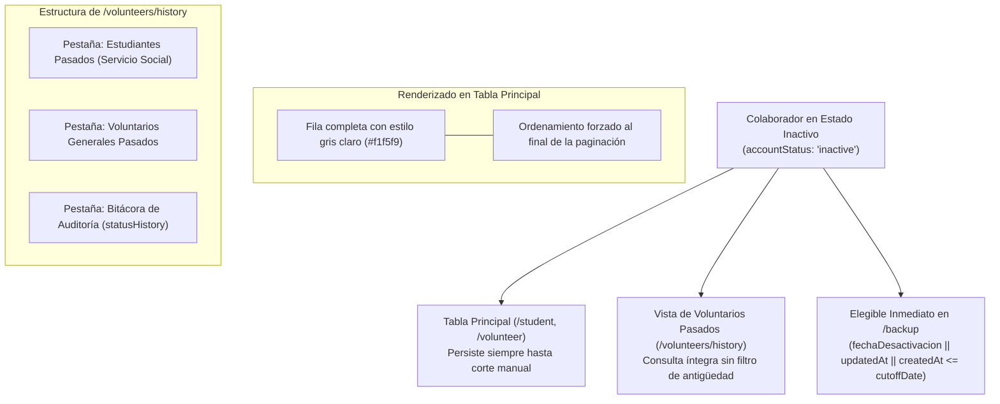

### 3.1 Persistencia en Tablas Operativas (`getAllStudents` y `getAllVolunteers`)
- Todos los estudiantes y voluntarios registrados permanecen visibles en las tablas principales de administración sin importar cuánto tiempo lleven inactivos.
- **Estilo Visual:** Las cuentas con `accountStatus: "inactive"` se marcan con la clase CSS `.row-inactive` (fondo gris claro `#f1f5f9`, texto atenuado `#64748b`).
- **Ordenamiento:** La consulta operativa ordena todos los registros `inactive` al final de la lista para no interferir con la supervisión de colaboradores activos y expedientes pendientes.

### 3.2 Persistencia Íntegra hasta Corte Manual en `/backup`
- Ningún registro `inactive` se oculta ni se purga automáticamente por antigüedad.
- Un registro solo abandona las tablas operativas y `/volunteers/history` cuando el administrador ejecuta el flujo guiado de 4 pasos de Corte y Deshidratación en `/backup`.

### 3.3 Vista Dedicada: Voluntarios Pasados (`/volunteers/history`)
Accesible desde el botón primario ubicado en el encabezado de la sección de Voluntarios: **"Ver Voluntarios Pasados"**.

La pantalla consulta **todos los colaboradores con `accountStatus: "inactive"` y todas las transiciones de estado vigentes en MongoDB** (sin recorte temporal), mediante navegación por pestañas y proyecciones optimizadas con **MongoDB Aggregation Pipelines**:

#### Tabla 1: Estudiantes de Servicio Social Pasados
1. **Nombre Completo:** `fullName`
2. **Datos de Contacto:** Correo electrónico (`email`) y Teléfono (`phone`)
3. **Edad:** Calculada a partir de fecha de nacimiento o edad registrada
4. **Fecha en la Organización:** `fechaEmisionExpediente` o `createdAt`
5. **Fecha de Activación:** `fechaAceptacionExpediente`
6. **Fecha de Desactivación:** `fechaDesactivacion`
7. **Total de Acreditaciones:** Conteo consolidado de acreditaciones (actividades + oportunidades manuales aprobadas)
8. **Total de Horas Realizadas:** Horas totales acreditadas (ej. 480 hrs)
9. **Tipo de Periodo Académico:** Valor del enum (`TRIMESTRAL`, `SEMESTRAL`, `TETRAMESTRAL`, etc.)
10. **Universidad / Institución:** `school`

#### Tabla 2: Voluntarios Generales Pasados
1. **Nombre Completo:** `fullName`
2. **Datos de Contacto:** Correo (`email`) y Teléfono (`phone`)
3. **Edad:** `age`
4. **Fecha en la Organización:** `createdAt`
5. **Fecha de Activación:** `fechaAceptacionExpediente`
6. **Fecha de Desactivación:** `fechaDesactivacion`
7. **Total de Acreditaciones:** Conteo de participaciones aprobadas (sin cómputo horario)

---

### 3.4 Matriz Integral de Visibilidad y Elegibilidad: Criterios y Consultas Mongoose

El ciclo de persistencia y elegibilidad de los colaboradores se estructura en **tres niveles operacionales** sin particiones artificiales por antigüedad:

| Nivel | Estado y Denominación | Condición Lógica | Consulta Mongoose / Regla de Motor | Comportamiento en Frontend (UX) | Endpoints Backend |
| :---: | :--- | :--- | :--- | :--- | :--- |
| **Nivel 1** | **Activo / Pendiente**<br>*(Operación Vigente)* | $\text{accountStatus} \in \{\text{'active'}, \text{'pending'}\}$ | `{ accountStatus: { $in: ['active', 'pending'] } }` | • Visible al inicio de `/student` y `/volunteer`<br>• Acceso operativo completo (si `active`)<br>• Protegido contra cualquier corte en `/backup` | `GET /student`<br>`GET /volunteer`<br>`GET /activities` |
| **Nivel 2** | **Inactivo Persistente**<br>*(Elegible Inmediato)* | $\text{accountStatus} = \text{'inactive'}$ | **Listados:** todos los documentos con ordenamiento `inactive` al fondo.<br>**Historial:** `{ accountStatus: 'inactive' }` sin filtro de fecha.<br>**Corte:** elegible cuando $t_{\text{efectiva}} \le t_{\text{corte}}$. | • Fila gris clara (`.row-inactive`, `#f1f5f9`) al final de tablas principales<br>• Visible íntegramente en `/volunteers/history`<br>• Banner informativo en su perfil | `GET /student`<br>`GET /volunteer`<br>`GET /volunteers/history/*` |
| **Nivel 3** | **Deshidratado de BD**<br>*(Corte Manual en `/backup`)* | $(t_{\text{efectiva}} \le t_{\text{corte}}) \quad \land$<br>$(\forall p \in \text{Participantes}(A), p \in \mathcal{U}_{\text{elegibles}})$ | Documento exportado al `.zip` y borrado de MongoDB tras validar `X-Purge-Token` (15 min). Registrado en `DehydrationAuditLog` con SHA-256. | • **Inexistente en MongoDB activa**<br>• Rehidratable en cualquier momento subiendo el `.zip` en `/backup` | `POST /backup/dehydrate/analyze`<br>`POST /backup/dehydrate/download`<br>`POST /backup/dehydrate/purge`<br>`POST /backup/dehydrate/restore` |

#### Regla de Fecha Efectiva para Elegibilidad en Corte Manual
Para garantizar que ninguna baja administrativa quede excluida aunque `fechaDesactivacion` sea `null`, el motor `dehydration.service.js` calcula la fecha efectiva de cada documento `inactive` como:
$$t_{\text{efectiva}}(u) = \text{fechaDesactivacion} \;\|\; \text{updatedAt} \;\|\; \text{createdAt}$$
* El tope máximo permitido para `cutoffDate` (`getMaxEligibleCutoffDate`) es el cierre del día actual UTC (`23:59:59.999Z`), rechazando con HTTP `400` únicamente fechas futuras.
* Todo colaborador con `accountStatus === "inactive"` y $t_{\text{efectiva}}(u) \le \text{cutoffDate}$ entra inmediatamente al conjunto candidato $\mathcal{U}_{\text{elegibles}}$.

---

---

## 4. Mecanismo de Deshidratación, Rehidratación y Registro Dinámico en `/backup`

La deshidratación es el procedimiento administrativo manual bajo demanda en `/backup` para exportar en un paquete `.zip` verificado y purgar físicamente de MongoDB la información de colaboradores con `accountStatus: "inactive"` cuya fecha efectiva (`fechaDesactivacion || updatedAt || createdAt`) sea `<= cutoffDate` (con tope en el día actual UTC), garantizando corte indivisible en actividades compartidas y capacidad de rehidratación íntegra en cualquier momento.

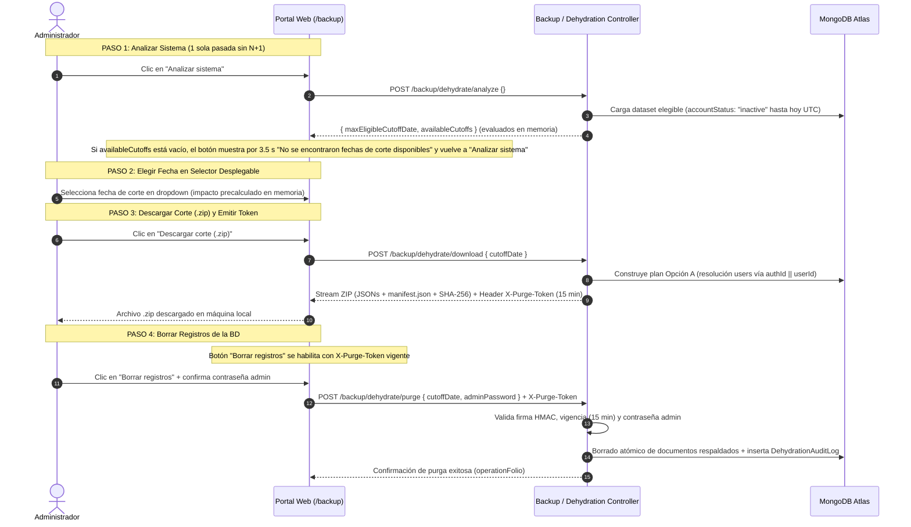

### 4.1 Principio del Corte Indivisible y Decisión Oficial de Arquitectura (Opción A)

#### Resolución del Dilema de Actividades Compartidas (Opción A Oficial)
En la operación de ABAQ, casi todas las convocatorias son de carácter grupal (jornadas de limpieza de albergue, brigadas de esterilización, pláticas masivas). Si una actividad cuenta con participantes mixtos (por ejemplo, el Estudiante A que ya tiene `accountStatus: "inactive"` con fecha efectiva `<= cutoffDate` y el Estudiante B que continúa `active` o fue desactivado después de `cutoffDate`):

> **Decisión Oficial de Arquitectura (Opción A):**
> 1. **El Colaborador Inactivo Elegible (`accountStatus: "inactive"` con fecha efectiva `<= cutoffDate`) SÍ se purga:** Se deshidrata de inmediato sin exigir espera adicional y se retira de MongoDB Atlas al 100 % (liberando su expediente, su cuenta `users` resuelta vía `authId || userId`, sus notificaciones y sus registros personales). Todo su historial queda respaldado íntegramente en el paquete `.zip`.
> 2. **La Actividad Colectiva Compartida SE CONSERVA en MongoDB:** Permanece viva en la base de datos operativa porque al menos un participante inscrito sigue activo (o fuera del corte) y la necesita para consultar su convocatoria y amparar sus horas curriculares.
> 3. **Purga Diferida de la Actividad:** La actividad colectiva se purgará de la base de datos únicamente en un corte futuro cuando el **100 % de sus participantes inscritos** pertenezcan al conjunto elegible de inactivos hasta la fecha de corte seleccionada.

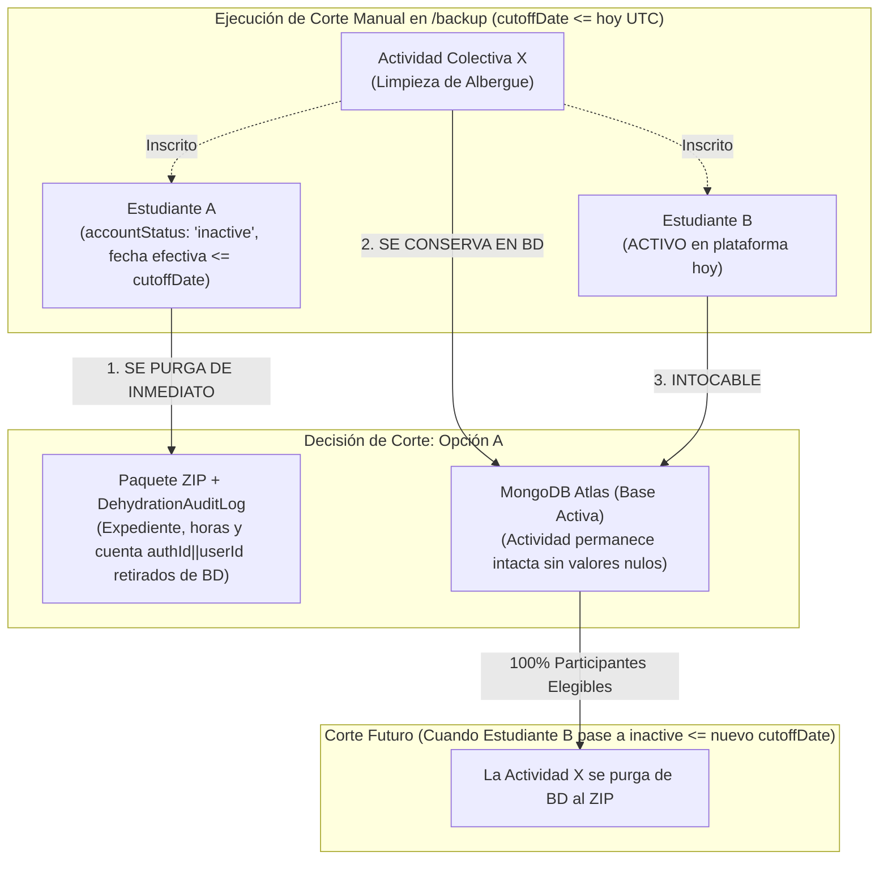

#### Patrón de Desacoplamiento por Doble Arreglo Embebido en `Student` y `Volunteer`
Para evitar que la eliminación de un usuario o el corte de base de datos deje valores nulos (`null`) o referencias rotas en llaves foráneas (`studentRef: null` o `activityRef: null`), la arquitectura establece un **patrón de datos embebidos autosuficientes**:

1. **El modelo `Activity` NO guarda referencias hacia los alumnos:** Las actividades convocadas son entidades maestras colectivas.
2. **Los modelos de colaborador (`Student` y `Volunteer`) almacenan dos arreglos embebidos independientes:**
   * **`assignedActivities`:** Subdocumentos con el historial de actividades convocadas en las que participó (`interactionFolio: 'AC-...'`, `activityId`, `status`, `validatedHours`, fechas).
   * **`accreditations`:** Subdocumentos con el historial de oportunidades y acreditaciones manuales (`interactionFolio: 'OP-...'`, `type`, `date`, `hoursAccredited`, `status`, evidencias).

##### Comparativa de Arquitectura: Modelo Tradicional Frágil vs Desacoplamiento ABAQ

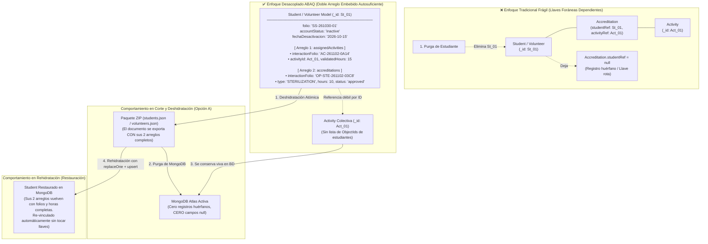

##### Ventajas Críticas del Desacoplamiento:
* **Cero Campos Nulos (`null-free`):** Si el Estudiante A es purgado, la Actividad compartida no sufre ninguna modificación, y no existe ninguna colección en MongoDB que requiera parchear llaves foráneas a `null`.
* **Historial Completo Autocontenido:** Toda la evidencia, horas acreditadas y participaciones de un voluntario viven dentro de su propio documento. Si la organización entrega un respaldo al usuario o a su universidad, el JSON de su expediente contiene el 100% de su historia cívica.
* **Resiliencia Total ante Rehidratación:** Al subir el paquete ZIP del Estudiante A posteriormente para una auditoría escolar, su documento en MongoDB se restaura con sus dos listados completos embebidos mediante `replaceOne` con `upsert: true`. El estudiante vuelve a estar vinculado de forma inmediata a sus actividades y oportunidades históricas sin necesidad de reconstruir tablas intermedias ni resolver dependencias de integridad foránea.

---

### 4.2 Registro Dinámico de Modelos y Flujo Guiado de 4 Pasos en `/backup`

La interfaz de **Respaldos y Recuperación** (`/backup`) sustenta sus métricas en el **descubrimiento dinámico de modelos Mongoose** (`getModelRegistry()` en `backup.service.js`, que inspecciona `backend/models/*.model.js` y `mongoose.models`, exponiendo `activeCollections / totalCollections`) y organiza *"Generar y Descargar Copias Locales"* en una **cuadrícula de tres columnas (3 tarjetas de acción)**:

1. **Columna 1 — Respaldo Completo del Sistema (`.ZIP / JSON`):** Descubre dinámicamente todos los modelos registrados vía `getModelRegistry()`, incluye íntegramente los campos ocultos (`select: false`, ej. `+passwordHash`) en cada `collections/<key>.json` y firma `manifest.json` con SHA-256 para *rollback* exacto.
2. **Columna 2 — Libro Consolidado en Excel (`.XLSX`):** Genera una hoja de `"Resumen General"` más una pestaña por cada modelo descubierto en `getModelRegistry()`, omitiendo automáticamente cualquier campo con `select: false` en el esquema o credenciales (`password`, `passwordHash`) para auditoría humana segura.
3. **Columna 3 — Corte y Deshidratación de Base de Datos (`.ZIP / PURGA`):** Tarjeta guiada en **4 pasos bajo demanda** para depurar colaboradores con `accountStatus: "inactive"` (fecha efectiva `<= cutoffDate`) y oportunidades concluidas bajo Opción A.

#### Alerta Operativa para el Administrador
Dado el alto impacto computacional de esta operación, la tarjeta de la tercera columna incluye de forma prominente un aviso de advertencia institucional:

!!! warning "Aviso de Alto Consumo de Procesamiento (Operación Fuera de Horario)"
    **Se recomienda enfáticamente ejecutar el corte de base de datos fuera de horarios operativos de oficina** (preferentemente en horario nocturno o fines de semana).  
    La verificación relacional indivisible entre los modelos de Mongoose, el filtrado de participantes activos, la compresión en tiempo real y el borrado transaccional generan una alta demanda de CPU y memoria en el clúster de MongoDB Atlas, lo que podría ralentizar la experiencia de los colaboradores que interactúen con el portal durante el día.

#### Principio de No Ejecución Pasiva: Escaneo en Una Sola Pasada y Evaluación en Memoria
Para salvaguardar el rendimiento del servidor y de MongoDB Atlas, **el sistema tiene estrictamente prohibido ejecutar la verificación o cálculo de corte de forma automática, continua o al cargar la página**:
* Al ingresar a la vista `/backup`, **no se dispara ninguna consulta de análisis**.
* El escaneo se ejecuta única y exclusivamente cuando el administrador pulsa **"Analizar sistema"** (Paso 1), realizando una sola pasada de consultas sin N+1 (`discoverAvailableCutoffs`). Cambiar de fecha en el selector desplegable (Paso 2) conmuta instantáneamente entre los planes ya precalculados en memoria sin volver a consultar MongoDB.

```
┌────────────────────────────────────────────────────────────────────────────────────────────────────────┐
│                              GENERAR Y DESCARGAR COPIAS LOCALES                                        │
├──────────────────────────────┬──────────────────────────────┬──────────────────────────────────────────┤
│ COLUMNA 1                    │ COLUMNA 2                    │ COLUMNA 3                                │
│ Respaldo Completo (.zip)     │ Libro Consolidado (.xlsx)    │ Deshidratación & Corte Guiado (4 Pasos)  │
│                              │                              │                                          │
│ getModelRegistry() dinámico  │ Pestañas dinámicas + Resumen │ ⚠️ AVISO: Ejecutar fuera de horario      │
│ Incluye select:false (+hash) │ Omite select:false y claves  │ operativo por alta carga en BD.          │
│ Oficial para rollback        │ Auditoría y patronato        │                                          │
│                              │                              │ [ 1. Analizar sistema ]                  │
│                              │                              │ (Si vacío -> 3.5s: "No se encontraron    │
│                              │                              │  fechas de corte disponibles")           │
│                              │                              │                                          │
│                              │                              │ [ 2. Elegir fecha: Dropdown en memoria ▼]│
│                              │                              │ ┌─ Resumen de Impacto (Previsualización) ┐│
│                              │                              │ │ • Estudiantes inactivos: 14            ││
│                              │                              │ │ • Voluntarios inactivos: 8             ││
│                              │                              │ │ • Actividades purgadas / retenidas     ││
│                              │                              │ └────────────────────────────────────────┘│
│                              │                              │                                          │
│ [ Descargar Respaldo JSON ]  │ [ Descargar Base en Excel ]  │ [ 3. Descargar corte (.zip) ]            │
│                              │                              │ [ 4. Borrar registros ] (X-Purge-Token)  │
└──────────────────────────────┴──────────────────────────────┴──────────────────────────────────────────┘
```

#### Flujo Operativo Guiado en Cuatro Pasos (Garantía Anti-Pérdida)

El flujo de deshidratación sigue una progresión estricta de cuatro pasos secuenciales:

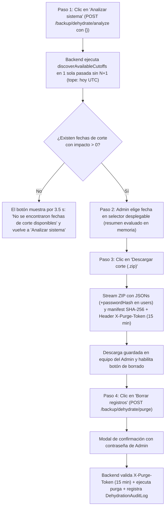

1. **Paso 1 — Analizar sistema (`POST /backup/dehydrate/analyze` con `{}`):**
   * **Bajo Demanda y en Una Sola Pasada (Sin N+1):** Se invoca únicamente tras pulsar el botón *"Analizar sistema"*. El backend carga una sola vez el conjunto elegible hasta el cierre del día actual UTC (`23:59:59.999Z`) mediante `loadEligibleDataset` y evalúa en memoria cada fecha candidata con `computePurgePlanFromDataset`, descartando fechas con impacto `0` y deduplicando fechas redundantes.
   * **Aviso Temporal Integrado en el Botón (`3.5 s`):** Si el escaneo no encuentra ninguna fecha con impacto `> 0` (`availableCutoffs.length === 0`), el propio botón muestra temporalmente el texto `"No se encontraron fechas de corte disponibles"` durante `3.5 s` y posteriormente se restaura a `"Analizar sistema"`, manteniendo ocultos/bloqueados los pasos posteriores.

2. **Paso 2 — Elegir fecha en selector desplegable (Evaluación en Memoria):**
   * Cuando existen fechas elegibles, se despliega el selector ordenado de la fecha más reciente (corte más completo) a la más antigua.
   * Seleccionar cualquier opción renderiza de inmediato en memoria el resumen de impacto (documentos por colección, actividades purgadas vs. retenidas por Opción A, bytes liberados y conteo de catálogos preservados `quickactivities`, `users` admin y `pets`) y habilita el Paso 3.

3. **Paso 3 — Descargar corte `.zip` (`POST /backup/dehydrate/download`):**
   * El administrador pulsa *"Descargar corte (.zip)"*.
   * El backend construye el plan para la `cutoffDate` elegida (resolviendo cuentas `users` de estudiantes y voluntarios mediante `authId || userId` e incluyendo `+passwordHash`), empaqueta `collections/<key>.json` más `manifest.json` con hashes SHA-256 e inyecta en la cabecera HTTP el token firmado `X-Purge-Token` con vigencia estricta de **15 minutos** (`Access-Control-Expose-Headers: X-Purge-Token, Content-Disposition`).
   * Al completarse la descarga en el cliente, el frontend retiene el `X-Purge-Token` y habilita el botón del Paso 4.

4. **Paso 4 — Borrar registros (`POST /backup/dehydrate/purge`):**
   * Al pulsar *"Borrar registros"*, un modal crítico solicita la contraseña del administrador en sesión (`adminPassword`).
   * El backend verifica la firma HMAC-SHA256 del `X-Purge-Token`, su no expiración (`<= 15 min`), la correspondencia con el administrador autenticado y la contraseña con `bcryptjs`.
   * Ejecuta el borrado de los documentos respaldados, registra de forma inmutable el evento en `DehydrationAuditLog` e invalida irrevocablemente el `X-Purge-Token`. Si el token expiró o es inválido, responde con HTTP `412 Precondition Failed` o `403 Forbidden` sin tocar la base de datos.

### 4.3 Rehidratación Idempotente (Restauración)
En caso de auditoría externa o requerimiento de consulta histórica en plataforma:
- El administrador carga el archivo `.zip` en la interfaz de respaldos (`POST /backup/dehydrate/restore`).
- El backend lee los archivos JSON correspondientes a cada modelo y ejecuta una operación **upsert idempotente** (`bulkWrite` con `replaceOne` y `upsert: true`).
- Se restauran los documentos conservando exactamente sus identificadores originales (`_id`), preservando intactas las relaciones entre voluntarios, acreditaciones y actividades.
- Se registra el evento en la colección interna de auditoría `DehydrationAuditLog` con tipo `"rehydrate_restore"`.

---

### 4.4 Algoritmo de Deshidratación: Búsqueda Relacional, Verificación Indivisible y Purga Atómica

El algoritmo de deshidratación resuelve el desafío de depurar grandes volúmenes de datos históricos garantizando que **jamás se rompa la integridad referencial** ni se elimine una actividad donde todavía exista un alumno activo.

#### Diagrama de Flujo del Algoritmo de Deshidratación

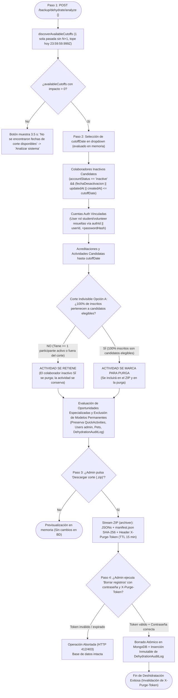

#### Los 10 Pasos del Algoritmo de Deshidratación (Lógica y Criterios Mongoose)

1. **Paso 1 — Carga Única y Filtrado por Fecha Efectiva ($\mathcal{U}_{\text{elegibles}}$):**
   El backend valida que `cutoffDate` no exceda el cierre del día actual UTC (`getMaxEligibleCutoffDate` $\to$ `23:59:59.999Z`), consulta todos los documentos con `accountStatus: 'inactive'` en una sola pasada y evalúa su fecha efectiva (`fechaDesactivacion || updatedAt || createdAt <= cutoffDate`), resolviendo sus cuentas `users` mediante `authId || userId`:
   ```javascript
   const getEffectiveInactiveDate = (doc) =>
     doc?.fechaDesactivacion || doc?.updatedAt || doc?.createdAt || null;

   const [rawStudents, rawVolunteers] = await Promise.all([
     Student.find({ accountStatus: 'inactive' }).lean(),
     Volunteer.find({ accountStatus: 'inactive' }).lean()
   ]);

   const candidateStudents = rawStudents.filter(
     s => new Date(getEffectiveInactiveDate(s)).getTime() <= cutoffDate.getTime()
   );
   const candidateVolunteers = rawVolunteers.filter(
     v => new Date(getEffectiveInactiveDate(v)).getTime() <= cutoffDate.getTime()
   );

   const candidateUserIds = [
     ...candidateStudents.map(s => (s.authId || s.userId || '').toString().trim()),
     ...candidateVolunteers.map(v => (v.authId || v.userId || '').toString().trim())
   ].filter(id => mongoose.Types.ObjectId.isValid(id));
   ```

2. **Paso 2 — Búsqueda de Cuentas de Acceso Vinculadas ($\mathcal{A}_{\text{auth}}$):**
   Filtra en `users` exclusivamente aquellas cuentas con rol operativo de voluntariado e incluye `+passwordHash` para preservar la capacidad de rehidratación íntegra:
   ```javascript
   const candidateUsers = await User.find({
     _id: { $in: candidateUserIds },
     role: { $in: ['student', 'volunteer'] } // NUNCA rol 'admin'
   }).select('+passwordHash').lean();
   ```

3. **Paso 3 — Búsqueda de Acreditaciones Candidatas ($\mathcal{AC}_{\text{candidatas}}$):**
   Localiza todas las acreditaciones vinculadas a los colaboradores candidatos:
   ```javascript
   const candidateAccreditations = await Accreditation.find({
     $or: [
       { studentRef: { $in: candidateStudents.map(s => s._id) } },
       { volunteerRef: { $in: candidateVolunteers.map(v => v._id) } }
     ]
   }).lean();
   ```

4. **Paso 4 — Evaluación Relacional Indivisible de Actividades (`Activity`):**
   Para cada actividad convocada cuya fecha de realización sea menor o igual a la fecha de corte (`dueDate <= cutoffDate` o `created <= cutoffDate`):
   * Se extrae el conjunto de colaboradores inscritos:
     $$P(A_j) = \{ u \in \text{Participantes}(A_j) \}$$
   * **Comprobación de Corte Indivisible para Actividades Colectivas:**
     $$\text{EsPurgable}(A_j) \iff P(A_j) \subseteq \mathcal{U}_{\text{elegibles}}$$
   * **Criterio de Decisión Oficial (Opción A):**
     * Si existe al menos un participante activo, pendiente o inactivado después de `cutoffDate` ($P(A_j) \not\subseteq \mathcal{U}_{\text{elegibles}}$):  
       **La actividad se RETIENE en MongoDB** (`retainedActivities.push(A_j)`). Sin embargo, **el colaborador inactivo elegible SÍ SE PURGA de la base de datos** al ZIP con todo su expediente. Gracias al desacoplamiento por doble arreglo en `Student` y `Volunteer`, la actividad no sufre alteraciones ni deja valores nulos (`null`), manteniéndose íntegra para el participante activo.
     * Si el 100 % de los participantes inscritos son inactivos elegibles ($P(A_j) \subseteq \mathcal{U}_{\text{elegibles}}$):  
       **La actividad se PURGA** (`purgedActivities.push(A_j)`), exportándose al paquete ZIP junto con sus inscripciones históricas.

5. **Paso 5 — Evaluación Relacional de las 11 Oportunidades Especializadas:**
   * **`talks` y `campaigns`:** Se evalúa si todos los asistentes registrados pertenecen a $\mathcal{U}_{\text{inactivos}}$. De existir un asistente activo, la plática o campaña masiva se conserva íntegra.
   * **`adoptions` e `identifications`:** Expedientes y solicitudes pasadas vinculadas a los voluntarios candidatos sin trámites pendientes.
   * **`surveys` y `contacts`:** Cuestionarios y bitácoras comunitarias creadas por los estudiantes candidatos (`studentId: { $in: candidateStudentIds }`).
   * **`notifications`:** Purgado masivo de todas las notificaciones dirigidas a los usuarios deshidratados (`userId: { $in: candidateUserIds }`), lo que erradica de inmediato el **41.40% del almacenamiento total de la base de datos**.

6. **Paso 6 — Verificación de Exclusión de Modelos Permanentes:**
   El algoritmo valida de forma asertiva que los modelos protegidos jamás sean incluidos en el arreglo de purga:
   * `quickactivities`: Cero registros tocados (conteo verificado).
   * `users` con `role: 'admin'`: Cero cuentas tocadas.
   * `pets`: Cero animales tocados (el padrón es patrimonio comunitario).
   * `dehydrationauditlogs`: Bitácora inmutable permanente.

7. **Paso 7 — Retorno del Escaneo y Previsualización de Impacto (Dry-Run):**
   Cuando se invoca `POST /backup/dehydrate/analyze` con cuerpo vacío (`{}`), el endpoint ejecuta `discoverAvailableCutoffs` en una sola pasada y retorna `{ maxEligibleCutoffDate, availableCutoffs }` con el resumen precalculado por cada fecha candidata con impacto `> 0` (para evaluación inmediata en memoria en el selector del Paso 2; si `availableCutoffs` está vacío, el botón muestra por `3.5 s` `"No se encontraron fechas de corte disponibles"`). Si se envía un `cutoffDate` puntual, retorna su reporte de impacto sin mutar la base de datos:
   ```json
   {
     "status": "success",
     "dryRun": true,
     "cutoffDate": "2026-11-03T23:59:59.999Z",
     "metrics": {
       "totalCollectionsAffected": 12,
       "totalDocumentsPurged": 185,
       "totalBytesFreed": 148520,
       "activeParticipantsRetainedCount": 0
     },
     "retainedActivitiesCount": 2,
     "eligibleForPurge": true
   }
   ```

8. **Paso 8 — Generación del Paquete ZIP Criptográfico (Fase 1 — Descarga):**
   * El servicio compila mediante el módulo `archiver` un archivo ZIP que contiene la carpeta `collections/` con los 12 archivos JSON (`students.json`, `accreditations.json`, etc.).
   * Genera el archivo `manifest.json` que contiene:
     * Fecha y hora de generación (`generatedAt`).
     * Identificador y correo del administrador (`generatedBy`).
     * Conteo exacto de documentos por modelo.
     * **Checksum SHA-256 individual por cada archivo JSON y global del paquete**.
   * Emite el token firmado criptográficamente en cabecera HTTP:
     ```http
     X-Purge-Token: <hmac-sha256-signed-payload>
     ```
     Con vigencia estricta de 15 minutos (TTL).

9. **Paso 9 — Purga Atómica Condicionada en MongoDB (Fase 2 — Ejecución):**
   * Al recibir la petición `POST /backup/dehydrate/purge` con el `X-Purge-Token` y la contraseña de administrador:
   * Se inicia una sesión transaccional atómica en MongoDB:
     ```javascript
     const session = await mongoose.startSession();
     session.startTransaction();
     try {
       for (const target of purgePlan) {
         await target.model.deleteMany(
           { _id: { $in: target.purgedIds } },
           { session }
         );
       }
       await DehydrationAuditLog.create([auditPayload], { session });
       await session.commitTransaction();
     } catch (err) {
       await session.abortTransaction();
       throw err;
     } finally {
       session.endSession();
     }
     ```

10. **Paso 10 — Registro Inmutable y Notificación:**
    * Invalida de forma irrevocable el `X-Purge-Token`.
    * Retorna código HTTP `200 OK` con el folio de operación pericial generado (ej. `DEHYD-20261102-0A14`).

#### 4.4.1 Especificación Algorítmica Técnica: Motor de Deshidratación (`DehydrationEngine`)

A continuación se detalla la lógica algorítmica técnica de ejecución a bajo nivel para evaluar las estructuras de datos, la complejidad computacional y el manejo atómico en MongoDB:

```javascript
/**
 * @file dehydration.service.js
 * @description Motor de evaluación relacional, empaquetado y purga atómica de deshidratación.
 */

const crypto = require("crypto");
const mongoose = require("mongoose");
const archiver = require("archiver");
const bcrypt = require("bcryptjs");
const AppError = require("../utils/appError");

// Modelos requeridos
const User = require("../models/user.model");
const Student = require("../models/student.model");
const Volunteer = require("../models/volunteer.model");
const Activity = require("../models/activity.model");
const Accreditation = require("../models/accreditation.model");
const Talk = require("../models/talk.model");
const Campaign = require("../models/campaign.model");
const Adoption = require("../models/adoption.model");
const Identification = require("../models/identification.model");
const Survey = require("../models/survey.model");
const Contact = require("../models/contact.model");
const Notification = require("../models/notification.model");
const QuickActivity = require("../models/quickActivity.model");
const Pet = require("../models/pet.model");
const DehydrationAuditLog = require("../models/dehydrationAuditLog.model");

const PURGE_TOKEN_SECRET = process.env.JWT_SECRET || "abaq-purge-secret-key-2026";
const TOKEN_TTL_MS = 15 * 60 * 1000; // 15 minutos

// Memoria volátil / caché de tokens emitidos para prevenir ataques de repetición (Replay Attacks)
const activePurgeTokens = new Map();

/**
 * Calcula el tope máximo permitido de corte: cierre del día actual UTC (23:59:59.999Z),
 * bloqueando únicamente fechas futuras sin imponer espera de antigüedad.
 */
function getMaxEligibleCutoffDate(nowRef = Date.now()) {
  const boundary = new Date(nowRef instanceof Date ? nowRef.getTime() : Number(nowRef));
  boundary.setUTCHours(23, 59, 59, 999);
  return boundary;
}

function getEffectiveInactiveDate(doc) {
  return doc?.fechaDesactivacion || doc?.updatedAt || doc?.createdAt || null;
}

/**
 * ALGORITMO TÉCNICO 1: Construcción del Plan de Purga Relacional Indivisible
 * Complejidad temporal: O(U + A*P) donde U es usuarios, A actividades y P participantes.
 * Con Sets en memoria, la verificación de cada participante se realiza en O(1).
 * 
 * @param {Date|string} cutoffDateRaw - Fecha límite de corte (<= fin del día actual UTC)
 * @returns {Promise<Object>} purgePlan estructurado con IDs y documentos a purgar/retener
 */
async function buildPurgePlan(cutoffDateRaw) {
  const cutoffDate = new Date(cutoffDateRaw);
  if (isNaN(cutoffDate.getTime())) {
    throw new AppError("La fecha de corte especificada no es válida.", 400);
  }
  if (cutoffDate.getTime() > getMaxEligibleCutoffDate().getTime()) {
    throw new AppError("La fecha de corte no puede ser futura.", 400);
  }

  // 1. Identificación de Colaboradores Inactivos Elegibles (accountStatus: "inactive" y fecha efectiva <= cutoffDate)
  const [rawStudents, rawVolunteers] = await Promise.all([
    Student.find({ accountStatus: "inactive" }).lean(),
    Volunteer.find({ accountStatus: "inactive" }).lean(),
  ]);

  const candidateStudents = rawStudents.filter(
    (s) => new Date(getEffectiveInactiveDate(s)).getTime() <= cutoffDate.getTime()
  );
  const candidateVolunteers = rawVolunteers.filter(
    (v) => new Date(getEffectiveInactiveDate(v)).getTime() <= cutoffDate.getTime()
  );

  // Estructuras de búsqueda rápida en memoria (O(1) lookups) y resolución authId || userId
  const candidateStudentIdSet = new Set(candidateStudents.map((s) => s._id.toString()));
  const candidateVolunteerIdSet = new Set(candidateVolunteers.map((v) => v._id.toString()));
  const candidateUserIdSet = new Set(
    [
      ...candidateStudents.map((s) => (s.authId || s.userId || "").toString().trim()),
      ...candidateVolunteers.map((v) => (v.authId || v.userId || "").toString().trim()),
    ].filter((id) => id && mongoose.Types.ObjectId.isValid(id))
  );

  // 2. Identificación de Cuentas Auth vinculadas (NUNCA rol admin; incluye +passwordHash para rehidratación)
  const candidateUsers = await User.find({
    _id: { $in: Array.from(candidateUserIdSet) },
    role: { $in: ["student", "volunteer"] },
  })
    .select("+passwordHash")
    .lean();

  // 3. Mapa de Inscripciones en Actividades extraídas de los perfiles de los candidatos
  // En ABAQ, las inscripciones residen desnormalizadas en assignedActivities de Student/Volunteer
  const activityParticipantMap = new Map(); // activityId -> Set de student/volunteer ObjectIds

  // Cargar TODAS las actividades concluidas anteriores a la fecha de corte
  const candidateActivities = await Activity.find({
    $or: [
      { dueDate: { $lte: cutoffDate } },
      { created: { $lte: cutoffDate } },
    ],
  }).lean();

  // Para cada actividad candidata, consultar TODOS los alumnos y voluntarios inscritos
  // (soporta compatibilidad dual: assignedActivities.activityRef y assignedActivities.activityId)
  const candidateActivityIds = candidateActivities.map((a) => a._id);
  const [allEnrolledStudents, allEnrolledVolunteers] = await Promise.all([
    Student.find(
      {
        $or: [
          { "assignedActivities.activityRef": { $in: candidateActivityIds } },
          { "assignedActivities.activityId": { $in: candidateActivityIds } },
        ],
      },
      { _id: 1, accountStatus: 1, fechaDesactivacion: 1, assignedActivities: 1 }
    ).lean(),
    Volunteer.find(
      {
        $or: [
          { "assignedActivities.activityRef": { $in: candidateActivityIds } },
          { "assignedActivities.activityId": { $in: candidateActivityIds } },
        ],
      },
      { _id: 1, accountStatus: 1, fechaDesactivacion: 1, assignedActivities: 1 }
    ).lean(),
  ]);

  // Poblar el mapa con todos los participantes reales
  for (const st of allEnrolledStudents) {
    for (const act of st.assignedActivities || []) {
      const actId = (act.activityRef || act.activityId)?.toString();
      if (!actId) continue;
      if (!activityParticipantMap.has(actId)) {
        activityParticipantMap.set(actId, []);
      }
      activityParticipantMap.get(actId).push({
        id: st._id.toString(),
        role: "student",
        isEligible: candidateStudentIdSet.has(st._id.toString()),
      });
    }
  }

  for (const vol of allEnrolledVolunteers) {
    for (const act of vol.assignedActivities || []) {
      const actId = (act.activityRef || act.activityId)?.toString();
      if (!actId) continue;
      if (!activityParticipantMap.has(actId)) {
        activityParticipantMap.set(actId, []);
      }
      activityParticipantMap.get(actId).push({
        id: vol._id.toString(),
        role: "volunteer",
        isEligible: candidateVolunteerIdSet.has(vol._id.toString()),
      });
    }
  }

  // 4. ALGORITMO DE CORTE INDIVISIBLE PARA ACTIVIDADES
  const purgedActivities = [];
  const retainedActivities = [];
  const retainedActivityIdSet = new Set();

  for (const act of candidateActivities) {
    const actIdStr = act._id.toString();
    const participants = activityParticipantMap.get(actIdStr) || [];

    // CONDICIÓN INDIVISIBLE:
    // ¿Existe al menos un participante que NO sea candidato inactivo elegible?
    const hasActiveOrRecentParticipant = participants.some((p) => !p.isEligible);

    if (hasActiveOrRecentParticipant) {
      // LA ACTIVIDAD SE RETIENE EN BASE DE DATOS
      retainedActivities.push({
        activityId: act._id,
        title: act.title,
        dueDate: act.dueDate,
        totalParticipants: participants.length,
        activeParticipantsCount: participants.filter((p) => !p.isEligible).length,
      });
      retainedActivityIdSet.add(actIdStr);
    } else {
      // 100% de los inscritos pertenecen al conjunto elegible de inactivos: LA ACTIVIDAD SE PURGA
      purgedActivities.push(act);
    }
  }

  // 5. Acreditaciones Candidatas:
  // Se purgan acreditaciones de los candidatos SIEMPRE Y CUANDO la actividad vinculada NO haya sido retenida
  const candidateAccreditations = await Accreditation.find({
    $or: [
      { studentRef: { $in: Array.from(candidateStudentIdSet) } },
      { volunteerRef: { $in: Array.from(candidateVolunteerIdSet) } },
    ],
  }).lean();

  const purgedAccreditations = candidateAccreditations.filter((acc) => {
    if (acc.activityRef && retainedActivityIdSet.has(acc.activityRef.toString())) {
      return false; // Se conserva para no generar acreditación huérfana en actividad retenida
    }
    return true;
  });

  // 6. Evaluación de las 11 Oportunidades Especializadas
  const [
    candidateTalks,
    candidateCampaigns,
    candidateAdoptions,
    candidateIdentifications,
    candidateSurveys,
    candidateContacts,
    candidateNotifications,
  ] = await Promise.all([
    Talk.find({ date: { $lte: cutoffDate } }).lean(),
    Campaign.find({ date: { $lte: cutoffDate } }).lean(),
    Adoption.find({ status: "completed", updatedAt: { $lte: cutoffDate } }).lean(),
    Identification.find({ status: { $in: ["delivered", "cancelled"] }, updatedAt: { $lte: cutoffDate } }).lean(),
    Survey.find({ studentId: { $in: Array.from(candidateStudentIdSet) } }).lean(),
    Contact.find({ studentId: { $in: Array.from(candidateStudentIdSet) } }).lean(),
    Notification.find({ userId: { $in: Array.from(candidateUserIdSet) } }).lean(),
  ]);

  // 7. ASERCIÓN ESTRICTA DE MODELOS PERMANENTES (Garantía Anti-Corrupción)
  const quickCount = await QuickActivity.countDocuments({});
  const adminCount = await User.countDocuments({ role: "admin" });
  const petCount = await Pet.countDocuments({});
  if (quickCount === 0 || adminCount === 0) {
    throw new Error("Violación de integridad: Verificación de modelos permanentes fallida.");
  }

  // Consolidación de documentos y bytes liberados
  const collectionsMap = {
    students: { name: "Estudiantes", model: Student, docs: candidateStudents },
    volunteers: { name: "Voluntarios", model: Volunteer, docs: candidateVolunteers },
    users: { name: "Cuentas Auth", model: User, docs: candidateUsers },
    accreditations: { name: "Acreditaciones", model: Accreditation, docs: purgedAccreditations },
    activities: { name: "Actividades", model: Activity, docs: purgedActivities },
    notifications: { name: "Notificaciones", model: Notification, docs: candidateNotifications },
    surveys: { name: "Encuestas", model: Survey, docs: candidateSurveys },
    contacts: { name: "Contactos", model: Contact, docs: candidateContacts },
    identifications: { name: "Identificaciones", model: Identification, docs: candidateIdentifications },
    talks: { name: "Pláticas", model: Talk, docs: candidateTalks },
    campaigns: { name: "Campañas", model: Campaign, docs: candidateCampaigns },
    adoptions: { name: "Adopciones", model: Adoption, docs: candidateAdoptions },
  };

  let totalDocs = 0;
  let totalBytes = 0;
  const collectionsSummary = [];

  for (const [key, item] of Object.entries(collectionsMap)) {
    const rawJson = JSON.stringify(item.docs);
    const bytes = Buffer.byteLength(rawJson, "utf8");
    totalDocs += item.docs.length;
    totalBytes += bytes;

    collectionsSummary.push({
      collectionName: key,
      modelKey: key,
      modelName: item.name,
      documentCount: item.docs.length,
      estimatedBytesFreed: bytes,
      filterCriteria: `{ fechaDesactivacion/fecha: { $lte: "${cutoffDate.toISOString()}" } }`,
      purgedDocumentIds: item.docs.map((d) => d._id),
      sampleItems: item.docs.slice(0, 5).map((d) => ({
        documentId: d._id,
        identifier: d.folio || d.interactionFolio || d.email || d.title || String(d._id),
        displayName: d.fullName || d.title || d.name || "Registro",
        metadata: { role: d.role, hours: d.totalHours || d.hoursAccredited },
      })),
    });
  }

  return {
    cutoffDate,
    totalDocuments: totalDocs,
    totalBytesFreed: totalBytes,
    retainedActivities,
    collectionsMap,
    collectionsSummary,
    candidateStudents,
    candidateVolunteers,
    purgedActivities,
  };
}

/**
 * ALGORITMO TÉCNICO 2: Generación de Paquete ZIP y Emisión de Token Criptográfico (Fase 1)
 */
async function generateDehydrationZipStream(cutoffDateRaw, adminUser, res) {
  const plan = await buildPurgePlan(cutoffDateRaw);

  const archive = archiver("zip", { zlib: { level: 9 } });
  const manifestCollections = {};
  let overallSha256Stream = crypto.createHash("sha256");

  // Inyectar cada archivo JSON en el archivo ZIP y computar SHA-256 individual
  for (const [key, item] of Object.entries(plan.collectionsMap)) {
    const jsonContent = JSON.stringify(item.docs, null, 2);
    const fileSha256 = crypto.createHash("sha256").update(jsonContent).digest("hex");
    overallSha256Stream.update(jsonContent);

    archive.append(jsonContent, { name: `collections/${key}.json` });

    manifestCollections[key] = {
      modelKey: key,
      modelName: item.name,
      documentCount: item.docs.length,
      sha256: fileSha256,
      sizeBytes: Buffer.byteLength(jsonContent, "utf8"),
    };
  }

  const packageSha256 = overallSha256Stream.digest("hex");

  // Manifiesto Criptográfico Oficial
  const manifest = {
    version: "1.0.0",
    operationType: "dehydrate_purge",
    generatedAt: new Date().toISOString(),
    cutoffDate: plan.cutoffDate.toISOString(),
    generatedBy: {
      adminId: adminUser._id,
      email: adminUser.email,
    },
    metrics: {
      totalCollections: Object.keys(manifestCollections).length,
      totalDocuments: plan.totalDocuments,
      totalBytesFreed: plan.totalBytesFreed,
      packageSha256,
    },
    collections: manifestCollections,
  };

  archive.append(JSON.stringify(manifest, null, 2), { name: "manifest.json" });

  // Generación del Token de Purga Criptográfico HMAC-SHA256 (TTL 15 min)
  const tokenPayload = {
    tokenVersion: "1.0",
    cutoffDate: plan.cutoffDate.toISOString(),
    adminId: adminUser._id.toString(),
    packageSha256,
    totalDocuments: plan.totalDocuments,
    expiresAt: Date.now() + TOKEN_TTL_MS,
  };

  const serializedPayload = Buffer.from(JSON.stringify(tokenPayload)).toString("base64url");
  const hmacSignature = crypto
    .createHmac("sha256", PURGE_TOKEN_SECRET)
    .update(serializedPayload)
    .digest("base64url");
  const purgeToken = `${serializedPayload}.${hmacSignature}`;

  // Registrar token activo en memoria
  activePurgeTokens.set(purgeToken, {
    plan,
    expiresAt: tokenPayload.expiresAt,
    adminId: tokenPayload.adminId,
  });

  // Limpieza automática tras expiración
  setTimeout(() => activePurgeTokens.delete(purgeToken), TOKEN_TTL_MS);

  // Inyectar encabezados de respuesta
  const timestampStr = new Date().toISOString().replace(/T/, "_").replace(/:/g, "-").split(".")[0];
  const filename = `abaq-dehydrate-${timestampStr}.zip`;

  res.setHeader("Content-Type", "application/zip");
  res.setHeader("Content-Disposition", `attachment; filename="${filename}"`);
  res.setHeader("X-Purge-Token", purgeToken);
  res.setHeader("Access-Control-Expose-Headers", "X-Purge-Token, Content-Disposition");

  archive.pipe(res);
  await archive.finalize();
}

/**
 * ALGORITMO TÉCNICO 3: Purga Atómica Transaccional en MongoDB (Fase 2)
 */
async function executeDehydrationPurge(purgeToken, adminPassword, adminUser) {
  if (!purgeToken) {
    throw new AppError("No se proporcionó el token criptográfico 'X-Purge-Token'.", 400);
  }

  // 1. Verificación del Token Criptográfico (Firma y Expiración)
  const parts = purgeToken.split(".");
  if (parts.length !== 2) {
    throw new AppError("Token de purga con formato inválido.", 403);
  }

  const [serializedPayload, receivedSig] = parts;
  const expectedSig = crypto
    .createHmac("sha256", PURGE_TOKEN_SECRET)
    .update(serializedPayload)
    .digest("base64url");

  if (receivedSig !== expectedSig) {
    throw new AppError("Firma criptográfica del token de purga inválida o adulterada.", 403);
  }

  const payload = JSON.parse(Buffer.from(serializedPayload, "base64url").toString("utf8"));
  if (Date.now() > payload.expiresAt) {
    activePurgeTokens.delete(purgeToken);
    throw new AppError("El token de purga ha expirado (límite de 15 minutos excedido).", 412);
  }

  if (payload.adminId !== adminUser._id.toString()) {
    throw new AppError("El token de purga no corresponde al administrador en sesión.", 403);
  }

  // 2. Re-autenticación de Seguridad con Contraseña del Administrador
  const fullAdmin = await User.findById(adminUser._id);
  const isMatch = await bcrypt.compare(adminPassword, fullAdmin.passwordHash);
  if (!isMatch) {
    throw new AppError("Contraseña de confirmación administrativa incorrecta.", 401);
  }

  // 3. Obtener el Plan de Purga
  const cachedData = activePurgeTokens.get(purgeToken);
  const plan = cachedData?.plan || (await buildPurgePlan(payload.cutoffDate));

  // 4. TRANSACCIÓN ATÓMICA EN MONGODB ATLAS (session.withTransaction)
  const session = await mongoose.startSession();
  session.startTransaction({
    readConcern: { level: "snapshot" },
    writeConcern: { w: "majority" },
  });

  const folioSuffix = crypto.randomBytes(2).toString("hex").toUpperCase();
  const dateStr = new Date().toISOString().slice(0, 10).replace(/-/g, "");
  const operationFolio = `DEHYD-${dateStr}-${folioSuffix}`;

  try {
    // Borrado en lote sobre las 12 colecciones
    for (const [key, item] of Object.entries(plan.collectionsMap)) {
      const idsToDelete = item.docs.map((d) => d._id);
      if (idsToDelete.length > 0) {
        await item.model.deleteMany({ _id: { $in: idsToDelete } }, { session });
      }
    }

    // Inserción inmutable de la Bitácora DehydrationAuditLog dentro de la misma transacción
    await DehydrationAuditLog.create(
      [
        {
          operationFolio,
          operationType: "dehydrate_purge",
          cutoffDate: plan.cutoffDate,
          durationMs: Date.now() - (payload.expiresAt - TOKEN_TTL_MS),
          executedBy: {
            adminId: adminUser._id,
            email: adminUser.email,
          },
          status: "completed",
          backupPackage: {
            fileName: `abaq-dehydrate-${payload.cutoffDate.toISOString().slice(0, 10)}.zip`,
            sha256: payload.packageSha256,
            fileSizeBytes: plan.totalBytesFreed,
          },
          metrics: {
            totalCollectionsAffected: Object.keys(plan.collectionsMap).length,
            totalDocumentsPurged: plan.totalDocuments,
            totalBytesFreed: plan.totalBytesFreed,
          },
          purgedUsersSummary: [
            ...plan.candidateStudents.map((s) => ({
              userId: s._id,
              folio: s.folio,
              email: s.mail || s.schoolMail,
              fullName: s.fullName,
              role: "student",
              fechaDesactivacion: s.fechaDesactivacion,
              totalHoras: s.totalHours || 0,
            })),
            ...plan.candidateVolunteers.map((v) => ({
              userId: v._id,
              folio: v.folio,
              email: v.email,
              fullName: v.fullName,
              role: "volunteer",
              fechaDesactivacion: v.fechaDesactivacion,
              totalHoras: 0,
            })),
          ],
          collections: plan.collectionsSummary,
        },
      ],
      { session }
    );

    // Commit de la transacción en MongoDB
    await session.commitTransaction();
  } catch (err) {
    await session.abortTransaction();
    throw new AppError(`Fallo en la purga atómica de base de datos: ${err.message}`, 500);
  } finally {
    session.endSession();
    // Invalidar token de forma irrevocable
    activePurgeTokens.delete(purgeToken);
  }

  return {
    status: "success",
    operationFolio,
    message: "Base de datos deshidratada y purgada exitosamente con corte indivisible.",
    totalDocumentsPurged: plan.totalDocuments,
    totalBytesFreed: plan.totalBytesFreed,
  };
}

/**
 * ALGORITMO TÉCNICO 0: Escaneo en una sola pasada sin N+1 (Paso 1 — Analizar sistema)
 * Carga el dataset elegible hasta el cierre de hoy UTC (getMaxEligibleCutoffDate),
 * evalúa en memoria el impacto de cada fecha efectiva candidata, descarta fechas de
 * impacto 0 y deduplica fechas redundantes.
 */
async function discoverAvailableCutoffs(options = {}) {
  const maxEligible = getMaxEligibleCutoffDate(options.nowMs ?? Date.now());
  const dataset = await loadEligibleDataset(maxEligible);
  // Evalúa computePurgePlanFromDataset(effectiveCutoff, dataset) en memoria y ordena descendente
  return { maxEligibleCutoffDate: maxEligible.toISOString(), availableCutoffs };
}

module.exports = {
  getMaxEligibleCutoffDate,
  getEffectiveInactiveDate,
  discoverAvailableCutoffs,
  buildPurgePlan,
  generateDehydrationZipStream,
  executeDehydrationPurge,
};
```

---

### 4.5 Algoritmo de Rehidratación (Restauración Idempotente sin Pérdida)

A diferencia del procedimiento de **Rollback Completo del Sistema** (el cual vacía la base de datos completa con `deleteMany({})` antes de restaurar), el algoritmo de **Rehidratación de Deshidratados** es **selectivo, aditivo e idempotente**: restaura exclusivamente los documentos purgados que contiene el paquete ZIP **sin borrar ni alterar a los alumnos y actividades activas existentes en el sistema actual**.

#### Diagrama de Flujo del Algoritmo de Rehidratación

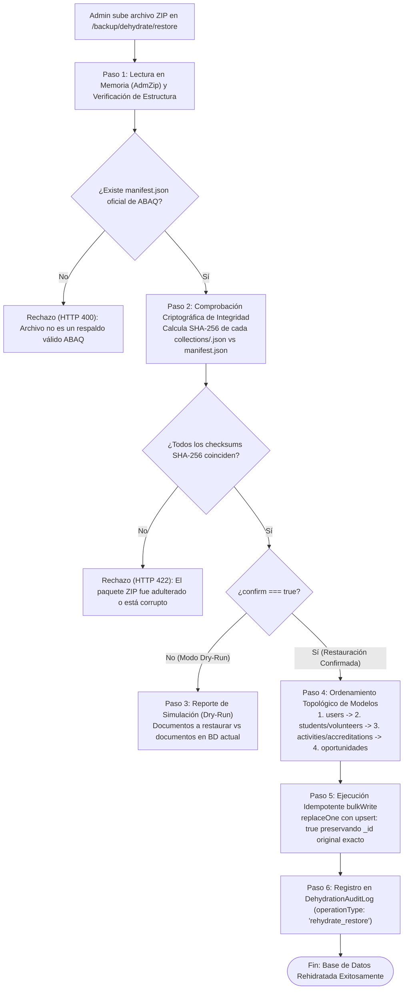

#### Los 7 Pasos del Algoritmo de Rehidratación

1. **Paso 1 — Descompresión Segura en Memoria:**
   El backend recibe el archivo binario mediante `multer` en memoria (`req.file.buffer`) y lo parsea utilizando `AdmZip`, evitando escribir archivos temporales inseguros en el disco del servidor.
   ```javascript
   const zip = new AdmZip(zipBuffer);
   const manifestEntry = zip.getEntry("manifest.json");
   if (!manifestEntry) {
     throw new AppError("El paquete no contiene el manifiesto requerido 'manifest.json'.", 400);
   }
   ```

2. **Paso 2 — Verificación Criptográfica Forense (Anti-Manipulación):**
   Para cada archivo `collections/<key>.json` dentro del ZIP, se calcula su hash SHA-256 en tiempo real y se contrasta con el valor original firmado en el manifiesto:
   ```javascript
   const sha256Calculado = crypto.createHash("sha256").update(entryData).digest("hex");
   if (sha256Calculado !== manifest.collections[key].sha256) {
     throw new AppError(`Fallo de integridad criptográfica en '${key}.json'. El archivo fue manipulado.`, 422);
   }
   ```

3. **Paso 3 — Modo de Simulación Preliminar (*Dry-Run*):**
   Si la petición se invoca con `confirm: false` (comportamiento predeterminado al seleccionar el archivo en el modal de subida), el sistema analiza cuántos registros se insertarían o actualizarían y devuelve una tabla comparativa sin modificar MongoDB.

4. **Paso 4 — Orden Topológico de Restauración (Integridad de Llaves Foráneas):**
   Para respetar las dependencias relacionales y no generar referencias huérfanas, los modelos se procesan en estricto orden secuencial:
   ```
   1º. users (Cuentas de autenticación requeridas por Student y Volunteer)
   2º. students y volunteers (Documentos base del colaborador con su userId)
   3º. activities (Convocatorias de actividades pasadas)
   4º. accreditations (Acreditaciones vinculadas a studentRef/volunteerRef y activityRef)
   5º. talks, campaigns, adoptions, identifications, surveys, contacts, notifications
   ```

5. **Paso 5 — Operación Idempotente `bulkWrite` con `replaceOne` y `upsert: true`:**
   En lugar de un borrado masivo, cada documento se restaura mediante una operación atómica que **garantiza conservar su identificador original (`_id`) exacto**:
   ```javascript
   for (const key of TOPOLOGICAL_ORDER) {
     const docs = parsedCollections[key];
     if (!docs || docs.length === 0) continue;

     const operations = docs.map(doc => ({
       replaceOne: {
         filter: { _id: doc._id }, // Coincidencia exacta por _id original
         replacement: doc,
         upsert: true // Inserta si no existe; reemplaza si ya existía
       }
     }));

     await models[key].bulkWrite(operations, { ordered: false });
   }
   ```
   * **Garantía Técnica:** Si la base de datos contiene nuevos estudiantes registrados hoy, sus documentos no son alterados ni eliminados. Los documentos históricos se reintegran transparentemente conservando sus llaves y folios.

6. **Paso 6 — Auditoría de Rehidratación:**
   Se persiste un nuevo registro en la colección `DehydrationAuditLog` con `operationType: "rehydrate_restore"`, capturando:
   * El nombre del archivo y el hash SHA-256 del ZIP restaurado.
   * La lista de colecciones y conteo de documentos rehidratados.
   * El administrador que ejecutó la restauración (`executedBy.email = req.user.email`).

7. **Paso 7 — Respuesta y Confirmación:**
   El backend responde con el resumen de documentos restablecidos y actualiza de inmediato la vista `/volunteers/history`, permitiendo que los registros rehidratados vuelvan a ser consultables en el sistema.

#### 4.5.1 Especificación Algorítmica Técnica: Motor de Rehidratación Idempotente (`RehydrationEngine`)

A continuación se detalla la implementación técnica del motor de rehidratación con procesamiento por lotes (*batching*) para prevenir el desbordamiento del límite BSON de 16 MB en MongoDB:

```javascript
/**
 * @file rehydration.service.js
 * @description Motor de verificación criptográfica y restauración idempotente por bloques.
 */

const crypto = require("crypto");
const AdmZip = require("adm-zip");
const AppError = require("../utils/appError");

// Modelos requeridos
const User = require("../models/user.model");
const Student = require("../models/student.model");
const Volunteer = require("../models/volunteer.model");
const Activity = require("../models/activity.model");
const Accreditation = require("../models/accreditation.model");
const Talk = require("../models/talk.model");
const Campaign = require("../models/campaign.model");
const Adoption = require("../models/adoption.model");
const Identification = require("../models/identification.model");
const Survey = require("../models/survey.model");
const Contact = require("../models/contact.model");
const Notification = require("../models/notification.model");
const DehydrationAuditLog = require("../models/dehydrationAuditLog.model");

// Orden topológico estricto para inserción relacional
const TOPOLOGICAL_ORDER = [
  { key: "users", model: User, name: "Usuarios" },
  { key: "students", model: Student, name: "Estudiantes" },
  { key: "volunteers", model: Volunteer, name: "Voluntarios" },
  { key: "activities", model: Activity, name: "Actividades" },
  { key: "accreditations", model: Accreditation, name: "Acreditaciones" },
  { key: "talks", model: Talk, name: "Pláticas" },
  { key: "campaigns", model: Campaign, name: "Campañas" },
  { key: "adoptions", model: Adoption, name: "Adopciones" },
  { key: "identifications", model: Identification, name: "Identificaciones" },
  { key: "surveys", model: Survey, name: "Encuestas" },
  { key: "contacts", model: Contact, name: "Contactos" },
  { key: "notifications", model: Notification, name: "Notificaciones" },
];

const BATCH_SIZE = 500; // Bloques seguros para bulkWrite

/**
 * ALGORITMO TÉCNICO DE REHIDRATACIÓN: Validación Criptográfica y Restauración Selectiva
 * 
 * @param {Buffer} zipBuffer - Archivo ZIP recibido en memoria
 * @param {boolean} confirm - false: dry-run de sólo lectura; true: commit a MongoDB
 * @param {Object} adminUser - Administrador ejecutor autenticado
 * @returns {Promise<Object>} Resumen pericial de restauración
 */
async function executeRehydrationRestore(zipBuffer, confirm = false, adminUser) {
  if (!zipBuffer || !Buffer.isBuffer(zipBuffer)) {
    throw new AppError("No se recibió un búfer binario de archivo ZIP válido.", 400);
  }

  // 1. Descompresión Segura en Memoria (AdmZip)
  let zip;
  try {
    zip = new AdmZip(zipBuffer);
  } catch (err) {
    throw new AppError(`El archivo no tiene un formato ZIP válido: ${err.message}`, 400);
  }

  const manifestEntry = zip.getEntry("manifest.json");
  if (!manifestEntry) {
    throw new AppError("El archivo ZIP no contiene el manifiesto requerido 'manifest.json' de ABAQ.", 400);
  }

  let manifest;
  try {
    manifest = JSON.parse(manifestEntry.getData().toString("utf8"));
  } catch (err) {
    throw new AppError(`El manifiesto manifest.json está corrupto: ${err.message}`, 400);
  }

  // 2. Comprobación Criptográfica de Integridad Forense SHA-256
  const parsedCollections = {};
  const reportCollections = [];

  for (const item of TOPOLOGICAL_ORDER) {
    const entryPath = `collections/${item.key}.json`;
    const entry = zip.getEntry(entryPath);

    if (!entry) {
      reportCollections.push({
        key: item.key,
        name: item.name,
        status: "omitted_in_package",
        restoreCount: 0,
      });
      continue;
    }

    const rawData = entry.getData();
    const calculatedSha256 = crypto.createHash("sha256").update(rawData).digest("hex");
    const expectedSha256 = manifest.collections?.[item.key]?.sha256;

    if (expectedSha256 && expectedSha256 !== calculatedSha256) {
      throw new AppError(
        `Fallo de verificación criptográfica SHA-256 en '${item.name}' (${item.key}.json). El paquete fue adulterado externamente.`,
        422
      );
    }

    let docs;
    try {
      docs = JSON.parse(rawData.toString("utf8"));
    } catch (parseErr) {
      throw new AppError(`JSON corrupto en '${entryPath}': ${parseErr.message}`, 400);
    }

    if (!Array.isArray(docs)) {
      throw new AppError(`El archivo '${entryPath}' debe contener un arreglo de documentos JSON.`, 400);
    }

    parsedCollections[item.key] = docs;
    reportCollections.push({
      key: item.key,
      name: item.name,
      status: "verified_ready",
      documentsToRestore: docs.length,
      bytes: rawData.length,
    });
  }

  // 3. Si es Modo Simulación (Dry-Run), retornar diagnóstico comparativo
  if (!confirm) {
    return {
      status: "success",
      dryRun: true,
      message: "Validación de integridad completada exitosamente. Listo para rehidratación.",
      manifestInfo: {
        packageDate: manifest.generatedAt,
        cutoffDate: manifest.cutoffDate,
        originalAuthor: manifest.generatedBy?.email,
      },
      collections: reportCollections,
    };
  }

  // 4. RESTAURACIÓN SELECTIVA IDEMPOTENTE POR BLOQUES (bulkWrite con upsert: true)
  const startTime = Date.now();
  const restorationResults = [];
  let totalRestored = 0;

  for (const item of TOPOLOGICAL_ORDER) {
    const docs = parsedCollections[item.key];
    if (!docs || docs.length === 0) continue;

    let collectionRestoredCount = 0;

    // Procesar en chunks de BATCH_SIZE (500) para evitar desbordar memoria y BSON limits
    for (let i = 0; i < docs.length; i += BATCH_SIZE) {
      const chunk = docs.slice(i, i + BATCH_SIZE);

      const bulkOps = chunk.map((doc) => ({
        replaceOne: {
          filter: { _id: new mongoose.Types.ObjectId(doc._id) }, // Conservación exacta de _id original
          replacement: doc,
          upsert: true, // Si no existe lo inserta; si existe lo actualiza de forma idempotente
        },
      }));

      const res = await item.model.bulkWrite(bulkOps, { ordered: false });
      collectionRestoredCount += (res.upsertedCount || 0) + (res.modifiedCount || 0);
    }

    totalRestored += collectionRestoredCount;
    restorationResults.push({
      key: item.key,
      name: item.name,
      restoredCount: collectionRestoredCount,
    });
  }

  // 5. Inserción de la Bitácora Inmutable en DehydrationAuditLog
  const folioSuffix = crypto.randomBytes(2).toString("hex").toUpperCase();
  const dateStr = new Date().toISOString().slice(0, 10).replace(/-/g, "");
  const operationFolio = `REHYD-${dateStr}-${folioSuffix}`;

  await DehydrationAuditLog.create({
    operationFolio,
    operationType: "rehydrate_restore",
    cutoffDate: manifest.cutoffDate || new Date(),
    durationMs: Date.now() - startTime,
    executedBy: {
      adminId: adminUser._id,
      email: adminUser.email,
    },
    status: "completed",
    backupPackage: {
      fileName: `rehydration-${operationFolio}.zip`,
      sha256: manifest.metrics?.packageSha256 || "verified_in_stream",
      fileSizeBytes: zipBuffer.length,
    },
    metrics: {
      totalCollectionsAffected: restorationResults.length,
      totalDocumentsPurged: 0,
      totalBytesFreed: 0,
    },
    collections: restorationResults.map((r) => ({
      collectionName: r.key,
      modelKey: r.key,
      modelName: r.name,
      documentCount: r.restoredCount,
      estimatedBytesFreed: 0,
      filterCriteria: "{ bulkWrite: replaceOne, upsert: true }",
    })),
  });

  return {
    status: "success",
    operationFolio,
    message: "Base de datos rehidratada exitosamente. Registros históricos restaurados.",
    totalRestoredDocuments: totalRestored,
    collections: restorationResults,
  };
}

module.exports = {
  executeRehydrationRestore,
};
```

---

---

## 5. Esquema de Datos y Bitácora de Auditoría

### 5.1 Sub-documento `statusHistory` y Colección Centralizada `UserStatusAuditLog`

Para garantizar trazabilidad completa de cada transición de cuenta (especificando con total transparencia **a qué usuario se le hizo**, **qué administrador lo hizo**, **el estado previo y nuevo**, **el motivo** y **las observaciones**), el sistema define una estructura unificada de auditoría de transiciones.

#### Estructura de Datos de Transición de Estado (`StatusHistoryEntry`)

```typescript
interface StatusHistoryEntry {
  // 1. Identificación del Usuario Afectado (A quién se le hizo)
  targetUserId: mongoose.Types.ObjectId;               // _id del Student o Volunteer
  targetUserFolio: string;                            // Folio único institucional (ej. "SS-261030-01" o "VG-261030-01")
  targetUserEmail: string;                            // Correo electrónico del voluntario
  targetUserName: string;                             // Nombre completo del colaborador
  targetUserRole: 'student' | 'volunteer';            // Rol del colaborador

  // 2. Transición Exacta de Estados
  previousStatus: 'pending' | 'active' | 'inactive' | 'rejected' | null;
  newStatus: 'pending' | 'active' | 'inactive' | 'rejected';
  changedAt: Date;

  // 3. Responsable de la Acción (Quién lo hizo)
  // Alineado a la realidad de MongoDB: el modelo User solo posee email, role y passwordHash; no posee campo name.
  changedBy: mongoose.Types.ObjectId | 'system';      // _id del User admin autenticado o string 'system' (ej. acreditación 480 h)
  changedByEmail: string;                             // req.user.email del administrador ejecutor o 'system'
  changedByRole: 'admin' | 'system';                  // Rol operativo del actor ejecutor

  // 4. Causal Formal de la Transición
  reason: 
    | 'initial_signup'                     // Registro inicial por el colaborador en onboarding
    | 'admin_approval'                     // Aprobación y alta manual por administrador
    | 'admin_rejection'                    // Rechazo manual de expediente con observaciones
    | 'hours_completed'                    // Sistema: cumplimiento íntegro de 480 hrs reglamentarias
    | 'administrative_decision'            // Inactivación manual por administrador a su discreción
    | 're_registration';                   // Re-registro tras haber sido previamente rechazado

  // 5. Justificación y Observaciones Formales
  comments: string;                        // Mensaje institucional explicativo visible en UI y correos
}
```

!!! note "Auditoría Real sin Campos Ficticios: Uso de `changedByEmail`"
    En la base de datos de ABAQ, las cuentas de administración residen exclusivamente en la colección `users` (`User`), la cual cuenta únicamente con los atributos `email`, `passwordHash`, `role` (`'admin'`) y `createdAt`. **No existe un campo de nombre propio para los administradores**. Por ello, el responsable se audita fidedignamente mediante su correo electrónico real (`changedByEmail = req.user.email`), garantizando cero discrepancias o campos inexistentes en backend.

#### Estrategia Dual de Persistencia: Local y Centralizada
1. **Embebida en `Student` y `Volunteer` (`statusHistory: [StatusHistoryEntry]`):**
   Permite lecturas inmediatas y atómicas ($O(1)$) al renderizar la vista de expediente recibido (`/onboarding/expediente`), la ficha de perfil de voluntario (`/volunteer-profile`) o el detalle del estudiante (`StudentDetailComponent`), sin necesidad de hacer joins relacionales.
2. **Colección Centralizada `UserStatusAuditLog` (o Aggregation Pipeline Indexado):**
   Permite alimentar de forma altamente eficiente la pestaña **"Bitácora de Estados"** de la vista `/volunteers/history`, posibilitando al administrador filtrar todas las transiciones vigentes en base de datos por rango de fechas, por tipo de causal (`reason`), por correo del administrador ejecutor (`changedByEmail`) o por colaborador afectado (`targetUserFolio`), sin ningún recorte de antigüedad.

#### Reglas de Llenado del Campo `comments`
1. **Acciones Autónomas del Sistema (Comentarios Automáticos Preconfigurados, sin procesos cron en segundo plano):**
   * *Cumplimiento de 480 horas (`hours_completed`):*  
     `"Cumplimiento íntegro de las 480 horas reglamentarias de Servicio Social. Acreditación final aprobada y emisión de constancia oficial de acreditación."`
   * *Re-registro tras rechazo (`re_registration`):*  
     `"Reactivación a estatus pendiente tras el reenvío de un nuevo expediente y formulario corregido por parte del colaborador."`
   * *Registro inicial (`initial_signup`):*  
     `"Expediente digital recibido en 4 fases, pendiente de revisión y validación administrativa por la Coordinación de ABAQ."`

2. **Acciones Manuales del Administrador (Modal con Campo de Observaciones):**
   * Al **Rechazar un Expediente (`admin_rejection`)**: La UI despliega un modal con un campo de texto obligatorio para que el administrador redacte las observaciones específicas (ej. *"Falta adjuntar constancia oficial sellada por la universidad en la Fase 3"*, *"El enlace a Google Drive carece de permisos públicos de lectura"*).
   * Al **Inactivar Manualmente (`administrative_decision`)**: Modal para capturar la causa de la baja (ej. *"Baja administrativa solicitada formalmente por carga académica o ausencia prolongada"*).
   * Al **Aceptar un Expediente (`admin_approval`)**: Mensaje institucional por defecto (*"Expediente validado satisfactoriamente por la Coordinación de ABAQ"*), con posibilidad de ingresar notas de bienvenida personalizadas.
   * *Fallback por Omisión:* Si el admin deja el campo en blanco, el backend inyecta automáticamente una plantilla formal predeterminada.

#### Consumo y Visibilidad del Comentario por Voluntarios y Administradores
El campo `comments` no se queda oculto en la base de datos; se expone estratégicamente en interfaces y correos según el estado y rol:

1. **En la Interfaz Web de Expediente (`/onboarding/expediente`):**
   * Aplica a ambos roles de voluntario (`student` y `volunteer`).
   * **Estado `accepted` (`active`):** La pantalla de expediente muestra la tarjeta oficial de felicitación acompañada del mensaje de bienvenida y observaciones de la Coordinación (`comments`).
   * **Estado `rejected`:** La pantalla despliega un contenedor de alerta ámbar/rojo con las **"Observaciones de la Coordinación: {{comments}}"**, permitiendo que el aspirante conozca con exactitud qué corregir antes de iniciar su re-registro con el mismo correo.

2. **En el Perfil Personal del Voluntario (Estado `inactive`):**
   * Cuando la cuenta pasa a `inactive`, el voluntario ya no tiene acceso operativo ni visualiza nuevas actividades convocadas.
   * Al acceder a su perfil (`/volunteer-profile` o perfil de estudiante), el sistema renderiza de **forma fija y permanente en la parte superior (inmediatamente debajo del header)** un banner destacado:
     > 🛑 **Cuenta Inactiva / Servicio Concluido:** {{comments}}  
     > *Fecha de Desactivación: {{fechaDesactivacion}} · Causal: {{reason}}*

3. **En la Vista Administrativa del Perfil (`student-detail` y `volunteer-detail`):**
   * Mientras el colaborador inactivo permanezca en la base de datos activa (antes de un corte manual en `/backup`), el administrador visualiza en la parte superior de la ficha del perfil (debajo del hero) una tarjeta informativa permanente:
     > ℹ️ **Registro Inactivo:** {{comments}}  
     > *Inactivado el: {{fechaDesactivacion}} por {{changedByEmail}} (Causal: {{reason}})*
   * Esto permite que cualquier administrador que consulte el perfil de un voluntario inactivo identifique de inmediato **por qué, cuándo y quién** realizó la baja (distinguiendo bajas automáticas por cumplimiento de 480 hrs frente a bajas administrativas manuales).

4. **En los Correos Transaccionales (Resend):**
   * En cada notificación de cambio de estado (aceptación, rechazo, desactivación administrativa o finalización), el texto de `comments` se inyecta en una caja destacada (*callout box*):
     > *"Mensaje de la Coordinación: {{comments}}"*

---

### 5.2 Colección de Auditoría `DehydrationAuditLog` y Análisis Cuantitativo de Almacenamiento

Para garantizar máxima transparencia y auditoría legal, el sistema implementa la colección inmutable `dehydrationauditlogs` en MongoDB. A continuación se presenta el análisis de telemetría extraído en vivo de MongoDB Atlas (`abaqPrototype`) que fundamenta qué modelos se retiran, cuáles se preservan y cómo se estructura el log para detallar con precisión **qué es lo que se salió del sistema**.

#### Análisis Cuantitativo de Almacenamiento en MongoDB Atlas
Un análisis empírico del clúster de base de datos determinó el peso real y la jerarquía de almacenamiento:

| Colección | Documentos | DataSize (Bytes) | % del Total | Promedio / Doc | Diagnóstico Arquitectónico |
| :--- | :---: | :---: | :---: | :---: | :--- |
| **`notifications`** | 73 | 64,806 B | **41.40%** | 887 B | **Mayor consumidor de almacenamiento.** Notificaciones de constancias, alertas y avisos. |
| **`students`** | 14 | 28,444 B | **18.17%** | **2,031 B** | **Modelo individual más pesado.** Almacena `onboardingData` (JSON) y `assignedActivities` anidadas. |
| **`accreditations`** | 51 | 18,465 B | **11.80%** | 362 B | Oportunidades validadas con URLs de evidencias y desglose horario. |
| **`volunteers`** | 8 | 10,886 B | 6.95% | 1,360 B | Voluntarios generales con grados académicos y actividades anidadas. |
| **`surveys`** | 10 | 10,492 B | 6.70% | 1,049 B | Encuestas de campo con más de 25 reactivos socio-ambientales. |
| **`pets`** | 8 | 4,159 B | 2.66% | 519 B | Padrón de mascotas registradas para esterilización y citas. |
| **`users`** | 22 | 3,686 B | 2.35% | 167 B | Cuentas de acceso (estudiantes, voluntarios y administradores). |
| **`activities`** | 12 | 3,303 B | 2.11% | 275 B | Convocatorias de actividades (ligeras; el peso real se absorbe en `students`). |
| **`adoptions`** | 3 | 2,381 B | 1.52% | 793 B | Expedientes de adopción con periodos de prueba, contratos y fotos. |
| **`campaigns`** | 3 | 2,184 B | 1.39% | 728 B | Jornadas masivas con datos completos de tutores. |
| **`identifications`** | 5 | 2,047 B | 1.31% | 409 B | Solicitudes de placas con comprobantes de pago. |
| **`quickactivities`**| 6 | 1,370 B | 0.88% | 228 B | **Plantillas maestras reutilizables (permanentes).** |
| **`talks`** | 4 | 1,298 B | 0.83% | 324 B | Pláticas con listas embebidas de asistentes. |
| **`contacts`** | 6 | 1,049 B | 0.67% | 174 B | Bitácoras de prospección ciudadana vinculadas a estudiantes. |

> **Corroboración Técnica:**  
> La afirmación operativa es certera: **los estudiantes, las oportunidades (`accreditations`) y las actividades concentran el mayor flujo transaccional**. Sin embargo, la inspección técnica reveló un hallazgo crucial: **las actividades individuales son muy ligeras (275 bytes)** porque el peso de cada inscripción se desnormaliza dentro del arreglo `assignedActivities` de cada `Student` (elevando el documento a > 2 KB).  
> Además, se identificó un **punto ciego crítico**: la colección **`notifications` concentra por sí sola más del 41% del almacenamiento total**. Purgar las notificaciones de los usuarios inactivos libera de inmediato casi la mitad del volumen de la base de datos.

---

#### Catálogo Exhaustivo de Modelos: Qué se va vs. Qué se queda

El principio del **Corte Limpio e Indivisible** (*"o se quita todo o no se quita nada"*) rige estrictamente el proceso de deshidratación. Si una actividad u oportunidad cuenta con al menos un voluntario activo, se conserva íntegramente.

```mermaid
flowchart TD
    subgraph Purgados ["MODELOS ELEGIBLES QUE SALEN EN EL CORTE LIMPIO"]
        direction TB
        M1["1. students (Expedientes inactivos con fecha efectiva <= cutoffDate)"]
        M2["2. volunteers (Perfiles generales inactivos con fecha efectiva <= cutoffDate)"]
        M3["3. users (Cuentas auth student/volunteer resueltas vía authId || userId)"]
        M4["4. accreditations (Acreditaciones vinculadas a candidatos purgados)"]
        M5["5. activities (Actividades concluidas cuyo 100% de inscritos es elegible)"]
        M6["6. notifications (Notificaciones de usuarios archivados - 41.4% BD)"]
        M7["7. surveys (Cuestionarios levantados por voluntarios purgados)"]
        M8["8. contacts (Bitácoras de prospección levantadas en campo)"]
        M9["9. identifications (Trámites de placas concluidos hasta cutoffDate)"]
        M10["10. talks (Pláticas de tenencia responsable concluidas)"]
        M11["11. campaigns (Jornadas masivas de esterilización concluidas)"]
        M12["12. adoptions (Expedientes de adopción concluidos hasta cutoffDate)"]
    end

    subgraph Conservados ["4 MODELOS QUE SE CONSERVAN PERMANENTEMENTE"]
        direction TB
        C1["1. quickactivities (Plantillas maestras reutilizables)"]
        C2["2. users con rol 'admin' (Cuentas de gobierno y coordinación)"]
        C3["3. pets (Catálogo comunitario de identidad y salud animal)"]
        C4["4. DehydrationAuditLog (Bitácora inmutable de auditoría)"]
    end
```

##### Detalle de los Modelos que se Purgan (Salen del Sistema a JSON/ZIP)
1. **`students` (`Student`):** Expedientes completos de estudiantes de Servicio Social con `accountStatus: "inactive"` y fecha efectiva (`fechaDesactivacion || updatedAt || createdAt`) `<= cutoffDate`. Incluye su `onboardingData`, reflexiones de inducción, consentimientos y los arreglos `assignedActivities` y `accreditations`.
2. **`volunteers` (`Volunteer`):** Perfiles completos de Voluntarios Generales con `accountStatus: "inactive"` y fecha efectiva `<= cutoffDate`. Incluye formación académica (`degrees`) y participaciones cívicas.
3. **`users` (`User`, roles `'student'` y `'volunteer'`):** Credenciales (`+passwordHash`) y cuentas de acceso de autenticación vinculadas a los colaboradores archivados mediante `authId || userId`.
4. **`accreditations` (`Accreditation`):** Todos los registros históricos de acreditación de horas y oportunidades de los colaboradores purgados.
5. **`activities` (`Activity`):** Convocatorias de actividades pasadas concluidas donde **el 100 % de los inscritos pertenezca al conjunto de inactivos elegibles** hasta `cutoffDate` (Opción A). Si existe un solo participante activo o fuera del corte, la actividad se conserva en su totalidad.
6. **`notifications` (`Notification`):** Notificaciones dirigidas a los usuarios purgados. Su eliminación erradica el 41.40% de la carga de base de datos.
7. **`surveys` (`Survey`):** Respuestas a cuestionarios y encuestas de bienestar animal levantadas por los estudiantes que se deshidratan.
8. **`contacts` (`Contact`):** Prospecciones y censos levantados en campo por los estudiantes deshidratados.
9. **`identifications` (`Identification`):** Expedientes de placas de identificación animal gestionadas en ciclos concluidos.
10. **`talks` (`Talk`):** Pláticas de tenencia responsable concluidas con listas cerradas de asistentes inactivos.
11. **`campaigns` (`Campaign`):** Jornadas masivas de esterilización concluidas sin vinculación a colaboradores vigentes.
12. **`adoptions` (`Adoption`):** Trámites y contratos de adopción resueltos y concluidos de periodos pasados.

##### Detalle de los 4 Modelos que se Conservan Permanentemente
1. **`quickactivities` (`QuickActivity`):** **Plantillas maestras reutilizables.** Definen configuraciones base de actividades institucionales frecuentes. Su eliminación rompería la capacidad del administrador de convocar nuevas actividades rápidamente.
2. **`users` con `role: 'admin'`:** Cuentas del personal administrativo, directivo y operativo de ABAQ. Deben permanecer intactas para gobernar la plataforma.
3. **`pets` (`Pet`):** Padrón comunitario de animales registrados para campañas de salud, vacunación y seguimiento en Querétaro. Representa la identidad del paciente animal y trasciende la baja de cualquier voluntario temporal.
4. **`DehydrationAuditLog` (`dehydrationauditlogs`):** La propia bitácora inmutable de auditoría. Es la prueba pericial de qué datos salieron, en qué fecha y bajo qué firma criptográfica.

---

#### Esquema de Mongoose Granular: `DehydrationAuditLog`

Para que el log sea **altamente detallado y certifique con exactitud qué salió del sistema**, el esquema registra:
- Lista consolidada de los usuarios deshidratados (`purgedUsersSummary`).
- Verificación de integridad relacional del corte (`relationalIntegrityCheck`).
- Desglose granular por colección purgada con resumen de entidades e identificadores legibles (`collections`).
- Métricas cuantitativas de almacenamiento antes y después de la purga.
- Firma criptográfica SHA-256 del paquete ZIP descargado.

```javascript
const mongoose = require("mongoose");

// Sub-documento que detalla cada entidad o registro representativo purgado
const purgedEntityItemSchema = new mongoose.Schema(
  {
    documentId: {
      type: mongoose.Schema.Types.ObjectId,
      required: true,
    },
    identifier: {
      type: String, // Folio ("SS-251020-01"), Email ("alumno@mail.com") o Título ("Jornada San Pedrito")
      required: true,
    },
    displayName: {
      type: String, // Nombre legible de la persona o actividad
      required: true,
    },
    metadata: {
      type: mongoose.Schema.Types.Mixed,
      default: {}, // Metadatos útiles: { horasTotales: 480, fechaDesactivacion: "2025-10-15" }
    },
  },
  { _id: false }
);

// Resumen granular por cada una de las 12 colecciones afectadas
const collectionPurgeSummarySchema = new mongoose.Schema(
  {
    collectionName: {
      type: String, // ej. "students", "accreditations", "notifications", "activities"
      required: true,
    },
    modelKey: {
      type: String, // ej. "students"
      required: true,
    },
    modelName: {
      type: String, // ej. "Estudiantes de Servicio Social"
      required: true,
    },
    documentCount: {
      type: Number,
      required: true,
      min: 0,
    },
    estimatedBytesFreed: {
      type: Number,
      required: true,
      min: 0,
    },
    filterCriteria: {
      type: String,
      required: true, // Query de corte ejecutada
    },
    purgedDocumentIds: [
      {
        type: mongoose.Schema.Types.ObjectId,
      },
    ],
    // Muestra representativa para inspección rápida sin abrir el ZIP
    sampleItems: [purgedEntityItemSchema],
  },
  { _id: false }
);

// Resumen específico de los usuarios deshidratados
const purgedUserSummarySchema = new mongoose.Schema(
  {
    userId: { type: mongoose.Schema.Types.ObjectId, required: true },
    folio: { type: String, required: true },
    email: { type: String, required: true },
    fullName: { type: String, required: true },
    role: { type: String, enum: ["student", "volunteer"], required: true },
    fechaDesactivacion: { type: Date, required: true },
    totalHoras: { type: Number, default: 0 },
    totalAcreditaciones: { type: Number, default: 0 },
  },
  { _id: false }
);

const dehydrationAuditLogSchema = new mongoose.Schema(
  {
    operationFolio: {
      type: String, // Ej: "DEHYD-20261102-E9A2"
      required: true,
      unique: true,
      uppercase: true,
      index: true,
    },
    operationType: {
      type: String,
      enum: ["dehydrate_purge", "rehydrate_restore"],
      required: true,
      index: true,
    },
    cutoffDate: {
      type: Date,
      required: true,
      index: true,
    },
    executedAt: {
      type: Date,
      default: Date.now,
      index: true,
    },
    durationMs: {
      type: Number,
      required: true,
    },
    executedBy: {
      adminId: {
        type: mongoose.Schema.Types.ObjectId,
        ref: "User",
        required: true,
      },
      email: {
        type: String, // req.user.email del administrador ejecutor
        required: true,
      },
      ipAddress: {
        type: String,
        default: "",
      },
    },
    status: {
      type: String,
      enum: ["started", "completed", "failed", "rolled_back"],
      default: "completed",
      index: true,
    },

    // Integridad Criptográfica del Paquete de Respaldo Local
    backupPackage: {
      fileName: {
        type: String,
        required: true, // Ej: "abaq-dehydrate-20261102-143000.zip"
      },
      sha256: {
        type: String,
        required: true, // Hash SHA-256 de 64 caracteres hex
      },
      fileSizeBytes: {
        type: Number,
        required: true,
      },
      storageLocation: {
        type: String,
        default: "local_download", // "local_download" | "cloud_blob"
      },
      manifestVersion: {
        type: String,
        default: "1.0.0",
      },
    },

    // Certificación de Integridad Relacional del Corte Indivisible
    relationalIntegrityCheck: {
      activeParticipantsFound: {
        type: Number,
        default: 0, // DEBE SER ESTRICTAMENTE 0 para que la purga proceda
      },
      activitiesEvaluatedCount: {
        type: Number,
        required: true,
      },
      opportunitiesEvaluatedCount: {
        type: Number,
        required: true,
      },
      cutoffIntegrityVerified: {
        type: Boolean,
        default: true,
      },
    },

    // Verificación de los 4 Modelos Preservados
    preservedCatalogVerification: {
      quickActivitiesPreservedCount: { type: Number, required: true },
      adminUsersPreservedCount: { type: Number, required: true },
      petsPreservedCount: { type: Number, required: true },
    },

    // Métricas Globales de Liberación de Almacenamiento
    metrics: {
      totalCollectionsAffected: {
        type: Number,
        required: true,
      },
      totalDocumentsPurged: {
        type: Number,
        required: true,
      },
      totalBytesFreed: {
        type: Number,
        required: true,
      },
      preExecutionStorageBytes: {
        type: Number,
        default: 0,
      },
      postExecutionStorageBytes: {
        type: Number,
        default: 0,
      },
    },

    // Lista Consolidada de Usuarios que se Retiraron del Sistema
    purgedUsersSummary: [purgedUserSummarySchema],

    // Desglose Granular por cada una de las 12 Colecciones Purgadas
    collections: [collectionPurgeSummarySchema],

    errorMessage: {
      type: String,
      default: null,
    },
  },
  {
    timestamps: true,
  }
);

const DehydrationAuditLog = mongoose.model(
  "DehydrationAuditLog",
  dehydrationAuditLogSchema
);

module.exports = DehydrationAuditLog;
```

---

### 5.3 Nomenclatura Determinista y Folios de Solicitud de Interacción (`AC` y `OP`)

Así como los usuarios cuentan con un folio institucional único de expediente (`SS-YYMMDD-HEX` para Servicio Social y `VG-YYMMDD-HEX` para Voluntariado General), el sistema establece una **nomenclatura determinista obligatoria para las solicitudes de interacción de los colaboradores con actividades y oportunidades**.

#### Propósito Operativo y Jurídico de los Folios de Interacción
!!! important "El Folio Representa la Solicitud de Interacción del Usuario, no la Actividad General"
    El objetivo del folio **no es categorizar la actividad general ni la oportunidad a nivel macro**, sino identificar de forma unívoca **la interacción específica de un usuario (estudiante o voluntario) con dicha actividad u oportunidad**:
    * **Para Estudiantes de Servicio Social (`student`):** Constituye el comprobante oficial de registro con el que el alumno puede dar seguimiento, validar y **pelear sus horas acreditadas** ante la Coordinación de ABAQ o ante la Dirección de Servicio Social de su universidad en caso de discrepancias o revisiones.
    * **Para Voluntarios Generales (`volunteer`):** Constituye el respaldo institucional inmutable que **certifica su asistencia y participación cívica** en las actividades u oportunidades comunitarias en las que colaboró.
    * **Para la Administración:** Proporciona un código alfanumérico estandarizado y legible para resolver aclaraciones, auditar listas de asistencia y dictaminar solicitudes sin ambigüedades.

#### Reglas de Nomenclatura y Prefijos Deterministas
El sistema distingue de forma estricta entre dos tipos de interacción y sub-clasifica las oportunidades para que el folio exprese inmediatamente la naturaleza de la participación:

| Tipo | Prefijo Base | Sub-código de Modalidad | Estructura Canónica | Ejemplo Real |
| :--- | :---: | :--- | :--- | :--- |
| **Actividad Convocada** | `AC` | N/A (Convocatoria directa en plataforma) | `AC-YYMMDD-HEX` | `AC-261102-0A14` |
| **Oportunidad Institucional** | `OP` | Código de 3 letras de la modalidad (`CAT`) | `OP-CAT-YYMMDD-HEX` | `OP-STE-261102-0B2E` |

##### Análisis de Colisiones de las Primeras 2 Letras en las Oportunidades
Al analizar si las primeras 2 letras de los nombres en el enum (`accreditation.model.js`) pueden usarse directamente, se detecta un **solapamiento crítico (colisión triple)** en la raíz `AD`:

* `ADOPTION` $\to$ **`AD`** *(Colisión)*
* `ADOPTION_MODULE` $\to$ **`AD`** *(Colisión)*
* `ADMINISTRATIVE` $\to$ **`AD`** *(Colisión)*

Si se tomaran ciegamente las dos primeras letras, sería imposible distinguir si un folio `OP-AD-...` corresponde a un expediente de adopción individual, a una jornada en un módulo itinerante o a tareas de apoyo administrativo.

##### Catálogo Estandarizado de Sub-códigos sin Solapamiento
Para eliminar cualquier colisión y garantizar legibilidad inmediata para estudiantes, voluntarios y administración, se definen dos alternativas estandarizadas (con recomendación formal del estándar de 3 letras tipo ISO):

| Oportunidad (Enum) | Modalidad Operativa | Opción Recomendada (3 Letras) | Opción Alternativa (2 Letras) | Ejemplo Canónico (Recomendado) |
| :--- | :--- | :---: | :---: | :--- |
| `EVENT` | Eventos institucionales y albergue | `EVE` | `EV` | `OP-EVE-261102-01A2` |
| `INDUCTION` | Inducción reglamentaria (10 hrs) | `IND` | `IN` | `OP-IND-261102-0045` |
| `IDENTIFICATION` | Placas y registro de identidad animal | `IDE` | `ID` | `OP-IDE-261102-02B1` |
| `STERILIZATION` | Campañas de esterilización quirúrgica | `STE` | `ST` | `OP-STE-261102-03C8` |
| `ADOPTION` | Adopción individual y seguimiento | `ADO` | `AD` | `OP-ADO-261102-01F4` |
| `ADOPTION_MODULE`| Módulos itinerantes en centros comerciales| `MOD` | `AM` | `OP-MOD-261102-0089` |
| `TALK` | Pláticas de tenencia responsable | `TLK` | `TK` | `OP-TLK-261102-0112` |
| `CAMPAIGN` | Campañas masivas de vacunación/salud | `CAM` | `CA` | `OP-CAM-261102-04D7` |
| `MEDIA` | Cobertura en prensa, radio y TV | `MED` | `MD` | `OP-MED-261102-0023` |
| `SOCIAL_MEDIA` | Contenido y gestión de redes sociales | `SOC` | `SM` | `OP-SOC-261102-0067` |
| `DONATION` | Recaudación de fondos y donativos | `DON` | `DO` | `OP-DON-261102-0019` |
| `ADMINISTRATIVE` | Soporte de oficina y archivo | `ADM` | `AA` | `OP-ADM-261102-0031` |

> [!TIP] Ventaja del Estándar de 3 Letras (`OP-CAT-YYMMDD-HEX`)
> El formato de 3 letras (ej. `OP-STE-...` para Esterilización, `OP-ADM-...` para Administrativo, `OP-TLK-...` para Pláticas) es **auto-explicativo** para cualquier colaborador o autoridad escolar al primer vistazo, evitando ambigüedades y manteniendo una longitud homogénea y profesional.

* **Componentes del Folio Resultante:**
  * `AC` / `OP`: Prefijo indicativo del tipo de interacción (Actividad convocada vs Oportunidad institucional).
  * `CAT` (sólo para `OP`): Sub-código de 3 letras de la oportunidad (`STE`, `ADO`, `ADM`, etc.).
  * `YYMMDD`: Fecha exacta de la solicitud o inscripción (año, mes, día).
  * `HEX`: Correlativo hexadecimal de 4 caracteres generado atómicamente por día (ej. `0001`, `0A14`).

#### Visibilidad Transversal en Todas las Vistas y para Todos los Roles
El folio de interacción no permanece oculto como un identificador técnico interno; **está marcado y visible de forma destacada en la información de cada vista para todos los roles**:

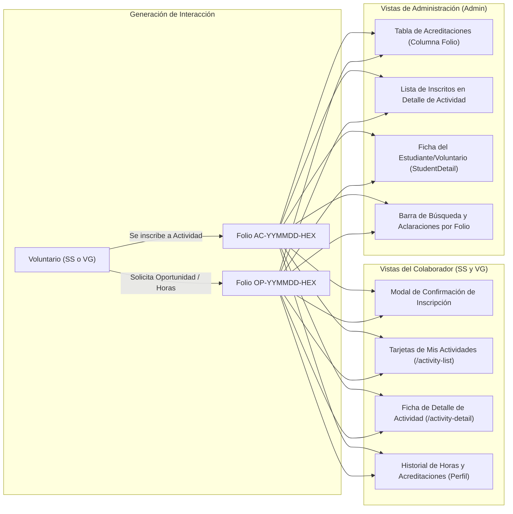

1. **En la Experiencia del Colaborador (Estudiantes y Voluntarios Generales):**
   * **Modal de Confirmación:** Al pulsar *"Inscribirme"* o *"Enviar Acreditación"*, el modal de éxito despliega en tipografía monoespaciada destacada:  
     `🎉 Solicitud registrada con éxito. Tu Folio de Seguimiento es: AC-261102-0A14`
   * **En la Lista de Actividades Convocadas (`/activity-list`):** Si el usuario ya está registrado en la actividad, la tarjeta sustituye el botón de inscripción por una píldora con gradiente: `Folio: AC-261102-0A14 · Estado: Registrado`.
   * **En la Vista de Detalle (`/activity-detail`):** Encabezado de estado con el folio de inscripción y opción de copiar al portapapeles.
   * **En el Perfil Personal (`/volunteer-profile` o perfil de estudiante):** La tabla de *"Mis Horas y Asistencias"* expone el folio de interacción como primera columna, permitiendo al usuario respaldar cada fila con su código oficial.

2. **En la Experiencia de Administración (`Admin`):**
   * **Tabla de Gestión de Acreditaciones (`accreditation.component.html`):** Columna visible `Folio Interacción`, permitiendo ordenar y buscar rápidamente por `AC-...` u `OP-...`.
   * **Administración de Actividades (`activity.component.html`):** En la lista desplegable de voluntarios inscritos a una convocatoria, cada fila muestra el nombre, el folio de expediente del colaborador (`SS-...` / `VG-...`) y el folio específico de su inscripción (`AC-...`).
   * **Ficha de Detalle del Alumno (`StudentDetailComponent` y `VolunteerDetailComponent`):** En la tabla de actividades asignadas y acreditadas, cada registro exhibe su folio para facilitar el cotejo ante reclamos de horas.

#### Persistencia en Modelos de MongoDB

##### 1. Sub-esquema `assignedActivities` (en `Student` y `Volunteer`)
En los modelos `backend/models/student.model.js` y `backend/models/volunteer.model.js`, cada inscripción en el arreglo `assignedActivities` incorpora los campos del folio:

```javascript
const assignedActivitySchema = new mongoose.Schema({
  activityId: {
    type: mongoose.Schema.Types.ObjectId,
    ref: "Activity",
    required: true,
  },
  // Folio determinista de la interacción del usuario con la actividad
  interactionFolio: {
    type: String,
    required: true,
    uppercase: true,
    trim: true,
    index: true, // Ej: "AC-261102-0A14"
  },
  interactionType: {
    type: String,
    enum: ["AC", "OP"],
    default: "AC",
    required: true,
  },
  comments: {
    type: String,
    default: "Sin realizar",
  },
  dueDate: { type: Date },
  valueInHours: { type: Number },
  validatedHours: { type: Number, default: 0 },
  status: {
    type: String,
    enum: ["registered", "attended", "absent", "validated", "cancelled"],
    default: "registered",
  },
  performance: {
    type: String,
    enum: ["pending", "very_bad", "bad", "good", "very_good", "excellent", "absent"],
    default: "pending",
  },
  registrationDate: {
    type: Date,
    default: Date.now,
  },
});
```

##### 2. Sub-esquema `accreditations` Embebido (Arreglo 2 en `Student` y `Volunteer`)
Para que cada colaborador sea dueño integral de su historial y no dependa de llaves foráneas frágiles en una colección externa, `Student` y `Volunteer` incorporan un segundo arreglo embebido para sus oportunidades acreditadas:

```javascript
const embeddedAccreditationSchema = new mongoose.Schema(
  {
    accreditationId: {
      type: mongoose.Schema.Types.ObjectId,
      ref: "Accreditation",
      required: false,
    },
    // Folio determinista único de la interacción (OP-CAT-YYMMDD-HEX)
    interactionFolio: {
      type: String,
      required: true,
      uppercase: true,
      trim: true,
      index: true,
    },
    interactionType: {
      type: String,
      enum: ["AC", "OP"],
      default: "OP",
      required: true,
    },
    type: {
      type: String,
      enum: [
        "EVENT", "INDUCTION", "IDENTIFICATION", "STERILIZATION",
        "ADOPTION", "ADOPTION_MODULE", "TALK", "CAMPAIGN",
        "MEDIA", "SOCIAL_MEDIA", "DONATION", "ADMINISTRATIVE",
      ],
      required: true,
    },
    categoryCode: {
      type: String,
      enum: ["EVE", "IND", "IDE", "STE", "ADO", "MOD", "TLK", "CAM", "MED", "SOC", "DON", "ADM"],
      required: true,
    },
    date: { type: Date, required: true },
    hoursPerformed: { type: Number, default: 0, min: 0 },
    hoursAccredited: { type: Number, default: 0, min: 0 },
    status: {
      type: String,
      enum: ["pending", "approved", "rejected"],
      default: "pending",
      index: true,
    },
    comments: { type: String, default: "" },
    evidenceUrl: { type: String, default: "" },
    activityRef: {
      type: mongoose.Schema.Types.ObjectId,
      ref: "Activity",
      required: false,
    },
    registeredAt: { type: Date, default: Date.now },
    validatedAt: { type: Date },
  },
  {
    _id: true, // Cada acreditación embebida retiene su propio ObjectId inmutable
  }
);
```

##### 3. Definición Dual en los Esquemas Maestros `Student` y `Volunteer`
En `backend/models/student.model.js` y `backend/models/volunteer.model.js`, los esquemas raíz alojan de forma estandarizada los dos arreglos desnormalizados:

```javascript
// Esquema raíz en Student y Volunteer:
const studentSchema = new mongoose.Schema({
  folio: { type: String, required: true, uppercase: true, index: true }, // "SS-261030-01"
  accountStatus: { type: String, enum: ["active", "inactive"], default: "active" },
  fechaDesactivacion: { type: Date, default: null },

  // ARREGLO 1: Actividades convocadas colectivas (con folio AC-YYMMDD-HEX)
  assignedActivities: [assignedActivitySchema],

  // ARREGLO 2: Oportunidades y horas acreditadas (con folio OP-CAT-YYMMDD-HEX)
  accreditations: [embeddedAccreditationSchema],

  // Otros campos del perfil, expediente, consentimientos...
}, { timestamps: true });
```

##### 4. Colección Transaccional `Accreditation` (`backend/models/accreditation.model.js`)
Para la cola de moderación y aprobación administrativa, la colección independiente `Accreditation` opera como un buzón transaccional de revisión que sincroniza atómicamente el estado aprobado al subdocumento del estudiante/voluntario:

```javascript
const accreditationSchema = new mongoose.Schema(
  {
    // Folio determinista único de la acreditación
    interactionFolio: {
      type: String,
      required: true,
      unique: true,
      uppercase: true,
      trim: true,
      index: true, // Ej: "OP-STE-261102-03C8"
    },
    interactionType: {
      type: String,
      enum: ["AC", "OP"],
      default: "OP",
      required: true,
      index: true,
    },

    // Referencias opcionales al colaborador (permite rol student o volunteer)
    studentRef: {
      type: mongoose.Schema.Types.ObjectId,
      ref: "Student",
      required: false,
    },
    volunteerRef: {
      type: mongoose.Schema.Types.ObjectId,
      ref: "Volunteer",
      required: false,
    },
    userRole: {
      type: String,
      enum: ["student", "volunteer"],
      required: true,
    },

    type: {
      type: String,
      enum: [
        "EVENT", "INDUCTION", "IDENTIFICATION", "STERILIZATION",
        "ADOPTION", "ADOPTION_MODULE", "TALK", "CAMPAIGN",
        "MEDIA", "SOCIAL_MEDIA", "DONATION", "ADMINISTRATIVE",
      ],
      required: true,
    },
    
    activityRef: {
      type: mongoose.Schema.Types.ObjectId,
      ref: "Activity",
      required: false,
    },

    date: { type: Date, required: true },
    hoursPerformed: { type: Number, default: 0, min: 0 },
    hoursAccredited: { type: Number, default: 0, min: 0 },
    status: {
      type: String,
      enum: ["pending", "approved", "rejected"],
      default: "pending",
      index: true,
    },
    comments: { type: String, default: "" },
    evidenceUrl: { type: String, default: "" },
  },
  {
    timestamps: true,
  }
);
```

#### Sincronización Atómica y Garantía Cero-Null en Deshidratación / Rehidratación

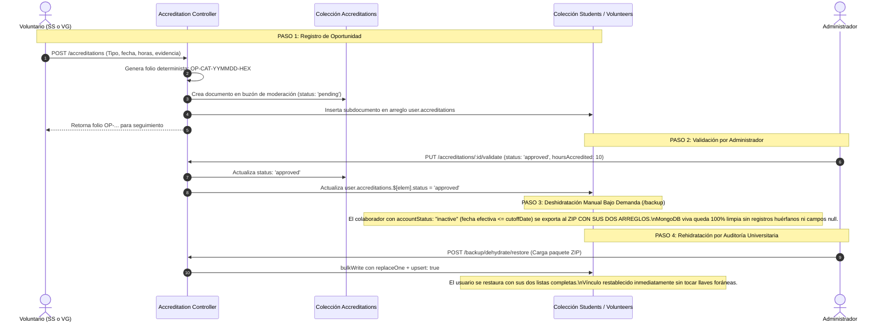

##### Resumen de la Garantía de Integridad:
1. **Durante la Operación Activa:** El usuario consulta su perfil y ve inmediatamente sus horas y folios desde sus propios arreglos embebidos `assignedActivities` y `accreditations`, sin sobrecargar la base de datos con joins de agregación pesados.
2. **Durante la Deshidratación:** Al ejecutarse un corte manual en `/backup` sobre cualquier colaborador con `accountStatus: "inactive"` y fecha efectiva `<= cutoffDate`, el documento completo del usuario (con sus dos arreglos y todos sus folios) se empaqueta en `students.json` o `volunteers.json` y se retira de Atlas. No queda ningún campo en la base de datos viva apuntando a `studentRef: null`.
3. **Durante la Rehidratación:** Si la universidad requiere el expediente tiempo después, la carga del ZIP restaura el documento del estudiante con sus horas y folios originales. El usuario vuelve a existir en Atlas con todo su historial íntegro.

#### Preservación en Deshidratación y Vista de Historial
* **En la Vista `/volunteers/history`:** Todos los colaboradores con `accountStatus: "inactive"` vigentes en MongoDB se consultan sin filtro de antigüedad y sus registros de acreditaciones retienen y muestran el `interactionFolio` (`AC-...` u `OP-...`), permitiendo a la organización atender auditorías escolares retrospectivas en cualquier momento.
* **En el Manifiesto de Deshidratación:** Los identificadores `interactionFolio` son exportados en los archivos JSON de `accreditations.json` y respaldados en el sub-esquema `sampleItems` de la bitácora `DehydrationAuditLog`.

---

### 5.4 Mapeo y Definición Visual de Vistas: Ubicación Exacta de los Folios

Para evitar la saturación visual (*UI clutter*) y garantizar que los folios cumplan su función operativa (respaldar horas, auditar asistencias y tramitar aclaraciones), el sistema define con precisión en qué vistas, para qué roles y en qué elementos visuales específicos se renderizan los folios, así como las vistas donde queda estrictamente prohibido colocarlos.

```mermaid
flowchart TD
    subgraph DONDE_SI ["DONDE SÍ SE MUESTRA EL FOLIO (9 Vistas Críticas)"]
        direction TB
        S1["1. /my-accreditations (Folio AC / OP para pelear horas)"]
        S2["2. /admin/accreditations (Folio AC / OP para dictaminar)"]
        S3["3. /student-profile (SS-... en header y tabla con AC/OP)"]
        S4["4. /volunteer-profile (VG-... en header y tabla con AC/OP)"]
        S5["5. /onboarding/expediente (SS-... o VG-... de admisión)"]
        S6["6. /student (Tabla de voluntarios con columna de Folio)"]
        S7["7. /student/:id (Ficha alumno con SS-... y AC/OP)"]
        S8["8. /volunteer-detail/:id (Ficha voluntario con VG-... y AC/OP)"]
        S9["9. /volunteers/history (Histórico pasado para auditorías)"]
    end

    subgraph CONDICIONAL ["VISIBILIDAD CONDICIONAL / DINÁMICA (3 Vistas)"]
        direction TB
        C1["/activity-list (Solo si el voluntario ya está inscrito)"]
        C2["/activity-list/:id (Solo si el voluntario ya está inscrito)"]
        C3["Detalle de Plática/Campaña (Solo en lista de asistentes)"]
    end

    subgraph DONDE_NO ["DONDE NO SE MUESTRA (Excluidas por Ruido Visual / 10 Vistas)"]
        direction TB
        N1["/admin/home (Dashboard macro directivo)"]
        N2["/activity (Crear actividad colectiva)"]
        N3["/admin/quick-activities (Plantillas maestras permanentes)"]
        N4["/pets (Censo animal comunitario)"]
        N5["/survey y /contact (Analítica y directorio externo)"]
        N6["/sobre-mi (Edición de biografía personal)"]
        N7["/survey/form (Captura de preguntas en campo)"]
        N8["/auth/login y /signup (Sin sesión autenticada)"]
        N9["Formularios públicos ciudadanos (Trámites externos)"]
    end
```

#### 1. Catálogo de Vistas donde SÍ va el Folio (Especificación de Componentes)

| # | Vista y Ruta | Rol de Acceso | Qué muestra la vista (Código) | Folios Mostrados | Elemento UI y Ubicación Exacta |
| :-: | :--- | :--- | :--- | :---: | :--- |
| **1** | **`/my-accreditations`**<br>([`MyAccreditationsComponent`](file:///Users/riosisraelg/Desktop/1/abaq/frontend/src/app/components/my-accreditations/my-accreditations.ts)) | `student` | Bandeja de horas y actividades personales, solicitudes pendientes/aprobadas y modal de nueva solicitud. | **Folio de Interacción (`AC` / `OP`)** | **En cada tarjeta y fila de tabla:** Píldora destacada junto al estatus (`.folio-pill-interactive`) con botón de copiado rápido al portapapeles. |
| **2** | **`/admin/accreditations`**<br>([`AccreditationListComponent`](file:///Users/riosisraelg/Desktop/1/abaq/frontend/src/app/components/accreditation-list/accreditation-list.ts)) | `admin` | Bandeja general de validación de horas (pendientes e historial). Dictamen con modal de observaciones. | **Folio de Interacción (`AC` / `OP`)** | **Columna dedicada en la tabla principal (`th.folio-col`, `td.folio-cell`):** Permite ordenar, filtrar y cotejar solicitudes universitarias. |
| **3** | **`/student-profile`**<br>([`StudentProfile`](file:///Users/riosisraelg/Desktop/1/abaq/frontend/src/app/components/student-profile/student-profile.ts)) | `student` | Perfil del estudiante: progreso sobre 480 hrs, carrera, matrícula, expediente y actividades asignadas. | **Ambos:**<br>• `SS-YYMMDD-HEX`<br>• `AC` / `OP` | • **Header:** Badge institucional permanente `.profile-header-folio-badge` junto al nombre.<br>• **Tabla de Actividades Asignadas:** Primera columna con el folio de interacción de cada actividad/hora. |
| **4** | **`/volunteer-profile`**<br>([`VolunteerProfile`](file:///Users/riosisraelg/Desktop/1/abaq/frontend/src/app/components/volunteer-profile/volunteer-profile.ts)) | `volunteer` | Perfil del voluntario general: grados académicos, constancia de vinculación e historial de asistencias. | **Ambos:**<br>• `VG-YYMMDD-HEX`<br>• `AC` / `OP` | • **Hero:** Badge `.profile-header-folio-badge` junto al nombre.<br>• **Tabla de Participaciones:** Columna de folio para amparar cada asistencia cívica. |
| **5** | **`/onboarding/expediente`**<br>([`ExpedienteRecibidoComponent`](file:///Users/riosisraelg/Desktop/1/abaq/frontend/src/app/components/onboarding/expediente-recibido.component.ts)) | `student`<br>`volunteer` | Estado de revisión documental (`pending`, `accepted`, `rejected`), observaciones de coordinación y descarga de carta. | **Folio de Expediente (`SS` / `VG`)** | **Hero superior:** Contenedor destacado `.expediente-folio-badge` con tipografía monoespaciada: *"Tu Folio Oficial de Admisión: SS-261030-01"*. |
| **6** | **`/student`**<br>([`StudentComponent`](file:///Users/riosisraelg/Desktop/1/abaq/frontend/src/app/components/student/student.component.ts)) | `admin` | Tabla general de voluntarios (pestaña Estudiantes y pestaña Voluntarios Generales), buscador y paginador. | **Folio de Expediente (`SS` / `VG`)** | **Columna visible e indexada (`th.folio-th`, `td.folio-cell`):** Permite buscar directamente por folio en el input de filtrado rápido. |
| **7** | **`/student/:id`**<br>([`StudentDetail`](file:///Users/riosisraelg/Desktop/1/abaq/frontend/src/app/components/student-detail/student-detail.ts)) | `admin` | Ficha exhaustiva del estudiante: expediente digital, URLs de Drive, actividades asignadas y bitácora de estatus. | **Ambos:**<br>• `SS-YYMMDD-HEX`<br>• `AC` / `OP` | • **Encabezado principal:** Badge de folio escolar.<br>• **Tabla de Actividades y Acreditaciones:** Columna dedicada exhibiendo `AC-...` u `OP-...` en cada registro. |
| **8** | **`/volunteer-detail/:id`**<br>([`VolunteerDetail`](file:///Users/riosisraelg/Desktop/1/abaq/frontend/src/app/components/volunteer-detail/volunteer-detail.ts)) | `admin` | Ficha del voluntario general: grados académicos, participaciones cívicas y bitácora de estatus. | **Ambos:**<br>• `VG-YYMMDD-HEX`<br>• `AC` / `OP` | • **Encabezado:** Badge `VG-...`<br>• **Tabla de Participaciones:** Columna de folio de asistencia de cada jornada. |
| **9** | **`/volunteers/history`**<br>*(Vista Histórica)* | `admin` | Historial íntegro de todos los colaboradores `inactive` en BD y bitácora de transiciones. | **Ambos:**<br>• `SS` / `VG`<br>• `AC` / `OP` | • **Tablas de Historial:** Folio de expediente en cada fila.<br>• **Modal de Desglose:** Folios `AC/OP` de las participaciones pasadas para atender requerimientos universitarios. |

---

#### 2. Vistas con Visibilidad Condicional / Dinámica

| Vista y Ruta | Rol de Acceso | Comportamiento sin Inscripción previa | Comportamiento con Inscripción Confirmada |
| :--- | :--- | :--- | :--- |
| **`/activity-list`**<br>([`ActivityListComponent`](file:///Users/riosisraelg/Desktop/1/abaq/frontend/src/app/components/activity-list/activity-list.component.ts)) | `student`<br>`volunteer` | **NO se muestra ningún folio.** La tarjeta exhibe los datos generales de la convocatoria y el botón *"Inscribirme"*. | **SÍ se muestra una píldora con el Folio:** El botón de inscripción se reemplaza por el badge: `Folio: AC-261102-0A14 · Estado: Registrado`. |
| **`/activity-list/:id`**<br>([`ActivityDetail`](file:///Users/riosisraelg/Desktop/1/abaq/frontend/src/app/components/activity-detail/activity-detail.ts)) | `student`<br>`volunteer` | **NO se muestra folio.** Muestra el botón de postulación o inscripción. | **SÍ se muestra el banner de participación:** En el hero superior aparece una barra destacada: `Tu Folio de Inscripción es: AC-261102-0A14` con botón de *"Copiar"*. |
| **Detalle de Oportunidad**<br>(`/admin/talks/:id`, `/admin/campaigns/:id`, `/admin/adoptions/:id`) | `admin` | **NO se muestra en el encabezado del evento.** La plática o campaña no es una interacción individual. | **SÍ en la lista de voluntarios asistentes:** Cada fila de la tabla de colaboradores inscritos exhibe su folio individual (`OP-TLK-...`, `OP-CAM-...`). |

---

#### 3. Vistas donde NO Vale la Pena Mostrar el Folio (Exclusión Justificada)

| Vista y Ruta | Rol | Qué muestra | Razón de Exclusión (Cero Ruido Visual) |
| :--- | :--- | :--- | :--- |
| **`/admin/home`** | `admin` | Tablero directivo con tarjetas de métricas agregadas (totales de voluntarios, horas acumuladas, actividades creadas). | **Vista macro-estadística.** No opera sobre registros individuales. Añadir folios generaría saturación absurda. |
| **`/activity`** | `admin` | Formulario para crear una nueva actividad institucional y catálogo general. | La actividad a crear es una entidad institucional abstracta. El folio de interacción sólo nace cuando un alumno se inscribe. |
| **`/admin/quick-activities`** | `admin` | Plantillas maestras reutilizables (limpieza, eventos exprés). | Son moldes permanentes de configuración; no tienen relación con ningún voluntario individual. |
| **`/pets`** | `admin` | Padrón y censo de animales comunitarios (vacunas, fotos, citas). | Es la entidad paciente animal de Querétaro; no pertenece al subsistema de horas de voluntarios. |
| **`/survey`** y **`/contact`** | `admin` | Tableros analíticos de encuestas y directorio de aliados/veterinarios. | Gráficas agregadas de Business Intelligence y directorio externo sin relación con folios de servicio. |
| **`/sobre-mi`** | `student`<br>`volunteer` | Formulario de edición de biografía personal, teléfono y redes sociales. | Pantalla de edición de campos blandos. Exhibir folios aquí sobrecarga el formulario sin aportar valor. |
| **`/survey/form`** | Colaborador | Cuestionario de 25 preguntas socioambientales para aplicar en campo. | Durante la captura de datos en campo se requiere máxima agilidad; no debe haber folios distractores. |
| **`/auth/login` y `/signup`** | Público | Formularios de inicio de sesión y registro público. | No existe sesión autenticada ni cuenta creada todavía. |
| **Formularios Públicos Ciudadanos** (`/formularios/...`) | Ciudadanía | Solicitud ciudadana de adopción, placa o plática. | Son trámites de cara a la comunidad externa, no interacciones de voluntariado de horas. |

---

#### 4. Especificación Visual y Estilos de Interfaz (Design System ABAQ)

Para mantener una presentación consistente, limpia y accesible, los folios se renderizan bajo tres patrones visuales estandarizados:

```
1. BADGE DE FOLIO DE EXPEDIENTE (Header de Perfil y Tablas Generales)
   ┌────────────────────────────────────────────────────────┐
   │  FOLIO: SS-261030-01                                   │  (Fondo azul suave, borde 1.5px, monoespaciado)
   └────────────────────────────────────────────────────────┘

2. PÍLDORA DE ACTIVIDAD CONVOCADA (AC)
   ┌────────────────────────────────────────────────────────┐
   │  📅 AC-261102-0A14 · Registrado                       │  (Fondo verde esmeralda suave, texto institucional)
   └────────────────────────────────────────────────────────┘

3. PÍLDORA DE OPORTUNIDAD INSTITUCIONAL (OP)
   ┌────────────────────────────────────────────────────────┐
   │  🏷️ OP-STE-261102-03C8 · Validado (10 hrs)             │  (Sub-código de 3 letras visible, monoespaciado)
   └────────────────────────────────────────────────────────┘
```

##### Clases CSS Estandarizadas
```css
/* Badge de Folio de Expediente (Estudiantes y Voluntarios Generales) */
.folio-badge-expediente {
  font-family: 'SF Mono', 'Roboto Mono', Menlo, monospace;
  font-size: 0.88rem;
  font-weight: 800;
  letter-spacing: 0.5px;
  background: rgba(31, 47, 99, 0.08);
  border: 1.5px solid rgba(31, 47, 99, 0.28);
  color: #1f2f63;
  padding: 3px 10px;
  border-radius: 6px;
  display: inline-flex;
  align-items: center;
  gap: 6px;
}

/* Píldora de Folio de Actividad (AC) */
.folio-pill-ac {
  font-family: 'SF Mono', 'Roboto Mono', Menlo, monospace;
  font-size: 0.82rem;
  font-weight: 700;
  background: rgba(45, 106, 46, 0.1);
  border: 1px solid rgba(45, 106, 46, 0.35);
  color: #2d6a2e;
  padding: 2px 8px;
  border-radius: 20px;
  display: inline-flex;
  align-items: center;
  gap: 5px;
}

/* Píldora de Folio de Oportunidad (OP) */
.folio-pill-op {
  font-family: 'SF Mono', 'Roboto Mono', Menlo, monospace;
  font-size: 0.82rem;
  font-weight: 700;
  background: rgba(234, 88, 12, 0.1);
  border: 1px solid rgba(234, 88, 12, 0.35);
  color: #c2410c;
  padding: 2px 8px;
  border-radius: 20px;
  display: inline-flex;
  align-items: center;
  gap: 5px;
}
```

---

## 6. Sistema Transaccional de Notificaciones (Resend)

El servicio de correo transaccional utiliza la API oficial de Resend exclusivamente bajo eventos explícitos del ciclo de vida (sin procesos `node-cron` en segundo plano).

!!! important "Destinatarios Exclusivos: Los Voluntarios"
    Todas las notificaciones del ciclo de vida son **exclusivamente para los voluntarios** (estudiantes de servicio social y voluntarios generales). Se despachan directamente a su dirección de correo electrónico personal registrada. **No existen notificaciones hacia los administradores, ni barridos automáticos en background, ni se implementa interfaz web, campana o bandeja in-app**; la comunicación es 100 % por correo electrónico transaccional.

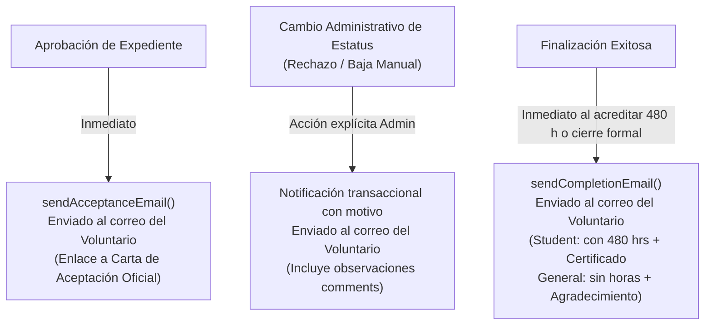

1. **Aceptación de Expediente (`sendAcceptanceEmail`):** Notifica al voluntario a su buzón que su cuenta fue validada, con enlace directo para descargar su Carta de Aceptación Oficial.
2. **Notificación de Dictamen o Baja Administrativa Manual:** Informa al colaborador el motivo formal registrado por la Coordinación (`comments`) cuando su expediente es rechazado o su cuenta pasa manualmente a `inactive`, sin depender de ningún cron diario de inactividad.
3. **Finalización de Vinculación (`sendCompletionEmail`):**
   - **Para Estudiante de Servicio Social:** Reconocimiento con cómputo de sus **480 horas** acreditadas y enlace de descarga a su **Certificado de Finalización Oficial**.
   - **Para Voluntario General:** Reconocimiento y carta de agradecimiento institucional por su labor comunitaria, sin mención de cómputo de horas.

---

## 7. Emisión Criptográfica de Constancias y Certificados

La generación de documentos oficiales se desacopla en dos eventos precisos del ciclo de vida:

| Certificado / Constancia | Evento de Emisión | Condición Obligatoria | Mecanismo Criptográfico |
| :--- | :--- | :--- | :--- |
| **Carta de Aceptación y Felicitación** | Transición a `active` | Aprobación formal por administrador | Token SHA-256 (`acceptance`) verificado en `/certificate/v/:token` |
| **Certificado de Finalización Oficial** | Transición a `inactive` | **Únicamente por término exitoso** (480 horas completadas o desvinculación formal regular) | Token SHA-256 (`completion`) con firma digital institucional y código QR |

!!! warning "Exclusión Estricta de Constancia"
    Si un usuario pasa a `inactive` por **baja administrativa sin conclusión formal** (abandono o sanción administrativa), el sistema **NO** emite certificado de finalización. La constancia es un mérito oficial reservado a voluntarios que concluyeron formalmente.

---

## 8. Homologación Visual de Encabezados (Design System)

Para unificar la identidad visual de la plataforma en ambos roles, todos los encabezados de sección adoptan el patrón estándar institucional `.admin-hero` / `.page-hero`:

```scss
/* Contenedor estándar unificado de encabezado */
.page-hero,
.admin-hero {
  background: linear-gradient(135deg, #1f2f63 0%, #24366f 35%, #2d6a2e 78%, #5ca83a 100%);
  color: #ffffff;
  padding: 32px 36px;
  border-radius: 20px;
  margin-bottom: 28px;
  display: flex;
  justify-content: space-between;
  align-items: center;
  box-shadow: 0 10px 25px -5px rgba(31, 47, 99, 0.25);

  .hero-text-block {
    .eyebrow {
      display: inline-block;
      font-size: 11.5px;
      font-weight: 800;
      letter-spacing: 1.5px;
      text-transform: uppercase;
      opacity: 0.85;
      margin-bottom: 6px;
    }
    h1 {
      font-size: 28px;
      font-weight: 800;
      margin: 0 0 8px 0;
      color: #ffffff;
    }
    p {
      margin: 0;
      font-size: 14.5px;
      opacity: 0.9;
      max-width: 680px;
      line-height: 1.5;
    }
  }
}
```

### Pantallas Homologadas:
- **Rol Administrador:** Home (`/admin/home`), Voluntarios (`/student`), Actividades (`/activity`), Respaldos y Deshidratación (`/backup`), Historial de Voluntarios Pasados (`/volunteers/history`), Encuestas (`/survey`).
- **Rol Voluntario / Estudiante:** Catálogo de Actividades (`/activity-list`), Detalle de Actividad (`/activity-detail/:id`), Perfil de Voluntario (`/volunteer-profile`), Encuestas (`/survey`).
