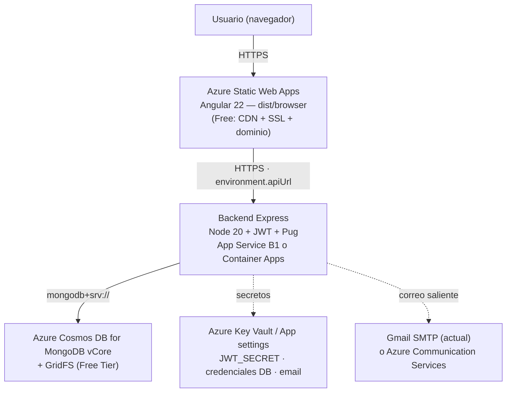

# Estudio de Despliegue en la Nube (Azure)
**Proyecto:** Aplicativos internos ABAQ (Backend de datos + Panel Angular)
**Versión:** 1.0.0
**Fecha:** 2026-10-08
**Estado:** Borrador para revisión del ingeniero de soporte
**Autor:** Arquitectura de Soluciones Cloud — Equipo de Desarrollo ABAQ

!!! warning "Nota sobre cifras de costos"
    Todos los costos de Azure citados en este documento son valores de referencia **sujetos a verificación en el portal de precios de Azure y en la cuenta del grant** antes de comprometer presupuesto.

---

## 1. Resumen ejecutivo

El equipo interno desarrolla dos aplicativos independientes del sitio de presentación institucional: un **backend de datos (Node.js/Express + MongoDB)** y un **panel frontend (Angular 22)**. Estos sistemas son operacionalmente distintos del servidor de página dinámica que el proveedor actual mantiene.

El objetivo de este documento es doble:

1. **Determinar la compatibilidad** de la infraestructura y licencias que la organización ya paga con los requisitos técnicos reales de nuestros aplicativos.
2. En caso de incompatibilidad o insuficiencia, **proponer una arquitectura de referencia en Azure** que opere dentro del Microsoft for Nonprofits Azure Grant ($2,000 USD/año en créditos).

!!! note "Veredicto preliminar"
    El stack que opera un sitio de presentación (típicamente CMS/hosting web de contenido) **rara vez cubre** los requisitos de nuestro backend (runtime Node persistente, base de datos tipo MongoDB con almacenamiento binario GridFS y SMTP saliente). La sección 3 lista las preguntas exactas para confirmarlo con cifras, no por suposición.

---

## 2. Inventario técnico verificado de nuestros aplicativos

Leído directamente del repositorio en las ramas `abel-backend-redesign` y `abel-ui-redesign`.

### 2.1 Backend — `/backend` (Node.js + Express)

| Elemento | Detalle verificado |
|---|---|
| Framework | Express `^4.19.2` |
| Entrypoint / arranque | `app.js`, `node app.js`, escucha en `PORT` (default 3000) |
| Versión de Node | **No declarada** (`package.json` sin campo `engines`) |
| Scripts | Solo `start` y `test` (ambos `node app.js`); **sin `build` ni `dev`** |
| Base de datos | MongoDB vía Mongoose `^8.4.4` |
| Cadena de conexión | Construida por concatenación: `mongodb+srv://` + usuario/clave/cluster/db/query (estilo Atlas SRV). **No usa una variable única `MONGODB_URI`** |
| Almacenamiento de archivos | **GridFS** sobre la misma conexión Mongo (bucket `uploads`); subida vía **Multer memoryStorage**, hasta 10 archivos |
| Email | **Nodemailer** con transporte fijo **Gmail** (SMTP 465), credenciales `EMAIL_FROM`/`EMAIL_PASS` |
| Autenticación | **JWT** (`jsonwebtoken`), `JWT_SECRET`, expiración `JWT_EXPIRES_IN` (7d) |
| Motor de vistas | Pug |
| Contenerización / CI-CD | **No existe Dockerfile, docker-compose ni workflows CI/CD** |

!!! info "Discrepancia con el SAD vigente"
    El documento de Arquitectura (SAD v2.0.0) declara **Node.js v24 LTS**, pero el `package.json` real del backend **no declara `engines`**. La versión de Node queda sin fijar en el código y debe establecerse explícitamente antes del despliegue (ver remediación 5.4).

**Valores hardcodeados que bloquean la portabilidad (deben parametrizarse antes de desplegar):**

1. CORS fijado a `origin: "http://localhost:4200"` (`app.js`).
2. URL de descarga de uploads `http://localhost:${PORT}/upload/...` (`upload.controller.js`).
3. Remitente de email `abaq.org@gmail.com` (`utils/email.js`).

### 2.2 Frontend — `/frontend` (Angular 22)

| Elemento | Detalle verificado |
|---|---|
| Framework | Angular `^22.0.0`, Angular CLI 22, TypeScript `~6.0.3` |
| Build de producción | `ng build -c production` → salida `dist/browser` |
| Builder | `@angular-devkit/build-angular:browser` |
| Budgets | initial 1 MB warn / 5 MB error |
| UI | Bootstrap 5.3, ng-bootstrap 21, Chart.js; `csv-parse` para datos |
| Conexión al backend | Todos los servicios usan `environment.apiUrl` |
| Environments | `src/environments/environment*.ts` **no versionados**; se generan en build por `frontend/server.js` desde la variable `FIREBASE_DETAILS`. **El valor real de `apiUrl` no está en el código (pendiente de confirmar)** |
| Config de despliegue existente | Firebase Hosting (`.firebaserc`, `FIREBASE_*`) y AWS Amplify (IaC en `/infrastructure`). **No hay** config Azure |

### 2.3 Infraestructura — `/infrastructure`

- `cosmosdb-vcore/main.tf`: Terraform/OpenTofu (provider `azurerm ~4.0`) que provisiona `azurerm_resource_group` + `azurerm_mongo_cluster` (**Azure Cosmos DB for MongoDB vCore**). Marcado como **skeleton NO aplicado**.

!!! danger "Discrepancia crítica de conexión a la base de datos"
    El comentario del Terraform asume que el backend lee `MONGODB_URI`, pero el código construye la URI por piezas. Requiere refactor del backend o mapeo de variables en el despliegue (ver remediación 5.5).

- `amplify-abaqStaticWebsite`, `amplify-mock-frontend`: IaC Amplify (AWS), orientada al sitio estático.
- `/staticWebsite`: prototipo HTML + `dist` + `site.zip` (el sitio de presentación institucional).

---

## 3. Preguntas de compatibilidad para el ingeniero de soporte

Nuestros aplicativos **no son** una página de presentación: son servicios con estado persistente. Para decidir objetivamente si su infraestructura actual sirve, necesitamos las siguientes respuestas con datos concretos.

### 3.1 Plataforma y runtime

1. ¿Qué sistema operativo, panel de control y modelo de hosting opera el servidor actual (hosting compartido, VPS, servidor dedicado, PaaS)?
2. ¿Permite ejecutar un **proceso Node.js de larga duración** (no CGI/PHP por request)? ¿Qué versiones de Node están disponibles? Requerimos **Node 20 LTS o superior**.
3. ¿Soporta despliegue mediante **contenedores (Docker)** o solo subida de archivos (FTP/SFTP)?
4. ¿Permite configurar **CI/CD** (webhooks de Git, GitHub Actions, pipelines)?

### 3.2 Base de datos y almacenamiento

5. ¿Ofrece **MongoDB** o un servicio compatible con el protocolo MongoDB? ¿Qué versión y qué cuota de almacenamiento?
6. ¿Permite almacenamiento de **archivos binarios** (nuestro backend usa GridFS dentro de MongoDB)? ¿Hay límite de tamaño por archivo o por base de datos?
7. ¿La base de datos acepta conexiones autenticadas con cadena `mongodb+srv://` (SRV) o requiere un formato distinto?

### 3.3 Red, correo y licencias

8. ¿Permite **SMTP saliente** (puerto 465/587) para envío de correo transaccional? ¿O debemos usar un relay externo?
9. ¿Qué **puertos salientes** están permitidos desde el servidor?
10. ¿Qué **licencias paga actualmente la organización** y qué cubren exactamente? ¿Incluyen capacidad de cómputo/almacenamiento adicional para alojar aplicaciones de terceros (las nuestras), o están limitadas al sitio de presentación?
11. ¿Hay cuota de CPU/RAM/almacenamiento libre que podamos usar sin costo adicional, o implicaría un upgrade de plan?

### 3.4 Criterio de decisión del arquitecto

| Si el proveedor actual... | Entonces... |
|---|---|
| Soporta Node 20+, MongoDB con GridFS, SMTP saliente y CI/CD **sin costo adicional** | Evaluar reutilizar su infraestructura (menor fricción, sin consumo de grant) |
| Soporta el stack pero requiere **upgrade de licencia de pago** | Comparar ese costo recurrente contra el grant Azure de $2,000/año |
| **No soporta** proceso Node persistente o MongoDB | Levantar en Azure (recomendación por defecto, ver sección 4) |

---

## 4. Arquitectura objetivo en Azure

Diseñada para operar dentro del grant de $2,000 USD/año, maximizando los niveles gratuitos.

### 4.1 Diagrama lógico

### 4.2 Componentes y justificación

| Capa | Servicio Azure | Nivel | Justificación |
|---|---|---|---|
| Frontend | **Azure Static Web Apps** | Free | Hosting estático global, CI/CD con GitHub Actions, dominio custom y SSL incluidos; encaja con la salida `dist/browser` de Angular |
| Backend | **App Service (Linux)** vs **Container Apps** | B1 / Consumo | Ver comparativa 4.3 |
| Datos | **Cosmos DB for MongoDB vCore** | Free Tier | 1 servidor gratis/suscripción, 32 GB; compatible con protocolo Mongo y Mongoose |
| Secretos | **Key Vault / App settings** | Bajo costo | Sacar `JWT_SECRET`, credenciales DB y email del código |

### 4.3 Backend: App Service vs Container Apps

| Criterio | Azure App Service (B1) | Azure Container Apps (consumo) |
|---|---|---|
| Requiere Dockerfile | No (deploy directo de código Node) | **Sí** (no existe aún en el repo) |
| Modelo de costo | Plan fijo mensual | Pago por uso; **scale-to-zero** |
| Nivel gratuito | Free/Shared para dev (limitado) | 180k vCPU-seg, 360k GiB-seg, 2M requests/mes gratis por suscripción |
| Idoneidad | Óptimo para app web Express de un solo proceso | Óptimo si se conteneriza y el tráfico es intermitente |
| Esfuerzo inicial | **Menor** | Mayor (crear y mantener imagen) |

!!! tip "Recomendación"
    Iniciar con **App Service B1** por el menor esfuerzo (no requiere contenerizar) y porque el motor Pug y el proceso Express encajan directamente. Migrar a Container Apps si el patrón de tráfico justifica scale-to-zero.

---

## 5. Remediación de código requerida antes del despliegue

Lista accionable, previa a cualquier deploy:

1. **Backend — parametrizar CORS:** reemplazar `origin: "http://localhost:4200"` por una variable de entorno (`FRONTEND_ORIGIN`) con el dominio del Static Web App.
2. **Backend — URL de uploads:** reemplazar `http://localhost:${PORT}` por una base configurable (`PUBLIC_BASE_URL`).
3. **Backend — email:** mover el remitente `abaq.org@gmail.com` a `EMAIL_FROM`.
4. **Backend — runtime:** añadir `"engines": { "node": ">=20" }` en `package.json` y confirmar `start`.
5. **Backend — conexión DB:** reconciliar la discrepancia `MONGODB_URI` del Terraform contra la construcción por piezas; recomendado soportar `MONGODB_URI` directo para Cosmos vCore.
6. **Frontend — environments:** reemplazar la generación de `environment.ts` desde `FIREBASE_DETAILS` por una estrategia Azure (variable de build o `staticwebapp.config.json`), fijando `apiUrl` al dominio del backend.
7. **Contenerización (condicional):** crear `Dockerfile` solo si se elige Container Apps.
8. **CI/CD:** añadir los workflows de la sección 6 (hoy inexistentes).

---

## 6. Pipeline CI/CD propuesto (GitHub Actions)

=== "Frontend → Azure Static Web Apps"

    - Trigger: push a la rama de release.
    - Pasos: `npm ci` → `ng build -c production` → deploy a Static Web Apps (acción oficial `Azure/static-web-apps-deploy`).
    - Secreto: `AZURE_STATIC_WEB_APPS_API_TOKEN`.
    - Config build: `app_location: "/frontend"`, `output_location: "dist/browser"`.

=== "Backend → App Service / Container Apps"

    - Trigger: push a la rama de release.
    - Pasos (App Service): `npm ci` → (lint/test) → deploy con `azure/webapps-deploy`.
    - Pasos (Container Apps): `docker build` → push a ACR → `az containerapp update`.
    - Secretos: credenciales de publicación de App Service o service principal + ACR.

---

## 7. Estimación de costos anual contra el grant de $2,000

| Servicio | Nivel propuesto | Costo mensual estimado* | Costo anual* | ¿Consume grant? |
|---|---|---|---|---|
| Static Web Apps (frontend) | Free | $0 | $0 | No |
| App Service B1 (backend) | B1 Linux | ~$13 | ~$156 | Sí |
| Cosmos DB for MongoDB vCore | Free Tier | $0 | $0 | No |
| Key Vault | Estándar (uso bajo) | <$1 | <$12 | Sí |
| **Total estimado** | | **~$14** | **~$170** | **~8.5% del grant** |

\* Cifras de referencia **sujetas a verificación en el portal de Azure**. El tier M25 de Cosmos (~$111/mes) solo aplicaría si el Free Tier se agota; en ese escenario el costo anual subiría a ~$1,500 y seguiría dentro del grant, pero con menos holgura.

!!! success "Conclusión de costos"
    La arquitectura propuesta consume una fracción pequeña del grant mientras se mantenga en Free Tier de Cosmos y Static Web Apps, dejando amplio margen de crecimiento.

---

## 8. Riesgos y pendientes de confirmar

1. **Valor real de `apiUrl`:** no versionado (se genera desde `FIREBASE_DETAILS`). Debe definirse para el entorno Azure.
2. **GridFS sobre Cosmos vCore:** validar compatibilidad de GridFS y límites de tamaño de documento/archivo; probar con una carga real antes de migrar producción.
3. **Versión de Node objetivo:** sin `engines` declarado; fijar a Node 20 LTS y validar dependencias.
4. **Elegibilidad y vigencia del grant:** confirmar en `nonprofit.microsoft.com` que ABAQ está aprobada y que el crédito aplica a los servicios listados (solo servicios Azure de primera parte).
5. **Discrepancia `MONGODB_URI`:** resolver antes de aplicar el Terraform de Cosmos.
6. **SMTP Gmail en Azure:** verificar que el envío por Gmail SMTP funciona desde Azure; considerar un servicio de correo gestionado si hay bloqueos.

---

## 9. Preguntas abiertas para el ingeniero

- Las once preguntas de la sección 3 (plataforma, base de datos, red/correo, licencias).
- ¿El servidor actual y nuestros aplicativos deben compartir dominio/subdominio, o irán en dominios separados?
- ¿Existe algún requisito de residencia de datos o cumplimiento que condicione la región de Azure?
- ¿Quién administrará las credenciales del grant y la suscripción de Azure (gobernanza de accesos)?
