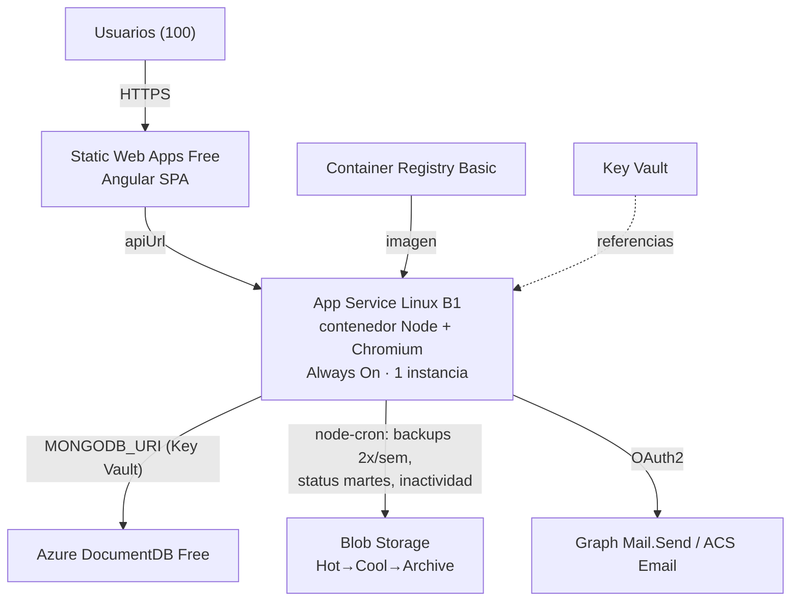
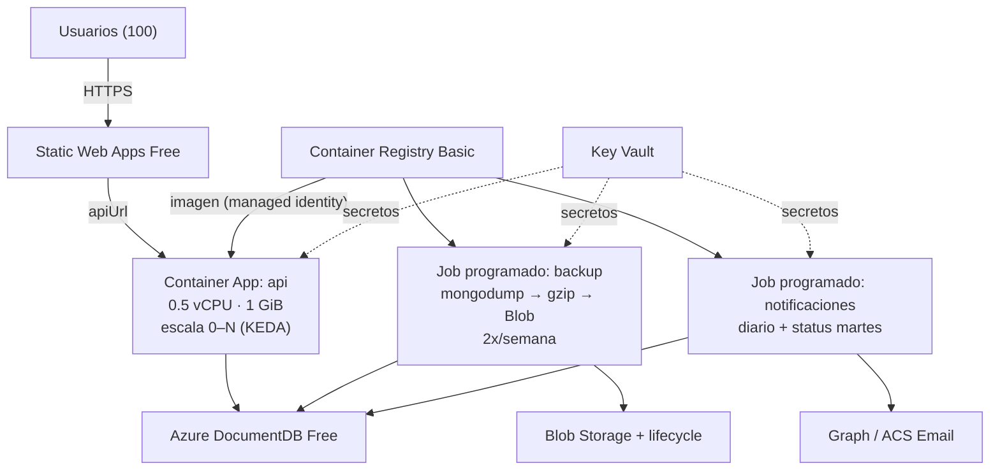
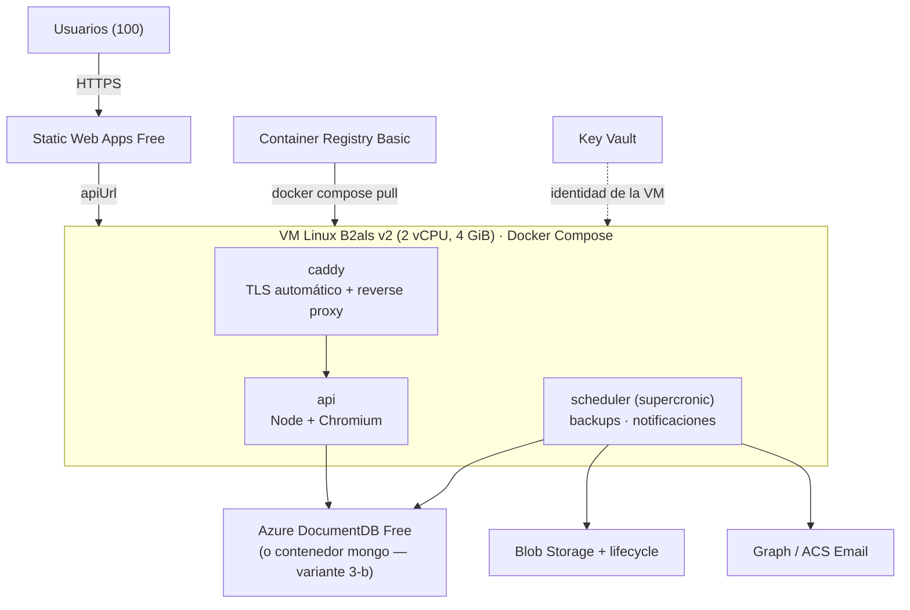

# Despliegue en la Nube (Azure): Tres Arquitecturas y Costeo

**Proyecto:** Plataforma Web ABAQ (Servicio Social)
**Versión:** 3.1.0
**Fecha:** 2026-10-18
**Estado:** Propuesta con costeo real, auditada (ver §13)
**Escala objetivo:** 100 usuarios (capacidad máxima de prueba)
**Presupuesto:** 2,000 USD/año (grant Microsoft for Nonprofits; infraestructura + correo)
**Región de costeo:** East US (`eastus`)
**Relacionado:** [Stack Tecnológico](tech-stack.md) · [Pipelines CI/CD](cicd-pipelines-design.md) · [Datos, Respaldo y Recuperación](datos-respaldo-recuperacion-design.md) · [Notificaciones](notificaciones-design.md)

!!! warning "Alcance y naturaleza de las cifras"
    - **Solo Azure.** Este documento descarta proveedores externos (Cloudflare, AWS, SendGrid, Resend) y cotiza exclusivamente servicios de Azure de primera parte, que son los únicos cubiertos por el crédito del grant [6].
    - Los precios son **de lista (retail)**, consultados el 2026-10-14 en la **Azure Retail Prices API** [1] para `eastus`. No incluyen impuestos ni descuentos. Aún no hay acceso al grant ni recursos aprovisionados, así que el costeo es **proyectivo** y se valida en la Azure Pricing Calculator [23] antes de comprometer presupuesto.
    - Mes de referencia: **730 horas**.

---

## 1. Método

1. Se leyó la documentación de diseño (autenticación, perfil, notificaciones, datos/respaldos) para identificar **cargas futuras**: 2FA, correos programados, backups 2×/semana con permanencia de 6 meses, bulk load y ciclo de vida de datos (periodo en curso + 1 año en la base de datos; histórico en Frío/Rehidratación).
2. Se analizó el **código implementado** (`backend/`, `frontend/`, `infrastructure/`, submódulo `tool-constancias`) para identificar requisitos reales de runtime y bloqueadores (§2).
3. Se definieron **tres arquitecturas Azure**, dos de ellas con Docker/contenedores (§4–§6).
4. Se costearon con precios unitarios de la Retail Prices API (§3) y los supuestos de carga de §1.1.

### 1.1 Supuestos de carga (100 usuarios)

| Variable | Supuesto | Justificación |
|---|---|---|
| Usuarios | 100 voluntarios + 2 administradoras | Capacidad máxima de prueba |
| Peticiones HTTP | ~600,000/mes (≈200 por usuario/día) | Muy por debajo del free grant de Container Apps (2 M) [2] |
| Correos | **2,000/mes**, ~50 KB c/u | Status de los martes (~430), acreditaciones, hitos, inactividad y avisos a admins |
| Base de datos | < 1 GB (sin binarios) | Ventana activa: periodo en curso + 1 año atrás; los documentos son enlaces externos |
| Respaldos | ~5.2 GB en tier Cold | 2 por semana × 26 semanas de permanencia (6 meses) = ~52 respaldos de ~100 MB comprimidos; borrado automático a los 180 días [13] |
| Ciclo de vida (Frío / Rehidratación) | ~1 GB/año en Archive; < 1 GB ocasional en Hot | ZIP de cada periodo que sale de la ventana; rehidrataciones esporádicas |
| Tiempo activo del backend | 120–240 h/mes | Uso concentrado en horario escolar; aplica a escala a cero |
| Logs | < 5 GB/mes | Dentro de la ingesta gratuita de Log Analytics |
| Tráfico de salida | Marginal (SPA servida por Static Web Apps) | Verificar la cuota gratuita de salida vigente [21]; no se costea por separado |

---

## 2. Hallazgos del código que condicionan la arquitectura

El análisis del repositorio (rama de trabajo `dev-rivers`; existe `dev-azure` con ajustes parciales) arroja estos hechos, que pesan en la elección:

| # | Hallazgo (archivo) | Impacto en la arquitectura |
|---|---|---|
| H1 | El submódulo `tool-constancias/generate_html.js` genera el certificado con **Puppeteer 25 (Chromium headless)**, abre un navegador por certificado y escribe el PDF a disco local. | Requiere **Chromium y librerías del SO** en el runtime → conviene **contenedor** (la imagen oficial de Puppeteer parte de Node 24 [31]). Ni Container Apps ni App Service permiten contenedores privilegiados, así que el sandbox de Chromium requiere el *setuid sandbox* o `--no-sandbox` (solo aceptable si el HTML del certificado lo genera 100 % el backend) [18][32]. El consumo de memoria **no tiene cifra oficial**: medir con prueba de carga y limitar la concurrencia (un navegador reutilizado con un contexto por certificado). Alternativa sin binarios: `generate.js` con **pdf-lib**. |
| H2 | No hay cron, colas ni workers en el backend actual. | Los jobs del diseño (backups 2×/semana, status de los martes, inactividad a 30/45/60 días) **son nuevos** y se deben ubicar en la arquitectura. Con escala a cero, un cron dentro del proceso **no se ejecuta** si no hay réplica viva. |
| H3 | `mongoose.connect()` sin `await` y `listen()` inmediato (`app.js`). | En arranque en frío, las primeras peticiones pueden llegar antes de que la BD conecte → requiere **health/readiness probe** y conexión con espera. |
| H4 | CORS fijo a `http://localhost:4200` y URL de upload fija a `localhost` (`app.js`, `upload.controller.js`). | Bloqueador común a las tres opciones: parametrizar por variables de entorno. |
| H5 | URI de Mongo armada por piezas, con `retryWrites=true` en `.env.example`; `dev-azure` ya admite `MONGODB_URI`. | La cadena de conexión oficial de Azure DocumentDB incluye `retrywrites=false` [33]. Usar `MONGODB_URI` completa, tal como la genera el portal, desde Key Vault. Compatibilidad con Mongoose 8 y GridFS: a nivel de protocolo, **sin certificación oficial** → validar con pruebas de integración contra el clúster Free. |
| H6 | Correo con Nodemailer + Gmail SMTP con contraseña (`utils/email.js`). | En Exchange Online, la autenticación básica de SMTP AUTH **se deshabilitará por defecto a fines de diciembre de 2026** en tenants existentes (reactivable por el administrador; sin fecha de retiro definitivo) [26]. Con Gmail el riesgo es equivalente. El correo pasa a **Microsoft Graph** (OAuth2) [12] o **Azure Communication Services Email** [11]. |
| H7 | Sin Dockerfile, sin `engines` de Node, sin workflows CI/CD; `infrastructure/` no está en git y su estado OpenTofu es local. | Prerrequisitos de despliegue. Se cubren en el [diseño de pipelines](cicd-pipelines-design.md). |
| H8 | Frontend Angular 22 es una **SPA sin SSR** (`dist/browser`), con rutas sin hash y `apiUrl` fijado en build. | Hosting estático con **fallback a `index.html`** [19]; un build por entorno. |
| H9 | `multer.memoryStorage()` sin límite de tamaño; GridFS dentro de MongoDB. | GridFS está marcado para retirarse (modelo sin archivos). Mientras exista, limitar tamaño para no agotar la RAM de réplicas pequeñas. |

---

## 3. Precios unitarios verificados (Retail Prices API, `eastus`)

| Servicio | SKU / medidor | Precio de lista | Mensual (730 h) |
|---|---|---|---|
| App Service Linux | **B1** (1 núcleo, 1.75 GB) | $0.017/h | $12.41 |
| App Service Linux | B2 / B3 | $0.034/h / $0.067/h | $24.82 / $48.91 |
| App Service Linux | F1 (gratuito, sin SLA, no apto para producción [24]) | $0.00 | $0.00 |
| Container Apps (Consumption) | vCPU activo | $0.000024/vCPU-s | — |
| Container Apps (Consumption) | vCPU inactivo (idle) | $0.000003/vCPU-s | — |
| Container Apps (Consumption) | Memoria (activa e idle) | $0.000003/GiB-s | — |
| Container Apps (Consumption) | Peticiones | $0.40/millón | — |
| Container Apps | **Free grant mensual por suscripción** | 180,000 vCPU-s · 360,000 GiB-s · 2 M peticiones [2] | $0.00 |
| Container Registry | **Basic** (incluye 10 GB de almacenamiento; excedente $0.10/GB-mes) | $0.1666/día | $5.07 |
| Azure DocumentDB (Cosmos DB for MongoDB vCore) | **Free Tier** (32 GB) | $0.00 | $0.00 |
| Azure DocumentDB | Burstable 1 vCore (M10) | $0.0191/h | $13.94 + almacenamiento |
| Azure DocumentDB | Burstable 2 vCore (M20) | $0.0764/h | $55.77 + almacenamiento |
| Azure DocumentDB | Almacenamiento General Purpose | $0.115/GB-mes | $3.68 (32 GB) |
| Blob Storage LRS | Hot / Cool / **Cold** / **Archive** (almacenado) | $0.0208 / $0.0152 / $0.0036 / $0.00099 por GB-mes | $0.03 con los supuestos (se presupuesta $0.10 como cota) |
| Blob Storage LRS | Rehidratación desde Archive (recuperación) | $0.02 por GB estándar / $0.10 por GB prioridad alta | Centavos por evento |
| Blob Storage LRS | Operaciones de escritura Hot / Cold / Archive; recuperación desde Cold | $0.05 / $0.18 / $0.10 por 10K; $0.03 por GB | Despreciable a esta escala |
| Static Web Apps | **Free** / Standard | $0 / $9.00 por app-mes (medidor en eastus2/centralus; no hay medidor en eastus) | $0.00 |
| Communication Services Email | Correo enviado / datos | $0.00025 por correo / $0.00012 por MB | $0.51 (2,000 correos) |
| Key Vault (Standard) | Operaciones | $0.03 por 10K | ~$0.15 |
| Log Analytics | Ingesta / retención | primeros 5 GB por cuenta de facturación gratis, luego $2.30/GB; retención $0.10/GB-mes después de 31 días | $0.00 si se mantiene < 5 GB |
| Azure Functions (Consumption) | Ejecuciones / GB-s | 1 M y 400,000 GB-s gratis | $0.00 |
| Máquina virtual Linux | **B2als v2** (2 vCPU, 4 GiB) | $0.0376/h | $27.45 |
| Máquina virtual Linux | B1ms (1 vCPU, 2 GiB) / B2s (2 vCPU, 4 GiB) | $0.0207/h / $0.0416/h | $15.11 / $30.37 |
| Disco administrado | Standard SSD **E4** (32 GB) / E6 (64 GB) | $2.40 / $4.80 por mes | $2.40 |
| IP pública | Standard IPv4 estática | $0.005/h | $3.65 |

!!! info "Cambio de nombre del servicio de base de datos"
    En la API de precios, Cosmos DB for MongoDB vCore aparece como **Azure DocumentDB** (`productName: "Azure DocumentDB"`) [25]. Es el mismo servicio que provisiona el Terraform existente (`azurerm_mongo_cluster`).

### 3.1 Restricciones del Free Tier de la base de datos

El Free Tier de Azure DocumentDB [3][34] es la pieza que más reduce el costo, pero trae restricciones que el diseño debe absorber:

- **Uno por suscripción.** Un segundo entorno (pruebas) no puede tener su propio clúster gratuito → usar **otra base de datos dentro del mismo clúster** o pagar un tier.
- **Sin alta disponibilidad, sin backup/restore y sin SLA.** El backup gestionado existe **desde M25** y la alta disponibilidad **desde M30** [34]; un M10 no los agrega. El sistema de respaldos propio (`mongodump` 2×/semana a Blob, soportado oficialmente [35]) es **obligatorio** en cualquier tier menor a M25.
- **Se pausa tras 60 días sin conexiones al clúster** [34]. Los jobs programados (backups, revisión de inactividad) abren conexiones y la mantienen activa. **La forma de reactivarla no está documentada**: validarla en pruebas.
- **Sin autenticación con Microsoft Entra ID ni logs de diagnóstico.** La credencial es usuario/contraseña y se guarda en Key Vault.
- **Capacidad de cómputo del Free Tier no publicada** (no se puede afirmar vCores/RAM); medir en el clúster creado.
- El almacenamiento **solo puede crecer, nunca reducirse**, y no se puede volver de un tier pagado a Free [34].
- Disponible en East US.

---

## 4. Componentes comunes a las tres opciones

| Capa | Servicio | Nivel | Costo mensual |
|---|---|---|---|
| Frontend (SPA Angular) | Azure Static Web Apps [4][36] | Free (SSL, 2 dominios, 3 entornos de staging, 100 GB/mes de ancho de banda por suscripción sin excedente; sin SLA) | $0.00 |
| Base de datos | Azure DocumentDB [3] | Free Tier (32 GB) | $0.00 |
| Ciclo de vida y respaldos | Dos cuentas de Blob Storage: **tiering** (Frío = Archive, Rehidratación = Hot) y **respaldos** (Cold, borrado a los 180 días) [13][14] | LRS | $0.10 |
| Secretos | Key Vault [16] | Standard | $0.15 |
| Correo | Microsoft Graph `Mail.Send` + buzón compartido [12] **o** Communication Services Email [11] | — | $0.00 (Graph) / $0.51 (ACS) |
| Observabilidad | Log Analytics / Application Insights | < 5 GB/mes | $0.00 |

!!! note "Correo dentro de Azure"
    - **Graph** reutiliza el Microsoft 365 nonprofit existente: $0 adicionales, pero no consume grant. Con permiso de aplicación `Mail.Send`, la app envía desde el buzón compartido **sin necesidad de Send As** [37]; el alcance se restringe con **RBAC for Applications** de Exchange Online, quitando el consentimiento de `Mail.Send` sin alcance en Entra ID (si no, el alcance no restringe nada) [38]. El buzón compartido no requiere licencia hasta 50 GB [39]; que Graph app-only funcione con un buzón **sin licencia** no está documentado oficialmente → validar.
    - **Communication Services Email** es servicio Azure de primera parte: **consume el grant** y cuesta ~$0.51/mes con 2,000 correos. Límites por **suscripción** [40]: con dominio propio verificado (SPF/DKIM), **30 correos/min y 100/hora** por defecto, ampliables por ticket de soporte con baja tasa de fallos; el dominio administrado por Azure (5/min, 10/hora, no ampliable) es solo para pruebas. Microsoft recomienda subir el volumen de forma gradual.
    - **Impacto en el diseño:** el status de los martes (~100 correos) cabe justo en el límite horario por defecto de ACS → el job de notificaciones debe **encolar y espaciar** los envíos (≤ 30/min) y conviene solicitar el aumento de cuota antes de producción.
    - En las tablas se usa **ACS** como peor caso (el de mayor costo).

---

## 5. Opción 1 — PaaS gestionado: App Service con contenedor

**Perfil:** la menor operación posible. Un solo servicio web siempre encendido que ejecuta el backend como contenedor Docker (para incluir Chromium y las herramientas de MongoDB).



| Componente | Nivel | Mensual | Anual |
|---|---|---|---|
| App Service Linux | B1, 1 instancia | $12.41 | $148.92 |
| Container Registry | Basic | $5.07 | $60.81 |
| Comunes (§4) | Free + Blob + KV + ACS | $0.76 | $9.12 |
| **Total** | | **$18.24** | **~$219 (11 % del grant)** |

**Variante 1-b (sin Docker):** desplegar por código y generar el certificado con `pdf-lib` (`generate.js`) en lugar de Puppeteer → sin ACR: **$13.17/mes (~$158/año)**.

- **Jobs:** `node-cron` dentro del proceso, viable porque B1 ofrece *Always On* y hay una sola instancia. Si en el futuro se escala a 2+ instancias, los jobs se duplican → requiere un candado (lock) en MongoDB o mover los jobs a Functions/WebJobs.
- **Despliegue:** contenedor personalizado desde ACR con identidad administrada (rol `AcrPull`; el registro debe aceptar tokens con audiencia ARM, `authentication-as-arm`) [15]; secretos como referencias a Key Vault [16].
- **Limitaciones:** B1 **no tiene deployment slots** (desde Standard S1) [5] → los despliegues reinician la app (segundos de indisponibilidad); no tiene autoscale (máximo 3 instancias manuales); 1.75 GB de RAM compartidos entre Node y Chromium → limitar la concurrencia de generación de PDF.
- **A favor:** sin arranques en frío, Always On disponible en Basic [41], operación mínima, costo fijo y predecible, SLA de 99.95 %.

---

## 6. Opción 2 — Serverless con contenedores: Azure Container Apps

**Perfil:** costo mínimo y separación limpia entre la API y los procesos programados. La API escala a cero (o a una réplica en horario escolar) y cada tarea programada corre como **Container Apps Job** [9].



Costeo del cómputo con el free grant [2] (API de 0.5 vCPU / 1 GiB, combinación válida en Consumption [42], más jobs: 9 backups × 10 min y 30 ejecuciones × 2 min al mes). Se muestra también el escenario **sin free grant**, porque no está confirmado que aplique a la oferta de la suscripción del grant (ver §13):

| Variante de escalado | Horas | Total mensual* (con free grant) | Anual | Anual sin free grant |
|---|---|---|---|---|
| **2-a** Escala a cero (mín. 0 réplicas) | 120 h activas | **$7.04** | **~$85** | ~$152 |
| **2-a** Escala a cero (mín. 0 réplicas) | 240 h activas | $13.52 | ~$162 | ~$230 |
| **2-b** 1 réplica en horario escolar con escalador cron de KEDA (12 h/día) | **360 h a tarifa activa** | **$20.00** | **~$240** | ~$308 |
| **2-c** Mín. 1 réplica 24/7 | 120 h activas + 610 h idle | $16.92–20.70 | ~$203–248 | ~$271 |
| **2-c** Mín. 1 réplica 24/7 | 240 h activas + 490 h idle | $21.46–25.24 | ~$258–303 | ~$325 |
| **2-c** peor caso: la réplica nunca califica como idle | 730 h activas | $39.98 | ~$480 | ~$547 |

\* Incluye ACR Basic ($5.07) y comunes con ACS ($0.76). En 2-c el rango refleja que la documentación no indica si el free grant se descuenta primero de horas activas o idle.

!!! warning "Corrección tras la auditoría: el escalado por cron no obtiene tarifa idle"
    Con `minReplicas = 0` y una regla cron que sube a 1 réplica, esa réplica queda **por encima del mínimo**, y toda réplica por encima del mínimo se cobra a **tarifa activa** [2]. La versión anterior de este documento costeaba 2-b con 240 h idle ($14.71/mes, ~$177/año); el valor correcto es **~$20.00/mes (~$240/año)**. La tarifa idle solo aplica con `minReplicas ≥ 1` y si la réplica usa < 0.01 vCPU, recibe < 1,000 B/s y no atiende peticiones; con Node y Chromium esto debe medirse, por eso 2-c tiene un peor caso.

- **Jobs:** resuelve H2 de forma nativa: los jobs se ejecutan aunque la API esté en cero réplicas, se facturan solo mientras corren y no pagan peticiones [2][9]. Las expresiones cron de los jobs se evalúan en **UTC**.
- **Backups:** el job usa una imagen con MongoDB Database Tools (`mongodump`) [27][35], comprime y sube a Blob.
- **Arranque en frío (2-a):** sin cifra oficial; incluye el arranque de Chromium. Mitigación: imagen pequeña, ACR en la misma región, probes de salud [28] (ver H3).
- **Despliegue:** revisiones inmutables con división de tráfico (rollback activando la revisión anterior); imagen extraída de ACR con identidad administrada [17].
- **Restricción de costo:** no habilitar *private endpoints*, *planned maintenance* ni perfiles Dedicated: activan el cargo **Environment/Dedicated Plan Management de $0.10/h (~$73/mes)** aun en Consumption [2].
- **Restricciones de contenedor:** sin modo privilegiado; solo imágenes `linux/amd64` [42].
- **A favor:** jobs desacoplados (backups y notificaciones no afectan la latencia de la API), despliegue sin interrupción, escala sin cambios de arquitectura; 2-a es la opción más barata.
- **En contra:** requiere Dockerfile, health probes y más conceptos operativos (entorno, revisiones, jobs); costo variable según el patrón de uso real.

---

## 7. Opción 3 — IaaS con Docker Compose en una VM

**Perfil:** control total y paridad con el entorno local. Una VM Linux ejecuta la API, un proxy con TLS y un programador de tareas como servicios de Docker Compose.



| Componente | Nivel | Mensual | Anual |
|---|---|---|---|
| Máquina virtual | B2als v2 Linux (serie Basv2, burstable) [20] | $27.45 | $329.38 |
| Disco del SO | Standard SSD E4 (32 GB) | $2.40 | $28.80 |
| IP pública | Standard estática | $3.65 | $43.80 |
| Container Registry | Basic | $5.07 | $60.81 |
| Comunes (§4) | | $0.76 | $9.12 |
| **Total** | | **$39.33** | **~$472 (24 % del grant)** |

**Variante 3-b (MongoDB propio en contenedor):** añade un disco de datos E6 (64 GB, $4.80) → **$44.13/mes (~$530/año)**. Elimina las restricciones del Free Tier (pausa por inactividad, compatibilidad parcial) a cambio de que el equipo opere la base de datos (versiones, parches y respaldos, que ya cubre el job de backup).

- **Jobs:** contenedor `supercronic` con las mismas imágenes de la API; sin límites de escala a cero.
- **Despliegue:** CI publica la imagen en ACR y ejecuta `docker compose pull && docker compose up -d` mediante **Run Command** de Azure [22], sin exponer SSH. En la VM, la autenticación al registro es `az login --identity` seguido de `az acr login --name <registro>` [43].
- **TLS:** Caddy emite y renueva certificados automáticamente.
- **En contra:** el equipo asume la operación del SO (parches, hardening, firewall/NSG); punto único de falla; el costo más alto de las tres.
- **A favor:** el mismo `docker-compose.yml` sirve para desarrollo local y producción; portabilidad total; costo fijo y predecible.

---

## 8. Comparativa

| Criterio | Opción 1 — App Service | Opción 2 — Container Apps | Opción 3 — VM + Compose |
|---|---|---|---|
| Costo anual (100 usuarios) | **~$219, fijo** (1-b: ~$158) | 2-a: **~$85–162** (sin free grant: ~$152–230) · 2-b: ~$240 · 2-c: ~$203–480 | ~$472 (3-b: ~$530) |
| % del grant de $2,000 | 8–11 % | 4–24 % | 24–27 % |
| Previsibilidad del costo | **Alta (fijo)** | Baja (depende del uso real y de la tarifa idle) | Alta (fijo) |
| Docker/contenedores | Sí (1-b: no) | Sí | Sí (Compose) |
| Jobs programados | Dentro del proceso (node-cron, 1 instancia) | **Jobs nativos** | Contenedor scheduler |
| Arranque en frío | No | Sí en 2-a | No |
| Despliegue sin interrupción | No (B1 sin slots) | **Sí (revisiones)** | Parcial (recreación de contenedores) |
| Carga operativa | **Baja** | Media | Alta (SO a cargo del equipo) |
| Escalabilidad futura | Manual (hasta 3 instancias en Basic; sin autoscale) | **Automática** | Manual (redimensionar la VM) |
| Paridad con desarrollo local | Media | Alta (misma imagen) | **Total (mismo Compose)** |

!!! tip "Recomendación del arquitecto (revisada tras la auditoría del 2026-10-18)"
    **Opción 1 — App Service B1 con contenedor** para el despliegue inicial:

    1. **Costo fijo y predecible (~$219/año, ≈11 % del grant).** Tras corregir el costeo, la variante 2-b de Container Apps (~$240/año) ya no es más barata, y el costo de 2-c depende de que la réplica califique como idle, algo que con Node + Chromium solo se sabe midiendo.
    2. **Comportamiento verificado:** B1 ofrece Always On, contenedores personalizados desde ACR con identidad administrada y 1.75 GB de RAM; con una sola instancia, los jobs con `node-cron` corren sin duplicarse.
    3. **Menor carga operativa** para un equipo que aún no opera Azure.
    4. Sin arranques en frío para Chromium.

    **Opción 2-a (escala a cero)** es la alternativa si se prioriza el costo mínimo y se aceptan arranques en frío. **Opción 2** en general es la ruta de evolución cuando se necesiten despliegues sin interrupción, más de una instancia o jobs desacoplados. **Opción 3** solo se justifica si se decide operar MongoDB propio (3-b) o se requiere paridad total con el entorno local.

    La decisión final (D-1) sigue siendo del equipo.

---

## 9. Escenarios de crecimiento y contingencia

| Escenario | Cambio | Impacto mensual | Anual, con la Opción 1 |
|---|---|---|---|
| Base actual | DocumentDB Free | $0 | ~$219 |
| La BD supera el Free Tier | DocumentDB M10 (1 vCore, 2 GiB + 32 GB) — **no agrega backup gestionado ni HA** | +$17.62 | ~$430 |
| Se requiere backup gestionado | DocumentDB **M25 o superior** [34] | Precio no consultado | Cotizar antes de decidir |
| Carga mayor | DocumentDB M20 (2 vCore, 4 GiB + 32 GB) | +$59.45 | ~$932 |
| Entorno de pruebas | Segunda base de datos en el mismo clúster Free + Container App en escala a cero (misma imagen) | +~$0–2 | ~$240 |
| Frontend con SLA, más staging o > 100 GB/mes de tráfico | Static Web Apps Standard | +$9.00 | ~$327 |

Incluso el escenario M20 queda por debajo del 50 % del grant.

!!! danger "Riesgos del grant (verificados en la auditoría)"
    - El crédito aplica **solo a servicios Azure de primera parte**; excluye Marketplace de terceros, reservas, savings plans y planes de soporte [6]. Ninguna fuente lista los servicios cubiertos uno por uno: Container Apps, DocumentDB y Communication Services califican **por no figurar entre las exclusiones**.
    - Hay que **activarlo dentro de los 90 días** desde que se emite la oferta [6]. Dura un año, se renueva cada año a 2,000 USD y **no se acumula ni se extiende** [8][44].
    - **Si no se renueva o se agota, la suscripción no se deshabilita: el consumo pasa a pago por uso** y se cobra al medio de pago del perfil de facturación [44]. Hay que vigilar el saldo y apagar o reducir recursos antes del tope.
    - **Modelo de cuenta:** el modelo actual aplica el grant como **crédito a un perfil de facturación (MCA)**; el modelo heredado usa la suscripción *Microsoft Azure Sponsorship* (MS-AZR-0036P), que Cost Management lista como **no soportada** [29][44]. Hay que revisar el *Offer ID* real en Suscripción → Propiedades.
    - **Presupuestos y alertas** funcionan en cuentas MCA, pero miden el **costo bruto**: Cost Management no descuenta créditos ni muestra recursos gratuitos [29][45]. El **saldo del crédito** se consulta en Billing → Payment methods → Azure credits (o por REST API) [46].
    - **No está confirmado que el free grant de Container Apps aplique** si la suscripción es Sponsorship heredada (esa oferta cobra a tarifa plana) [47]. Por eso §6 incluye el escenario sin free grant.

---

## 10. Cómo re-cotizar

1. **Retail Prices API** [1] (pública, sin credenciales). Ejemplo para reproducir un precio:

    ```bash
    curl -s -G 'https://prices.azure.com/api/retail/prices' \
      --data-urlencode "\$filter=serviceName eq 'Azure Container Apps' and armRegionName eq 'eastus' and priceType eq 'Consumption'"
    ```

2. **Azure Pricing Calculator** [23]: cargar los SKUs de §3 con la región definitiva.
3. **Saldo del crédito:** Billing → Payment methods → Azure credits (cuentas MCA), o el portal Azure Sponsorships en el modelo heredado [6][46].
4. **Cost Management** de la suscripción (si la oferta lo soporta): comparar el consumo real contra esta proyección. Recordar que muestra costo bruto, sin créditos ni recursos gratuitos [29]; aquí sí aporta un MCP o una herramienta conectada a la cuenta.

---

## 11. Remediación de código previa al despliegue (común)

1. CORS por variable de entorno (`CORS_ORIGIN`) [H4].
2. Retirar la URL `localhost` de uploads o derivarla del host público; plan de retiro de GridFS [H4][H9].
3. `MONGODB_URI` completa tal como la genera el portal (incluye `retrywrites=false`), almacenada en Key Vault; pruebas de integración de Mongoose y GridFS contra el clúster Free [H5].
4. `await mongoose.connect()` antes de `listen()`, endpoint de salud que verifique la BD y manejo de `SIGTERM` [H3].
5. Migrar el correo a Graph o ACS con OAuth2/identidad administrada; el job de notificaciones **encola y limita** los envíos (≤ 30/min con ACS) [H6].
6. Declarar `engines.node`: **Node 24** (LTS de mantenimiento desde 2026-10-20, fin de soporte 2028-04-30) o **Node 26** (LTS activo desde 2026-10-28). Node 20 ya no tiene soporte (fin el 2026-04-30) [48]. Crear `Dockerfile`/`.dockerignore` (excepto la variante 1-b) [H7].
7. Decidir el motor del certificado: Puppeteer (Chromium en la imagen; *setuid sandbox* o `--no-sandbox` solo con HTML controlado; un navegador reutilizado y concurrencia limitada; medir memoria) o pdf-lib (sin binarios). El PDF se devuelve por stream, nunca se persiste en disco [H1].
8. Generar los `environment*.ts` del frontend en CI y añadir `staticwebapp.config.json` con `navigationFallback` [H8][19].
9. Versionar `infrastructure/` en git y mover el estado de OpenTofu a un backend remoto en Blob [H7].
10. En el IaC, habilitar en ACR la autenticación con audiencia ARM (`authentication-as-arm`), requerida para extraer imágenes con identidad administrada desde App Service y Container Apps [15][17].

---

## 12. Decisiones pendientes

| ID | Decisión | Opciones |
|---|---|---|
| D-1 | Arquitectura | **Opción 1 (recomendada)** / 2-a / 2-c / 3 |
| D-2 | Motor del certificado | Puppeteer (HTML→PDF) / pdf-lib |
| D-3 | Correo | Graph + buzón compartido ($0, sin grant) / ACS Email (grant, límites de envío) |
| D-4 | Base de datos | DocumentDB Free / M10 / M25+ (backup gestionado) / MongoDB propio (solo Opción 3) |
| D-5 | Entorno de pruebas | Base de datos adicional en el clúster Free / ninguno |
| D-6 | Tipo de cuenta del grant | Confirmar *Offer ID* (crédito MCA vs. Sponsorship heredada): define Cost Management, presupuestos y el free grant de Container Apps |

---

## 13. Estado de verificación (auditoría del 2026-10-18)

Cuatro agentes auditores verificaron las afirmaciones de este documento contra fuentes oficiales y re-consultaron todos los precios.

| Área | Resultado | Cambio aplicado |
|---|---|---|
| Precios unitarios (todos los medidores de §3) | **Confirmados**: la Retail Prices API y los datos de las páginas públicas coinciden | Se agregaron medidores omitidos (operaciones de Blob, excedente de ACR, retención de logs) |
| Totales de las opciones 1 y 3 y de 2-a | **Confirmados** (diferencia de −$0.07/mes por redondeo del Blob) | Se conserva $0.10 de Blob como cota conservadora |
| Costeo de 2-b (cron de KEDA) | **Refutado**: la réplica escalada por cron se cobra a tarifa activa | 2-b corregido a ~$240/año; **la recomendación cambió a la Opción 1** |
| Free grant de Container Apps en suscripción Sponsorship | **No verificable** | Se agrega el escenario sin free grant y la decisión D-6 |
| Grant: 2,000 USD, primera parte, sin acumulación | **Confirmado** | Se añaden exclusiones y la activación en 90 días |
| "Si no se renueva, la suscripción se deshabilita" | **Refutado**: pasa a pago por uso | Corregido en §9 |
| Cost Management y presupuestos | **Parcial**: depende del tipo de cuenta; no descuenta créditos | Corregido en §9 y §10 |
| DocumentDB Free Tier (32 GB, uno por suscripción, sin HA/backup, pausa a los 60 días) | **Confirmado**; backup gestionado desde M25 y HA desde M30; reactivación no documentada; cómputo del Free Tier no publicado | §3.1 y §9 corregidos (M10 no da backup) |
| `mongodump`/`mongorestore`, `dbStats`/`collStats` en DocumentDB | **Confirmado** | — |
| Mongoose 8 y GridFS en DocumentDB | **Sin certificación oficial** | Pruebas de integración en §11 |
| `retrywrites=false` obligatorio | **Parcial**: está en la cadena oficial, no consta como obligatorio | H5 corregido |
| Retiro de Basic Auth "25 de septiembre de 2025" | **Refutado**: SMTP AUTH se deshabilita por defecto a fines de diciembre de 2026, reactivable | H6 corregido |
| Graph: se requiere Send As | **Refutado**: con `Mail.Send` de aplicación no se requiere; restringir con RBAC for Applications | §4 corregido |
| Límites de envío de ACS | **Nuevo hallazgo**: 30/min y 100/hora por suscripción con dominio propio | Encolar envíos (§4, §11) |
| Puppeteer/Chromium en 1 GiB y 1.75 GB | **No verificable**; sin modo privilegiado en ACA | H1 y §11: medir, limitar concurrencia, sandbox |
| App Service B1 (1.75 GB, Always On, sin slots, contenedor desde ACR con identidad) | **Confirmado**; ACR requiere `authentication-as-arm` | §5 y §11 |
| `az acr login --identity` | **Refutado** (no existe) | Corregido en §7 |
| Node 20 sin soporte | **Confirmado** (fin el 2026-04-30) | Node 24 o 26 en §11 |

---

## Referencias

1. Microsoft Learn — *Azure Retail Prices REST API overview*. <https://learn.microsoft.com/en-us/rest/api/cost-management/retail-prices/azure-retail-prices>
2. Microsoft Learn — *Billing in Azure Container Apps* (free grant mensual, tarifas activa e idle, jobs). <https://learn.microsoft.com/en-us/azure/container-apps/billing>
3. Microsoft Learn — *Free tier – Azure DocumentDB* (32 GB, uno por suscripción, sin HA ni backup, pausa a los 60 días). <https://learn.microsoft.com/en-us/azure/documentdb/free-tier>
4. Microsoft Learn — *Azure Static Web Apps hosting plans*. <https://learn.microsoft.com/en-us/azure/static-web-apps/plans>
5. Microsoft Learn — *Deploy to App Service slots with azd* (slots desde Standard S1). <https://learn.microsoft.com/en-us/azure/developer/azure-developer-cli/app-service-slots>
6. Microsoft Learn — *Activate your Azure grant* (crédito solo para servicios de primera parte). <https://learn.microsoft.com/en-us/industry/nonprofit/microsoft-for-nonprofits/claim-activate-nonprofit-azure-grant>
7. Microsoft Learn — *Nonprofit offerings and products* (2,000 USD anuales). <https://learn.microsoft.com/en-us/industry/nonprofit/microsoft-for-nonprofits/nonprofit-offerings-products>
8. Microsoft Q&A — *How do I extend our credits* (los créditos no se acumulan ni extienden). <https://learn.microsoft.com/en-us/answers/questions/5865175/how-do-i-extend-our-credits>
9. Microsoft Learn — *Jobs in Azure Container Apps*. <https://learn.microsoft.com/en-us/azure/container-apps/jobs>
10. KEDA — *Cron scaler*. <https://keda.sh/docs/latest/scalers/cron/>
11. Microsoft Learn — *Email in Azure Communication Services* y *Quota increase for email domains*. <https://learn.microsoft.com/en-us/azure/communication-services/concepts/email/email-overview> · <https://learn.microsoft.com/en-us/azure/communication-services/concepts/email/email-quota-increase>
12. Microsoft Learn — *user: sendMail (Microsoft Graph)*. <https://learn.microsoft.com/en-us/graph/api/user-sendmail>
13. Microsoft Learn — *Azure Blob Storage lifecycle management overview*. <https://learn.microsoft.com/en-us/azure/storage/blobs/lifecycle-management-overview>
14. Microsoft Learn — *Access tiers for blob data* (Hot, Cool, Archive). <https://learn.microsoft.com/en-us/azure/storage/blobs/access-tiers-overview>
15. Microsoft Learn — *Configure a custom container for Azure App Service*. <https://learn.microsoft.com/en-us/azure/app-service/configure-custom-container>
16. Microsoft Learn — *Use Key Vault references in App Service*. <https://learn.microsoft.com/en-us/azure/app-service/app-service-key-vault-references>
17. Microsoft Learn — *Azure Container Apps image pull with managed identity*. <https://learn.microsoft.com/en-us/azure/container-apps/managed-identity-image-pull>
18. Puppeteer — *Troubleshooting* (Chrome en Docker, sandbox). <https://pptr.dev/troubleshooting>
19. Microsoft Learn — *Configure Azure Static Web Apps* (`navigationFallback`). <https://learn.microsoft.com/en-us/azure/static-web-apps/configuration>
20. Microsoft Learn — *Basv2 series VM sizes*. <https://learn.microsoft.com/en-us/azure/virtual-machines/sizes/general-purpose/basv2-series>
21. Microsoft Azure — *Bandwidth pricing*. <https://azure.microsoft.com/en-us/pricing/details/bandwidth/>
22. Microsoft Learn — *Run scripts in your VM by using Run Command*. <https://learn.microsoft.com/en-us/azure/virtual-machines/run-command-overview>
23. Microsoft Azure — *Pricing Calculator*. <https://azure.microsoft.com/pricing/calculator/>
24. Microsoft Azure — *App Service for Linux pricing*. <https://azure.microsoft.com/en-us/pricing/details/app-service/linux/>
25. Azure Cosmos DB Blog — *Azure DocumentDB: a fully managed MongoDB-compatible database*. <https://devblogs.microsoft.com/cosmosdb/azure-documentdb-mongodb-compatible/>
26. Microsoft Learn — *Deprecation of Basic authentication in Exchange Online* (sección POP, IMAP y SMTP AUTH; remite al cronograma actualizado del Exchange Team Blog). <https://learn.microsoft.com/en-us/exchange/clients-and-mobile-in-exchange-online/deprecation-of-basic-authentication-exchange-online> · Exchange Team Blog — *Updated Exchange Online SMTP AUTH basic authentication deprecation timeline*. <https://techcommunity.microsoft.com/blog/exchange/updated-exchange-online-smtp-auth-basic-authentication-deprecation-timeline/4489835>
27. MongoDB — *MongoDB Database Tools* (`mongodump`/`mongorestore`). <https://www.mongodb.com/docs/database-tools/>
28. Microsoft Learn — *Health probes in Azure Container Apps*. <https://learn.microsoft.com/en-us/azure/container-apps/health-probes>
29. Microsoft Learn — *Understand Cost Management data* (ofertas soportadas y no soportadas, retraso de datos). <https://learn.microsoft.com/en-us/azure/cost-management-billing/costs/understand-cost-mgt-data>
30. Microsoft Learn — *Blob rehydration from the archive tier*. <https://learn.microsoft.com/en-us/azure/storage/blobs/archive-rehydrate-overview>
31. Puppeteer — *Docker guide* (imagen oficial basada en Node 24). <https://pptr.dev/guides/docker>
32. Microsoft Learn — *Containers in Azure Container Apps* (sin contenedores privilegiados). <https://learn.microsoft.com/en-us/azure/container-apps/containers>
33. Microsoft Learn — *Quickstart: Azure DocumentDB with Node.js* (cadena de conexión oficial). <https://learn.microsoft.com/en-us/azure/documentdb/quickstart-nodejs>
34. Microsoft Learn — *Azure DocumentDB limitations* (Free Tier, backup desde M25, HA desde M30, pausa sin conexiones). <https://learn.microsoft.com/en-us/azure/documentdb/limitations>
35. Microsoft Learn — *Migration options for Azure DocumentDB* (herramientas nativas `mongodump`/`mongorestore`). <https://learn.microsoft.com/en-us/azure/documentdb/migration-options> · *Release notes* (habilitación de `dbStats` y `collStats`). <https://learn.microsoft.com/en-us/azure/documentdb/release-notes>
36. Microsoft Learn — *Quotas in Azure Static Web Apps* (100 GB/mes en Free). <https://learn.microsoft.com/en-us/azure/static-web-apps/quotas>
37. Microsoft Learn — *Send Outlook messages from another user* (Graph). <https://learn.microsoft.com/en-us/graph/outlook-send-mail-from-other-user>
38. Microsoft Learn — *Role Based Access Control for Applications in Exchange Online*. <https://learn.microsoft.com/en-us/exchange/permissions-exo/application-rbac>
39. Microsoft Learn — *About shared mailboxes* (sin licencia hasta 50 GB). <https://learn.microsoft.com/en-us/microsoft-365/admin/email/about-shared-mailboxes>
40. Microsoft Learn — *Service limits for Azure Communication Services* (límites de envío de correo). <https://learn.microsoft.com/en-us/azure/communication-services/concepts/service-limits>
41. Microsoft Learn — *Azure subscription and service limits* (límites de App Service por plan). <https://learn.microsoft.com/en-us/azure/azure-resource-manager/management/azure-subscription-service-limits>
42. Microsoft Learn — *Containers in Azure Container Apps* (combinaciones de vCPU/memoria y restricciones). <https://learn.microsoft.com/en-us/azure/container-apps/containers>
43. Microsoft Learn — *Authenticate with Azure Container Registry using a managed identity*. <https://learn.microsoft.com/en-us/azure/container-registry/container-registry-authentication-managed-identity>
44. Microsoft Learn — *Renew your Azure grant* (renovación, pago por uso al vencer, modelo MCA vs. heredado). <https://learn.microsoft.com/en-us/industry/nonprofit/microsoft-for-nonprofits/renew-azure-grant>
45. Microsoft Learn — *Create and manage budgets* (scopes soportados). <https://learn.microsoft.com/en-us/azure/cost-management-billing/costs/tutorial-acm-create-budgets>
46. Microsoft Learn — *Track Azure credit balance for a Microsoft Customer Agreement*. <https://learn.microsoft.com/en-us/azure/cost-management-billing/manage/mca-check-azure-credits-balance>
47. Microsoft Azure — *Microsoft Azure Sponsorship offer (MS-AZR-0036P)*. <https://azure.microsoft.com/en-us/pricing/offers/ms-azr-0036p>
48. Node.js — *Release schedule*. <https://github.com/nodejs/release>

*Contenido de las fuentes parafraseado para cumplir restricciones de licencia.*
