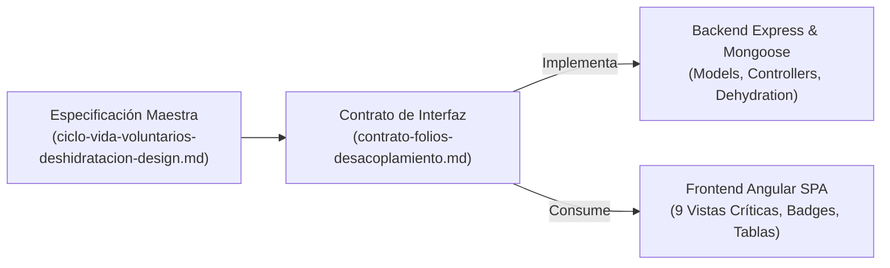
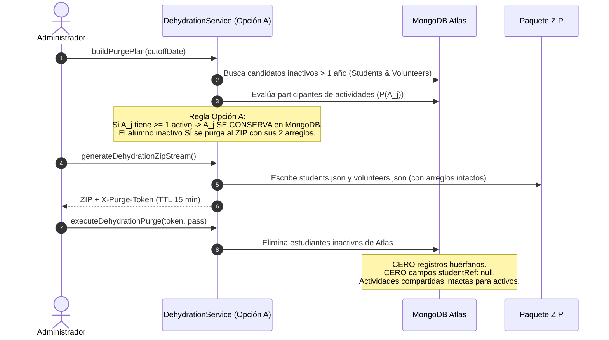

# Contrato de Interfaz y Datos: Folios Deterministas y Desacoplamiento por Doble Arreglo (AC / OP)

> **Documento Derivado Oficial y Fuente Única de Verdad (SSOT)**  
> **Especificación Maestra:** [`ciclo-vida-voluntarios-deshidratacion-design.md`](ciclo-vida-voluntarios-deshidratacion-design.md)  
> **ADR Relacionado:** ADR-13 en [`architecture.md`](architecture.md)  
> **Versión:** 1.0.0  
> **Ámbito:** Backend Express / Mongoose ODM $\longleftrightarrow$ Frontend Angular Standalone

---

## 1. Propósito y Delimitación

Este documento congela el **contrato formal de datos** entre el backend (Chat de Core & Backend) y el frontend (Chat de UI & Visualización), asegurando que ningún desarrollo desvíe o segmente la arquitectura integral definida en la [Propuesta Técnica del Ciclo de Vida y Deshidratación](ciclo-vida-voluntarios-deshidratacion-design.md).



---

## 2. Contratos de Folios Deterministas de Interacción

### 2.1 Folio de Actividad Convocada (`AC`)

Identifica la postulación, asistencia o validación de un colaborador (estudiante o voluntario) en una convocatoria grupal de la plataforma.

| Atributo | Especificación Técnica |
| :--- | :--- |
| **Prefijo Fijo** | `AC-` |
| **Expresión Regular (Regex)** | `^AC-\d{6}-[0-9A-F]{4}$` |
| **Ejemplo Canónico** | `AC-261102-0A14` |
| **Ubicación en Modelo / API** | `user.assignedActivities[i].interactionFolio` |
| **Propiedad `interactionType`** | `'AC'` (constante) |
| **Regla de Negocio para `Student`** | Acredita horas curriculares hacia la meta de 480 hrs (`valueInHours`, `validatedHours`). |
| **Regla de Negocio para `Volunteer`** | Certifica **asistencia cívica y presencia comunitaria** (`status: 'attended' / 'validated'`). No contabiliza horas curriculares universitarias (`valueInHours: 0`, `validatedHours: 0`). |

### 2.2 Folio de Oportunidad Institucional / Acreditación (`OP`)

Identifica la solicitud o registro de participación en una de las modalidades especializadas del catálogo institucional de ABAQ.

| Atributo | Especificación Técnica |
| :--- | :--- |
| **Prefijo Base** | `OP-` |
| **Expresión Regular (Regex)** | `^OP-[A-Z]{3}-\d{6}-[0-9A-F]{4}$` |
| **Ejemplo Canónico** | `OP-STE-261102-03C8` |
| **Ubicación en Modelo / API** | `user.accreditations[i].interactionFolio` y `accreditation.interactionFolio` |
| **Propiedad `interactionType`** | `'OP'` (constante) |
| **Mnemónico de 3 Letras (`CAT`)** | Catálogo ISO de 3 letras sin solapamiento (resuelve la triple colisión de `AD`): |

#### Catálogo Oficial de Sub-códigos de Modalidad (`CAT`):

```json
{
  "EVENT": "EVE",
  "INDUCTION": "IND",
  "IDENTIFICATION": "IDE",
  "STERILIZATION": "STE",
  "ADOPTION": "ADO",
  "ADOPTION_MODULE": "MOD",
  "TALK": "TLK",
  "CAMPAIGN": "CAM",
  "MEDIA": "MED",
  "SOCIAL_MEDIA": "SOC",
  "DONATION": "DON",
  "ADMINISTRATIVE": "ADM"
}
```

---

## 3. Esquemas Mongoose y Cero-Null en Modelos

Tanto `Student` (`backend/models/student.model.js`) como `Volunteer` (`backend/models/volunteer.model.js`) incorporan los dos arreglos embebidos independientes:

```javascript
// Esquema de Actividad Asignada / Convocada
const assignedActivitySchema = new mongoose.Schema({
  activityId: { type: mongoose.Schema.Types.ObjectId, ref: 'Activity', required: true },
  interactionFolio: { type: String, required: true, uppercase: true, trim: true, index: true },
  interactionType: { type: String, enum: ['AC', 'OP'], default: 'AC', required: true },
  comments: { type: String, default: 'Sin realizar' },
  dueDate: { type: Date },
  valueInHours: { type: Number, default: 0 },
  validatedHours: { type: Number, default: 0 },
  status: {
    type: String,
    enum: ['registered', 'attended', 'absent', 'validated', 'cancelled'],
    default: 'registered'
  },
  performance: {
    type: String,
    enum: ['pending', 'very_bad', 'bad', 'good', 'very_good', 'excellent', 'absent'],
    default: 'pending'
  },
  registrationDate: { type: Date, default: Date.now }
}, { _id: true });

// Esquema de Acreditación Embebida
const embeddedAccreditationSchema = new mongoose.Schema({
  accreditationId: { type: mongoose.Schema.Types.ObjectId, ref: 'Accreditation', required: false },
  interactionFolio: { type: String, required: true, uppercase: true, trim: true, index: true },
  interactionType: { type: String, enum: ['AC', 'OP'], default: 'OP', required: true },
  type: {
    type: String,
    enum: [
      'EVENT', 'INDUCTION', 'IDENTIFICATION', 'STERILIZATION',
      'ADOPTION', 'ADOPTION_MODULE', 'TALK', 'CAMPAIGN',
      'MEDIA', 'SOCIAL_MEDIA', 'DONATION', 'ADMINISTRATIVE'
    ],
    required: true
  },
  categoryCode: {
    type: String,
    enum: ['EVE', 'IND', 'IDE', 'STE', 'ADO', 'MOD', 'TLK', 'CAM', 'MED', 'SOC', 'DON', 'ADM'],
    required: true
  },
  date: { type: Date, required: true },
  hoursPerformed: { type: Number, default: 0, min: 0 },
  hoursAccredited: { type: Number, default: 0, min: 0 },
  status: {
    type: String,
    enum: ['pending', 'approved', 'rejected'],
    default: 'pending',
    index: true
  },
  comments: { type: String, default: '' },
  evidenceUrl: { type: String, default: '' },
  activityRef: { type: mongoose.Schema.Types.ObjectId, ref: 'Activity', required: false },
  registeredAt: { type: Date, default: Date.now },
  validatedAt: { type: Date }
}, { _id: true });
```

---

## 4. Garantía de Corte y Deshidratación (Opción A)



---

## 5. Reglas de Renderizado para el Equipo de Frontend

1. **Uso Obligatorio de Clases CSS Oficiales:**
   - `.folio-badge-expediente`: Para folios de admisión `SS-YYMMDD-XX` o `VG-YYMMDD-XX`.
   - `.folio-pill-ac`: Para folios de actividades `AC-YYMMDD-HEX` (verde institucional).
   - `.folio-pill-op`: Para folios de oportunidades `OP-CAT-YYMMDD-HEX` (naranja institucional con subcódigo de 3 letras visible).
2. **Las 9 Vistas Críticas Autorizadas:**
   - Consultar la matriz exhaustiva de vistas en la [Sección 5.4 de la Propuesta Técnica](ciclo-vida-voluntarios-deshidratacion-design.md#54-mapeo-y-definicion-visual-de-vistas-ubicacion-exacta-de-los-folios).
3. **Regla de Ocultamiento:** No mostrar folios en dashboards macro (`/admin/home`), edición de biografía (`/sobre-mi`), formularios en campo (`/survey/form`) ni vistas públicas.
