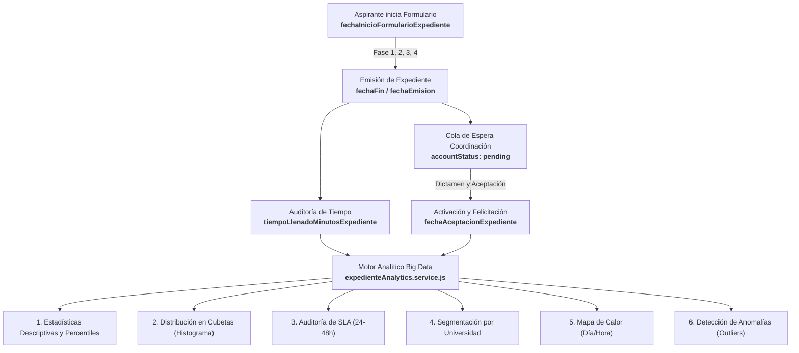

# Propuesta de Data Analysis y Big Data: Analítica del Ciclo de Vida de Expedientes ABAQ

> **Fecha:** 30 de Octubre de 2026  
> **Estado:** Implementado / Propuesta Fase 1  
> **Módulo Técnico:** [`backend/services/expedienteAnalytics.service.js`](file:///Users/riosisraelg/Desktop/1/abaq/backend/services/expedienteAnalytics.service.js)  
> **Endpoints:** `/analytics/expedientes/*`

---

## 1. Visión General y Valor Estratégico

La captura sistemática de las marcas de tiempo (`fechaInicioFormularioExpediente`, `fechaFinFormularioExpediente`, `fechaEmisionExpediente`, `fechaAceptacionExpediente`) y la variable cuantitativa `tiempoLlenadoMinutosExpediente` desbloquea la primera capacidad analítica de **Big Data y Business Intelligence** para ABAQ Querétaro.

Este módulo transforma los datos crudos del onboarding en inteligencia operativa para responder a cuatro preguntas críticas:
1. **Fricción y Usabilidad:** ¿En qué secciones o preguntas se atoran los estudiantes y cuántos minutos reales toma la inducción?
2. **Eficiencia Operativa (SLA):** ¿Cuánto tarda la Coordinación de Admisión en dictaminar un expediente desde que se emite? ¿Cumplimos la promesa de 24 a 48 horas hábiles?
3. **Análisis Demográfico y Convenios:** ¿Qué universidades y carreras tienen mayor tasa de finalización y rapidez de respuesta?
4. **Seguridad y Control de Calidad:** ¿Podemos detectar automáticamente bots, registros falsos o aspirantes que no leyeron el reglamento?

---

## 2. Dimensiones Analíticas Implementadas

---

## 3. Módulos y Metodología Estadística

### 3.1. Estadísticas de Tiempo de Llenado (`computeDescriptiveStats`)
Calcula los indicadores estadísticos clave de la muestra:
- **Media aritmética ($\mu$) y Mediana ($P_{50}$):** La mediana mitiga el sesgo de aspirantes que dejaron la pestaña abierta días enteros.
- **Percentiles ($P_{25}, P_{75}, P_{90}, P_{95}$):** Indican el tiempo en el que el 90% o 95% de los aspirantes completan el registro exitosamente.
- **Rango Intercuartílico ($IQR$) y Desviación Estándar ($\sigma$):** Permiten evaluar la dispersión de tiempos y la consistencia del flujo.

### 3.2. Histograma y Distribución en Cubetas (*Time Bucketing*)
Agrupa a los aspirantes en 6 segmentos de comportamiento:
- **$< 5$ min (Ultra-Fast):** Posible omisión de lectura de módulos o registro automatizado.
- **$5 - 15$ min (Lectura fluida):** Rango de velocidad alta pero plausible.
- **$15 - 30$ min (Estándar recomendado):** Tiempo óptimo para reflexiones y carga de ligas de Drive.
- **$30 - 60$ min (Detallado):** Aspirantes meticulosos con pausas moderadas.
- **$1 - 24$ horas (Pausa de sesión):** Aspirantes que buscan documentos o tramitan cartas en su facultad.
- **$> 24$ horas (Alta fricción):** Requiere revisión para prevenir deserción temprana.

### 3.3. Auditoría de SLA de Admisión (24 a 48 Horas)
Calcula el *turnaround time*:
$$\text{Horas de Resolución} = \frac{\text{fechaAceptacionExpediente} - \text{fechaEmisionExpediente}}{3,600,000 \text{ ms}}$$
Mide el porcentaje de expedientes resueltos en:
- Menos de 24 horas.
- Entre 24 y 48 horas (meta institucional).
- Más de 48 horas (vencidos / cuellos de botella).

### 3.4. Detección Inteligente de Anomalías (Outliers)
El servicio ejecuta tres filtros automatizados:
1. **Fast-Drop Anomaly ($< 2$ min):** Alerta a coordinación sobre aspirantes que probablemente contestaron al azar las reflexiones de los 6 módulos.
2. **High-Friction Anomaly ($> 48$ hrs de llenado):** Casos donde el enlace de Google Drive requirió solicitar permisos repetidamente.
3. **Overdue SLA ($> 48$ hrs en estado pendiente):** Notificación prioritaria a los administradores para evitar quejas de aspirantes.

---

## 4. API Endpoints Disponibles

| Endpoint | Método | Descripción |
| :--- | :--- | :--- |
| `/analytics/expedientes/kpis` | `GET` | Resumen ejecutivo con totales, estados y estadísticas descriptivas completas. |
| `/analytics/expedientes/buckets` | `GET` | Histograma de distribución de tiempos en cubetas porcentuales. |
| `/analytics/expedientes/sla` | `GET` | Tasa de cumplimiento del SLA de 24 a 48 horas hábiles por coordinación. |
| `/analytics/expedientes/universities` | `GET` | Rendimiento y tiempos agregados por universidad (UAQ, ITQ, Anáhuac, etc.). |
| `/analytics/expedientes/heatmap` | `GET` | Matriz de 7 días x 24 horas con el volumen de expedientes emitidos. |
| `/analytics/expedientes/anomalies` | `GET` | Listado en tiempo real de registros sospechosos o con alta fricción. |
| `/analytics/expedientes/export` | `GET` | Dataset plano tabular listo para Pandas, BigQuery o PowerBI. |

---

## 5. Próximos Pasos (Roadmap de Big Data)
1. **Integración en Panel Admin:** Incorporar gráficas interactivas con Chart.js o ECharts en el módulo de administración de ABAQ.
2. **Análisis Predictivo:** Modelo simple de regresión para estimar la probabilidad de que un estudiante complete sus 480 horas en tiempo y forma en función de su compromiso y velocidad en la inducción.
3. **Alertas automáticas por correo:** Notificación a coordinación cuando el volumen de pendientes en cola exceda el umbral de 48 horas.
