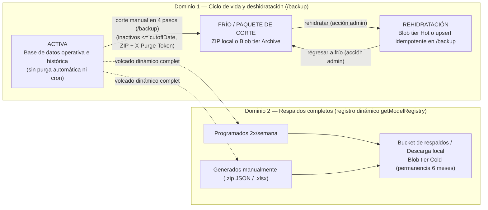
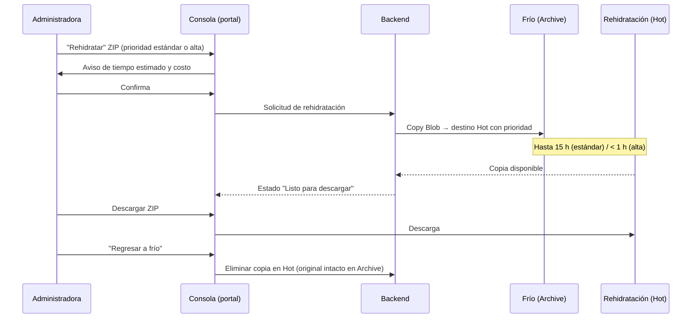
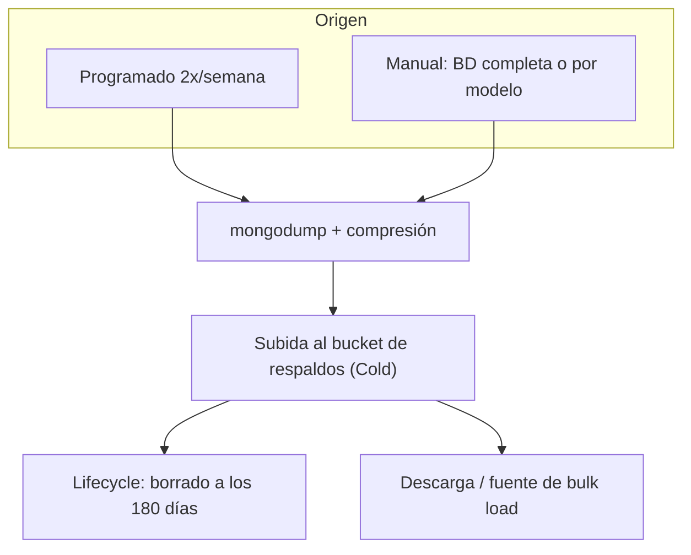
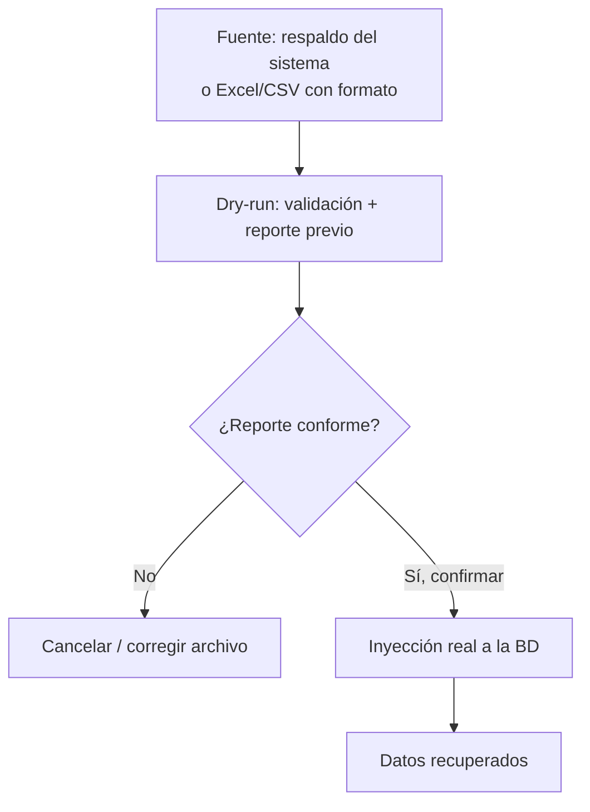

# Diseño de Datos: Ciclo de Vida, Respaldos y Recuperación

**Proyecto:** Plataforma Web ABAQ (Servicio Social)
**Versión:** 0.4.0
**Fecha:** 2026-11-03
**Estado:** Propuesta de diseño alineada con consola local `/backup` (con decisiones pendientes marcadas)
**Relacionado:** [Arquitectura](architecture.md) · [Ciclo de Vida y Deshidratación](ciclo-vida-voluntarios-deshidratacion-design.md) · [Despliegue en la nube (Azure)](cloud-deployment.md) · [Mapa de interfaces](ui-prompts-figma.md)

---

## 1. Propósito y contexto

La infraestructura **no contempla replicación** de la base de datos y el presupuesto de almacenamiento es acotado. El sistema resuelve esto con dos mecanismos **independientes**:

1. **Ciclo de vida de los datos (tiering):** mantiene en la base de datos solo lo que se usa en el presente y mueve el resto a almacenamiento barato del que se puede recuperar para consulta.
2. **Respaldos:** copias completas de la base de datos para recuperarse de pérdidas, errores o rollbacks.

!!! abstract "Principios"
    1. **El ciclo de vida es diseño de arquitectura, no configuración.** La ventana activa, las fases y sus reglas forman parte del diseño del backend y de la nube. Desde el portal **se observan y se accionan, pero no se reconfiguran**.
    2. **Lo relevante es ocupación y costo**, no qué periodos están en cada fase.
    3. El sistema **no guarda archivos** en la base de datos. Todo artefacto (ZIP de datos, backup) vive en un bucket (Azure Blob Storage).
    4. **Los respaldos no forman parte del tiering.** Viven en su propio bucket, con su propia regla de permanencia.
    5. Toda operación de datos relevante para administración tiene **interfaz en el portal**.

---

## 2. Ciclo de vida de los datos y corte manual bajo demanda

### 2.1 Retención sin purga automática y elegibilidad inmediata de inactivos

- **Cero barridos ni purgas automáticas en segundo plano:** El sistema **no ejecuta ningún `node-cron` diario de inactividad (45/60 días)** ni aplica ninguna ventana o purga automática de 12 meses (`365` días). Las transiciones a `accountStatus: "inactive"` ocurren exclusivamente cuando un `student` acredita sus **480 horas** de servicio social o mediante gestión administrativa manual, y **todos los registros persisten en los listados operativos (con los `inactive` ordenados al fondo) y en `/volunteers/history`** hasta que un administrador ejecute intencionalmente un corte manual en `/backup`.
- **Elegibilidad inmediata en Corte y Deshidratación (`/backup`):** Cualquier colaborador (`student` o `volunteer`) con `accountStatus: "inactive"` cuya fecha efectiva (`fechaDesactivacion || updatedAt || createdAt`) sea `<= cutoffDate` —con tope máximo al cierre del día actual UTC (`23:59:59.999Z`), rechazando únicamente fechas futuras— es candidato inmediato al corte sin esperar antigüedad adicional. Las cuentas de autenticación en `users` (roles `student` y `volunteer`, nunca `admin`) se resuelven mediante `authId || userId`, y se preserva estrictamente el **corte indivisible Opción A** para actividades compartidas (una actividad colectiva solo se purga cuando el 100 % de sus participantes inscritos pertenecen al conjunto elegible de inactivos para esa fecha de corte).
- **Flujo guiado bajo demanda en 4 pasos en `/backup`:**
    1. **Analizar sistema:** Invoca `POST /backup/dehydrate/analyze` con cuerpo `{}` ejecutando una sola pasada de consultas sin N+1 (`discoverAvailableCutoffs`). Si no existen fechas candidatas con impacto `> 0`, el propio botón cambia temporalmente su texto a `"No se encontraron fechas de corte disponibles"` durante `3.5 s` y vuelve automáticamente a `"Analizar sistema"`.
    2. **Elegir fecha:** Selección en desplegable de fechas de corte disponibles cuyo resumen de impacto se evalúa en memoria sin disparar nuevas consultas pesadas.
    3. **Descargar corte `.zip`:** Compila el paquete con `manifest.json` y hashes SHA-256 e inyecta en cabecera HTTP un `X-Purge-Token` firmado con vigencia estricta de **15 minutos**.
    4. **Borrar registros:** Ejecuta `POST /backup/dehydrate/purge` exigiendo el `X-Purge-Token` vigente y confirmación con contraseña administrativa, registrando la operación en `DehydrationAuditLog`.

!!! danger "Salvaguarda antes de borrar de la base de datos"
    El borrado de registros en la base de datos solo procede si:

    1. el paquete `.zip` de corte fue descargado previamente (emitiendo un `X-Purge-Token` vigente de 15 min con firma HMAC-SHA256 y **checksum SHA-256** verificado; o subido a Frío cuando el bucket cloud esté aprovisionado), y
    2. se respeta el corte indivisible Opción A (cero participantes activos o fuera del corte afectados en actividades compartidas) y la confirmación explícita del administrador.

    Si alguna condición falla o el token expira, los documentos permanecen intactos en la base de datos.

### 2.2 Las tres fases

| Fase | Qué guarda | Servicio Azure | Acceso | Mínimo de permanencia |
|---|---|---|---|---|
| **Activa** | Todos los registros vigentes e inactivos (sin ventana automática) hasta corte manual en `/backup` | Azure DocumentDB (Cosmos DB for MongoDB vCore) / MongoDB Atlas | En vivo, por la aplicación | — |
| **Frío** | ZIP de cada corte manual ejecutado por administración | Blob Storage, tier **Archive** (y descarga local `.zip`) | **Offline en Archive:** no se puede leer ni descargar sin rehidratar [1] | 180 días [1] |
| **Rehidratación** | Copias de ZIP traídas de Frío para consumo (o restauradas por upsert en `/backup`) | Blob Storage, tier **Hot** | Inmediato (descarga del ZIP) | Ninguno [1] |

!!! warning "Regla técnica de Azure: no hay descarga directa desde Archive"
    Un blob en Archive no se puede leer ni descargar. Para consumirlo hay que **rehidratarlo** a un tier en línea, lo que tarda **hasta 15 horas** con prioridad estándar o **menos de 1 hora** con prioridad alta para objetos menores a 10 GB. El límite es de **10 GiB por hora por cuenta** con prioridad alta [2]. La política de lifecycle **no puede rehidratar**; la rehidratación siempre es una acción explícita [1].

    En la interfaz, "descargar de Frío" es por tanto una acción en dos pasos: **rehidratar → descargar desde Rehidratación**.

### 2.3 Rehidratación (consumo desde el bucket, no en la base de datos)

- La rehidratación **no vuelve a cargar datos en la base de datos**. El ZIP queda disponible en el bucket para **descargarse y consultarse fuera del sistema**.
- Se implementa como **copia** del blob archivado hacia Rehidratación (Hot) [2]:
    - el original **permanece en Frío**, por lo que no se paga el cargo por borrado anticipado de Archive (180 días);
    - se evita que una regla de lifecycle vuelva a archivar la copia [2].
- **Regresar a Frío** = eliminar la copia de Rehidratación. El original sigue en Archive, y Hot no tiene mínimo de permanencia, así que la operación es inmediata y sin penalización [1].
- La carga de datos a la base de datos (por ejemplo, tras una pérdida) es otro proceso: el **bulk load** (§5).

---

## 3. Consola de ciclo de vida de datos

Sección de administración para **conocer la información vital** de las tres fases y **accionar** sobre Frío y Rehidratación. No permite modificar el diseño del ciclo de vida.

### 3.1 Indicadores

| Indicador | Activa | Frío | Rehidratación | Total |
|---|---|---|---|---|
| Ocupación (GB) | ✔ | ✔ | ✔ | ✔ |
| % del total almacenado | ✔ | ✔ | ✔ | 100 % |
| % de capacidad | ✔ (vs. 32 GB del Free Tier [3]) | — | — | — |
| Costo mensual | ✔ | ✔ | ✔ | ✔ |
| Elementos (ZIP) | — | ✔ | ✔ | — |
| Rehidrataciones en curso | — | — | ✔ (con prioridad y tiempo transcurrido) | — |

### 3.2 Acciones permitidas y no permitidas

| Acción | ¿Permitida? | Detalle |
|---|---|---|
| Rehidratar ZIP (Frío → Rehidratación) | Sí | Elegir prioridad estándar o alta; la consola muestra tiempo y costo estimados antes de confirmar |
| Regresar a Frío (Rehidratación → Frío) | Sí | Elimina la copia en línea; el original sigue en Archive |
| Descargar ZIP | Sí, solo desde Rehidratación | Desde Frío, el botón inicia la rehidratación |
| Cambiar la ventana activa, las fases o sus reglas | No | Es diseño de arquitectura |
| Borrar datos de Frío | No incluido | Fuera del alcance definido |

### 3.3 Cómo se calcula la ocupación

- **Activa:** estadísticas de la base de datos (`dbStats` / `collStats`).
- **Frío y Rehidratación:** listado de blobs de la cuenta de tiering, sumando el tamaño por tier (cada blob expone su tier y su tamaño). A la escala de ABAQ, este listado es exacto e inmediato.

### 3.4 Cómo se calcula el costo

!!! warning "El costo real facturado puede no estar disponible o no reflejar el crédito"
    Cost Management (la fuente del costo facturado) depende del tipo de cuenta del grant. En el modelo actual, el grant es un **crédito aplicado a un perfil de facturación (MCA)** y Cost Management funciona. En el modelo heredado, la oferta **Microsoft Azure Sponsorship (MS-AZR-0036P)** figura entre las **no soportadas** [4]. En ambos casos, Cost Management **no descuenta créditos ni muestra recursos gratuitos**, y sus datos llegan con retraso (8–24 h en EA/MCA, hasta 72 h en pago por uso) [4]. Hay que confirmar el *Offer ID* real de la suscripción (D-T5).

Por eso el diseño calcula un **costo estimado**:

> costo mensual de la fase = ocupación medida (GB) × precio unitario de lista del tier (Azure Retail Prices API [5], `eastus`)

- Los precios se consultan periódicamente y se guardan en caché; la consola muestra la fecha del precio.
- El costo se etiqueta como **estimado (precio de lista)**, no como facturado.
- **Activa:** $0 mientras se use el Free Tier de DocumentDB; con un tier pagado, el costo es fijo por clúster más almacenamiento.
- Si en el futuro la suscripción soporta Cost Management, se puede añadir el costo facturado como dato complementario.

Precios de referencia (`eastus`, LRS, consulta 2026-10-14):

| Concepto | Precio de lista |
|---|---|
| Archive — almacenamiento | $0.00099 por GB-mes |
| Hot — almacenamiento | $0.0208 por GB-mes |
| Cold — almacenamiento (respaldos) | $0.0036 por GB-mes |
| Rehidratación estándar — recuperación / lectura | $0.02 por GB / $5.00 por 10K operaciones |
| Rehidratación alta — recuperación / lectura | $0.10 por GB / $50.00 por 10K operaciones |

Con el volumen de ABAQ, rehidratar un ZIP de 100 MB cuesta menos de $0.01 (estándar) o ~$0.015 (alta).

---

## 4. Respaldos (dominio independiente)

- **Bucket propio:** una cuenta de almacenamiento separada de la de tiering. **No aparece en la Consola de ciclo de vida.** Separar cuentas permite atribuir el costo por recurso y evita mezclar reglas de lifecycle.
- **Programados:** 2 veces por semana (volcado completo, comprimido).
- **Generables manualmente** desde el portal: base de datos completa mediante descubrimiento dinámico de todos los modelos Mongoose registrados (`getModelRegistry()` sobre `backend/models/*.model.js` y `mongoose.models`, exponiendo métricas `activeCollections / totalCollections`). Permite descarga directa de archivo comprimido `.zip` (JSONs con inclusión íntegra de campos ocultos `select: false` como `+passwordHash` + `manifest.json` para rollback fiel) y libro consolidado de Excel `.xlsx` (con exclusión automática de campos `select: false` y credenciales `password` / `passwordHash`) para auditoría administrativa.
- **Permanencia: 6 meses.** Una regla de lifecycle **elimina cada respaldo a los 180 días** de su creación [6]. Aplica a respaldos programados y manuales en el bucket de nube.
- **Tier Cold:** en línea, restauración inmediata [1]. Su mínimo de 90 días es menor a los 180 de permanencia, así que no hay cargo por borrado anticipado. Archive no conviene para respaldos: restaurar tomaría horas.
- **Qué pueden hacer las administradoras:** generar, listar (fecha, tamaño, fecha de expiración), descargar y usar como fuente de bulk load / rollback.
- **Qué no pueden hacer:** cambiar la frecuencia ni la permanencia; son parte del diseño.

!!! tip "Implementación Vigente en el Portal Web Admin (`/backup`)"
    El portal de administración incorpora la consola de **Respaldos y Deshidratación** (`/backup` / `/admin/backups`) respaldada por el registro dinámico `getModelRegistry()` (`activeCollections / totalCollections`), que ofrece:
    1. Paquete `.zip` con los volcados JSON de todas las colecciones descubiertas dinámicamente (forzando la inclusión de campos `select: false` para no perder hashes de acceso) más `manifest.json` con firmas SHA-256 como fuente oficial de *rollback*.
    2. Libro Excel `.xlsx` multi-hoja (hoja de resumen + una pestaña por modelo descubierto) que omite automáticamente cualquier atributo con `select: false` o credenciales (`password`, `passwordHash`).
    3. Corte y Deshidratación manual bajo demanda en **4 pasos** (**Analizar sistema** con aviso temporal de `3.5 s` en el botón cuando no hay fechas disponibles $\rightarrow$ **Elegir fecha** en memoria $\rightarrow$ **Descargar corte `.zip`** con `X-Purge-Token` de 15 min $\rightarrow$ **Borrar registros**), donde todo `student` o `volunteer` con `accountStatus: "inactive"` y fecha efectiva `<= cutoffDate` es elegible de inmediato bajo corte indivisible Opción A (`authId || userId`).
    4. Restauración de respaldo completo (*dry-run* y confirmación) y rehidratación selectiva idempotente (`POST /backup/dehydrate/restore` con `replaceOne` + `upsert: true`).

!!! warning "Alcance de desarrollo (dependiente de infraestructura)"
    La integración real con Azure Blob queda **pendiente de aprovisionar la infraestructura**. En el backend se desarrolla hasta antes de la subida efectiva: volcado, compresión y preparación del artefacto, dejando la subida como integración documentada (stub).

---

## 5. Recuperación y carga masiva (bulk load)

Sistema para **re-inyectar** información en la base de datos ante pérdidas, errores, rollbacks o escenarios imprevistos. Tiene **interfaz en el portal**.

### 5.1 Fuentes admitidas

- **Respaldos del sistema** (§4).
- **Excel y CSV** con el formato definido.

### 5.2 Validación previa obligatoria (dry-run)

!!! danger "Dry-run obligatorio"
    Antes de inyectar cualquier dato, el sistema ejecuta una **validación en seco** y presenta un **reporte previo** (conteos, conflictos, registros inválidos). La inyección real **solo procede tras revisar y confirmar ese reporte**.

---

## 6. Dependencias técnicas a investigar

| Propósito | Candidata | Notas |
|---|---|---|
| Azure Blob (subir, listar, cambiar tier, copiar con rehidratación) | `@azure/storage-blob` | SDK oficial para Node |
| Autenticación a Azure | `@azure/identity` | Identidad administrada, sin credenciales embebidas |
| Empaquetado ZIP | `archiver` / `zlib` (nativo) | ZIP de corte manual y respaldos JSON |
| Volcado y restauración | `getModelRegistry()` / `mongodump` | Descubrimiento dinámico Mongoose en `/backup` y herramientas nativas |
| Parseo y exportación Excel / CSV | `exceljs` / `xlsx` / `csv-parse` | Exportación multi-hoja y bulk load |
| Precios para la consola | Azure Retail Prices API | Pública, sin credenciales [5] |
| Jobs programados | Según la arquitectura cloud | Solo respaldos de infraestructura; cero `node-cron` de inactividad en app |
| Lifecycle de los buckets | Reglas de Azure Blob lifecycle | Configuración de infraestructura (OpenTofu), no dependencia npm [6] |

---

## 7. Requisitos derivados

- **RF-DAT-01**: La base de datos conserva todos los registros vigentes e inactivos sin purgas automáticas de 12 meses ni barridos `node-cron` en segundo plano; los registros `inactive` permanecen al final de los listados operativos y en `/volunteers/history` hasta que un administrador ejecute un corte manual en `/backup`.
- **RF-DAT-02**: Todo colaborador (`student` o `volunteer`) con `accountStatus: "inactive"` y fecha efectiva (`fechaDesactivacion || updatedAt || createdAt`) `<= cutoffDate` (tope al día actual UTC) es elegible de inmediato en el flujo guiado de 4 pasos de `/backup`, preservando el corte indivisible Opción A, resolviendo `users` vía `authId || userId` y permitiendo borrar únicamente tras descargar el `.zip` verificado con `X-Purge-Token` vigente (15 min).
- **RF-DAT-03**: La Consola muestra, por fase y en total, ocupación, porcentaje y costo mensual estimado.
- **RF-DAT-04**: Las administradoras pueden rehidratar ZIP (Frío → Rehidratación) eligiendo prioridad, regresarlos a Frío, descargarlos desde Rehidratación o restaurarlos idempotentemente en `/backup`.
- **RF-DAT-05**: La rehidratación en el bucket de Azure no carga datos automáticamente en la base de datos; la re-inyección selectiva en MongoDB requiere invocar explícitamente `POST /backup/dehydrate/restore`.
- **RF-DAT-06**: Respaldos programados 2 veces por semana en nube y generables manualmente en `/backup` descubriendo dinámicamente el registro de modelos Mongoose (`getModelRegistry()`, `activeCollections / totalCollections`), omitiendo campos `select: false` / credenciales en `.xlsx` e incluyéndolos íntegramente en `.zip` JSON para rollback.
- **RF-DAT-07**: Todo respaldo se elimina automáticamente a los 6 meses (180 días).
- **RF-DAT-08**: El bulk load admite respaldos del sistema y Excel/CSV, con dry-run obligatorio.
- **RNF-DAT-01**: El sistema no persiste archivos en la base de datos; los artefactos van al bucket.
- **RNF-DAT-02**: El costo mostrado en la Consola se rotula como estimado (precio de lista) mientras no exista una fuente de costo facturado para la suscripción.

---

## 8. Decisiones pendientes

| ID | Decisión | Opciones |
|---|---|---|
| D-T1 | Tier de Frío | **Archive (aplicado):** costo mínimo, descarga en dos pasos con espera de horas · **Cold:** descarga inmediata sin rehidratación, ~3.6× el costo de Archive; a la escala de ABAQ la diferencia es de centavos al mes |
| D-T2 | Expiración de copias en Rehidratación | Manual (aplicado: solo "Regresar a frío") / automática tras N días |
| D-T3 | Modo de carga del bulk load | Overwrite total / upsert por correo institucional / insertar solo faltantes |
| D-T4 | Fuente del costo en la Consola | Estimado por precio de lista (aplicado) / añadir el facturado si la suscripción lo soporta |
| D-T5 | Tipo de cuenta del grant | Confirmar el *Offer ID*: crédito en perfil MCA (Cost Management disponible, costo bruto) o Sponsorship heredada (no soportada) |

---

## Referencias

1. Microsoft Learn — *Access tiers for blob data* (Hot, Cool, Cold, Archive; permanencias mínimas; Archive offline). <https://learn.microsoft.com/en-us/azure/storage/blobs/access-tiers-overview>
2. Microsoft Learn — *Blob rehydration from the archive tier* (prioridades, tiempos, límite de 10 GiB/h, rehidratación por copia). <https://learn.microsoft.com/en-us/azure/storage/blobs/archive-rehydrate-overview>
3. Microsoft Learn — *Free tier – Azure DocumentDB* (32 GB). <https://learn.microsoft.com/en-us/azure/documentdb/free-tier>
4. Microsoft Learn — *Understand Cost Management data* (ofertas soportadas, retraso, exclusiones). <https://learn.microsoft.com/en-us/azure/cost-management-billing/costs/understand-cost-mgt-data>
5. Microsoft Learn — *Azure Retail Prices REST API*. <https://learn.microsoft.com/en-us/rest/api/cost-management/retail-prices/azure-retail-prices>
6. Microsoft Learn — *Azure Blob Storage lifecycle management overview*. <https://learn.microsoft.com/en-us/azure/storage/blobs/lifecycle-management-overview>

*Contenido de las fuentes parafraseado para cumplir restricciones de licencia.*
