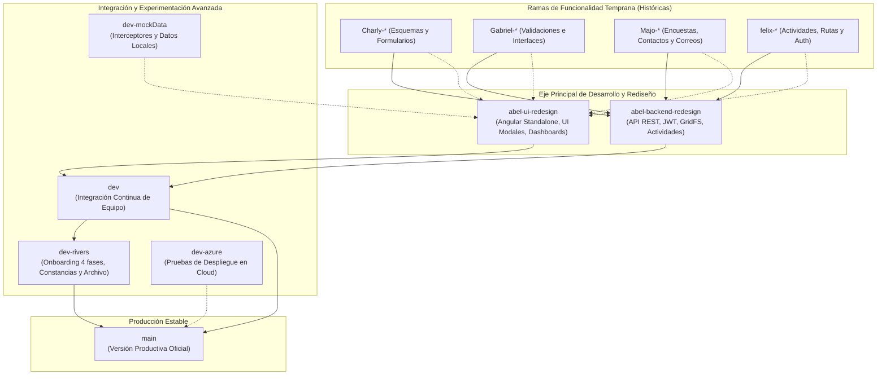

# Estrategia de Ramas Git y Ciclo de Vida del Software

Este documento describe la arquitectura de control de versiones, el inventario exhaustivo de ramas (locales y remotas) y la función técnica que desempeña cada una en los tres repositorios que conforman el ecosistema de la plataforma ABAQ: **Backend**, **Frontend** y **Documentación**.

> [!IMPORTANT]
> **Eje Principal de Desarrollo (`abel` branches):**  
> Las ramas desarrolladas por **Abel** (`abel-backend-redesign` en Backend y `abel-ui-redesign` en Frontend) constituyen la **columna vertebral y fuente primaria de cambios estructurales** del proyecto. A partir de estas ramas se estableció la arquitectura moderna de la plataforma (eliminación del stack legado de Firebase/Pug SSR y transición hacia Angular Standalone + API REST Node.js/Express + MongoDB GridFS).

---

## 1. Modelo de Flujo de Trabajo (Git Workflow)

El proyecto opera bajo un modelo adaptado donde las ramas de rediseño de Abel actúan como la referencia troncal de innovación, integrándose hacia `dev` y estabilizándose en `main` para despliegues de producción:

---

## 2. Repositorio Backend (`proyecto-web-abaq/backend`)

El backend proporciona la API REST central en Node.js, Express y Mongoose (MongoDB).

### 2.1. Ramas Locales y de Seguimiento

| Rama Local | Rama Remota de Seguimiento | Propósito Técnico y Estado |
| :--- | :--- | :--- |
| **`abel-backend-redesign`** | `origin/abel-backend-redesign` | **Rama principal de cambios y arquitectura.** Liderada por Abel (`JADAG`), reemplazó la arquitectura monolítica Pug SSR por una API REST pura en JSON, autenticación con JWT (`User` model), subdocumentos de actividades asignadas y almacenamiento GridFS. |
| **`dev`** | `origin/dev` | **Rama de integración del equipo backend.** Fusión activa donde convergen los módulos de Abel, submódulos auxiliares (`tool-constancias`) y correcciones de desarrollo continuo. |
| **`dev-rivers`** | `origin/dev-rivers` | **Rama de features avanzadas y archivo.** Contiene la implementación del modelo de notificaciones MongoDB, integración de Resend API para correos transaccionales, motor de certificados criptográficos y archivado de funcionalidades experimentales fuera de producción. |
| **`main`** | `origin/main` | **Rama de producción oficial.** Código productivo probado, con ciclo de vida de estudiantes/voluntarios, regla de inactividad de 60 días ejecutada a nivel BD y emisión de constancias oficiales. |
| **`dev-azure`** | *(Sin tracking directo)* | **Rama técnica de staging cloud.** Configuración y adaptación de cadena de conexión `MONGODB_URI` para compatibilidad con Azure Cosmos DB for MongoDB (vCore). |

### 2.2. Ramas Remotas (`origin/*`) en Backend

| Rama Remota | Responsable / Origen | Propósito y Uso Técnico |
| :--- | :--- | :--- |
| **`origin/abel-backend-redesign`** | Abel (`JADAG`) | Rama remota canónica del rediseño backend. Base estructural de modelos, rutas y controladores consumidos por el frontend moderno. |
| **`origin/dev`** | Equipo ABAQ | Rama de integración continua en el repositorio remoto. |
| **`origin/dev-rivers`** | Rivers (`riosisraelg`) | Respaldo remoto del estado completo de desarrollo con notificaciones y herramientas auxiliares archivadas. |
| **`origin/main`** | Equipo ABAQ | Versión productiva desplegable en el servidor de producción. |
| **`origin/Charly-add_fields_to_student_scheme`** | Carlos Galicia | Rama de funcionalidad temprana que incorporó al esquema de estudiantes los campos de período académico (`period`), estado de conclusión (`concluded`) y comentarios administrativos (`comment`). |
| **`origin/Gabriel-Validaciones`** | Gabriel Córdova | Implementación de esquemas de validación de entradas de datos y sanitización en controladores del backend. |
| **`origin/Majo-Mail`** | María José Gaytán | Prototipado inicial del envío de notificaciones por correo electrónico utilizando Nodemailer. |
| **`origin/Majo-PreguntasParaContactos`** | María José Gaytán | Adaptación de rutas y controladores para capturar respuestas de contactos y encuestas vinculadas a estudiantes. |
| **`origin/Majo-login`** | María José Gaytán | Implementación histórica de controladores y vistas para la sesión de usuario en el motor legado. |
| **`origin/felix-actividades`** | Félix Rojas | Definición inicial de rutas REST y controladores para la gestión y listado de actividades de voluntariado. |
| **`origin/felix-angular`** | Félix Rojas | Modificación de cabeceras y eliminación de tokens CSRF para habilitar el consumo de la API REST desde clientes SPA (Angular). |
| **`origin/mongo-version`** | Félix Rojas | Rama histórica de transición para migrar la persistencia de datos desde Firestore hacia MongoDB nativo, resolviendo errores en el endpoint de creación de estudiantes. |
| **`origin/dependabot/npm_and_yarn/*`** | GitHub Dependabot | Ramas de mantenimiento automatizado para actualización de dependencias vulnerables (`lodash`, `mongoose`, `multer`, `nodemailer`, `express`, `qs`). |

---

## 3. Repositorio Frontend (`proyecto-web-abaq/frontend`)

El frontend es una Single Page Application (SPA) desarrollada en Angular 18/19 con componentes Standalone, TypeScript estricto y Bootstrap / CSS personalizado.

### 3.1. Ramas Locales y de Seguimiento

| Rama Local | Rama Remota de Seguimiento | Propósito Técnico y Estado |
| :--- | :--- | :--- |
| **`abel-ui-redesign`** | `origin/abel-ui-redesign` | **Rama principal de rediseño de UI y experiencia de usuario.** Desarrollada por Abel (`JADAG`), eliminó las dependencias legadas de Firebase Hosting y `@angular/fire`. Construyó la totalidad de las vistas administrativas y de estudiante modernas (`student-detail`, `student-profile`, `admin-home`, `activity-detail`, `activity-list`, `signup`, `login`). |
| **`dev`** | `origin/dev` | **Rama de integración de frontend.** Integra el rediseño de Abel con ajustes colaborativos de interfaz, validaciones reactivas y servicios compartidos. |
| **`dev-rivers`** | `origin/dev-rivers` | **Rama de UX avanzada y repositorio de archivo.** Desarrollo del wizard de Onboarding de 4 fases, adaptación responsive móvil (eliminación de scrollbars parásitos y fijación a 100vw), Slide-Over Drawer de Notificaciones, campanita con badge en navbar y panel de testing Resend. Todo el código experimental queda respaldado aquí. |
| **`main`** | `origin/main` | **Rama oficial de producción.** Versión final estable para usuario final, con tablas operativas densas, flujo de expediente recibido, controles de formulario custom (`custom-select`, `custom-datepicker`) y validaciones de seguridad sin dependencias bloqueantes de terceros. |
| **`dev-azure`** | *(Sin tracking directo)* | **Rama técnica de despliegue Azure.** Parametrización de variables de entorno de producción (`environment.prod.ts`) y configuración para empaquetado optimizado en Azure Static Web Apps / Container Apps. |
| **`dev-mockData`** | `origin/abel-ui-redesign` | **Rama de desarrollo aislado.** Contiene interceptores HTTP de Angular (`mock interceptor`) y datasets de prueba para trabajar en la UI sin necesidad de ejecutar el backend localmente. |

### 3.2. Ramas Remotas (`origin/*`) en Frontend

| Rama Remota | Responsable / Origen | Propósito y Uso Técnico |
| :--- | :--- | :--- |
| **`origin/abel-ui-redesign`** | Abel (`JADAG`) | Rama remota canónica de la interfaz de usuario. Es la referencia base sobre la cual se diseñaron todas las pantallas operativas del sistema. |
| **`origin/dev`** | Equipo ABAQ | Rama remota de integración para el equipo frontend. |
| **`origin/dev-rivers`** | Rivers (`riosisraelg`) | Respaldo remoto oficial de las características avanzadas de interfaz y módulo de notificaciones archivado. |
| **`origin/main`** | Equipo ABAQ | Código desplegado en el entorno de producción web. |
| **`origin/Charly-design_student/new_form`** | Carlos Galicia | Maquetación y captura inicial de datos de estudiantes en formularios Angular. |
| **`origin/Majo-surveyform`** | María José Gaytán | Desarrollo y finalización de los componentes visuales de la encuesta de servicio social (`survey.component`). |
| **`origin/majo-interfaces`** | María José Gaytán | Definición de las interfaces TypeScript iniciales para mapear las respuestas de encuestas y contactos. |
| **`origin/majo/home`** | María José Gaytán | Primer prototipo de la página de inicio (`home.component`) y presentación institucional. |
| **`origin/felix-actividades`** | Félix Rojas | Vistas iniciales de tarjetas y filtros para el catálogo de actividades disponibles. |
| **`origin/felix-auth`** | Félix Rojas | Integración inicial de autenticación en Angular y protección de variables de entorno. |
| **`origin/firebase-api`** | Félix Rojas | Pruebas de integración con la API de Firebase Hosting y Firestore antes de la decisión de migración a servidor propio. |
| **`origin/firebase-test`** | Félix Rojas | Verificación de consultas directas a base de datos NoSQL bajo la infraestructura inicial de Google Cloud/Firebase. |
| **`origin/gabriel-interfaces`** | Gabriel Córdova | Estructuración de modelos de datos e interfaces de TypeScript para tipado estricto en clientes Angular. |
| **`origin/gabriel-register-&-delete-Activity`** | Gabriel Córdova | Botones y modales de diálogo para creación y baja lógica de actividades institucionales. |
| **`origin/pet-view`** | Félix Rojas | Componente de visualización de expedientes de animales (`pet-view.component`) y su relación con actividades. |
| **`origin/reporte-estudiante`** | Félix Rojas | Configuración de pipelines en GitHub Actions para despliegue automatizado hacia Firebase Hosting (`firebase-hosting-merge.yml`). |

---

## 4. Repositorio de Documentación (`proyecto-web-abaq/documentation`)

El repositorio de documentación técnica y operativa está construido sobre el generador de sitios estáticos **Zensical** (Python / Markdown) y publicado mediante GitHub Pages.

### 4.1. Ramas y su Función

| Rama | Tipo | Propósito Técnico y Uso |
| :--- | :--- | :--- |
| **`abel`** *(Alineación Conceptual)* | Marco Arquitectónico | Las especificaciones técnicas de requerimientos (SRS v2.1.0), los diagramas de arquitectura de capas y el diseño de la API se modelaron tomando como base canónica las soluciones introducidas en las ramas de Abel (`abel-backend-redesign` y `abel-ui-redesign`). |
| **`main`** / **`origin/main`** | Producción | Rama productiva oficial. Cada commit publicado dispara la acción de GitHub Pages para actualizar el sitio web público de documentación en `https://proyecto-web-abaq.github.io/documentation/`. |
| **`dev`** | Integración | Rama de desarrollo donde se integran borradores de arquitectura, estudios de costos de infraestructura en Azure y guías de desarrollo antes de publicarse en `main`. |
| **`dev-rivers`** | Trabajo Técnico | Rama de redacción y pulido de especificaciones formales: SRS v2.1.0 (§7 definición de roles, códigos de folio, tiempos máximos de respuesta), diseño de autenticación v1.1.0, política de respaldo de datos y diseño del sistema de notificaciones. |

---

## 5. Directrices de Ciclo de Vida y Promoción de Ramas

Para garantizar la estabilidad y la trazabilidad del código en futuras fases del proyecto, se establece la siguiente política de ramas:

1. **Desarrollo de Nuevas Funcionalidades:**
   - Cualquier nueva característica debe partir de la arquitectura consolidada en `dev` (derivada de `abel-*`).
   - Las ramas de funcionalidad deben nombrarse bajo la convención:  
     `feat/<modulo>-<descripcion>` o `fix/<modulo>-<descripcion>`.
2. **Integración en `dev`:**
   - Todo cambio debe verificarse localmente antes de fusionarse en `dev`:
     - Backend: pruebas de endpoints y verificación de sintaxis (`node -c`).
     - Frontend: compilación de producción limpia (`ng build`).
3. **Cortes de Producción (`main`):**
   - La rama `main` contiene únicamente código verificado y listo para producción sin servicios que dependan de cuentas de prueba o cuotas efímeras no garantizadas.
   - Todo código en evaluación, experimental o que exceda el alcance del release actual debe quedar respaldado en ramas de archivo (como `dev-rivers`).
