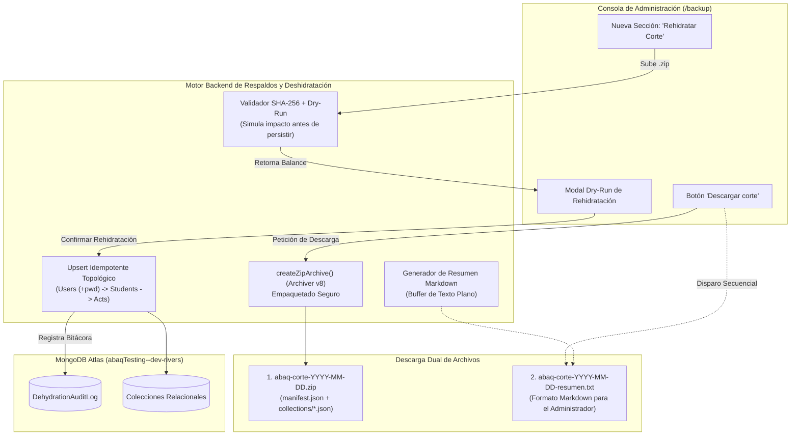

# 💾 Propuesta y Diseño de Arquitectura: Estabilización de Deshidratación, Manifiesto Dual (.zip + .txt MD), Gobernanza de Rehidratación y Resiliencia de Respaldos

- **Fecha de Creación:** 4 de noviembre de 2026
- **Estado:** 🟢 **Propuesta Aprobada — Fuente de Verdad del Sprint**
- **Ámbito:** Frontend Angular v22 Standalone, Backend Node.js / Express / MongoDB Atlas & Consola de Respaldos (`/backup`)
- **Módulos Afectados:** Motor de Deshidratación ([`backend/services/dehydration.service.js`](file:///Users/riosisraelg/Desktop/1/abaq/backend/services/dehydration.service.js)), Controlador de Respaldos ([`backend/controllers/backup.controller.js`](file:///Users/riosisraelg/Desktop/1/abaq/backend/controllers/backup.controller.js)), Rutas de Respaldos ([`backend/routes/backup.route.js`](file:///Users/riosisraelg/Desktop/1/abaq/backend/routes/backup.route.js)), Servicio Angular ([`frontend/src/app/services/backup.service.ts`](file:///Users/riosisraelg/Desktop/1/abaq/frontend/src/app/services/backup.service.ts)), Vista y Controlador de Respaldos ([`frontend/src/app/components/backup/backup.component.ts`](file:///Users/riosisraelg/Desktop/1/abaq/frontend/src/app/components/backup/backup.component.ts), [`backup.component.html`](file:///Users/riosisraelg/Desktop/1/abaq/frontend/src/app/components/backup/backup.component.html)).

---

## 1. Resumen Ejecutivo y Diagnóstico Integral

### 1.1 Diagnóstico de la Falla de Descarga en Deshidratación
Al ejecutar la acción **"Descargar corte"** en la interfaz `/backup`, el navegador no realizaba la descarga del archivo `.zip`. La auditoría técnica del backend reveló una incompatibilidad de exportación de librerías:

```javascript
// backend/services/dehydration.service.js:948
const archive = archiver("zip", { zlib: { level: 9 } }); // 💥 TypeError: archiver is not a function
```

1. **Causa Raíz:** En la versión instalada de `archiver` (`^8.0.0`), el módulo exporta un objeto de constructores `{ Archiver, JsonArchive, TarArchive, ZipArchive }` en lugar de una función directa. Mientras que en [`backend/services/backup.service.js`](file:///Users/riosisraelg/Desktop/1/abaq/backend/services/backup.service.js#L213-L221) ya existía el helper polimórfico `createZipArchive()`, en [`dehydration.service.js`](file:///Users/riosisraelg/Desktop/1/abaq/backend/services/dehydration.service.js#L487) y [`dehydration.service.js`](file:///Users/riosisraelg/Desktop/1/abaq/backend/services/dehydration.service.js#L948) se invocaba directamente `archiver("zip")`, provocando que la promesa rechazara con un error 500 no capturado adecuadamente.
2. **Ocultamiento del Error en el Frontend:** En [`backup.service.ts`](file:///Users/riosisraelg/Desktop/1/abaq/frontend/src/app/services/backup.service.ts#L204-L221), la petición HTTP a `POST /backup/dehydrate/download` se configura con `responseType: 'blob'`. Cuando Express responde con un error HTTP 500 en formato JSON (`{ status: "error", message: "archiver is not a function" }`), Angular entrega a la capa de componentes un `Blob` de texto plano. Al evaluar `err?.error?.message`, el resultado es `undefined`, lo que impedía reportar el motivo real del fallo al usuario administrador.

### 1.2 ¿Qué Contiene el Archivo .ZIP Actualmente?
El archivo `.zip` descargado por deshidratación es un **paquete criptográfico de preservación relacional** indivisible (Opción A Oficial). Su estructura interna es:

- **`manifest.json`:** Manifiesto oficial en formato JSON estructurado. Contiene la versión de esquema (`1.0.0`), la operación (`dehydrate_purge`), la fecha de corte exacta en UTC, métricas globales (`totalDocuments`, `totalBytesFreed`, `packageSha256`) y un diccionario por cada colección (`modelKey`, `modelName`, `documentCount`, `sha256` individual del JSON, `sizeBytes`).
- **`collections/<coleccion>.json`:** Documentos puros en formato JSON extraídos directamente de MongoDB para cada una de las colecciones afectadas por el corte (`students.json`, `volunteers.json`, `users.json`, `activities.json`, `accreditations.json`, `talks.json`, `campaigns.json`, `adoptions.json`, `identifications.json`, `contacts.json`, `notifications.json`).

### 1.3 Archivo Complementario `.txt` (Formato Markdown) Fuera del ZIP
Para resolver la necesidad de legibilidad humana sin requerir software de descompresión ni arriesgar la integridad criptográfica del archivo `.zip`:

- Se emitirá un **segundo archivo de descarga complementario** denominado `abaq-corte-YYYY-MM-DD-resumen.txt`.
- Tendrá una extensión `.txt` para abrirse instantáneamente en el Bloc de Notas, TextEdit o cualquier visor del sistema operativo, pero su contenido estará maquetado con sintaxis **Markdown estandarizada** (títulos, tablas, viñetas, bloques de código y advertencias).
- **Aislamiento e Inmunidad:** Los scripts de rehidratación (`restoreDehydration`) y restauración (`restoreBackup`) examinan de forma estricta los buffers binarios que contengan el archivo interno `manifest.json`. Al viajar como un segundo archivo fuera del `.zip`, los motores de datos lo ignoran por completo, eliminando cualquier riesgo de corrupción o alteración de sumas de verificación.

### 1.4 Análisis Profundo de lo No Considerado en el Sistema
Al reflexionar sobre la carga de archivos para **rehidratar la base de datos** o **restaurar respaldos**, se identificaron cinco vacíos arquitectónicos críticos que deben ser formalizados y gobernados:

1. **Carencia de Interfaz Gráfica para Rehidratación:** Existe el endpoint `POST /backup/dehydrate/restore` en backend, pero la consola web `/backup` únicamente cuenta con la interfaz de "Rollback General". Un administrador no tiene ningún medio visual en la plataforma para subir y aplicar un corte histórico de deshidratación.
2. **Pérdida de Credenciales por `select: false`:** En Mongoose, el campo `User.passwordHash` tiene la propiedad `select: false`. [`loadEligibleDataset()`](file:///Users/riosisraelg/Desktop/1/abaq/backend/services/dehydration.service.js#L123) no solicitaba explícitamente `+passwordHash`. Como resultado, los usuarios archivados carecerían de contraseña al ser rehidratados, impidiéndoles autenticarse nuevamente.
3. **Colisión de Llaves Únicas y Conflictos Relacionales:** Si un colaborador purgado es rehidratado, pero durante el periodo de archivo se registró una nueva cuenta con el mismo correo electrónico o folio, la operación fallaría con un error de índice único `E11000 duplicate key error`. Se requiere una política determinista de resolución de conflictos (*Skip*, *Replace* o *Dry-Run Warning*).
4. **Ausencia de Validación en Seco (Dry-Run) en Rehidratación:** Mientras que el Rollback General cuenta con un modo de inspección previa (`confirm=false`), el endpoint de rehidratación ejecutaba la inserción directamente en la base de datos sin un paso intermedio de previsualización.
5. **Riesgo de Memoria en Servidor (OOM) y Límites de Multer:** La carga de respaldos opera mediante `multer.memoryStorage()`, cargando el archivo completo en la memoria RAM de Node.js. Para archivos voluminosos o transferencias concurrentes, esto puede degradar el hilo de ejecución principal o exceder el límite de 50MB.

---

## 2. Diagrama de Arquitectura Global del Sistema



---

## 3. Desglose Arquitectónico Modular y Subsecciones

### 3.1 Módulo 1: Corrección y Unificación del Motor de Empaquetado ZIP
- **Archivos Afectados:**
  - [`backend/services/dehydration.service.js`](file:///Users/riosisraelg/Desktop/1/abaq/backend/services/dehydration.service.js)
  - [`backend/controllers/backup.controller.js`](file:///Users/riosisraelg/Desktop/1/abaq/backend/controllers/backup.controller.js)
  - [`frontend/src/app/services/backup.service.ts`](file:///Users/riosisraelg/Desktop/1/abaq/frontend/src/app/services/backup.service.ts)

#### 3.1.1 Diagnóstico Técnico y Compatibilidad con Archiver v8
Se estandariza la instanciación de generadores de compresión en todo el backend mediante una función polimórfica que garantiza interoperabilidad entre entornos de desarrollo y producción:

```javascript
function createZipArchive(options = { zlib: { level: 9 } }) {
  if (typeof archiver === "function") {
    return archiver("zip", options);
  }
  if (archiver.ZipArchive) {
    return new archiver.ZipArchive(options);
  }
  throw new Error("No se pudo instanciar el motor de compresión ZIP (Archiver v8).");
}
```

#### 3.1.2 Factorización en `generateDehydrationZipStream` y `packageDehydration`
Se sustituyen las llamadas crudas `archiver("zip")` por `createZipArchive()` en las líneas 487 y 948 de `dehydration.service.js`, garantizando la resolución exitosa de la promesa y la emisión fluida del buffer binario.

#### 3.1.3 Cabeceras HTTP y Exposición CORS
El controlador [`backend/controllers/backup.controller.js`](file:///Users/riosisraelg/Desktop/1/abaq/backend/controllers/backup.controller.js#L145-L155) expone explícitamente en `Access-Control-Expose-Headers` las cabeceras `X-Purge-Token`, `X-Package-Sha256` y `Content-Disposition`, asegurando que el cliente web pueda capturar el token que habilita el botón de purga.

#### 3.1.4 Decodificación Resiliente de Errores Blob en Angular
En [`backup.service.ts`](file:///Users/riosisraelg/Desktop/1/abaq/frontend/src/app/services/backup.service.ts), ante respuestas con código de error HTTP (4xx o 5xx) donde el cuerpo es un `Blob`, se incorpora un interceptor/capturador asíncrono que lee el contenido textual del Blob mediante `blob.text()`, parsea el JSON subyacente y expone el mensaje real del backend en la notificación visual del componente.

---

### 3.2 Módulo 2: Manifiesto Criptográfico y Generador del Archivo Complementario `.txt` (Markdown)
- **Archivos Afectados:**
  - [`backend/services/dehydration.service.js`](file:///Users/riosisraelg/Desktop/1/abaq/backend/services/dehydration.service.js)
  - [`frontend/src/app/services/backup.service.ts`](file:///Users/riosisraelg/Desktop/1/abaq/frontend/src/app/services/backup.service.ts)
  - [`frontend/src/app/components/backup/backup.component.ts`](file:///Users/riosisraelg/Desktop/1/abaq/frontend/src/app/components/backup/backup.component.ts)

#### 3.2.1 Estructura del Manifiesto Oficial (`manifest.json` interno al ZIP)
Permanece como el contrato formal e inalterable consumido por las máquinas:

```json
{
  "version": "1.0.0",
  "operationType": "dehydrate_purge",
  "generatedAt": "2026-11-04T16:00:00.000Z",
  "cutoffDate": "2026-10-31T23:59:59.999Z",
  "metrics": {
    "totalCollections": 11,
    "totalDocuments": 42,
    "totalBytesFreed": 105432,
    "packageSha256": "e3b0c44298fc1c149afbf4c8996fb92427ae41e4649b934ca495991b7852b855"
  },
  "collections": {
    "students": {
      "modelKey": "students",
      "modelName": "Estudiantes",
      "documentCount": 12,
      "sha256": "4b227777d4dd1fc61c6f884f48641d02b4d121d3fd328cb08b5531fcacdabf8a",
      "sizeBytes": 28400
    }
  }
}
```

#### 3.2.2 Diseño del Archivo Complementario `abaq-corte-YYYY-MM-DD-resumen.txt`
Se generará un documento de texto estructurado con formato Markdown enriquecido:

```markdown
# ==============================================================================
# ABAQ QUERÉTARO — REPORTE DE CORTE HISTÓRICO Y DESHIDRATACIÓN DE DATOS
# ==============================================================================
Fecha de Generación: 2026-11-04 10:00:00 UTC
Fecha Límite de Corte: 2026-10-31 (Registros inactivos hasta esta fecha)
Folio de Identificación: DEHYD-20261104-E7A1
Hash Criptográfico SHA-256 del Paquete: e3b0c44298fc...

> NOTA INFORMATIVA:
> Este archivo ha sido generado exclusivamente para consulta y auditoría humana.
> Si deseas rehidratar o restaurar estos datos, utiliza el archivo .zip complementario.
> Los scripts automáticos de la plataforma ignoran este archivo de texto.

------------------------------------------------------------------------------
1. RESUMEN DE IMPACTO GLOBAL
------------------------------------------------------------------------------
- Total de Colecciones Afectadas: 11
- Total de Documentos Archivados: 42
- Espacio Liberado Estimado: 102.96 KB
- Actividades Retenidas (con participantes activos): 3

------------------------------------------------------------------------------
2. DESGLOSE DETALLADO POR COLECCIÓN
------------------------------------------------------------------------------
| Colección       | Modelo Mongoose   | Registros | Integridad SHA-256 (Primeros 12) |
| :-------------- | :---------------- | :-------- | :------------------------------- |
| Estudiantes     | Student           | 12        | 4b227777d4dd...                 |
| Voluntarios     | Volunteer         | 8         | 8f4323bba911...                 |
| Cuentas Auth    | User              | 20        | 1a2b3c4d5e6f...                 |
| Acreditaciones  | Accreditation     | 18        | 998877665544...                 |
| Actividades     | Activity          | 5         | 112233445566...                 |

------------------------------------------------------------------------------
3. INSTRUCCIONES DE PRESERVACIÓN Y REHIDRATACIÓN
------------------------------------------------------------------------------
1. Conserva este archivo de texto junto con el archivo .zip en el almacenamiento seguro institucional.
2. Para reingresar estos datos a la plataforma, ingresa a la consola de administración en `/backup`
   en la sección "Rehidratación de Corte Histórico" y selecciona únicamente el archivo .zip.
3. El sistema verificará los sellos criptográficos y aplicará las inserciones de forma segura.
==============================================================================
```

#### 3.2.3 Mecanismo de Descarga Dual en Frontend
Para descargar ambos archivos en una sola acción del usuario:
1. Al pulsar **"Descargar corte"**, se consume el endpoint binario del `.zip`.
2. Al recibir la respuesta exitosa, el frontend guarda el `purgeToken` y dispara la descarga del archivo `.zip`.
3. Inmediatamente después (con un desfase de 300 ms para evitar que el navegador bloquee múltiples descargas), se construye dinámicamente un `Blob` de tipo `text/plain;charset=utf-8` con el resumen Markdown precalculado del impacto y se dispara la descarga de `abaq-corte-YYYY-MM-DD-resumen.txt`.

---

### 3.3 Módulo 3: Gobernanza de Rehidratación, Prevención de Colisiones y Validación Dry-Run
- **Archivos Afectados:**
  - [`backend/services/dehydration.service.js`](file:///Users/riosisraelg/Desktop/1/abaq/backend/services/dehydration.service.js)
  - [`backend/controllers/backup.controller.js`](file:///Users/riosisraelg/Desktop/1/abaq/backend/controllers/backup.controller.js)
  - [`backend/models/dehydrationAuditLog.model.js`](file:///Users/riosisraelg/Desktop/1/abaq/backend/models/dehydrationAuditLog.model.js)

#### 3.3.1 Preservación de Credenciales (`+passwordHash`)
En [`dehydration.service.js`](file:///Users/riosisraelg/Desktop/1/abaq/backend/services/dehydration.service.js#L123), se actualiza la consulta de usuarios elegibles:

```javascript
const userQuery = User.find({
  _id: { $in: userIdList },
  role: { $in: ["student", "volunteer"] },
}).select("+passwordHash"); // Garantiza que la rehidratación preserve el acceso del usuario
```

#### 3.3.2 Matriz de Conflictos y Resolución de Colisiones
Al rehidratar documentos, se implementa una política en 3 fases:
- **Verificación Previa:** Comprobar si los identificadores `_id` o las llaves únicas (`email` en `User`, `controlNumber` en `Student`, `curp` en `Volunteer`) ya existen con datos de usuarios activos.
- **Detección de Colisión:** Si un `email` existe en la base de datos pero con un `_id` diferente al archivado, la rehidratación marca el registro como conflicto (`COLLISION_EMAIL_ACTIVE`) y omite su sobreescritura, reportándolo en el resumen.
- **Upsert Seguro:** Para registros legítimos sin conflicto, se ejecuta `replaceOne({ _id: doc._id }, doc, { upsert: true })`.

#### 3.3.3 Flujo Dry-Run en Rehidratación (`confirm: false` vs `confirm: true`)
Se homologa el endpoint `POST /backup/dehydrate/restore` con el estándar de `POST /backup/restore`:
- **`confirm = false` (Validación en Seco):** Descomprime el paquete en memoria, valida la existencia de `manifest.json`, coteja los hashes SHA-256 de cada archivo, evalúa conflictos en la base de datos y retorna un reporte de viabilidad sin escribir ningún cambio.
- **`confirm = true` (Ejecución Definitiva):** Aplica la rehidratación topológica, genera el registro en `DehydrationAuditLog` y retorna el balance de documentos restablecidos.

#### 3.3.4 Bitácora de Auditoría en Rehidratación
Toda rehidratación exitosa creará un registro en [`DehydrationAuditLog`](file:///Users/riosisraelg/Desktop/1/abaq/backend/models/dehydrationAuditLog.model.js) indicando:
- `operationType: "dehydrate_restore"`
- `adminUser`: Correo e ID del administrador responsable.
- `packageSha256`: Hash del paquete restaurado.
- `restoredCounts`: Desglose de documentos recuperados por colección.
- `conflictsEncountered`: Conteo y lista de registros omitidos por colisión.

---

### 3.4 Módulo 4: Experiencia de Usuario (UI/UX) en Consola `/backup`
- **Archivos Afectados:**
  - [`frontend/src/app/components/backup/backup.component.html`](file:///Users/riosisraelg/Desktop/1/abaq/frontend/src/app/components/backup/backup.component.html)
  - [`frontend/src/app/components/backup/backup.component.ts`](file:///Users/riosisraelg/Desktop/1/abaq/frontend/src/app/components/backup/backup.component.ts)
  - [`frontend/src/app/components/backup/backup.component.scss`](file:///Users/riosisraelg/Desktop/1/abaq/frontend/src/app/components/backup/backup.component.scss)

#### 3.4.1 Feedback Visual en Descarga Dual
En la tarjeta de **Corte y Deshidratación**, se actualiza la leyenda del Paso 3:
> *"Descargar corte (.zip oficial + .txt de lectura para el usuario)"*
Un toast institucional confirmará: *"Paquete de deshidratación y resumen de auditoría descargados correctamente."*

#### 3.4.2 Carga al Sistema en Doble Columna (Rollback y Rehidratación Simétricos)
Se unifica la zona de inyección de datos al sistema mediante una cuadrícula de **doble columna en resolución de escritorio** (`upload-columns-grid`):
- **Columna 1 (Rollback Total)** y **Columna 2 (Rehidratación de Cortes)** comparten simétricamente los mismos componentes: tarjeta institucional `.rollback-card`, zona de arrastre `.upload-zone`, explorador de archivos `.btn-file-picker` y vista previa del archivo seleccionado.
- **Diseño Adaptativo Móvil y Tablet:** En resoluciones $\le 991$ px, la cuadrícula se apila verticalmente a una sola columna, optimizando la visualización en iPad y teléfonos inteligentes con botones táctiles de al menos 44 px.

#### 3.4.3 Modal de Revisión Preliminar (Dry-Run) antes de Cargar
El proceso de inspección y balance comparativo se encapsula en una **ventana modal interactiva con scroll interno** (`modal-dialog-scrollable`), evitando que tablas masivas deformen la estructura de la página:
- Resumen analítico de métricas (En Paquete, Restaurables, Ya en BD, Conflictos).
- Alerta visual detallada en caso de detectar colisiones por índice único.
- Tabla responsiva con el desglose de colecciones.
- Botón directo de confirmación para ejecutar la rehidratación o rollback de forma controlada.

---

### 3.5 Módulo 5: Resiliencia de Archivos Físicos, Cargas Masivas y Memoria
- **Archivos Afectados:**
  - [`backend/routes/backup.route.js`](file:///Users/riosisraelg/Desktop/1/abaq/backend/routes/backup.route.js)
  - [`backend/services/dehydration.service.js`](file:///Users/riosisraelg/Desktop/1/abaq/backend/services/dehydration.service.js)

#### 3.5.1 Límite de Multer y Prevención de Desbordamiento de Heap
- Se incrementa el límite de carga de Multer a 100 MB para respaldos históricos consolidados.
- Para operaciones de rehidratación masiva, se incorpora un validador que rechaza archivos que no contengan una cabecera ZIP válida (`PK\x03\x04`) antes de procesar el buffer en memoria.

#### 3.5.2 Auditoría de Evidencias Digitales y Archivos Adjuntos
Se clarifica en la arquitectura que las colecciones de MongoDB almacenan rutas y URLs relativas o absolutas a Azure Blob Storage. La deshidratación archiva los metadatos y relaciones de base de datos; la infraestructura de almacenamiento en la nube mantiene su propia política de retención para evitar la eliminación accidental de binarios de soporte.

---

## 4. Requerimientos del Sistema

### 4.1 Requerimientos Funcionales

| Código | Requerimiento Funcional | Prioridad | Módulo |
| :--- | :--- | :--- | :--- |
| **RF-DEHYD-01** | Instanciar el motor de compresión mediante `createZipArchive()` polimórfico compatible con Archiver v8. | Crítica | Módulo 1 |
| **RF-DEHYD-02** | Capturar y decodificar mensajes de error del backend cuando el cliente Angular solicite respuestas con `responseType: 'blob'`. | Alta | Módulo 1 |
| **RF-DEHYD-03** | Mantener el archivo `manifest.json` dentro del archivo `.zip` con sumas criptográficas SHA-256 por colección y paquete. | Crítica | Módulo 2 |
| **RF-DEHYD-04** | Generar y descargar automáticamente un archivo complementario `abaq-corte-YYYY-MM-DD-resumen.txt` en formato Markdown con el balance del corte. | Alta | Módulo 2 |
| **RF-DEHYD-05** | Garantizar que el archivo complementario `.txt` viaje fuera del `.zip` para que los procesos de rehidratación y rollback lo ignoren de forma nativa. | Crítica | Módulo 2 |
| **RF-DEHYD-06** | Incluir explícitamente `+passwordHash` al consultar y archivar cuentas de usuario (`User`) para asegurar la validez de credenciales al rehidratar. | Crítica | Módulo 3 |
| **RF-DEHYD-07** | Implementar validación en seco (*Dry-Run*) en `POST /backup/dehydrate/restore` cuando `confirm = false`. | Alta | Módulo 3 |
| **RF-DEHYD-08** | Detectar y omitir colisiones de llaves únicas (`email`, `controlNumber`, `curp`) al ejecutar la rehidratación definitiva. | Alta | Módulo 3 |
| **RF-DEHYD-09** | Registrar cada evento de rehidratación exitoso en la colección `DehydrationAuditLog`. | Media | Módulo 3 |
| **RF-DEHYD-10** | Proveer una interfaz gráfica en `/backup` para subir y rehidratar paquetes de corte histórico. | Alta | Módulo 4 |
| **RF-DEHYD-11** | Presentar un modal de confirmación con el balance detallado del *dry-run* antes de ejecutar la rehidratación. | Alta | Módulo 4 |
| **RF-DEHYD-12** | Validar la cabecera mágica binaria de archivos ZIP antes de procesar el buffer en memoria en Multer. | Media | Módulo 5 |

---

### 4.2 Requerimientos No Funcionales

| Código | Requerimiento No Funcional | Métrica / Estándar |
| :--- | :--- | :--- |
| **RNF-DEHYD-01** | **Rendimiento de Compresión:** El empaquetado del archivo `.zip` para 5,000 registros debe concluir en menos de 2.5 segundos. | $\le 2.5\text{ s}$ |
| **RNF-DEHYD-02** | **Integridad Criptográfica:** Cada archivo dentro del `.zip` debe verificarse contra su hash SHA-256 antes de permitir la rehidratación. | SHA-256 estricto |
| **RNF-DEHYD-03** | **Compatibilidad de Plataforma:** El archivo `.txt` de resumen debe ser legible en UTF-8 en Windows, macOS y Linux sin caracteres rotos. | UTF-8 sin BOM |
| **RNF-DEHYD-04** | **Seguridad de Tokens:** El `X-Purge-Token` debe expirar de forma estricta a los 15 minutos de su emisión y admitir un solo uso. | TTL 15 min |
| **RNF-DEHYD-05** | **Idempotencia:** La ejecución repetida de una rehidratación sobre la misma base de datos no debe duplicar documentos ni alterar registros activos. | 100% Idempotente |
| **RNF-DEHYD-06** | **Disponibilidad y Concurrencia:** La generación de respaldos no debe bloquear las operaciones de lectura de los módulos operativos. | No bloqueante |
| **RNF-DEHYD-07** | **UX No Intrusiva:** La descarga del archivo secundario `.txt` debe ejecutarse sin provocar bloqueos de ventanas emergentes en Chrome/Safari/Firefox. | Desfase $\ge 250\text{ ms}$ |
| **RNF-DEHYD-08** | **Trazabilidad:** Toda acción destructiva o de recuperación debe asociarse al usuario administrador en sesión. | JWT Audit trail |

---

## 5. Plan de Tareas para la Implementación

### Fase 1: Corrección del Motor de Empaquetado y Descarga (Módulo 1)
- [ ] Implementar `createZipArchive()` en [`backend/services/dehydration.service.js`](file:///Users/riosisraelg/Desktop/1/abaq/backend/services/dehydration.service.js) y reemplazar invocaciones de `archiver("zip")`.
- [ ] Agregar manejo de decodificación de errores Blob en [`frontend/src/app/services/backup.service.ts`](file:///Users/riosisraelg/Desktop/1/abaq/frontend/src/app/services/backup.service.ts).
- [ ] Probar descarga unitaria y de extremo a extremo de archivos `.zip` de deshidratación.

### Fase 2: Manifiesto y Generador del Archivo Complementario `.txt` (Módulo 2)
- [ ] Crear el generador de texto Markdown del corte en [`frontend/src/app/services/backup.service.ts`](file:///Users/riosisraelg/Desktop/1/abaq/frontend/src/app/services/backup.service.ts).
- [ ] Implementar la descarga secuencial dual (`.zip` + `.txt` Markdown) en [`frontend/src/app/components/backup/backup.component.ts`](file:///Users/riosisraelg/Desktop/1/abaq/frontend/src/app/components/backup/backup.component.ts).
- [ ] Validar que los scripts de rehidratación sigan operando sin interferencia alguna del archivo `.txt`.

### Fase 3: Gobernanza de Rehidratación, Credenciales y Dry-Run (Módulo 3)
- [ ] Añadir `.select("+passwordHash")` en `loadEligibleDataset()` de [`backend/services/dehydration.service.js`](file:///Users/riosisraelg/Desktop/1/abaq/backend/services/dehydration.service.js).
- [ ] Actualizar `restoreDehydration` en [`backend/controllers/backup.controller.js`](file:///Users/riosisraelg/Desktop/1/abaq/backend/controllers/backup.controller.js) para admitir el parámetro `confirm: false` (Dry-run).
- [ ] Implementar detección de colisiones por llave única y registro en `DehydrationAuditLog`.

### Fase 4: Experiencia de Usuario y Consola Administrativa (Módulo 4)
- [ ] Agregar sección de Rehidratación de Cortes en [`frontend/src/app/components/backup/backup.component.html`](file:///Users/riosisraelg/Desktop/1/abaq/frontend/src/app/components/backup/backup.component.html).
- [ ] Implementar modal de visualización de balance *dry-run* y confirmación en TypeScript y SCSS.
- [ ] Ajustar textos de apoyo y estados de carga en la tarjeta de deshidratación.

### Fase 5: Resiliencia de Memoria y Pruebas Integrales (Módulo 5)
- [ ] Ajustar límites de carga en [`backend/routes/backup.route.js`](file:///Users/riosisraelg/Desktop/1/abaq/backend/routes/backup.route.js).
- [ ] Ejecutar suite completa de pruebas unitarias y de integración de respaldos.

---

## 6. Escenarios de Prueba y Verificación (Test Matrix)

| ID Escenario | Caso de Prueba | Entrada | Resultado Esperado |
| :--- | :--- | :--- | :--- |
| **TC-DEHYD-01** | Descarga de ZIP con Archiver v8 | Clic en "Descargar corte" con fecha válida | Se descarga `abaq-corte-YYYY-MM-DD.zip` conteniendo `manifest.json` y carpetas `collections/`. |
| **TC-DEHYD-02** | Descarga de archivo complementario `.txt` | Finalización exitosa de la descarga del ZIP | Se descarga automáticamente `abaq-corte-YYYY-MM-DD-resumen.txt` con el resumen formateado en Markdown. |
| **TC-DEHYD-03** | Inmunidad de scripts de restauración | Intento de rehidratación con archivo `.txt` | El sistema rechaza el archivo indicando que debe ser un `.zip` válido. |
| **TC-DEHYD-04** | Preservación de contraseña al rehidratar | Rehidratación de un usuario archivado | El documento en MongoDB contiene `passwordHash` válido y el usuario puede iniciar sesión. |
| **TC-DEHYD-05** | Simulación Dry-Run de rehidratación | Carga de ZIP con `confirm = false` | Se devuelve el reporte de documentos a restaurar sin modificar la base de datos. |
| **TC-DEHYD-06** | Detección de colisión de correo | Rehidratación de un usuario cuyo email ya existe en otra cuenta activa | El sistema omite el registro conflictivo, no rompe la transacción y reporta la colisión en el balance. |
| **TC-DEHYD-07** | Registro en Bitácora de Auditoría | Rehidratación confirmada (`confirm = true`) | Se genera un registro en `DehydrationAuditLog` con el desglose de documentos y el admin responsable. |
