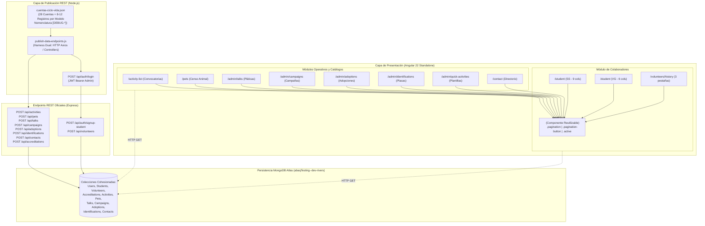

# 📑 Propuesta y Diseño de Arquitectura: Estandarización de Paginación UI/UX, Cohesión Relacional de Datos y Publicador de Endpoints

- **Fecha de Creación:** 4 de noviembre de 2026
- **Estado:** 🟢 **Propuesta Aprobada — Fuente de Verdad del Sprint**
- **Ámbito:** Frontend Angular v22 Standalone & Backend Node.js / Express / MongoDB Atlas
- **Módulos Afectados:** Componente UI `<app-pagination>`, Módulo de Colaboradores (`StudentComponent`, `VolunteersHistoryComponent`), Módulos Operativos (`ActivityListComponent`, `PetViewComponent`, `TalkListComponent`, `CampaignListComponent`, `AdoptionListComponent`, `IdentificationListComponent`, `QuickActivitiesComponent`, `ContactComponent`), Vistas de Detalle (`ActivityDetail`, `TalkDetail`), Manifiesto de Datos [`cuentas-ciclo-vida.json`](file:///Users/riosisraelg/Desktop/1/abaq/cuentas-ciclo-vida.json), y Script Publicador REST [`backend/scripts/publish-data-endpoints.js`](file:///Users/riosisraelg/Desktop/1/abaq/backend/scripts/publish-data-endpoints.js).

---

## 1. Resumen Ejecutivo y Visión Holística

Para garantizar una experiencia de usuario fluida, consistente y escalable en la plataforma **ABAQ Querétaro**, se requiere resolver dos necesidades estructurales:

1. **Fragmentación y Ausencia de Paginación en Vistas:**
   Actualmente, solo dos vistas (`accreditation-list` y `my-accreditations`) cuentan con controles de paginación. Las restantes 10 vistas y tablas (`student`, `volunteers/history`, `activity-list`, `pets`, `admin/talks`, `admin/campaigns`, `admin/adoptions`, `admin/identifications`, `admin/quick-activities` y `contact`) renderizan todos los registros de forma lineal, provocando sobrecarga visual, scrolls kilométricos y degradación de rendimiento conforme la base de datos crece.
2. **Desconexión Relacional y Carencia de Datos de Prueba en Staging:**
   Los modelos operativos (`Pet`, `Talk`, `Campaign`, `Adoption`, `Identification`, `Contact`, `QuickActivity`) no cuentan con suficiente volumen ni vinculación con los colaboradores que gestionaron las actividades. Los datos sintéticos deben tener **cohesión relacional**: las pláticas, campañas, adopciones y placas deben reflejarse como acreditaciones deterministas (`OP-*`) en los expedientes de los voluntarios que las registraron, utilizando una **nomenclatura semántica de depuración (`[DEBUG-*]`)** con todos sus campos poblados para verificar la renderización visual y la lógica de negocio de cada rol.
3. **Publicación Automatizada por Endpoints REST:**
   Para poblar `abaqTesting--dev-rivers` de manera fiel al comportamiento de producción, los datos deben emitirse consumiendo los endpoints `POST` oficiales de Express con autenticación JWT de administrador, garantizando que middleware, validadores y ganchos de modelo se ejecuten íntegramente.

---

## 2. Diagrama de Arquitectura Global del Sistema



---

## 3. Desglose Arquitectónico por Módulo

### 3.1 Módulo 1: Componente Standalone `<app-pagination>`
- **Ubicación:** `frontend/src/app/components/ui/pagination/`
- **Archivos:** `pagination.component.ts`, `pagination.component.html`, `pagination.component.scss`, `pagination.component.spec.ts`.
- **Diseño Visual y UX:**
  - Replica al 100% las clases `.pagination`, `.pagination-button`, `.active` y el estado `:disabled` de `accreditation-list` y `my-accreditations`.
  - Dimensiones: Botones de `min-width: 38px`, `height: 38px`, `padding: 0 12px`, `border-radius: 10px`, `border: 1px solid #e2e8f0`.
  - Estados: Hover con fondo `#eff6ff` y borde `#2563eb`; activo con fondo `#2563eb`, texto blanco `#ffffff`; deshabilitado con `opacity: 0.45`.
  - Soporte de elipsis inteligente (`…`) mediante `maxVisiblePages: number` (predeterminado: 7) para no romper el layout cuando existan decenas de páginas.
  - Preservación de scroll: Opción `scrollBehavior = 'preserve'` (por defecto), capturando `window.scrollY` antes del cambio y restaurándolo con `requestAnimationFrame` para eliminar brincos bruscos de pantalla.

### 3.2 Módulo 2: Vistas de Colaboradores (`student` y `volunteers-history`)
- **Archivos:**
  - `frontend/src/app/components/student/student.component.ts`, `.html`, `.scss`
  - `frontend/src/app/components/volunteers-history/volunteers-history.component.ts`, `.html`, `.scss`
- **Arquitectura de Filtrado y Paginación en `StudentComponent`:**
  - **Problema detectado en auditoría:** En el template HTML anterior, se iteraba sobre un único array mixto `filteredVolunteerList` y se filtraba con un `@if (volunteer.volunteerType === '...')` en el `@for`. Si se paginaba ese array mixto, la tabla de Servicio Social quedaba incompleta y la de Voluntariado General mostraba filas en blanco o fuera de orden.
  - **Solución arquitectónica:** Desacoplar en TypeScript dos getters independientes con ordenamiento prioritario:
    ```typescript
    get socialServiceVolunteers(): VolunteerListItem[] {
      const list = this.filteredVolunteerList.filter(
        (v) => v.volunteerType === 'SERVICE_SOCIAL',
      );
      return this.sortWithInactivesAtEnd(list);
    }

    get generalVolunteers(): VolunteerListItem[] {
      const list = this.filteredVolunteerList.filter(
        (v) => v.volunteerType === 'GENERAL',
      );
      return this.sortWithInactivesAtEnd(list);
    }

    private sortWithInactivesAtEnd(list: VolunteerListItem[]): VolunteerListItem[] {
      return [...list].sort((a, b) => {
        const aInactive = (a.accountStatus === 'inactive' || a.accountStatus === 'rejected') ? 1 : 0;
        const bInactive = (b.accountStatus === 'inactive' || b.accountStatus === 'rejected') ? 1 : 0;
        if (aInactive !== bInactive) {
          return aInactive - bInactive;
        }
        return 0;
      });
    }
    ```
  - **Tamaño de página:** `ssPageSize = 8`, `generalPageSize = 8`.
  - **Punto de Inserción:** Inmediatamente después del `</div>` que cierra `.table-wrapper` en cada sección de pestaña.
  - **Reset de página:** Cada cambio en el término de búsqueda (`filter.valueChanges`) o en la bandera `showPendingOnly` reinicia explícitamente `this.ssPage = 1` y `this.generalPage = 1`.
  - **Tratamiento y Estilo Diferenciado de Filas Inactivas:**
    - Las filas de colaboradores con estado `inactive` o `rejected` reciben la clase CSS `.row-inactive`.
    - Estilo: Fondo tenue `#f8fafc`, color de texto secundario `#64748b`, nombre en `#475569` y etiqueta de estatus `.badge-inactive` (`⏹ Inactivo` en `#f1f5f9` con borde `#cbd5e1`).
  - **Estabilidad de Altura Contenedora:**
    - `.table-wrapper` y `.volunteer-group .table-wrapper` cuentan con `min-height: 480px;`, garantizando que la transición hacia páginas con menor número de registros (ej. página 2 con 4 registros) no colapse la tabla ni mueva la botonera de paginación.

- **Arquitectura de Paginación en `VolunteersHistoryComponent`:**
  - Tres estados independientes: `studentsPage = 1`, `volunteersPage = 1`, `auditPage = 1`, con `historyPageSize = 8`.
  - Inserción de `<app-pagination>` debajo de las tablas en cada pestaña activa.
  - `.table-wrapper` con `min-height: 480px;` para estabilización de layout.

### 3.3 Módulo 3: Vistas Operativas y Catálogos en Cuadrícula y Lista
- **Estabilidad de Altura Contenedora (Anti-Cumulative Layout Shift CLS):**
  - Todos los contenedores de cuadrícula y listas verticales implementan `min-height: 520px;` (o `440px` en tablas simples), asegurando que la barra de paginación conserve una posición fija al alternar entre páginas con distinta densidad de tarjetas.
- **Mapeo y `pageSize` optimizado para layouts:**
  - **`talk-list` (Pláticas):** Cuadrícula CSS Grid auto-fill 320px. `pageSize = 6` (simetría perfecta para 3 columnas en desktop y 2 en tablet). `.talk-list` con `min-height: 520px;`. Inserción al pie de `section.talk-list-page`.
  - **`campaign-list` (Campañas):** Cuadrícula CSS Grid auto-fit 460px (2 columnas). `pageSize = 6` (3 filas completas de 2 columnas). `.campaign-list` con `min-height: 520px;`. Inserción al pie de `.campaign-list`.
  - **`identification-list` (Placas):** Cuadrícula fija de 2 columnas (`.identification-grid`). `pageSize = 6` (3 filas de 2 tarjetas). `.identification-grid` con `min-height: 520px;`. Inserción al pie de `.identification-grid`.
  - **`quick-activities` (Plantillas Rápidas):** Cuadrícula auto-fill 320px. `pageSize = 6`. `.quick-activities-grid` con `min-height: 520px;`. Inserción al pie de `.quick-activities-grid`.
  - **`pet-view` (Censo Animal):** Cuadrícula de tarjetas de albergue. `pageSize = 6`. `.pet-grid` con `min-height: 520px;`.
  - **`activity-list` (Convocatorias):** Lista vertical flex de tarjetas con insignia y horas. `pageSize = 6`. `.activity-list` con `min-height: 520px;`. Inserción debajo de `.activity-list`.
  - **`adoption-list` (Adopciones):** Lista vertical de expedientes fotográficos. `pageSize = 6`. `.adoption-list` con `min-height: 520px;`. Inserción debajo de `.adoption-list`.
  - **`contact` (Directorio):** Tabla Bootstrap `table-striped`. `pageSize = 8`. `.table` con `min-height: 440px;`. Inserción debajo de `</table>`.

### 3.4 Módulo 4: Cohesión Relacional e Historia de Colaboradores
Los modelos operativos deben contar con vínculos referenciales reales hacia los colaboradores:
1. **Identificaciones (`Identification`):**
   - Campo `studentRef`: Referencia al `ObjectId` del estudiante de servicio social asignado.
   - Campo `linkerName`: Nombre diagnóstico del estudiante (ej. `[DEBUG-SS-ACTIVO] Carlos Alumno Activo`).
   - Campo `animalName` y `species`: Vinculado a la mascota de `Pet`.
   - Genera una acreditación con categoría `IDE` y folio `OP-IDE-YYMMDD-HEX`.
2. **Pláticas (`Talk`):**
   - Campo `speakerRef`: Voluntario o estudiante responsable de la plática.
   - Arreglo `participants`: Cada asistente con datos reales y folio de oportunidad `OP-TLK-YYMMDD-HEX`.
   - Genera una acreditación con categoría `TLK` en el perfil del ponente.
3. **Campañas (`Campaign`):**
   - Campo `responsibleName`: Voluntario o estudiante a cargo de la brigada comunitaria.
   - Genera una acreditación con categoría `CAM` o `STE` (esterilización) en el perfil del colaborador.
4. **Adopciones (`Adoption`):**
   - Vinculada a una mascota existente en `Pet` mediante nombre y expediente.
   - Gestor voluntario vinculado mediante acreditación con categoría `ADO` (`OP-ADO-YYMMDD-HEX`).
5. **Sincronización Dual de Folios:**
   - Todo folio `OP-*` se emite conforme a la regla determinista `OP-CAT-YYMMDD-HEX` y se guarda en la colección raíz `accreditations` y en el arreglo `accreditations` del usuario en `students` o `volunteers`.

### 3.5 Módulo 5: Nomenclatura Semántica de Depuración (`[DEBUG-*]`)
Para facilitar las pruebas de regresión visual y asegurar que cada campo de cada vista despliega datos correctos:
- **Prefijo Estandarizado:** Todos los registros llevarán el prefijo `[DEBUG-<ROL>-<CASO>]` o `[DEBUG-<MODELO>-<ESTADO>]`.
- **Estudiantes (20 cuentas):**
  - Casos del ciclo: `[DEBUG-SS-PENDIENTE]`, `[DEBUG-SS-PRIMERINGRESO]`, `[DEBUG-SS-ACTIVO]`, `[DEBUG-SS-ALERTA45]`, `[DEBUG-SS-INACTIVO60]`, `[DEBUG-SS-EGRESADO480H]`, `[DEBUG-SS-HISTORICO]`, `[DEBUG-SS-RECHAZADO]`.
  - Cuentas de paginación página 2: `[DEBUG-SS-PAGE2-ACTIVO-A]`, `[DEBUG-SS-PAGE2-ACTIVO-B]`, etc.
  - Cuentas de paginación página 3: `[DEBUG-SS-PAGE3-ACTIVO-A]`, etc.
- **Voluntarios Generales (8 cuentas):**
  - Casos del ciclo: `[DEBUG-VG-PENDIENTE]`, `[DEBUG-VG-PRIMERINGRESO]`, `[DEBUG-VG-ACTIVO]`, `[DEBUG-VG-ALERTA45]`, `[DEBUG-VG-HISTORICO]`, `[DEBUG-VG-RECHAZADO]`.
  - Cuentas de paginación página 2: `[DEBUG-VG-PAGE2-RESCATES]`, `[DEBUG-VG-PAGE2-DONACIONES]`.
- **Completitud de Campos:** Ningún campo opcional quedará `null` o vacío. Se pueblan teléfonos válidos (10 dígitos), correos con dominio `@abaq.local`, edades, direcciones de Querétaro (Juriquilla, El Marqués, Corregidora), universidades (UAQ, ITESM, UCO), matrículas académicas, evidencias fotográficas ficticias y sellos de firma criptográfica HMAC.

### 3.6 Módulo 6: Publicador vía Endpoints REST (`publish-data-endpoints.js`)
- **Ubicación:** `backend/scripts/publish-data-endpoints.js`
- **Mecanismo:**
  1. Login como Administrador: Realiza petición a `POST /api/auth/login` con la cuenta admin y contraseña `123456789.a` para obtener el JWT Bearer Token.
  2. Publicación Secuencial por Endpoints:
     - `POST /api/auth/signup-student` y `POST /api/volunteers`
     - `POST /api/activities`
     - `POST /api/pets`
     - `POST /api/talks`
     - `POST /api/campaigns`
     - `POST /api/adoptions`
     - `POST /api/identifications`
     - `POST /api/contacts`
     - `POST /api/accreditations`
  3. Soporte Dual (Servidor On/Off):
     - Si `BACKEND_URL` responde, despacha peticiones HTTP reales.
     - Si el servidor HTTP local está apagado, invoca los controladores de Express directamente mediante el runtime de Mongoose conectado a `abaqTesting--dev-rivers`.
  4. Sincronización de Manifiesto: Actualiza en la raíz el archivo [`cuentas-ciclo-vida.json`](file:///Users/riosisraelg/Desktop/1/abaq/cuentas-ciclo-vida.json).

---

## 4. Especificación Formal de Requerimientos (SRS)

### 4.1 Requerimientos Funcionales (RF)

| ID | Nombre | Descripción | Criterio de Aceptación |
| :--- | :--- | :--- | :--- |
| **RF-PAG-01** | Componente `<app-pagination>` Reutilizable | Proporcionar un componente Standalone Angular de paginación compatible con two-way binding `[(page)]` y recálculo automático de páginas. | Renderiza botones Anterior, numéricos y Siguiente; deshabilita extremos y resalta la página activa. |
| **RF-PAG-02** | Paginación Independiente en `/student` | Separar el listado de Servicio Social y Voluntariado General en TypeScript y paginar cada tabla a 8 registros. | La navegación de página en Servicio Social no afecta la página de Voluntariado General y viceversa. |
| **RF-PAG-03** | Paginación en Vistas Operativas | Integrar `<app-pagination>` en `activity-list`, `talk-list`, `campaign-list`, `adoption-list`, `identification-list`, `quick-activities`, `pets` y `contact`. | Cada vista rebanará su array de datos según su `pageSize` (6 u 8) sin alterar su diseño de tarjetas o tabla. |
| **RF-PAG-04** | Reset Reactivo en Filtros | Reiniciar la página activa a `1` cada vez que el usuario modifica un campo de búsqueda o selector de estatus. | Al escribir en el buscador de cualquier vista, la página salta automáticamente a la página 1. |
| **RF-PAG-05** | Preservación de Posición de Scroll | Evitar saltos visuales incómodos al cambiar de página en listas largas. | La posición vertical de scroll se conserva o se ajusta suavemente al contenedor sin brincos bruscos. |
| **RF-PAG-06** | Estabilidad de Altura Contenedora | Establecer `min-height` consistente (480px en tablas, 520px en cuadrículas) en todos los contenedores paginados para mitigar variaciones y brincos visuales (Anti-CLS). | Al alternar a páginas con menor número de registros, el contenedor preserva su dimensión mínima y la botonera inferior no se desplaza. |
| **RF-PAG-07** | Ordenamiento y Estilo de Colaboradores Inactivos | Colocar a los colaboradores inactivos y rechazados de Servicio Social y Voluntariado General al final de las tablas con fondo `#f8fafc` y badge `.badge-inactive`. | Los registros inactivos se agrupan en las últimas páginas de cada tabla con estilo visual diferenciado. |
| **RF-DAT-01** | Catálogo Relacional en JSON | Registrar en `cuentas-ciclo-vida.json` 28 cuentas de usuario y entre 8 y 12 registros para cada uno de los 8 modelos complementarios. | El archivo JSON contiene todas las colecciones con datos diagnósticos `[DEBUG-*]` y contraseña `123456789.a`. |
| **RF-DAT-02** | Cohesión entre Modelos y Colaboradores | Vincular placas, pláticas, campañas y adopciones a los estudiantes y voluntarios responsables mediante `studentRef`, `volunteerRef` y folios `OP-*`. | Los folios de las actividades operativas coinciden exactamente con los registrados en el expediente del usuario. |
| **RF-PUB-01** | Publicación vía Endpoints REST | Disponer de un script CLI ejecutable (`publish-data-endpoints.js`) que consuma los endpoints `POST` oficiales con token JWT. | Las entidades son creadas ejecutando los controladores y validadores oficiales de Express en `abaqTesting--dev-rivers`. |

### 4.2 Requerimientos No Funcionales (RNF)

| ID | Categoría | Requisito | Métrica / Verificación |
| :--- | :--- | :--- | :--- |
| **RNF-PAG-01** | Integridad Visual | Fidelidad 100% con el diseño existente de `accreditation-list`. | Mismos márgenes, clases CSS (`.pagination`, `.pagination-button`), border-radius 10px y paleta `#2563eb`. |
| **RNF-PAG-02** | Modularidad | Cero duplicación de código de paginación en plantillas SCSS y HTML. | Los estilos de paginación residen exclusivamente en el componente `<app-pagination>`. |
| **RNF-PAG-03** | Rendimiento Frontend | Tiempo de re-renderizado de página inferior a 16ms (60 FPS). | `ChangeDetectionStrategy.OnPush` y segmentación ágil en memoria con `.slice()`. |
| **RNF-DAT-01** | Aislamiento de Base de Datos | Operación exclusiva sobre la base de datos de pruebas `abaqTesting--dev-rivers`. | Cero escrituras o mutaciones sobre la base principal de producción (`abaqPrototype`). |
| **RNF-PUB-01** | Autenticidad de Operación | Ejecución de validaciones de esquema, sanitizaciones y middleware oficial. | Los datos se procesan por la capa de controladores de Express, emitiendo códigos HTTP 200/201. |

---

## 5. Matriz de Componentes y Puntos de Inserción

| Vista / Ruta | Componente TS | Archivo Template | `pageSize` | Ubicación de Inserción de `<app-pagination>` |
| :--- | :--- | :--- | :---: | :--- |
| `/student` (SS) | `StudentComponent` | `student.component.html` | **8** | Debajo del `.table-wrapper` de Servicio Social (L477) |
| `/student` (VG) | `StudentComponent` | `student.component.html` | **8** | Debajo del `.table-wrapper` de Voluntariado General (L661) |
| `/volunteers/history` | `VolunteersHistoryComponent` | `volunteers-history.component.html` | **8** | Debajo de cada tabla en sus 3 pestañas (L102, L144, L192) |
| `/activity-list` | `ActivityListComponent` | `activity-list.component.html` | **6** | Inmediatamente después de `.activity-list` (L483) |
| `/pets` | `PetViewComponent` | `pet-view.component.html` | **6** | Debajo de la cuadrícula de tarjetas de mascotas |
| `/admin/talks` | `TalkListComponent` | `talk-list.html` | **6** | Inmediatamente después de `.talk-list` (L210) |
| `/admin/campaigns` | `CampaignListComponent` | `campaign-list.html` | **6** | Inmediatamente después de `.campaign-list` (L567) |
| `/admin/adoptions` | `AdoptionListComponent` | `adoption-list.html` | **6** | Inmediatamente después de `.adoption-list` (L137) |
| `/admin/identifications` | `IdentificationListComponent` | `identification-list.html` | **6** | Inmediatamente después de `.identification-grid` (L488) |
| `/admin/quick-activities` | `QuickActivitiesComponent` | `quick-activities.html` | **6** | Inmediatamente después de `.quick-activities-grid` (L788) |
| `/contact` | `ContactComponent` | `contact.component.html` | **8** | Inmediatamente después de `</table>` (L70) |

---

## 6. Plan de Ejecución por Fases

1. **Fase 1: Componente Standalone `<app-pagination>`**
   - Construir `pagination.component.ts`, `pagination.component.html`, `pagination.component.scss` y su test unitario.
2. **Fase 2: Integración en Vistas de Colaboradores (`student` y `volunteers-history`)**
   - Desacoplar getters de Servicio Social y Voluntariado General e integrar paginador.
3. **Fase 3: Integración en Vistas Operativas y Catálogos**
   - Integrar paginador y rebanado en las 8 vistas restantes.
4. **Fase 4: Catálogo Relacional en `cuentas-ciclo-vida.json`**
   - Redactar los 28 usuarios y registros relacionales con nomenclatura `[DEBUG-*]` y folios `OP-*`.
5. **Fase 5: Publicador REST (`publish-data-endpoints.js`)**
   - Desarrollar y probar el publicador de endpoints contra `abaqTesting--dev-rivers`.
6. **Fase 6: Verificación y Sincronización en Documentación Técnica**
   - Actualizar `architecture.md`, `srs.md`, `seed-db.md` y compilar con `uv run zensical build`.
