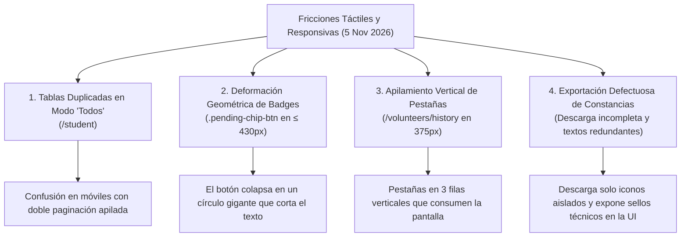

# 📱 Refinamiento Integral de Usabilidad Táctil en Móviles y Tabletas: Unificación de Tablas por Pestañas, Píldoras Anti-Deformación, Desplazamiento Horizontal en Historial y Generación Fiel de Constancias en Imagen PNG

- **Fecha de Inicio:** 5 de noviembre de 2026
- **Estado:** 🟡 **Aprobada — En Implementación**
- **Ámbito:** Frontend Angular v22 Standalone, Arquitectura SCSS Responsiva (Apple Human Interface Guidelines & Material Design), Generador Web de Constancias PNG (Backend Node.js Express / Canvas / Puppeteer)
- **Documento Relacionado:** ADR-20, ADR-21 y ADR-23 en [`architecture.md`](../architecture.md)
- **Entorno Objetivo:** Teléfonos móviles (iPhone SE 375px, iPhone 14/15/16 390px-430px, Android estándar), Tabletas convencionales (iPad / iPad Air 768px-1024px) y Pantallas de Escritorio (`> 1024px`)

---

## 1. Resumen Ejecutivo y Diagnóstico

El 5 de noviembre de 2026, tras auditar exhaustivamente la experiencia de usuario de la plataforma ABAQ en dispositivos móviles táctiles y tabletas convencionales, se identificó un conjunto de fricciones de usabilidad críticas que afectaban la navegación administrativa, la legibilidad de datos y la exportación de constancias oficiales.

### 1.1 Diagnóstico de Problemas Detectados



1. **Tablas Duplicadas y Doble Paginación en Modo "Todos" (`/student`)**:
   - Al incorporar la pestaña "Todos", el sistema renderizaba secuencialmente en el DOM dos secciones completas e independientes: la sección de **Servicio Social** (con su tabla, métricas y paginador) y la sección de **Voluntarios Generales** (con su respectiva tabla y paginador secundario).
   - En pantallas móviles, esto provocaba que el usuario tuviera que desplazarse verticalmente a través de una primera tabla paginada para encontrarse con una segunda tabla debajo, generando confusión operativa y desorden visual.
2. **Deformación Elíptica/Circular del Badge de Pendientes (`.pending-chip-btn`)**:
   - En teléfonos de pantalla compacta (`< 430px`, e.g., iPhone SE de 375px), el botón de solicitudes pendientes (`⏳ 0 pendientes de aceptación`) sufría quiebres multilínea involuntarios. Al tener `border-radius: 999px` combinado con `display: flex; flex-direction: column;`, el contenedor se estiraba verticalmente transformándose en un círculo gigante y desproporcionado que recortaba el texto.
3. **Apilamiento Vertical de Pestañas en Historial de Voluntarios (`/volunteers/history`)**:
   - Las pestañas de navegación (`Estudiantes pasados`, `Voluntarios pasados`, `Bitácora`) utilizaban `flex-wrap: wrap;`. En anchos de 375px a 400px, los botones se apilaban en tres líneas verticales desordenadas, quebrando el borde inferior decorativo y consumiendo más de 160px de altura útil antes de mostrar el contenido.
4. **Fallas en la Descarga de Constancias en Imagen PNG y Saturación de Metadatos en la UI**:
   - El visualizador de certificados presentaba inconsistencias en la descarga directa en imagen PNG: en navegadores de escritorio la captura fallaba o exportaba únicamente elementos secundarios aislados (como el icono de la huella en Preview.app).
   - Las tarjetas de constancia en el frontend (`student-detail`, `volunteer-detail`, `volunteer-profile`, `student-profile`) mostraban permanentemente la leyenda técnica:
     > *"Sello criptográfico HMAC-SHA256 · Verificable en línea con QR institucional"*
     lo cual saturaba visualmente la interfaz de usuario con metadatos técnicos redundantes que únicamente deben residir en el lienzo del certificado oficial.

---

## 2. Decisiones de Diseño y Arquitectura

### 2.1 Unificación de la Tabla por Pestaña Reactiva (`/student`)
En lugar de renderizar dos tablas completas superpuestas en el DOM, se diseña un **componente de tabla único y unificado**:
* Las pestañas superiores (`Todos`, `Servicio Social`, `Voluntariado General`) actúan como selector de vista del mismo contenedor.
* En la pestaña **`Todos`**, se presenta la lista global de colaboradores ordenada alfabéticamente o por estatus, con paginación única y coherente.
* Al seleccionar **`Servicio Social`** o **`Voluntariado General`**, la tabla aplica el filtro de forma reactiva en el mismo bloque visual, garantizando una sola sección visible y un solo control de paginación en pantalla.

### 2.2 Blindaje Geométrico del Badge de Pendientes (`.pending-chip-btn`)
Para garantizar que el indicador de solicitudes pendientes conserve su apariencia de píldora institucional elegante en cualquier resolución:
* Aplicación estricta de `white-space: nowrap !important; max-width: 100%; border-radius: 999px;`.
* `display: inline-flex; align-items: center; justify-content: center; gap: 6px;` con altura táctil ergonómica de 38px a 40px.
* Se anula cualquier posibilidad de que el texto quiebre en múltiples líneas o que el contenedor colapse en una forma circular gigante.

```scss
/* Regla de blindaje geométrico */
.pending-chip-btn {
  display: inline-flex !important;
  align-items: center !important;
  justify-content: center !important;
  white-space: nowrap !important;
  border-radius: 999px !important;
  min-height: 38px;
  padding: 6px 14px !important;
  max-width: 100%;
  flex-shrink: 0;
}
```

### 2.3 Desplazamiento Horizontal Continuo con Scroll-Snap (`.history-tabs` y `.vol-tabs`)
Se homologa el patrón de navegación táctil móvil en todas las barras de pestañas de la plataforma:
* En pantallas táctiles (`<= 768px` y `<= 480px`), se impone:
  - `overflow-x: auto; flex-wrap: nowrap !important;`
  - `-webkit-overflow-scrolling: touch; scroll-snap-type: x mandatory;`
  - `scrollbar-width: none; &::-webkit-scrollbar { display: none; }`
* Cada pestaña recibe `scroll-snap-align: start; flex-shrink: 0; min-height: 44px;` para cumplir con las directrices de Apple Human Interface Guidelines.
* Esto garantiza que en teléfonos de 375px (como iPhone SE) las tres opciones permanezcan en una sola fila horizontal limpia, permitiendo deslizarse con suavidad sin apilarse verticalmente.

### 2.4 Generación Confiable de Constancias PNG y Limpieza de UI Web

1. **Captura Fidedigna del Lienzo Completo (`#certificateRoot`)**:
   - El visualizador de certificados aísla el contenedor raíz nativo de 1122 × 793 px, asegurando que `html2canvas` o el servicio de renderizado tome el marco íntegro del diploma (orlas doradas, sellos criptográficos, logotipo oficial, firmas de directores y textos de felicitación) exportando un archivo PNG de 2x resolución (2244 × 1586 px).
   - Se elimina la posibilidad de que se descargue un sub-elemento o favicon aislado.
2. **Desacoplamiento de Sellos Criptográficos de la Interfaz Web**:
   - Se retira el texto técnico `"Sello criptográfico HMAC-SHA256 · Verificable en línea con QR institucional"` de las tarjetas y modales del frontend en los cuatro expedientes:
     - [`student-detail.html`](file:///Users/riosisraelg/Desktop/1/abaq/frontend/src/app/components/student-detail/student-detail.html)
     - [`volunteer-detail.html`](file:///Users/riosisraelg/Desktop/1/abaq/frontend/src/app/components/volunteer-detail/volunteer-detail.html)
     - [`volunteer-profile.html`](file:///Users/riosisraelg/Desktop/1/abaq/frontend/src/app/components/volunteer-profile/volunteer-profile.html)
     - [`student-profile.html`](file:///Users/riosisraelg/Desktop/1/abaq/frontend/src/app/components/student-profile/student-profile.html)
   - **Regla inviolable de autenticidad**: El sello criptográfico HMAC-SHA256 y el código QR institucional de verificación permanecen activos y visibles **exclusivamente dentro del documento oficial del certificado**, garantizando su validez jurídica sin sobrecargar la interfaz web.

---

## 3. Matriz de Breakpoints y Comportamiento Responsivo

| Elemento | Escritorio (`> 1024px`) | Tableta (`769px - 1024px`) | Móvil Estándar (`481px - 768px`) | Móvil Compacto (`<= 480px` / 375px) |
| :--- | :--- | :--- | :--- | :--- |
| **Pestañas (`.vol-tabs` / `.history-tabs`)** | Fila fija con borde inferior continuo; padding 12px 28px 0 | Fila horizontal holgada; padding 10px 16px 0 | Scroll horizontal táctil continuo; padding 8px 10px 0 | Scroll táctil con *scroll-snap*, touch target 44px, cero quiebre |
| **Contenedor de Tabla (`/student`)** | Tabla unificada de ancho completo con todas las columnas | Tabla con anchos optimizados y scroll interno si excede | Transformación táctil a tarjetas verticales desacopladas | Tarjetas compactas con `flex-wrap: wrap` en celdas |
| **Badge de Pendientes (`.pending-chip-btn`)** | Píldora alineada al encabezado | Píldora compacta junto a contadores | Píldora horizontal completa sin salto de línea | Píldora horizontal blindada (`white-space: nowrap`) |
| **Lienzo de Constancia** | 1122 × 793 px centrado con sombra profunda | Auto-escala dinámica con `--cert-scale` | Auto-escala fluida adaptable al ancho de pantalla | Auto-escala con barra de herramientas flotante compacta |
| **Prevención de Zoom Safari** | Estándar (`16px !important`) | Blindada (`16px !important`, manipulación táctil) | Meta viewport estricto + `16px !important` | Cero saltos involuntarios de zoom al tocar inputs |

---

## 4. Estado de Implementación y Trazabilidad

- **5 de noviembre de 2026**:
  - Implementación inicial de la pestaña "Todos" predeterminada y etiqueta de contexto `ESTATUS:` (registrado en ADR-21).
  - Liberación de padding lateral macro (`10px` en móvil, `16px` en tableta) eliminando el efecto "caja dentro de caja" (registrado en ADR-20).
  - Identificación del bug de deformación circular de `.pending-chip-btn` y del apilamiento vertical de `.history-tabs` en 375px (iPhone SE).
- **6 al 9 de noviembre de 2026**:
  - Incorporación de Cloudflare Turnstile en superficies públicas y estabilización de dependencias de build (Angular 22 application builder).
  - Registro formal de la propuesta arquitectónica definitiva bajo ADR-23 en el repositorio de documentación.

---

## 5. Criterios de Aceptación (DoD)

1. **Una sola tabla a la vez**: Al activar "Todos" o cualquier pestaña en `/student`, solo existe una tabla/conjunto de tarjetas con un único paginador activo en la vista.
2. **Forma de píldora intacta**: El botón de solicitudes pendientes mantiene su altura de ~38px y bordes redondeados limpios sin convertirse en un óvalo o círculo gigante en pantallas de 375px.
3. **Pestañas en una fila**: En `/volunteers/history`, las tres pestañas se presentan en una sola línea horizontal deslizable con el dedo en cualquier dispositivo móvil.
4. **Descarga íntegra de constancia**: El botón `📥 Descargar Imagen (PNG)` genera el diploma completo a resolución 2x (2244 × 1586 px).
5. **UI limpia**: Ninguna tarjeta de la interfaz web muestra la leyenda técnica de HMAC-SHA256, la cual se conserva íntegramente dentro del lienzo de la constancia emitida.
