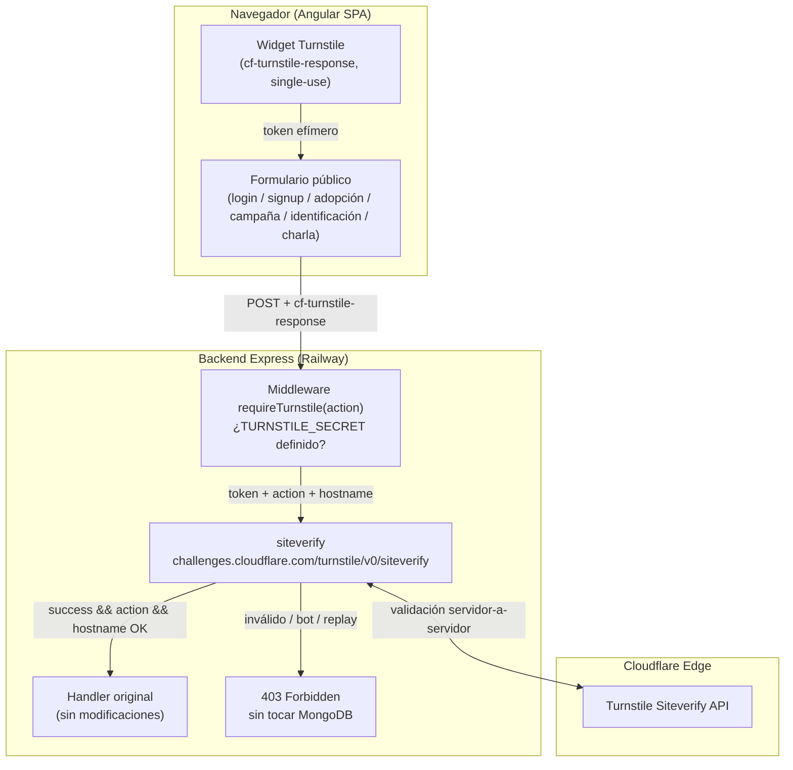

# 🛡️ Integración Integral de Cloudflare Turnstile en Todas las Superficies Públicas, Configuración de Dominios y Despliegue Railway

- **Fecha de Creación:** 6 de noviembre de 2026
- **Estado:** 🟡 **En Implementación**
- **Ámbito:** Frontend Angular v22 Standalone, Backend Node.js / Express / MongoDB, Cloudflare Turnstile, Railway CLI, DNS en AWS Route 53 (OpenTofu)
- **Documento Base:** [`cloudflare-waf-turnstile-proposal.md`](../cloudflare-waf-turnstile-proposal.md) (SEC-2026-CF01)
- **Entorno Objetivo:** `development` / `testing` / `security-testing` en Railway (sandbox académico, `NODE_ENV=development`)

---

## 1. Resumen Ejecutivo y Alcance

### 1.1 Contexto
La propuesta SEC-2026-CF01 estableció Turnstile únicamente para `/auth/login` y `/auth/signup`. El análisis de exposición real del sistema revela **siete puntos de entrada públicos sin autenticación** que aceptan escrituras directas a MongoDB y son vectores de spam, bots y fuerza bruta:

| # | Superficie | Endpoint backend | Handler |
| :- | :--- | :--- | :--- |
| 1 | Inicio de sesión | `POST /auth/login` | `auth.controller.login` |
| 2 | Registro estudiante | `POST /auth/signup-student` (fallback `/auth/signup`) | `auth.controller.signup` |
| 3 | Registro voluntario | `POST /auth/signup-volunteer` (fallback `/auth/signup`) | `auth.controller.signupVolunteer` |
| 4 | Formulario público de adopción | `POST /adoption/public` | `adoption.controller.createAdoption` |
| 5 | Formulario público de campaña | `POST /campaign/public` | `campaign.controller.createCampaign` |
| 6 | Formulario público de identificación | `POST /identification/public` | `identification.controller.createIdentification` |
| 7 | Formulario público de charla | `POST /talk/public` | `talk.controller.createTalk` |

> **Corrección de hallazgo en implementación:** los routers `/adoption`, `/campaign`,
> `/identification` y `/talk` protegían **todas** sus rutas con `protect` +
> `requireActiveAccount`, por lo que los formularios `/formularios/*` (rutas
> Angular públicas sin guard) recibían `401` a usuarios anónimos. Se resolvió
> añadiendo subrutas `POST /<recurso>/public` **antes** del `router.use(protect)`:
> quedan públicas, validadas por Turnstile, y las rutas autenticadas existentes
> permanecen intactas para los módulos administrativos.
>
> **`POST /contact` queda excluido**: la ruta completa (`router.use(protect)` +
> `requireActiveAccount`) exige sesión activa y su componente Angular es una
> vista administrativa de contactos, no un formulario público.

### 1.2 Decisiones Tomadas
1. **Cobertura total de superficies públicas**: las 7 rutas anteriores quedan protegidas con el mismo widget y contrato "gate, don't replace".
2. **Widget existente**: se reutiliza el widget ya creado en el dashboard de Cloudflare con site key `0x4AAAAAAFyFdIMaykCWh0xG`. No se crean widgets nuevos.
3. **DNS permanece en Route 53**: Turnstile **no requiere** que el dominio esté en Cloudflare DNS. Los registros de `hypercoreqro.lat` siguen administrados por OpenTofu en `infrastructure/route53-railway`. La delegación de nameservers a Cloudflare (Etapa 2 / WAF) permanece diferida.
4. **Dominios del widget ampliados**: se registran `hypercoreqro.lat`, `www.hypercoreqro.lat` y los dominios internos de Railway (`*.up.railway.app`) para que las pruebas funcionen en el sandbox y en producción sin depender del TLD `.lat` (bloqueado en la red universitaria).
5. **Despliegue sin GitHub conectado**: ambos servicios (frontend y backend) se publican con `railway up` desde los repositorios locales.
6. **Gobernanza del sandbox de seguridad**: la verificación Turnstile es **condicionada por variable de entorno** para reconciliar esta iniciativa con el SRS §16.3 (los evaluadores académicos deben poder ejecutar pruebas de inyección y estrés sin que un anti-bot bloquee el tráfico de auditoría).

---

## 2. Arquitectura de la Integración

### 2.1 Diagrama de Flujo



### 2.2 Contrato "Gate, Don't Replace"
El widget se inserta en la pantalla y el backend valida el token **antes** de la lógica existente. Los handlers no se modifican; el token es un campo adicional (`cf-turnstile-response`) en el cuerpo JSON.

### 2.3 Matriz de Acciones Turnstile

| Superficie | `data-action` | Endpoint | `expectedAction` server |
| :--- | :--- | :--- | :--- |
| Login (`/auth/login`) | `login` | `POST /auth/login` | `login` |
| Signup estudiante (Fase 4 onboarding) | `signup-student` | `POST /auth/signup-student` | `signup-student` |
| Signup voluntario (Fase 4 onboarding) | `signup-volunteer` | `POST /auth/signup-volunteer` | `signup-volunteer` |
| Adopción pública (`/formularios/adopciones`) | `public-adoption` | `POST /adoption/public` | `public-adoption` |
| Campaña pública (`/formularios/campanas`) | `public-campaign` | `POST /campaign/public` | `public-campaign` |
| Identificación pública (`/formularios/placas`) | `public-identification` | `POST /identification/public` | `public-identification` |
| Charla pública (`/formularios/platicas`) | `public-talk` | `POST /talk/public` | `public-talk` |

> **Ubicación del widget en signup:** el registro real ocurre al finalizar la
> Fase 4 del onboarding (`onboarding-phase.component`), no en `signup.component`
> (que solo captura tipo/email/password). El widget se renderiza únicamente en
> `currentPhase === 4` para que el token esté fresco al momento del `POST`.
> El fallback `/auth/signup` acepta las acciones `signup-student` y
> `signup-volunteer` porque reutiliza el mismo token del cliente.

> Las acciones cumplen la regla Turnstile: 1–32 caracteres, solo `[a-zA-Z0-9_-]`.

### 2.4 Validación Canónica Server-Side
Cada handler protegido ejecuta `siteverify` con:
- `secret`: `process.env.TURNSTILE_SECRET`
- `response`: token `cf-turnstile-response` del body
- `remoteip`: IP del cliente (`X-Forwarded-For` / `req.ip`)
- Verificación obligatoria de `success === true`, `action` esperada y `hostname` dentro de `TURNSTILE_HOSTNAMES`.
- **Tokens de un solo uso**: el frontend invoca `turnstile.reset(widgetId)` tras cada intento para permitir reintentos.

### 2.5 Degradación Graciosa del Widget (Redes Restringidas)
Si `api.js` de Cloudflare no puede cargarse (p. ej. redes que bloquean
`challenges.cloudflare.com`), el componente `app-turnstile-widget` emite
`errorChange` y el formulario marca `turnstileUnavailable = true`: el envío
se permite sin token y **el backend decide** según su configuración
(`TURNSTILE_DISABLED` / `TURNSTILE_SECRET` ausente). En servicios con secreto
configurado, la ausencia de token sigue produciendo `403`.

### 2.6 Interruptor para el Sandbox de Seguridad (SRS §16.3)
```javascript
// Comportamiento del middleware requireTurnstile:
// - TURNSTILE_DISABLED=true  -> next() inmediato (auditorías de seguridad)
// - TURNSTILE_SECRET ausente -> next() con advertencia en log (dev local)
// - Caso contrario           -> siteverify obligatorio, 403 si falla
```
Esto permite desplegar el mismo binario en `development`, `testing` y
`security-testing` y decidir por servicio/entorno si el anti-bot está activo,
sin recompilar ni bifurcar código.

---

## 3. Configuración de Dominios y DNS

### 3.1 Widget Turnstile (existente)
- **Site key:** `0x4AAAAAAFyFdIMaykCWh0xG`
- **Secret key:** recuperada de forma segura vía `wrangler turnstile widget get`
  (Wrangler ≥ 4.109, fuera del proyecto) y almacenada en el gestor de secretos
  del backend (`backend/.env` local / variables de Railway en desplegado).
  **Nunca** en el repositorio ni en el chat.
- **Dominios a registrar en el widget:** `localhost`, `127.0.0.1`,
  `hypercoreqro.lat`, `www.hypercoreqro.lat` y los hosts `*.up.railway.app`
  de los servicios frontend/backend.

### 3.2 DNS — Permanece en AWS Route 53
Los registros de `hypercoreqro.lat` se administran con OpenTofu en
`infrastructure/route53-railway` apuntando a los servicios de Railway. No se
delegan nameservers a Cloudflare en esta etapa; Turnstile no lo requiere.

> **Nota sobre el TLD `.lat`:** la red universitaria bloquea el TLD `.lat`, por
> lo que las pruebas en campus se realizarán contra los dominios internos de
> Railway (`*.up.railway.app`), que se registran como hostnames válidos del
> widget y de `TURNSTILE_HOSTNAMES` del backend.

---

## 4. Despliegue Railway sin GitHub

| Servicio | Directorio | Builder | Start |
| :--- | :--- | :--- | :--- |
| Backend API | `backend/` | Nixpacks (Node 22) | `npm start` → `node app.js` |
| Frontend SPA | `frontend/` | Dockerfile (dist prebuilt) | `node web-server.js` |

- `railway up` sube el directorio local respetando `.railwayignore`
  (backend excluye `node_modules/`; frontend sube solo `dist/` + `web-server.js`).
- El frontend hornea `environment.production.ts` con `apiUrl` al dominio del
  backend en Railway; si cambia la URL, se reconstruye con `npm run build`.
- Variables de entorno del backend en Railway: `MONGO_URL` (referencia al
  plugin MongoDB de Railway), `JWT_SECRET`, `TURNSTILE_SECRET`,
  `TURNSTILE_HOSTNAMES`, `TURNSTILE_DISABLED`, `resend`/`RESEND_API_KEY`,
  `EMAIL_FROM`, `ADMIN_EMAIL`, `NODE_ENV`, `BASE_URL`, `FRONTEND_URL`.
  `PORT` lo inyecta Railway automáticamente.

---

## 5. Tooling del Agente (Cloudflare Agent Setup)

Ejecutado conforme a `developers.cloudflare.com/agent-setup/prompt.md`:
- Skills de Cloudflare instaladas globalmente (`~/.agents/skills/`,
  `~/.config/devin/skills/`): `turnstile-spin`, `cloudflare`, `cf-cli`,
  `wrangler`, `workers-*`, etc.
- MCP server `cloudflare` registrado en `~/.codeium/windsurf/mcp_config.json`.
- CLI `cf` (beta) instalado globalmente para gestión de DNS/zonas.
- `AGENTS.md` de usuario actualizado: preferir `cf` sobre Wrangler salvo que
  exista configuración de Wrangler en el proyecto.

---

## 6. Plan de Validación

1. **Build frontend**: `npm run build` → `dist/` fresco con site key en el bundle.
2. **Sintaxis backend**: `node --check` en `app.js`, rutas, middlewares.
3. **Localhost E2E**: widget renderiza en las 7 superficies; un token real es
   aceptado una vez y su replay es rechazado (`success === false` → 403).
4. **Acciones incorrectas**: un token de `login` enviado a `/adoption` → 403.
5. **Hostname no autorizado**: token emitido en hostname fuera de
   `TURNSTILE_HOSTNAMES` → 403.
6. **Interruptor**: con `TURNSTILE_DISABLED=true` los endpoints responden sin
   token (sandbox de seguridad).
7. **Railway**: `railway up` backend + frontend; smoke test de login y un
   formulario público en `*.up.railway.app` y `hypercoreqro.lat`.

---

## 7. Riesgos y Consideraciones

- **Scripts de terceros**: `api.js` de Turnstile se carga de
  `challenges.cloudflare.com`; si la red lo bloquea, el formulario debe degradar
  con mensaje claro (no bloquear el envío silenciosamente).
- **Tokens single-use**: todo reintento requiere `turnstile.reset()`; un token
  reutilizado es rechazado por diseño.
- **Hostname del widget vs. `TURNSTILE_HOSTNAMES`**: ambos allowlists deben
  mantenerse sincronizados al agregar dominios nuevos.
- **Secret en Railway**: `TURNSTILE_SECRET` se define como variable de entorno
  del servicio backend, nunca en el bundle del frontend ni en el repo.
- **SRS §16.3**: en entornos de auditoría se opera con `TURNSTILE_DISABLED=true`
  para no interferir con pruebas de inyección/stress; el anti-bot se activa en
  el servicio de cara al público.

---

## 8. Entregables

- [x] `backend/utils/turnstile.js` — cliente `siteverify` canónico.
- [x] `backend/middlewares/turnstile.middleware.js` — `requireTurnstile(action)` con interruptor.
- [x] `backend/routes/auth.route.js` — Turnstile en `login`, `signup-student`, `signup`, `signup-volunteer`.
- [x] `backend/routes/{adoption,talk,campaign,identification}.route.js` — nuevas subrutas públicas `POST /<recurso>/public` con Turnstile, antes de `protect`.
- [x] `frontend/src/app/services/turnstile.service.ts` — carga de `api.js`, render y ciclo de vida del token.
- [x] `frontend/src/app/components/shared/turnstile-widget/turnstile-widget.component.ts` — componente reusable con degradación graceful.
- [x] Integración en `login`, `onboarding-phase` (Fase 4), `public-adoption-form`, `public-campaign-form`, `public-identification-form`, `public-talk-form`.
- [x] Servicios Angular: `auth.service` (token en login/signup), `onboarding-state.service` y `createPublic*` en los 4 servicios de formularios.
- [x] `environment*.ts` — `turnstileSiteKey` pública (`0x4AAAAAAFyFdIMaykCWh0xG`).
- [x] Widget existente actualizado vía Wrangler 4.158: dominios `localhost`, `127.0.0.1`, `hypercoreqro.lat`, `www.hypercoreqro.lat`, `up.railway.app`.
- [x] `TURNSTILE_SECRET` recuperado con `wrangler turnstile widget get`, validado contra `siteverify` (probe `invalid-input-response`) y escrito en `backend/.env` (gitignored, nunca impreso).
- [ ] `TURNSTILE_SECRET` + `TURNSTILE_HOSTNAMES` de producción en variables de Railway — **pendiente del despliegue**.
- [x] Actualización de `srs.md` y `architecture.md` (ver documentos enlazados).
