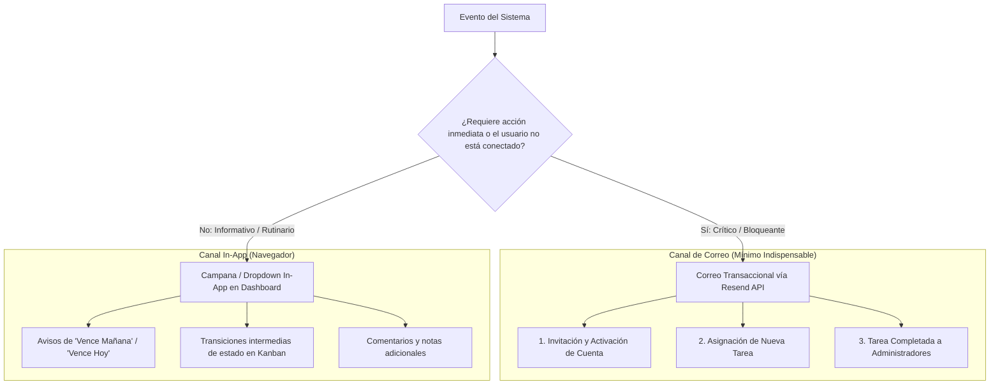

# 📋 Estrategia de Tablero Kanban, Gestión de Tareas y Notificaciones Mínimas con Resend

- **Fecha:** 9 de noviembre de 2026
- **Estado:** 🟢 **Implementado y Estable en Rama `dev`**
- **Ámbito:** ABAQ-Organizador (PHP 8.2 / MySQL / Docker), Backend Node.js / Express (Resend API), Frontend Angular v22 (Application Builder)
- **Documentos Relacionados:** [`notificaciones-design.md`](../notificaciones-design.md) · [`tasks.md`](../tasks.md) · [`ciclo-vida-voluntarios-deshidratacion-design.md`](../ciclo-vida-voluntarios-deshidratacion-design.md)

---

## 1. Resumen Ejecutivo y Dominio

El dominio de **Organización de Tareas y Notificaciones** abarca dos necesidades críticas para la operación diaria de la asociación ABAQ:

1. **Supervisión Visual del Flujo de Trabajo (Kanban):** Coordinación del avance de las actividades de los colaboradores a través de cuatro estados clave: `Pendiente`, `En proceso`, `Completada` y `Cancelada`.
2. **Sistema Híbrido de Notificaciones (In-App vs. Correo Transaccional):** Asegurar que las acciones críticas lleguen al destinatario correcto sin generar **fatiga de alertas** ni saturar la bandeja de entrada del usuario o del administrador.

---

## 2. Diagnóstico y Correcciones en el Tablero Kanban

### 2.1 Problemas Detectados
- **Cancelación Interrumpida por Diálogo Modal:** Al arrastrar tarjetas hacia la columna *Canceladas*, el uso de `window.confirm()` síncrono provocaba que el navegador disparara inmediatamente el evento `dragend`, anulando `tareaArrastradaId = null`. El backend recibía `id = 0` y rechazaba la operación con error *"Tarea no válida"*.
- **Parpadeo Visual (*Flickering*) en Columnas:** En eventos `dragleave`, transiciones sobre elementos hijos (títulos, etiquetas) retiraban prematuramente la clase `.drag-over`.
- **Incompatibilidad con Pantallas Táctiles:** La API nativa de arrastre de HTML5 no opera en dispositivos móviles o tablets.
- **Fragilidad en Persistencia Concurrente:** Validaciones estrictas basadas en `affected_rows !== 1` generaban falsos positivos de error si los valores de estado en MySQL no modificaban físicamente el registro o presentaban variaciones de mayúsculas/espacios.

### 2.2 Soluciones Implementadas y Estado Actual
- **Captura Inmediata de Identificador:** El ID y el estado previo se capturan en variables locales síncronas antes de desplegar cualquier diálogo de confirmación, garantizando la persistencia independientemente del ciclo de eventos del navegador.
- **Contadores de Profundidad (`dragCounters`):** Previenen la pérdida del estilo activo de la columna durante el arrastre sobre elementos anidados.
- **Control Táctil y Accesible (`Mover:`):** Cada tarjeta incorpora un selector desplegable accesible para cambiar de estado al instante con un solo toque o mediante navegación por teclado.
- **Actualización Segura por ID:** En backend (`actualizar_estado_kanban.php`), se consulta previamente la entidad y se actualiza directamente mediante `WHERE id = ?`, registrando la actividad en el historial y emitiendo notificación interna al responsable.

---

## 3. Estrategia de Notificaciones Mínimas Indispensables (Resend)

### 3.1 Principio de Diseño: Prevención de Fatiga de Alertas
Para evitar que los correos sean clasificados como spam o ignorados por los usuarios, se estableció un criterio estricto de segregación de canales:

### 3.2 Matriz de Notificaciones por Correo Electrónico

| # | Notificación | Disparador | Destinatario | Justificación |
| :- | :--- | :--- | :--- | :--- |
| **1** | **Invitación / Activación** | Creación de usuario en panel admin (`enviar_invitacion.php`) | Colaborador nuevo | **Bloqueante:** El usuario necesita el enlace único con token seguro para establecer su contraseña y acceder. |
| **2** | **Asignación de Tarea** | Creación de tarea en panel admin (`guardar_tarea_admin.php`) | Colaborador responsable | **Operativa:** Alerta con fecha límite, categoría y prioridad sin exigir que el usuario mantenga el navegador abierto. |
| **3** | **Tarea Completada** | Conclusión formal con horas y beneficio (`finalizar_tarea.php`) | Administradores activos | **Supervisión:** Notifica a la mesa directiva la entrega de resultados y horas acreditadas para su validación. |

---

## 4. Alineación con el Ecosistema Global ABAQ

| Componente | Stack & Versión | Builder / Runtime | Rol en el Ecosistema |
| :--- | :--- | :--- | :--- |
| **Frontend** | Angular `^22.0.0` | `@angular/build:application` (Vite + esbuild) | SPA principal de administración y autoservicio de voluntarios (`https://hypercoreqro.lat`). |
| **Backend** | Node.js Express `4.19.2` | Node `22.22.3` nativo (`engines: ^22.22.3`) | API REST principal (`api.hypercoreqro.lat`), Mongoose 8.4.4, Turnstile Anti-bot y Resend API. |
| **Organizador** | PHP 8.2 / MySQL | Docker (`php:8.2-cli`) en Railway | Módulo especializado de coordinación de tareas, seguimiento presupuestal y tablero Kanban. |
| **Infraestructura** | Railway + AWS Route 53 | Dockerfiles independientes | Orquestación en contenedores con dominios internos y públicos administrados. |

---

## 5. Estado de Código y Ramas

- **Código Fuente:** Estable y congelado (no requiere cambios adicionales de implementación).
- **Ramas:**
  - `dev` consolidada con los merges de `origin/main` (commit `9bce8e4` y `2e06b78`), con tipo de dato `TINYINT` verificado para `invitacion_enviada`.
  - Integración nativa de Resend cURL (`servicio_correo.php`) en ABAQ-Organizador compatible con la configuración de `backend/utils/email.js`.
