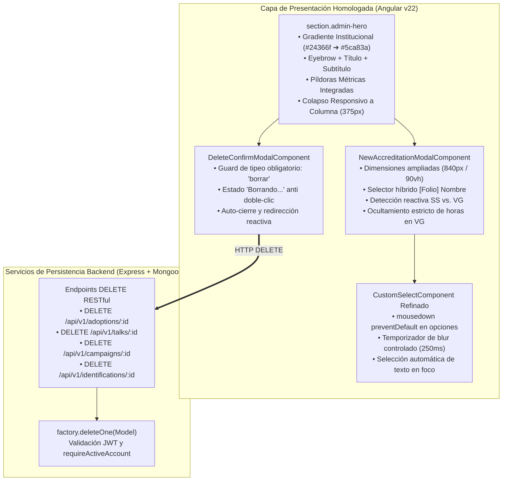

# 🎨 Homologación Visual de Encabezados (Admin Heroes), Borrado Validado en Formularios de Servicio Social, Acreditación Desacoplada de Voluntarios Generales y Optimización Móvil (iPhone SE)

- **Fecha:** 12 de noviembre de 2026
- **Estado:** 🟢 **Implementado y Estable en Rama `dev`** (Versión CalVer `v2026.11.12`)
- **Ámbito:** Frontend Angular v22 (Standalone Components / SCSS BEM / Reactive UI), Backend Node.js / Express v4 (Mongoose ORM / RESTful Endpoints)
- **Documentos Relacionados:** [`srs.md`](../srs.md) · [`architecture.md`](../architecture.md) · [`design-system.md`](../design-system.md) · [`datos-respaldo-recuperacion-design.md`](../datos-respaldo-recuperacion-design.md)

---

## 1. Resumen Ejecutivo y Diagnóstico

Durante la fase de validación operativa en dispositivos móviles y estaciones de trabajo administrativas, se detectaron áreas clave de optimización en la experiencia de usuario (UX), consistencia visual (UI) y robustez transaccional:

1. **Desborde de Botones en Pantallas Ultra-Angostas (iPhone SE / 375px):** En las vistas de formularios de Servicio Social (Adopciones, Pláticas, Campañas EST, Placas de Identificación), el botón de acción principal (`.btn-copy-form` / `.copy-form-button`) se desbordaba horizontalmente hacia la derecha, superando el viewport visible y forzando scroll horizontal no deseado.
2. **Disparidad Visual en Encabezados Administrativos:** Los 4 formularios de servicio social y la vista de acreditaciones utilizaban cabeceras divergentes con estilos antiguos, careciendo del gradiente institucional característico (`#24366f` a `#5ca83a`), cejas tipográficas (*eyebrows*), subtítulos descriptivos y píldoras métricas de conteo de registros.
3. **Carencia de Eliminación Segura en Formularios Operativos:** No existía mecanismo en la interfaz ni en el backend para eliminar registros erróneos o duplicados en Adopciones, Pláticas, Campañas o Placas. Para prevenir borrados accidentales, se requería un diálogo modal validador que exigiera al administrador escribir textualmente la palabra `"borrar"`.
4. **Mezcla Conceptual de Horas en Acreditaciones de Voluntarios Generales (`VG`):** El modal original de acreditaciones forzaba la captura de horas de servicio social y mostraba leyendas educativas sobre acumulación de horas. Los Voluntarios Generales participan comunitariamente sin fines curriculares, por lo que cualquier referencia o cómputo de horas académicas en su expediente resulta inválida.
5. **Cierre Involuntario del Selector Desplegable (`CustomSelectComponent`):** Al tener una opción seleccionada y abrir el menú desplegable, si el usuario movía el cursor sobre la lista, el evento `blur` se disparaba de forma prematura cerrando el dropdown e impidiendo elegir otra opción cómodamente. Asimismo, el modal anterior de acreditación presentaba dimensiones excesivamente reducidas (`max-width: 600px`).
6. **Contenedor Restrictivo en Gestión de Actividades (`div.activities-content`):** En `/activity-list`, un contenedor con padding rígido limitaba el ancho útil de la tabla y las tarjetas, restando espacio operativo en pantallas intermedias y móviles.

---

## 2. Arquitectura de Solución Implementada



---

## 3. Detalle de Cambios por Módulo

### 3.1 Eliminación de Desborde y Responsividad en iPhone SE (375px)
- **Modificación SCSS**: En `.admin-hero`, la fila de cabecera `.hero-header-row` y el bloque de acciones `.hero-actions-row` se transforman en diseño de columna con `flex-direction: column; width: 100%` en viewports $\le 768$ px y $\le 380$ px.
- **Botón Copiar Enlace**: Pasa a ocupar el 100% del ancho del contenedor en móviles, centrado, con tipografía y espaciado ajustado para evitar roturas de línea incómodas o desbordamiento fuera de pantalla.

### 3.2 Homologación de Encabezados `.admin-hero` con Tarjetas de Métricas
- **Formularios Adaptados**:
  - `/admin/adoptions` y su detalle `/admin/adoptions/:id`.
  - `/admin/talks` y su detalle `/admin/talks/:id`.
  - `/admin/campaigns` y su detalle `/admin/campaigns/:id`.
  - `/admin/identifications` y su detalle `/admin/identifications/:id`.
  - `/admin/accreditations` (pestañas de pendientes e historial).
- **Consistencia Visual**:
  - Eyebrow tipográfico en mayúsculas (`FORMULARIO DE SERVICIO SOCIAL`, `DETALLE DE ADOPCIÓN`, etc.).
  - Píldoras de métricas translúcidas con efecto *backdrop blur* que muestran en tiempo real la cantidad de registros en base de datos.
  - Vistas de detalle con enlace superior externo `a.back-link` (`← Volver a ...`) posicionado fuera del hero, y botón de acción de borrado (`.btn-hero-delete`) situado en la esquina superior derecha dentro de `.hero-actions-row`.

### 3.3 Componente Reusable `DeleteConfirmModalComponent`
- **Ubicación**: `frontend/src/app/components/shared/delete-confirm-modal/`
- **Validación Estricta**: El botón de confirmación permanece deshabilitado hasta que el usuario teclea exactamente `"borrar"` (o `"BORRAR"`).
- **Prevención de Doble Envío**: Al pulsar el botón, entra en estado de carga con spinner (`isDeleting = true`), bloqueando el botón e informando visualmente *"Borrando..."*.
- **Auto-cierre**: Al completarse la petición HTTP con código 204 o 200, el modal se oculta y el usuario es redirigido automáticamente al listado correspondiente con su estado actualizado.

### 3.4 Backend: Rutas y Controladores `DELETE`
- **Endpoints Habilitados**:
  - `DELETE /api/v1/adoptions/:id` $\rightarrow$ `deleteAdoption` vía `factory.deleteOne(Adoption)`
  - `DELETE /api/v1/talks/:id` $\rightarrow$ `deleteTalk` vía `factory.deleteOne(Talk)`
  - `DELETE /api/v1/campaigns/:id` $\rightarrow$ `deleteCampaign` vía `factory.deleteOne(Campaign)`
  - `DELETE /api/v1/identifications/:id` $\rightarrow$ `deleteIdentification` vía `factory.deleteOne(Identification)`
- **Seguridad**: Todas las rutas exigen autenticación por token JWT activo mediante el middleware `requireActiveAccount`.

### 3.5 Modal Reusable `NewAccreditationModalComponent` y Desacoplamiento SS / VG
- **Ubicación**: `frontend/src/app/components/shared/new-accreditation-modal/`
- **Dimensiones**: Ampliado a `width: min(840px, 96vw)` y `max-height: min(90vh, 880px)` con scroll interno independiente y pie de página fijo.
- **Paso Previo en Acreditaciones Globales**: Incluye un selector desplegable unificado que carga concurrentemente estudiantes y voluntarios generales bajo la nomenclatura `[Folio] Nombre completo`.
- **Lógica para Voluntarios Generales (`isVolunteerGeneral`)**:
  - Muestra un banner distintivo con icono de corazón indicando: *"Voluntario General: Registro de actividad institucional (no contabiliza horas de servicio social)"*.
  - Oculta el campo numérico de horas a acreditar en actividades administrativas.
  - Oculta todas las cajas de ayuda que mencionen acumulación de horas (período de prueba de adopción, 30 horas de difusión, 5 horas base de redes sociales, 1 hora por cada $50 recaudados).
  - Al enviar la acreditación, despacha `hoursPerformed: 0`, `hoursAccredited: 0` y vincula a `volunteerRef`.
- **Integración Global**: El componente fue integrado de forma transparente en `accreditation-list`, `student-detail` y `volunteer-detail`, eliminando duplicación de código en tres vistas críticas.

### 3.6 Corrección de Eventos en `CustomSelectComponent`
- **Ubicación**: `frontend/src/app/components/ui/custom-select/custom-select.component.ts`
- Se agregó `(mousedown)="$event.preventDefault()"` tanto en el contenedor del dropdown como en cada opción individual, previniendo que el navegador transfiera el foco al hacer clic o mover el ratón y cancelando el evento `blur`.
- El temporizador de blur (`blurTimeout`) cuenta con un retardo de 250ms y es cancelado inmediatamente en eventos de foco, alternancia o selección.
- Al enfocar el campo de texto, el valor actual se auto-selecciona (`input.select()`), permitiendo al usuario escribir para filtrar inmediatamente sin requerir borrar manualmente el texto preexistente.

### 3.7 Desacoplamiento de Contenedores en `/activity-list`
- Se eliminó la etiqueta restrictiva `div.activities-content` y su padding fijo de `32px 36px 42px`.
- El encabezado `.activities-header` opera ahora de manera autónoma como un `.admin-hero` con botón `+ Nueva actividad` ubicado en la esquina superior derecha (`.hero-actions-row`) y responsivo a pantalla completa en móviles.
- La barra de búsqueda, filtros y cuadrícula de tarjetas aprovechan el 100% del ancho del viewport con espaciado fluido.

### 3.8 Homologación de Ancho en Pláticas y Campañas, Limpieza de Navbar y Navegación de Retorno
- **Emparejamiento de Anchos**: Se reemplazó el contenedor con `clamp(16px, 4vw, 48px)` y `max-width: 1500px` en `talk-list` y `campaign-list` por la regla uniforme `padding: 32px 24px; max-width: 1400px;` (idéntica a `adoption-list` e `identification-list`), garantizando que tanto el hero como el contenido compartan exactamente el mismo ancho visual y márgenes laterales.
- **Limpieza de Barra de Navegación**: Se removió el enlace redundante `Nueva Actividad` del menú principal de administración (`navbar.component.html`), dado que el acceso oficial se realiza a través del botón `+ Nueva actividad` integrado en la cabecera de la sección de Actividades.
- **Navegación Reusable `a.back-link`**: Se integró el componente de retorno `<a class="back-link" routerLink="/activity-list">← Volver a actividades</a>` en la vista de plantillas de actividad (`quick-activities`), manteniendo la experiencia de navegación consistente con el resto de vistas de detalle del sistema.

### 3.9 Definición del Dominio: Horas Acreditadas vs Horas Realizadas
- **Horas Realizadas (`hoursPerformed`)**: Representan el tiempo de reloj físico y efectivo que el alumno o voluntario dedicó en campo (p. ej. 3 horas presenciales en el refugio).
- **Horas Acreditadas (`hoursAccredited`)**: Representan el valor curricular oficial computado bajo las reglas institucionales y factores de acreditación (p. ej. Limpieza de refugio cuenta con factor multiplicador 4×: 3 horas realizadas equivalen a 12 horas acreditadas hacia la meta de servicio social; o metas fijas por producto como 1 adopción = 100 horas acreditadas).

### 3.10 Hotfix: Eliminación de ID de Debug y Enriquecimiento de Datos de Evento en Actividades
- **Retiro de ID de Depuración**: Se retiró el elemento visual `.activity-id` de la lista de actividades (`activity-list.component.html`), el cual mostraba el `_id` de MongoDB usado durante pruebas.
- **Visualización Completa del Evento**: Se integró el campo `Fecha` (`startDate` con rango a `dueDate`) en las tarjetas de actividades, garantizando que el usuario visualice tanto el día de realización como el horario de inicio y fin. En la vista de detalle se agregaron además los bloques de `Cupo`, `Enlace` e `Indicaciones`.
- **Persistencia de Indicaciones**: Se añadió el campo `comments` en el esquema Mongoose de `Activity` (`backend/models/activity.model.js`) e interfaces frontend, permitiendo preservar indicaciones y notas adicionales de la plantilla al publicarse.

### 3.11 Homologación del Sistema de Desempeño y Cálculo en Tiempo Real en Acreditaciones y Actividades
- **Homologación de Calificadores de Desempeño**:
  - Se unificó el sistema de evaluación cualitativa en acreditaciones y actividades utilizando los calificadores: `very_bad` (Muy malo / deficiente), `bad` (Malo), `good` (Bueno), `very_good` (Muy bueno) y `excellent` (Excelente), acompañados de un campo opcional de retroalimentación textual (`performanceComment`).
  - **Voluntarios Generales (`VG`)**: Por diseño institucional no acumulan horas curriculares (conteo y multiplicadores fijos en `0 h`), pero cuentan con evaluación completa de desempeño y comentarios para su expediente de colaboración.
  - **Estudiantes de Servicio Social (`SS`)**: Mantienen el cómputo de horas con multiplicadores oficiales y reciben la evaluación cualitativa de desempeño correspondiente.
- **Cálculo y Multiplicador en Tiempo Real en Modal de Acreditación**:
  - En `new-accreditation-modal`, al seleccionar la modalidad y parámetros de la acreditación, se muestra dinámicamente un banner institucional con la regla / multiplicador oficial (ej. Limpieza 4×, Placas 5×, Esterilización 10×, Adopción 100 h, Redes 5 h + reacciones/5, Donaciones 1 h/$50) y el cálculo de horas estimadas resultantes en tiempo real.
  - Para Voluntarios Generales, el banner muestra automáticamente el distintivo de régimen especial: `0 h curriculares · Registro con evaluación de desempeño`.
- **Modal de Aprobación y Evaluación al Validar Acreditaciones**:
  - Al hacer clic en "Aprobar acreditación" en `accreditation-list` y `student-detail`, se despliega un diálogo institucional donde el administrador selecciona el nivel de desempeño y puede capturar observaciones o retroalimentación antes de formalizar la aprobación.
  - En el historial y detalle de acreditaciones de estudiantes y voluntarios, se integraron chips visuales de desempeño (`performance-pill`) con código de colores según la calificación obtenida.
- **Validación de Desempeño para Voluntarios Generales en Actividades**:
  - En `activity-detail`, se habilitó el flujo de validación para participantes de tipo Voluntario General que hayan asistido a la actividad (`attended`), permitiendo al administrador registrar su desempeño y comentarios con `0 h`, homologando las capacidades entre ambos tipos de colaboradores.

### 3.12 Corrección de Enrutamiento y Redirección por Rol en `/home` y Brand Link
- **Problema Detectado**: Al ingresar directamente a `/home` o al hacer clic en el logotipo de ABAQ en el navbar con una sesión de administrador activa, la pantalla se quedaba congelada indefinidamente en el spinner *"Cargando información del estudiante..."*. Esto ocurría porque `HomeComponent` intentaba consultar datos de estudiante para el ID del usuario administrador, recibiendo `null` y permaneciendo en `isLoading = true`.
- **Guards de Redirección Automática por Rol**: Se crearon `HomeRoleGuard` y `VolunteerHomeGuard` en `auth.guard.ts` e integrados en `app.routes.ts`:
  - Si un **administrador** navega a `/home` o a `/volunteer-home`, es redirigido inmediatamente a su panel administrativo oficial (`/admin/home`).
  - Si un **voluntario general** navega a `/home`, es redirigido a `/volunteer-home`.
  - Si un **estudiante** navega a `/volunteer-home`, es redirigido a `/home`.
- **Respaldo en Componentes**: Se añadieron verificaciones síncronas y reactivas en `HomeComponent.ngOnInit` y `VolunteerHomeComponent.ngOnInit`, además de apagar el estado de carga (`isLoading = false`) en caso de no encontrar datos de estudiante.
- **Enlace de Marca en Navbar**: Se actualizó el enlace del logo en `NavbarComponent` (`brand-link`) para resolver dinámicamente `homeRoute`, llevando a cada rol a su panel principal sin fricción.

### 3.13 Homologación de Encabezado Hero en Plantillas de Actividades y Clarificación Institucional de "Campaña de esterilización"
- **Homologación de Encabezado Hero en `/admin/quick-activities`**:
  - Se transformó el antiguo encabezado plano `div.page-header` en el componente estándar institucional `<header class="admin-hero">`, compartiendo el gradiente `#24366f` a `#5ca83a`, ceja tipográfica (`.hero-eyebrow`: "GESTIÓN DE PLANTILLAS"), título H1, subtítulo descriptivo, botón de acción `.btn-create-item` ("+ Nueva plantilla" con icono `add_circle`) y píldora métrica reactiva (`.hero-stat-pill`) con el conteo de plantillas registradas.
  - Se mantuvo y perfeccionó el enlace superior izquierdo `a.back-link` ("← Volver a actividades") reutilizando los estilos y proporciones de las páginas de detalle (`talk-detail`, `campaign-detail`, `identification-detail`).
  - Se integraron reglas responsivas completas en `@media (max-width: 700px)` y `(max-width: 480px)` para colapso fluido de botones y tarjetas en dispositivos móviles.
- **Clarificación de "Campaña de esterilización" en Catálogo de Acreditaciones**:
  - En la modalidad `CAMPAIGN` de acreditaciones institucionales, la regla oficial exige $\ge 60$ animales inscritos e infraestructura médica/quirúrgica para acreditar 100 horas.
  - Para eliminar cualquier ambigüedad frente a otras campañas generales (de recaudación, difusión o adopción), se homologó la etiqueta textual a **"Campaña de esterilización"** en:
    - Selector desplegable y banner descriptivo de cálculo en `NewAccreditationModalComponent`.
    - Tablas y detalles de acreditaciones en `AccreditationListComponent`, `StudentDetailComponent`, `VolunteerDetailComponent`, `MyAccreditationsComponent`, `StudentProfileComponent` y `VolunteerProfileComponent`.

### 3.14 Desacoplamiento Silencioso y Supresión Total de Menciones de Horas para Voluntarios Generales (VG) en Modales Compartidos
- **Fallback Silencioso**: En el backend y en la lógica interna del frontend, los registros de actividades y acreditaciones de Voluntarios Generales (`VG`) preservan de forma completamente silenciosa valores nulos/cero (`hoursAccredited: 0`, `hoursWorked: 0`), garantizando que la persistencia y la asignación de folios institucionales se realicen sin fricción ni fallos de validación.
- **Supresión Absoluta de Horas en la Interfaz de VG**:
  - En los modales compartidos (`NewAccreditationModalComponent`, modal de aprobación en `AccreditationListComponent` y modal de validación de participantes en `ActivityDetailComponent`), se eliminó cualquier mención o referencia a horas para los Voluntarios Generales.
  - El banner dinámico de cálculo y multiplicadores (`.accreditation-calc-banner`) se restringió de forma exclusiva para colaboradores de Servicio Social (`@if (selectedAccreditationType && !isVolunteerGeneral)`).
  - Se eliminaron las leyendas redundantes como `(no contabiliza horas de servicio social)`, `sin conteo de horas` y `0 h curriculares`. Los distintivos y tarjetas para Voluntarios Generales ahora indican de forma limpia y profesional: *"Voluntario General: Registro de actividad institucional"* y *"Participación comunitaria institucional"*.

### 3.15 Homologación Exhaustiva de Encabezados (Admin Heroes) y Métricas Integradas en Todas las Vistas
- **Padrón de Voluntarios (`/student`)**:
  - Se homologó el encabezado principal `<header class="students-header admin-hero">` incorporando `.hero-header-row`, `.hero-actions-row` (con los botones de *Ver Voluntarios Pasados* y el dropdown de *Invitar a voluntarios*) y `.hero-stats-row`.
  - **Métricas integradas en el Hero**:
    - `Total`: `{{ volunteerList.length }} colaboradores registrados`.
    - `Activos`: `{{ allActiveCount }} activos`.
    - `Por aprobar`: `{{ allPendingCount }} por aprobar`.
    - `Servicio Social`: `{{ ssList.length }} Servicio Social`.
    - `Voluntariado General`: `{{ generalList.length }} Voluntariado General`.
- **Historial de Voluntarios (`/volunteers/history`)**:
  - Se incorporó `a.back-link` (*"← Volver a voluntarios"*) en la esquina superior izquierda.
  - Se reemplazó el antiguo encabezado blanco por el estándar `<header class="admin-hero">` con gradiente institucional.
  - **Métricas integradas en el Hero**:
    - `{{ pastStudents.length }} estudiantes pasados`.
    - `{{ pastVolunteers.length }} voluntarios pasados`.
    - `{{ statusAudit.length }} eventos en bitácora`.
- **Gestión de Actividades (`/activity-list`)**:
  - Se integró `.hero-stats-row` dentro del `admin-hero`:
    - Para **administradores**: `{{ data.length }} actividades publicadas` y conteo de coincidencias en búsqueda.
    - Para **colaboradores** (estudiantes y voluntarios): `{{ data.length }} actividades disponibles` y `{{ registeredActivityIds.size }} actividades inscritas`.
- **Mis Acreditaciones (`/my-accreditations`)**:
  - Se transformó el antiguo encabezado plano `div.page-header` en `<section class="admin-hero">` con ceja (*"SERVICIO SOCIAL"*), título, subtítulo descriptivo y botón de acción `+ Nueva acreditación`.
  - **Métricas integradas en el Hero**:
    - `{{ accreditations.length }} acreditaciones institucionales`.
    - `{{ activities.length }} actividades vinculadas`.
    - `{{ combinedRecords.length }} registros en total`.
- **Creación de Actividades (`/activity`)**:
  - Se agregó el enlace de navegación `a.back-link` (*"← Volver a actividades"*) en la esquina superior izquierda antes de la tarjeta del formulario.

---

## 4. Verificación y Resultados de Compilación

1. **Compilación Frontend**:
   ```bash
   npm --prefix frontend run build
   # Resultado: Application bundle generation complete. 0 errores.
   ```
2. **Validación Sintáctica Backend**:
   ```bash
   node -c backend/controllers/*.js backend/models/*.js
   # Resultado: 0 errores de sintaxis en controladores y modelos Mongoose.
   ```
3. **Control de Versiones y Despliegue en Railway**:
   - Las ramas `dev` en `backend`, `frontend` y `documentation` fueron sincronizadas y etiquetadas formalmente bajo la versión CalVer `v2026.11.12.9`.
   - El push activa automáticamente los webhooks de compilación y despliegue continuo en Railway.
