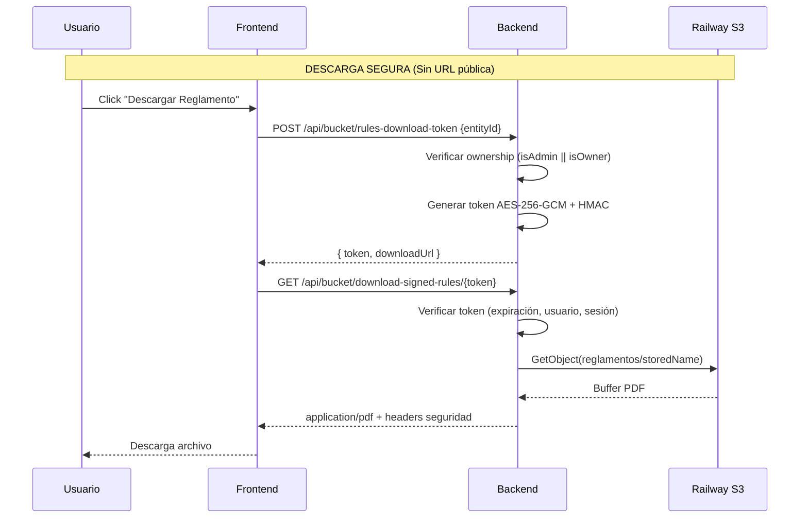
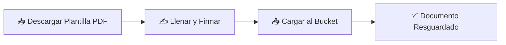

# 📁 Migración de Documentos PDF a Bucket Railway: Eliminación de Enlaces Externos, Seguridad de Endpoints y Rate Limiting Silencioso

**Fecha:** 13 de noviembre de 2026  
**Versión CalVer:** `v2026.11.13`  
**Alcance:** Centralización de todos los documentos PDF del sistema en el bucket institucional de Railway (S3), eliminación de campos redundantes en modelos, corrección de vulnerabilidades de seguridad en endpoints de carga, implementación de rate limiting silencioso de 8 horas para protección de costos de API, y actualización de vistas para reemplazar inputs de enlaces por componentes de carga de archivos.

---

## 1. Resumen Ejecutivo y Declaración del Problema

Actualmente, el sistema ABAQ maneja documentos de tres formas inconsistentes:

1. **Archivos PDF al Bucket** (`signedRulesDocument`): Solo el reglamento firmado se almacena correctamente en el bucket institucional con validación de magic bytes, tokens de descarga cifrados y nomenclatura formal.
2. **Enlaces externos en la nube** (`cloudUrls.ine`, `cloudUrls.cv`, `cloudUrls.comprobante`): El usuario pega URLs de Google Drive, Dropbox u otros servicios externos, sin control de vigencia, formato ni seguridad.
3. **Inputs de texto libre** (`evidenceUrl` en `Accreditation`): El colaborador escribe manualmente un enlace HTTPS como evidencia de participación, sin validación de que el recurso exista o sea un PDF.

Esta fragmentación genera:

- **Riesgo de enlaces rotos**: Los links externos caducan o se eliminan sin aviso.
- **Falta de control de formato**: No se garantiza que el documento sea PDF válido.
- **Vulnerabilidades de seguridad**: Endpoints de carga sin autenticación ni verificación de propiedad.
- **Campos redundantes**: `cloudUrls.comprobante` y `cloudUrls.reglamento` no corresponden al reglamento oficial (§8).

---

## 2. Arquitectura de Almacenamiento en Bucket Railway S3

### 2.1 Un Solo Bucket con Prefijos de Carpeta

El sistema utiliza **un único bucket S3** de Railway con organización por prefijos (carpetas virtuales):

```
abaq-bucket/
├── reglamentos/          # Reglamentos firmados (Student/Volunteer)
│   ├── reglamento_student_ABC123_1699900000000_a1b2c3.pdf
│   └── reglamento_volunteer_XYZ789_1699900000000_d4e5f6.pdf
├── adopciones/           # Formatos de adopción firmados
│   └── adopcion_formato_Juan_Perez_1699900000000_g7h8i9.pdf
├── evidencias/           # Evidencias de participación (Acreditaciones)
│   └── comprobante_event_ABC123_1699900000000_j0k1l2.pdf
└── documentos/           # INE, CV y comprobantes de domicilio (FUTURO)
    ├── ine_student_ABC123_1699900000000_m3n4o5.pdf
    └── cv_volunteer_XYZ789_1699900000000_p6q7r8.pdf
```

### 2.2 Nomenclatura de Archivos (storedName)

| Tipo | Patrón | Ejemplo |
| :--- | :--- | :--- |
| Reglamento | `reglamento_{tipo}_{entityId}_{timestamp}_{random}.pdf` | `reglamento_student_ABC123_1699900000000_a1b2c3.pdf` |
| Adopción | `adopcion_formato_{nombre}_{timestamp}_{random}.pdf` | `adopcion_formato_Juan_Perez_1699900000000_g7h8i9.pdf` |
| Evidencia | `comprobante_{modalidad}_{userId}_{timestamp}_{random}.pdf` | `comprobante_event_ABC123_1699900000000_j0k1l2.pdf` |
| INE | `ine_{tipo}_{entityId}_{timestamp}_{random}.pdf` | `ine_student_ABC123_1699900000000_m3n4o5.pdf` |
| CV | `cv_{tipo}_{entityId}_{timestamp}_{random}.pdf` | `cv_volunteer_XYZ789_1699900000000_p6q7r8.pdf` |

**Componentes:**
- `{tipo}`: `student` | `volunteer`
- `{entityId}`: ID del documento MongoDB (últimos 8 caracteres sanitizados)
- `{timestamp}`: `Date.now()` en milisegundos
- `{random}`: `crypto.randomBytes(5-6).toString("hex")` para unicidad

### 2.3 Referencia en Base de Datos (Sin URLs Públicas)

El backend **NO almacena URLs públicas**. Solo guarda el `storedName` como referencia interna:

```javascript
// Estructura embebida en MongoDB
signedRulesDocument: {
  fileName: "mi_reglamento.pdf",           // Nombre original del usuario
  storedName: "reglamento_student_ABC123_1699900000000_a1b2c3.pdf",  // Clave en S3
  mimeType: "application/pdf",
  fileSize: 245678,                        // Bytes
  uploadedAt: ISODate("2026-11-13T10:30:00Z"),
  uploadedBy: "usuario@correo.com"
}
```

### 2.4 Seguridad: Sin URLs Públicas, Solo Tokens de Descarga



**¿Por qué no URLs públicas?**
1. **Control de acceso**: Solo el dueño del expediente o admin puede descargar
2. **Auditoría**: Cada descarga pasa por el backend y puede loguearse
3. **Rate limiting**: Protección de costos de egress
4. **Revocación**: Se puede invalidar acceso sin modificar S3

### 2.5 Modos de Almacenamiento (Fallback Jerárquico)

```javascript
function getStorageMode() {
  // 1. Railway Storage Bucket (S3) - Producción
  if (s3Config.isConfigured) return "railway_bucket";
  
  // 2. Railway Volume - Persistencia en disco Railway
  if (process.env.RAILWAY_VOLUME_MOUNT_PATH) return "railway_volume";
  
  // 3. Local disk - Desarrollo
  return "local_disk";
}
```

| Modo | Entorno | Almacenamiento | Persistencia |
| :--- | :--- | :--- | :--- |
| `railway_bucket` | Producción | S3 Railway | ✅ Permanente |
| `railway_volume` | Staging | Volume mount | ✅ Permanente |
| `local_disk` | Desarrollo | `uploads/buckets/` | ⚠️ Efímero |

---

## 3. Análisis de Documentos según Reglamento ABAQ

### 3.1 Reglamento de Voluntarios ABAQ (§8 — Documentos Personales)

> **"Documentos personales para enviar en PDF junto con tu presentación: INE vigente, Curriculum Vitae y este reglamento ABAQ con firma autógrafa en tinta azul."**

| Documento Requerido | Campo Actual | Acción |
| :--- | :--- | :--- |
| INE vigente | `cloudUrls.ine` (link) | → Migrar a bucket |
| Curriculum Vitae | `cloudUrls.cv` (link) | → Migrar a bucket |
| Reglamento firmado | `signedRulesDocument` | ✅ Ya en bucket |
| ~~Comprobante~~ | ~~`cloudUrls.comprobante`~~ | ❌ **Eliminar** (no requerido) |
| ~~Reglamento link~~ | ~~`cloudUrls.reglamento`~~ | ❌ **Eliminar** (redundante) |

### 3.2 Formato de Solicitud de Adopción (§4.2 — Documentación Requerida)

> **"Copia legible de identificación oficial (INE) y comprobante de domicilio reciente (no mayor a 3 meses)."**

| Documento Requerido | Campo Actual | Acción |
| :--- | :--- | :--- |
| INE del adoptante | ❌ No existe | → **Agregar** `ineDocument` |
| Comprobante domicilio | ❌ No existe | → **Agregar** `comprobanteDomicilioDocument` |
| Formato firmado | `formatUrl` (link) | → Migrar a `signedFormatDocument` |

### 3.3 Evidencias de Acreditación

| Documento | Campo Actual | Acción |
| :--- | :--- | :--- |
| Evidencia de participación | `evidenceUrl` (input texto) | → Migrar a bucket con upload |

---

## 4. Cambios en Modelos de Base de Datos

### 4.1 Student y Volunteer — Campos Eliminados

```diff
cloudUrls: {
  ine: { type: String, default: "" },
  cv: { type: String, default: "" },
- comprobante: { type: String, default: "" },
- reglamento: { type: String, default: "" },
},
```

**Estado:** ✅ Implementado

### 4.2 Adoption — Campos Agregados

```javascript
// Documentos del adoptante (Formato Adopción §4.2)
ineDocument: {
  fileName: { type: String, default: "" },
  storedName: { type: String, default: "" },
  mimeType: { type: String, default: "application/pdf" },
  fileSize: { type: Number, default: 0 },
  uploadedAt: { type: Date, default: null },
  uploadedBy: { type: String, default: "" },
},

comprobanteDomicilioDocument: {
  fileName: { type: String, default: "" },
  storedName: { type: String, default: "" },
  mimeType: { type: String, default: "application/pdf" },
  fileSize: { type: Number, default: 0 },
  uploadedAt: { type: Date, default: null },
  uploadedBy: { type: String, default: "" },
},

signedFormatDocument: {
  fileName: { type: String, default: "" },
  storedName: { type: String, default: "" },
  mimeType: { type: String, default: "application/pdf" },
  fileSize: { type: Number, default: 0 },
  uploadedAt: { type: Date, default: null },
  uploadedBy: { type: String, default: "" },
},
```

**Estado:** ✅ Implementado

---

## 5. Seguridad de Endpoints

### 5.1 Validaciones Existentes ✅

| Protección | Implementación |
| :--- | :--- |
| PDF Magic Bytes | `isValidPdfBuffer()` — verifica `%PDF-` |
| Path Traversal | `fileName.includes("..")` bloqueado |
| Token Descarga | AES-256-GCM + HMAC + verificación de sesión |
| Ownership Check | `isAdmin \|\| isOwner` en `generateDownloadToken` |
| Headers Seguridad | `X-Content-Type-Options: nosniff`, `no-cache` |
| Tamaño Máximo | 15 MB en frontend y backend |

### 5.2 Vulnerabilidades Detectadas y Correcciones Pendientes

| Endpoint | Riesgo | Corrección |
| :--- | :--- | :--- |
| `POST /upload-signed-rules` | 🔴 Sin `protect` | Agregar middleware `protect` |
| `POST /upload-adoption-format` | 🔴 Sin `protect` | Agregar middleware `protect` |
| `POST /upload-signed-rules` | 🟡 Sin ownership | Verificar `entityId` pertenece al usuario |
| `GET /documents/:fileName` | 🟡 Sin ownership | Evaluar restricción por sesión |

### 5.3 Correcciones Requeridas en `bucket.route.js`

```diff
- router.post("/upload-signed-rules", uploadMiddleware, uploadSignedRules);
+ router.post("/upload-signed-rules", protect, uploadMiddleware, uploadSignedRules);

- router.post("/upload-adoption-format", uploadMiddleware, uploadAdoptionFormat);
+ router.post("/upload-adoption-format", protect, uploadMiddleware, uploadAdoptionFormat);
```

### 5.4 Verificación de Ownership en Upload

```javascript
// uploadSignedRules — agregar antes de guardar:
if (entityId && req.user) {
  const isOwner = String(entityId) === String(req.user.linkedDoc?._id);
  const isAdmin = req.user.role === 'admin';
  if (!isOwner && !isAdmin) {
    return next(new AppError("No puedes subir documentos a un expediente ajeno.", 403));
  }
}
```

---

## 6. Rate Limiting Silencioso (Protección de Costos Railway)

### 6.1 Configuración Implementada

```javascript
// Protección silenciosa anti-abuso (Railway API cost protection)
const MAX_DIRECT_DOWNLOADS_PER_WINDOW = 3;
const DOWNLOAD_COOLDOWN_MS = 8 * 60 * 60 * 1000; // 8 horas
const SPAM_CLICK_THRESHOLD_MS = 2000; // 2 segundos entre clicks
```

### 6.2 Comportamiento

| Escenario | Respuesta |
| :--- | :--- |
| Clicks rápidos (< 2s) | `204 No Content` silencioso |
| > 3 descargas en ventana | `204 No Content` silencioso |
| Después de 8 horas | Reset automático de contador |

### 6.3 Justificación

- **Sin mensajes visibles**: El usuario no comprende el límite, simplemente no descarga de nuevo.
- **Protección de costos**: Railway cobra por egress del bucket S3.
- **Anti-spam**: Evita clicks accidentales múltiples.

**Estado:** ✅ Implementado

---

## 7. Flujo de Documentos: Descarga → Firma → Carga

### 7.1 Plantillas Oficiales (Solo PDF)

| Documento | Ruta de Descarga | Formato |
| :--- | :--- | :--- |
| Reglamento ABAQ | `/documents/reglamento-voluntarios-abaq.pdf` | PDF |
| Formato Adopción | `/documents/formato-adopcion-abaq.pdf` | PDF |

> ⚠️ **Corrección Pendiente**: Actualmente el reglamento se descarga como `.docx`. Debe migrarse a `.pdf` en:
> - `legal-doc-view.component.ts:490`
> - `legal-doc-view.component.ts:534`
> - `legal-doc-view.component.ts:571`

### 7.2 Flujo Completo



---

## 8. Vistas a Modificar

### 8.1 Reemplazo de Inputs de Enlaces por Upload

| Vista | Campo Actual | Cambio |
| :--- | :--- | :--- |
| `student-detail` | Modal edición link INE | → `FileUploadModalComponent` |
| `student-detail` | Modal edición link CV | → `FileUploadModalComponent` |
| `volunteer-detail` | Modal edición link INE | → `FileUploadModalComponent` |
| `volunteer-detail` | Modal edición link CV | → `FileUploadModalComponent` |
| `new-accreditation-modal` | Input texto `evidenceUrl` | → File picker + upload |
| `my-accreditations` | Input texto `evidenceUrl` | → File picker + upload |

### 8.2 Botones de Acción

| Vista | Botón Descarga | Botón Carga |
| :--- | :--- | :--- |
| `onboarding-phase` | "Descargar Reglamento (.pdf)" | "Subir Reglamento Firmado" |
| `public-adoption-form` | "Descargar Formato (.pdf)" | "Subir Formato Firmado" |
| `student-detail` | — | "Subir INE" / "Subir CV" |
| `volunteer-detail` | — | "Subir INE" / "Subir CV" |

### 8.3 Eliminación de Referencias a Campos Obsoletos

Las siguientes referencias en el frontend deben eliminarse o actualizarse:

- `cloudUrls.comprobante` — eliminar de mappers y templates
- `cloudUrls.reglamento` — eliminar de mappers (usar `signedRulesDocument`)

---

## 9. Mapa Consolidado de Documentos

| Entidad | Documento | Descarga | Carga | Almacenamiento |
| :--- | :--- | :--- | :--- | :--- |
| Student/Volunteer | Reglamento plantilla | `/documents/reglamento.pdf` | — | Estático |
| Student/Volunteer | Reglamento firmado | — | `signedRulesDocument` | 📁 Bucket |
| Student/Volunteer | INE | — | `cloudUrls.ine` → bucket | 📁 Bucket |
| Student/Volunteer | CV | — | `cloudUrls.cv` → bucket | 📁 Bucket |
| Adoption | Formato plantilla | `/documents/formato-adopcion.pdf` | — | Estático |
| Adoption | Formato firmado | — | `signedFormatDocument` | 📁 Bucket |
| Adoption | INE adoptante | — | `ineDocument` | 📁 Bucket |
| Adoption | Comprobante domicilio | — | `comprobanteDomicilioDocument` | 📁 Bucket |
| Accreditation | Evidencia | — | `evidenceDocument` → bucket | 📁 Bucket |

---

## 10. Plan de Implementación

### Fase 1 — Backend (Completado Parcialmente)

- [x] Eliminar `cloudUrls.comprobante` y `cloudUrls.reglamento` de modelos
- [x] Agregar campos de documento a modelo `Adoption`
- [x] Implementar rate limiting silencioso de 8 horas
- [ ] Agregar middleware `protect` a endpoints de upload
- [ ] Agregar verificación de ownership en uploads

### Fase 2 — Frontend

- [ ] Migrar plantilla reglamento de `.docx` a `.pdf`
- [ ] Reemplazar modales de edición de link por `FileUploadModalComponent`
- [ ] Actualizar `new-accreditation-modal` con file picker
- [ ] Eliminar referencias a campos obsoletos en mappers

### Fase 3 — Migración de Datos Existentes

- [ ] Script de migración para convertir `cloudUrls.*` a documentos en bucket
- [ ] Validación de enlaces existentes antes de migración

---

## 11. Referencias

- [Reglamento de Voluntarios ABAQ (6 mayo 2026)](../../reports/reglamento-voluntarios-2026-05-06.md)
- [Formato de Solicitud de Adopción ABAQ (5 sep 2024)](../../reports/formato-adopcion-2024-09-05.md)
- `backend/services/bucket.service.js` — Servicio de almacenamiento
- `backend/controllers/bucket.controller.js` — Controlador de endpoints
- `backend/routes/bucket.route.js` — Rutas de bucket
