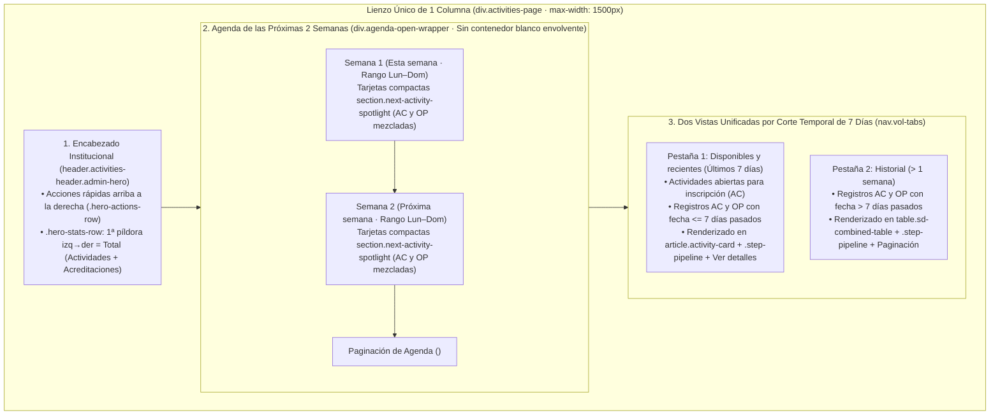
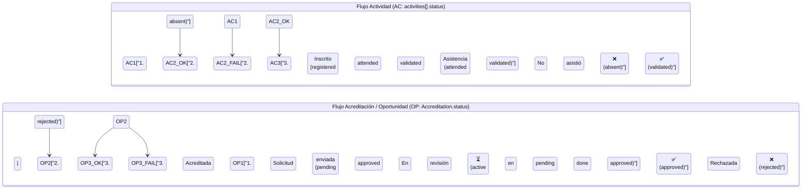

# 🗓️ Vista Unificada de Participación y Acreditaciones: Reutilización Estricta de Componentes (Harness), Agenda de 2 Semanas, Barra de Progreso de 3 Fases sin Cambios de Backend y División Temporal de 7 Días

**Fecha:** 13 de noviembre de 2026  
**Versión CalVer:** `v2026.11.13`  
**Alcance:** Unificación arquitectónica de `/activity-list` y `/my-accreditations` en una sola vista de 1 columna (`max-width: 1500px`), arnés de reutilización estricta de componentes reales de Angular 22 sin creación de componentes redundantes ni nuevos campos en MongoDB, Agenda seccionada de 2 semanas sin contenedor envolvente con tarjeta compacta `section.next-activity-spotlight`, máquina de estados visual de 3 fases (`.step-pipeline`) sin duplicar píldoras de estado, separación semántica entre información vital en tarjeta e información secundaria/modalidad en cajón desplegable (`Ver detalles`), distinción entre `Indicaciones:` (`activity.comments`) y `Comentario de solicitud:` (`accreditation.comments`), y partición temporal de 2 vistas mediante corte a los 7 días posteriores al evento.  
**Prototipo de Referencia:** `docs/mockups/participacion-unificada/mockup.html`

---

## 1. Resumen Ejecutivo y Declaración del Problema

Actualmente, la experiencia de participación del colaborador (`student` / `volunteer`) y la supervisión operativa del administrador (`admin`) se encuentran fragmentadas entre dos rutas distintas:
1. **`/activity-list` (`ActivityListComponent` — Actividad Grupal `AC`)**: Catálogo e inscripción a eventos y jornadas grupales organizadas por ABAQ (`AC-YYMMDD-XXXX`), que representan únicamente **1 de las 11 opciones** oficiales de participación (la opción de *Eventos ABAQ / Limpieza de refugio* con cupo y pase de lista grupal), almacenadas en `Student.activities[]` o `Volunteer.activities[]`.
2. **`/my-accreditations` (`MyAccreditationsComponent` — Participación Individual `OP`)**: Solicitud granular que el colaborador envía a administración para avisar que **realizó por su cuenta alguna de las 11 opciones del reglamento** (pláticas, esterilizaciones, adopciones, placas, difusión en medios, redes sociales, donaciones, etc., con folio `OP-YYMMDD-XXXX`), respaldada por el modelo `Accreditation`.

Durante las iteraciones de diseño sobre el prototipo unificado (`docs/mockups/participacion-unificada/mockup.html`), se identificaron y resolvieron siete desafíos arquitectónicos y de lenguaje de interfaz:

1. **Lenguaje Claro Centrado en «Mi participación» (Cero Jerga Críptica en la Interfaz)**: El usuario no debe leer códigos internos (`AC`, `OP`, `STE`, `TLK`), nombres de variables (`quantity`, `participantsCount`, `evidenceUrl`) ni reglas técnicas (`> 7 días`, `Últimos 7 días`). La sección se denomina **`Mi participación`** y distingue en lenguaje humano:
   - **`Actividad grupal`** (para eventos convocados por ABAQ donde el participante se inscribe a una lista grupal, correspondiente a la opción 1 de Eventos).
   - **`Participación individual`** (para reportar de forma granular a administración lo que el colaborador realizó por su cuenta en cualquiera de las 11 opciones).
2. **Restricción de Arnés Arquitectónico (*Component Reuse Harness*)**: La unificación **no debe introducir nuevos componentes Angular innecesarios ni mutar los esquemas del backend en MongoDB**. Todo el flujo debe construirse adaptando y componiendo las piezas reales ya existentes en el proyecto (`activity-list`, `my-accreditations`, `<app-folio-pill>`, `<app-pagination>`, `<app-new-accreditation-modal>`, `manual-hours-modal`, `table.sd-combined-table`).
3. **Eliminación de Segunda Columna Lateral y Contenedor Envolvente de Agenda**: Se suprime la barra lateral `aside#sideColumn.side-column` en favor de un lienzo único de `1500px`, y se retira el contenedor blanco `section.agenda-two-weeks-section` para que la Agenda de las próximas 2 semanas (`div.agenda-open-wrapper`) respire directamente sobre el layout principal aprovechando el 100% del ancho útil.
4. **Eliminación de Recomendaciones No Persistidas en Base de Datos (`QUÉ TENER LISTO PARA TU ASISTENCIA`)**: Se descarta cualquier bloque de recomendaciones predefinidas en el frontend (`ul.prep-checklist`) dado que no existe un campo de checklist de preparación en MongoDB y se prohíbe mapear recomendaciones estáticas en cliente.
5. **Máquina de Estados de 3 Fases (`.step-pipeline`) Validable al 100% sin Modificar el Backend y sin Duplicar Píldoras**: Una barra de 4 pasos requeriría un estado intermedio inexistente en la base de datos. Al reducirla a **3 fases simples**:
   - En **Actividad grupal**: `1. Inscrito` → `2. Asistencia` (o `2. No asistió`) → `3. Validada`.
   - En **Participación individual**: `1. Enviada` → `2. En revisión` → `3. Validada` (o `3. Rechazada`).
   Se elimina además cualquier píldora de estado redundante junto a la barra.
6. **Separación entre Información Vital en Tarjeta e Información Detallada + Descarga de Documento en `Ver detalles`**: Mostrar todos los campos de `Activity` y `Accreditation` simultáneamente satura la tarjeta. La superficie principal conserva únicamente la **información vital** y distingue entre **`Indicaciones:`** (instrucciones del administrador para asistir a una actividad grupal) y **`Tu nota para administración:`** (comentario que el participante escribió al registrar su participación individual), mientras que los datos específicos de la opción elegida y la descarga del documento comprobante (`.PDF` en bucket, con caché en memoria y fallback anti-abuso) viven dentro de **`Ver detalles`**.
7. **Fusión de las Secciones Inferiores en 2 Vistas con Nombres Naturales**: Después de la Agenda de 2 semanas (`Esta semana` y `Próxima semana`), las dos pestañas inferiores (`nav.vol-tabs`) se titulan simplemente **`Para inscribirme y recientes`** (lo que viene abierto para inscripción + lo enviado/asistido en los últimos 7 días) y **`Mi historial`** (participaciones con más de 7 días de antigüedad en tabla).

---

## 2. Arquitectura Visual y Flujo de Componentes Reutilizados

---

## 3. Arnés de Reutilización Estricta de Componentes (*Component Reuse Harness*)

> [!IMPORTANT]
> **Regla de Oro de Implementación**: Está estrictamente prohibido crear componentes Angular nuevos para tarjetas, tablas o barras de progreso cuando pueden adaptarse las plantillas y hojas SCSS existentes. La tabla siguiente define el contrato exacto de reutilización.

| Elemento en la Vista Unificada | Componente / Plantilla Real Reutilizada | Adaptación Aplicada (Sin Nuevos Componentes) |
| :--- | :--- | :--- |
| **Contenedor de página (1 columna)** | `frontend/src/app/activity-list/activity-list.html` (`div.activities-page`) | Eliminación de columna lateral (`aside#sideColumn`), ancho máximo homologado a `1500px`. |
| **Encabezado Hero con métricas y acciones** | `header.activities-header.admin-hero` (`activity-list.scss` + `_admin-hero.scss`) | Botonera `.hero-actions-row` en esquina superior derecha; fila `.hero-stats-row` donde la **primera píldora de izquierda a derecha es siempre la suma total (`activities + accreditations`)**. |
| **Píldora de Folio Interactiva (`AC-` / `OP-`)** | `<app-folio-pill>` (`frontend/src/app/shared/folio-pill/folio-pill.component.ts`) | Reutilización directa para folios `AC-YYMMDD-XXXX` y `OP-YYMMDD-XXXX` con copiado al portapapeles. |
| **Tarjeta de Agenda (Próximas 2 semanas)** | `section.next-activity-spotlight` (`frontend/src/app/volunteer-dashboard/volunteer-dashboard.html`) | Rediseño compacto horizontal en 3 zonas (`div.ticket-stub-left` sin borde punteado ni muescas circulares + `div.ticket-center` con info vital + `div.split-prep-box` con `.step-pipeline` y acciones) y cajón inferior desplegable `Ver detalles`. |
| **Tarjeta de Disponibles y Recientes ($\le 7$ días)** | `article.activity-card` (`frontend/src/app/activity-list/activity-list.html`) | Incorpora `.step-pipeline` de 3 fases, comentario contextual (`Indicaciones:` o `Comentario de solicitud:`) y cajón desplegable `Ver detalles`. |
| **Cajón Desplegable `Ver detalles`** | `div.accreditation-details` / `.details-grid` (`frontend/src/app/my-accreditations/my-accreditations.html`) | Oculta en el estado inicial los metadatos específicos de cada modalidad (`quantity`, `participantsCount`, `trialStartDate`, `evidenceUrl`, `activity.url`, `performanceComment`) para no sobrecargar la tarjeta. |
| **Tabla de Historial ($> 7$ días)** | `table.sd-combined-table` (`frontend/src/app/student-detail/student-detail.html`) | Unifica registros históricos `AC` y `OP` con la barra `.step-pipeline` en la columna de progreso y colapso responsivo a tarjetas en $\le 900\text{px}$ vía atributos `data-label`. |
| **Paginación** | `<app-pagination>` (`frontend/src/app/shared/pagination/pagination.component.ts`) | Instanciada tanto en la Agenda de 2 semanas como en las pestañas inferiores. |
| **Modales de Solicitud y Validación** | `<app-new-accreditation-modal>` y `manual-hours-modal` | Reutilización íntegra para registrar participación/acreditación (`OP`) y para calificar desempeño/asistencia desde el rol `admin`. |

---

## 4. Especificación de la Agenda de 2 Semanas y Tarjeta Compacta (`section.next-activity-spotlight`)

### 4.1 Estructura Abierta sin Contenedor Envolvente
- Se elimina cualquier tarjeta contenedora padre (`section.agenda-two-weeks-section`).
- El bloque `div.agenda-open-wrapper` se inserta directamente en el flujo de `.activities-page`, dividido en dos sub-bloques semanales claramente etiquetados con su rango de fechas:
  - **Semana 1 — Esta semana** (ej. `Lun 09 Nov – Dom 15 Nov 2026`).
  - **Semana 2 — Próxima semana** (ej. `Lun 16 Nov – Dom 22 Nov 2026`).
- Combina tanto **Actividades programadas (`AC`)** en las que el usuario está inscrito como **Acreditaciones/Oportunidades (`OP`)** programadas o registradas dentro de esas dos semanas.

### 4.2 Anatomía Compacta de `section.next-activity-spotlight` (Fusión 1 + 3)
1. **Columna Izquierda (`div.ticket-stub-left`)**:
   - Muestra el día del mes en tipografía destacada (`.ticket-day`), mes/día de la semana (`.ticket-month`), rango horario (`.ticket-time-pill`) y horas a acreditar (`.ticket-hours-badge`, oculto estrictamente para `Voluntario General`).
   - **Normalización estética**: Sin bordes discontinuos (`border-right: none`) ni recortes circulares superiores/inferiores (`::before` / `::after` eliminados). Usa los gradientes institucionales del sistema (`#24366f → #334c91` para `AC` y `#1f5f5b → #2b7a75` para `OP`).
   - **Responsividad Móvil ($\le 768\text{px}$)**: Se transforma en una barra horizontal de ancho completo (`flex-direction: row; justify-content: space-between; width: 100%`) que distribuye fecha a la izquierda y horario/horas a la derecha para aprovechar todo el ancho del teléfono sin desperdiciar altura.
2. **Columna Central (`div.ticket-center`) — Solo Información Vital**:
   - Fila superior de metadatos: `<app-folio-pill>`, badge de registro (`Actividad` / `Acreditación`), categoría (`PASEO`, `ESTERILIZACIÓN`, `PLÁTICAS`, etc.), ubicación o sede, y cupo/modalidad.
   - Título (`.ticket-title`) y descripción concisa (`.ticket-desc`).
   - Caja de nota contextual (`div.ticket-notice`):
     - En registros **`AC`**: Muestra **`Indicaciones:`** alimentado de `activity.comments` (instrucciones del administrador para asistir).
     - En registros **`OP`**: Muestra **`Comentario de solicitud:`** alimentado de `accreditation.comments` (nota escrita por el estudiante o voluntario al enviar su solicitud).
3. **Columna Derecha (`div.split-prep-box`)**:
   - Renderiza únicamente el encabezado `Progreso del registro`, la barra segmentada de 3 pasos (`.step-pipeline`) sin píldoras de estado repetidas, y la botonera `.prep-actions-row` (`Ver detalles`, `Ver participantes` / `Ver evidencia`, `Cancelar registro`).
   - Se suprime definitivamente el listado estático `QUÉ TENER LISTO PARA TU ASISTENCIA`.

---

## 5. Máquina de Estados de 3 Fases (`.step-pipeline`) sin Modificar el Backend

### 5.1 Justificación Arquitectónica
El backend cuenta con dos colecciones y máquinas de estado reales en MongoDB:
- **Actividades (`AC` — `Student.activities[]` / `Volunteer.activities[]`)**: `status ∈ {'registered', 'attended', 'validated', 'absent'}`.
- **Acreditaciones (`OP` — `Accreditation`)**: `status ∈ {'pending', 'approved', 'rejected'}`.

Una barra de 4 pasos requeriría inventar un estado adicional en base de datos. Al estandarizar un pipeline de **3 fases**, cada estado del backend se proyecta de manera biunívoca y determinista:

### 5.2 Matriz de Mapeo Determinista (Cero Cambios en Backend)

| Origen | Valor en MongoDB (`status`) | Paso 1 | Paso 2 | Paso 3 |
| :--- | :--- | :--- | :--- | :--- |
| **`AC` (`Activity`)** | `'registered'` | `.done` (`✓ 1. Inscrito`) | *(pendiente)* (`2. Asistencia`) | *(pendiente)* (`3. Acreditada`) |
| **`AC` (`Activity`)** | `'attended'` | `.done` (`✓ 1. Inscrito`) | `.done` (`✓ 2. Asistencia`) | `.active` (`3. Acreditada` en validación) |
| **`AC` (`Activity`)** | `'validated'` | `.done` (`✓ 1. Inscrito`) | `.done` (`✓ 2. Asistencia`) | `.done-green` (`✓ 3. Acreditada`) |
| **`AC` (`Activity`)** | `'absent'` | `.done` (`✓ 1. Inscrito`) | `.failed` (`✕ 2. No asistió`) | *(inactivo)* (`3. Acreditada`) |
| **`OP` (`Accreditation`)** | `'pending'` | `.done` (`✓ 1. Solicitud enviada`) | `.active` (`⏳ 2. En revisión`) | *(pendiente)* (`3. Acreditada`) |
| **`OP` (`Accreditation`)** | `'approved'` | `.done` (`✓ 1. Solicitud enviada`) | `.done` (`✓ 2. En revisión`) | `.done-green` (`✓ 3. Acreditada`) |
| **`OP` (`Accreditation`)** | `'rejected'` | `.done` (`✓ 1. Solicitud enviada`) | `.done` (`✓ 2. Revisada`) | `.failed` (`✕ 3. Rechazada`) |

> [!NOTE]
> **Prohibición de Píldoras Redundantes**: Dondequiera que se renderice `.step-pipeline` (Agenda de 2 semanas, tarjetas de la Pestaña 1 o filas de la tabla en la Pestaña 2), **no se debe renderizar un segundo badge o píldora con el mismo estado** (`✓ Registrado`, `Pendiente de revisión`, `✓ Horas validadas`), evitando duplicidad visual.

---

## 6. Jerarquía de Información: Superficie Vital vs. Cajón Desplegable (`Ver detalles`)

Para evitar tarjetas saturadas y mantener una lectura rápida, todos los campos de `Activity` y `Accreditation` se clasifican en dos niveles:

### 6.1 Nivel 1 — Información Vital (Siempre visible en la tarjeta)
- **Identificación y Clasificación**: `<app-folio-pill>` (`AC-...` u `OP-...`), tipo de registro (`Actividad` vs `Acreditación`), y categoría/subtipo (`PASEO`, `ESTERILIZACIÓN`, `PLÁTICAS`, `CAMPAÑA EST`, `ADOPCIÓN`, `DIFUSIÓN EN MEDIOS`, `REDES SOCIALES`, `DONACIÓN`, etc.).
- **Tiempo y Espacio**: Fecha o periodo principal, horario (`startTime - endTime`), lugar (`location`) y cupo (`registeredCount / maxParticipants` en `AC`).
- **Valor Curricular (`SS` únicamente)**: Píldora de horas (`+3 h`, `6 h solicitadas`, `+15 h acreditadas`). Oculta mediante clase `.ss-only` cuando el usuario activo es `Voluntario General` (`VG`).
- **Contenido Principal**: Título (`title` / `description`) y resumen descriptivo.
- **Nota Contextual de 1 Línea**:
  - `Indicaciones:` (`activity.comments`) en actividades `AC`.
  - `Comentario de solicitud:` (`accreditation.comments`) en acreditaciones `OP`.
- **Estado y Acción**: Barra `.step-pipeline` de 3 fases + botones de acción (`Ver detalles`, `Registrarse` / `Cancelar registro`).

### 6.2 Nivel 2 — Información Secundaria, Modalidad y Descarga Protegida de Documentos (Desplegable en `Ver detalles`)
El botón `Ver evidencia` se unifica dentro de **`Ver detalles`** (`[data-toggle-detail]`). Al pulsarlo, se expande el bloque `.record-details-drawer` (reutilizando la cuadrícula `.details-grid` de `my-accreditations.html`) mostrando todos los atributos de la acreditación/actividad y permitiendo **descargar el documento oficial de evidencia** resguardado en el bucket institucional:
- **En Actividades (`AC`)**:
  - `activity.url`: Enlace externo de convocatoria o ubicación en mapa.
  - `registeredAt`: Fecha exacta de inscripción del participante.
  - `participantsCount` / lista resumida de cupo ocupado.
  - `performance` (`Muy bueno`, `Bueno`, `Regular`) y `performanceComment` (retroalimentación del coordinador tras validar asistencia).
- **En Acreditaciones (`OP`) según `activityType`**:
  - `quantity`: Cantidad registrada (ej. número de pláticas impartidas, mascotas esterilizadas o piezas difundidas).
  - `participantsCount`: Asistentes impactados en pláticas o eventos.
  - `animalsEnrolled` e `infrastructureAvailable`: Campos específicos de campañas de esterilización.
  - `trialStartDate` y `trialEndDate`: Fechas de inicio y fin del periodo de prueba en adopciones.
  - `reactionsCount`: Número de reacciones alcanzadas en publicaciones de redes sociales (`social_media`).
  - `donationAmount`: Monto económico o valor en especie en donaciones (`donations`).
  - `evidenceUrl` (**Carga y Descarga de Documentos en Bucket Institucional reemplazando la liga manual**): En el modal de creación (`<app-new-accreditation-modal>`) se reemplaza el campo de texto de URL externa por un selector/dropzone de archivo `.PDF` hacia el bucket institucional (`BucketService`), guardando el identificador o ruta del documento en `evidenceUrl` (cero nuevos campos en MongoDB). Dentro de `Ver detalles`, el usuario visualiza el botón **`Descargar documento (.PDF)`**.
  - `performance` y `performanceComment`: Evaluación y retroalimentación emitida por el administrador al aprobar o rechazar la solicitud.

### 6.3 Prevención de Costo de Egress y Carga del Servidor en Descargas Repetidas (Fallback en `Ver detalles`)
Para evitar que un usuario o administrador dispare múltiples peticiones de lectura al bucket S3/volumen de Railway al hacer clic repetidamente en **`Descargar documento (.PDF)`**, se implementa una estrategia de protección en dos capas:
1. **Caché de `Blob` en Memoria de Sesión (Cliente)**: La primera descarga solicita el binario al backend (`/api/bucket/...`) y conserva la referencia `Blob` en un `Map<string, { blob: Blob, count: number, cooldownUntil: number }>` durante la sesión activa. El 2.º y 3.er intento sirven el archivo instantáneamente desde la memoria RAM del navegador (**0 peticiones HTTP adicionales y 0 costo de transferencia del bucket**).
2. **Fallback con Cooldown y Rate-Limit (Cliente + Servidor)**: Si el usuario intenta descargar el mismo documento más de `MAX_DOWNLOADS_PER_WINDOW = 3` veces consecutivas, el botón entra en estado `.is-throttled` durante una ventana de enfriamiento (45–60 s) y despliega el aviso de fallback `.doc-fallback-alert` indicando revisar la carpeta local de `Descargas` antes de solicitar nuevamente el archivo, respaldado en el backend por un limitador por sesión/documento (`HTTP 429 Too Many Requests`).

---

## 7. Especificación de Requerimientos de Software (SRS) — Vista Unificada de Participación

### `[SRS 18.1 Requerimientos Funcionales - Vista Unificada, Agenda y Pipeline de 3 Fases]`

- **RF-PART-UNI-01 (Unificación de Actividades y Acreditaciones en 1 Columna)**:
  - El sistema debe consolidar la consulta, inscripción y seguimiento de actividades (`AC`) y acreditaciones (`OP`) en una sola vista de 1 columna (`max-width: 1500px`), eliminando cualquier barra lateral secundaria (`aside#sideColumn`).
  - En el encabezado `.admin-hero`, las acciones rápidas (`+ Solicitar acreditación (OP)`, `Ir a próximas disponibles` o `+ Nueva actividad (AC)` en `admin`) deben ubicarse en la esquina superior derecha (`.hero-actions-row`), y la primera píldora métrica de izquierda a derecha en `.hero-stats-row` debe mostrar siempre el **total combinado** de registros (`activities.length + accreditations.length`).

- **RF-PART-HARNESS-01 (Reutilización Estricta de Componentes Existentes y Cero Cambios de Esquema en Backend)**:
  - La implementación frontend debe reutilizar y adaptar los componentes existentes (`ActivityListComponent`, `MyAccreditationsComponent`, `FolioPillComponent`, `PaginationComponent`, `NewAccreditationModalComponent`, `manual-hours-modal`) sin crear nuevos componentes redundantes ni añadir campos nuevos a los modelos Mongoose `Activity`, `Accreditation`, `Student` o `Volunteer`.

- **RF-PART-AGENDA-01 (Agenda de 2 Semanas Sin Contenedor Envolvente y Tarjeta Compacta)**:
  - La sección superior de Agenda debe mostrar los compromisos (`AC` inscritos y `OP` registradas) comprendidos en los próximos 14 días naturales, agrupados en dos bloques (**Semana 1: Esta semana** y **Semana 2: Próxima semana**) con paginación independiente (`<app-pagination>`), renderizados directamente sobre el lienzo sin un contenedor blanco envolvente (`section.agenda-two-weeks-section` eliminado).
  - Cada registro de la Agenda debe emplear la tarjeta compacta `section.next-activity-spotlight` sin bordes punteados de boleto ni recortes semicirculares, y sin listas estáticas de recomendaciones (`QUÉ TENER LISTO PARA TU ASISTENCIA` eliminado).

- **RF-PART-PIPE-01 (Barra de Progreso de 3 Fases `.step-pipeline` Sin Píldoras Duplicadas)**:
  - El progreso de cada registro debe representarse mediante una barra de 3 pasos validada exclusivamente con el campo `status` actual del backend:
    - Para `AC`: `1. Inscrito` → `2. Asistencia` (o `2. No asistió` en rojo si `status === 'absent'`) → `3. Acreditada` (en verde si `status === 'validated'`).
    - Para `OP`: `1. Solicitud enviada` → `2. En revisión` (activo en ámbar si `status === 'pending'`) → `3. Acreditada` (en verde si `status === 'approved'`, o `3. Rechazada` en rojo si `status === 'rejected'`).
  - Queda prohibido mostrar píldoras de estado adicionales que repitan la información ya expresada por `.step-pipeline`.

- **RF-PART-SPLIT-01 (División Temporal de 7 Días en 2 Vistas Inferiores)**:
  - Debajo de la Agenda, el navegador `nav.vol-tabs` debe estructurar los registros en exactamente dos pestañas:
    1. **Pestaña 1 (`Disponibles y recientes — Últimos 7 días`)**: Muestra las actividades futuras con cupo disponible para inscripción (`AC`) junto con las actividades y acreditaciones (`AC` y `OP`) cuya fecha de realización sea futura o haya transcurrido hace **máximo 7 días naturales** ($\text{hoy} - \text{fecha} \le 7\text{ días}$), presentadas en tarjetas `article.activity-card`.
    2. **Pestaña 2 (`Historial — > 1 semana`)**: Muestra todos los registros (`AC` y `OP`) cuya fecha de realización haya transcurrido hace **más de 7 días naturales** ($\text{hoy} - \text{fecha} > 7\text{ días}$), consolidados en la tabla histórica `table.sd-combined-table` con paginación.

- **RF-PART-DET-01 (Separación de Información Vital, Comentarios Contextuales y Cajón `Ver detalles` con Descarga de Documentos)**:
  - Las tarjetas de la Agenda y de la Pestaña 1 deben mostrar en su vista principal únicamente la información vital del registro y distinguir semánticamente entre **`Indicaciones:`** (`activity.comments` emitidas por el administrador en `AC`) y **`Comentario de solicitud:`** (`accreditation.comments` redactado por el colaborador en `OP`).
  - El botón `Ver evidencia` se consolida en **`Ver detalles`**, donde se muestran todos los metadatos secundarios y específicos por modalidad (`quantity`, `participantsCount`, `animalsEnrolled`, `infrastructureAvailable`, `reactionsCount`, `donationAmount`, `trialStartDate`, `trialEndDate`, `activity.url`, `performance` y `performanceComment`) junto con el botón **`Descargar documento (.PDF)`** para bajar el documento de evidencia almacenado en el bucket institucional (el cual reemplaza la captura de ligas manuales en `<app-new-accreditation-modal>` reutilizando el campo `evidenceUrl`).

- **RF-PART-DOC-01 (Fallback Anti-Abuso y Caché en Descarga de Documentos de Evidencia)**:
  - Para prevenir costos de transferencia (*egress*) y sobrecarga en el servidor/bucket ante descargas repetitivas de un mismo documento de acreditación:
    1. El cliente debe cachear en memoria el `Blob` tras la primera descarga exitosa para entregar el 2.º y 3.er intento localmente sin generar tráfico adicional hacia el servidor.
    2. Al superar 3 intentos seguidos de descarga sobre el mismo documento, el componente debe activar un **estado de fallback con enfriamiento (*cooldown*)** que bloquee temporalmente nuevas descargas y muestre una alerta indicando al usuario que el archivo ya fue descargado en su dispositivo, complementado con rate-limiting (`HTTP 429`) en el endpoint de descarga del bucket.

### `[SRS 18.2 Requerimientos No Funcionales - Responsividad Móvil y Paridad de Roles]`

- **RNF-PART-MOB-01 (Aprovechamiento de Ancho Completo en Móvil para `div.ticket-stub-left`)**:
  - En viewports móviles ($\le 768\text{px}$), la franja lateral de fecha de la tarjeta de Agenda (`div.ticket-stub-left`) debe disponerse horizontalmente a todo lo ancho (`flex-direction: row; justify-content: space-between; width: 100%`), alineando el bloque numérico del día y mes a la izquierda y las píldoras de horario/horas a la derecha.
- **RNF-PART-VG-01 (Supresión Total de Horas en Voluntariado General)**:
  - Cuando el usuario autenticado posea el rol `volunteer` (`Voluntario General`), la vista unificada debe ocultar toda píldora, columna o contador de horas (`+X h`, `Horas acreditadas`, `Horas en revisión`), conservando intacto el flujo de inscripción, asistencia y acreditación participativa.

---

## 8. Registro de Decisión de Arquitectura (ADR-25)

- **Título**: ADR-25 — Arquitectura de Vista Unificada de Participación y Acreditaciones mediante Arnés de Reutilización de Componentes, Agenda Compacta de 2 Semanas, Máquina de Estados de 3 Fases sin Mutación de Backend y Partición Temporal de 7 Días.
- **Estado**: Aceptado — Especificado y Validado en Prototipo Funcional (`2026-11-13`, CalVer `v2026.11.13`).
- **Contexto**:
  - La separación entre `/activity-list` y `/my-accreditations` obligaba a estudiantes, voluntarios y administradores a navegar entre múltiples pantallas para consultar su agenda próxima, inscribirse a actividades, subir evidencias de oportunidades (`OP`) y verificar si sus horas o asistencias ya habían sido validadas.
  - Se requería unificar la experiencia sin inflar el bundle de Angular con nuevos componentes ni alterar los esquemas de producción en MongoDB.
- **Decisión**:
  1. Adoptar un **arnés de reutilización estricta (*Component Reuse Harness*)** sobre un contenedor único de `1500px`, integrando `header.admin-hero`, `section.next-activity-spotlight`, `article.activity-card`, `div.accreditation-details`, `table.sd-combined-table`, `<app-folio-pill>` y `<app-pagination>`.
  2. Renderizar la **Agenda de las próximas 2 semanas** (`Semana 1` y `Semana 2`) directamente sobre el contenedor principal sin caja blanca envolvente, utilizando una versión compacta de `section.next-activity-spotlight` con distribución horizontal en móvil y sin checklists estáticos no respaldados por base de datos.
  3. Implementar la barra de progreso **`.step-pipeline` de 3 fases** gobernada por una función pura de mapeo sobre `activities[].status` y `Accreditation.status`, prescindiendo de píldoras de estado duplicadas.
  4. Establecer una **regla de partición temporal de 7 días naturales** (`7 * 24 * 60 * 60 * 1000 ms` posteriores a la fecha del registro) que divide automáticamente los registros entre la **Pestaña 1 (`Disponibles y recientes`)** en formato de tarjetas interactivas y la **Pestaña 2 (`Historial > 1 semana`)** en formato de tabla densa responsiva.
  5. Encapsular los campos específicos de cada modalidad de acreditación y enlaces de evidencia dentro del cajón colapsable **`Ver detalles`**, manteniendo la tarjeta principal enfocada en los datos vitales y en la distinción explícita entre `Indicaciones:` (`activity.comments`) y `Comentario de solicitud:` (`accreditation.comments`).
- **Consecuencias**:
  - *Positivas*: Cero migraciones o cambios de esquema en MongoDB; reducción de carga cognitiva al separar datos vitales de metadatos por modalidad; trazabilidad visual inmediata en 3 pasos sin badges redundantes; transición automática y predecible hacia el historial pasados 7 días del evento.
  - *Negativas*: El servicio o selector en el componente contenedor debe normalizar y ordenar en memoria las colecciones de `Activity` y `Accreditation` bajo una interfaz de vista común (`UnifiedParticipationItem`) para alimentar la Agenda y las dos pestañas.
