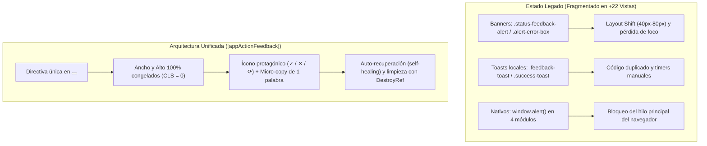

# 🎯 Refactorización Integral del Sistema de Notificaciones en Foco de Acción (`[appActionFeedback]`): Mapeo Exhaustivo de Interfaces, Erradicación de Alertas Legadas y Cero Layout Shift (CLS = 0)

- **Fecha de Inicio:** 14 de noviembre de 2026
- **Estado:** 🟡 **Aprobada — En Implementación**
- **Ámbito:** Todo el Sistema Frontend Angular v22 Standalone (41 plantillas HTML + 9 plantillas inline), Erradicación Total de Banners Estáticos y `window.alert()`, Arquitectura SCSS Responsiva y Accesibilidad WCAG AAA
- **Documentos Relacionados:** [srs.md](../srs.md) (Sección 21), [architecture.md](../architecture.md) (ADR-27), [design-system.md](../design-system.md) (Secciones 7.1 y 9)
- **Entorno Objetivo:** Teléfonos móviles táctiles (320px–430px), Tabletas (768px–1024px) y Escritorio (`> 1024px`)

---

## 1. Resumen Ejecutivo y Diagnóstico Sistémico

### 1.1 Alcance: Refactorización Total del Sistema de Notificaciones
A lo largo de la evolución de la plataforma ABAQ, cada módulo resolvió la retroalimentación de acciones del usuario con mecanismos heterogéneos y desconectados del foco de atención visual:
1. **Banners estáticos en el flujo del DOM** (`div.status-feedback-alert`, `div.participation-feedback-banner`, `div.profile-message`, `div.document-success-alert`, `div.alert-error-box`, `div.alert-error-banner`, `div.auth-alert-error`, `div.validation-alert-banner`, `div.unified-success-banner`).
2. **Toasts manuales ad-hoc por componente** (`div.success-toast` en `activity` y `quick-activities`, `div.feedback-toast` en `student-profile` y `volunteer-profile`).
3. **Alertas bloqueantes nativas del navegador** (`window.alert(...)` en `adoption-list`, `adoption-detail`, `campaign-list`, `campaign-detail`, `identification-list`, `identification-detail`, `talk-list`, `talk-detail`, `certificate-view`).
4. **Decenas de variables y temporizadores redundantes** (`statusFeedback`, `feedbackMessage`, `feedbackError`, `feedbackBannerMessage`, `showSuccessMessage`, `showActivitySuccessMessage`, `errorMessage`, `successMessage`, `copiedKey`, `isFolioCopied`).

Esta fragmentación generaba tres problemas críticos en **todo el sistema**:
- **Ruptura del foco visual cognitivo**: El usuario presiona un botón en la parte inferior de una tarjeta, modal o formulario, pero el mensaje aparece arriba del todo o en otra zona de la página.
- **Desplazamiento Acumulativo de Diseño (*Cumulative Layout Shift - CLS*)**: La inserción/remoción de `div`s condicionales empuja la interfaz 40px–80px hacia abajo.
- **Deuda técnica y fugas de memoria**: Más de 35 propiedades de estado y `setTimeout` dispersos en controladores TypeScript.

---

## 2. Filosofía Visual y Reglas Geométricas Inquebrantables

### 2.1 Regla de Oro de Espacio e Íconos
1. **El botón en reposo (`idle`) describe la acción**: Su etiqueta original indica qué hará el usuario (ej. `✎ Modificar datos del voluntario`, `✓ Guardar cambios`, `✕ Rechazar`, `link Copiar formulario`).
2. **El ícono transitorio describe qué pasó**: Al ejecutarse y resolverse la acción, el ícono (`⟳`, `✓`, `✕`) lleva la carga semántica principal, acompañado únicamente de **micro-copy ultra-compacto** (`"Guardando"`, `"¡Listo!"`, `"¡Copiado!"`, `"Error"`), prohibiendo frases largas que describan el efecto secundario.
3. **Invariante de Ancho y Alto Fijos (`ΔWidth = 0`, `ΔHeight = 0`)**:
   - Antes de mutar a `loading`, `success` o `error`, la directiva mide `offsetWidth` y `offsetHeight` del botón en su estado `idle` y fija `width` y `height` exactos en píxeles (`box-sizing: border-box; overflow: hidden; text-overflow: ellipsis; white-space: nowrap;`).
   - Al regresar a `idle` (`self-healing`), libera las dimensiones en línea para preservar la fluidez responsiva ante cambios de orientación de pantalla.

### 2.2 Patrones de Comportamiento según el Tipo de Interfaz

| Patrón | Caso de Uso | Comportamiento de `[appActionFeedback]` |
|---|---|---|
| **Patrón A: Formulario / Edición In-Situ** | Guardar expediente, perfil, actividad o plantilla sin cambiar de ruta | `idle` $\rightarrow$ `loading` (`⟳ Guardando`) $\rightarrow$ `success` (`✓ ¡Listo!`, 3000 ms) $\rightarrow$ `self-healing` a `idle`. Si la edición colapsa un panel (`isEditing = false`), el botón disparador o el botón de guardado permanece visible durante la confirmación o transfiere el estado al botón de acción principal de la sección. |
| **Patrón B: Modal con Cierre Post-Éxito** | Aprobar/rechazar aspirante, inactivar cuenta, borrar registro, subir PDF, nueva acreditación | `idle` $\rightarrow$ `loading` (`⟳ Procesando`) $\rightarrow$ En **éxito**: muestra `✓ ¡Listo!` en verde durante **700 ms** (`[successDuration]="700"`) para que el ojo del usuario perciba la confirmación en el botón del modal antes de cerrarse suavemente. En **error**: el modal **no se cierra**, no muestra banners que deformen la caja, y el botón tiembla en rojo (`✕ Error`, 4000 ms) regresando a `idle` para reintentar. |
| **Patrón C: Acción Síncrona / Instantánea** | Copiar enlace de formulario público (`.btn-copy-form`), copiar link de invitación, copiar folio | Salta `loading` y transiciona directo: `idle` $\rightarrow$ `success` (`✓ ¡Copiado!`, 2500 ms) $\rightarrow$ `self-healing` a `idle`. Reemplaza todos los `window.alert('Formulario copiado...')`. |
| **Patrón D: Descarga / Apertura de Documento** | Descargar INE, CV, Reglamento PDF, Constancias PNG, Respaldos `.ZIP`/`.XLSX` | `idle` $\rightarrow$ `loading` (`⟳ Descargando`) $\rightarrow$ `success` (`✓ ¡Listo!`, 2500 ms) o `error` (`✕ Error`, 4000 ms) $\rightarrow$ `idle`. Reemplaza los `alert('No se pudo descargar...')` y banners `.doc-fallback-alert`. |

---

## 3. Mapeo Exhaustivo de Interfaces, Notificaciones a Remover y Botones del Sistema

### 3.1 Categoría 1: Expedientes Administrativos y Perfiles de Usuario

| Componente / Ruta | Notificaciones Legadas a **ELIMINAR** (HTML y TS) | Botón en Interfaz (`idle`) | Estado `loading` | Estado `success` | Estado `error` |
|---|---|---|---|---|---|
| **`volunteer-detail`** `/volunteer-detail/:id` | • `
` (`alert-success`, `alert-danger`) • Propiedad TS `statusFeedback` | `✎ Modificar datos del voluntario` / `✓ Guardar cambios` | `⟳ Guardando` | `✓ ¡Listo!` | `✕ Error` |
| *(mismo)* | *(mismo)* | `check Aceptar Voluntario y Activar` | `⟳ Aceptando` | `✓ Activado` | `✕ Error` |
| *(mismo)* | *(mismo)* | `close Rechazar` | `⟳ Rechazando` | `✓ Rechazado` | `✕ Error` |
| *(mismo)* | *(mismo)* | `Descargar PDF ↓` (INE / CV / Reglamento) | `⟳ Abriendo` | `✓ ¡Listo!` | `✕ Error` |
| *(mismo)* | *(mismo)* | `Ver y descargar constancia` | `⟳ Abriendo` | `✓ ¡Listo!` | `✕ Error` |
| **`student-detail`** `/student/:id` | • `
` • `
` (`success`/`error`) • `
` y `document-error` • Props TS: `statusFeedback`, `profileSuccess`, `profileError`, `documentSuccess`, `documentError` | `Editar información` / `Guardar cambios` (`saveStudent`) | `⟳ Guardando` | `✓ ¡Listo!` | `✕ Error` |
| *(mismo)* | *(mismo)* | `check Aceptar Estudiante y Activar` | `⟳ Aceptando` | `✓ Activado` | `✕ Error` |
| *(mismo)* | *(mismo)* | `close Rechazar` | `⟳ Rechazando` | `✓ Rechazado` | `✕ Error` |
| *(mismo)* | *(mismo)* | `Guardar enlace` (Modal enlace reporte) | `⟳ Guardando` | `✓ ¡Listo!` | `✕ Error` |
| *(mismo)* | *(mismo)* | `Descargar PDF ↓` (INE / CV / Reglamento) | `⟳ Abriendo` | `✓ ¡Listo!` | `✕ Error` |
| *(mismo)* | *(mismo)* | `Ver y descargar constancia` (Inicio / Término) | `⟳ Abriendo` | `✓ ¡Listo!` | `✕ Error` |
| *(mismo)* | *(mismo)* | `Aprobar` / `Confirmar aprobación` (Tabla y modal acreditación) | `⟳ Aprobando` | `✓ Aprobada` | `✕ Error` |
| *(mismo)* | *(mismo)* | `Rechazar` / `Confirmar rechazo` (Tabla y modal acreditación) | `⟳ Rechazando` | `✓ Rechazada` | `✕ Error` |
| **`volunteer-profile`** `/volunteer-profile` | • `
` • `
` • Props TS: `feedbackMessage`, `feedbackError` y `setTimeout` | `✓ Guardar cambios` (Datos de contacto) | `⟳ Guardando` | `✓ ¡Listo!` | `✕ Error` |
| *(mismo)* | *(mismo)* | `✓ Guardar cambios` (Semblanza personal) | `⟳ Guardando` | `✓ ¡Listo!` | `✕ Error` |
| *(mismo)* | *(mismo)* | `✓ Guardar cambios` (Redes sociales) | `⟳ Guardando` | `✓ ¡Listo!` | `✕ Error` |
| *(mismo)* | *(mismo)* | `Descargar PDF ↓` (INE / CV / Reglamento / Constancia) | `⟳ Abriendo` | `✓ ¡Listo!` | `✕ Error` |
| **`student-profile`** `/student-profile` | • `
` • `
` • Props TS: `feedbackMessage`, `feedbackError`, `feedbackTimeout`, `showFeedback()`, `clearFeedback()` | `✓ Guardar cambios` (Datos de contacto) | `⟳ Guardando` | `✓ ¡Listo!` | `✕ Error` |
| *(mismo)* | *(mismo)* | `✓ Guardar cambios` (Semblanza personal) | `⟳ Guardando` | `✓ ¡Listo!` | `✕ Error` |
| *(mismo)* | *(mismo)* | `✓ Guardar cambios` (Redes sociales) | `⟳ Guardando` | `✓ ¡Listo!` | `✕ Error` |
| *(mismo)* | *(mismo)* | `Descargar PDF ↓` (INE / CV / Reglamento / Constancias) | `⟳ Abriendo` | `✓ ¡Listo!` | `✕ Error` |

---

### 3.2 Categoría 2: Directorio de Voluntarios y Gestión de Participación / Actividades

| Componente / Ruta | Notificaciones Legadas a **ELIMINAR** (HTML y TS) | Botón en Interfaz (`idle`) | Estado `loading` | Estado `success` | Estado `error` |
|---|---|---|---|---|---|
| **`student`** `/student` (Directorio Admin) | • `
` • Timers manuales `copiedKey` / `copyResetTimer` | `.dropdown-item-btn` (4 links de invitación en dropdown) | *(Síncrono)* | `✓ ¡Copiado!` | `✕ Error` |
| *(mismo)* | *(mismo)* | `check Aceptar` / `close Rechazar` / `person_off Inactivar` (en tabla) | `⟳ ...` | `✓ ¡Listo!` | `✕ Error` |
| **`activity-list`** `/activity-list` (Participación) | • `
` • `
` • Propiedad TS `feedbackBannerMessage` | `Inscribirme` / `Volver a inscribirme` | `⟳ Inscribiendo` | `✓ Inscrito` | `✕ Error` |
| *(mismo)* | *(mismo)* | `Cancelar asistencia` (Modal confirmación) | `⟳ Cancelando` | `✓ Cancelada` | `✕ Error` |
| *(mismo)* | *(mismo)* | `Sí, cancelar envío` (Modal cancelar acreditación) | `⟳ Cancelando` | `✓ Cancelado` | `✕ Error` |
| *(mismo)* | *(mismo)* | `Validar participación` (Modal admin validar) | `⟳ Validando` | `✓ Validada` | `✕ Error` |
| *(mismo)* | *(mismo)* | `✕ Confirmar rechazo` (Modal admin rechazar) | `⟳ Rechazando` | `✓ Rechazada` | `✕ Error` |
| *(mismo)* | *(mismo)* | `Eliminar actividad` (Modal admin eliminar) | `⟳ Eliminando` | `✓ Eliminada` | `✕ Error` |
| *(mismo)* | *(mismo)* | `.btn-doc-download` (Descargar comprobante PDF) | `⟳ Abriendo` | `✓ ¡Listo!` | `✕ Error` |
| **`activity-detail`** `/activity/:id` (Pase de lista) | • Mensajes sueltos de fallo de validación | `✓ Asistió` / `✕ No asistió` | `⟳ ...` | `✓ Asistió` / `✕ No asistió` | `✕ Error` |
| *(mismo)* | *(mismo)* | `Validar X h` / `Validar desempeño` (Modal confirmación) | `⟳ Validando` | `✓ Validado` | `✕ Error` |
| **`quick-activities`** `/admin/quick-activities` | • `
` • `
` • `
` • Props TS: `successMessage`, `errorMessage`, `showActivitySuccessMessage` | `Crear plantilla` / `Actualizar plantilla` | `⟳ Guardando` | `✓ ¡Listo!` | `✕ Error` |
| *(mismo)* | *(mismo)* | `Publicar actividad` (Modal publicar) | `⟳ Publicando` | `✓ Publicada` | `✕ Error` |
| *(mismo)* | *(mismo)* | `Eliminar` (Modal eliminar plantilla) | `⟳ Eliminando` | `✓ Eliminada` | `✕ Error` |
| **`activity`** `/activity` | • `
` • Props TS: `showSuccessMessage`, `successMessageTimeout` | `Crear actividad` (`.submit-button`) | `⟳ Creando` | `✓ Creada` | `✕ Error` |

---

### 3.3 Categoría 3: Los 4 Módulos Operativos (Adopciones, Campañas, Placas, Pláticas) y Formularios Públicos

| Componente / Ruta | Notificaciones Legadas a **ELIMINAR** (HTML y TS) | Botón en Interfaz (`idle`) | Estado `loading` | Estado `success` | Estado `error` |
|---|---|---|---|---|---|
| **`adoption-list`** `/adoptions` | • `alert('Formulario copiado correctamente')` • `alert('No se pudo eliminar la adopción...')` | `link Copiar formulario` (`.btn-copy-form`) | *(Síncrono)* | `✓ ¡Copiado!` | `✕ Error` |
| *(mismo)* | *(mismo)* | `sync Actualizar datos` (`.btn-refresh-data`) | `⟳ Cargando` | `✓ ¡Listo!` | `✕ Error` |
| **`adoption-detail`** `/adoptions/:id` | • `alert('No se pudo descargar el documento PDF...')` • `alert('Error al eliminar el registro')` | `Confirmar adopción` (`.confirm-complete-button`) | `⟳ Guardando` | `✓ Completada` | `✕ Error` |
| *(mismo)* | *(mismo)* | `Descargar Formato / INE / Comprobante (.PDF)` | `⟳ Abriendo` | `✓ ¡Listo!` | `✕ Error` |
| **`campaign-list`** `/campaigns` | • `alert('Formulario copiado correctamente')` • `alert('No se pudo eliminar la campaña...')` | `link Copiar formulario` (`.btn-copy-form`) | *(Síncrono)* | `✓ ¡Copiado!` | `✕ Error` |
| *(mismo)* | *(mismo)* | `sync Actualizar datos` (`.btn-refresh-data`) | `⟳ Cargando` | `✓ ¡Listo!` | `✕ Error` |
| *(mismo)* | *(mismo)* | `Guardar campaña` (`.save-campaign-button`) | `⟳ Guardando` | `✓ Guardada` | `✕ Error` |
| **`campaign-detail`** `/campaigns/:id` | • `alert('Error al eliminar la campaña')` | Borrado vía `<app-delete-confirm-modal>` | `⟳ Borrando` | `✓ Eliminada` | `✕ Error` |
| **`identification-list`** `/identifications` | • `alert('Enlace del formulario copiado...')` • `alert('Formulario copiado correctamente')` • `alert('No se pudo eliminar la placa...')` | `link Copiar enlace` (`.btn-copy-form`) | *(Síncrono)* | `✓ ¡Copiado!` | `✕ Error` |
| *(mismo)* | *(mismo)* | `sync Actualizar datos` (`.btn-refresh-data`) | `⟳ Cargando` | `✓ ¡Listo!` | `✕ Error` |
| *(mismo)* | *(mismo)* | `Guardar placa` (`.save-button`) | `⟳ Guardando` | `✓ Guardada` | `✕ Error` |
| **`identification-detail`** `/identifications/:id` | • `alert('Error al eliminar la placa')` | `✓ Marcar como completada` (`.complete-button`) | `⟳ Guardando` | `✓ Completada` | `✕ Error` |
| **`talk-list`** `/talks` | • `alert('Formulario copiado correctamente')` | `link Copiar enlace` (`.btn-copy-form`) | *(Síncrono)* | `✓ ¡Copiado!` | `✕ Error` |
| *(mismo)* | *(mismo)* | `Guardar plática` (`.save-talk-button`) | `⟳ Guardando` | `✓ Guardada` | `✕ Error` |
| **`talk-detail`** `/talks/:id` | • `alert('Error al eliminar la plática')` | Borrado vía `<app-delete-confirm-modal>` | `⟳ Borrando` | `✓ Eliminada` | `✕ Error` |
| **Formularios Públicos (x4)** `public-adoption-form` `public-campaign-form` `public-identification-form` `public-talk-form` | • Alertas de fallo al enviar formulario | `Enviar formulario` / `Enviar solicitud` | `⟳ Enviando` | `✓ Enviado` | `✕ Error` |

---

### 3.4 Categoría 4: Modales Compartidos (`shared/*` y `ui/*`)

| Componente Modal | Notificaciones Legadas a **ELIMINAR** | Botón de Acción Primaria (`idle`) | Estado `loading` | Estado `success` (700ms antes de cerrar) | Estado `error` (Permanece abierto) |
|---|---|---|---|---|---|
| **`decision-volunteer-modal`** | • `
` • Renderizado visual de `errorMessage` | `check_circle Aceptar y Activar` | `⟳ Aceptando` | `✓ Activado` | `✕ Error` |
| *(mismo)* | *(mismo)* | `cancel Confirmar Rechazo` | `⟳ Rechazando` | `✓ Rechazado` | `✕ Error` |
| **`inactivate-volunteer-modal`** | • `
` • Propiedad `errorMessage` en plantilla | `person_off Inactivar Cuenta Definitivamente` | `⟳ Procesando` | `✓ Inactivada` | `✕ Error` |
| **`delete-confirm-modal`** | • Todos los `window.alert()` en los 7 componentes padres al fallar borrado | `delete Eliminar definitivamente` | `⟳ Borrando` | `✓ Eliminado` | `✕ Error` |
| **`new-accreditation-modal`** | • `
` • Propiedad `errorMessage` en plantilla | `verified Enviar a revisión` | `⟳ Enviando` | `✓ Enviado` | `✕ Error` |
| **`file-upload-modal`** | • `
` | `check_circle Guardar en expediente` | `⟳ Subiendo` | `✓ Guardado` | `✕ Error` |

---

### 3.5 Categoría 5: Autenticación, Onboarding y Respaldos de Base de Datos

| Componente / Ruta | Notificaciones Legadas a **ELIMINAR** (HTML y TS) | Botón en Interfaz (`idle`) | Estado `loading` | Estado `success` | Estado `error` |
|---|---|---|---|---|---|
| **`login`** `/login` | • `
` (causaba salto brusco en la tarjeta de login) | `Iniciar sesión en ABAQ` (`#login-submit-btn`) | `⟳ Validando` | `✓ ¡Listo!` | `✕ Credenciales inválidas` |
| **`signup`** `/signup` | • `
` | `Continuar a Fase 1` (`#reg-submit-btn`) | `⟳ Validando` | `✓ ¡Listo!` | `✕ Revisa tus datos` |
| **`onboarding-phase`** `/onboarding/phase-1..4` | • `
` | `Guardar y continuar` / `Finalizar y enviar expediente` | `⟳ Guardando` | `✓ Guardado` | `✕ Faltan datos` |
| **`expediente-recibido`** `/onboarding/expediente-recibido` | • `
` | `Ingresar a la Plataforma ABAQ` `Descargar Constancia Oficial` `Copiar` (Folio) | `⟳ Ingresando` `⟳ Abriendo` *(Síncrono)* | `✓ ¡Listo!` `✓ ¡Listo!` `✓ ¡Copiado!` | `✕ Error` |
| **`backup`** `/admin/backups` | • `
` • `
` • `
` • Props TS: `errorMessage`, `successMessage` | `archive Descargar Respaldo (.ZIP)` `table_view Descargar Libro Excel` `Analizar corte de deshidratación` `archive Descargar corte` `delete_forever Borrar registros` `Revisar paquete` `Sí, ejecutar rollback` `Sí, restaurar paquete` `Sí, rehidratar registros` | `⟳ Generando` `⟳ Generando` `⟳ Analizando` `⟳ Descargando` `⟳ Borrando` `⟳ Revisando` `⟳ Restaurando` `⟳ Restaurando` `⟳ Restaurando` | `✓ Descargado` `✓ Descargado` `✓ Analizado` `✓ Descargado` `✓ Purgado` `✓ Validado` `✓ Restaurado` `✓ Restaurado` `✓ Restaurado` | `✕ Error` |

---

## 4. Qué Elementos Informativos NO son Notificaciones Transitorias (Se Conservan)

Para evitar confusiones durante la refactorización, se distingue entre **notificaciones de resultado de acción** (que se migran al botón y cuyos banners se eliminan) y **avisos estructurales permanentes de negocio** (que forman parte del contenido de la vista):
1. **Se eliminan por completo**: Todos los banners de resultado de acción (`status-feedback-alert`, `participation-feedback-banner`, `feedback-toast`, `success-toast`, `profile-message`, `document-success-alert`, `alert-error-box`, `alert-error-banner`, `auth-alert-error`, `validation-alert-banner`, `unified-success-banner` y llamadas `window.alert`).
2. **Se conservan por ser UI de negocio estática**:
   - El panel de "Solicitud pendiente de aprobación" (`pending-approval-banner`) en `student-detail` y `volunteer-detail` porque contiene los botones de decisión administrativa.
   - El aviso de cuenta inactiva (`inactive-volunteer-banner`) en `activity-list` que explica por qué el usuario tiene las inscripciones bloqueadas.
   - Los errores de validación por campo individual bajo un `<input>` (`small.field-error-text`), ya que indican qué campo específico tiene formato inválido antes de enviar.
   - La tarjeta de recibo final con folio cuando un ciudadano externo termina de enviar un formulario público (`public-adoption-form`, etc.).
