# 🎯 Retroalimentación en Foco de Acción (`[appActionFeedback]`): Erradicación de Banners Estáticos, Máquina de Estados en Botón y Cero Desplazamiento de Diseño (CLS = 0)

- **Fecha de Inicio:** 14 de noviembre de 2026
- **Estado:** 🟡 **Aprobada — En Implementación**
- **Ámbito:** Frontend Angular v22 Standalone, Arquitectura SCSS Responsiva, Accesibilidad Web WCAG AAA, Directiva Reutilizable Global
- **Documentos Relacionados:** [srs.md](../srs.md) (Sección 21), [architecture.md](../architecture.md) (ADR-27), [design-system.md](../design-system.md) (Secciones 7.1 y 9)
- **Entorno Objetivo:** Dispositivos móviles táctiles (320px–430px), Tabletas (768px–1024px) y Pantallas de Escritorio (`> 1024px`)

---

## 1. Resumen Ejecutivo y Diagnóstico

### 1.1 El Problema de los Banners Estáticos de Estado (`status-feedback-alert`)
En múltiples pantallas de la plataforma ABAQ (expedientes de voluntarios, detalles de estudiantes, modales de aprobación/rechazo y formularios administrativos), las confirmaciones de guardado se renderizaban como bloques estáticos en el DOM:

```html
<!-- Patrón legado a erradicar -->
<div class="status-feedback-alert alert-success">
  Información del expediente actualizada exitosamente en la base de datos.
</div>
```

Este patrón introducía tres patologías severas de interfaz y usabilidad:
1. **Ruptura del Foco Visual Cognitivo**: El usuario interactúa y hace clic en el botón de acción (ubicado al final del formulario o en el pie de un modal). Sin embargo, el mensaje de confirmación aparecía en la parte superior o en una región lejana, obligando al usuario a mover la mirada o hacer scroll para comprobar si la acción se realizó.
2. **Desplazamiento Acumulativo de Diseño (*Cumulative Layout Shift - CLS*)**: La aparición y desaparición repentina del banner empujaba verticalmente el contenido entre 40px y 60px. En dispositivos móviles, este salto producía clics erróneos y desorientación espacial.
3. **Proliferación de Banderas y Timers en Controladores**: Múltiples componentes TypeScript acumulaban variables dispersas (`statusFeedback`, `profileSuccess`, `profileError`, `successMessage`, `errorMessage`) con `setTimeout` manuales sin protección de fugas de memoria al desmontar la vista.

```mermaid
flowchart TD
    subgraph Antes ["Patrón Legado (Banners Estáticos)"]
        A1["Usuario hace clic en Botón"] --> A2["Petición HTTP"]
        A2 --> A3["Aparece banner arriba: status-feedback-alert"]
        A3 --> A4["Layout Shift (La pantalla salta 50px)"]
        A4 --> A5["Usuario debe desviar la mirada y buscar confirmación"]
    end

    subgraph Despues ["Patrón Nuevo ([appActionFeedback])"]
        B1["Usuario hace clic en Botón"] --> B2["Botón muta in situ a Loading (Spinner + Guardando)"]
        B2 --> B3["HTTP 200: Botón muta a Verde (#16a34a) + Icono ✓ + 'Actualizado'"]
        B3 --> B4["Cero Layout Shift (El botón mantiene ancho y alto exactos)"]
        B4 --> B5["Retorno suave automático a estado original (3000 ms)"]
    end
```



---

## 2. Principios de Diseño: Inteligencia Espacial y Micro-Copy Compacto

### 2.1 Preservación Geométrica Estricta (Zero Width & Height Shifts)
- **El botón NO cambia de tamaño en alto ni en ancho**: La directiva bloquea las dimensiones del botón (`box-sizing: border-box; min-height: 44px;`) durante las transiciones para que el contenedor circundante permanezca completamente estático.
- **Micro-Copy Compacto Basado en Íconos**: En lugar de inyectar párrafos largos explicativos (como *"Información del expediente actualizada exitosamente en la base de datos"*), el botón utiliza:
  - **Ícono protagónico**: El glifo visual (`✓`, `✕` o mini spinner `⟳`) comunica de inmediato el resultado al cerebro del usuario.
  - **Texto conciso**: Máximo una o dos palabras (ej. `"Guardado"`, `"Listo"`, `"Actualizado"`, `"Error"`).

### 2.2 Anatomía de Estados del Botón

| Fase | Estado Visual | Dimensión (Ancho / Alto) | Comportamiento |
|---|---|---|---|
| **1. Reposo (`idle`)** | Color original (ej. Azul `#24366f`), ícono y texto de acción (ej. `✎ Modificar datos del voluntario`) | Natural / 100% responsivo | Habilitado para clic |
| **2. En Proceso (`loading`)** | Tono base atenuado, mini spinner CSS 16px girando + `"Guardando"` | Exactamente idéntica a `idle` | `disabled: true`, `pointer-events: none` (anti doble clic) |
| **3. Éxito (`success`)** | Fondo verde esmeralda institucional (`#16a34a`), ícono `✓` (`done`) + `"¡Actualizado!"` | Exactamente idéntica a `idle` | Duración de 3000 ms con pulso táctil |
| **4. Error (`error`)** | Fondo rojo advertencia (`#dc2626`), ícono `✕` (`close`) + `"Error al guardar"` | Exactamente idéntica a `idle` | Duración de 4000 ms con sacudida lateral (shake 300ms) |
| **5. Auto-Recuperación (`self-healing`)** | Transición suave de opacidad (200 ms) retornando a Fase 1 | Inalterada | Reactiva `disabled: false` |

---

## 3. Especificación Técnica de la Directiva `ActionFeedbackDirective`

### 3.1 Ubicación Canónica
`frontend/src/app/directives/action-feedback.directive.ts`

### 3.2 Firma e Inputs
```typescript
@Directive({
  selector: 'button[appActionFeedback]',
  standalone: true
})
export class ActionFeedbackDirective implements OnInit, OnChanges, OnDestroy {
  @Input('appActionFeedback') state: 'idle' | 'loading' | 'success' | 'error' = 'idle';
  @Input() successText: string = '¡Guardado!';
  @Input() errorText: string = 'Error al procesar';
  @Input() loadingText: string = 'Guardando...';
  @Input() successDuration: number = 3000;
  @Input() errorDuration: number = 4000;
  ...
}
```

### 3.3 Gestión de Ciclo de Vida y Anti-Fugas de Memoria
- Almacena el `innerHTML` original y clases CSS en el gancho `ngOnInit`.
- Controla temporizadores activos con `clearTimeout`.
- Si el usuario navega a otra ruta o cierra un modal durante la fase de éxito o error, `ngOnDestroy` cancela inmediatamente cualquier temporizador pendiente, asegurando cero fugas de memoria y cero intentos de manipular nodos desmontados.

---

## 4. Plan de Despliegue en Superficies Clave

1. **Expedientes de Colaboradores**:
   - `student-detail.component.html`: Botón de actualización de datos del estudiante.
   - `volunteer-detail.component.html`: Botón *"Modificar datos del voluntario"*.
2. **Modales de Decisión Administrativa**:
   - `decision-volunteer-modal.component.html`: Botones *"Aprobar"* y *"Rechazar"*.
   - `inactivate-volunteer-modal.component.html`: Botón *"Inactivar cuenta"*.
3. **Formularios de Participación**:
   - `new-accreditation-modal.component.html`: Botón *"Registrar participación"*.
   - `quick-activities.component.html`: Botón *"Publicar plantilla"*.
4. **Erradicación de Código Muerto**:
   - Eliminación de todas las instancias de `<div class="status-feedback-alert">` y sus estilos SCSS redundantes.
