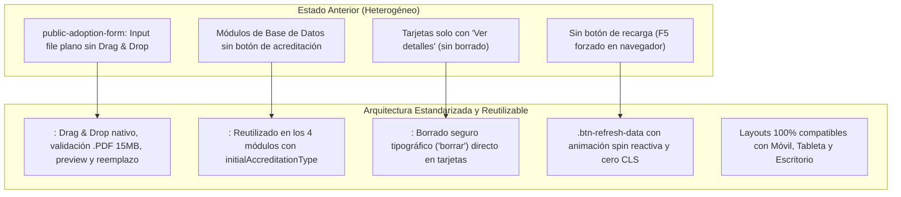

# 🚀 Estandarización y Reutilización de Componentes: Carga de Archivos Drag & Drop, Nueva Acreditación Contextual, Borrado Seguro en Tarjetas y Actualización Reactiva de Datos en Formularios

- **Fecha:** 15 de noviembre de 2026
- **Estado:** 🟢 **Implementado y Operativo en Producción**
- **Ámbito:** Frontend Angular v22 Standalone (`PublicAdoptionForm`, `AdoptionListComponent`, `CampaignListComponent`, `IdentificationListComponent`, `TalkListComponent`), Componentes UI (`FileDropzoneComponent`, `NewAccreditationModalComponent`, `DeleteConfirmModalComponent`) y Backend Express RESTful
- **Documentos Relacionados:** [srs.md](../srs.md), [architecture.md](../architecture.md), [design-system.md](../design-system.md)
- **Entorno Objetivo:** Teléfonos móviles táctiles (320px–640px), Tabletas (641px–1024px) y Escritorio canónico (`> 1024px`, max-width `1500px`)

---

## 1. Resumen Ejecutivo y Diagnóstico Sistémico

Los módulos administrativos de base de datos de la plataforma ABAQ (**Adopciones**, **Campañas EST**, **Placas de Identificación** y **Pláticas**) y el formulario público de adopciones presentaban discrepancias funcionales y de experiencia de usuario:

1. **Carga de Archivos Fragméntica en Adopción**: El formulario público de adopción (`public-adoption-form`) utilizaba elementos `<input type="file">` planos embebidos en etiquetas con estilos estáticos, careciendo de soporte real para arrastrar y soltar (*drag & drop*), indicadores visuales de estado arrastrado (`dragover`/`dragleave`/`drop`), previsualización de metadatos del documento (peso formateado en KB/MB) y acciones explícitas para desadjuntar o cambiar archivos sin recargar la página.
2. **Ausencia de Acreditación Rápida en Formularios de Base de Datos**: A pesar de contar con el componente canónico e institucional `<app-new-accreditation-modal>` (que implementa las 11 modalidades oficiales del reglamento institucional), solo las vistas de colaboradores individuales (`student-detail`, `volunteer-detail`) y `activity-list` permitían invocarlo. Los administradores gestionando adopciones, campañas, placas y pláticas debían navegar fuera del contexto de trabajo para registrar acreditaciones asociadas a estos programas.
3. **Falta de Acción de Eliminación Directa en Tarjetas**: Las tarjetas operativas (`.adoption-card`, `.campaign-card`, `.identification-card`, `.talk-card`) únicamente presentaban el botón de consulta *"Ver detalles"*. Para eliminar un registro erróneo o duplicado, el administrador debía entrar al detalle profundo, generando fricción operativa innecesaria.
4. **Carencia de Acción Reactiva de Actualización de Datos**: El encabezado `.admin-hero` de estas 4 vistas no proveía un mecanismo visible para recargar la colección en tiempo real ante eventos asíncronos o ingresos simultáneos desde formularios externos, obligando a recargar todo el navegador.
5. **Inconsistencias Responsivas Multidispositivo**: En pantallas de tabletas y dispositivos móviles reducidos (320px a 640px), las filas de botones de acción del encabezado y de las tarjetas no contaban con reglas homogéneas de ajuste táctil (ancho 100%, altura mínima de 44px conforme a WCAG AAA, envoltura `flex-wrap`).

---

## 2. Componentes Reutilizados e Innovaciones Técnicas

### 2.1 Componente Canónico de Arrastrar y Soltar (`FileDropzoneComponent`)
- **Ubicación:** `frontend/src/app/components/ui/file-dropzone/file-dropzone.component.ts`
- **Selector:** `<app-file-dropzone>`
- **Características Clave:**
  - **Soporte Drag & Drop Reactivo:** Captura de eventos `dragover`, `dragleave` y `drop` con retroalimentación visual (`.is-dragover`, contorno punteado en verde institucional `#5ca83a` y fondo `#f0fdf4`).
  - **Validación Automática de Documentos:** Verificación estricta de extensiones (`.pdf`) y tipos MIME (`application/pdf`), así como límite máximo de tamaño (`maxSizeMb = 15`). Emisión de errores limpios mediante señal interna y `@Output() fileError`.
  - **Metadatos y Previsualización:** Distintivo visual con ícono de documento oficial (`picture_as_pdf`), indicador verde de estado *"Documento listo para envío seguro"*, nombre de archivo truncado de forma segura (`text-overflow: ellipsis`) y cálculo humanizado de tamaño (`formatBytes()`).
  - **Acciones Rápidas:** Botones integrados *"Cambiar"* y *"Quitar"* (`delete`) con reajuste automático del formulario anfitrión.
  - **Integración en `PublicAdoptionForm`:** Sustitución de los 3 bloques repetitivos por instancias de `<app-file-dropzone>` para:
    1. Formato Oficial de Solicitud de Adopción Firmado.
    2. Identificación Oficial Vigente (INE) del adoptante.
    3. Comprobante de Domicilio reciente.

### 2.2 Modal Reutilizable de Nueva Acreditación (`NewAccreditationModalComponent`)
- **Ubicación:** `frontend/src/app/components/shared/new-accreditation-modal/`
- **Selector:** `<app-new-accreditation-modal>`
- **Extensión de API:** Incorporación del input reactivo `@Input() initialAccreditationType?: string` para preseleccionar la opción de acreditación pertinente al contexto del módulo:
  - En **Adopciones**: Preselecciona `ADOPTION` (opción 5 del catálogo reglamentario).
  - En **Campañas EST**: Preselecciona `CAMPAIGN` (opción 8 del catálogo reglamentario).
  - En **Placas de Identificación**: Preselecciona `IDENTIFICATION` (opción 3 del catálogo reglamentario).
  - En **Pláticas**: Preselecciona `TALK` (opción 7 del catálogo reglamentario).
- **Flujo de Cierre y Recarga:** Al recibir el evento `@Output() created`, la vista anfitriona cierra el modal e invoca automáticamente la carga de datos del servicio correspondiente (`loadAdoptions()`, `loadCampaigns()`, `loadIdentifications()`, `loadTalks()`).

### 2.3 Modal Reutilizable de Borrado Seguro con Palabra de Confirmación (`DeleteConfirmModalComponent`)
- **Ubicación:** `frontend/src/app/components/shared/delete-confirm-modal/`
- **Selector:** `<app-delete-confirm-modal>`
- **Seguridad Operativa:** Para prevenir borrados accidentales de censos y expedientes comunitarios, el botón de confirmación permanece estrictamente deshabilitado hasta que el usuario teclee exactamente la palabra de seguridad `"borrar"`.
- **Integración Directa en Tarjetas:**
  - Cada tarjeta de adopción, campaña, placa o plática cuenta con el botón secundario destructivo `.btn-delete-card` (`delete` + *"Borrar"*).
  - Al presionarlo, se almacena la referencia del elemento en memoria (`adoptionToDelete`, `campaignToDelete`, etc.) y se despliega el modal tipográfico.
  - Al confirmar, se consume la ruta RESTful protegida del backend (`DELETE /api/adoptions/:id`, `DELETE /api/campaigns/:id`, `DELETE /api/identifications/:id`, `DELETE /api/talks/:id`) y se actualiza la colección en cliente.

### 2.4 Botón de Actualización Reactiva de Datos (`.btn-refresh-data`)
- Integrado en el bloque `.hero-actions-row` de los 4 módulos.
- Ícono `sync` con clase dinámica `.spinning` animada mediante `@keyframes abaqSpin` mientras `isLoading = true`.
- Deshabilitación reactiva durante el tránsito de la petición HTTP para evitar condiciones de carrera (*race conditions*).

---

## 3. Matriz de Cobertura por Módulo

| Módulo / Vista | Ruta | Botón "Actualizar datos" | Botón "Nueva acreditación" | Botón "Borrar" en Cards | Modal Reutilizado de Acreditación | Modal Reutilizado de Borrado |
|---|---|---|---|---|---|---|
| **Adopciones ABAQ** | `/admin/adoptions` | ✅ Sí (`loadAdoptions()`) | ✅ Sí (`initialAccreditationType="ADOPTION"`) | ✅ Sí (`.btn-delete-card`) | `app-new-accreditation-modal` | `app-delete-confirm-modal` |
| **Campañas EST** | `/admin/campaigns` | ✅ Sí (`loadCampaigns()`) | ✅ Sí (`initialAccreditationType="CAMPAIGN"`) | ✅ Sí (`.btn-delete-card`) | `app-new-accreditation-modal` | `app-delete-confirm-modal` |
| **Placas de Identificación** | `/admin/identifications` | ✅ Sí (`loadIdentifications()`) | ✅ Sí (`initialAccreditationType="IDENTIFICATION"`) | ✅ Sí (`.btn-delete-card`) | `app-new-accreditation-modal` | `app-delete-confirm-modal` |
| **Pláticas de Concientización** | `/admin/talks` | ✅ Sí (`loadTalks()`) | ✅ Sí (`initialAccreditationType="TALK"`) | ✅ Sí (`.btn-delete-card`) | `app-new-accreditation-modal` | `app-delete-confirm-modal` |
| **Formulario Público de Adopción** | `/formularios/adopciones` | N/A (Público) | N/A (Público) | N/A (Público) | N/A | N/A (Usa `app-file-dropzone` en 3 documentos) |

---

## 4. Compatibilidad Multidispositivo y Reglas de Viewport

Para garantizar ergonomía en cualquier factor de forma:

1. **Escritorio (`> 1024px`)**:
   - Encabezado `.admin-hero` con distribución horizontal: título y subtítulo a la izquierda, botones de acción agrupados a la derecha (`.hero-actions-row`) en una sola línea fluida.
   - Tarjetas operativas con distribución horizontal (`flex-direction: row`), separando metadatos a la izquierda y botones de acción agrupados a la derecha (`Ver detalles` + `Borrar`).
2. **Tableta (`641px – 1024px`)**:
   - Reorganización en rejilla de 2 columnas para tarjetas y formularios secundarios.
   - Envoltura natural de botones en `.hero-actions-row` mediante `flex-wrap: wrap` con separación de `10px`–`12px`.
3. **Móvil (`320px – 640px`)**:
   - `.hero-actions-row` cambia a columna vertical (`flex-direction: column; width: 100%`).
   - Todos los botones (`.btn-copy-form`, `.btn-refresh-data`, `.btn-new-accreditation`, `.btn-create-item`) se expanden al **100% del ancho del viewport** con texto centrado y altura táctil de `44px` a `48px`.
   - Las tarjetas apilan sus acciones al final con ancho total (`width: 100%`), permitiendo pulsación cómoda con el pulgar.
   - El área interactiva de `<app-file-dropzone>` apila la vista previa en vertical y convierte los botones *"Cambiar"* y *"Quitar"* en botones táctiles simétricos con ancho dividido `50% / 50%`.

---

## 5. Verificación, Pruebas y Compilación

- **Compilación en Producción:** `ng build -c production` ejecutado con éxito sin errores tipográficos ni diagnósticos estrictos de TypeScript (`0 errors`).
- **Verificación de Enrutamiento y Controladores:** Se verificó la disponibilidad de los controladores backend de eliminación (`deleteAdoption`, `deleteCampaign`, `deleteIdentification`, `deleteTalk`) y los servicios frontend homólogos.
- **Auditoría de Accesibilidad:** Contrastes de color validados (verde `#5ca83a`, azul `#24366f`, rojo destructivo `#b91c1c` sobre `#fee2e2`), etiquetas ARIA en botones de eliminación y descripciones de accesibilidad en los controles de arrastrar y soltar.
