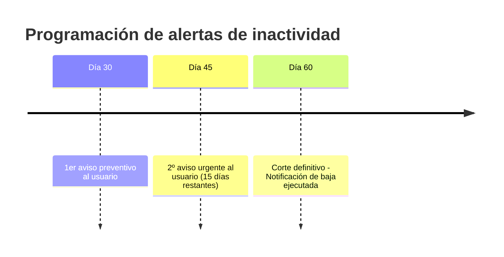
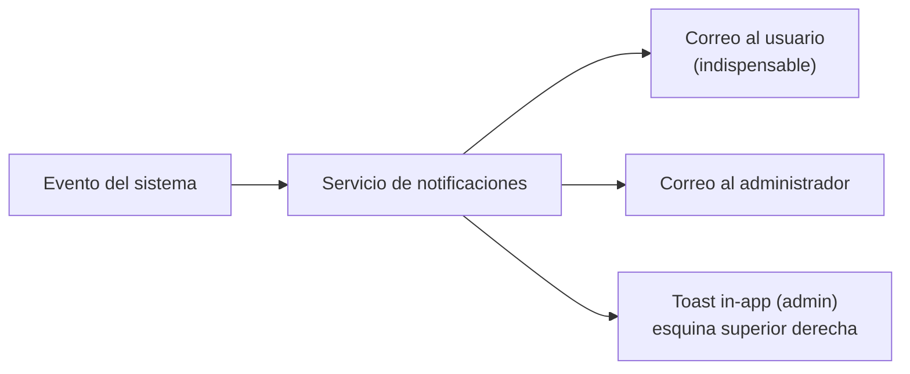

# Diseño del Sistema de Notificaciones

**Proyecto:** Plataforma Web ABAQ (Servicio Social)
**Versión:** 0.3.0
**Fecha:** 2026-10-14
**Estado:** Propuesta en evolución (estrategia de correo pendiente de decisión)
**Relacionado:** [Perfil del Usuario](perfil-usuario-design.md) · [Autenticación](auth-design.md) · [Datos, Respaldo y Recuperación](datos-respaldo-recuperacion-design.md)

---

## 1. Propósito

Notificar eventos relevantes del ciclo de vida de la cuenta, de la solicitud y del progreso de servicio social, por dos canales:

1. **Correo electrónico** — a los **usuarios (voluntarios)** y a los **administradores**.
2. **Notificación in-app (toasts)** — en la **esquina superior derecha**, para **administradores**.

!!! info "Correos indispensables (no opt-out)"
    Todos los correos al usuario definidos en §2 son **indispensables**: el usuario **no** puede desactivarlos. No hay preferencias de baja (opt-out) para estos avisos.

---

## 2. Eventos de notificación al usuario (voluntario)

| Evento | Disparador / umbral | Contenido |
|---|---|---|
| **Acreditación de SS** | Automático, por **cada** acreditación de horas | Descripción de la acreditación (actividad), **horas acumuladas** y **horas faltantes** hacia la meta |
| **Status semanal** | Automático, **cada martes** | Resumen: horas acumuladas, horas faltantes, **última actividad realizada** y **aviso si está entrando en inactividad** |
| **Inscripción validada** | Al validar el administrador la postulación (Fase 5) | Confirmación de acceso al portal |
| **Hito de horas — 25%** | Al alcanzar **120 h** | Felicitación de avance |
| **Hito de horas — 50%** | Al alcanzar **240 h** | Felicitación de avance |
| **Hito de horas — 75%** | Al alcanzar **360 h** | Felicitación de avance |
| **Hito de horas — 100% / Felicitación** | Al alcanzar **480 h** | **Felicitación** por completar las horas |
| **Finalización del servicio** | Al concluir el servicio | Felicitación + **generación de certificado** |
| **Inactividad — 1er aviso** | **30 días** de inactividad | Aviso preventivo: detección de 30 días continuos sin registrar horas |
| **Inactividad — 2º aviso** | **45 días** de inactividad | Segundo aviso urgente: restan 15 días antes de la baja definitiva |
| **Inactividad — corte** | **60 días (2 meses)** sin actividad no notificada | **Notificación formal de baja definitiva ejecutada** (la medida administrativa se tomó de oficio y se formaliza la baja en el sistema) |
| **Acreditacion de horas validadas** semanales de la semana anterior | Cuando una actividad o oportunidad son validadas por el admin otrogando las horas al volutario instiucional | titulo de la actividad,  horas propuestas, horas obtenidas y comentarios |

!!! note "Meta de horas"
    La meta base de servicio social es **480 horas**. Los hitos se calculan en cuartos: 120 / 240 / 360 / 480.

!!! success "Certificado al finalizar"
    La felicitación por finalización acompaña la **generación del certificado**. El backend **ya cuenta con el script** para generar ese documento (submódulo de git `tool-constancias`); el certificado se genera bajo demanda, sin almacenar PDF en el servidor.

### 2.1 Regla de inactividad (reglamento)

> El reglamento establece: *"Al cumplirse 2 meses de inactividad no previamente notificada a Coordinación, ABAQ ejecuta la baja definitiva del programa y notifica la resolución al usuario por correo (la medida se toma de forma directa sin aviso previo posterior)."* El sistema programa avisos preventivos a los 30 y 45 días antes del corte definitivo de 60 días.

---

## 3. Eventos de notificación al administrador

| Evento | Correo | Toast in-app |
|---|---|---|
| Creación de cuenta nueva (registro enviado) | ✅ | ✅ |
| Usuario propone cambio de datos (post-validación) | ✅ | ✅ |
| Cambio aprobado / rechazado | — | ✅ |
| Inactividad de un usuario (corte a 60 días) | ✅ | ✅ |

### 3.1 Canal in-app (toasts)

- **Posición:** esquina **superior derecha**.
- **Audiencia:** solo administradores.
- **Comportamiento:** aparecen al ocurrir el evento, se apilan verticalmente, se autodescartan tras unos segundos y permiten descarte manual. Enlazan a la bandeja de aprobación o al expediente cuando aplica.

---

## 4. Estrategia de correo emisor (decisión pendiente)

El sistema debe enviar correo "desde ABAQ" sin degradar ni ocupar los dos buzones de persona existentes. La decisión se evalúa bajo un **presupuesto total de 2,000 USD** (infraestructura + envío de correo), priorizando opciones económicas o con beneficios para *nonprofits*.

!!! danger "Autenticación básica: en retiro (dato de infraestructura, verificado el 2026-10-18)"
    En Exchange Online, la autenticación básica de **SMTP AUTH** se **deshabilitará por defecto a fines de diciembre de 2026** en los tenants existentes; el administrador podrá reactivarla temporalmente y la fecha de retiro definitivo no está anunciada (ver [Despliegue](cloud-deployment.md), referencia 26). Usar la contraseña de un buzón personal no es una base viable: cualquier integración con Microsoft 365 debe usar **autenticación moderna (OAuth2 / app registrada)**.

### 4.1 Opciones a evaluar

| # | Opción | Descripción | Costo estimado |
|---|--------|-------------|----------------|
| 1 | **Microsoft Graph (`Mail.Send`) + Buzón Compartido ABAQ** | Aprovechar la infraestructura existente de Microsoft 365 con un buzón compartido y autenticación OAuth2 (app-only) para enviar directamente desde la aplicación. No consume licencia ni toca los buzones de persona. | **$0 adicional** si ya se cuenta con M365 / Microsoft for Nonprofits. Aprovecha beneficios existentes. |
| 2 | **SendGrid (programa Nonprofit / plan básico)** | Integración por API, con descuentos o créditos del programa para organizaciones sin fines de lucro (vía TechSoup). | Gratis hasta 100 correos/día, o planes de bajo volumen para nonprofits por debajo del presupuesto. |
| 3 | **Amazon SES** | Envío escalable y de costo muy bajo, integrado en la infraestructura en la nube. | ~**$0.10 por cada 1,000 correos**; prácticamente imperceptible dentro del presupuesto. |
| 4 | **Resend** | Proveedor moderno orientado a desarrolladores, con SDKs limpios y buena entregabilidad. | Tier gratuito generoso y planes de pago escalables; prioriza simplicidad de desarrollo. |

!!! info "Costeo con alcance solo Azure"
    El [documento de despliegue](cloud-deployment.md) (v3.0.0) cotiza solo servicios Azure. Ahí se evalúan la **Opción 1 (Microsoft Graph)** y **Azure Communication Services Email**, que es servicio de primera parte y por eso consume el grant (~$0.51/mes con 2,000 correos). Las opciones 2–4 de esta tabla quedan fuera de ese costeo.

### 4.2 Patrón recomendado si se elige la Opción 1 (Microsoft Graph)

Patrón oficial de Microsoft para enviar desde un buzón compartido con autenticación moderna:

1. Registrar una **app en Entra ID** → Client ID + Tenant ID + Client Secret.
2. Otorgar permiso de aplicación **`Mail.Send`** en Microsoft Graph (con consentimiento de administrador).
3. Crear un **buzón compartido** de ABAQ (p. ej. `avisos@abaq.org.mx`) — **no requiere licencia hasta 50 GB**. Pendiente de validar que Graph app-only funcione con un buzón sin licencia (no está documentado oficialmente).
4. **Restringir el alcance** de la app con **RBAC for Applications** de Exchange Online, para que solo pueda enviar desde ese buzón, y **quitar el consentimiento de `Mail.Send` sin alcance** en Entra ID (los permisos se suman; si se deja, el alcance no restringe nada). Con permiso de aplicación **no se requiere Send As**.
5. El backend (Node.js) envía vía Graph `POST /users/{buzón}/sendMail`.

Ventajas: no toca los dos buzones de persona ni su licencia; los correos salen "desde ABAQ"; cumple la autenticación moderna exigida por Microsoft.

!!! warning "Alcance de desarrollo (dependiente de infraestructura)"
    La integración real con el proveedor elegido (app registrada + buzón compartido, o claves del proveedor externo) queda **pendiente de configurar la infraestructura**. En el backend se desarrolla **hasta el punto de integración** (preparación del mensaje y plantillas), dejando el envío efectivo como integración documentada (stub) a completar. El backend ya cuenta con `utils/email.js` como punto de integración.

---

## 5. Requisitos derivados

- **RF-NOT-01**: El sistema envía al usuario un correo por **cada acreditación** de SS, con descripción, acumulado y horas faltantes.
- **RF-NOT-02**: El sistema envía un correo de **status cada martes** (acumulado, faltantes, última actividad, aviso de inactividad).
- **RF-NOT-03**: El sistema envía felicitación en los hitos **120/240/360/480 h** y felicitación + certificado a la **finalización**.
- **RF-NOT-04**: El sistema programa avisos de inactividad preventiva a **30 y 45 días**, y la notificación formal de baja definitiva ejecutada a **60 días** sin aviso previo de ausencia.
- **RF-NOT-05**: El sistema notifica al usuario la **validación de su inscripción**.
- **RF-NOT-06**: Los correos al usuario son **indispensables** (sin opt-out).
- **RF-NOT-07**: El administrador recibe correo + toast in-app ante registro nuevo, cambio propuesto e inactividad; toast ante aprobación/rechazo.
- **RNF-NOT-01**: El emisor debe usar **autenticación moderna** (OAuth2 / app registrada); no se usa la contraseña de ningún buzón personal.

---

## 6. Pendientes de definición

- **Elección de la estrategia de correo** entre las 4 opciones de §4.1, dentro del presupuesto de 2,000 USD.
- Confirmación de la identidad emisora de ABAQ (buzón compartido o dominio verificado en proveedor externo).
- Persistencia e historial de notificaciones in-app (¿bandeja consultable o solo toasts efímeros?).
