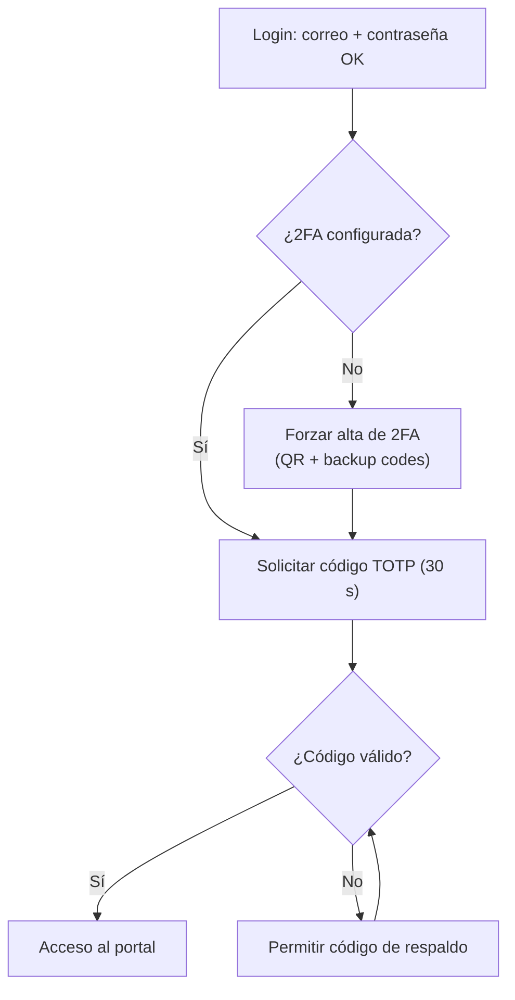
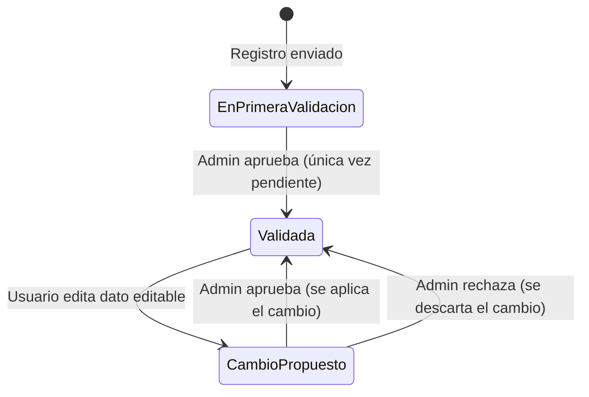
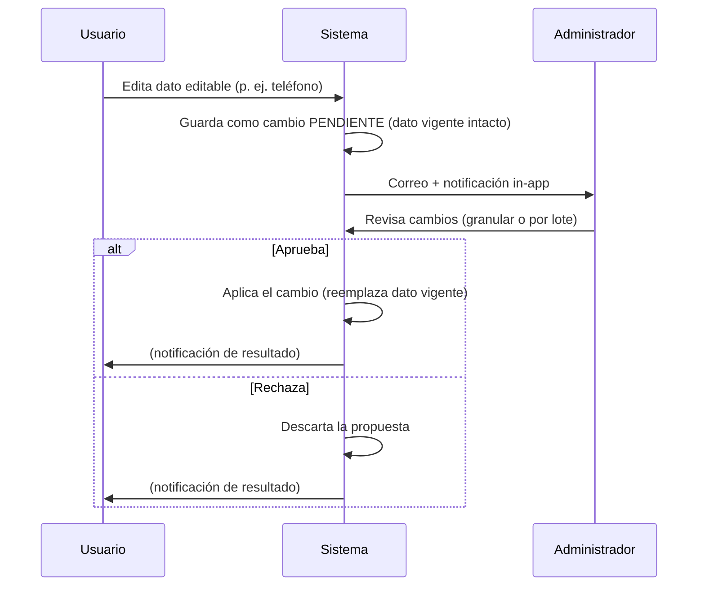

# Diseño de la Página de Perfil del Usuario

**Estándar de referencia:** ISO/IEC/IEEE 29148:2018 (requisitos)
**Proyecto:** Plataforma Web ABAQ (Servicio Social)
**Versión:** 1.0.0
**Fecha:** 2026-10-14
**Estado:** Propuesta de diseño
**Relacionado:** [Diseño de Autenticación](auth-design.md) · [Sistema de Notificaciones](notificaciones-design.md) · [Datos, Respaldo y Recuperación](datos-respaldo-recuperacion-design.md)

---

## 1. Propósito y alcance

La **página de perfil** es una vista separada del *dashboard*. Se accede mediante el **botón de usuario del navbar** (arriba a la derecha). Permite a la persona voluntaria administrar su cuenta y su solicitud de servicio social. No sustituye al dashboard (que muestra progreso y actividades); es el espacio de **autogestión de cuenta y datos**.

!!! note "Sin sección de Privacidad (por ahora)"
    En la definición inicial se contempló una sección de Privacidad (ocultar horas). Se **descartó** por no ser aplicable al modelo de ABAQ. La sección queda fuera de alcance hasta nueva consideración.

La página se compone de tres áreas:

1. **Configuración de la cuenta** — contraseña, 2FA, tema de interfaz.
2. **Mi solicitud** — brief de la información capturada y entregada en el registro, con edición controlada.
3. **Cambios pendientes de aprobación** — estado de las ediciones solicitadas que esperan validación del administrador.

---

## 2. Configuración de la cuenta

| Elemento | Comportamiento |
|---|---|
| **Correo institucional** | **Inmutable.** Es el identificador único de acceso; se muestra en solo lectura. |
| **Contraseña** | Editable. Requiere contraseña actual + nueva (12–128 caracteres, conforme a `[SRS RF-SEC-01]`). |
| **Autenticación en dos pasos (2FA)** | **Obligatoria para todos** los usuarios (voluntarios y administradores). TOTP de 30 segundos + **códigos de respaldo** (*backup codes*). |
| **Tema de interfaz** | Selección de tema claro / oscuro / según sistema. |

### 2.1 2FA obligatoria (TOTP)

Todas las cuentas deben tener 2FA activa. El diseño contempla:

- **Alta de 2FA:** presentación de un código QR o codigo de configracion en texto (secreto TOTP) para escanear con una app de autenticación (Google Authenticator, Authy, etc.), confirmación con un primer código válido y entrega de un conjunto de **códigos de respaldo** de un solo uso.
- **Reto en el login:** tras validar correo + contraseña, se solicita el código TOTP de 30 s. Alternativamente, un código de respaldo.
- **Regeneración de códigos de respaldo:** disponible desde la configuración de la cuenta. generar un documento de emergency kit.
    - Genera 10 backup codes, en primera instancia son descargados al configurar auth2 y TOTP. Pero este docuemnto emergency kit puede ser generado de nuevo en el perfil en la seccion de seguridad.
- **Emergency kit**: docuemtno .txt con la información de la cuenta, breve guia de la configuracion de la cuenta, contrasena correo identificador y codigos de recuperacion.

---

## 3. Mi solicitud (brief del registro)

Vista de resumen de todo lo que la persona capturó y entregó durante el [registro de 5 fases](auth-design.md#4-diseno-del-registro-signup-5-fases): datos personales y académicos, onboarding, documentos y aceptación del reglamento.

### 3.1 Reglas de edición

El modelo de edición distingue entre la **primera validación** y las ediciones posteriores.

!!! danger "Durante la primera validación"
    Mientras la cuenta está en su **única** fase *pendiente* (primera revisión del registro), la información **no es editable**. El administrador la revisa por primera vez; hasta que apruebe, el usuario no puede modificar nada.

!!! info "Después de la primera validación — patrón de cambios pendientes"
    Una vez validada la cuenta, el usuario **puede editar los campos editables**, pero el cambio **no se aplica inmediatamente**:

    1. El dato **vigente permanece sin cambios** y sigue siendo el valor visible/activo.
    2. El cambio queda registrado como **propuesta pendiente de aprobación**.
    3. Se **notifica al administrador** (correo + notificación in-app).
    4. El cambio se aplica **solo cuando el administrador lo confirma**. Si lo rechaza, se descarta y el dato vigente no se altera.
    5. La cuenta **NO vuelve al estado "pendiente"** global ni pierde acceso: solo el campo editado tiene una propuesta en revisión.

### 3.2 Campos editables vs. inmutables

| Área | Campo | ¿Editable tras 1ª validación? |
|---|---|---|
| Datos personales | Nombre completo | ✅ Sí (con aprobación) |
| Datos personales | Teléfono celular | ✅ Sí (con aprobación) |
| Datos académicos | Institución / escuela | ✅ Sí (con aprobación) |
| Documentos | INE (re-subir enlace) | ✅ Sí (con aprobación) |
| Documentos | Curriculum Vitae (re-subir enlace) | ✅ Sí (con aprobación) |
| Cuenta | Correo institucional | ❌ Inmutable (identificador de acceso) |
| Onboarding | Videos de inducción y su registro | ❌ Inmutable |
| Onboarding | Opiniones (gustó / importante / mejora) | ❌ Inmutable |
| Onboarding | Seguimiento de redes sociales | ❌ Inmutable |
| Reglamento | Consentimiento del reglamento | ❌ Inmutable |

### 3.3 Aprobación por el administrador

El administrador dispone de **dos modalidades** sobre los cambios propuestos de un usuario:

- **Granular:** aprobar o rechazar **cada cambio individual** (p. ej. aprobar el nuevo teléfono pero rechazar el nuevo CV).
- **Por lote:** aprobar o rechazar **todo el conjunto** de cambios de esa edición de una sola vez.

---

## 4. Requisitos derivados

- **RF-PERF-01**: La página de perfil es accesible desde el botón de usuario del navbar, separada del dashboard.
- **RF-PERF-02**: El correo institucional es inmutable; no puede editarse desde el perfil.
- **RF-PERF-03**: La 2FA (TOTP 30 s) es obligatoria para todas las cuentas, con códigos de respaldo.
- **RF-PERF-04**: Durante la primera validación, la solicitud no es editable.
- **RF-PERF-05**: Tras la primera validación, las ediciones de campos editables se registran como cambios pendientes; el dato vigente no cambia hasta que el administrador aprueba.
- **RF-PERF-06**: El administrador puede aprobar/rechazar cambios de forma granular o por lote.
- **RF-PERF-07**: Onboarding, opiniones, seguimiento de redes y consentimiento del reglamento son inmutables.
- **RF-PERF-08**: Toda edición notifica al administrador por correo y por notificación in-app.
- **RF-PERF-09**: El sistema genera al configrar 2FA Emergency kit, constituido por identificador de cuenta (correo institucional), contraseña y backup codes, ademas de guia del funcionamiento de los backup codes. Este archivo es descargado de forma automatica como .txt.
- **RF-PERF-10**: El sistema permite la descarga del archivo Emergency kit.txt en el perfil en la seccion de seguridad.

---

## 5. Pendientes de definición

- Posibilidad de que el usuario **cancele** un cambio propuesto antes de que el administrador lo revise (a confirmar).
- Reincorporación futura (o no) de la sección de **Privacidad**.
