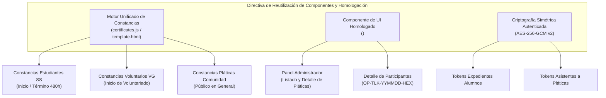
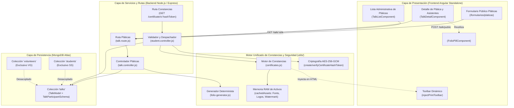

# Especificación de Requerimientos de Software (SRS) y Arquitectura: Módulo de Constancias de Plática para Público en General

> **Estándar:** ISO/IEC/IEEE 29148:2018 (Requirements Engineering) & ISO/IEC/IEEE 42010:2022 (Architecture Description)  
> **Proyecto:** Sistema Integral ABAQ Querétaro (Asociación de Bienestar Animal Querétaro)  
> **Módulo:** Constancias de Asistencia a Pláticas de Bienestar Animal (Público General y Comunidad)  
> **Versión:** 2026.11.12 (CalVer)  
> **Estado:** Aprobado y Homologado  
> **Directiva de Ingeniería:** Reutilización Estricta de Componentes y Homologación Arquitectónica Zero-Duplication  
> **Autores:** Equipo de Arquitectura de Software e Ingeniería de Requerimientos ABAQ  

---

## 1. Introducción y Contexto

### 1.1 Propósito y Misión Institucional
La **Asociación de Bienestar Animal Querétaro (ABAQ)** imparte periódicamente pláticas, talleres y conferencias sobre tenencia responsable, prevención del maltrato animal, esterilización ética y marco jurídico de protección a la fauna urbana en escuelas, centros comunitarios, empresas y espacios cívicos del Estado de Querétaro.

A estas capacitaciones asisten niños, jóvenes, padres de familia, docentes y ciudadanos en general que **no forman parte de la estructura interna de Servicio Social universitario (`SS`) ni del padrón permanente de Voluntarios Generales (`VG`)**. Con el fin de certificar formalmente la asistencia cívica de la comunidad y fomentar una cultura de corresponsabilidad ética hacia los animales, se establece el presente **Módulo de Constancias de Plática para Público en General**.

El propósito fundamental de esta especificación es formalizar los requerimientos funcionales, requerimientos no funcionales, directivas de seguridad criptográfica y diseño de arquitectura que rigen la emisión, consulta pública y descarga de dichas constancias, asegurando una experiencia confiable, instantánea y exenta de fricciones de acceso.

---

### 1.2 Directiva Crítica: Reutilización de Componentes y Homologación Arquitectónica
Para evitar la proliferación de subsistemas aislados (*code bloat*), dispersión de estilos visuales y costos operativos innecesarios, se establece como **mandato de arquitectura obligatorio la reutilización integral de los activos y componentes nucleares del sistema**:

1. **Reutilización del Motor Unificado de Constancias (`backend/utils/certificates.js`)**:
   - Se homologa la plantilla base `template.html`, los membretes oficiales de la asociación, las firmas institucionales vectoriales y los activos embebidos.
   - Reutilización de tipografías TrueType integradas en Base64 (`CrimsonText-Regular.ttf` para cuerpo institucional y `GreatVibes-Regular.ttf` para el nombre del participante).
   - Inyección en tiempo de renderizado de la marca de agua translúcida oficial (`new_watermark_trans.png`) y logotipo institucional en alta resolución (`logo_highres_trans.png`).
   - Reutilización estricta de la barra interactiva superior (`injectPrintToolbar`), que proporciona auto-escalado responsive, generación de instantánea en alta fidelidad y llamadas de impresión nativas.

2. **Reutilización de `<app-folio-pill>` en Todas las Superficies**:
   - Todo asistente registrado en una plática recibe un folio de oportunidad canónico del catálogo institucional bajo la nomenclatura determinista `OP-TLK-YYMMDD-HEX` (cumpliendo con el estándar ADR-13 y el [Contrato de Interfaz de Folios](contrato-folios-desacoplamiento.md)).
   - El componente Angular Standalone `<app-folio-pill>` se reutiliza sin duplicación para renderizar el folio tanto en las vistas administrativas (`TalkDetailComponent`, `TalkListComponent`) como en el detalle del participante y las constancias emitidas, aplicando el estilo violeta/verde de oportunidad (`interactionType="OP"`) con la bandera `showHours="false"`.

3. **Reutilización del Esquema de Tokens Criptográficos Opacos (AES-256-GCM / HMAC-SHA256)**:
   - Se utiliza el mismo generador criptográfico de tokens inviolables `createCertificateHashToken()` y validador `verifyCertificateHashToken()`.
   - Se descarta cualquier esquema paralelo de enlaces basados en ObjectIds planos o firmas débiles; las constancias de plática utilizan tokens protegidos con prefijo de versión `v2.`, vector de inicialización (IV) de 12 bytes aleatorio y etiqueta de autenticación (Tag) GCM de 16 bytes.



---

### 1.3 Alcance y Límites del Módulo
El alcance del módulo delimita taxativamente las responsabilidades del sistema:

* **Público Objetivo**: Asistentes comunitarios a pláticas y conferencias impartidas por ABAQ (estudiantes de escuelas primarias/secundarias, padres de familia, funcionarios o público general).
* **Canal de Ingreso**: Formulario público accesible desde `/formularios/platicas`, con verificación anti-bot de Cloudflare Turnstile.
* **Naturaleza del Documento**: Certificado de asistencia ciudadana y participación cívica conmemorativa.
* **Exclusiones Clave**: 
  - **No acredita horas de Servicio Social curricular universitario.** Las horas de servicio social son exclusivas de estudiantes formalmente dados de alta mediante el proceso de onboarding (`Student`).
  - **No crea cuentas de usuario ni credenciales en la base de datos.** Los asistentes no son dados de alta en la colección `users` ni requieren correo institucional de acceso.
  - **No almacena PDFs binarios en el servidor.** Se mantiene la arquitectura *Zero-File Storage* y *Zero-Puppeteer*, generando el HTML autocontenido bajo demanda y delegando la rasterización visual al navegador del usuario.

---

## 2. Requerimientos Funcionales (SRS Funcional)

### `[RF-01: Generación de Constancia de Asistencia en Registro de Plática]`
* **Descripción**: El sistema debe posibilitar la generación y emisión de constancias de asistencia individualizadas al registrar una plática comunitaria desde la interfaz pública `/formularios/platicas` o desde el panel administrativo.
* **Entradas**:
  - Título o nombre de la plática (`name`, p. ej. *"Tenencia Responsable y Bienestar Canino en Comunidades"*).
  - Fecha de impartición (`date`).
  - Lugar o sede de la plática (`location`, p. ej. *"Escuela Secundaria General No. 1, Querétaro"*).
  - Listado de asistentes en `participants[]`, donde cada participante contiene: `name` (obligatorio), `sex`, `age`, `email`, `phone`, `followUp`.
  - Verificación anti-bot: Token de Cloudflare Turnstile validado en backend.
* **Comportamiento del Sistema**:
  1. Al persistir el documento `Talk`, el backend genera automáticamente un folio de interacción determinista para cada asistente:
     $$\text{Folio} = \text{OP-TLK-YYMMDD-HEX4}$$
     utilizando la función `generateAccreditationFolio('TALK', date, participantId)`.
  2. El sistema asocia el identificador de la plática y el sub-identificador del participante para la generación de la constancia digital.
  3. Tras el envío exitoso, la pantalla de confirmación presenta al promotor o participante la URL segura para consultar o descargar de inmediato la constancia correspondiente.

---

### `[RF-02: Emisión de Token Protegido e Inviolable]`
* **Descripción**: Cada constancia emitida debe estar protegida por un token criptográfico opaco, determinista en verificación pero irreversible y no predecible por terceros, asegurando que un usuario no pueda falsificar constancias ni alterar nombres mediante modificación de parámetros en la URL.
* **Especificación Criptográfica**:
  - **Algoritmo**: AES-256-GCM (*Galois/Counter Mode*), cifrado simétrico con autenticación integrada.
  - **Clave Criptográfica**: Hash SHA-256 de 256 bits derivado a partir de la variable de entorno `CERTIFICATE_SECRET` (con respaldo en `JWT_SECRET`), con sal de dominio:
    $$K_{\text{cert}} = \text{SHA-256}(\text{"abaq-cert-v2:"} \parallel \text{CERTIFICATE\_SECRET})$$
  - **Vector de Inicialización (IV)**: 12 bytes aleatorios generados criptográficamente (`crypto.randomBytes(12)`).
  - **Etiqueta de Autenticación (Tag)**: 16 bytes generados por el algoritmo GCM.
  - **Cuerpo del Payload**: Estructura JSON compactada:
    ```json
    {
      "id": "<talkId>",
      "pId": "<participantId>",
      "t": "talk"
    }
    ```
  - **Formato Final en URL**:
    $$\text{Token} = \text{"v2."} + \text{base64url}(IV_{12\text{B}} \parallel \text{Tag}_{16\text{B}} \parallel \text{Ciphertext})$$
* **Manejo de Errores e Inviolabilidad**: Si el token es alterado en un solo bit o truncado, el método `verifyCertificateHashToken()` falla en la verificación del tag GCM y retorna `null`, provocando una respuesta HTTP 403 Forbidden (*"El enlace de la constancia es inválido o fue alterado"*), impidiendo ataques de manipulación de identidad o manipulación de parámetros de la consulta.

---

### `[RF-03: Renderizado Autocontenido de Constancia con Gráficos Oficiales]`
* **Descripción**: Al resolver una petición legítima en `/certificate/v/:hashToken`, el servidor debe responder un documento HTML5 100% autocontenido y listo para visualización instantánea, sin depender de descargas secundarias de CSS externo ni fuentes externas que comprometan la privacidad o retrasen el pintado.
* **Elementos Visuales Obligatorios**:
  - **Membrete Oficial**: Logotipo institucional de ABAQ Querétaro en alta resolución vectorizada/PNG, inyectado directamente como Data URL Base64 (`assets.logoBase64`).
  - **Marca de Agua Traslúcida**: Huella institucional oficial de ABAQ con opacidad controlada (`opacity: 0.18`), inyectada como Data URL Base64 (`assets.watermarkBase64`).
  - **Tipografía Caligráfica del Nombre**: `Great Vibes` embebida mediante `@font-face` con Data URL Base64 (`fontVibesBase64`), aplicada al nombre del participante.
  - **Tipografía Formal de Lectura**: `Crimson Text` embebida mediante Data URL Base64 (`fontCrimsonBase64`) para títulos, textos de certificación, firmas y fechas.
  - **Escalado Tipográfico Adaptativo de Nombre**:
    Para evitar que nombres con múltiples apelativos desborden el ancho imprimible (ancho máximo de 880px en el canvas), el sistema debe calcular dinámicamente el tamaño en puntos (`pt`) del nombre utilizando la función homologada `nameFontSizePt(nombre)`:
    | Longitud de Caracteres (`len`) | Tamaño de Fuente (`font-size`) |
    | :--- | :--- |
    | $\le 12$ caracteres | `52pt` |
    | $13 - 18$ caracteres | `40pt` |
    | $19 - 24$ caracteres | `32pt` |
    | $25 - 32$ caracteres | `26pt` |
    | $33 - 40$ caracteres | `21pt` |
    | $41 - 50$ caracteres | `17pt` |
    | $51 - 62$ caracteres | `15pt` |
    | $> 62$ caracteres | `13pt` |
  - **Cuerpo del Texto Institucional Homologado**:
    > *"La Asociación de Bienestar Animal Querétaro (ABAQ) otorga la presente CONSTANCIA a: **{{NOMBRE}}** por su valiosa participación y asistencia en la plática de Bienestar Animal y Tenencia Responsable: **«{{TITULO_PLATICA}}»**, impartida el día {{DIA}} de {{MES}} de {{ANIO}} en {{LUGAR}}."*
  - **Folio y Validador Visible**: Exhibición en tipografía monoespaciada del folio determinista `<app-folio-pill>` (`OP-TLK-YYMMDD-HEX`) y leyenda de verificación criptográfica con fecha de emisión.

---

### `[RF-04: Acceso Público Verificado sin Requerir Cuenta Institucional]`
* **Descripción**: La visualización de constancias de plática debe operar en modalidad **pública verificada**, prescindiendo de autenticación por cookies de sesión o cabeceras `Authorization: Bearer <JWT>`.
* **Regla de Autorización**:
  1. A diferencia de las constancias de expediente estudiantil (que exigen `userCanViewCertificate(req.user, doc)` para proteger datos personales sensibles de alumnos universitarios), las constancias de plática (`certType === "talk"`) resuelven de forma segura a partir de la posesión del token AES-256-GCM.
  2. El middleware `protectCertificate` en `app.js` debe verificar si el token corresponde al tipo `"talk"`. De ser así, autoriza la visualización pública del participante individual sin solicitar inicio de sesión en `/login`.
  3. No se expone ningún endpoint de listado o enumeración de constancias públicas; el acceso solo es posible a través del token opaco emitido.

---

### `[RF-05: Hint y Recomendaciones de Descarga (PNG y PDF)]`
* **Descripción**: La barra superior inyectada (`injectPrintToolbar`) debe guiar de manera intuitiva al ciudadano sobre cómo guardar o imprimir su reconocimiento oficial tanto en ordenadores de escritorio como en teléfonos móviles.
* **Capacidades Funcionales de Exportación**:
  1. **Descarga Instantánea en Imagen PNG (Botón Primario Destacado)**:
     - Ejecución en cliente de la librería `html2canvas` (v1.4.1) con configuración optimizada:
       ```javascript
       html2canvas(element, {
         scale: 2,               // Resolución de retina 2x (2244x1586 px efectivos)
         useCORS: true,
         logging: false,
         backgroundColor: '#F4F3EC',
         width: 1122,
         height: 793,
         windowWidth: 1122,
         windowHeight: 793
       })
       ```
     - **Integración con Web Share API Móvil**: En pantallas móviles ($\le 800\text{px}$), si el navegador soporta `navigator.canShare({ files: [file] })`, el sistema activa el diálogo nativo del sistema operativo (permitiendo compartir directamente a WhatsApp, Correo o Guardar en Fotos).
     - **Fallback de Descarga Directa**: En navegadores de escritorio, se genera un enlace dinámico `<a>` con atributo `download` para descargar el archivo `Constancia_Platica_<Nombre>_ABAQ.png`.
  2. **Impresión y Guardado en PDF (Botón Secundario)**:
     - Invocación de la API del navegador `window.print()`.
     - Reglas de estilo para impresión (`@media print`):
       - Configuración forzada de página: `@page { size: A4 landscape; margin: 0; }`.
       - Eliminación de barras de herramientas, botones de navegación y sombras: `.abaq-top-bar, .abaq-actions { display: none !important; }`.
       - Forzado de colores de fondo y gráficos: `-webkit-print-color-adjust: exact !important` y `print-color-adjust: exact !important`.
       - Ajuste dimensional exacto del canvas a $1122\text{px} \times 793\text{px}$ sin desfase ni cortes de página múltiple.

---

### `[RF-06: Desacoplamiento de Constancias de Plática del Perfil de Estudiante]`
* **Descripción**: El subsistema de constancias de plática debe operar en estricto desacoplamiento conceptual, lógico y transaccional respecto a los modelos de expediente de Estudiantes (`Student`) y Voluntarios Generales (`Volunteer`).
* **Reglas de Integridad y Segregación**:
  1. Las constancias oficiales del expediente de Servicio Social son exclusivamente dos:
     - **Constancia de Inicio (Aceptación)**: Emitida tras validar inducción, entrevista y activar expediente.
     - **Constancia de Término (Conclusión Oficial)**: Emitida tras completar y validar las 480 horas reglamentarias.
  2. La asistencia a una plática comunitaria **no incrementa las horas curriculares** (`validatedHours`, `pendingHours`) ni modifica el estado de ciclo de vida (`accountStatus: "active" | "inactive" | "completed"`) de un estudiante.
  3. Si un alumno activo asiste o colabora en una plática como parte de sus actividades formativas, dicha actividad se acredita mediante el flujo estándar de acreditación de horas (`Accreditation` con tipo `TALK` y folio `OP-TLK-*`), pero la constancia comunitaria para el público asistente permanece como un registro independiente perteneciente a la entidad `Talk`.

---

## 3. Requerimientos No Funcionales (SRS No Funcional)

### `[RNF-01: Seguridad Criptográfica Anti-Manipulación]`
* **Mecanismo**: Cifrado autenticado AES-256-GCM.
* **Robustez**: 
  - La clave simétrica de 256 bits no se expone al cliente ni se incluye en repositorios públicos.
  - La clave se deriva con SHA-256 sobre un espacio con prefijo de dominio (`abaq-cert-v2:`).
  - La etiqueta de autenticación (Tag) de 16 bytes detecta de manera estricta cualquier intento de modificación de bits en el ciphertext (*tampering*). Cualquier alteración provoca fallo de autenticación inmediato.
* **Cero Colisiones y No Repetición**: Gracias a los 12 bytes de entropía en el IV aleatorio, tokens generados para el mismo participante en diferentes instantes producen cadenas Base64URL completamente divergentes, impidiendo ataques de sondeo o análisis de frecuencias.

---

### `[RNF-02: Mitigación de Denegación de Servicio (DoS Rate Limiting por IP)]`
* **Mecanismo**: Limitador de tasa (*Rate Limiting*) en memoria aplicado a los endpoints de emisión y consulta de certificados mediante `express-rate-limit`.
* **Políticas Operativas**:
  - **Endpoint de Renderizado (`GET /certificate/v/:hashToken`)**: Ventana deslizante de 15 minutos, máximo 60 peticiones por dirección IP pública. Previene ataques de agotamiento de CPU o memoria provocados por solicitudes masivas simultáneas.
  - **Endpoint de Creación Pública (`POST /talk/public`)**: Ventana de 15 minutos, máximo 15 peticiones por IP, sumado a la verificación de token criptográfico Cloudflare Turnstile con validación obligatoria en backend (`requireTurnstile("public-talk")`).

---

### `[RNF-03: Sanitización Estricta y Prevención de Inyecciones (XSS)]`
* **Mecanismo**: Sanitización universal de caracteres HTML mediante la función `escapeHtml()` previa a cualquier inyección en el template:
  ```javascript
  function escapeHtml(value) {
    return String(value ?? "")
      .replace(/&/g, "&amp;")
      .replace(/</g, "&lt;")
      .replace(/>/g, "&gt;")
      .replace(/"/g, "&quot;")
      .replace(/'/g, "&#039;");
  }
  ```
* **Campos Sanitizados**: Nombre del participante, título de la plática, sede/lugar, fecha y folio.
* **Validación de Longitud Máxima en Backend**:
  - `name`: Máximo 150 caracteres Unicode.
  - `location`: Máximo 200 caracteres Unicode.
  - `talkName`: Máximo 200 caracteres Unicode.

---

### `[RNF-04: Responsividad de Canvas y Escalado Geométrico Bidimensional]`
* **Mecanismo**: Contenedor envolvente `.cert-viewport-wrapper` gobernado por la variable CSS reactiva `--cert-scale` y cálculo bidimensional en JavaScript.
* **Resolución Nativa de Diseño**: $1122\text{px}$ de ancho por $793\text{px}$ de alto (proporción ISO A4 horizontal: $1 : \sqrt{2} \approx 1.4149$).
* **Adaptación a Pantallas de Laptop Desktop ($1175\text{px} \times 782\text{px}$)**:
  - En pantallas de laptop de $1175\text{px}$, el contenedor asigna un factor de escala unitario o proporcional ($\text{scale} \approx 0.98 - 1.0$), renderizando el lienzo centrado sin recorte vertical ni barras de desplazamiento horizontal.
* **Fórmula de Escalado Bidimensional Dinámico**:
  $$\text{scale} = \min\left(1.0, \; \frac{\text{availableWidth}}{1122}\right)$$
  donde:
  $$\text{availableWidth} = \max\left(280, \; W_{\text{viewport}} - \text{padding}\right)$$
  - Smartphones ($\le 480\text{px}$): Padding de 16px, factor de escala resultante $\approx 0.28 - 0.40$.
  - Tablets ($481 - 768\text{px}$): Padding de 24px, factor de escala resultante $\approx 0.41 - 0.66$.
  - Laptops ($769 - 1200\text{px}$): Padding de 48px, factor de escala adaptado al espacio de trabajo.
* **Escalado Vectorial en CSS**:
  El lienzo `.certificate-canvas` mantiene su tamaño intrínseco de $1122\text{px} \times 793\text{px}$ y se escala mediante `transform: scale(var(--cert-scale, 1))` con `transform-origin: top center`, garantizando nitidez tipográfica sin fractura de layouts ni saltos de línea indeseados.

---

### `[RNF-05: Rendimiento y Tiempo de Carga (< 200ms TTFB)]`
* **Mecanismo**: Patrón Singleton con almacenamiento estático en memoria RAM (`cachedAssets` en `certificates.js`).
* **Cero I/O en Disco en Runtime**:
  - Los archivos físicos `template.html`, `new_watermark_trans.png`, `logo_highres_trans.png`, `GreatVibes-Regular.ttf` y `CrimsonText-Regular.ttf` se leen y codifican a Base64 una única vez durante el ciclo de vida del proceso de Node.js.
  - Las peticiones subsecuentes resuelven el HTML mediante manipulaciones de cadenas en memoria RAM, eliminando accesos al sistema de archivos local o almacenamiento remoto.
* **SLA de Desempeño**:
  - Tiempo hasta el primer byte (**TTFB**): $\le 200\text{ms}$ en entornos de producción (Railway / Contenedores Node.js v24).
  - Tiempo total de carga y renderizado visual en cliente (**FCP - First Contentful Paint**): $\le 450\text{ms}$.
  - Peso total del documento HTML autocontenido: $\approx 280\text{ KB}$ (incluyendo fuentes TrueType y gráficos institucionales comprimidos en Base64).

---

## 4. Arquitectura y Flujos

### 4.1 Diagrama de Secuencia Integral
El siguiente diagrama detalla el flujo de información de extremo a extremo: registro comunitario con protección Turnstile, persistencia, generación de tokens opacos y renderizado responsive en el cliente.

```mermaid
sequenceDiagram
    autonumber
    actor Asistente as Asistente / Promotor
    participant Navegador as Navegador Web (Angular SPA)
    participant CF as Cloudflare Turnstile
    participant Backend as Backend Express API
    participant Crypto as Motor Criptográfico (AES-256-GCM)
    participant MongoDB as Base de Datos MongoDB
    participant MotorCert as Motor de Constancias (certificates.js)

    Note over Asistente,Backend: Fase 1: Registro Comunitario en /formularios/platicas
    Asistente->>Navegador: Llena formulario de plática y asistentes
    Navegador->>CF: Solicita token anti-bot
    CF-->>Navegador: Retorna Turnstile Token
    Navegador->>Backend: POST /talk/public (Datos + Turnstile Token)
    Backend->>CF: Valida Turnstile Token en API Cloudflare
    CF-->>Backend: Token válido (success: true)
    
    loop Por cada participante
        Backend->>Backend: Genera Folio OP-TLK-YYMMDD-HEX
    end

    Backend->>MongoDB: Persiste documento Talk con participantes
    MongoDB-->>Backend: Documento creado con IDs asignados
    
    loop Por cada participante
        Backend->>Crypto: createCertificateHashToken(talkId, participantId, 'talk')
        Crypto-->>Backend: Token opaco v2.<base64url>
    end

    Backend-->>Navegador: HTTP 201 Created (Confirmación + Enlaces seguros)
    Navegador-->>Asistente: Pantalla de confirmación con enlaces y folios <app-folio-pill>

    Note over Asistente,MotorCert: Fase 2: Consulta Pública de Constancia
    Asistente->>Backend: GET /certificate/v/:hashToken
    Backend->>Crypto: verifyCertificateHashToken(hashToken)
    alt Token alterado o corrupto
        Crypto-->>Backend: null (Fallo de integridad)
        Backend-->>Navegador: HTTP 403 Forbidden (Constancia inválida)
    else Token íntegro y válido
        Crypto-->>Backend: { talkId, participantId, certType: 'talk' }
        Backend->>MongoDB: Talk.findById(talkId)
        MongoDB-->>Backend: Documento Talk y datos del participante
        Backend->>MotorCert: renderTalkCertificateHtml(talk, participant, token)
        MotorCert->>MotorCert: Inyecta assets en memoria (Base64) + escala nombre (nameFontSizePt)
        MotorCert-->>Backend: HTML5 autocontenido con injectPrintToolbar
        Backend-->>Navegador: HTTP 200 OK (text/html, TTFB < 200ms)
    end

    Note over Navegador,Asistente: Fase 3: Renderizado y Descarga
    Navegador->>Navegador: Aplica auto-escalado bidimensional (--cert-scale)
    Navegador-->>Asistente: Muestra constancia oficial membretada
    alt Clic en "Descargar imagen (PNG)"
        Asistente->>Navegador: Clic botón PNG
        Navegador->>Navegador: html2canvas(element, scale: 2)
        Navegador-->>Asistente: Descarga PNG nítido o activa Web Share API
    else Clic en "Imprimir"
        Asistente->>Navegador: Clic botón Imprimir
        Navegador->>Navegador: window.print() con estilos @media print (A4 landscape)
        Navegador-->>Asistente: Diálogo de impresión / Guardar como PDF
    end
```



---

### 4.2 Diagrama de Arquitectura de Componentes Reutilizados (C4 Component)
Este diagrama ilustra cómo las entidades de software interactúan y se reutilizan entre los diferentes dominios institucionales.



---

### 4.3 Modelo de Datos y Esquemas Mongoose

#### Esquema de Participante de Plática (`TalkParticipantSchema`)
```javascript
const talkParticipantSchema = new mongoose.Schema(
  {
    name: {
      type: String,
      required: true,
      trim: true,
    },
    sex: {
      type: String,
      trim: true,
      default: "",
    },
    age: {
      type: Number,
      min: 0,
    },
    email: {
      type: String,
      trim: true,
      default: "",
    },
    phone: {
      type: String,
      trim: true,
      default: "",
    },
    followUp: {
      type: String,
      trim: true,
      default: "",
    },
    // Folio determinista OP-TLK-YYMMDD-HEX asignado a cada asistente
    interactionFolio: {
      type: String,
      trim: true,
      index: true,
    },
  },
  {
    _id: true, // Subdocumento con identificador único para tokenización segura
  }
);
```

#### Esquema Principal de Plática (`TalkSchema`)
```javascript
const talkSchema = new mongoose.Schema(
  {
    name: {
      type: String,
      required: true,
      trim: true,
    },
    date: {
      type: Date,
      required: true,
    },
    location: {
      type: String,
      trim: true,
      default: "",
    },
    participants: {
      type: [talkParticipantSchema],
      default: [],
    },
    entrySurvey: {
      type: Boolean,
      default: false,
    },
    exitSurvey: {
      type: Boolean,
      default: false,
    },
  },
  {
    timestamps: true,
  }
);
```

---

### 4.4 Matriz de Desacoplamiento y Comparación de Constancias Institucionales

| Parámetro / Criterio | Constancia de Inicio (SS / VG) | Constancia de Término (SS 480h) | Constancia de Plática (Comunidad) |
| :--- | :--- | :--- | :--- |
| **Público Objetivo** | Alumnos de Servicio Social y Voluntarios Generales activos. | Alumnos universitarios que completaron 480 horas curriculares. | Ciudadanos, familias, estudiantes escolares y público general. |
| **Requisito de Autenticación** | Requiere cuenta institucional y sesión iniciada (`userCanViewCertificate`). | Requiere cuenta institucional y sesión iniciada (`userCanViewCertificate`). | **Acceso público verificado** sin login (posesión del token criptográfico). |
| **Cómputo de Horas Curriculares** | $0\text{ h}$ validadas (Inicio). | $480\text{ h}$ validadas y acreditadas. | **$0\text{ h}$** (Asistencia cívica y reconocimiento social). |
| **Naturaleza del Folio** | Folio institucional de expediente escolar / voluntariado. | Folio institucional de conclusión de servicio. | Folio canónico de oportunidad: `OP-TLK-YYMMDD-HEX`. |
| **Entidad de Persistencia** | Colección `students` / `volunteers`. | Colección `students`. | Colección `talks` (Subdocumento `participants`). |
| **Impacto en Ciclo de Vida** | Transición a estatus `active`. | Transición a estatus `completed`. | **Sin impacto en ciclo de vida institucional.** |
| **Motor de Renderizado** | `certificates.js` (`renderAcceptanceCertificateHtml`). | `certificates.js` (`renderCompletionCertificateHtml`). | `certificates.js` (`renderTalkCertificateHtml`). |
| **Tecnología de Exportación** | PNG de alta fidelidad (html2canvas) y PDF (`@media print`). | PNG de alta fidelidad (html2canvas) y PDF (`@media print`). | PNG de alta fidelidad (html2canvas) y PDF (`@media print`). |
| **Componente de Folio** | `<app-folio-pill>` (`interactionType="OP"`). | `<app-folio-pill>` (`interactionType="AC"` / `"OP"`). | `<app-folio-pill>` (`interactionType="OP"`, `showHours="false"`). |

---

## 5. Implementación del Motor de Renderizado Homologado

A continuación se especifica la firma técnica y el comportamiento del método homologado a integrar en `backend/utils/certificates.js`:

```javascript
/**
 * Genera el HTML autocontenido de la Constancia de Plática de Bienestar Animal
 * para público en general con membrete, firmas institucionales y marca de agua oficial.
 *
 * @param {Object} params
 * @param {string} params.nombre - Nombre completo del participante asistente.
 * @param {string} params.tituloPlatica - Título o tema impartido en la plática.
 * @param {Date|string} params.fecha - Fecha de realización del evento.
 * @param {string} [params.lugar] - Ubicación o sede de la plática.
 * @param {string} [params.folio] - Folio determinista OP-TLK-YYMMDD-HEX.
 * @param {string} [params.token] - Token opaco de verificación criptográfica.
 * @returns {string} Documento HTML5 autocontenido y responsive con toolbar inyectado.
 */
function renderTalkCertificateHtml({
  nombre = "Participante ABAQ",
  tituloPlatica = "Bienestar Animal y Tenencia Responsable",
  fecha = new Date(),
  lugar = "Querétaro, Qro., México",
  folio = "",
  token = "",
}) {
  const assets = loadSubmoduleAssets();
  const { dia, mes, anio } = formatDateParts(fecha);

  let html = applyCertificateAssets(assets.templateHtml, assets);
  const safeName = escapeHtml(nombre);
  const safeTalkTitle = escapeHtml(tituloPlatica);
  const namePt = nameFontSizePt(nombre);

  // Ajuste contextual del encabezado
  html = html.replace(
    '<h1 class="title">CONSTANCIA</h1>',
    '<h1 class="title" style="font-size: 38pt; letter-spacing: 6px;">CONSTANCIA</h1>',
  );
  html = html.replace(
    '<div class="subtitle">DE RECONOCIMIENTO A:</div>',
    '<div class="subtitle">DE PARTICIPACIÓN Y ASISTENCIA A:</div>',
  );

  // Redacción comunitaria de bienestar animal
  const talkText = `Por su valiosa participación y asistencia en la plática de Bienestar Animal y Tenencia Responsable:<br><strong>«${safeTalkTitle}»</strong>, promoviendo una cultura de respeto, empatía y protección hacia los animales.`;

  html = html.replace(
    /Por su participación, colaboración, apoyo, haber tomado la plática de Bienestar Animal<br>\s*con ABAQ, y concluir su Servicio Social\./,
    talkText,
  );

  // Inyección de nombre adaptativo, fechas y sede
  html = applyNameAndDate(html, safeName, namePt, dia, mes, anio, lugar);

  // Inyección de folio visible si está disponible
  if (folio) {
    html = html.replace(
      '</body>',
      `<div class="cert-folio-tag" style="position: absolute; bottom: 18px; right: 28px; font-family: monospace; font-size: 11px; color: rgba(29,61,105,0.65);">Folio: ${escapeHtml(folio)}</div>\n</body>`
    );
  }

  return injectPrintToolbar(html, `Constancia de Plática - ${safeName}`, folio, token);
}
```

---

## 6. Verificación y Criterios de Aceptación

Para dar por aceptada la especificación y la arquitectura técnica del módulo, deben cumplirse las siguientes pruebas de verificación:

1. **Prueba Criptográfica de Inviolabilidad**:
   - Generar un token válido con `createCertificateHashToken()`.
   - Modificar un carácter arbitrario en el payload en base64url.
   - Invocar `verifyCertificateHashToken()` y verificar que retorne estrictamente `null` sin lanzar excepciones no controladas ni provocar caídas del proceso (*uncaught exception*).
2. **Prueba de Escalado Tipográfico Visual**:
   - Verificar que un nombre corto (*"Ana Cruz"*) se renderice a `52pt`.
   - Verificar que un nombre complejo de 45 caracteres (*"María de Lourdes Domínguez Hernández"* o *"Juan Carlos de la Cruz de los Santos Pérez"*) escale automáticamente a $\le 17\text{pt}$ sin rebasar el límite del membrete.
3. **Prueba de Responsividad de Canvas**:
   - Cargar la constancia en un viewport de desktop de $1175\text{px} \times 782\text{px}$. Verificar que `--cert-scale` se sitúe en $1.0$ y que no aparezca barra de desplazamiento horizontal.
   - Redimensionar el viewport a $375\text{px} \times 667\text{px}$ (iPhone SE/13). Verificar que el canvas escale uniformemente mediante `scale(var(--cert-scale))` adaptándose al ancho disponible.
4. **Prueba de Carga de Assets en Memoria**:
   - Confirmar que tras la primera llamada al motor de constancias, `cachedAssets` mantenga en caché los búferes de fuentes y logotipos, asegurando tiempos de respuesta $\text{TTFB} < 200\text{ms}$ en peticiones subsecuentes.
5. **Prueba de Aislamiento de Modelos**:
   - Confirmar que la emisión y consulta de constancias de plática no genera ni altera registros en las colecciones `students` ni `volunteers`.
